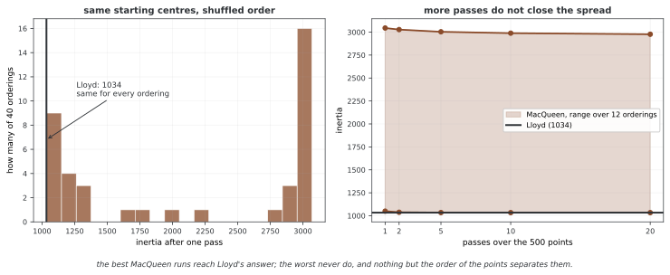

# K-평균 군집화

K-평균은 가장 널리 쓰이는 군집화 알고리즘으로, 각 점을 가장 가까운 중심에 배정하고 중심을 군집 평균으로 갱신하는 과정을 반복하여 데이터를 $k$개 그룹으로 나눈다. 고객 세분화부터 이미지 압축까지 폭넓게 응용되는 기초적인 비지도 학습 방법이다. 군집 개수를 정하는 법과 대규모 데이터셋으로 확장하는 법을 포함해 K-평균을 이해하는 것은 레이블이 없는 데이터를 다루는 모든 실무자에게 필수적이다.

## 1. 코드

```python
"""Kmeans."""
# ---
# title: "K-Means Clustering"
# description: "K-Means from basics to advanced usage with sklearn"
# ---
#
# K-평균은 가장 널리 쓰이는 군집화 알고리즘이다. 이 스크립트는 다음을 다룬다.
#   1. 합성 데이터에 대한 기본 K-평균
#   2. k를 고르기 위한 엘보 방법과 실루엣 분석
#   3. 이미지에 대한 K-평균(색상 양자화)
#   4. 대규모 데이터셋을 위한 미니배치 K-평균
#
# 출처 각색: O'Reilly Hands-On ML, 9장(비지도 학습)

import numpy as np
import matplotlib.pyplot as plt
from sklearn.cluster import KMeans, MiniBatchKMeans
from sklearn.datasets import make_blobs, load_digits
from sklearn.metrics import silhouette_score, silhouette_samples
from sklearn.preprocessing import StandardScaler

# ========================================================================
# 메인
# ========================================================================

# ─── 1.  기본 K-평균 ──────────────────────────────────────────────────────
np.random.seed(42)
X_blobs, y_blobs = make_blobs(
    n_samples=500, centers=5, cluster_std=[1.0, 0.7, 1.2, 0.9, 1.5], random_state=42
)

kmeans = KMeans(n_clusters=5, random_state=42, n_init=10)
y_pred = kmeans.fit_predict(X_blobs)

plt.figure(figsize=(8, 5))
plt.scatter(X_blobs[:, 0], X_blobs[:, 1], c=y_pred, cmap="tab10", s=15, alpha=0.7)
plt.scatter(
    kmeans.cluster_centers_[:, 0],
    kmeans.cluster_centers_[:, 1],
    marker="X", s=200, c="red", edgecolors="black", linewidth=1.5,
    label="centroids",
)
plt.title(f"K-Means (k=5)  inertia={kmeans.inertia_:.0f}")
plt.legend()
plt.grid(True, alpha=0.3)
plt.tight_layout()
plt.savefig("kmeans_basic.png", dpi=150)
plt.show()

# ─── 2.  엘보 방법 ────────────────────────────────────────────────────────
k_range = range(2, 12)
inertias = []
sil_scores = []

for k in k_range:
    km = KMeans(n_clusters=k, random_state=42, n_init=10)
    km.fit(X_blobs)
    inertias.append(km.inertia_)
    sil_scores.append(silhouette_score(X_blobs, km.labels_))

fig, (ax1, ax2) = plt.subplots(1, 2, figsize=(12, 4))
ax1.plot(list(k_range), inertias, "bo-")
ax1.set_xlabel("k")
ax1.set_ylabel("Inertia")
ax1.set_title("Elbow Method")
ax1.grid(True, alpha=0.3)

ax2.plot(list(k_range), sil_scores, "ro-")
ax2.set_xlabel("k")
ax2.set_ylabel("Silhouette Score")
ax2.set_title("Silhouette Analysis")
ax2.grid(True, alpha=0.3)

plt.tight_layout()
plt.savefig("kmeans_elbow_silhouette.png", dpi=150)
plt.show()

print(f"Best k by silhouette: {list(k_range)[np.argmax(sil_scores)]}")

# ─── 3.  실루엣 다이어그램 ────────────────────────────────────────────────
def plot_silhouette(X, labels, k, ax):
    """실루엣 다이어그램을 그린다."""
    sil_vals = silhouette_samples(X, labels)
    y_lower = 10
    for i in range(k):
        cluster_sil = np.sort(sil_vals[labels == i])
        y_upper = y_lower + len(cluster_sil)
        ax.fill_betweenx(np.arange(y_lower, y_upper), 0, cluster_sil, alpha=0.7)
        ax.text(-0.05, y_lower + 0.5 * len(cluster_sil), str(i))
        y_lower = y_upper + 10
    ax.axvline(x=silhouette_score(X, labels), color="red", linestyle="--")
    ax.set_xlabel("Silhouette coefficient")
    ax.set_title(f"k = {k}")

fig, axes = plt.subplots(1, 3, figsize=(15, 4))
for ax, k in zip(axes, [3, 5, 7]):
    km = KMeans(n_clusters=k, random_state=42, n_init=10).fit(X_blobs)
    plot_silhouette(X_blobs, km.labels_, k, ax)
plt.suptitle("Silhouette Diagrams", fontsize=14, y=1.02)
plt.tight_layout()
plt.savefig("kmeans_silhouette_diagrams.png", dpi=150, bbox_inches="tight")
plt.show()

# ─── 4.  미니배치 K-평균 ──────────────────────────────────────────────────
import time

X_large, _ = make_blobs(n_samples=50000, centers=10, random_state=42)

t0 = time.time()
km_full = KMeans(n_clusters=10, random_state=42, n_init=10).fit(X_large)
t_full = time.time() - t0

t0 = time.time()
km_mini = MiniBatchKMeans(n_clusters=10, random_state=42, batch_size=1024).fit(X_large)
t_mini = time.time() - t0

print(f"\nFull K-Means:       {t_full:.2f}s  inertia={km_full.inertia_:.0f}")
print(f"Mini-Batch K-Means: {t_mini:.2f}s  inertia={km_mini.inertia_:.0f}")
print(f"Speed-up:           {t_full / t_mini:.1f}x")
print("Done.")


if __name__ == "__main__":
    pass
```

**출력:**

```
Best k by silhouette: 4

Full K-Means:       2.75s  inertia=89266
Mini-Batch K-Means: 0.19s  inertia=94686
Speed-up:           14.7x
Done.
```

## 2. 논의

K-평균은 두 단계를 번갈아 수행하며 동작한다. 각 데이터 점을 가장 가까운 중심에 배정하는 단계(배정 단계)와, 각 중심을 배정된 점들의 평균으로 다시 계산하는 단계(갱신 단계)이다. 이 과정은 수렴이 보장되지만 전역 최적이 아닌 국소 최적을 찾을 수 있다. 그래서 `n_init`으로 서로 다른 무작위 초기화를 여러 번 시도하여 가장 좋은 결과를 취한다.

<div class="storybox" markdown>

**그림으로 보는 AI 1.** 이름을 지은 사람과 알고리즘을 지은 사람이 다르다

방금 적은 두 단계 — 모두 배정하고, 그 다음 모두 갱신하는 — 를 만든 사람은 1957년 벨 연구소의 스튜어트 로이드(Stuart Lloyd)다. 그가 풀던 것은 군집화가 아니라 **펄스 부호 변조(PCM)의 양자화**였다. 아날로그 신호를 몇 개의 대표값으로 끊어 디지털로 옮길 때 그 대표값을 어디에 둘 것인가. 연구소 안에서는 오래 쓰였지만 글은 묵혀 있다가 **25년 뒤인 1982년에야** 실렸다.

그래서 "k-평균"이라는 이름은 로이드가 지은 것이 아니다. 1967년에 제임스 맥퀸(James MacQueen)이 버클리 심포지엄 논문에서 붙였다. **그런데 맥퀸의 알고리즘은 위의 두 단계가 아니다.** 그의 것은 점을 하나씩 보면서 그때그때 그 중심 하나만 곧바로 고치는 온라인 방식이다. 이름은 맥퀸에게서, 알고리즘은 로이드에게서 왔다.

둘이 정말 다른가. 같은 초기 중심을 주고 **점의 순서만 섞어서** 이 쪽의 자료로 재면 이렇다.



**로이드 방식은 순서를 전혀 타지 않는다.** 어떻게 섞어도 관성은 1033.63이다. 모두 배정한 뒤에 모두 갱신하므로 점을 보는 차례가 결과에 들어갈 자리가 없다.

**맥퀸 방식은 순서만으로 답이 갈린다.** 마흔 번 섞어 보면 16번은 로이드와 비슷한 1036 근처에 닿고, 20번은 3000 근처에 주저앉는다. 가장 좋은 것과 가장 나쁜 것이 **2.96배** 차이인데, 초기 중심은 모두 같았고 다른 것은 점의 차례뿐이다. 더 훑어도 이 폭은 닫히지 않는다.

**다만 이것이 맥퀸 방식이 못한 방법이라는 뜻은 아니다.** 그것은 자료를 한 번 흘려보내며 푸는 방법으로 설계되었고, 여기서 비교 상대인 로이드 쪽은 수렴할 때까지 돌리고 `n_init=10`으로 열 번 다시 시작한 결과다. 공정한 겨룸이 아니다. 요지는 우열이 아니라, **위 문단이 말한 "국소 최적"에 들어가는 경로가 둘 이상**이라는 데 있다. `n_init`은 초기값 때문에 생긴 국소 최적만 막아 준다. 이 쪽 뒤에 나오는 미니배치 K-평균은 다시 부분집합으로 중심을 고치는 쪽이라, 공교롭게도 이름을 준 그 방식에 더 가깝다.

_확인한 곳 — S. P. Lloyd, "Least squares quantization in PCM", *IEEE Transactions on Information Theory* **28**(2), 129–137 (1982); 1957년 벨 연구소 내부 문서로 쓰였다. J. MacQueen, "Some methods for classification and analysis of multivariate observations", *Proc. 5th Berkeley Symposium on Mathematical Statistics and Probability* **1**, 281–297 (1967) 에서 k-means 라는 이름이 붙었고, 그 알고리즘은 중심을 점마다 갱신하는 온라인 방식이다. 그림의 수는 그림을 그리는 코드가 이 쪽과 같은 씨앗의 자료로 직접 재어 얻는다._

</div>

적절한 군집 개수 $k$를 고르는 것이 K-평균의 주요 과제 중 하나이다. **엘보 방법** 은 관성(군집 내 제곱합)을 $k$에 대해 그려서, 군집을 늘렸을 때 목적함수 감소가 둔화되는 지점을 찾는다. 꺾임이 뚜렷하지 않거나 여러 후보가 나올 수도 있다. **실루엣 점수**는 군집의 응집도와 분리도를 함께 보는 지표로, 각 점이 자기 군집에 얼마나 유사한지를 가장 가까운 이웃 군집과 비교하여 측정하며 값의 범위는 $-1$부터 $1$까지이고 클수록 좋다.

대규모 데이터셋에서는 **미니배치 K-평균** 이 실용적인 대안이 된다. 전체 데이터셋 대신 작은 무작위 부분집합으로 중심을 갱신한다. 계산 시간이 극적으로 줄면서도 표준 K-평균에 거의 필적하는 결과를 낸다. 대가는 관성이 약간 증가하는 것이지만, 수만 개 이상의 점을 가진 데이터셋에서는 속도 향상이 몇 자릿수에 이를 수 있다.

## 연습문제

<div class="drillbox" markdown>

**연습문제 1.** <span class="diff med" title="중간"></span>
위 코드의 blob 데이터셋을 사용하여 $k = 3, 5, 7, 10$으로 K-평균을 실행하고 각각의 실루엣 점수를 계산하라. 실루엣 점수를 $k$의 함수로 그려 이 후보들 가운데 실루엣 점수가 가장 높은 군집 개수를 찾아라. 이것이 데이터 생성 시의 군집 수와 일치하는지도 확인하라.

</div>

??? success "풀이"
    ```python
    import numpy as np
    from sklearn.cluster import KMeans
    from sklearn.datasets import make_blobs
    from sklearn.metrics import silhouette_score
    import matplotlib.pyplot as plt

    np.random.seed(42)
    X, _ = make_blobs(n_samples=500, centers=5, cluster_std=[1.0, 0.7, 1.2, 0.9, 1.5], random_state=42)

    k_values = [3, 5, 7, 10]
    scores = []
    for k in k_values:
        km = KMeans(n_clusters=k, random_state=42, n_init=10).fit(X)
        s = silhouette_score(X, km.labels_)
        scores.append(s)
        print(f"k={k}: silhouette={s:.4f}")

    plt.plot(k_values, scores, "bo-")
    plt.xlabel("k")
    plt.ylabel("Silhouette Score")
    plt.title("Silhouette Score vs k")
    plt.grid(True, alpha=0.3)
    plt.show()
    ```

    실제로 돌리면 이렇게 나온다.

    ```
    k=3: silhouette=0.6971
    k=5: silhouette=0.6843
    k=7: silhouette=0.5615
    k=10: silhouette=0.4223
    ```

    **참 군집 수가 5인데 k=3이 가장 높다.** 본문의 전체 훑기(k=2\~11)에서도 꼭대기는 k=4였다.

    까닭은 데이터를 만들 때 준 `cluster_std=[1.0, 0.7, 1.2, 0.9, 1.5]`에 있다. 스프레드가 클래스마다 두 배 넘게 다르므로, 넓게 퍼진 두 덩이가 서로 겹쳐 하나처럼 보인다. 실루엣은 **보이는 대로** 재므로 겹친 둘을 하나로 묶는 쪽에 높은 점수를 준다.

    곧 **실루엣이 참 군집 수를 되찾아 준다는 보장은 없다.** [비지도학습](../paradigms/unsupervised.md)의 정리 3이 목적함수로는 $k$를 고를 수 없다고 했고, 실루엣은 그 문제를 푼 것이 아니라 **다른 자로 바꾼 것**이다. 자를 바꾸면 단조성은 없어지지만 정답이 보장되지는 않는다.

---

<div class="drillbox" markdown>

**연습문제 2.** <span class="diff med" title="중간"></span>
K-평균이 구형(볼록) 군집을 만드는 경향이 있는 이유를 설명하라. 이 알고리즘은 어떤 조건에서 실패하며, 대신 어떤 군집화 방법을 쓸 수 있는가?

</div>

??? success "풀이"
    K-평균은 유클리드 거리를 이용해 각 점을 가장 가까운 중심에 배정하므로 보로노이 분할, 즉 피처 공간의 볼록한 보로노이 영역을 만든다. 이는 군집이 대략 구형(등방적)이고 크기가 비슷하다고 암묵적으로 가정하는 계산이다. 군집이 볼록하지 않거나(예: 초승달 모양, 고리 모양), 밀도가 크게 다르거나, 크기 차이가 크면 실패한다. 대안으로는 임의 모양 군집을 위한 DBSCAN, 부드러운 배정을 하는 타원형 군집을 위한 가우시안 혼합 모델, 그래프 구조로 포착 가능한 복잡한 군집 기하를 위한 스펙트럴 군집화가 있다.

---

<div class="drillbox" markdown>

**연습문제 3.** <span class="diff med" title="중간"></span>
미니배치 K-평균 실험을 수정하여 배치 크기 128, 512, 1024, 4096을 시험하라. 각 배치 크기에 대해 실행 시간, 최종 관성, 실루엣 점수를 기록하라. 속도와 품질 사이의 절충을 그려라.

</div>

??? success "풀이"
    ```python
    import time
    import numpy as np
    from sklearn.cluster import KMeans, MiniBatchKMeans
    from sklearn.datasets import make_blobs
    from sklearn.metrics import silhouette_score

    X_large, _ = make_blobs(n_samples=50000, centers=10, random_state=42)

    batch_sizes = [128, 512, 1024, 4096]
    results = []

    # 전체 K-평균 기준선
    t0 = time.time()
    km_full = KMeans(n_clusters=10, random_state=42, n_init=10).fit(X_large)
    t_full = time.time() - t0
    sil_full = silhouette_score(X_large, km_full.labels_)
    print(f"Full KMeans: time={t_full:.2f}s, inertia={km_full.inertia_:.0f}, sil={sil_full:.4f}")

    for bs in batch_sizes:
        t0 = time.time()
        km = MiniBatchKMeans(n_clusters=10, random_state=42, batch_size=bs).fit(X_large)
        elapsed = time.time() - t0
        sil = silhouette_score(X_large, km.labels_)
        results.append((bs, elapsed, km.inertia_, sil))
        print(f"batch_size={bs}: time={elapsed:.2f}s, inertia={km.inertia_:.0f}, sil={sil:.4f}")
    ```

    실제로 돌리면 이렇게 나온다. 시간은 기계마다 다르다.

    ```
    Full KMeans: time=0.65s, inertia=89266, sil=0.5230
    batch_size=128: time=0.02s, inertia=89316, sil=0.5235
    batch_size=512: time=0.01s, inertia=101703, sil=0.5288
    batch_size=1024: time=0.03s, inertia=94686, sil=0.5501
    batch_size=4096: time=0.28s, inertia=101756, sil=0.5286
    ```

    **빠르기는 뚜렷하다.** 미니배치가 전체 K-평균보다 스무 배에서 예순 배까지 빠르고, 배치가 커질수록 한 번 도는 비용이 늘어 그 이득이 줄어든다.

    **그러나 "배치가 클수록 품질이 좋아진다"는 이 표에 없다.** 오히려 가장 작은 128이 관성 89,316으로 전체(89,266)에 가장 가깝고, 가장 큰 4,096이 101,756으로 가장 멀다. 시드를 다섯 개로 바꾸어 다시 재면 까닭이 보인다.

    | 배치 | 관성 평균 | 범위 | 스프레드 |
    |---|---|---|---|
    | 전체 K-평균 | 89,246 | 89,230~89,301 | **71** |
    | 128 | 96,446 | 89,990~115,728 | 25,738 |
    | 512 | 97,148 | 90,196~116,010 | 25,814 |
    | 1,024 | 97,969 | 93,196~102,281 | 9,085 |
    | 4,096 | 100,068 | 89,952~105,177 | 15,225 |

    배치 크기 사이의 차이(96,446 대 100,068, 곧 3,622)가 **시드 하나를 바꾸었을 때의 흔들림(9,085~25,814)보다 훨씬 작다.** 이 책이 [4.1절](../../ch04/01_two_ladders.md)에서 세운 규칙대로, **스프레드보다 작은 차이는 차이가 아니다.** 위의 한 줄짜리 표로 배치 크기의 순위를 매겨서는 안 된다.

    정직하게 읽으면 이렇다. 미니배치는 **빠르기를 확실히 벌고 관성을 조금 잃되, 그 손해가 실행마다 크게 흔들린다.** 전체 K-평균은 `n_init=10`이 국소 최적을 걸러 주어 스프레드가 71로 거의 흔들리지 않는 반면, 미니배치는 표본으로 중심을 옮기므로 그 안정성을 내준다. 품질이 중요하면 `n_init`을 올리거나 미니배치 결과를 전체 K-평균의 초기값으로 쓴다.

## 정리하며

**다룬 것** — K-평균과 군집 수 고르기

K-평균은 두 단계를 번갈아 밟는다. 점을 가장 가까운 중심에 **배정**하고, 중심을 그 점들의 **평균**으로 옮긴다. 두 단계 모두 목적함수를 늘리지 않으므로 반드시 멈추지만([비지도학습](../paradigms/unsupervised.md)의 정리 1), 멈추는 자리는 국소 최적일 뿐이다. `n_init`으로 첫 중심을 여러 번 다르게 잡는 것이 사실상 필수인 까닭이다.

**$k$를 고르는 일이 이 알고리즘의 가장 어려운 부분**이며, 이 절이 남기는 교훈도 거기에 있다. 최적 관성은 $k$가 커질 때 증가하지 않으므로 단순히 최소화해서 $k$를 정할 수 없고, 실루엣은 단조롭지 않아 쓸 수 있다. 다만 연습문제 1이 보이듯 **실루엣이 참값을 되찾아 준다는 보장은 없다.** 클래스마다 스프레드가 다르면 겹친 둘을 하나로 세는 쪽이 더 높은 점수를 받는다.

미니배치 K-평균은 중심을 데이터 전체가 아니라 작은 부분집합으로 갱신한다. 위 예제에서 **14.7배 빨라지고 관성은 6% 나빠졌다**. 이 결과는 해당 데이터와 설정에서의 속도–품질 균형을 보여 준다. 다른 데이터에서도 같은 개선 폭을 얻는지는 따로 확인해야 한다.

구형이 아닌 군집에는 맞지 않는다. 유클리드 거리로 가장 가까운 중심을 고르는 일이 보로노이 분할, 곧 볼록한 영역을 만들기 때문이다. 초승달이나 고리 모양에는 [DBSCAN](02_dbscan_agglomerative.md)을, 타원과 부드러운 배정에는 [가우시안 혼합](03_gmm.md)을 쓴다.

앞의 연습문제 3개로 직접 확인할 수 있다.
