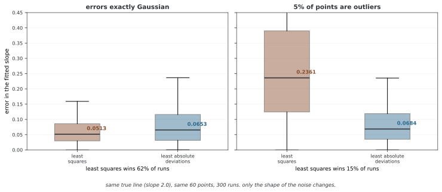

# 선형 모델

선형 모델은 지도 학습의 기초이자 뉴럴 넷트웍의 기본 구성 요소이다. 완전 연결 레이어는 입력의 선형 변환을 수행하며, 여러 레이어 사이에 비선형 엑티베이션 함수를 넣어 표현력을 높이므로, 선형 회귀와 로지스틱 회귀를 이해하는 것은 딥러닝을 이해하기 위한 선결 조건이다.

---

## 1. 정의

선형 모델은 출력을 입력 피처의 선형 결합으로 예측한다.

$$
\hat{y} = \mathbf{x}^\top \boldsymbol{\beta} + \beta_0
$$

회귀에서는 출력이 연속값이다. 분류에서는 이 선형 결합이 시그모이드(이진)나 소프트맥스(다중 클래스)를 거쳐 확률이 된다. 절편을 포함하려면 $\mathbf{X}$에 상수 열을 추가한다. $\mathbf{X}$의 열들이 선형 독립이면 최소제곱 추정값은 다음과 같다. 이 조건이 없으면 역행렬 대신 의사역행렬이나 정칙화 등을 사용한다.

$$
\hat{\boldsymbol{\beta}} = (\mathbf{X}^\top \mathbf{X})^{-1} \mathbf{X}^\top \mathbf{y}
$$

<div class="storybox" markdown>

**그림으로 보는 AI 1.** 이 식을 두고 수학사에서 가장 유명한 다툼이 있었다

이 식을 처음 인쇄물로 내놓은 사람은 아드리앵마리 르장드르(Adrien-Marie Legendre)다. 1805년 책이고, 제목이 《혜성의 궤도를 정하는 새로운 방법》이다. **통계 책이 아니라 천문 책이다.** 최소제곱은 자료를 설명하려고 만든 것이 아니라 관측이 어긋나는 가운데 혜성이 어디로 갈지를 정하려고 만든 것이었다.

네 해 뒤 카를 프리드리히 가우스(Carl Friedrich Gauss)가 《천체 운행론》을 내면서 르장드르의 글을 언급하고는, **자기는 1795년부터 이 방법을 써 왔다**고 적었다. 출판된 증거는 없었다. 르장드르는 1809년 5월 31일 편지에서 우선권은 출판으로 정해진다고 맞섰고, 1820년에는 1805년 책의 보유편에 가우스의 주장을 공개적으로 반박하는 글을 붙였다.

다툼의 내용보다 중요한 것은 가우스가 덧붙인 **까닭**이다. 그는 최소제곱이 왜 옳은 답인지를 설명하려고, 오차가 어떤 분포를 따라야 산술평균이 가장 그럴듯한 값이 되는지를 물었고 그 답으로 **정규분포**를 끌어냈다. 널리 지적되어 온 대로 이 논증은 돌고 돈다 — 정규분포가 산술평균을 가정해서 나오는데, 산술평균이 좋다는 것은 정규분포에서 따라 나오는 결론이기 때문이다. 가우스 자신도 뒷날 이 설명을 버리고 다른 근거를 댔다.

그 가정이 실제로 무엇을 사 주는지 재 보면 이렇다.



기울기가 2.0인 줄을 알고 있는 문제에서, 오차가 정말 정규분포이면 최소제곱이 최소절대편차보다 낫다(0.0513 대 0.0653). **그런데 점 예순 개 가운데 세 개만 이상치로 바꾸면 최소제곱의 오차가 0.2361로 네 배 넘게 뛴다.** 같은 조건에서 최소절대편차는 0.0684로 거의 움직이지 않는다. 이기던 비율도 62%에서 15%로 뒤집힌다.

**그러니 위의 닫힌 식은 "가장 좋은 추정"이 아니라 "이런 오차를 가정했을 때 가장 좋은 추정"이다.** 가정이 식 안에 보이지 않는다는 것이 이 식의 편리함이자 위험이다. 아래 2절의 정칙화도 같은 성격의 선택이다 — 릿지와 라쏘는 계수에 대한 가정을 하나씩 더 얹는 것이지, 가정 없이 더 좋아지는 장치가 아니다.

_확인한 곳 — A.-M. Legendre, *Nouvelles méthodes pour la détermination des orbites des comètes* (1805) 가 최소제곱의 첫 출판이다. C. F. Gauss, *Theoria motus corporum coelestium* (1809) 에서 1795년부터 썼다고 적었고, 르장드르는 1809년 5월 31일 편지와 1820년 보유편에서 이에 맞섰다. 가우스의 1809년 논증이 순환적이라는 지적과 그가 뒷날 이 근거를 버렸다는 점은 통계사 문헌에서 널리 다루어진다. 그림의 수는 그림을 그리는 코드가 직접 재어 얻는다._

</div>

---

## 2. 설명

선형 회귀는 예측이라는 일 전체의 뼈대를 가장 적은 부품으로 보여 준다.

$$
\text{데이터} \longrightarrow \text{모델} \longrightarrow \text{예측}
$$

한 변수짜리로 적으면 흩어진 점들 사이를 지나는 직선 하나를 찾는 일이다.

$$
y = \alpha x + \beta
$$

!!! note "통계와 기계학습의 차이"
    이 뼈대는 통계학에서도 똑같다. 데이터를 받아 모델을 세우고 예측한다는 순서가 같으므로, 통계학과 기계학습은 여러 모델과 추정 방법을 공유한다. 통계학에서는 추론과 불확실성에, 기계학습에서는 예측 성능과 계산에 초점을 두는 경우가 많지만, 이는 두 분야를 나누는 절대적인 경계가 아니다. 선형 회귀는 공통된 개념을 이해하기 좋은 출발점이다.

**정칙화(regularization)** 는 큰 웨이트에 패널티를 부과하여 과적합을 막는다.

- **릿지(L2)**: $\|\mathbf{y} - \mathbf{X}\boldsymbol{\beta}\|^2 + \alpha \|\boldsymbol{\beta}\|^2$을 최소화한다. 모든 계수를 0 쪽으로 줄이지만 정확히 0으로 만들지는 않는다. 피처들이 상관되어 있을 때 사용한다.
- **라쏘(L1)**: $\|\mathbf{y} - \mathbf{X}\boldsymbol{\beta}\|^2 + \alpha \|\boldsymbol{\beta}\|_1$을 최소화한다. 일부 계수를 정확히 0으로 만들어 피처 선택을 수행한다.
- **엘라스틱넷**: L1과 L2 패널티를 결합한다. 피처들이 상관되어 있으면서 희소성도 원할 때 사용한다.

**딥러닝과의 연결**: PyTorch의 `nn.Linear` 레이어 하나가 바로 이 모델을 구현한다. 일반적인 SGD에서는 L2 패널티의 계수를 맞추면 `weight_decay`와 같은 갱신을 얻는다. 분리된 웨이트 감쇠를 사용하는 AdamW에서는 두 방식이 다르다. L1 정칙화는 로스에 직접 더해 주어야 한다.

---

## 3. 예제

```python
import torch
import torch.nn as nn
import numpy as np

# ── 1. 참 모델을 정해 두고 그 모델에서 데이터를 만든다 ────────────────
# 참값을 알고 있어야 두 방법이 얼마나 잘 복원하는지 견줄 수 있다.
np.random.seed(42)          # 씨앗을 고정해 실행할 때마다 같은 결과가 나오게 한다
n, d = 200, 5               # 표본 200개, 특성 5개

X_np = np.random.randn(n, d)                    # 설계 행렬: 표준정규에서 뽑는다
true_w = np.array([3.0, -1.5, 0.0, 0.0, 2.0])   # 참 계수. 3번째와 4번째는 0이므로
                                                # 그 두 특성은 y와 아무 관계가 없다
y_np = X_np @ true_w + 0.5 * np.random.randn(n) # y = Xw + 잡음(표준편차 0.5)

# ── 2. 방법 A: 정규방정식으로 한 번에 푼다 ──────────────────────────
# 최소제곱해는 닫힌 형태로 존재하므로 반복이 필요 없다.
# lstsq는 (X^T X)^{-1} X^T y 를 수치적으로 안정하게 푼 것이다.
beta_hat = np.linalg.lstsq(X_np, y_np, rcond=None)[0]
print(f"True weights:     {true_w}")
print(f"Estimated weights:{np.round(beta_hat, 2)}")

# ── 3. 방법 B: 같은 문제를 경사 하강법으로 푼다 ─────────────────────
# 닫힌 형태가 있는데도 굳이 이렇게 푸는 까닭은, 이 절차가 뉴럴 넷트웍으로
# 그대로 이어지기 때문이다. 모델만 바꾸면 나머지 뼈대는 똑같다.
X_t = torch.tensor(X_np, dtype=torch.float32)
y_t = torch.tensor(y_np, dtype=torch.float32)

# bias=False: 데이터를 절편 없이 만들었으므로 바이어스 항을 두지 않는다
model = nn.Linear(d, 1, bias=False)

# weight_decay가 곧 L2(릿지) 정칙화이다. 로스에 alpha*||w||^2 를 더하는 것과 같다
optimizer = torch.optim.SGD(model.parameters(), lr=0.01, weight_decay=0.01)
loss_fn = nn.MSELoss()

for epoch in range(500):
    pred = model(X_t).squeeze()   # 순전파: 예측을 만든다
    loss = loss_fn(pred, y_t)     # 예측이 얼마나 틀렸는지 잰다

    optimizer.zero_grad()         # 지난 스텝의 그래디언트를 지운다(안 지우면 누적된다)
    loss.backward()               # 역전파: 로스를 웨이트로 미분한다
    optimizer.step()              # 그래디언트 반대 방향으로 웨이트를 한 스텝 옮긴다

# ── 4. 두 방법의 결과를 견준다 ──────────────────────────────────────
# 정칙화 때문에 경사 하강법 쪽 계수가 0에 아주 조금 더 가깝게 나온다.
learned = model.weight.detach().numpy().flatten()
print(f"PyTorch weights:  {np.round(learned, 2)}")
print(f"Final MSE loss:   {loss.item():.4f}")
```

**출력:**

```
True weights:     [ 3.  -1.5  0.   0.   2. ]
Estimated weights:[ 2.97 -1.47  0.01  0.03  2.03]
PyTorch weights:  [ 2.96 -1.46  0.01  0.03  2.01]
Final MSE loss:   0.2655
```

---

## 연습문제

<div class="drillbox" markdown>

**연습문제 1.** <span class="diff hard" title="어려움"></span>
MSE 로스 $\ell(\boldsymbol{\beta}) = \|\mathbf{y} - \mathbf{X}\boldsymbol{\beta}\|^2$의 경사를 0으로 두어 정규방정식 $\hat{\boldsymbol{\beta}} = (\mathbf{X}^\top \mathbf{X})^{-1}\mathbf{X}^\top \mathbf{y}$을 유도하라.

</div>

??? success "풀이"
    전개하면 $\ell = (\mathbf{y} - \mathbf{X}\boldsymbol{\beta})^\top(\mathbf{y} - \mathbf{X}\boldsymbol{\beta}) = \mathbf{y}^\top\mathbf{y} - 2\boldsymbol{\beta}^\top\mathbf{X}^\top\mathbf{y} + \boldsymbol{\beta}^\top\mathbf{X}^\top\mathbf{X}\boldsymbol{\beta}$이다. 경사를 구하면 $\nabla_{\boldsymbol{\beta}}\ell = -2\mathbf{X}^\top\mathbf{y} + 2\mathbf{X}^\top\mathbf{X}\boldsymbol{\beta}$이다. 0으로 두면 $\mathbf{X}^\top\mathbf{X}\boldsymbol{\beta} = \mathbf{X}^\top\mathbf{y}$이다. $\mathbf{X}^\top\mathbf{X}$가 가역이면 $\hat{\boldsymbol{\beta}} = (\mathbf{X}^\top\mathbf{X})^{-1}\mathbf{X}^\top\mathbf{y}$이다. $\square$

---

<div class="drillbox" markdown>

**연습문제 2.** <span class="diff med" title="중간"></span>
릿지 회귀의 기하학적 해석을 설명하라. $\alpha \to 0$일 때와 $\alpha \to \infty$일 때 해는 어떻게 되는가?

</div>

??? success "풀이"
    릿지 회귀는 $\|\mathbf{y} - \mathbf{X}\boldsymbol{\beta}\|^2 + \alpha\|\boldsymbol{\beta}\|^2$을 최소화한다. 닫힌 형태 해는 $\hat{\boldsymbol{\beta}}_{\text{ridge}} = (\mathbf{X}^\top\mathbf{X} + \alpha\mathbf{I})^{-1}\mathbf{X}^\top\mathbf{y}$이다. 기하학적으로 릿지는 $\boldsymbol{\beta}$가 $\ell_2$ 공 안에 있도록 제약한다. $\alpha \to 0$이면 릿지는 OLS(정칙화 없음)로 수렴한다. $\alpha \to \infty$이면 패널티가 지배하여 $\hat{\boldsymbol{\beta}} \to \mathbf{0}$이 되고 절편을 정칙화하지 않고 따로 추정하면 모델은 $\mathbf{y}$의 평균을 예측한다. 절편까지 함께 정칙화하면 이 결론은 달라질 수 있다. $\alpha\mathbf{I}$를 더하면 $\mathbf{X}^\top\mathbf{X}$가 특이행렬이어도 가역성이 보장된다.

---

<div class="drillbox" markdown>

**연습문제 3.** <span class="diff hard" title="어려움"></span>
선형 회귀에서 L2 정칙화가 SGD의 `weight_decay`와 동등함을 보여라. 구체적으로 감쇠 계수 $\lambda$인 웨이트 감쇠의 경사 갱신이 $\alpha = \lambda$인 L2 정칙화 로스의 경사와 일치함을 보여라.

</div>

??? success "풀이"
    L2 정칙화 로스는 $\ell_{\text{reg}} = \ell(\boldsymbol{\beta}) + \frac{\alpha}{2}\|\boldsymbol{\beta}\|^2$이다. 그 경사는 $\nabla \ell_{\text{reg}} = \nabla \ell + \alpha \boldsymbol{\beta}$이다. SGD 갱신은 $\boldsymbol{\beta} \leftarrow \boldsymbol{\beta} - \eta(\nabla \ell + \alpha \boldsymbol{\beta}) = (1 - \eta\alpha)\boldsymbol{\beta} - \eta \nabla \ell$이다. 계수 $\lambda$인 웨이트 감쇠는 $\boldsymbol{\beta} \leftarrow (1 - \eta\lambda)\boldsymbol{\beta} - \eta \nabla \ell$을 준다. $\alpha = \lambda$일 때 둘은 동일하다. 참고: 이 동등성은 SGD에서는 정확히 성립하지만 Adam에서는 그렇지 않다. Adam에서는 분리된 웨이트 감쇠(AdamW)가 L2 정칙화와 다르다. $\square$

---

<div class="drillbox" markdown>

**연습문제 4.** <span class="diff med" title="중간"></span>
어떤 데이터셋에 표본이 $n = 50$개, 피처가 $d = 100$개 있다. 정규방정식이 실패하는 이유를 설명하고 해결책 세 가지를 제안하라.

</div>

??? success "풀이"
    정규방정식은 $(100 \times 100)$ 행렬인 $\mathbf{X}^\top\mathbf{X}$의 역행렬을 필요로 한다. 표본이 $n = 50$개뿐이므로 $\text{rank}(\mathbf{X}) \leq 50 < 100$이고 따라서 $\mathbf{X}^\top\mathbf{X}$는 특이행렬(비가역)이다. 해결책: (1) **릿지 회귀**: $\alpha\mathbf{I}$를 더하면 임의의 $\alpha > 0$에 대해 $(\mathbf{X}^\top\mathbf{X} + \alpha\mathbf{I})$가 가역이 된다. (2) **의사역행렬**: SVD로 최소 노름 최소제곱해를 구한다. (3) **PCA/피처 선택**: 학습 데이터로 차원을 줄인 뒤 적합한다. 차원을 줄였더라도 남은 열들이 선형 독립인지 확인해야 한다.

---

<div class="drillbox" markdown>

**연습문제 5.** <span class="diff med" title="중간"></span>
바이어스를 포함한 `nn.Linear(784, 10)`의 파라메터 개수를 계산하라. 이를 `nn.Linear(784, 128)` 다음에 `nn.Linear(128, 10)`이 오는 2레이어 뉴럴 넷트웍과 비교하라.

</div>

??? success "풀이"
    단일 레이어: 웨이트 $784 \times 10 = 7{,}840$개, 바이어스 $10$개. 총 $7{,}850$개. 2레이어: 첫 레이어 $784 \times 128 + 128 = 100{,}480$개, 둘째 레이어 $128 \times 10 + 10 = 1{,}290$개. 총 $101{,}770$개. 2레이어 뉴럴 넷트웍은 파라메터가 $\approx 13\times$ 많지만 (레이어 사이에 ReLU를 두면) 비선형 결정 경계를 학습할 수 있는 반면, 단일 레이어는 선형 경계로 제한된다. 대부분의 실제 문제에서는 이 추가 용량이 파라메터 비용을 치를 만한 밸류가 있다.

## 정리하며

**다룬 것** — 선형 모델과 정칙화

선형 모델은 출력을 입력의 선형 결합으로 예측한다. 최소제곱해는 정규방정식으로 **한 번에** 구할 수 있으며, 해석적 해는 추정의 원리를 이해하는 데 유용하다. 실제 계산에서는 역행렬을 직접 구하기보다 수치적으로 안정적인 선형대수 알고리즘을 사용한다. 뒤에 나오는 거의 모든 모델은 경사 하강법으로 더듬어 가야 한다.

그런데도 이 절이 같은 문제를 경사 하강법으로 한 번 더 푸는 까닭이 있다. **그 절차가 뉴럴 넷트웍으로 그대로 이어지기 때문**이다. 순전파로 예측하고, 로스를 재고, 역전파로 그래디언트를 구하고, 한 스텝 옮긴다. 모델만 바꾸면 이 뼈대는 그대로다.

정칙화는 큰 웨이트에 패널티를 걸어 과적합을 막는다. L2(릿지)는 계수를 0 쪽으로 줄이되 0으로 만들지 않고, L1(라쏘)은 일부를 정확히 0으로 만들어 피처를 고른다. **L2 패널티와 SGD의 `weight_decay`는 계수 정의를 맞추면 같은 갱신을 준다**이며(연습문제 3), 다만 Adam에서는 그 동등성이 깨져 AdamW가 따로 있다.

`nn.Linear` 레이어 하나가 곧 이 모델이다. [3장](../../ch03/index.md)의 스텝2가 이것을 MNIST에 걸어 92%를 얻고, 나머지 두 스텝이 그 위에 비선형성과 이웃 관계를 얹는다.

앞의 연습문제 5개로 직접 확인할 수 있다.
