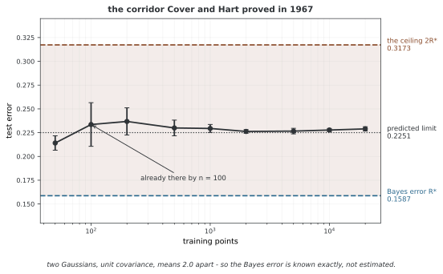

# K-최근접 이웃

K-최근접 이웃(KNN)은 가장 가까운 학습 예제들을 기반으로 예측하는 비모수 방법이다. 중요한 기준선 역할을 하며, 딥러닝에서 더 정교한 모델이 필요한 이유가 되는 편향-분산 절충을 잘 보여준다.

---

## 1. 정의

질의점 $\mathbf{x}$에 대해 KNN은 선택한 거리 척도 아래에서 가장 가까운 학습 점 $k$개의 집합 $\mathcal{N}_k(\mathbf{x})$를 찾는다. 분류에서는 다수결로 예측한다.

$$
\hat{y} = \arg\max_{c} \sum_{i \in \mathcal{N}_k(\mathbf{x})} \mathbf{1}[y_i = c]
$$

회귀에서는 이웃 목표값의 (가중) 평균으로 예측한다.

$$
\hat{y} = \frac{\sum_{i \in \mathcal{N}_k(\mathbf{x})} w_i \, y_i}{\sum_{i \in \mathcal{N}_k(\mathbf{x})} w_i}
$$

---

## 2. 설명

KNN은 웨이트를 반복적으로 최적화하지 않고 학습 데이터를 저장한다. 구현에 따라 탐색용 인덱스를 구축하는 준비 단계는 필요하며, 예측할 때 이웃을 찾는다. 그래서 **게으른 학습기(lazy learner)** 라고 부른다. 주요 고려사항은 다음과 같다.

- **피처 스케일 조정이 필수**: 거리 척도는 피처의 크기에 민감하다. 단위와 스케일이 다른 피처에는 표준화 등을 검토한다. 이미 의미 있는 거리나 적절한 스케일을 사용한다면 추가 표준화가 필요하지 않을 수 있다.
- **$k$ 선택**: $k$가 작으면 바이어스는 낮지만 분산이 크다(잡음에 민감). $k$가 크면 바이어스는 크지만 분산이 작다(경계가 지나치게 매끄러워짐). 교차 검증으로 $k$를 고른다.
- **차원의 저주**: 고차원에서는 점들 사이의 거리가 거의 균일해져 최근접 이웃 질의가 정보를 주지 못한다. 이는 뉴럴 넷트웍으로 저차원 표현을 학습해야 하는 핵심 동기이다.
- **계산 비용**: 완전 탐색은 질의당 $O(nd)$가 든다. 트리 구조(KD 트리, Ball 트리)는 저차원에서 이를 $O(d \log n)$으로 줄이지만 고차원에서는 성능이 떨어진다.

<div class="storybox" markdown>

**그림으로 보는 AI 1.** 가장 가까운 이웃 하나에 절반이 들어 있다

이 방법은 학회지가 아니라 **군 기술 보고서**에서 나왔다. 1951년 2월, 텍사스 랜돌프 필드의 미 공군 항공의학교에서 에벌린 픽스(Evelyn Fix)와 조지프 호지스(Joseph Hodges)가 쓴 「Discriminatory analysis, nonparametric discrimination」이다. 과제 번호 21-49-004, 계약 번호 AF41(128)-31까지 붙은 내부 문서였고 정식으로 실리지 않았다.

열여섯 해 뒤 토머스 커버(Thomas Cover)와 피터 하트(Peter Hart)가 이 규칙이 **얼마나 좋은지**를 증명했다. 베이즈 오차를 $R^*$라 할 때, 표본이 무한히 많아지면 최근접 이웃 하나만 보는 규칙의 오차 $R$이 이 사이에 갇힌다.

$$
R^* \;\le\; R \;\le\; 2R^*
$$

논문의 문장이 이 결과를 잘 요약한다 — "the probability of error of the nearest neighbor rule is bounded above by twice the Bayes probability of error. In this sense, it may be said that **half the classification information in an infinite sample set is contained in the nearest neighbor**."

베이즈 오차를 정확히 아는 문제를 만들어 재면 이렇다.



이론이 맞는다. 측정한 1-NN 오차는 $2R^*=0.3173$ 아래에 머물고, 예측된 점근값 0.2251에 가 앉는다. 그리고 눈에 띄는 것이 하나 더 있다 — **점 100개에서 이미 거기에 닿는다.** 점을 200배로 늘려도 더 나아지지 않는다. 이웃 하나가 가진 정보는 일찍 다 쓰이고, 남은 절반은 아무리 자료를 모아도 $k$를 키우거나 다른 방법으로 가져와야 한다.

**다만 이 복도는 표본이 무한할 때의 이야기이고, 무엇보다 이웃이 정말 가까울 때의 이야기다.** 증명은 표본이 쌓이면 최근접 이웃이 질의점으로 수렴한다는 데 기댄다. 위에 적은 **차원의 저주** 항이 무너뜨리는 것이 바로 그 전제다. 거리가 고르게 비슷해지면 "가장 가까운" 점이 가깝지 않고, 그러면 $2R^*$라는 약속도 함께 사라진다. 이 그림이 2차원에서 그려졌다는 사실이 그림의 일부다.

_확인한 곳 — E. Fix, J. L. Hodges, Jr., "Discriminatory analysis, nonparametric discrimination", USAF School of Aviation Medicine, Randolph Field, Tex., Project 21-49-004, Rept. 4, Contract AF41(128)-31, February 1951 — 서지 사항은 아래 커버·하트 논문의 참고문헌에서 옮겼다. T. M. Cover, P. E. Hart, "Nearest Neighbor Pattern Classification", *IEEE Transactions on Information Theory* **13**(1), 21–27 (1967); 인용한 문장은 서론이다. 그림의 수는 그림을 그리는 코드가 직접 재어 얻는다._

</div>

---

## 3. 예제

```python
import torch
import numpy as np
from sklearn.neighbors import KNeighborsClassifier
from sklearn.datasets import make_classification
from sklearn.model_selection import train_test_split, cross_val_score
from sklearn.preprocessing import StandardScaler

# ── 1. 데이터를 만들고 나눈 뒤 자를 맞춘다 ──────────────────────────
# 특성 10개 가운데 5개만 실제로 쓸모가 있다. 나머지는 잡음이며,
# k-최근접 이웃이 쓸모없는 차원에 얼마나 약한지 보기 좋은 설정이다
X, y = make_classification(n_samples=500, n_features=10, n_informative=5,
                           n_classes=3, random_state=42)
X_train, X_test, y_train, y_test = train_test_split(X, y, test_size=0.2, random_state=42)

# 표준화가 특히 중요하다. 거리로만 판단하는 모델이므로 자가 큰 특성
# 하나가 거리 전체를 좌우해 버린다
scaler = StandardScaler()
X_train_s = scaler.fit_transform(X_train)   # 훈련 자료로만 평균과 표준편차를 잰다
X_test_s = scaler.transform(X_test)         # 시험 자료에는 그 값을 적용만 한다
                                            # (전체로 fit하면 시험 정보가 새어 든다)

# ── 2. 교차 검증으로 k를 고른다 ─────────────────────────────────────
# k는 학습으로 정해지지 않는 초파라메터이므로 따로 골라야 한다.
# 시험 자료를 쓰면 안 되므로 훈련 자료를 5겹으로 나누어 고른다
best_k, best_score = 1, 0.0
for k in range(1, 21):
    score = cross_val_score(KNeighborsClassifier(n_neighbors=k),
                            X_train_s, y_train, cv=5).mean()
    if score > best_score:
        best_k, best_score = k, score
print(f"Best k={best_k}, CV accuracy={best_score:.4f}")

# weights="distance": 가까운 이웃에 더 큰 표를 준다.
# 기본값인 "uniform"은 k개 이웃을 모두 똑같이 셈한다
knn = KNeighborsClassifier(n_neighbors=best_k, weights="distance")
knn.fit(X_train_s, y_train)   # "학습"이라 하지만 사실 훈련 자료를 저장할 뿐이다
print(f"Test accuracy: {knn.score(X_test_s, y_test):.4f}")

# ── 3. 같은 일을 PyTorch로 직접 해 본다 ─────────────────────────────
# 학습된 임베딩 위에서 이웃을 찾을 때 쓰는 방식이다. 얼굴 인식이나
# 검색처럼 뉴럴 넷트웍이 뽑은 벡터를 견주는 자리에서 그대로 쓰인다
X_tr = torch.tensor(X_train_s, dtype=torch.float32)
X_te = torch.tensor(X_test_s, dtype=torch.float32)
y_tr = torch.tensor(y_train)

# cdist는 두 배치 사이의 모든 쌍별 거리를 한 번에 셈한다.
# 결과 모양은 (질의 5개) x (훈련 표본 400개)
dists = torch.cdist(X_te[:5], X_tr)

# largest=False 이므로 가장 "작은" k개, 곧 가장 가까운 이웃을 고른다
_, idx = dists.topk(best_k, largest=False)

# 고른 이웃의 인덱스로 레이블을 가져온다. 실제 예측은 이 레이블들의
# 다수결(또는 거리 가중 다수결)이 된다
neighbor_labels = y_tr[idx]
print(f"Neighbor labels for first 5 queries:\n{neighbor_labels}")
```

**출력:**

```
Best k=7, CV accuracy=0.7950
Test accuracy: 0.8200
Neighbor labels for first 5 queries:
tensor([[2, 2, 2, 2, 0, 2, 2],
        [2, 2, 2, 1, 2, 2, 2],
        [0, 2, 0, 2, 0, 2, 0],
        [0, 0, 1, 1, 0, 1, 2],
        [1, 2, 1, 1, 1, 2, 1]])
```

---

## 연습문제

<div class="drillbox" markdown>

**연습문제 1.** <span class="diff med" title="중간"></span>
$k = 3$인 최근접 이웃의 레이블이 $\{1, 0, 1\}$인 질의점 $\mathbf{x}$에 대해 KNN은 무엇을 예측하는가? 거리가 $\{0.5, 0.3, 0.8\}$일 때 거리 가중 투표를 사용하면 어떻게 되는가?

</div>

??? success "풀이"
    **다수결**: 클래스 1이 2표, 클래스 0이 1표이다. 예측: 클래스 1. **거리 가중**: 웨이트는 거리에 반비례한다. $w_i = 1/d_i$. 클래스 1: $1/0.5 + 1/0.8 = 2.0 + 1.25 = 3.25$. 클래스 0: $1/0.3 = 3.33$. 예측: 클래스 0. 가장 가까운 이웃(거리 0.3)이 클래스 0에 속하고 불균형하게 큰 웨이트를 받기 때문에 거리 가중이 예측을 바꾸었다.

---

<div class="drillbox" markdown>

**연습문제 2.** <span class="diff hard" title="어려움"></span>
완전 탐색 KNN의 질의당 시간 복잡도가 $O(nd)$임을 증명하라. 여기서 $n$은 학습 점의 개수, $d$는 차원이다. $d$가 클 때 KD 트리가 도움이 되지 않는 이유는 무엇인가?

</div>

??? success "풀이"
    질의마다 $n$개의 학습 점 모두에 대한 거리를 계산한다. $\mathbb{R}^d$에서 거리 계산 하나당 $O(d)$번의 연산이 든다($d$개의 제곱 차이의 합). 총 $O(nd)$이다. KD 트리는 좌표축을 따라 공간을 분할하고 탐색 중 가지를 쳐내어 저차원에서 $O(d \log n)$을 달성한다. 그러나 $d$가 크면 트리가 효과적으로 가지를 쳐낼 수 없다. 축에 평행한 어떤 분할 안에서 "가장 가까운" 점이 다른 차원에서는 멀 수 있어 대부분의 가지를 탐색해야 하기 때문이다. 경험적으로 KD 트리는 $d \gtrsim 20$이면 완전 탐색 수준으로 성능이 떨어진다.

---

<div class="drillbox" markdown>

**연습문제 3.** <span class="diff med" title="중간"></span>
KNN에는 피처 스케일 조정이 필수인데 결정 트리에는 그렇지 않은 이유를 설명하라. 스케일이 조정되지 않은 피처가 잘못된 KNN 예측을 낳는 구체적인 예를 들라.

</div>

??? success "풀이"
    KNN은 피처의 크기에 민감한 거리 척도(예: 유클리드)에 의존한다. 피처 1의 범위가 $[0, 1000]$이고 피처 2가 $[0, 1]$이면 거리는 피처 1에 지배되어 피처 2가 사실상 무시된다. 결정 트리는 각 피처를 독립적으로 분할하므로 피처의 스케일이 분할 임계값 선택에 영향을 주지 않는다. 예: 나이(0–100)와 혈압(60–200)으로 환자를 분류하는 경우. 스케일을 조정하지 않으면 혈압의 수치 범위가 더 넓으면 같은 상대적 변화가 나이보다 거리에 더 크게 기여할 수 있는데, 나이가 더 예측력이 높을 수도 있다.

---

<div class="drillbox" markdown>

**연습문제 4.** <span class="diff med" title="중간"></span>
차원의 저주는 고차원에서 최근접 이웃까지의 거리와 최원접 이웃까지의 거리의 비가 1에 가까워진다는 것이다. 이것이 KNN에 주는 함의를 설명하고, 딥러닝이 이를 어떻게 다루는지 설명하라.

</div>

??? success "풀이"
    거리가 거의 균일해지면 "가장 가깝다"는 개념이 의미를 잃는다. $k$개의 최근접 이웃이 무작위 점보다 거의 가깝지 않게 된다. 이웃 구분이 어려워져 KNN의 예측 성능이 떨어질 수 있다. 모든 고차원 데이터에서 예측이 무작위 수준이 되는 것은 아니다. 형식적으로, $[0,1]^d$에 균등 분포한 점들에 대해 $\lim_{d \to \infty} \frac{d_{\min}}{d_{\max}} = 1$이다. 딥러닝은 의미 있는 거리가 보존되는 저차원 임베딩 $\phi(\mathbf{x}) \in \mathbb{R}^{d'}$($d' \ll d$)을 학습하여 이 문제를 다룬다. 학습된 임베딩(예: 뉴럴 넷트웍의 마지막 직전 레이어 출력) 위에서의 KNN이 잘 동작하는 이유는, 임베딩 공간이 의미적으로 유사한 점들을 가깝게 배치하도록 구조화되어 있기 때문이다.

---

<div class="drillbox" markdown>

**연습문제 5.** <span class="diff hard" title="어려움"></span>
학습 점 $n$개, 피처 $d$개, 이웃 $k$개인 KNN의 저장 공간과 예측 시간 복잡도를 유도하라. 이를 파라메터가 $P$개이고 추론 비용이 고정된 뉴럴 넷트웍과 비교하라.

</div>

??? success "풀이"
    **KNN**: 저장 공간은 $O(nd)$(모든 학습 점). 질의당 예측: 완전 탐색 거리 계산에 $O(nd)$, 상위 $k$개를 찾는 부분 정렬에 $O(n \log k)$. 이 선택 방식을 사용하면 총 비용은 $O(nd+n\log k)$이다. $k$를 고정하면 $O(nd)$로 쓸 수 있다. 부분 선택 알고리즘을 쓰면 이웃 선택 비용을 줄일 수 있다. **뉴럴 넷트웍**: 저장 공간은 $O(P)$(파라메터만, 학습 데이터는 필요 없음). 예측: $O(P)$(레이어마다 행렬 곱 한 번). $P$는 고정이고 큰 데이터셋에서는 보통 $P \ll nd$이므로 뉴럴 넷트웍이 추론에서 훨씬 효율적이다. 대가는 뉴럴 넷트웍이 비싼 학습을 요구하는 반면 KNN은 반복적인 파라메터 최적화가 필요하지 않다는 점이다. 데이터 저장과 인덱스 구축 비용까지 0인 것은 아니다.

## 정리하며

**다룬 것** — 가장 가까운 것을 보고 답하기

KNN에는 **학습 단계가 없다.** 데이터를 통째로 들고 있다가 물음이 올 때 거리를 잰다. 그래서 모델 적합의 계산은 비교적 적지만 완전 탐색의 추론 비용은 $O(nd)$로, 다른 모델들과 정확히 반대의 셈법을 갖는다.

거리로만 판단하므로 **거리 척도와 피처 스케일을 확인해야 한다**. 자가 큰 특성 하나가 거리를 독차지하기 때문이며, 임계값으로 자를 뿐인 [결정 트리](trees.md)와 갈리는 자리가 여기다.

$k$가 곧 매끄러움의 손잡이다. 작으면 잡음까지 따라가고(바이어스 낮음·분산 큼) 크면 경계가 뭉개진다(바이어스 큼·분산 작음). [지도학습](../paradigms/supervised.md)의 정리 3이 말한 트레이드오프가 손잡이 하나로 드러나는 드문 보기다.

**가장 중요한 한계는 차원의 저주다.** 차원이 높아지면 가장 가까운 점과 가장 먼 점의 거리 비가 1로 다가가 "가깝다"는 말이 뜻을 잃는다. 딥러닝이 이것을 푸는 방식은 차원을 줄이는 것이 아니라 **거리가 뜻을 갖는 공간을 배우는 것**이며, 그 공간 위에서는 KNN이 다시 잘 듣는다.

그래서 이 방법은 낡은 것이 아니라 **자리가 옮겨간 것**이다. 얼굴 인식과 검색은 뉴럴 넷트웍이 뽑은 벡터 위에서 최근접 이웃을 찾는 일이고, [3장 스텝1](../../ch03/mnist/01_template_learning.md)의 템플릿 학습도 클래스마다 평균 하나만 두는 KNN의 사촌이다.

앞의 연습문제 5개로 직접 확인할 수 있다.
