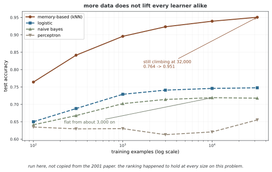

# 데이터 탐색과 분석

고전적 통계는 물음을 먼저 세우고 그 물음에 답하도록 데이터 수집을 **설계**한다. 딥러닝이 자란 토양은 그 반대다. 거래 로그, 센서 측정값, 웹 클릭, 사진과 글이 업무의 부산물로 이미 쌓여 있고, 우리는 *"이것으로 무엇을 배울 수 있는가"* 를 묻는다. 이 마당은 그 접근이 무엇을 얻고 무엇을 잃는지를 밝히고, 뒤이어 다룰 세 가지 학습 패러다임의 자리를 잡는다.

## 1. 두 가지 접근

**정의 1.** [설계된 데이터와 관측된 데이터]

연구자가 처치 $T$ 의 배정을 통제하여 얻은 데이터를 **설계된 데이터**, 배정이 통제되지 않은 채 기록만 된 데이터를 **관측된 데이터**라 한다. 무작위 배정이란 처치가 잠재적 결과와 독립임을 뜻한다.

$$
T \perp\!\!\!\perp \bigl(Y(0),\, Y(1)\bigr)
$$

여기서 $Y(t)$ 는 처치가 $t$ 였을 때의 잠재적 결과이다.

<div class="thmbox" markdown>

### 정리 1. 무작위 배정과 평균 처치 효과 { .thm }

두 처치군의 확률이 모두 양수이고, 관측 결과가 실제로 받은 처치의 잠재적 결과와 일치한다고 하자. 이때 $T \perp\!\!\!\perp (Y(0), Y(1))$이면 모집단의 두 조건부 평균 차이는 평균 처치 효과와 같다. 유한 표본의 평균 차이는 이 효과를 추정하며 표본 오차를 갖는다.

$$
\mathbb{E}[Y \mid T=1] - \mathbb{E}[Y \mid T=0] = \mathbb{E}[Y(1) - Y(0)]
$$

무작위 배정이 없으면 이 등식은 일반적으로 성립하지 않는다.

</div>

??? proof "증명"

    관측되는 결과는 $Y = T\,Y(1) + (1-T)\,Y(0)$ 이므로 $T=1$ 로 조건을 걸면 $Y = Y(1)$ 이다. 따라서

    $$
    \mathbb{E}[Y \mid T=1] = \mathbb{E}[Y(1) \mid T=1] = \mathbb{E}[Y(1)]
    $$

    이며, 마지막 등식에서 독립성을 썼다. 같은 방식으로 $\mathbb{E}[Y\mid T=0] = \mathbb{E}[Y(0)]$ 이다. 두 식을 빼면 결론을 얻는다.

    독립성이 없으면 $\mathbb{E}[Y(1)\mid T=1] \neq \mathbb{E}[Y(1)]$ 일 수 있고, 그 차이가 곧 교란이다.

!!! note "쓰임새"
    기존 기록으로 학습한 예측 모델은, 별도의 인과 가정이나 연구 설계 없이는 **"이 특성을 바꾸면 결과가 어떻게 되는가"** 에는 답하지 못한다. 모델의 성능이 아무리 좋아도 이 한계는 성능으로 메워지지 않는다.

**보기 1.** <span class="diff easy" title="쉬움"></span> 어떤 병원 기록에서 특정 약을 먹은 환자의 사망률이 더 높게 나왔다. 이 약이 해롭다고 결론지을 수 있는가?

??? success "풀이"

    없다. 의사가 **더 위중한 환자에게** 그 약을 처방했다면 위중도가 처치와 결과를 함께 밀어 올린 교란요인이다. 곧 $T \not\perp\!\!\!\perp (Y(0), Y(1))$ 이므로 정리 1이 쓰이지 않는다.

    관측된 연관은 참이지만 그 해석이 인과가 아니다. 무작위 시험을 설계하거나, 충분한 교란요인 측정과 식별 가정 아래에서 인과 효과를 추정해야 한다. 위중도 하나를 보정했다고 모든 교란이 제거되는 것은 아니다.

## 2. 데이터가 알고리즘보다 앞선다

이미 수집된 데이터를 분석할 때도 먼저 목적과 데이터 수집 과정을 확인해야 한다. 다음 표는 **실험을 설계하여 데이터를 얻는 접근**과 **기존 기록에서 문제를 찾는 접근**의 차이를 단순화한 것이다. 통계학과 딥러닝 모두 두 접근을 사용할 수 있다.

| 비교 | 고전적 접근 | 현대적 접근 |
|------|------------|------------|
| 출발점 | 물음과 연구 설계 | 이미 쌓인 데이터 |
| 표본 크기 | 검정력 계산으로 정함 | 있는 만큼 |
| 모델 | 해석 가능한 소수 파라메터 | 파라메터가 아주 많음 |
| 목표 | 인과 추론, 불확실성 정량화 | 예측 성능 |
| 데이터 종류 | 정형 표 데이터 | 이미지·글·소리·영상까지 |

<div class="storybox" markdown>

**그림으로 보는 AI 1.** 이 절의 제목을 수로 처음 보인 실험

"데이터가 알고리즘보다 앞선다"는 이 절의 제목은 구호로 떠돈 지 오래지만, 그것을 **수로 처음 보여 준** 자리는 꼽을 수 있다. 2001년 마이크로소프트 연구소의 미셸 방코(Michele Banko)와 에릭 브릴(Eric Brill)이 ACL 학회에 낸 「아주아주 큰 말뭉치로 자연어 중의성 해소를 키워 보기」다.

고른 문제는 소박하다. `{principle, principal}`, `{then, than}`, `{to, two, too}` 처럼 **헷갈리는 낱말 묶음**에서 맞는 쪽을 고르는 일이다. 두 사람은 학습기 넷을 **10억 단어** 말뭉치로 학습시켰다. 그때까지 이 문제에 쓰인 가장 큰 말뭉치보다 **천 배** 큰 자료였다.

결과를 논문의 말로 옮기면 이렇다. 곡선들이 "10억 단어까지 가도 로그-선형으로 보이며(log-linear even out to one billion words)", **"이 분야가 흔히 쓰는 말뭉치 크기에서는 시험한 어느 학습기도 성능이 평평해지는 근처에도 가 있지 않다."** 그래서 두 사람은 "알고리즘 개발에 시간과 돈을 쓰는 것과 말뭉치 개발에 쓰는 것 사이의 득실을 다시 따져 볼 만하다"고 적었다.

같은 물음을 여기서 직접 돌려 보면 이렇다. 논문의 그림을 베껴 오지 않고 새로 잰 것이다.



**자료를 늘리는 것이 모두에게 같은 선물이 아니다.** 최근접 이웃은 표본 100개의 0.764에서 3만 2천 개의 0.951까지 올라가고 끝에서도 아직 오르는 중이다. 반면 나이브 베이즈는 3천 개 근처에서 0.72에 주저앉아 자료를 열 배 더 줘도 움직이지 않는다. 둘의 간격이 100개일 때 0.12에서 3만 2천 개일 때 0.23으로 **두 배 가까이 벌어진다.** 덧붙이자면 이 문제에서는 학습기 순위가 크기마다 그대로였다 — 바뀌는 경우도 있지만 여기서는 아니었고, 본 대로 적는다.

**그러니 이 절의 제목은 조건부로 읽어야 한다.** 논문 스스로가 두 가지 단서를 달아 두었다. 첫째, 그들이 고른 문제는 **레이블이 공짜**였다 — 잘 교정된 글에서는 맞는 낱말이 이미 적혀 있으므로 정답이 저절로 붙는다. 논문은 "이 응용에서 올바르게 레이블된 학습 자료가 공짜라는 점에서 우리는 운이 좋다. 흔히 그렇지 않을 것이므로" 하고 곧바로 비용 이야기로 넘어간다. 둘째, 자료를 늘리면 **학습된 표현의 크기도 함께 커진다**(논문 그림 2). 위 표의 "있는 만큼"이라는 칸은 그래서 공짜라는 뜻이 아니라, **비용이 표본 크기 계산에서 레이블 값과 저장 공간으로 옮겨 갔다**는 뜻이다.

_확인한 곳 — M. Banko, E. Brill, "Scaling to Very Very Large Corpora for Natural Language Disambiguation", *Proc. 39th Annual Meeting of the ACL* (2001), 26–33. 인용한 문장들과 10억 단어·천 배·공짜 레이블·표현 크기 증가는 모두 논문 본문에서 옮겼다. 그림의 수는 그림을 그리는 코드가 여기서 직접 재어 얻은 것이고 논문의 곡선이 아니다._

</div>

<div class="thmbox" markdown>

### 정리 2. 표본 평균의 표준오차 { .thm }

분산이 $\sigma^2$ 로 유한한 분포에서 크기 $n$ 인 i.i.d. 표본을 얻어 평균으로 어림하면 그 표준오차는

$$
\operatorname{sd}(\bar X_n) = \frac{\sigma}{\sqrt n}
$$

이다. 곧 오차를 절반으로 줄이려면 데이터를 **네 배** 모아야 한다.

</div>

??? proof "증명"

    독립이므로 분산이 더해진다.

    $$
    \operatorname{Var}(\bar X_n) = \operatorname{Var}\!\left(\frac1n\sum_{i=1}^n X_i\right)
    = \frac{1}{n^2}\sum_{i=1}^n \operatorname{Var}(X_i) = \frac{\sigma^2}{n}
    $$

    제곱근을 취하면 $\sigma/\sqrt n$ 이다. 오차를 $1/2$ 로 만들려면 $\sqrt n$ 을 두 배로, 곧 $n$ 을 네 배로 키워야 한다.

!!! note "쓰임새"
    데이터를 더 모으는 것은 값싸게 정확도를 사는 길이지만 **수확 체감**이 있다. 데이터를 $100$ 배로 늘려도 오차는 $10$ 분의 $1$ 이 될 뿐이다. 다만 이 정리는 표본 평균의 표준오차에 관한 것이며, 딥러닝의 모든 예측 오차가 같은 비율로 줄어든다는 뜻은 아니다.

**문제 1.** <span class="diff med" title="중간"></span> 관측된 데이터가 수백만 개 있으면 설계된 실험 수백 개보다 인과 추론에 유리한가? 정리 1과 정리 2를 함께 써서 답하시오.

??? success "풀이"

    유리하지 않다. 정리 2가 말하는 것은 **어림값의 흔들림**이 $n$ 이 커질수록 줄어든다는 것뿐이다. 교란이 있으면 어림하는 대상 자체가 인과 효과가 아니므로, $n\to\infty$ 에서도 틀린 값으로 정확히 수렴한다.

    곧 데이터가 많으면 **분산**은 줄지만 **바이어스**는 그대로다. 무작위 배정이 없으면 정리 1의 등식이 성립하지 않으니 표본을 아무리 키워도 그 간극은 메워지지 않는다. 표본이 작은 무작위 시험 하나가 거대한 관측 데이터보다 인과에 관해서는 더 많은 것을 말해 준다.

## 3. 세 가지 학습 패러다임

관측된 데이터에서 무엇을 배울지는 **어떤 신호가 함께 오는가**로 갈린다.

**정의 2.** [세 패러다임]

- **지도학습** — 짝지어진 입력과 출력 $(\mathbf{x}_i, y_i)$ 이 주어지고, 사상 $\mathbf{x}\mapsto y$ 를 배운다.
- **비지도학습** — 입력 $\mathbf{x}_i$ 만 주어지고, 데이터 안의 구조를 찾는다.
- **강화학습** — 환경과 주고받으며 리워드 $r_t$ 만을 길잡이 삼아 순차적 결정을 배운다.

| 패러다임 | 주어지는 신호 | 신호의 밀도 | 로스를 관측할 수 있는가 |
|---------|-------------|-----------|------------------|
| 지도학습 | 참값 레이블 | 표본마다 | 그렇다 |
| 비지도학습 | 외부 레이블 없음 | — | 재구성 등 목적함수는 계산 가능 |
| 강화학습 | 스칼라 리워드 | 즉시 또는 지연 | 관측한 리워드로 추정 |

세 패러다임은 「[지도학습](supervised.md)」, 「[비지도학습](unsupervised.md)」, 「[강화학습](reinforcement.md)」에서 하나씩 다룬다.

**보기 2.** <span class="diff easy" title="쉬움"></span> 다음을 세 패러다임으로 가르시오. (a) 손글씨 사진에서 숫자 맞히기 (b) 고객을 구매 성향으로 묶기 (c) 바둑 두는 프로그램 만들기

??? success "풀이"

    (a) 지도학습이다. 사진마다 정답 숫자가 붙어 있다.

    (b) 비지도학습이다. 미리 정한 집단이 없고 데이터 안의 구조를 찾는다.

    (c) 강화학습이다. 한 수 한 수에 정답이 없고 대국이 끝난 뒤의 승패만이 신호다.

## 4. 무엇을 잃는가

현대적 접근의 강점은 규모·유연함·속도이고, 약점은 대체로 그 강점의 뒷면이다.

| 강점 | 그 뒷면인 약점 |
|------|--------------|
| 데이터가 저절로 쌓인다 | 어떻게 쌓였는지 통제하지 못한다(샘플링 바이어스) |
| 모델이 매우 유연하다 | 잡음까지 적합한다(과적합) |
| 파라메터가 아주 많다 | 왜 그렇게 예측하는지 설명하기 어렵다 |
| 관측된 데이터로 곧장 배운다 | 인과를 말할 수 없다 |

<div class="thmbox" markdown>

### 정리 3. 학습 오차의 낙관성 — 기대값에서의 비교 { .thm }

가설 공간 $\mathcal{F}$ 위에서 경험위험 $\hat R_n$ 을 최소화하여 $\hat f$ 를 골랐다고 하자. 그러면

$$
\mathbb{E}\bigl[\hat R_n(\hat f)\bigr] \;\leq\; \mathbb{E}\bigl[R(\hat f)\bigr]
$$

이다. 특히 $\mathcal{F}$ 의 원소가 하나뿐이면 등호가 성립한다.

</div>

??? proof "증명"

    임의로 고정된 $f \in \mathcal{F}$ 에 대해 $\mathbb{E}[\hat R_n(f)] = R(f)$ 이다. 경험위험이 참위험의 불편추정값이기 때문이다.

    한편 $\hat f$ 는 $\hat R_n$ 을 최소화하도록 골랐으므로 모든 $f$ 에 대해 $\hat R_n(\hat f) \leq \hat R_n(f)$ 이다. 기댓값을 취하면

    $$
    \mathbb{E}[\hat R_n(\hat f)] \leq \mathbb{E}[\hat R_n(f)] = R(f)
    $$

    이고, 이것이 모든 $f\in\mathcal{F}$ 에 대해 성립하므로 오른쪽을 최소화하여

    $$
    \mathbb{E}[\hat R_n(\hat f)] \leq \inf_{f\in\mathcal{F}} R(f) \leq \mathbb{E}[R(\hat f)]
    $$

    를 얻는다. $\mathcal{F}$ 가 한 원소뿐이면 고를 여지가 없어 첫 부등식이 등식이 된다.

    거꾸로는 말할 수 없다. 이를테면 $\mathcal{F}$ 의 원소들이 모두 같은 위험을 갖는다면 원소가 여럿이어도 등호가 될 수 있다. 여기서 필요한 것은 **등호가 언제 깨지는가**가 아니라 부등호의 방향 자체이므로 그것으로 충분하다.

!!! note "쓰임새"
    이 낙관성은 $\mathcal{F}$ 가 커질수록 커진다. 그래서 **시험 집합을 떼어 두는 일**이 타협할 수 없는 절차가 된다. 시험 데이터는 $\hat f$ 를 고르는 데 쓰이지 않았으므로 그 위의 오차는 편향 없는 값이다.

**문제 2.** <span class="diff hard" title="어려움"></span> 시험 집합에서 여러 모델을 비교하여 가장 좋은 하나를 고른 뒤, 그 시험 오차를 최종 성능으로 알렸다. 정리 3에 비추어 무엇이 잘못되었는지 밝히시오.

??? success "풀이"

    시험 집합이 **모델을 고르는 데 쓰인 순간** 그것은 더 이상 시험 집합이 아니라 검증 집합이다. 정리 3의 논증에서 $\mathcal{F}$ 를 "견준 모델들의 모임"으로 놓으면 그대로 적용되어, 고른 모델의 시험 오차는 참위험을 과소평가한다.

    견준 모델이 많을수록 이 낙관성이 커진다. 올바른 절차는 훈련·검증·시험 셋으로 나누어 검증 집합으로 고르고, 모든 결정을 확정한 뒤 시험 집합을 **딱 한 번** 쓰는 것이다.

## 5. 세 정리를 수로 확인한다

이 마당의 정리 셋은 모두 "그래서 실제로 어떻게 되는가"를 물을 수 있는 것들이다. 특히 **문제 1**이 던진 물음 — 관측 데이터가 수백만 개면 실험 수백 개보다 나은가 — 은 돌려 보면 답이 눈에 보인다.

```python
"""'가진 자료를 분석하라'의 세 정리를 수로 확인한다.

    정리 1  무작위 배정이 있으면 평균 차이가 곧 인과 효과다
    정리 2  표준오차는 sigma/sqrt(n) — 오차를 반으로 줄이려면 자료가 네 배
    정리 3  자기 자료로 매긴 점수는 늘 후하다

특히 문제 1("관측 자료가 수백만 개면 실험 수백 개보다 나은가")의 답을
수로 보인다. 자료를 아무리 키워도 **바이어스는 줄지 않는다.**
"""

import numpy as np

rng = np.random.RandomState(0)


# ==========================================================================
# 정리 1 — 무작위 배정이 없으면 n을 키워도 틀린 값으로 수렴한다
# ==========================================================================
print("=" * 66)
print("정리 1  무작위 배정의 값어치 (보기 1의 약 이야기를 그대로 돌린다)")
print("=" * 66)

# 보기 1의 상황을 그대로 만든다.
#   위중도가 처치와 결과를 함께 민다 = 교란요인
#   의사는 위중한 환자에게 약을 준다
#   그런데 약은 사실 **이롭다** (사망 확률을 0.10 낮춘다)
TRUE_ATE = -0.10          # 약이 사망 확률을 10%포인트 낮춘다 (이롭다)


def make_patients(n, randomized, rng):
    """환자 n명을 만든다. randomized=True면 동전으로 약을 나눠 준다."""
    severe = rng.rand(n) < 0.5                      # 절반이 위중하다

    # 약을 주지 않았을 때의 사망 확률 — 위중하면 높다
    p0 = np.where(severe, 0.80, 0.20)
    p1 = p0 + TRUE_ATE                              # 약을 주면 0.10 낮아진다

    if randomized:
        T = rng.rand(n) < 0.5                       # 동전 던지기 — 위중도와 무관
    else:
        # 관측 자료: 의사가 위중한 환자에게 약을 몰아 준다
        T = rng.rand(n) < np.where(severe, 0.90, 0.10)

    # 실제로 관측되는 결과 하나만 남는다 (반사실은 볼 수 없다)
    died = rng.rand(n) < np.where(T, p1, p0)
    return T, died


print(f"  참 인과 효과 ATE = {TRUE_ATE:+.2f}  (음수 = 약이 이롭다)\n")
print(f"  {'n':>9} | {'관측 자료 추정':>14} | {'무작위 시험 추정':>16}")
print("  " + "-" * 46)

for n in (1_000, 10_000, 100_000, 1_000_000):
    T, d = make_patients(n, randomized=False, rng=rng)
    obs = d[T].mean() - d[~T].mean()                # 단순 평균 차이
    T, d = make_patients(n, randomized=True, rng=rng)
    rct = d[T].mean() - d[~T].mean()
    print(f"  {n:>9,} | {obs:>+14.4f} | {rct:>+16.4f}")

print(f"\n  관측 자료 쪽은 n을 천 배로 키워도 **양수**에 머문다.")
print(f"  곧 약이 해롭다고 말한다 — 참값은 {TRUE_ATE:+.2f}인데도.")
print("  무작위 시험 쪽은 n이 작아도 참값 언저리에 있고, 커질수록 붙는다.")
print("\n  이것이 문제 1의 답이다. 자료를 키우면 **분산**은 줄지만")
print("  **바이어스**는 그대로다. 틀린 값으로 더 정확히 수렴할 뿐이다.")


# ==========================================================================
# 정리 2 — 표준오차는 sigma/sqrt(n)
# ==========================================================================
print("\n" + "=" * 66)
print("정리 2  표준오차 = sigma/sqrt(n)")
print("=" * 66)

SIGMA = 3.0
N_REPEAT = 20000                       # 같은 실험을 2만 번 되풀이해 흩어짐을 잰다

print(f"  참 분포의 sigma = {SIGMA}\n")
print(f"  {'n':>6} | {'잰 표준오차':>11} | {'sigma/sqrt(n)':>13} | {'앞 줄 대비':>9}")
print("  " + "-" * 48)

prev = None
for n in (100, 400, 1600, 6400):
    # 크기 n인 표본을 2만 번 뽑아 평균을 내고, 그 평균들의 흩어짐을 잰다
    samples = SIGMA * rng.randn(N_REPEAT, n)      # (2만, n) — 평균 0, 표준편차 SIGMA
    means = samples.mean(1)                       # 실험마다의 표본평균
    measured = means.std(ddof=1)                  # 표본평균들이 얼마나 흩어지는가
    closed = SIGMA / np.sqrt(n)
    ratio = "" if prev is None else f"{measured/prev:>9.3f}"
    print(f"  {n:>6} | {measured:>11.4f} | {closed:>13.4f} | {ratio:>9}")
    prev = measured

print("\n  잰 값과 닫힌 꼴이 소수점 셋째 자리까지 맞는다.")
print("  그리고 n을 네 배로 할 때마다 오차가 0.5배가 된다 — 정리 2가 말한 대로다.")


# ==========================================================================
# 정리 3 — 자기 자료로 매긴 점수는 늘 후하다
# ==========================================================================
print("\n" + "=" * 66)
print("정리 3  훈련오차의 낙관성")
print("=" * 66)

# 신호가 **하나도 없는** 자료를 만든다. y는 x와 아무 관계가 없다.
# 그러므로 정직한 모형이라면 설명력이 0이어야 한다.
N, P = 100, 80


def r2(y, pred):
    return 1 - ((y - pred) ** 2).sum() / ((y - y.mean()) ** 2).sum()


Xtr, ytr = rng.randn(N, P), rng.randn(N)
Xte, yte = rng.randn(N, P), rng.randn(N)

# 최소제곱으로 맞춘다
w, *_ = np.linalg.lstsq(Xtr, ytr, rcond=None)
print(f"  자료: 표본 {N}개, 특성 {P}개, 그리고 **신호는 0**")
print(f"    학습 자료 R^2 = {r2(ytr, Xtr @ w):+.4f}   <- 아무 관계도 없는데 높다")
print(f"    시험 자료 R^2 = {r2(yte, Xte @ w):+.4f}   <- 참값인 0 언저리, 오히려 음수")

# --- 문제 2: 시험 집합에서 고른 뒤 그 점수를 알리면? ---
# 한 번만 해 보면 운에 휘둘린다. 고르는 절차 전체를 300번 되풀이해 평균낸다.
print("\n  문제 2: 모형 50개를 시험 집합에서 견주어 가장 좋은 것을 고르면?")

N_MODEL, N_TRIAL, K = 50, 300, 5
picked_val, picked_test = [], []

for _ in range(N_TRIAL):
    # 자료를 세 벌로 나눈다. 셋 다 신호가 없으므로 참 R^2는 모두 0이다.
    Xa, ya = rng.randn(N, P), rng.randn(N)     # 학습
    Xv, yv = rng.randn(N, P), rng.randn(N)     # 고르는 데 쓰는 집합
    Xt, yt = rng.randn(N, P), rng.randn(N)     # 아껴 둔 집합

    val, test = [], []
    for _m in range(N_MODEL):
        cols = rng.choice(P, K, replace=False)             # 특성 5개를 아무렇게나 고른다
        w, *_ = np.linalg.lstsq(Xa[:, cols], ya, rcond=None)
        val.append(r2(yv, Xv[:, cols] @ w))
        test.append(r2(yt, Xt[:, cols] @ w))

    b = int(np.argmax(val))                     # 고르는 집합에서 가장 좋은 것
    picked_val.append(val[b])
    picked_test.append(test[b])                 # 같은 모형을 아껴 둔 집합에서 다시 잰다

print(f"    (같은 절차를 {N_TRIAL}번 되풀이한 평균)")
print(f"    참값                          = {0.0:+.4f}   (신호가 없으므로)")
print(f"    고른 모형의 '고르는 집합' 점수 = {np.mean(picked_val):+.4f}   <- 골랐으니 후하다")
print(f"    같은 모형의 아껴 둔 집합 점수  = {np.mean(picked_test):+.4f}   <- 정직한 값")
print(f"    고르기가 부풀린 몫             = {np.mean(picked_val) - np.mean(picked_test):+.4f}")
print("\n  시험 집합으로 **고르는 순간** 그 집합도 학습 자료가 된다.")
print("  그래서 고른 뒤의 점수는 다시 후해지고, 정직한 값은 또 한 벌의 자료에서만 나온다.")
```

**출력:**

```
==================================================================
정리 1  무작위 배정의 값어치 (보기 1의 약 이야기를 그대로 돌린다)
==================================================================
  참 인과 효과 ATE = -0.10  (음수 = 약이 이롭다)

          n |       관측 자료 추정 |        무작위 시험 추정
  ----------------------------------------------
      1,000 |        +0.3624 |          -0.0908
     10,000 |        +0.3864 |          -0.1072
    100,000 |        +0.3828 |          -0.0992
  1,000,000 |        +0.3777 |          -0.1008

  관측 자료 쪽은 n을 천 배로 키워도 **양수**에 머문다.
  곧 약이 해롭다고 말한다 — 참값은 -0.10인데도.
  무작위 시험 쪽은 n이 작아도 참값 언저리에 있고, 커질수록 붙는다.

  이것이 문제 1의 답이다. 자료를 키우면 **분산**은 줄지만
  **바이어스**는 그대로다. 틀린 값으로 더 정확히 수렴할 뿐이다.

==================================================================
정리 2  표준오차 = sigma/sqrt(n)
==================================================================
  참 분포의 sigma = 3.0

       n |      잰 표준오차 | sigma/sqrt(n) |    앞 줄 대비
  ------------------------------------------------
     100 |      0.3013 |        0.3000 |          
     400 |      0.1512 |        0.1500 |     0.502
    1600 |      0.0745 |        0.0750 |     0.493
    6400 |      0.0376 |        0.0375 |     0.505

  잰 값과 닫힌 꼴이 소수점 셋째 자리까지 맞는다.
  그리고 n을 네 배로 할 때마다 오차가 0.5배가 된다 — 정리 2가 말한 대로다.

==================================================================
정리 3  훈련오차의 낙관성
==================================================================
  자료: 표본 100개, 특성 80개, 그리고 **신호는 0**
    학습 자료 R^2 = +0.8788   <- 아무 관계도 없는데 높다
    시험 자료 R^2 = -5.3654   <- 참값인 0 언저리, 오히려 음수

  문제 2: 모형 50개를 시험 집합에서 견주어 가장 좋은 것을 고르면?
    (같은 절차를 300번 되풀이한 평균)
    참값                          = +0.0000   (신호가 없으므로)
    고른 모형의 '고르는 집합' 점수 = +0.0288   <- 골랐으니 후하다
    같은 모형의 아껴 둔 집합 점수  = -0.0514   <- 정직한 값
    고르기가 부풀린 몫             = +0.0802

  시험 집합으로 **고르는 순간** 그 집합도 학습 자료가 된다.
  그래서 고른 뒤의 점수는 다시 후해지고, 정직한 값은 또 한 벌의 자료에서만 나온다.
```

**정리 1이 문제 1의 답을 그대로 보여 준다.** 관측 데이터의 추정값이 $n = 1{,}000$ 에서 $+0.3624$, $n = 1{,}000{,}000$ 에서 $+0.3777$ 이다. 데이터를 **천 배**로 키웠는데 값이 움직이지 않는다. 그리고 부호가 양수이니 **약이 해롭다**고 말하고 있다 — 참값은 $-0.10$ 으로 이로운데도.

손으로 셈해도 같은 값이 나온다. 처치군은 위중한 환자가 90%이므로

$$
\mathbb{E}[Y \mid T{=}1] = \frac{0.45 \times 0.7 + 0.05 \times 0.1}{0.5} = 0.64,
\qquad
\mathbb{E}[Y \mid T{=}0] = \frac{0.05 \times 0.8 + 0.45 \times 0.2}{0.5} = 0.26
$$

이고 그 차이가 $0.38$ 이다. 표의 $+0.3777$ 이 이 값에 붙어 가고 있다. **틀린 값으로 정확히 수렴하는 것**이다.

무작위 시험 쪽은 $n = 1{,}000$ 에서 이미 $-0.0908$ 로 참값 언저리에 있다. **데이터 1,000개짜리 실험이 데이터 100만 개짜리 관측을 이긴다.**

**정리 2**는 잰 값과 $\sigma/\sqrt{n}$ 이 소수점 셋째 자리까지 맞고, $n$ 을 네 배로 할 때마다 앞 줄 대비 0.5배가 된다.

**정리 3**은 신호가 **하나도 없는** 데이터로 보인다. 표본 100개에 특성 80개를 맞추면 학습 $R^2$ 이 $+0.8788$ 까지 오른다. 관계가 없는데도 거의 다 설명한 것처럼 보이는 것이다. 같은 모델의 시험 $R^2$ 은 $-5.3654$ 다.

!!! warning "문제 2 — 고르는 데 쓴 집합은 이미 학습 데이터다"
    표의 마지막 토막이 문제 2의 답이다. 모델 50개 가운데 시험 집합에서 가장 좋은 것을 고르면 그 점수가 $+0.0288$ 로 참값 $0$ 보다 높다. 같은 모델을 **아껴 둔 세 번째 집합**에서 다시 재면 $-0.0514$ 다.

    **고르기만 했는데 0.08만큼 부풀었다.** 300번 되풀이한 평균이니 이 다섯 시드에서 개선이 일관되었다.

    그러므로 "시험 집합에서 가장 좋은 모델을 골라 그 시험 점수를 알린다"는 것은 정리 3이 말하는 낙관성을 한 번 더 겪는 일이다. 고르는 데 쓴 집합은 그 순간부터 학습 데이터이며, 정직한 값은 또 한 벌의 데이터에서만 나온다.

## 연습문제

<div class="drillbox" markdown>

**연습문제 1.** <span class="diff easy" title="쉬움"></span> 설계된 데이터와 관측된 데이터의 차이를 정리 1로 설명하시오.

</div>

??? success "풀이"

    무작위 배정 실험에서는 처치가 잠재적 결과와 독립으로 배정되어 $T \perp\!\!\!\perp (Y(0),Y(1))$ 이 성립하고, 정리 1에 따라 집단 평균의 차이가 곧 평균 처치 효과이다.

    관측된 데이터에서는 무엇이 처치를 정했는지 알 수 없어 이 독립성이 깨진다. 그러면 평균 차이는 처치 효과와 교란의 합이 되고, 둘을 데이터만으로는 갈라낼 수 없다.

<div class="drillbox" markdown>

**연습문제 2.** <span class="diff easy" title="쉬움"></span> 표준오차를 $10$ 분의 $1$ 로 줄이려면 데이터를 몇 배로 모아야 하는가?

</div>

??? success "풀이"

    정리 2에서 표준오차가 $\sigma/\sqrt n$ 이므로 $\sqrt n$ 을 $10$ 배로 만들어야 한다. 곧 $n$ 을 $100$ 배로 모아야 한다.

    이것이 데이터를 늘리는 일의 수확 체감이다. 이미 데이터가 많다면 데이터를 더 모으는 것보다 모델이나 특성을 고치는 편이 값싼 경우가 많다.

<div class="drillbox" markdown>

**연습문제 3.** <span class="diff med" title="중간"></span> 웹 로그로 학습한 추천 모델이 배포 뒤에 자기 성능을 스스로 떨어뜨릴 수 있다. 그 피드백 고리를 설명하시오.

</div>

??? success "풀이"

    모델이 추천한 것만 사용자에게 보이므로, 다음에 쌓이는 로그는 **모델이 이미 고른 것**에 치우친다. 추천되지 않은 항목에 대한 데이터는 늘지 않으니 그 항목의 밸류는 영영 배울 수 없다.

    곧 훈련 분포가 모델 자신의 결정으로 바뀌고, 정리 1이 요구하는 독립성이 가장 심하게 깨진 꼴이 된다. 이를 막으려면 일부러 무작위로 섞어 보이는 탐색 몫을 남겨야 하며, 이는 「[강화학습](reinforcement.md)」의 탐색과 활용 문제와 같다.

<div class="drillbox" markdown>

**연습문제 4.** <span class="diff med" title="중간"></span> 정확도가 $99\%$ 인 질병 진단 모델을 자랑하는 발표를 들었다. 무엇을 되물어야 하는가?

</div>

??? success "풀이"

    먼저 **유병률**을 물어야 한다. 인구의 $1\%$ 만 걸리는 병이면 "모두 음성"이라고만 답해도 정확도가 $99\%$ 이다. 정확도 하나로는 모델이 아무것도 배우지 않았을 가능성을 배제하지 못한다.

    다음으로 민감도와 특이도, 또는 정밀도와 재현율을 물어야 한다. 거짓음성과 거짓양성의 대가가 다르므로 그 비대칭을 반영한 자를 보아야 한다. 마지막으로 시험 집합이 정말 한 번만 쓰였는지, 곧 정리 3의 함정에 빠지지 않았는지 확인해야 한다.

<div class="drillbox" markdown>

**연습문제 5.** <span class="diff hard" title="어려움"></span> 예측과 인과 가운데 무엇이 필요한 물음인지 가르시오. (a) 내일 이 사용자가 이탈할까 (b) 할인 쿠폰을 주면 이탈이 줄어들까 (c) 이 사진에 고양이가 있는가

</div>

??? success "풀이"

    (a)는 예측이다. 이탈할 사용자를 미리 알아보는 것이 목적이고, 왜 이탈하는지는 묻지 않는다. 관측된 로그만으로 충분하다.

    (b)는 인과다. 쿠폰이라는 처치를 바꾸었을 때의 결과를 묻는다. 과거 로그에서 "쿠폰을 받은 사용자의 이탈이 적다"를 보아도, 애초에 이탈 가능성이 낮은 사용자에게 쿠폰을 주었을 수 있으므로 정리 1이 쓰이지 않는다. 무작위로 쿠폰을 뿌리는 시험이 필요하다.

    (c)는 주어진 이미지의 레이블을 예측하는 분류 문제다. 이 질문은 특정 개입의 효과를 묻지 않는다.

## 정리하며

딥러닝은 **관측된 데이터**를 딛고 서 있다.

1. 무작위 배정이 있어야 연관이 인과가 된다(정리 1). 관측된 데이터에는 그 보장이 없다.
2. i.i.d. 표본 평균의 표준오차는 $O(n^{-1/2})$로 줄지만(정리 2), 표본 수 증가만으로 교란이나 수집 바이어스가 제거되지는 않는다. 규모는 분산을 사는 것이지 바이어스를 사는 것이 아니다.
3. 자기 데이터로 매긴 점수는 늘 후하다(정리 3). 시험 집합을 떼어 두고 한 번만 쓰는 절차가 여기서 나온다.

무엇을 배울지는 함께 오는 신호가 정한다. 레이블이 있으면 「[지도학습](supervised.md)」, 없으면 「[비지도학습](unsupervised.md)」, 리워드만 있으면 「[강화학습](reinforcement.md)」이다.

**참고 문헌**

- Hastie, T., Tibshirani, R., & Friedman, J. *The Elements of Statistical Learning* (2nd ed.), 2장, 7장
- Pearl, J. & Mackenzie, D. *The Book of Why*
- Breiman, L. "Statistical Modeling: The Two Cultures." *Statistical Science*, 2001
