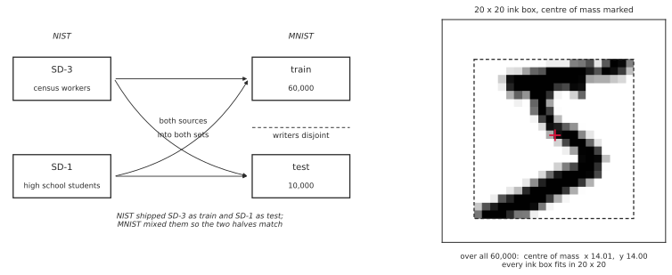

# 3장: MNIST로 보는 분류

이 장은 손글씨 숫자 데이터셋 MNIST 하나를 붙들고 네 스텝을 걷는다. 스텝마다 딱 한 가지 생각씩만 더하며, 그때마다 정확도가 얼마나 오르는지를 함께 잰다.

| 스텝 | 절 | 모델 | 더해지는 생각 | 시험 정확도 |
|---|---|---|---|---|
| 1 | [3.1](mnist/01_template_learning.md) | 템플릿 학습 | 없음 — 클래스마다 평균 이미지를 만들 뿐 | 82.03% |
| 2 | [3.2](linear_softmax/index.md) | 선형 모델 ($xA + b$) | 웨이트를 **학습한다** | 92.35% |
| 3 | [3.3](mnist/03_mlp.md) | 다층 퍼셉트론 | 레이어를 쌓아 **비선형성**을 얻는다 | 97.90% |
| 4 | [3.4](mnist/04_cnn.md) | 컨볼루션 뉴럴 넷트웍 | 화소의 **이웃 관계**를 되찾는다 | 99.21% |

모두 MNIST에서 기록한 실험 결과다. 다만 모델별 학습 과정과 예산이 다르므로, 표는 이 책의 설정에서 나타난 성능 변화를 보여 준다. 눈여겨볼 것은 1단계와 2단계의 선형 점수식으로 표현했을 때 계수 7,850개를 저장한다는 점이다. 템플릿에서는 바이어스 10개가 평균 벡터로부터 결정되므로 독립적으로 추정하는 수는 7,840개다. 달라진 것은 그 수를 평균으로 못박느냐 데이터에 맞추어 학습하느냐뿐인데 10%포인트가 넘게 벌어진다.

**그림으로 보는 AI 1.** 두 무리가 쓴 숫자를 섞어 놓은 까닭

이 장은 MNIST의 시험 정확도 하나로 네 스텝을 줄 세운다. 그 수가 뜻을 가지려면 **학습 집합과 시험 집합이 같은 자료여야** 하는데, 그것은 저절로 주어진 것이 아니라 손으로 만든 것이다.

MNIST의 재료는 NIST의 두 자료다. **SD-3**은 인구조사국 직원들이 쓴 것이고 **SD-1**은 고등학생들이 쓴 것인데, 둘은 결이 다르다. 직원들이 쓴 쪽이 훨씬 반듯하다. 그런데 NIST가 묶어 내놓은 꼴은 **SD-3을 학습용, SD-1을 시험용**으로 둔 것이었다.

그러면 무슨 일이 생기는지는 짐작할 수 있다. 반듯한 글씨로 배우고 거친 글씨로 시험을 보는 것이니, 학습 집합에서 아무리 잘해도 시험 집합에서 무너진다. **잰 값이 모델의 됨됨이가 아니라 두 무리의 차이를 재고 있는** 것이다.

MNIST는 그것을 고친 자료다. 두 출처를 **양쪽에 고루 섞어** 학습 6만 장과 시험 1만 장을 만들었고, 그러면서 **글쓴이가 겹치지 않게** 갈랐다. 덕분에 "학습에서 본 적 없는 글씨"라는 조건은 지키면서 "두 집합이 다른 무리의 글씨"라는 교란은 없앴다.

글씨를 다듬는 규약도 함께 정했다. 가로세로 비를 지킨 채 **20×20 상자**에 맞추고, 그것을 28×28 한가운데에 **무게중심으로** 앉힌다. 받아 든 자료에서 실제로 재어 보면 그대로다 — 학습 6만 장이 모두 20×20 안에 들고, 무게중심의 평균이 $x$ 14.01, $y$ 14.00이다. 28을 둘로 나눈 자리이니 **한가운데가 13.5가 아니라 14**라는 뜻이고, 표준편차는 0.29화소다.

**다만 고쳐진 것은 MNIST 안에서뿐이다.** 두 집합을 맞추었다고 이 자료가 "손글씨 숫자"를 대표하게 되는 것은 아니다. 글쓴이는 모두 1990년 무렵 미국의 어른과 학생이고, 반듯하게 쓰라는 요청을 받고 칸에 맞추어 쓴 글씨다. 이 장의 99.21%는 **그 사람들이 그렇게 쓴 숫자를 읽는 일**에 대한 수이며, 자료를 바꾸면 사다리가 어떻게 되는지는 [4장](../ch04/index.md)이 CIFAR-10에서 보인다.

_확인한 곳 — SD-3이 인구조사국 직원, SD-1이 고등학생의 글씨라는 것, NIST의 원래 묶음이 SD-3을 학습·SD-1을 시험으로 두었다는 것, MNIST가 두 출처를 양쪽에 섞고 **글쓴이 집합을 겹치지 않게** 갈랐다는 것, 그리고 20×20 상자·무게중심·28×28 규약은 MNIST를 소개하는 [Yann LeCun 등의 설명](https://en.wikipedia.org/wiki/MNIST_database)과 그 설명을 옮긴 여러 곳에서 확인했다(영문 위키백과의 한 판은 SD-1 대신 SD-7로 적고 있으나, 원 설명은 SD-1이다). 오른쪽 판의 수 — 무게중심 $x$ 14.01, $y$ 14.00, 표준편차 0.29, 6만 장이 모두 20×20 안에 든다는 것 — 은 **이 책이 받아 든 자료에서 직접 재었다.** 그림은 사진을 옮긴 것이 아니라 이 책의 그림체로 그린 것이다._

첫 단계에서는 경사 하강법을 사용하지 않고 클래스별 평균을 추정한다. 넓은 의미에서는 이 평균 추정도 데이터로 모델을 정하는 학습이다. 클래스마다 학습 이미지를 평균 내어 열 장의 템플릿을 만들고, 새 이미지를 가장 가까운 템플릿의 숫자로 부르면 그만이다. 그런데도 82%를 맞힌다. 이 값이 이 장의 바닥이 되고, 나머지 세 스텝은 저마다 무엇을 더해 그 바닥을 얼마나 끌어올리는지로 값어치가 매겨진다.

---

## 스텝마다 버는 몫을 어떻게 읽을 것인가

정확도만 보면 스텝마다 버는 것이 줄어든다. **+10.32 → +5.55 → +1.31.** 뒤로 갈수록 시들해 보인다.

남은 오차로 읽으면 반대가 된다.

| 스텝 | 정확도 | 남은 오차 | 그 스텝이 지운 몫 |
|---|---|---|---|
| 1 템플릿 학습 | 82.03% | 17.97%p | — |
| 2 선형 + 소프트맥스 | 92.35% | 7.65%p | **57%** |
| 3 다층 퍼셉트론 | 97.90% | 2.10%p | **73%** |
| 4 컨볼루션 뉴럴 넷트웍 | 99.21% | 0.79%p | **62%** |

**정확도 증가와 상대적인 오차 감소를 함께 읽어야 한다.** 마지막 단계의 개선은 1.31%포인트이며, 이전 단계의 오류율 2.10% 중 약 62%를 줄인 것이다. 상대 감소율이 단계마다 단조롭게 커지는 것은 아니다.

정확도가 높아질수록 한 스텝의 값어치는 **남은 오차로 재야 한다.** 이 장뿐 아니라 [4장](../ch04/index.md)의 모든 표를 읽는 방식이기도 하다.

---

## 그리고 여기서 멈추는 까닭

99.21%에 이르면 **남은 오차가 1%포인트도 되지 않는다.** 오류 사례가 적어지므로 작은 성능 차이를 구분하려면 더 신중한 평가가 필요하다.

[3.4절](mnist/04_cnn.md)이 그것을 손으로 만져 본다. 필터를 키우고, 팽창을 주고, 레이어를 겹치고, 드롭아웃을 빼는 **여덟 클래스를 시드 다섯 개씩** 재었는데 여러 설정의 차이가 시드별 변동과 겹친다. 클래스 사이의 차이가 **같은 클래스를 다시 돌릴 때 생기는 흔들림보다 작기** 때문이다.

다섯째 생각이 아무리 좋아도 사정은 같다. 그래서 [4장](../ch04/index.md)은 모델이 아니라 **데이터를 바꾼다.** 같은 네 스텝을 CIFAR-10 위에서 다시 걸으면 오류율이 더 높아져 구조 변경의 효과를 비교하기 쉬워지고, 여기서 아무것도 아니던 변경이 거기서는 그 장 최대의 이득이 된다.

---

각 스텝에 필요한 PyTorch 도구는 그 코드가 처음 쓰는 자리에서 함께 설명한다. 텐서, 자동 미분, 경사 하강법을 체계적으로 파고드는 것은 [7장: PyTorch 기초](../ch06/index.md)이며, 이 장을 걷다가 더 깊이 알고 싶을 때 찾아보면 된다.

각 기법의 이론은 뒤의 장들이 따로 다룬다. 소프트맥스 회귀는 [8장](../ch07/index.md), 순방향 뉴럴 넷트웍의 구성 요소는 [9장](../ch08/index.md), 컨볼루션은 [11장](../ch10/index.md)이다. 이 장은 그 이론을 미리 맛보이는 자리가 아니라, 하나의 데이터셋 위에서 네 모델을 나란히 비교하여 보는 자리이다.
