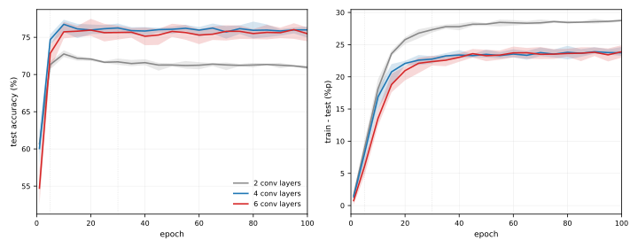

# 깊이 — 3×3을 쌓는다

[4.1절](01_two_ladders.md)의 4걸음 CNN은 CIFAR-10에서 72.58%였다. **오분류율은 27.42%다.**

앞의 두 절은 그 구조를 손대지 않고 74.73%까지 갔다. [4.2절](06_ensemble.md)은 같은 모델을 다섯 대 세웠고, [4.3절](07_distillation.md)은 그 다섯을 한 대로 접었다. 이 절은 처음으로 **구조 자체**를 건드린다.

[3.4절](../ch03/mnist/04_cnn.md)의 MNIST 실험에서는 여러 설정을 바꾸어도 정확도 차이가 작았다. 기준 모델의 오분류율이 0.79%로 낮아 작은 개선을 구별하기 어려웠다. 그렇다고 모든 설정의 효과가 같다고 결론 내릴 수는 없다.

여기서는 그 여지가 서른 배다. **같은 손잡이를 돌리면 이번에는 무엇이 일어나는가?**

---

## 1. 무엇을 바꾸고 무엇을 고정하는가

분류 헤드(`fc1`, `fc2`)와 두 번의 풀링 후 크기인 $8 \times 8 \times 64$는 고정한다. 합성곱 블록의 깊이와 필터 크기를 바꾸되, 그에 따라 매개변수 수와 계산량도 달라진다. 따라서 이 비교는 각 구조 전체의 효과를 보여 주며, 깊이만의 순수한 효과를 분리하지는 않는다.

| 갈래 | 합성곱 블록 |
|---|---|
| 2겹 3×3 | `[conv(3→32), pool]`, `[conv(32→64), pool]` — 4.1절 그대로 |
| 2겹 5×5 | 같은 깊이, 필터만 5×5 |
| 4겹 3×3 | 블록마다 두 번 — `[conv, conv, pool]` ×2 |
| 6겹 3×3 | 블록마다 세 번 |

규약은 [4.1절](01_two_ladders.md)과 **같다**. 10 에포크, 배치 100, Adam $10^{-3}$이며 시드 다섯 개로 재어 퍼짐을 함께 적는다. 두 절의 수를 곧바로 견줄 수 있다는 뜻이다.

이 절의 기본 비교 시점은 10 에포크다. 4절에서는 5·10·30·100 에포크의 기록도 살펴본다. 시험 정확도 곡선에서 가장 높은 시점을 고르는 것은 결과를 설명하는 데는 유용하지만, 최종 모델의 학습 기간을 정할 때는 별도의 검증 데이터를 사용해야 한다. 시험 데이터를 설정 선택에 반복해서 사용하면 평가가 낙관적으로 치우칠 수 있다.

### 코드

```python
"""CIFAR-10에서 같은 손잡이를 돌린다. 배치 100, Adam 1e-3, 10 에포크.
(4.1절과 같은 규약이다. 이 절은 에포크도 손잡이로 보므로 4절에서 100까지 올린다.)

분류기 머리(fc1, fc2)는 모든 갈래에서 같다. 바뀌는 것은 합성곱 더미뿐이라
정확도 차이를 깊이와 필터 크기의 몫으로 읽을 수 있다.

실험 규모: 갈래 5개 x 씨앗 5개 = 학습 25번, 각 10 에포크.
"""
import json
import time

import torch
import torch.nn as nn
import torch.optim as optim
from torch.utils.data import DataLoader, TensorDataset
from torchvision import datasets, transforms


# =============================================================================
# 1. 실험 설정
# =============================================================================
device = torch.device("cuda" if torch.cuda.is_available()
                      else "mps" if torch.backends.mps.is_available()
                      else "cpu")

NUM_EPOCHS    = 10
BATCH_SIZE    = 100
LEARNING_RATE = 1e-3
SEEDS         = [0, 1, 2, 3, 4]   # 씨앗마다 초기 가중치와 섞는 순서가 달라진다
RESULTS_FILE  = "cifar10_depth_filter_results.json"


# =============================================================================
# 2. 데이터: 변환을 한 번만 하고 메모리에 올려 둔다
# =============================================================================
# 보통은 DataLoader가 배치를 꺼낼 때마다 ToTensor와 Normalize를 다시 한다.
# 아래 CIFAR10(...) 에 transform 을 넘겨도 마찬가지다. 그 인수는 변환을 지금
# 해 두라는 뜻이 아니라 꺼낼 때마다 이렇게 하라는 뜻이기 때문이다.
# 이 실험은 학습을 25번 돌리므로 같은 변환을 250번(25번 x 10 에포크) 반복하게 된다.
# 그래서 처음에 전체를 한 번 변환해 큰 텐서로 만들어 두고,
# 이후에는 그 텐서를 잘라 쓰기만 한다.
#
# 이 방법이 통하는 조건:
#   - 데이터가 메모리에 다 들어간다 (CIFAR-10 학습 이미지: float32로 약 600MB)
#   - 변환이 고정되어 있다 (무작위 자르기, 뒤집기 같은 증강을 쓰면
#     에포크마다 새로 변환해야 하므로 이 방법을 쓸 수 없다)

# CIFAR-10 학습 데이터의 채널별 평균과 표준편차
CIFAR10_MEAN = (0.4914, 0.4822, 0.4465)
CIFAR10_STD  = (0.2470, 0.2435, 0.2616)

transform = transforms.Compose([
    transforms.ToTensor(),                          # PIL 이미지 -> [0,1] 범위 텐서, 모양 (3, 32, 32)
    transforms.Normalize(CIFAR10_MEAN, CIFAR10_STD) # 채널마다 평균 0, 표준편차 1로 맞춘다
])

# 아래 두 줄은 변환을 **하지 않는다.** 어떻게 변환할지를 적어 둘 뿐이다.
# 생성자가 끝난 시점에 데이터셋이 들고 있는 것은 여전히 (50000, 32, 32, 3) 꼴의
# uint8 numpy 배열이고, 변환은 한 장을 꺼낼 때마다 __getitem__ 안에서 일어난다.
train_dataset = datasets.CIFAR10("./data", train=True,  download=True, transform=transform)
test_dataset  = datasets.CIFAR10("./data", train=False, download=True, transform=transform)


def dataset_to_tensors(dataset):
    """데이터셋을 한 번 훑어 (이미지 텐서, 정답 텐서)로 **구워 둔다.**

    이 함수가 필요한 까닭은 위의 `transform=transform`이 **게으르기** 때문이다.
    그 인수는 변환을 지금 하지 않고 "이렇게 변환하라"고 적어 두기만 하며,
    torchvision은 한 장을 꺼낼 때마다 `Image.fromarray` 로 PIL을 만들고 거기에
    변환을 다시 건다. 같은 장을 두 번 꺼내면 변환도 두 번 일어난다.

    그러므로 데이터셋을 그대로 쓰면 에포크마다 5만 장을 처음부터 다시 변환한다.
    여기서 한 번 구워 두면 그 뒤로는 텐서를 잘라 쓰기만 하면 된다. 만 장으로 재면
    한 바퀴가 0.38초에서 0.03초로 줄고, 굽는 데 드는 0.87초는 세 에포크면 갚는다.

    DataLoader는 학습용이 아니라 2000장씩 나눠 변환을 돌리는 도구로만 쓴다.
    섞지 않으므로 순서가 그대로다.
    """
    image_batches = []
    label_batches = []
    for images, labels in DataLoader(dataset, batch_size=2000):
        image_batches.append(images)                # (2000, 3, 32, 32) 한 뭉치
        label_batches.append(labels)                # (2000,)

    # 뭉치 25개를 첫 축으로 이어 붙인다: 2000 x 25 = 50000
    return torch.cat(image_batches), torch.cat(label_batches)


train_images, train_labels = dataset_to_tensors(train_dataset)  # (50000, 3, 32, 32), (50000,)
test_images,  test_labels  = dataset_to_tensors(test_dataset)   # (10000, 3, 32, 32), (10000,)


# =============================================================================
# 3. 모형
# =============================================================================
class Net(nn.Module):
    """블록 두 개(32채널, 64채널)에 합성곱을 쌓고, 블록 끝마다 풀링한다.

    convs_per_block : 블록 하나에 쌓는 합성곱 수. 전체 합성곱 수 = 2 * convs_per_block.
                      convs_per_block=1이면 4.1절의 4걸음(합성곱-풀링-합성곱-풀링)이다.
    filter_size     : 합성곱 필터의 가로세로 크기 (홀수: 3 또는 5).
    dropout         : fc1 뒤 드롭아웃 비율. 0이면 드롭아웃을 쓰지 않는다.

    모양 변화 (convs_per_block=2 예):
        3x32x32 -> 합성곱(3->32) -> 32x32x32 -> 합성곱(32->32) -> 32x32x32 -> 풀링 -> 32x16x16
                -> 합성곱(32->64) -> 64x16x16 -> 합성곱(64->64) -> 64x16x16 -> 풀링 -> 64x8x8
                -> 펼치기 -> 4096 -> fc1 -> 128 -> fc2 -> 10
    """

    def __init__(self, convs_per_block=1, filter_size=3, dropout=0.25):
        super().__init__()

        layers = []
        in_channels = 3                         # 첫 입력은 RGB 3채널

        for out_channels in (32, 64):           # 블록 두 개
            for _ in range(convs_per_block):
                # padding='same': 가로세로 크기를 그대로 둔다.
                # 홀수 필터에서는 padding=filter_size//2 와 똑같다 (3x3 -> 1, 5x5 -> 2).
                layers += [nn.Conv2d(in_channels, out_channels, filter_size, padding="same"),
                           nn.ReLU()]
                # 다음 합성곱의 입력 채널은 방금 만든 합성곱의 출력 채널이다.
                # 이미 만든 층은 생성 시점의 in_channels 값을 저장해 두므로
                # 여기서 값을 바꿔도 그 층에는 영향이 없다.
                in_channels = out_channels
            layers += [nn.MaxPool2d(2, 2)]      # 가로세로를 절반으로: 32->16, 16->8

        self.features = nn.Sequential(*layers)

        # 분류기 머리: 모든 갈래에서 같다.
        # 합성곱은 크기를 바꾸지 않고 풀링만 두 번 절반으로 줄이므로
        # 깊이나 필터 크기와 상관없이 합성곱 더미의 출력은 언제나 64x8x8 = 4096이다.
        self.dropout = nn.Dropout(dropout) if dropout else nn.Identity()
        self.fc1 = nn.Linear(64 * 8 * 8, 128)
        self.fc2 = nn.Linear(128, 10)           # CIFAR-10 부류 10개

    def forward(self, x):                       # 들어올 때 (배치, 3, 32, 32)
        # 합성곱 더미. 갈래마다 층 수도 필터 크기도 다르지만 **나오는 모양은
        # 언제나 같다** — 합성곱은 padding='same' 이라 가로세로를 두고, 줄이는
        # 것은 풀링 두 번뿐이기 때문이다. 아래 머리를 모든 갈래가 공유할 수
        # 있는 것이 그 덕이고, 그래서 정확도 차이를 더미의 몫으로만 읽는다.
        x = self.features(x)                    # (배치, 64, 8, 8)
        x = x.flatten(1)                        # 64*8*8 = 4096 (배치, 4096)
        x = self.fc1(x)                         #               (배치, 128)
        x = torch.relu(x)                       # 모양 그대로   (배치, 128)
        x = self.dropout(x)                     # train() 일 때만 끊는다.
                                                # dropout=0 갈래는 Identity 라 그냥 통과
        return self.fc2(x)                      # (배치, 10): 소프트맥스 전 점수(로짓)


# =============================================================================
# 4. 학습 한 번: 씨앗 하나, 갈래 하나
# =============================================================================
def train_and_evaluate(seed, **model_kwargs):
    """모형을 새로 만들어 학습하고, 시험 정확도(%)와 모형 정보를 돌려준다."""

    # 씨앗을 두 곳에 고정한다.
    #   torch.manual_seed : 가중치 초기값, 드롭아웃 가면
    #   shuffle_generator : 에포크마다 배치를 섞는 순서
    # 그래서 같은 씨앗이면 갈래가 달라도 같은 순서의 배치를 본다.
    # 갈래 사이의 차이는 모형 구조에서만 온다.
    torch.manual_seed(seed)
    model = Net(**model_kwargs).to(device)

    num_params = sum(p.numel() for p in model.parameters())
    num_conv_layers = sum(1 for layer in model.features if isinstance(layer, nn.Conv2d))

    optimizer = optim.Adam(model.parameters(), lr=LEARNING_RATE)
    loss_fn = nn.CrossEntropyLoss()             # 로짓을 받아 내부에서 소프트맥스를 계산한다

    # 이미 변환해 둔 텐서를 감싸므로 배치를 꺼내는 일은 텐서를 자르는 것뿐이다.
    shuffle_generator = torch.Generator().manual_seed(seed)
    train_loader = DataLoader(TensorDataset(train_images, train_labels),
                              batch_size=BATCH_SIZE, shuffle=True,
                              generator=shuffle_generator)

    # 학습
    for _ in range(NUM_EPOCHS):
        model.train()                           # 드롭아웃 켜기
        for images, labels in train_loader:
            images, labels = images.to(device), labels.to(device)
            optimizer.zero_grad()               # 지난 배치의 기울기 지우기
            loss = loss_fn(model(images), labels)
            loss.backward()                     # 기울기 계산
            optimizer.step()                    # 가중치 갱신

    # 평가: 시험 이미지 10000장을 1000장씩 나눠 예측한다.
    # 테스트용 DataLoader(shuffle=False, batch_size=1000)와 같은 일을 직접 자르기로 한다.
    model.eval()                                # 드롭아웃 끄기
    with torch.no_grad():                       # 기울기 계산 안 함: 빠르고 메모리 절약
        predictions = torch.cat([
            model(test_images[i:i + 1000].to(device)).argmax(dim=1).cpu()
            for i in range(0, len(test_images), 1000)
        ])
    accuracy = 100.0 * (predictions == test_labels).float().mean().item()

    return accuracy, num_params, num_conv_layers


# =============================================================================
# 5. 갈래: 깊이, 필터 크기, 드롭아웃을 하나씩 바꾼다
# =============================================================================
# 비교 읽는 법:
#   1번 vs 2번 : 필터 크기 (3x3 -> 5x5), 깊이는 같다
#   1번 vs 3번 vs 4번 : 깊이 (합성곱 2 -> 4 -> 6겹), 필터는 같다
#   3번 vs 5번 : 드롭아웃 유무, 나머지는 같다
VARIANTS = [
    ("합성곱 2겹 3x3 (4.1절)",        dict(convs_per_block=1, filter_size=3)),
    ("합성곱 2겹 5x5",                dict(convs_per_block=1, filter_size=5)),
    ("합성곱 4겹 3x3",                dict(convs_per_block=2, filter_size=3)),
    ("합성곱 6겹 3x3",                dict(convs_per_block=3, filter_size=3)),
    ("합성곱 4겹 3x3, 드롭아웃 없음", dict(convs_per_block=2, filter_size=3, dropout=0.0)),
]


# =============================================================================
# 6. 실행: 갈래마다 씨앗 5개로 돌려 평균과 퍼짐을 본다
# =============================================================================
# 씨앗 하나의 결과는 운이 섞여 있다. 퍼짐(최댓값 - 최솟값)보다 작은 평균 차이는
# 구조의 차이라고 말하기 어렵다.
results = {}

for label, model_kwargs in VARIANTS:
    start_time = time.time()
    accuracies = []

    for seed in SEEDS:
        accuracy, num_params, num_conv_layers = train_and_evaluate(seed, **model_kwargs)
        accuracies.append(accuracy)

    mean_acc = sum(accuracies) / len(accuracies)
    min_acc, max_acc = min(accuracies), max(accuracies)
    spread = max_acc - min_acc

    results[label] = dict(
        mean=round(mean_acc, 3),
        lo=round(min_acc, 2),
        hi=round(max_acc, 2),
        spread=round(spread, 3),
        params=num_params,                      # 매개변수 수는 씨앗과 상관없이 같다
        n_conv=num_conv_layers,
        runs=[round(a, 2) for a in accuracies],
    )

    print(f"  {label:26s} {mean_acc:6.2f}%  퍼짐 {spread:.2f} "
          f"({min_acc:.2f}~{max_acc:.2f})  합성곱 {num_conv_layers}층  "
          f"매개변수 {num_params:,}  ({time.time() - start_time:.0f}s)", flush=True)

# 결과를 파일로 남겨 표나 그림을 만들 때 다시 돌리지 않아도 되게 한다.
with open(RESULTS_FILE, "w", encoding="utf-8") as f:
    json.dump(results, f, ensure_ascii=False, indent=2)
```

**출력:**

```
Files already downloaded and verified
Files already downloaded and verified
  합성곱 2겹 3x3 (4.1절)           72.76%  퍼짐 0.89 (72.36~73.25)  합성곱 2층  매개변수 545,098  (328s)
  합성곱 2겹 5x5                  72.93%  퍼짐 1.65 (71.92~73.57)  합성곱 2층  매개변수 579,402  (587s)
  합성곱 4겹 3x3                  76.74%  퍼짐 1.67 (75.69~77.36)  합성곱 4층  매개변수 591,274  (758s)
  합성곱 6겹 3x3                  75.74%  퍼짐 2.21 (74.85~77.06)  합성곱 6층  매개변수 637,450  (1209s)
  합성곱 4겹 3x3, 드롭아웃 없음         74.58%  퍼짐 2.56 (73.14~75.70)  합성곱 4층  매개변수 591,274  (582s)
```

!!! note "`transform=` 은 변환하지 않는다"

    위 코드에서 `dataset_to_tensors`가 왜 있는지 의아할 수 있다. 데이터셋을 만들 때
    이미 `transform=transform`을 넘겼으니 변환은 그때 끝난 것 아닌가?

    아니다. **그 인수는 변환을 해 두라는 뜻이 아니라, 꺼낼 때마다 이렇게 하라는
    뜻이다.** 생성자가 끝난 시점에 데이터셋이 들고 있는 것은 아직 `uint8` numpy
    배열이고, torchvision은 한 장을 꺼낼 때마다 `Image.fromarray`로 PIL을 만든 뒤
    거기에 변환을 다시 건다. 세어 보면 이렇다.

    | 무엇을 했는가 | 변환이 불린 횟수 |
    |---|---|
    | 데이터셋을 만든 직후 | 0 |
    | `ds[0]` 한 번 | 1 |
    | 같은 `ds[0]`을 또 한 번 | 2 |

    같은 장을 두 번 꺼내면 두 번 변환된다. 그러므로 데이터셋을 그대로 학습에 쓰면
    **에포크마다 5만 장을 처음부터 다시 변환한다.** 이 실험은 그것을 125번 되풀이하게
    된다.

    결정적인 변환을 한 번 적용해 텐서로 저장하면 반복 변환 비용을 줄일 수 있다. 기록된 만 장 실험에서는 한 번 순회하는 시간이 0.38초에서 0.03초로 줄었다. 사전 변환에 든 0.87초는 약 세 에포크의 절감 시간에 해당한다. 이 시간은 장치와 구현에 따라 달라진다.

    다만 무작위 증강 결과를 한 번만 저장하면 매번 다른 입력을 만드는 효과가 사라진다. 무작위 자르기나 뒤집기는 학습 중에 적용하고, 고정된 변환만 미리 저장하는 방식도 가능하다.

---

## 2. 큰 필터의 이득은 뚜렷하지 않다

| 갈래 | 평균 | 퍼짐 | 범위 | 매개변수 |
|---|---|---|---|---|
| 2겹 3×3 ([4.1절](01_two_ladders.md)) | 72.76% | 0.89 | 72.36~73.25 | 545,098 |
| 2겹 5×5 | 72.93% | **1.65** | 71.92~73.57 | 579,402 |

!!! note "4.1절의 72.58%는 이 표의 범위 안에 있다"
    4.1절은 같은 2겹 모델을 시드 하나로 한 번 돌려 **72.58%**를 얻었다. 이 표는 같은 규약으로 시드 다섯을 돌려 평균 72.76%, 범위 72.36~73.25를 얻었다.

    72.58은 그 범위 안이다. 두 절이 어긋나지 않는다는 뜻이고, 4.1절의 한 번 잰 값이 운이 좋거나 나쁜 쪽에 치우친 값이 아니었다는 뜻이기도 하다.

    그래도 **이 절부터 퍼짐 열이 붙는다.** 4.1절은 사다리의 칸을 보이는 자리라 한 번씩 재어도 됐지만, 여기서부터는 0.2%포인트짜리 차이를 다툰다. 한 번 잰 수로는 그런 차이를 판정할 수 없다.

**+0.17%포인트, 퍼짐 안이다.** 그리고 퍼짐이 0.89에서 1.65로 거의 두 배가 된다. 이겼다고 할 수 없을 뿐 아니라, 더 들쭉날쭉해졌다.

MNIST에 이어 이 CIFAR-10 설정에서도 5×5 필터의 평균 개선은 작았다. 오분류율이 더 높아도 필터 크기 확대가 반드시 도움이 되는 것은 아니다. 다만 다섯 시드의 범위만으로 두 구조가 동등하다고 판정할 수는 없다.

---

## 3. 합성곱을 더 쌓았을 때의 변화

| 합성곱 | 평균 | 퍼짐 | 범위 | 매개변수 |
|---|---|---|---|---|
| 2겹 3×3 | 72.76% | 0.89 | 72.36~73.25 | 545,098 |
| **4겹 3×3** | **76.74%** | 1.67 | **75.69~77.36** | 591,274 |
| 6겹 3×3 | 75.74% | 2.21 | 74.85~77.06 | 637,450 |

**4겹의 다섯 실행은 모두 2겹의 다섯 실행보다 높았다.** 최저 정확도 75.69%가 기준선의 최고 정확도 73.25%보다 2.44%포인트 높다. 이 설정에서는 깊이를 늘린 구조의 개선이 일관되게 관측되었다. 다섯 시드의 최솟값과 최댓값은 신뢰구간이 아니므로, 범위가 갈린다는 사실만으로 통계적 유의성을 확정하지는 않는다.

### 수용 영역이 같아도 연산은 다르다

여기가 이 절의 요점이다. **5×5 한 겹과 3×3 두 겹은 수용 영역가 같다.**

3×3을 두 번 지나면 한 자리가 보는 범위가 5×5가 된다. 그런데 결과는 72.93%와 76.74%로 3.81%포인트 갈린다. 두 갈래의 범위는 스치지도 않는다(71.92~73.57 대 75.69~77.36). 같은 넓이를 보는데 한쪽만 번다.

두 개의 3×3 합성곱은 한 개의 5×5 합성곱과 수용 영역의 크기가 같지만, 중간 특징 변환과 ReLU가 추가되고 매개변수 구성도 달라진다. 따라서 결과 차이를 ReLU 하나만의 효과로 설명할 수는 없다. 이 실험은 같은 수용 영역에서도 여러 단계의 특징 변환이 유리할 수 있음을 보여 준다.

작은 필터를 여러 층 쌓으면 수용 영역을 넓히면서 중간 비선형 변환을 늘릴 수 있다. 이것이 VGG의 설계 근거 중 하나다. [4.6절](03_vgg16_transfer.md)의 VGG16은 이 방식을 사용해 합성곱 13층을 구성한다.

!!! note "매개변수는 근거가 되지 못한다"
    "3×3 두 겹이 5×5보다 매개변수가 적다"는 말을 흔히 듣는다. 채널 수가 그대로일 때는 맞지만($2 \times 9C^2 < 25C^2$), 이 블록은 채널을 늘리므로 성립하지 않는다. 4겹이 591,274개로 2겹 5×5의 579,402개보다 **많다.**

    게다가 `fc1` 하나가 524,416개라 세 갈래 모두 매개변수의 대부분이 거기 있다. **이 실험에서 갈린 것은 크기가 아니라 구조다.**

---

## 4. 예산을 늘리면 — 곡선을 본다

여섯째 층은 다르다. 6겹은 75.74%로 4겹의 76.74%보다 1.00%포인트 낮은데, **이 차이는 퍼짐 안이다.** 범위가 74.85~77.06과 75.69~77.36으로 크게 겹치고, 6겹이 가장 잘 나온 실행(77.06)은 4겹의 평균보다도 높다.

이 결과에서는 6겹의 평균이 더 낮지만, 다섯 시드의 범위가 겹친다. 6겹의 우월성은 확인되지 않았고, 4겹과 6겹이 동등하다는 결론도 아직 내릴 수 없다. 더 많은 반복이나 대응 시드의 차이를 분석하면 불확실성을 더 자세히 평가할 수 있다.

<div class="defn" markdown>

이 학습 설정에서는 2겹에서 4겹으로 늘린 개선은 뚜렷했으나, 4겹에서 6겹으로 늘린 추가 개선은 관측되지 않았다. 이것은 CIFAR-10 자체의 깊이 한계를 뜻하지 않는다.

</div>

멈춘 까닭이 예산일 수 있다. 깊은 네트워크는 천천히 출발하니, 10 에포크가 6겹에게는 아직 이른 자리일지도 모른다. **예산을 의심할 자리다.**

그런데 10 에포크와 30 에포크 두 점만 견주면 또 같은 함정에 빠진다. 이 절이 여기까지 보인 것이 **점 몇 개로는 모양을 알 수 없다**는 것이었다. 그러니 점이 아니라 **곡선**을 재자. 100 에포크까지 돌리되 5 에포크마다 학습·시험 정확도를 함께 적는다. 재는 값은 이미 손에 있으므로 추가 비용이 8%뿐이다.



!!! note "곡선은 어떻게 재는가"
    위 코드의 `train_and_evaluate()`에서 에포크 반복문 안에 재는 줄을 넣으면 된다. 모델을 다시
    학습할 필요가 없고, 어차피 돌아가는 학습에 평가만 얹는 것이다.

    ```python
    CHECK = [1] + list(range(5, 101, 5))       # 재는 지점: 1, 5, 10, ..., 100

    @torch.no_grad()                            # 재기만 하므로 기울기는 필요 없다
    def acc(model, X, y, bs=1000):
        # 드롭아웃을 꺼야 재는 값이 흔들리지 않는다. 다만 여기서 켜 두고
        # 나가는데, 위 학습 반복문이 **에포크마다 첫 줄에서** model.train() 을
        # 다시 부르기 때문에 다음 에포크는 제대로 켜진 채로 시작한다.
        # 그 줄이 반복문 밖으로 나가면 이 함수가 학습을 조용히 망가뜨린다.
        model.eval()
        ok = sum((model(X[i:i+bs].to(device)).argmax(1).cpu() == y[i:i+bs]).sum().item()
                 for i in range(0, len(X), bs))
        return 100.0 * ok / len(X)

    for ep in range(1, NUM_EPOCHS + 1):
        ...                                     # 한 에포크 학습 (model.train() 포함)
        if ep in CHECK:
            # 학습 쪽도 같이 재야 틈(학습 - 시험)을 그릴 수 있다.
            # 비싼 쪽은 이것이다 — 5만 장이라 한 에포크의 33.3%가 든다.
            curve.append(dict(epoch=ep,
                              train=acc(model, train_images, train_labels),   # 5만 장
                              test=acc(model, test_images, test_labels)))    # 1만 장
    ```

    값은 5에포크마다만 재므로 추가 비용이 8%다. 시험 평가는 한 에포크의 6.7%,
    학습 평가는 33.3%이며, 그것을 스무 번 남짓 하는 계산이다.

띠는 시드 다섯 개의 **가장 낮음~가장 높음**이다. [4.1절](01_two_ladders.md)이 쓴 `퍼짐`이 바로 그 정의이므로, 그림의 띠 두께와 표의 퍼짐이 같은 자다.

### 기록된 최고 평균은 10 에포크에서 나온다

| 합성곱 | 5ep | **10ep** | 30ep | 100ep |
|---|---|---|---|---|
| 2겹 | 71.33% | **72.76%** | 71.70% | 70.95% |
| 4겹 | 74.69% | **76.74%** | 76.25% | 75.99% |
| 6겹 | 72.84% | 75.74% | 75.64% | 75.48% |

**셋 다 10 에포크 언저리에서 가장 높고, 그 뒤로는 오르지 않는다.**

이 표의 2겹 5 에포크 평균 71.33%는 4.2절의 기록과 반올림한 값이 같다. 해당 조건의 일관성을 확인하는 단서지만, 다른 실행 환경에서도 같은 결과를 보장하지는 않는다.

5 에포크는 **꼭대기에 닿기 전**이고, 30 에포크는 **이미 지난 뒤**다. 이 절이 규약으로 삼은 10 에포크가 바로 그 봉우리다. 5와 30 두 점만 보면 "예산을 늘려 좋아졌다"로 읽히지만, 곡선을 보면 그 사이에 봉우리가 있었다.

**이 곡선에서는 에포크 수만 늘려도 6겹의 평균이 4겹을 넘지 못했다.** 6겹은 1 에포크에서 54.72%로 가장 낮게 출발하지만, 기록된 10 에포크 시점에는 75.74%까지 오른다. 다만 학습률이나 초기화 등을 바꾼 경우에도 같은 결과가 나온다고 단정할 수는 없다.

만약 5 에포크에서 멈추어 재었다면 6겹은 72.84%로 4겹(74.69%)에 1.85%포인트 뒤졌을 것이고, 그때는 범위마저 갈라져(70.68~73.93 대 74.05~75.42) "6겹이 더 못하다"고 적을 뻔했다. **그 문장은 구조에 대한 관찰이 아니라 예산이 모자란 자리를 잘못 읽은 것이었다.** 꼭대기에서 다시 재면 두 범위는 겹친다.

### 100 에포크를 주어도 6겹은 4겹을 넘지 못한다

| 100 에포크 | 평균 | 퍼짐 | 범위 |
|---|---|---|---|
| 4겹 | 75.99% | 1.52 | 74.95~76.47 |
| 6겹 | 75.48% | 1.86 | 74.46~76.32 |

범위가 크게 겹친다. 10 에포크에서 **열 배**로 늘려도 여섯째 층이 버는 것은 없다. 4절 소개에서 퍼짐 안이라 판정을 미뤘던 그 차이는, 예산을 열 배 주고도 퍼짐 안에 머문다.

### 2겹의 정확도 하락이 가장 뚜렷하다

| 30ep → 100ep | 평균 변화 | 30ep 범위 | 100ep 범위 |
|---|---|---|---|
| **2겹** | **−0.75** | 71.31~72.15 | **70.71~71.24** |
| 4겹 | −0.26 | 75.66~76.84 | 74.95~76.47 |
| 6겹 | −0.16 | 74.70~76.56 | 74.46~76.32 |

4겹과 6겹의 평균도 조금 내려가지만 시드 범위가 겹쳐 하락의 크기를 단정하기 어렵다. 2겹은 100 에포크의 최고 정확도 71.24%가 30 에포크의 최저 정확도 71.31%보다 낮다. 이 기록에서는 2겹의 장기 학습에 따른 정확도 하락이 가장 일관되다.

---

## 5. 막는 것은 예산이 아니라 과적합이다

그림의 오른쪽 칸이 까닭을 말한다.

| 학습 − 시험 틈 | 5ep | 30ep | 100ep |
|---|---|---|---|
| 2겹 | 8.8 | 27.3 | **28.8** |
| 4겹 | 8.0 | 22.8 | 23.7 |
| 6겹 | **6.0** | 22.4 | 23.9 |

**5 에포크의 학습·시험 정확도 차이는 6~9%포인트이고, 이후 크게 벌어진다.** 학습 정확도가 높아지는 동안 시험 정확도는 정체하거나 내려가므로 과적합을 의심할 수 있다. 이 차이만으로 과적합이 시작된 정확한 시점을 정할 수는 없다.

이 세 모델에서는 2겹의 학습·시험 정확도 차이가 가장 컸다. [4.5절](04_augmentation.md)의 같은 설정에서도 30 에포크 학습 정확도는 99.05%였다. 이는 이 구조와 학습 조건의 관측이며, 얕은 네트워크가 언제나 더 심하게 과적합한다는 뜻은 아니다.

에포크 수를 늘리는 것만으로는 시험 정확도가 계속 좋아지지 않았다. 관측된 정체와 큰 학습·시험 정확도 차이를 함께 보면, 다음 비교에서는 정칙화와 데이터 증강의 영향을 살펴볼 이유가 있다.

### 드롭아웃이 그 천장을 올린다 — 예산이 충분할 때만

위 표의 다섯째 갈래가 이것을 직접 잰다. 4겹에서 드롭아웃만 빼고 나머지를 그대로 둔 것이다.

| 4겹 3×3 | 5 에포크 | 10 에포크 | 퍼짐(10ep) | 범위(10ep) |
|---|---|---|---|---|
| 드롭아웃 0.25 | 74.69% | **76.74%** | 1.67 | 75.69~77.36 |
| 드롭아웃 없음 | **75.24%** | 74.58% | 2.56 | 73.14~75.70 |

**부호가 뒤집힌다.** 5 에포크에서는 드롭아웃을 뺀 쪽이 0.55%포인트 높고, 10 에포크에서는 드롭아웃을 둔 쪽이 2.16%포인트 높다. 예산을 두 배로 준 사이에 드롭아웃 없는 갈래는 오히려 **내려갔다**(75.24 → 74.58).

이 결과는 드롭아웃의 효과가 학습 기간에 따라 달라질 수 있음을 보여 준다. 5 에포크의 평균은 드롭아웃 없는 모델이 높고, 10 에포크에서는 드롭아웃 있는 모델이 높다. 다만 이 두 시점만으로 과적합의 시작이나 드롭아웃의 작동 원인을 정확히 분리할 수는 없다.

퍼짐도 1.67 대 2.56으로 드롭아웃 없는 쪽이 더 들쭉날쭉하다. 다만 두 범위는 75.69와 75.70에서 **0.01%포인트 차이로 스친다.** 이 책의 규칙대로라면 아슬아슬하게 겹치는 것이니, 2.16%포인트를 확정된 차이로 읽기보다 **부호가 뒤집혔다는 사실**을 읽는 편이 안전하다. 그 뒤집힘은 두 예산 사이에서 일관되게 나타난다.

!!! note "5 에포크 열과 10 에포크 열은 다른 장치에서 쟀다 — 그래도 견줄 수 있다"
    이 표의 두 열은 한 번에 나온 값이 아니다. 10 에포크 열은 위 코드가 지금 내는 값이고, 5 에포크 열은 이 절이 처음 쓰였을 때 **CPU에서** 잰 값이다(그때의 코드는 `mps`를 고르지 않았다). 예산과 장치가 함께 바뀌었으니 곧바로 견주면 [4.1절](01_two_ladders.md) 6절이 경고한 바로 그 함정이다.

    그래서 두 갈래를 **5 에포크로, 지금 코드 그대로 MPS에서** 다시 쟀다.

    ```
    합성곱 4겹 3x3              74.69%  퍼짐 1.37 (74.05~75.42)
    합성곱 4겹 3x3, 드롭아웃 없음  75.24%  퍼짐 1.23 (74.62~75.85)
    ```

    평균도 퍼짐도 범위도 CPU에서 잰 값과 **소수점 둘째 자리까지 같다.** 이 기록은 해당 설정에서 반올림한 평가값이 일치했음을 보여 준다. 다른 모델과 장치에서도 같은 결과를 보장하지는 않는다.

    3장에서는 장치가 값을 바꾸었는데 여기서는 바꾸지 않는다. 장치가 바꾸는 것은 덧셈의 차례가 낳는 마지막 자리의 흔들림인데, 정확도는 `argmax`가 맞았는지를 세는 값이라 그 흔들림이 어느 표본의 판정을 뒤집을 만큼 클 때만 움직인다. **장치를 바꿔도 안전하다고 미리 단정하지 말고, 비교 전에 이렇게 한 번 재어 보는 것이 옳다.**

<div class="defn" markdown>

정칙화의 효과는 데이터, 모델, 강도, 학습 기간에 따라 달라진다. 같은 드롭아웃도 이 기록에서는 5 에포크와 10 에포크의 평균 비교 방향이 달랐다. 적용 여부와 강도는 검증 데이터로 판단해야 한다.

</div>

그러면 길이 둘로 갈리고, 이 장은 남은 두 절에서 그 둘을 차례로 밟는다. 과적합을 막아 천장을 올리거나([다음 절](04_augmentation.md)의 증강, 그리고 방금 본 드롭아웃), 아예 남이 올려 둔 천장을 빌려 오거나([4.6절](03_vgg16_transfer.md)의 전이).

---

## 6. 그래서 남은 두 절이 필요하다

여기까지가 **구조를 우리 손으로 쌓아** 얻을 수 있는 것이다.

| | 정확도 |
|---|---|
| 2겹 3×3 (이 절의 바닥, 시드 다섯) | 72.76% |
| 4겹 3×3, 10 에포크 | **76.74%** |

**3.98%포인트**를 벌었고, 값은 층 두 개와 두 배가 넘는 시간(328초 → 758초)이었다. [4.1절](01_two_ladders.md)의 72.58%와 견주면 4.16%포인트가 되는데, 그 값은 시드 하나로 잰 것이라 여기서는 **같은 규약으로 다섯 번 잰 72.76%**을 바닥으로 쓴다. 72.58은 이 절이 잰 범위 72.36~73.25 안에 있다.

이 구조에서는 6겹으로 늘리고 100 에포크까지 학습해도 4겹보다 높은 평균을 얻지 못했다. 추가 층의 이점을 얻으려면 학습 설정이나 다른 구조 요소까지 살펴봐야 한다.

남은 길은 앞 꼭지에서 갈린 그 둘이며, 이 장의 마지막 두 절이 하나씩 맡는다.

**하나는 천장을 조금 더 올리는 것이다.** 천장을 정하는 것이 과적합이니 과적합을 막으면 된다. 방금 본 드롭아웃이 그 갈래이고, [다음 절](04_augmentation.md)은 같은 일을 데이터 쪽에서 한다.

**다른 하나는 이 벽을 이미 넘어 둔 남의 네트워크를 빌리는 것이다.** [4.6절](03_vgg16_transfer.md)의 VGG16은 합성곱이 13층이며, ImageNet 120만 장으로 학습되어 있다. 우리가 치르지 못한 예산을 남이 치른 것이다.

두 길이 버는 몫은 크기가 사뭇 다르다. 그것이 이 장을 이 차례로 놓은 까닭이다.

---

## 7. 좋은 점과 아쉬운 점

### 좋은 점

**이 장에서 처음으로 퍼짐을 넘는 차이를 냈다.** 4겹의 가장 나쁜 실행(75.69)이 2겹의 가장 좋은 실행(73.25)보다 2.44%포인트 높다. 다섯 시드에서 개선 방향이 일관되었다. 이 장의 다른 절은 대개 예산을 늘려야 비로소 부호가 맞는데, 깊이는 **같은 예산에서 바로** 번다.

**매개변수 증가에 비해 정확도 개선이 컸다.** 2겹에서 4겹으로 늘리면 매개변수는 545,098개에서 591,274개로 약 8.5% 증가한다. 그러나 학습 시간은 328초에서 758초로 두 배 이상이므로, 매개변수 증가율만으로 계산 비용을 판단해서는 안 된다.

**이번 비교에서 바꾼 구조 요소가 명확하다.** 필터 크기를 고정하고 합성곱 층 수를 비교했다. 실제 모델 선택에는 채널 수, 학습률, 정칙화 강도 등도 함께 영향을 준다.

**수용 영역의 크기만으로는 결과를 설명할 수 없다.** 5×5 한 겹과 3×3 두 겹은 수용 영역이 같아도 연산과 비선형 변환 구성이 다르다. 이번 결과는 여러 단계의 특징 변환이 유리했던 사례다.

### 아쉬운 점

**추가 깊이의 이득은 확인되지 않았다.** 6겹의 평균은 75.74%이고 4겹과 범위가 겹친다. 100 에포크까지 학습한 기록에서도 6겹의 평균은 더 낮았다. 이를 모든 CIFAR-10 모델의 깊이 한계로 일반화할 수는 없다.

**깊어질수록 재기 어려워진다.** 퍼짐이 0.89 → 1.67 → 2.21로 함께 커진다. 더 깊은 모델일수록 같은 차이를 판정하는 데 더 많은 시드가 든다.

**학습 기간만 늘리는 데에는 한계가 있었다.** 세 구조 모두 기록된 시험 정확도는 10 에포크 부근에서 가장 높았고, 이후 학습·시험 정확도 차이가 커졌다. 다른 학습률이나 정칙화 조건의 결과는 이 실험으로 판단할 수 없다.

**매개변수로는 설명되지 않는다.** 4겹(591,274개)이 2겹 $5 \times 5$(579,402개)보다 **많은데도** 이긴다. 곧 "작아서 좋다"거나 "커서 좋다"로 적을 수 없고, 갈린 것은 크기가 아니라 구조다. 모델을 고를 때 매개변수 수를 근거로 삼으면 이 자리에서 틀린다.

<div class="defn" markdown>

이 실험에서 2겹을 4겹으로 늘리면 평균 정확도가 개선되었지만, 매개변수 수보다 학습 시간이 훨씬 크게 늘었다. 6겹의 추가 이득은 확인되지 않았다. 다음 절에서는 데이터 증강과 사전 학습 모델을 이용해 다른 개선 방향을 살펴본다.

</div>

---

## 연습문제

<div class="drillbox" markdown>

**연습문제 1.** <span class="diff med" title="중간"></span>
본문은 5×5 한 겹과 3×3 두 겹이 "수용 영역가 같다"고 했다. 이를 확인하라. 그리고 3×3 세 겹은 몇 ×몇에 해당하는가?

</div>

??? success "연습문제 1 풀이"
    3×3 합성곱을 한 번 지나면 한 자리가 보는 범위가 한 쪽으로 1칸씩 늘어난다. 곧 수용 영역의 한 변이 $3 \to 5 \to 7$로 2씩 커진다.

    | 3×3을 겹친 수 | 수용 영역 | 매개변수(채널 $C$ 고정) |
    |---|---|---|
    | 1 | 3×3 | $9C^2$ |
    | 2 | **5×5** | $18C^2$ |
    | 3 | **7×7** | $27C^2$ |

    스트라이드와 dilation이 모두 1이고 중간 풀링이 없으면, $k$겹의 수용 영역 한 변은 $2k+1$이다. 표의 매개변수 수는 편향을 제외한 값이다.

    채널이 고정이라면 3겹($27C^2$)이 7×7 한 겹($49C^2$)보다 싸다. VGG 논문이 든 근거가 이것이며, 겹칠수록 이득이 커진다. 다만 본문이 짚었듯 **채널을 늘리는 블록에서는 성립하지 않는다.**

---

<div class="drillbox" markdown>

**연습문제 2.** <span class="diff hard" title="어려움"></span>
곡선을 보면 6겹은 1 에포크에서 54.72%로 가장 낮게 출발해 10 에포크에 따라잡는다. "깊을수록 늦게 출발한다"는 말로 이 일을 설명했는데, 무엇이 그렇게 만드는가? 다른 설명은 없는가?

</div>

??? success "연습문제 2 풀이"
    적어도 셋이 그럴듯하다.

    **하나, 기울기가 깊이를 통과하기 어렵다.** 층이 여섯이면 역전파가 지나야 할 길이 길어지고, 첫 층에 닿는 신호가 약해진다. 늦게 출발하다 결국 따라잡는 모양과 어긋나지 않는다. 느리게라도 흐르면 오래 돌릴수록 나아지기 때문이다. 가려내려면 층마다 기울기의 크기를 재어 뒤로 갈수록 줄어드는지 보면 된다.

    **둘, 가중치 초기화 상태가 나쁘다.** 층이 늘수록 곱해지는 것이 많아져 초기 활성화의 크기가 층을 지나며 커지거나 작아진다. 배치 정규화가 흔히 이 자리를 푼다.

    **셋, 학습률이 맞지 않는다.** 깊은 네트워크는 흔히 더 작은 학습률을 원한다. 이 실험은 규약을 지키려고 $10^{-3}$으로 고정했으므로 6겹에만 불리했을 수 있다.

    **가려내는 법은 하나씩 푸는 것이다.** [4.3절](07_distillation.md)이 대조군으로 이득을 둘로 나눈 것과 같은 방식이다. 다만 배치 정규화를 넣으면 첫째와 둘째가 함께 풀리므로, 그 실험 하나로는 어느 쪽이 원인이었는지 여전히 가릴 수 없다.

    **이 절은 이 물음에 답하지 않았다.** 곡선은 6겹이 늦게 출발한다는 *사실*을 보였을 뿐, 까닭을 가린 것이 아니다.
