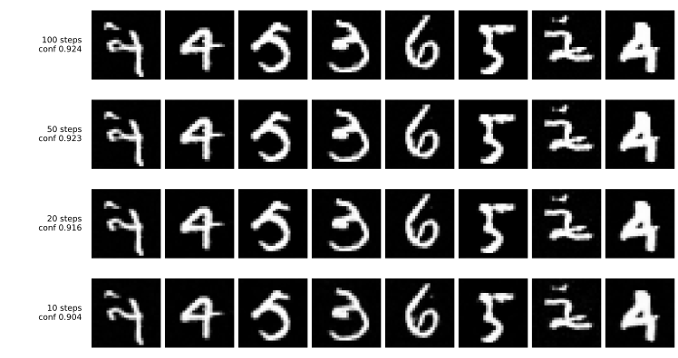

# DDIM — 스텝을 건너뛴다

[앞 쪽](01_ddpm.md)이 남긴 값은 컸다. 표본 하나에 네트워크를 **1,000번** 지나야 했고, 5,000장에 42분이 들었다. [DCGAN](../generative/02_dcgan.md)은 한 번이면 끝난다.

이 쪽은 **모델을 손대지 않는다.** 같은 `mnist_ddpm.pt`를 그대로 읽어 뽑는 방법만 바꾼다.

---

## 1. 무엇을 바꾸는가

기본 DDPM 샘플러는 인접한 시간 단계를 역순으로 따라가며 잡음을 추가한다. 단계를 줄이려면 줄인 시간 간격에 맞는 전이식을 사용해야 한다. DDIM은 같은 잡음 예측 모델로 선택한 시간 단계 사이를 이동하도록 샘플링 경로를 구성한다. 잡음이 있다는 이유만으로 모든 확산 샘플러가 단계를 건너뛸 수 없는 것은 아니다.

이 페이지는 DDIM의 $\eta=0$ 설정을 사용한다. 매 단계 새 잡음을 넣지 않는 결정적인 경로이며, DDIM에도 $\eta>0$인 확률적 설정이 있다. 각 단계에서 다음 두 계산을 수행한다.

1. 지금 자리 $x_t$에서 $\varepsilon_\theta(x_t, t)$을 맞혀 **원본이 무엇일지 추측**한다

$$
\hat{x}_0 = \frac{x_t - \sqrt{1 - \bar{\alpha}_t}\, \varepsilon_\theta(x_t, t)}{\sqrt{\bar{\alpha}_t}}
$$

2. 그 추측을 **다음 스텝 자리로 다시 보낸다**

$$
x_{t'} = \sqrt{\bar{\alpha}_{t'}}\, \hat{x}_0 + \sqrt{1 - \bar{\alpha}_{t'}}\, \varepsilon_\theta(x_t, t)
$$

무작위 항이 없으므로 $t'$은 $t-1$일 필요가 없다. **1,000에서 900으로 건너뛰어도 된다.**

!!! note "덤으로 따라오는 것"
    각 단계에서 추가하는 무작위성이 사라졌으므로 **처음 뽑은 $z$가 그림을 온전히 정한다.** 같은 $z$는 언제나 같은 그림이 된다. [VAE](../latent_generative/01_vae.md)나 [GAN](../generative/01_gan.md)이 그랬던 것처럼 잠재 공간이 생기는 계산이고, DDPM에는 없던 성질이다.

<div class="storybox" markdown>

**그림으로 보는 AI 1.** 이 장이 「없다」고 적어 온 것이, 여기서는 반쯤 있다

이렇게 길을 정해 버리는 수법에 DDIM이라는 이름을 붙인 글은 2020년 10월 지아밍 송(Jiaming Song)과 두 동료의 것이다.

바로 위 「덤」이 적은 말을 한 걸음만 더 밀어 보자. 길에 무작위가 없으면 씨앗 하나가 그림 하나를 정한다. 그런데 **길에 무작위가 없다는 것은 거꾸로도 갈 수 있다는 뜻**이기도 하다. 그림을 손에 들고 걸음을 되짚어 올라가면 그 그림을 낳은 씨앗이 나온다. 그림을 보고 씨앗을 돌려주는 장치 — 이 장이 **인코더**라 불러 온 것이고, 5.3절에서 GAN이 내주고 못 돌려받은 바로 그것이다.

그런데 이 쪽 5절의 표에는 DDIM 줄에도 「인코더: 없다」라고 적혀 있다.

**그 「없다」가 아주 틀린 것은 아니다.** 되짚는 길에 한 군데 금이 가 있기 때문이다. 내려올 때 한 걸음은 「지금 자리에서 본 잡음」을 써서 다음 자리로 간다. 거꾸로 올라가려면 **바로 그 잡음**이 있어야 하는데, 손에 있는 것은 이미 내려와 버린 다음 자리뿐이다. 그래서 거기서 본 잡음으로 대신 쓴다. 두 자리가 가까울수록 이 바꿔치기가 작고, **두 자리가 가깝다는 것은 곧 스텝을 많이 밟았다는 뜻**이다.


왼쪽 칸이 그 금의 크기다. **스텝을 1,000 밟으면 되찾은 씨앗이 0.5%밖에 어긋나지 않는다** — 사실상 되찾은 것이다. 100스텝에서 4.6%, 그리고 이 쪽이 가장 자랑하는 **10스텝에서는 37%** 어긋난다. 그쯤 되면 되찾았다고 할 수 없다.

오른쪽 칸은 이 쪽 표의 시간 열이다. 두 칸을 나란히 놓으면 할 말이 하나로 모인다. **같은 손잡이가 둘을 함께 돌린다.** 26초로 뽑는 자리에서는 씨앗을 되찾을 수 없고, 씨앗을 제대로 되찾는 자리에서는 2,495초를 도로 치른다. 이 쪽은 「확산은 품질을 시간으로 산다」고 닫는데, 그 손잡이에 매달린 것이 품질만은 아니다.

**다만 왼쪽 칸은 MNIST가 아니다.** 봉우리 둘짜리 장난감 자료에서 참 잡음예측기를 식으로 적어 돌린 것이고, 학습한 모델은 쓰지 않았다. 그러니 저 37%와 0.5%는 **오직 걸음을 띄엄띄엄 밟아서 생긴 몫**이다. 실제로는 학습한 모델이 잡음을 정확히 맞히지도 못하므로 **어긋남은 저것보다 작을 수 없고 더 클 것**이다. 그리고 이 쪽의 DDPM 웨이트로 실제로 되짚어 본 사람은 여기 없다 — 그 수가 얼마일지는 돌려 보기 전에는 말할 수 없다.

_확인한 곳 — J. Song, C. Meng, S. Ermon, "Denoising Diffusion Implicit Models", *ICLR 2021* (arXiv:2010.02502, 2020년 10월). $\eta = 0$일 때 과정이 결정적이 되어 $x_T$를 그림의 잠재 표현으로 다룰 수 있고 그 공간에서 의미 있는 보간이 된다는 것이 그 글의 관찰이며, 본문에서 「거꾸로 올라가 씨앗을 되찾는 일」이라 한 것을 흔히 **DDIM inversion** 이라 부른다. 「바꿔치기」는 되짚는 걸음에서 $\varepsilon_\theta(x_t, t)$ 대신 $\varepsilon_\theta(x_{t'}, t')$ 을 쓰는 것을 가리키고, 그래서 생기는 어긋남은 **이산화 오차**다. **왼쪽 칸의 수는 그 글의 것도 이 쪽의 것도 아니다** — 자료를 1차원 두 봉우리 가우스 섞음으로 두면 참 잡음예측기를 닫힌 꼴로 적을 수 있어, `figures/make_figures.py` 가 그 식으로 DDIM 의 두 걸음을 왕복시켜 센 것이다. 오른쪽 칸은 이 쪽 3절 표의 시간 열을 그대로 옮겼다._

</div>

---

## 2. 코드

```python
"""DDIM. 스텝을 건너뛰어 같은 모델에서 더 싸게 뽑는다.

앞 쪽에서 학습해 둔 mnist_ddpm.pt를 읽어 쓴다. 모델은 손대지 않는다.
자료·심판·U-Net 정의는 앞 쪽과 같다.
"""
import json, time
import torch, torch.nn as nn, torch.nn.functional as F, torch.optim as optim
from torch.utils.data import DataLoader, TensorDataset
import torchvision, torchvision.transforms as transforms

device = torch.device("mps" if torch.backends.mps.is_available() else "cpu")
SEED, BATCH, LR, EPOCHS, T = 42, 100, 1e-3, 30, 1000
N_SAMPLE = 5000
JM, JS = 0.1307, 0.3081

tf = transforms.Compose([transforms.ToTensor(), transforms.Normalize((0.5,), (0.5,))])
tr = torchvision.datasets.MNIST("./data", train=True, transform=tf)
te = torchvision.datasets.MNIST("./data", train=False, transform=tf)
Xtr = torch.cat([x for x,_ in DataLoader(tr, batch_size=2000)])
Xte = torch.cat([x for x,_ in DataLoader(te, batch_size=2000)])
yte = torch.cat([y for _,y in DataLoader(te, batch_size=2000)])

class JudgeCNN(nn.Module):
    def __init__(self):
        super().__init__()
        self.conv1=nn.Conv2d(1,32,3,padding=1); self.conv2=nn.Conv2d(32,64,3,padding=1)
        self.pool=nn.MaxPool2d(2,2); self.dropout=nn.Dropout(0.25)
        self.fc1=nn.Linear(64*7*7,128); self.fc2=nn.Linear(128,10)
    def forward(self,x):
        x=self.pool(torch.relu(self.conv1(x))); x=self.pool(torch.relu(self.conv2(x)))
        return self.fc2(self.dropout(torch.relu(self.fc1(x.flatten(1)))))

judge = JudgeCNN().to(device)
judge.load_state_dict(torch.load("mnist_judge.pt", weights_only=True)); judge.eval()

@torch.no_grad()
def predict(x):
    xj = (((x+1)/2)-JM)/JS
    p = torch.cat([torch.softmax(judge(xj[i:i+1000].to(device)),1).cpu() for i in range(0,len(xj),1000)])
    return p.max(1)

def within_var(im01, grp, min_n=20):
    vs,ws=[],[]
    for d in range(10):
        g=im01[grp==d]
        if len(g)<min_n: continue
        vs.append(g.flatten(1).var(0).mean().item()); ws.append(len(g))
    return sum(v*w for v,w in zip(vs,ws))/sum(ws) if vs else 0.0

REAL = within_var((Xte+1)/2, yte)

def evaluate(s, tag):
    conf,pred = predict(s)
    sh = torch.bincount(pred,minlength=10).float(); sh/=sh.sum(); nz=sh[sh>0]
    bal = (-(nz*nz.log()).sum()/torch.tensor(10.0).log()).item()
    wv = within_var((s+1)/2, pred)
    r = dict(confidence=round(conf.mean().item(),4), balance=round(bal,4),
             biggest=round(sh.max().item(),4), within=round(wv/REAL,4))
    print(f"  {tag:18s} 확신도 {r['confidence']:.3f}  고름 {r['balance']:.3f}  "
          f"최대몫 {r['biggest']:.3f}  클래스안 다양함 {r['within']:.3f}", flush=True)
    return r

# === 앞으로 가는 흐름: 미리 셈해 두는 상수들 ===
betas = torch.linspace(1e-4, 0.02, T)
alphas = 1.0 - betas
abar = torch.cumprod(alphas, 0)

class Block(nn.Module):
    def __init__(self, cin, cout, temb):
        super().__init__()
        self.c1=nn.Conv2d(cin,cout,3,padding=1); self.c2=nn.Conv2d(cout,cout,3,padding=1)
        self.t=nn.Linear(temb,cout); self.n1=nn.GroupNorm(8,cout); self.n2=nn.GroupNorm(8,cout)
        self.skip=nn.Conv2d(cin,cout,1) if cin!=cout else nn.Identity()
    def forward(self,x,t):
        h=F.silu(self.n1(self.c1(x)))
        h=h+self.t(t)[:,:,None,None]
        h=F.silu(self.n2(self.c2(h)))
        return h+self.skip(x)

class UNet(nn.Module):
    """28 -> 14 -> 7 -> 14 -> 28. 건너뛰기 이음을 갖춘 작은 U-Net."""
    def __init__(self, ch=64, temb=128):
        super().__init__()
        self.temb=temb
        self.tmlp=nn.Sequential(nn.Linear(temb,temb), nn.SiLU(), nn.Linear(temb,temb))
        self.d1=Block(1,ch,temb); self.d2=Block(ch,ch*2,temb)
        self.mid=Block(ch*2,ch*2,temb)
        self.u2=Block(ch*4,ch,temb); self.u1=Block(ch*2,ch,temb)
        self.out=nn.Conv2d(ch,1,3,padding=1)
        self.pool=nn.AvgPool2d(2)
    def temb_of(self,t):
        half=self.temb//2
        f=torch.exp(-torch.arange(half,device=t.device)*torch.log(torch.tensor(10000.0))/(half-1))
        a=t[:,None].float()*f[None]
        return torch.cat([a.sin(),a.cos()],1)
    def forward(self,x,t):
        e=self.tmlp(self.temb_of(t))
        h1=self.d1(x,e)                      # 28
        h2=self.d2(self.pool(h1),e)          # 14
        m=self.mid(self.pool(h2),e)          # 7
        u=F.interpolate(m,scale_factor=2)    # 14
        u=self.u2(torch.cat([u,h2],1),e)
        u=F.interpolate(u,scale_factor=2)    # 28
        u=self.u1(torch.cat([u,h1],1),e)
        return self.out(u)

net = UNet().to(device)
net.load_state_dict(torch.load("mnist_ddpm.pt", weights_only=True))
net.eval()


@torch.no_grad()
def sample_ddim(net, steps, n=N_SAMPLE, bs=500):
    """스텝을 건너뛴다. 잡음을 더하지 않으므로 z가 그림을 온전히 정한다."""
    ts = torch.linspace(T - 1, 0, steps).long().tolist()      # 1000스텝에서 골라낸다
    out = []
    ab_ = abar.to(device)
    g = torch.Generator().manual_seed(SEED)
    for i in range(0, n, bs):
        x = torch.randn(bs, 1, 28, 28, generator=g).to(device)
        for j, t in enumerate(ts):
            tt = torch.full((bs,), t, device=device, dtype=torch.long)
            eps = net(x, tt)
            a = ab_[t]
            x0 = (x - (1 - a).sqrt() * eps) / a.sqrt()        # 지금 자리에서 본 원본
            if j + 1 < len(ts):
                a_next = ab_[ts[j + 1]]
                # 그 원본을 다음 스텝 자리로 다시 보낸다. 무작위 항이 없다
                x = a_next.sqrt() * x0 + (1 - a_next).sqrt() * eps
            else:
                x = x0
        out.append(x.cpu())
    return torch.cat(out).clamp(-1, 1)


if __name__ == "__main__":
  for steps in (100, 50, 20, 10):
      t0 = time.time()
      s = sample_ddim(net, steps)
      evaluate(s, f"DDIM {steps}스텝")
      print(f"      ({time.time()-t0:.0f}s)")
```

**출력:**

```
  DDIM 100스텝       확신도 0.924  고름 0.979  최대몫 0.185  클래스안 다양함 1.110
      (290s)
  DDIM 50스텝        확신도 0.923  고름 0.979  최대몫 0.187  클래스안 다양함 1.097
      (158s)
  DDIM 20스텝        확신도 0.916  고름 0.977  최대몫 0.191  클래스안 다양함 1.060
      (69s)
  DDIM 10스텝        확신도 0.904  고름 0.971  최대몫 0.204  클래스안 다양함 0.979
      (26s)
```

---

## 3. 96배 빠르고 평균 확신도는 약 4% 낮다

| | 스텝 | 확신도 | 클래스 균형도 | 최대 클래스 | 클래스 안 다양함 | 5,000장 뽑는 데 |
|---|---|---|---|---|---|---|
| [DDPM](01_ddpm.md) | 1,000 | **0.940** | **0.986** | **0.175** | 1.047 | 2,495초 |
| DDIM | 100 | 0.924 | 0.979 | 0.185 | 1.110 | 290초 |
| DDIM | 50 | 0.923 | 0.979 | 0.187 | 1.097 | 158초 |
| DDIM | 20 | 0.916 | 0.977 | 0.191 | 1.060 | 69초 |
| DDIM | **10** | 0.904 | 0.971 | 0.204 | **0.979** | **26초** |

**스텝을 100분의 1로 줄이면 샘플링이 96배 빨라지고 확신도는 0.940에서 0.904로 떨어진다.** 3.8% 손해다.



`sample_ddim`이 안에서 씨앗을 고정하므로 네 줄은 **같은 $z$에서 출발한다.** 그래서 여기서는 칸끼리 짝이 맞고, 달라진 것은 스텝 수뿐이다.

**100에서 20까지는 같은 그림이라고 해도 될 만큼 닮았다.** 다섯 배를 줄였는데 획이 거의 그대로다. 10에서야 획이 조금 뭉툭해지고 가는 선이 묻는다 — 표의 확신도 0.904와 클래스 안 다양함 0.979가 그 뭉툭함이다. 위 표의 수가 왜 그렇게 천천히 나빠지는지를 이 네 줄이 보여 준다.


눈여겨볼 자리가 둘 있다.

**100스텝에서 50스텝은 거의 공짜다.** 확신도 0.924와 0.923, 클래스 균형도는 소수 셋째 자리까지 같다. 그런데 시간은 절반이다. 다만 **이 단일 실행에서 그렇다는 것**이고, 두 값의 차이가 재는 흔들림보다 큰지는 재지 않았다.

**10스텝짜리가 DCGAN과 맞먹는다.** 확신도 0.904 대 0.909, 클래스 균형도 0.971 대 0.970이다. 26초는 GAN의 한 번짜리 순전파보다는 여전히 느리지만, 5.3절이 얻은 자리를 **거의 같은 값으로** 얻는다는 뜻이다.

이 "맞먹는다"는 [DDPM 쪽](01_ddpm.md)이 시드 다섯 개로 잰 뒤 오히려 단단해졌다. DCGAN의 확신도는 시드에 따라 0.899\~0.906을 오가는데, **DDIM 10스텝의 0.904가 그 안에 든다.** 곧 두 값이 가까운 정도가 아니라, DCGAN을 다시 학습할 때 나올 법한 값 가운데 하나다.

!!! warning "다만 DDIM 쪽은 시드 하나다"
    위 표의 DDIM 값들은 모두 시드 42로 학습한 **하나의 DDPM 웨이트**에서 나왔다. 스텝 수만 바꾸었을 뿐 다시 학습하지 않았으므로, 이 표의 세로 방향(스텝 수에 따른 변화)은 믿을 만하지만 **가로 방향으로 다른 모델과 견줄 때는 DDIM 쪽에만 오차 막대가 없다.**

    위의 "맞먹는다"가 성립하는 것은 DCGAN 쪽 범위 안에 DDIM의 점 하나가 들어가기 때문이다. DDIM을 다섯 벌 학습하면 그 범위가 DCGAN 범위보다 넓을지 좁을지는 재지 않았다.

---

## 4. 이 자가 또 이상하게 움직인다

클래스 안 다양함 열을 스텝 수 차례로 읽어 보라.

$$
1.047 \;\to\; 1.110 \;\to\; 1.097 \;\to\; 1.060 \;\to\; 0.979
$$

**단조롭지 않다.** 1,000스텝에서 100스텝으로 갈 때 **올라갔다가**, 거기서부터 내려온다. 그리고 10스텝에서 1을 밑으로 지난다.

단계 수를 줄인다고 모든 품질 지표가 단조롭게 나빠져야 하는 것은 아니다. 확신도와 클래스 균형도는 얌전히 단조롭게 내려가는데 이 자만 다르게 움직인다.

[5.3절](../generative/index.md)이 DCGAN의 1.085를 두고 적어 둔 경고를 다시 읽을 자리다.

> 1을 넘었다는 것은 **이 자가 더 이상 다양함만 재고 있지 않다**는 신호로 보는 편이 안전하다.

여기서 그 신호가 더 또렷해진다. **10스텝짜리가 1에 가장 가까운 0.979를 받는데, 확신도는 가장 낮다.** 가장 숫자답지 않은 표본이 "진짜만큼 다양하다"는 점수를 받은 것이다.

까닭을 짐작하면 이렇다. 이 자는 심판이 **같은 클래스로 읽은 표본들** 사이의 화소 분산이다. 스텝이 적어 흐릿하거나 어정쩡한 표본이 섞이면 무리 안이 지저분해져 분산이 커진다. 1,000스텝에서 100스텝으로 갈 때 오른 것은 그 몫으로 보인다. 10스텝에서 도로 내려간 것은 또 다른 이야기가 필요한데, **이 실험만으로는 가를 수 없다.**

확실한 것은 하나다. **이 열의 값이 1에 가깝다고 좋은 모델이라 읽으면 안 된다.**

---

## 5. 5장이 걸어온 길

| | 뽑을 수 있는가 | 인코더 | 확신도 | 클래스 균형도 | 순전파 횟수 |
|---|---|---|---|---|---|
| [AE_MLP-64](../dimreduction/03_ae_mlp.md) | 억지로 | 있다 | 0.737 | 0.580 | 1 |
| [VAE-64](../latent_generative/01_vae.md) | 사전분포에서 | 있다 | 0.758 | 0.887 | 1 |
| [GAN (MLP)](../generative/01_gan.md) | 사전분포에서 | **없다** | 0.908 | 0.945 | 1 |
| [DCGAN](../generative/02_dcgan.md) | 사전분포에서 | **없다** | 0.909 | 0.970 | 1 |
| [DDPM](01_ddpm.md) | 사전분포에서 | 없다 | **0.940** | **0.986** | **1,000** |
| DDIM 10스텝 | 사전분포에서 | 없다 | 0.904 | 0.971 | **10** |

**확산은 품질을 시간으로 산다.** 5.2절의 VAE는 되살리기를 희생해 분포 커버리지를 샀고, 5.3절의 GAN은 인코더와 학습 안정성을 희생해 선명함을 샀다. 확산이 내놓은 값은 **뽑는 시간**이며, DDIM은 그 값을 얼마든지 깎을 수 있게 하되 깎은 만큼 품질을 돌려준다.

표의 26초는 한 장이 아니라 5,000장을 생성한 시간이다. 지연이 중요한 경우에는 실제 서비스의 배치 크기와 장치에서 시간을 확인해야 한다. 이 기록은 품질 지표와 샘플링 단계 수 사이의 비용을 비교하는 예다.

---

## 연습문제

<div class="drillbox" markdown>

**연습문제 1.** <span class="diff med" title="중간"></span>
DDIM은 무작위 항이 없어 같은 $z$가 언제나 같은 그림이 된다. 이 성질로 무엇을 할 수 있는가?

</div>

??? success "풀이"
    **잠재 공간을 훑을 수 있다.** $z_1$과 $z_2$ 사이를 이어 그 위의 점들을 모두 디코딩하면, [5.1절이 2차원 잠재 공간을 격자로 훑은 것](../dimreduction/03_ae_mlp.md)과 같은 그림을 얻는다. DDPM은 초기 잡음만 고정해도 추가 잡음 때문에 결과가 달라질 수 있다. 전체 난수 경로를 고정하면 재현 가능한 비교는 가능하다.

    **그림을 고칠 수도 있다.** 앞으로 가는 흐름을 DDIM 식으로 거꾸로 돌리면 주어진 그림에 해당하는 $z$를 찾을 수 있고($DDIM\ inversion$), 그 $z$를 조금 움직여 되돌리면 원본과 닮은 변형을 얻는다. [5.3절 연습문제](../generative/index.md)가 "GAN에는 인코더가 없어 그림을 잠재 표현으로 되돌릴 수 없다"고 적었는데, DDIM은 **학습 없이** 그 일을 근사한다.

    다만 온전한 인코더는 아니다. 되돌리기가 근사이므로 원본이 정확히 복원되지 않고, 스텝을 줄일수록 어긋남이 커진다.

---

<div class="drillbox" markdown>

**연습문제 2.** <span class="diff hard" title="어려움"></span>
본문은 스텝을 $[T-1, 0]$에서 고르게 골랐다(`torch.linspace`). 고르지 않게 고르면 나아질 수 있겠는가? 어느 쪽에 스텝을 몰아야 하는가?

</div>

??? success "풀이"
    **나아질 수 있고, 실제로 그렇게 한다.**

    잡음 수준과 복원 난이도는 시간 단계에 따라 달라진다. 그러나 선형 $\beta$ 일정에서 $\bar{\alpha}_t$가 작은 $t$에서 항상 가장 빠르게 변하는 것은 아니다. 적절한 단계 배치는 잡음 일정, 모델과 샘플러에 따라 달라진다.

    균등 시간 간격 외에 이차 간격이나 로그 신호 대 잡음 비를 기준으로 한 배치를 비교할 수 있다. 어느 쪽이 나은지는 같은 모델과 평가 표본으로 확인해야 하며, 작은 $t$에 몰아야 한다고 일반화하지 않는다.

    실제로 쓰이는 방법들이 이 자리를 다룬다. 이차 간격(quadratic spacing)이 흔하고, [31장](../../ch30/index.md)이 다루는 DPM-Solver 같은 것들은 한 스텝 안에서 더 고차원의 어림을 써서 같은 스텝 수로 더 멀리 간다.

    확인하려면 본문 코드의 `torch.linspace(T - 1, 0, steps)`만 바꾸어 같은 스텝 수로 재어 보면 된다. 모델을 다시 학습할 필요가 없다는 점이 이 쪽 전체의 요점이기도 하다.

---

<div class="drillbox" markdown>

**연습문제 3.** <span class="diff easy" title="쉬움"></span>
"뽑는 시간은 스텝 수에 비례한다"는 말을 표로 확인해 보라. 다섯 줄에서 **스텝 하나당 몇 초**인지 계산하고, 그 값이 한결같은지 보라. 한결같지 않다면 그것을 어떻게 읽어야 하는가?

</div>

??? success "풀이"
    ```python
    for steps, sec in [(10, 26), (20, 69), (50, 158), (100, 290), (1000, 2495)]:
        print(f"{steps:5}스텝  {sec:5}초  스텝당 {sec/steps:.2f}초")
    ```

    ```
       10스텝     26초  스텝당 2.60초
       20스텝     69초  스텝당 3.45초
       50스텝    158초  스텝당 3.16초
      100스텝    290초  스텝당 2.90초
     1000스텝   2495초  스텝당 2.50초
    ```

    **한결같지 않다.** 2.50초에서 3.45초까지, 가장 큰 값이 가장 작은 값의 1.38배다.

    먼저 가려야 할 것이 있다. **마지막 줄은 다른 샘플링이다.** 1,000스텝은 DDPM이고 위 넷은 DDIM이다. 스텝마다 하는 일이 같지 않으니 스텝당 값을 다섯 줄에 걸쳐 나란히 견주면 안 된다. DDIM 네 줄만 보아도 2.60\~3.45로 여전히 흔들린다.

    그러면 남은 흔들림은 무엇인가. **한 번씩만 재었기 때문이다.** 시간은 기계가 그때 무엇을 하고 있었는지에 달려 있어서, 같은 코드를 다시 돌려도 10%쯤은 달라진다. 스텝당 값이 20스텝에서 가장 크고 10스텝에서 가장 작은 것도 어떤 기제가 아니라 **그 두 번의 측정이 그렇게 떨어진 것**으로 읽는 것이 옳다.

    곧 [4.1절](../../ch04/01_two_ladders.md)이 정확도에 세운 규율이 **시간에도 그대로 적용된다.** 한 번 잰 시간으로는 10% 차이를 말할 수 없다.

    그래서 본문이 하는 말은 안전한 쪽에 있다. "96배 빨라진다"는 2495와 26을 나눈 값이고, 96배는 10%의 흔들림으로 뒤집히지 않는다. 반면 "스텝당 비용이 스텝 수에 따라 줄어든다" 같은 말을 이 표로 하려 하면 근거가 모자라다.

    !!! note "외삽은 더 위험하다"
        DDIM 네 점에 직선을 맞추면 시간 $\approx 2.88 \times$스텝$ + 6.2$가 나오고, 이것으로 1,000스텝을 외삽하면 2,885초다. 실제 DDPM의 2,495초보다 **16% 높다.**

        스텝당 비용이 샘플링마다 다르니 당연한 일이지만, 네 점이 직선에 잘 맞는다는 것만 보고 밖으로 늘리면 이렇게 어긋난다. **맞춘 구간 안에서만 쓰는 것**이 직선의 쓸모다.

