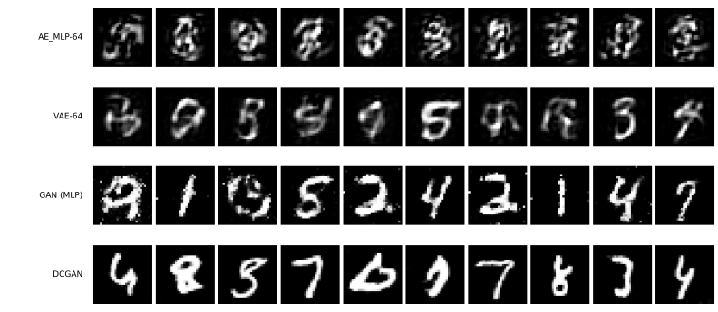

# 확산 모델 — 전체 그림

[5.2절](../latent_generative/index.md)의 VAE는 열 가지를 고루 만들었지만 흐릿했다. [5.3절](../generative/index.md)의 GAN은 선명했지만 인코더를 잃었고, 학습시키려면 이 책의 규약을 깨야 했다.

이 실험의 확산 모델은 잡음 예측 로스로 학습하고 여러 단계의 복원으로 표본을 만든다. 일반적인 DDPM에도 원본을 잠재 코드로 바꾸는 학습된 인코더는 없으며, VAE의 모든 기능을 유지한 채 품질만 개선하는 것은 아니다. 특히 샘플링 비용이 크다.

---

## 1. 5장이 만든 긴장

| | 얻은 것 | 치른 값 |
|---|---|---|
| [VAE](../latent_generative/01_vae.md) | 클래스 균형도 0.887 — 고루 만든다 | 흐릿하다 (클래스 안 다양함 0.628) |
| [GAN](../generative/01_gan.md) | 선명하다 (0.953) | 인코더가 없다, 규약을 깨야 한다 |
| **확산** | **둘 다** | **뽑는 데 네트워크를 1,000번 지난다** |

값이 품질에서 **시간으로** 옮겨 갔다. 그리고 시간은 깎을 수 있다 — [DDIM](02_ddim.md)이 그 이야기다.

!!! note "31장과의 사이"
    [31장 확산 모델](../../ch30/index.md)이 이 주제를 본격적으로 다룬다. 스코어 매칭, 확률 미분 방정식 틀, 조건 생성이 거기 있다. 이 절이 하는 일은 다르다. **5장이 줄 세워 온 다섯 모델 옆에 한 칸을 더 놓고 같은 자로 재는 것**이다.

---

## 2. 두 스텝

| 쪽 | 바꾸는 것 | 얻는 것 |
|---|---|---|
| [DDPM](01_ddpm.md) | **로스** (적대적 → 잡음 맞히기) | 확신도 0.909 → 0.940 (클래스 균형도는 스프레드 안) |
| [DDIM](02_ddim.md) | **뽑는 법** (모델은 그대로) | 2,495초 → 26초, 확신도 0.940 → 0.904 |

[5.3절](../generative/index.md)이 로스와 구조를 나누어 두 쪽에 담은 것과 같은 구조다. 여기서는 **학습과 샘플링**을 나눈다. DDIM은 모델을 다시 학습하지 않는다.

---

## 3. 여섯 모델

| | 확신도 | 클래스 균형도 | 최대 클래스 | 클래스 안 다양함 | 순전파 |
|---|---|---|---|---|---|
| 진짜 데이터 | — | — | — | **1.00** | — |
| [AE_MLP-64](../dimreduction/03_ae_mlp.md) | 0.737 | 0.580 | 0.619 | 0.640 | 1 |
| [VAE-64](../latent_generative/01_vae.md) | 0.758 | 0.887 | 0.343 | 0.628 | 1 |
| [GAN (MLP)](../generative/01_gan.md) | 0.908 | 0.945 | 0.214 | 0.953 | 1 |
| [DCGAN](../generative/02_dcgan.md) | 0.909 | 0.970 | **0.162** | 1.085 | 1 |
| [**DDPM**](01_ddpm.md) | **0.940** | **0.986** | 0.175 | **1.047** | 1,000 |
| [DDIM 10스텝](02_ddim.md) | 0.904 | 0.971 | 0.204 | 0.979 | 10 |

확신도가 0.737에서 0.940까지 올라왔다. 이 장이 [5.1절](../dimreduction/index.md)에서 출발할 때 자기 인코더의 표본은 절반 남짓만 숫자로 읽혔다.

!!! warning "굵은 칸이 모두 이긴 칸은 아니다"
    굵게 칠한 것은 그 열에서 가장 좋은 값일 뿐이다. 값이 가장 좋다는 것과 **다른 모델과 뜻 있게 다르다**는 것은 별개이며, 아래 두 칸이 그렇다.

    | | DCGAN | DDPM | |
    |---|---|---|---|
    | 클래스 균형도 | 0.966\~0.978 | 0.971\~0.993 | 겹친다 |
    | 최대 클래스 | 0.147\~0.163 | 0.123\~0.172 | 겹친다 |

    시드 다섯 개로 재면 두 칸 모두 범위가 겹친다. 곧 이 표에서 DDPM이 DCGAN을 **뚜렷이 앞선 자는 확신도 하나**다. 위쪽 네 모델과의 차이는 훨씬 커서 이 걱정이 걸리지 않는다.

---

## 4. 규약을 깬 것은 GAN뿐이었다

5.3절은 절을 따로 두어 이렇게 적어야 했다.

> 3장부터 5.2절까지 모든 모델이 Adam $10^{-3}$을 썼다. **이 절의 GAN에는 다른 학습 설정을 사용한다.**

확산 모델은 그 절이 필요 없다. Adam $10^{-3}$, 배치 100, 시드 42 그대로이며 로스가 단조롭게 내려간다.

| | 러닝레이트 | Adam $\beta_1$ | 로스를 믿을 수 있는가 |
|---|---|---|---|
| [GAN](../generative/01_gan.md) | $2 \times 10^{-4}$ | 0.5 | **아니다** — 상대가 바뀐다 |
| [DDPM](01_ddpm.md) | $10^{-3}$ | 0.9 | 학습 목적의 진전을 보여 주지만 표본 품질을 보장하지는 않는다 |

로스를 믿을 수 있다는 것이 실전에서 큰 차이다. GAN에서는 언제 멈출지, 무너지고 있는지를 로스만 보고는 알 수 없어 표본을 눈으로 봐야 했다.

---

## 5. 이 절이 재지 않은 것

**하나, 시드 범위 — 이제 쟀다.** 이 절은 본디 한 시드로만 학습했고, [4.1절](../../ch04/01_two_ladders.md)의 규율대로라면 그것으로는 표의 차이가 뜻이 있는지 말할 수 없다고 적어 두었다. 그래서 DDPM과 DCGAN을 시드 다섯 개씩 새로 학습해 [DDPM 쪽](01_ddpm.md)에 범위를 실었다. 결과는 **반만 맞았다.**

| | 시드 42에서 본 것 | 다섯 시드로 다시 보면 |
|---|---|---|
| 확신도 0.909 → 0.940 | 차이 | **차이** — 범위가 0.029만큼 떨어진다 |
| 클래스 균형도 0.970 → 0.986 | 차이 | 우열을 단정하기 어렵다 — 시드 범위가 겹친다 |

곧 조심한 것이 옳았던 칸과 지나치게 조심한 칸이 함께 있었다. **재기 전에는 어느 쪽인지 알 수 없다**는 것이 이 표의 뜻이다.

**둘, 조건 붙이기.** 5.2절에 [cVAE](../latent_generative/03_cvae.md)가 있듯 확산에도 원하는 숫자를 만드는 길이 있다(Classifier-Free Guidance). 이 절은 다루지 않았고 [31장](../../ch30/index.md)에 있다.

**셋, 클래스 안 다양함이 왜 단조롭지 않은가.** [DDIM 쪽](02_ddim.md)이 이 자가 스텝 수에 따라 올라갔다 내려오는 것을 보이는데, 까닭은 가리지 못했다.
