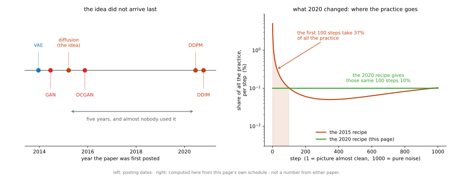

# 확산 모델 — 전체 그림

**들어가는 이야기** — 값이 품질에서 시간으로 옮겨 간다

5장이 여기까지 오면서 무엇을 하나 얻을 때마다 무엇을 하나 내주었다. 뽑을 수 있게 되는 대신 흐릿해졌고, 선명해지는 대신 그림을 수로 되돌리는 길과 학습의 얌전함을 잃었다.

이 절의 기계는 그 맞바꿈에서 빠져나온 것처럼 보인다. 선명하면서 열 가지를 고루 만들고, 이 책이 줄곧 써 온 학습 설정을 하나도 바꾸지 않으며, 로스가 얌전히 내려간다.

공짜는 아니다. 값을 **다른 통화로** 치른다. 지금까지의 기계는 그림 한 장을 만드는 데 신경망을 **한 번** 지나갔다. 이 기계는 **천 번** 지나간다. 5,000장을 뽑는 데 42분이 걸린다.

그러니 이 절이 묻는 것은 「더 좋은가」가 아니라 **「그 시간을 치를 값어치가 있는가」**이고, 이어서 **「그 시간을 깎을 수 있는가」**이다. 뒤 쪽이 그 시간을 96분의 1로 줄이는데, 깎은 만큼 무엇을 돌려주는지도 함께 적는다.

[5.2절](../latent_generative/index.md)의 VAE는 열 가지를 고루 만들었지만 흐릿했다. [5.3절](../generative/index.md)의 GAN은 선명했지만 인코더를 잃었고, 학습시키려면 이 책의 규약을 깨야 했다.

이 실험의 확산 모델은 잡음 예측 로스로 학습하고 여러 단계의 복원으로 표본을 만든다. 일반적인 DDPM에도 원본을 잠재 코드로 바꾸는 학습된 인코더는 없으며, VAE의 모든 기능을 유지한 채 품질만 개선하는 것은 아니다. 특히 샘플링 비용이 크다.

---

## 1. 5장이 만든 긴장

| | 얻은 것 | 치른 값 |
|---|---|---|
| [VAE](../latent_generative/01_vae.md) | 클래스 균형도 0.887 — 고루 만든다 | 흐릿하다 (클래스 안 다양함 0.628) |
| [GAN](../generative/01_gan.md) | 선명하다 (0.953) | 인코더가 없다, 규약을 깨야 한다 |
| **확산** | **둘 다** | **뽑는 데 네트워크를 1,000번 지난다** |

값이 품질에서 **시간으로** 옮겨 갔다. 그리고 시간은 깎을 수 있다 — [DDIM](02_ddim.md)이 그 이야기다.

!!! note "31장과의 사이"
    [31장 확산 모델](../../ch30/index.md)이 이 주제를 본격적으로 다룬다. 스코어 매칭, 확률 미분 방정식 틀, 조건 생성이 거기 있다. 이 절이 하는 일은 다르다. **5장이 줄 세워 온 다섯 모델 옆에 한 칸을 더 놓고 같은 자로 재는 것**이다.

---

## 2. 두 스텝

| 쪽 | 바꾸는 것 | 얻는 것 |
|---|---|---|
| [DDPM](01_ddpm.md) | **로스** (적대적 → 잡음 맞히기) | 확신도 0.909 → 0.940 (클래스 균형도는 스프레드 안) |
| [DDIM](02_ddim.md) | **뽑는 법** (모델은 그대로) | 2,495초 → 26초, 확신도 0.940 → 0.904 |

[5.3절](../generative/index.md)이 로스와 구조를 나누어 두 쪽에 담은 것과 같은 구조다. 여기서는 **학습과 샘플링**을 나눈다. DDIM은 모델을 다시 학습하지 않는다.

**그림으로 보는 AI 1.** 늦게 온 생각이 아니라, 오래 놓여 있던 생각이다

위의 두 표는 차례대로 읽힌다 — 흐릿한 것이 있었고, 선명한 것이 왔고, 둘 다 하는 것이 마지막에 왔다는 식이다. 날짜를 적어 보면 그 차례가 아니다.

확산이라는 생각을 처음 적은 글은 **2015년 3월**에 나왔다. 야샤 솔딕스타인(Jascha Sohl-Dickstein)과 세 동료가 올린 것인데, 이 장이 뒤에 놓은 DCGAN보다 **여덟 달 빠르다.** 그 글에 이 절의 장치가 거의 다 들어 있다. 그림에 잡음을 조금씩 섞어 아무것도 아닌 것으로 만드는 길, 그 길을 거꾸로 되짚는 길, 되짚는 일을 신경망에 맡기는 법까지 적혀 있다.

그런데 다섯 해 가까이 거의 쓰이지 않았다. 다시 꺼내 쓸 만하게 만든 것은 2020년의 조너선 호(Jonathan Ho)와 두 동료이고, 바로 위 표가 DDPM 줄에 「바꾸는 것 — **로스**」, 곧 **틀린 정도를 재는 자**라 적은 것이 그 일이다.

무엇이 바뀌었는지 오른쪽 칸이 보인다. 1,000스텝을 연습할 때 **어느 스텝에 품을 쏟는가**가 다르다. 2015년 방식은 품을 고르게 나누지 않았다. 앞쪽 100스텝 — 아직 그림이 거의 멀쩡한 자리다 — 이 전체 품의 **37%**를 가져가고, 맨 첫 스텝 하나가 혼자 **5%**를 가져간다. 천 개 가운데 하나가 그렇다.

2020년 방식은 그 무게를 **그냥 버렸다.** 모든 스텝을 똑같이 연습한다. 그래서 앞쪽 100스텝의 몫이 37%에서 10%로 줄고, 남는 품이 뒤쪽 — 그림이 심하게 망가져 되짚기 어려운 자리 — 으로 옮겨 간다. 호 일행이 적어 둔 까닭도 그것이다. 거의 멀쩡한 그림을 조금 더 다듬는 일은 쉬우니, 어려운 쪽을 연습시키는 편이 낫다는 것이다. [DDPM 쪽](01_ddpm.md) 코드의 `F.mse_loss(net(xt,t), eps)` 한 줄이 그 「그냥 버렸다」이다 — 스텝마다 붙는 무게가 거기에 없다.

**다만 이것을 「한 줄이 다섯 해를 풀었다」로 읽으면 안 된다.** 그 다섯 해 사이에 바뀐 것이 그 한 줄만은 아니다. 쓸 수 있는 계산기가 커졌고, 되짚는 일을 맡는 신경망의 생김새가 달라졌고, 비슷한 생각을 다른 길로 밀고 간 연구가 2019년에 따로 있었다. **역사는 한 가지만 바꿔 다시 돌려 볼 수가 없다** — 이 책이 [4.1절](../../ch04/01_two_ladders.md)부터 지켜 온 「한 가지만 바꾸고 다시 재라」는 규율을 아예 쓸 수 없는 자리다. 위 그림이 말해 주는 것은 **두 방식의 무게가 달랐다는 사실 하나**이고, 그 하나가 다섯 해를 설명한다는 뜻은 아니다.

_확인한 곳 — J. Sohl-Dickstein, E. A. Weiss, N. Maheswaranathan, S. Ganguli, "Deep Unsupervised Learning using Nonequilibrium Thermodynamics", *ICML 2015* (arXiv:1503.03585, 2015년 3월); J. Ho, A. Jain, P. Abbeel, "Denoising Diffusion Probabilistic Models", *NeurIPS 2020* (arXiv:2006.11239, 2020년 6월). 「어려운 쪽을 연습시키는 편이 낫다」는 뒤 글 3.4절의 관찰이고, 무게를 버린 쪽을 그 글은 $L_{\mathrm{simple}}$이라 부른다. 본문에서 「틀린 정도를 재는 자」라 한 것이 로스, 「2015년 방식의 무게」는 변분 하한의 스텝별 계수이며 그 글 식 (12)가 $L_{\mathrm{simple}}$에서 떼어 낸 $\beta_t^2 / (2\sigma_t^2 \alpha_t (1 - \bar{\alpha}_t))$다. 2019년의 다른 길은 Y. Song, S. Ermon, "Generative Modeling by Estimating Gradients of the Data Distribution", *NeurIPS 2019*이다. **오른쪽 칸의 곡선은 어느 논문에 실린 수도 아니다** — 위 식에 $\sigma_t^2 = \beta_t$와 **이 쪽이 쓰는 일정**(`torch.linspace(1e-4, 0.02, 1000)`)을 넣어 `figures/make_figures.py`가 셈한 것이고, 두 방식을 나란히 보려고 각각 합이 100%가 되게 고쳐 적었다. 왼쪽 칸의 날짜는 arXiv에 처음 올라온 달이다._

---

## 3. 여섯 모델

| | 확신도 | 클래스 균형도 | 최대 클래스 | 클래스 안 다양함 | 순전파 |
|---|---|---|---|---|---|
| 진짜 데이터 | — | — | — | **1.00** | — |
| [AE_MLP-64](../dimreduction/03_ae_mlp.md) | 0.737 | 0.580 | 0.619 | 0.640 | 1 |
| [VAE-64](../latent_generative/01_vae.md) | 0.758 | 0.887 | 0.343 | 0.628 | 1 |
| [GAN (MLP)](../generative/01_gan.md) | 0.908 | 0.945 | 0.214 | 0.953 | 1 |
| [DCGAN](../generative/02_dcgan.md) | 0.909 | 0.970 | **0.162** | 1.085 | 1 |
| [**DDPM**](01_ddpm.md) | **0.940** | **0.986** | 0.175 | **1.047** | 1,000 |
| [DDIM 10스텝](02_ddim.md) | 0.904 | 0.971 | 0.204 | 0.979 | 10 |

확신도가 0.737에서 0.940까지 올라왔다. 이 장이 [5.1절](../dimreduction/index.md)에서 출발할 때는 자기 인코더에서 뽑은 표본 가운데 심판이 확신하는 것이 **열에 넷**(41.4%)뿐이었고, [그 쪽](../dimreduction/06_sampling.md)이 보였듯 눈으로 보면 숫자도 아니었다.

!!! warning "굵은 칸이 모두 이긴 칸은 아니다"
    굵게 칠한 것은 그 열에서 가장 좋은 값일 뿐이다. 값이 가장 좋다는 것과 **다른 모델과 뜻 있게 다르다**는 것은 별개이며, 아래 두 칸이 그렇다.

    | | DCGAN | DDPM | |
    |---|---|---|---|
    | 클래스 균형도 | 0.966\~0.978 | 0.971\~0.993 | 겹친다 |
    | 최대 클래스 | 0.147\~0.163 | 0.123\~0.172 | 겹친다 |

    시드 다섯 개로 재면 두 칸 모두 범위가 겹친다. 곧 이 표에서 DDPM이 DCGAN을 **뚜렷이 앞선 자는 확신도 하나**다(0.935\~0.948 대 0.899\~0.906으로 0.029 떨어진다).

    같은 까닭으로 GAN 줄의 클래스 안 다양함 **0.953도 그대로 읽으면 안 된다.** 그 모델의 다섯 벌 범위는 0.831\~0.905이고 평균은 0.878이라, 0.953은 유난히 잘 뽑힌 한 벌이다([5.3절](../generative/01_gan.md)).

    위쪽 네 모델과의 차이는 훨씬 커서 이 걱정이 걸리지 않는다.

---

## 4. 규약을 깬 것은 GAN뿐이었다

5.3절은 절을 따로 두어 이렇게 적어야 했다.

> 3장부터 5.2절까지 모든 모델이 Adam $10^{-3}$을 썼다. **이 절의 GAN에는 다른 학습 설정을 사용한다.**

확산 모델은 그 절이 필요 없다. Adam $10^{-3}$, 배치 100, 시드 42 그대로이며 로스가 단조롭게 내려간다.

| | 러닝레이트 | Adam $\beta_1$ | 로스를 믿을 수 있는가 |
|---|---|---|---|
| [GAN](../generative/01_gan.md) | $2 \times 10^{-4}$ | 0.5 | **아니다** — 상대가 바뀐다 |
| [DDPM](01_ddpm.md) | $10^{-3}$ | 0.9 | **그렇다** — 다만 학습 목적의 진전일 뿐 표본 품질을 보장하지는 않는다 |

로스를 믿을 수 있다는 것이 실전에서 큰 차이다. GAN에서는 언제 멈출지, 무너지고 있는지를 로스만 보고는 알 수 없어 표본을 눈으로 봐야 했다.

---

## 5. 이 절이 재지 않은 것

**하나, 시드 범위 — 이제 쟀다.** 이 절은 본디 한 시드로만 학습했고, [4.1절](../../ch04/01_two_ladders.md)의 규율대로라면 그것으로는 표의 차이가 뜻이 있는지 말할 수 없다고 적어 두었다. 그래서 DDPM과 DCGAN을 시드 다섯 개씩 새로 학습해 [DDPM 쪽](01_ddpm.md)에 범위를 실었다. 결과는 **반만 맞았다.**

| | 시드 42에서 본 것 | 다섯 시드로 다시 보면 |
|---|---|---|
| 확신도 0.909 → 0.940 | 차이 | **차이** — 범위가 0.029만큼 떨어진다 |
| 클래스 균형도 0.970 → 0.986 | 차이 | 우열을 단정하기 어렵다 — 시드 범위가 겹친다 |

곧 조심한 것이 옳았던 칸과 지나치게 조심한 칸이 함께 있었다. **재기 전에는 어느 쪽인지 알 수 없다**는 것이 이 표의 뜻이다.

**둘, 조건 붙이기.** 5.2절에 [cVAE](../latent_generative/03_cvae.md)가 있듯 확산에도 원하는 숫자를 만드는 길이 있다(Classifier-Free Guidance). 이 절은 다루지 않았고 [31장](../../ch30/index.md)에 있다.

**셋, 클래스 안 다양함이 왜 단조롭지 않은가.** [DDIM 쪽](02_ddim.md)이 이 자가 스텝 수에 따라 올라갔다 내려오는 것을 보이는데, 까닭은 가리지 못했다.
