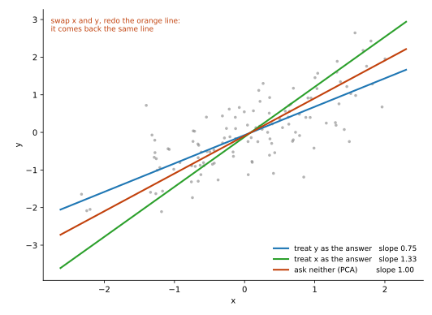
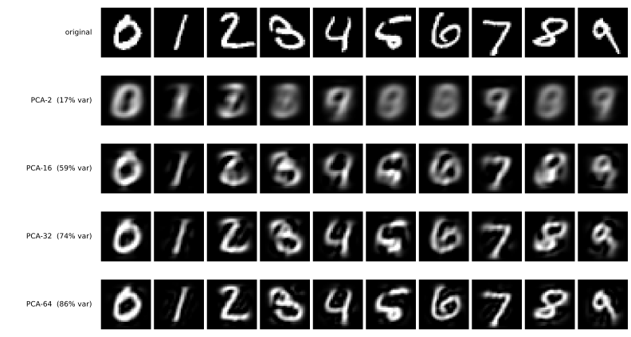

# PCA — 닫힌 형태라 시드가 없다

<div class="leadbox" markdown>

**들어가는 이야기** — 4를 줄였다 폈더니 9가 되었다

784개의 수를 **단 2개**로 줄였다가 다시 펴면 어떻게 될까. 이 쪽이 숫자 열 개로 그것을 해 보는데, 되살아난 열 개 가운데 **여섯 개가 다른 숫자**가 된다.

눈여겨볼 것은 아무렇게나 뒤섞이지 않는다는 점이다. **4도 7이 되고 9도 7이 된다.** 5도 6도 8도 모두 0이 된다. 살아남는 것은 0·1·3·7 넷뿐이다. 곧 숫자들이 서로 바뀌는 것이 아니라 **몇 군데로 빨려 들어간다.**

고장이 아니다. 2개만 남기라고 했으니 기계는 아까운 것부터 쥐고 나머지를 버려야 했고, 4와 9와 7을 가르는 것 — 위쪽 고리가 닫혔는가, 삐침이 있는가 — 이 그 버려진 쪽에 들어 있었다. 2개로 줄이는 셈에서는 그 차이가 **아낄 만큼 크지 않았던** 것이다.

여기에 이 절 내내 돌아올 물음이 들어 있다. 줄이는 기계는 「무엇이 아까운가」를 스스로 정하는데, **그 기준이 우리가 바라는 기준과 같다는 보장이 없다.** 이 쪽의 기계는 「되살렸을 때 어긋남이 작게」만 지킬 뿐, 숫자를 가르라는 말은 한 번도 듣지 못했다.

</div>

사다리의 첫 단계다. PCA도 데이터에서 평균과 주성분을 추정하는 학습이지만, 여기서는 경사 하강법 대신 공분산의 고유분해로 한 번에 셈한다. 무작위 초기화도 에포크도 없다.

**그래서 이 쪽의 수에는 시드에 따른 오차 막대가 없다** — 사다리의 나머지 세 스텝과 달리 같은 데이터에서 같은 값이 나오는 기준선이다. 남는 흔들림은 수치 구현의 작은 차이, 고유벡터의 부호, 겹친 고윳값에서 축이 하나로 정해지지 않는 것뿐이다. (무작위 SVD로 셈하는 PCA 구현은 시드를 쓴다.)


---

## 1. 코드

```python
"""스텝1: PCA. 학습이 없으므로 씨앗도 없고 에포크도 없다.

앞서 만들어 둔 mnist_judge.pt를 읽어, 되살린 그림이 아직 같은 숫자로
읽히는지를 함께 잰다.
"""

import numpy as np
import torch
import torch.nn as nn
from torch.utils.data import DataLoader
import torchvision
import torchvision.transforms as transforms

device = torch.device("mps" if torch.backends.mps.is_available() else "cpu")

tf = transforms.Compose([transforms.ToTensor(),
                         transforms.Normalize((0.1307,), (0.3081,))])
tr_ds = torchvision.datasets.MNIST("./data", train=True, download=True, transform=tf)
te_ds = torchvision.datasets.MNIST("./data", train=False, download=True, transform=tf)


def materialize(ds):
    xs, ys = [], []
    for x, y in DataLoader(ds, batch_size=2000, shuffle=False):
        xs.append(x.flatten(1)); ys.append(y)
    return torch.cat(xs), torch.cat(ys)


Xtr, ytr = materialize(tr_ds)                  # (60000, 784)
Xte, yte = materialize(te_ds)


# === 심판 (앞 쪽에서 학습해 둔 것을 읽는다) =================================
class JudgeCNN(nn.Module):
    def __init__(self):
        super().__init__()
        self.conv1 = nn.Conv2d(1, 32, 3, padding=1)
        self.conv2 = nn.Conv2d(32, 64, 3, padding=1)
        self.pool = nn.MaxPool2d(2, 2); self.dropout = nn.Dropout(0.25)
        self.fc1 = nn.Linear(64 * 7 * 7, 128); self.fc2 = nn.Linear(128, 10)

    def forward(self, x):
        x = self.pool(torch.relu(self.conv1(x)))
        x = self.pool(torch.relu(self.conv2(x)))
        return self.fc2(self.dropout(torch.relu(self.fc1(x.flatten(1)))))


judge = JudgeCNN().to(device)
judge.load_state_dict(torch.load("mnist_judge.pt", weights_only=True))
judge.eval()


@torch.no_grad()
def identity(flat):
    """되살린 (N, 784)를 심판에 넣어 원래 라벨과 같게 읽는 비율."""
    pred = torch.cat([judge(flat[i:i + 1000].reshape(-1, 1, 28, 28).to(device))
                      .argmax(1).cpu() for i in range(0, len(flat), 1000)])
    return 100.0 * (pred == yte).float().mean().item()


# === PCA ====================================================================
if __name__ == "__main__":
  mu = Xtr.mean(0, keepdim=True)
  Xc = Xtr - mu
  cov = (Xc.T @ Xc) / (Xc.shape[0] - 1)          # (784, 784)

  # torch.linalg.eigh는 이 크기에서 실패하는 빌드가 있다(LAPACK 작업공간 문제).
  # numpy의 경로를 float64로 쓰면 안정적이며, 어차피 한 번만 계산한다
  ev, evec = np.linalg.eigh(cov.double().numpy())
  evals = torch.from_numpy(np.ascontiguousarray(ev[::-1])).float()
  evecs = torch.from_numpy(np.ascontiguousarray(evec[:, ::-1])).float()
  torch.save((mu, evecs, evals), "mnist_pca.pt")

  for k in (2, 16, 32, 64):
    V = evecs[:, :k]                            # 위에서 k개
    Z = (Xte - mu) @ V                          # 잠재 표현으로 줄이기
    rec = Z @ V.T + mu                          # 되살리기
    mse = ((Xte - rec) ** 2).mean().item()
    var = (evals[:k].sum() / evals.sum()).item()
    print(f"  PCA-{k:3d}  설명분산 {100 * var:5.1f}%  "
          f"복원 MSE {mse:.5f}  같은 숫자로 {identity(rec):.2f}%")
```

**출력:**

```
  PCA-  2  설명분산  16.8%  복원 MSE 0.58645  같은 숫자로 35.66%
  PCA- 16  설명분산  59.4%  복원 MSE 0.28296  같은 숫자로 83.69%
  PCA- 32  설명분산  74.4%  복원 MSE 0.17728  같은 숫자로 94.39%
  PCA- 64  설명분산  86.2%  복원 MSE 0.09530  같은 숫자로 97.81%
```

<div class="storybox" markdown>

**그림으로 보는 AI 1.** 이 직선이 하나뿐인 까닭은 "무엇이 정답인가"를 묻지 않아서다

이 쪽은 PCA를 사다리의 첫 칸, 흔들리지 않는 기준선으로 쓴다. 그런데 PCA는 자료를 줄이려고 만들어진 것이 아니다. 1901년 칼 피어슨(Karl Pearson)이 던진 물음에서 나왔고, 그 물음은 훨씬 수수했다.

종이에 점이 흩어져 있다. 가장 잘 맞는 직선을 하나 긋고 싶다. 그런데 "잘 맞는다"가 무슨 뜻인지부터 정해져 있지 않았다. 그때까지 쓰던 방법은 점에서 **위아래로** 내려 그은 길이를 쟀다. 가로 위치는 정확하고 세로만 틀릴 수 있다고 본 것이다. 피어슨이 물었다 — **둘 다 재서 얻은 수라면 어떻게 하나?** 키와 몸무게처럼 양쪽 모두 조금씩 틀릴 수 있다면, 한쪽만 틀렸다고 치는 쪽이 오히려 이상하다. 그래서 그는 길이를 **직선까지 가장 가까운 쪽으로**, 곧 비스듬히 쟀다. 논문 제목이 그대로 그 이야기다 — 「점들에 가장 가까운 직선과 평면에 대하여」.



**차이는 수로 바로 드러난다.** 같은 점들에 "y가 맞혀야 할 값"이라 치고 선을 그으면 기울기가 **0.75**다. 거꾸로 "x가 맞혀야 할 값"이라 치면 **1.33**이다. 같은 점인데 선이 둘이다. 무엇을 정답 자리에 놓느냐가 답을 바꿔 버린 것이다.

피어슨의 방식으로 그으면 **1.00** 하나가 나온다. 그리고 x와 y를 서로 바꿔 넣고 다시 그어도 **똑같은 선**이 돌아온다. 물음 안에 "무엇이 정답인가"가 들어 있지 않으니, 바꿔 넣을 것이 없기 때문이다.

**그러니 이 쪽이 PCA를 흔들리지 않는 기준선이라 부른 것은 맞지만, 흔들리지 않는 까닭은 셈이 한 번에 끝나서만이 아니다.** 물음 자체에 임의로 고를 자리가 없다. 바로 위 문단이 적어 둔 작은 흔들림 셋이 흔들림의 전부인 것도 같은 까닭이다.

다만 피어슨이 준 것은 **기하**까지다. 어느 직선이 점들에 가장 가까운가를 답했을 뿐, 그 직선이 "줄였다가 되살렸을 때 어긋남이 가장 작은" 직선이기도 하다는 것은 따로 보여야 하는 이야기다. 그 자리가 [바로 다음 쪽](02_ae_linear.md)이다.

_확인한 곳 — K. Pearson, "On Lines and Planes of Closest Fit to Systems of Points in Space", *Philosophical Magazine* Series 6, **2**(11), 559–572 (1901). 본문에서 「비스듬히 잰다」고 적은 것이 직교 거리이고, 「위아래로 잰다」가 세로 잔차를 쓰는 최소제곱 회귀다. **그림의 점 120개와 기울기 세 개는 그림 코드가 씨앗 0으로 만들어 직접 잰 값이며 논문에 실린 수가 아니다** — 보이려는 것은 특정한 수가 아니라 두 회귀선이 갈라진다는 사실이다. 주성분을 자료 압축에 쓰는 쓰임새는 뒤에 붙은 것이며, 두 직선의 차이를 자료로 잰 것은 [25장](../../ch24/pca/01_pca_2d_numpy.md)에 있다._

</div>

---

## 2. 주성분을 몇 개 쓸 것인가



| | 설명 분산 | 복원 MSE | 같은 숫자로 읽히는 비율 |
|---|---|---|---|
| 원본 (784차원) | 100% | 0 | **98.83%** |
| PCA-2 | 16.8% | 0.5865 | **35.66%** |
| PCA-16 | 59.4% | 0.2830 | 83.69% |
| PCA-32 | 74.4% | 0.1773 | 94.39% |
| PCA-64 | 86.2% | 0.0953 | 97.81% |

64개를 쓰면 97.81%로 거의 돌아온다. 784개를 64개로, 곧 **12분의 1로 줄이고도 숫자의 정체는 거의 그대로**다.

---

## 3. PCA-2는 흐리게 만드는 것이 아니라 다른 숫자로 만든다

그림의 둘째 줄을 심판에게 읽히면 열 칸 가운데 여섯 칸이 다른 숫자가 된다. 2는 3이 되고, **4와 9는 둘 다 7이 되며**, 5·6·8은 모두 0이 된다. 남는 것은 0·1·3·7 넷이다.

수로도 그렇다. **35.66%**다. 우연이 10%이니 아주 못 맞히는 것은 아니지만, 원본의 98.83%에서 3분의 2가 날아갔다.

**2차원 선형 부분공간은 숫자를 서로 겹쳐 놓는다.** 주성분 2개가 쥐고 있는 것은 분산이 가장 큰 두 방향뿐이고, 그 두 방향에서 값이 비슷한 숫자들은 같은 자리로 모인다.

이 실패가 나머지 세 스텝이 무엇을 고쳐야 하는지를 정한다. [다음 스텝](02_ae_linear.md)은 같은 2차원을 경사 하강법으로 찾아보고, 그다음 스텝이 **굽은** 2차원을 찾는다.

---

## 연습문제

<div class="drillbox" markdown>

**연습문제 1.** <span class="diff med" title="중간"></span>
PCA-2에서는 열 숫자가 고르게 나빠지는 것이 아니다. 어느 숫자가 어느 숫자로 가는지, 그리고 어떤 숫자가 제 정체를 지키는지 알아보려면 무엇을 재면 되는가? 실제로 재어 보고 읽어라.

</div>

??? success "풀이"
    **혼동 행렬을 만들면 된다.** 맞은 비율만 세지 말고, 원래 라벨 $i$가 어떤 라벨 $j$로 읽혔는지를 $10 \times 10$ 표에 쌓는다. 본문의 반복문은 마지막에 PCA-64를 남겨 두므로 $k = 2$로 다시 사영해야 하고, 심판은 $(N, 1, 28, 28)$을 받으므로 `reshape` 가 필요하다.

    ```python
    V = evecs[:, :2]                                   # k = 2로 다시
    rec2 = ((Xte - mu) @ V) @ V.T + mu

    with torch.no_grad():
        pred = torch.cat([judge(rec2[i:i + 1000].reshape(-1, 1, 28, 28).to(device))
                          .argmax(1).cpu() for i in range(0, len(rec2), 1000)])

    conf = torch.zeros(10, 10, dtype=torch.long)
    for true, p in zip(yte, pred):
        conf[true, p] += 1

    off = sorted(((int(conf[i, j]), i, j) for i in range(10) for j in range(10) if i != j),
                 reverse=True)
    for c, i, j in off[:5]:
        print(f"  {i} -> {j}   {c:4d}장  (그 숫자의 {100 * c / int(conf[i].sum()):4.1f}%)")
    print("  제 숫자로 남은 비율")
    for i in range(10):
        print(f"    {i}: {100 * int(conf[i, i]) / int(conf[i].sum()):5.1f}%")
    ```

    ```
      9 -> 7    891장  (그 숫자의 88.3%)
      4 -> 7    889장  (그 숫자의 90.5%)
      6 -> 0    507장  (그 숫자의 52.9%)
      2 -> 3    456장  (그 숫자의 44.2%)
      8 -> 1    388장  (그 숫자의 39.8%)
      제 숫자로 남은 비율
        0:  92.7%
        1:  98.5%
        2:   0.0%
        3:  68.5%
        4:   0.0%
        5:   0.0%
        6:   0.0%
        7:  80.7%
        8:   0.0%
        9:   1.8%
    ```

    **읽을 것은 짝이 아니라 모이는 자리다.** 4와 9는 서로 섞이는 것이 아니라 **둘 다 7로** 간다(90.5%와 88.3%). 5·6·8은 0 쪽으로 쏠리고, 2는 3이 된다. 곧 PCA-2는 숫자를 뒤섞는 것이 아니라 **몇 개의 목적지로 빨아들인다.**

    그리고 아래쪽 표가 더 날카롭다. **열 숫자가 고르게 나빠지는 것이 아니다.** 0·1·3·7은 69~99%로 살아남고 2·4·5·6·8은 **0.0%**, 9는 1.8%로 통째로 사라진다. 35.66%라는 평균 하나로는 "모두 조금씩 나빠졌다"로 읽히지만, 실제로는 **넷이 버티고 여섯이 무너진** 것이다.

    까닭은 PCA의 성질에 있다. 주성분 2개가 쥔 것은 분산이 가장 큰 두 방향뿐이고, 그 두 좌표에서 값이 가까운 숫자들은 같은 자리로 모인다. 살아남은 넷은 그 평면에서 멀찍이 떨어져 앉은 숫자들이다.

    같은 표를 [AE_MLP-2](03_ae_mlp.md)에도 만들어 견주면, 굽은 2차원이 **어느 숫자를 되살려 냈는지**가 드러난다.

---

<div class="drillbox" markdown>

**연습문제 2.** <span class="diff easy" title="쉬움"></span>
설명 분산과 복원 MSE는 같은 것을 다르게 적은 값이다. 둘의 관계를 식으로 적어라.

</div>

??? success "풀이"
    데이터를 중심화한 뒤 상위 $k$개 주성분으로 사영했다 되살리면, 잃는 것은 **버린 방향의 분산**이다. 고윳값 $\lambda_1 \ge \lambda_2 \ge \cdots$을 분산이 큰 순서라 하면

    $$
    \text{복원 MSE} = \frac{1}{D}\sum_{i > k} \lambda_i,
    \qquad
    \text{설명 분산} = \frac{\sum_{i \le k} \lambda_i}{\sum_i \lambda_i}
    $$

    이다($D$는 화소 수 784). 곧 **설명 분산이 오르는 만큼 복원 MSE가 내린다.** 이 관계는 주성분을 추정한 데이터에서 성립한다. 표의 MSE가 시험 집합에서 측정되었다면 학습 집합의 고윳값과 정확히 일치할 필요는 없다. 공분산을 N−1로 나눈 경우에는 MSE의 N 기준과의 보정도 필요하다.

    그런데 세 번째 열인 **숫자 정체는 이 관계 밖에 있다.** PCA-16은 분산의 59%를 쥐고도 정체는 83.69%를 지키고, PCA-2는 분산 16.8%에 정체 35.66%다. 분산과 정체가 비례하지 않는다. 분산이 큰 방향이 숫자를 가르는 방향과 같지 않기 때문이며, 같은 이야기를 [CIFAR-10 쪽](05_cifar_classification.md)이 CIFAR-10에서 더 크게 겪었다.

---

<div class="drillbox" markdown>

**연습문제 3.** <span class="diff hard" title="어려움"></span>
위 코드는 공분산을 구하기 전에 평균을 뺀다(`Xc = Xtr - mu`). 이 줄을 빼면 — 곧 중심화를 잊으면 — 복원 MSE가 어떻게 달라지는가? $k = 2, 16, 64$에서 재어 보고, **$k$가 커질수록 손해가 줄어드는** 까닭을 밝혀라.

(힌트: 중심화하지 않은 1번 주성분이 어느 방향을 가리키는지 평균 벡터와 비교하여 보라.)

</div>

??? success "풀이"
    중심화를 뺀 쪽은 `cov = (Xtr.T @ Xtr) / (N - 1)`로 구하고, 되살릴 때도 평균을 더하지 않는다.

    ```python
    def run(center):
        if center:
            Xc = Xtr - mu
            cov = (Xc.T @ Xc) / (Xc.shape[0] - 1)
        else:
            cov = (Xtr.T @ Xtr) / (Xtr.shape[0] - 1)      # 중심화를 잊었다
        ev, evec = np.linalg.eigh(cov.double().numpy())
        V = torch.from_numpy(np.ascontiguousarray(evec[:, ::-1])).float()
        out = {}
        for k in (2, 16, 64):
            Vk = V[:, :k]
            rec = ((Xte - mu) @ Vk) @ Vk.T + mu if center else (Xte @ Vk) @ Vk.T
            out[k] = ((Xte - rec) ** 2).mean().item()
        return out
    ```

    | $k$ | 중심화함 | 잊음 | 손해 |
    |---|---|---|---|
    | 2 | 0.58645 | 0.61681 | **+5.18%** |
    | 16 | 0.28296 | 0.29084 | +2.78% |
    | 64 | 0.09530 | 0.09670 | +1.46% |

    **먼저 눈여겨볼 것은 손해가 작다는 점이다.** 터지지도 않고 눈에 띄게 나빠지지도 않는다. 그래서 중심화를 잊은 코드는 **그대로 돌아가고 결과도 그럴듯하다.** 이 실수가 오래 남는 까닭이 여기에 있다.

    **$k$가 커질수록 손해가 줄어드는 까닭**은 주성분 하나를 평균에 쓰기 때문이다. 중심화하지 않으면 첫 방향에 평균 벡터의 영향이 크게 들어간다. 모든 데이터에서 첫 방향이 평균과 일치하는 것은 아니지만, 이 데이터에서는 얼마나 비슷한지 재어 볼 수 있다.

    ```python
    m = (mu / mu.norm()).squeeze()
    print(abs(float(m @ Vn[:, 0])))      # Vn은 중심화하지 않은 고유벡터
    ```

    ```
    0.9974
    ```

    1번 주성분이 평균 방향과 **99.74%** 겹친다. 곧 $k$개를 쓴다고 해도 실제로 모양을 담는 데 쓰이는 것은 $k - 1$개다. 그러므로 중심화를 잊은 $k$는 중심화한 $k - 1$과 비슷해야 하는데, 정말 그렇다.

    | | 중심화 잊은 $k$ | 중심화한 $k - 1$ |
    |---|---|---|
    | $k = 2$ | 0.61681 | 0.63980 |
    | $k = 3$ | 0.56346 | 0.58645 |
    | $k = 16$ | 0.29084 | 0.29368 |
    | $k = 64$ | 0.09670 | 0.09685 |

    $k$가 커지면 두 열이 거의 붙는다. 여기서 답이 나온다. **잃는 것은 늘 "주성분 한 개"인데, 그 한 개가 전체에서 차지하는 몫이 $k$가 커질수록 작아진다.** 2개 가운데 하나를 잃는 것은 절반이고 64개 가운데 하나는 1.6%다.

    (중심화를 잊은 쪽이 중심화한 $k-1$보다 조금 **낫다**. 평균 방향이 정확히 한 축을 다 먹는 것은 아니어서 나머지가 조금 남기 때문이다.)

    요점은 이렇다. 이 실수는 **오류로 드러나지 않고 성능으로만 드러난다.** 그리고 쓰는 $k$가 클수록 더 조용해진다.

