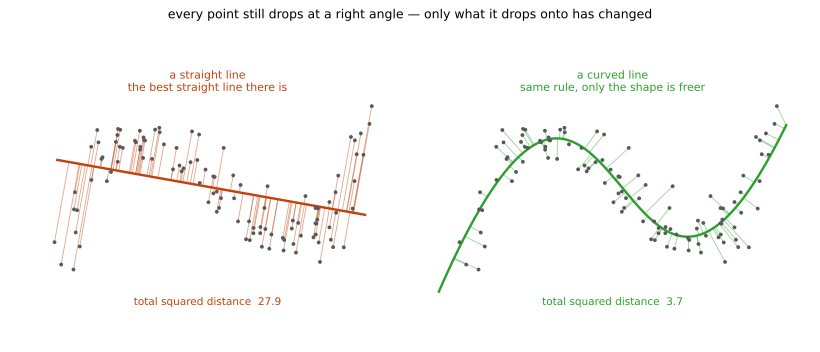
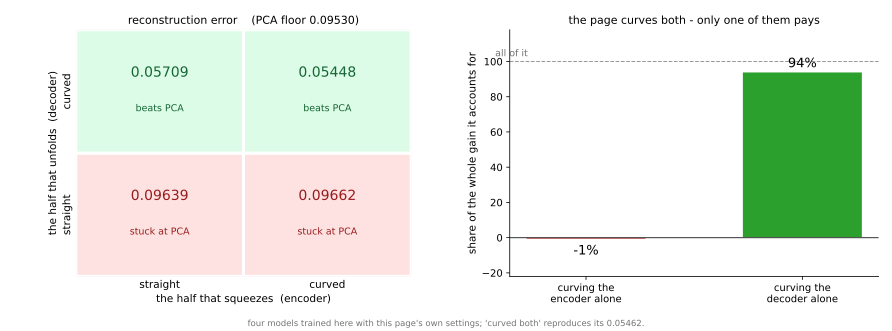
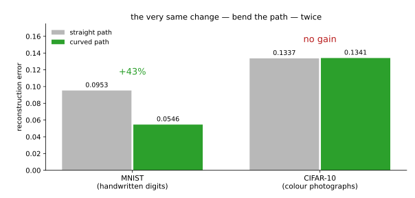
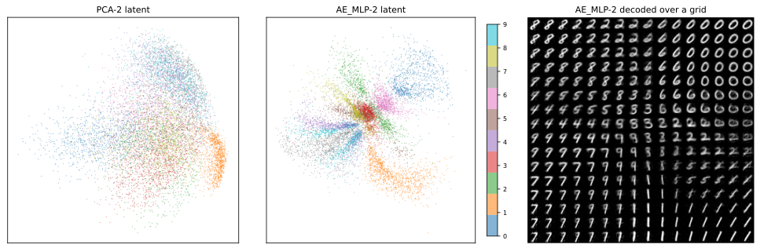

# AE_MLP — 비선형성, 여기서는 크게 번다

<div class="leadbox" markdown>

**들어가는 이야기** — 판을 굽히면 공식이 사라진다

앞 쪽은 비긴 채로 끝났다. 공식으로 한 번에 적어 낸 답과 6만 번 걸어서 찾은 답이 같은 자리에 닿았고, 까닭은 **찾는 것이 납작했기** 때문이었다.

이 쪽은 그 납작한 판을 **굽힌다.** 무슨 말인지 2차원으로 줄여 보면 이렇다.



**내리는 규칙은 글자 그대로 같다.** 점에서 가장 가까운 자리로, 곧 수직으로 내린다. 달라진 것은 **무엇에 내리느냐**뿐이다 — 곧은 선이냐 굽은 선이냐.

그것만으로 **내린 길이의 제곱을 모두 더한 값이 여덟 배 가까이 줄어든다.** 그림 아래에 적힌 27.9와 3.7이 그 값이다. 두 수 자체에는 뜻이 없다 — 지어낸 점들에서 잰 것이라 단위가 없다. 읽을 것은 **둘의 비**뿐이다.

점이 애초에 굽은 길 위에 놓여 있었으니, 곧은 선으로는 아무리 잘 그어도 따라갈 수가 없었던 것이다.

이 쪽이 MNIST에서 하는 일이 그것이다. 784개의 수가 만드는 공간에서 **납작한 판** 대신 **굽은 면**을 찾는다. 64차원짜리 굽은 면은 그림으로 그릴 수 없지만, 하는 일은 위 오른쪽과 같다.

그리고 여기서 앞 쪽의 채비가 쓰인다. **굽은 면 가운데 가장 좋은 것을 한 번에 적어 주는 공식은 없다.** 걸어서 찾는 수밖에 없고, 그래서 앞 쪽에서 그 방법이 공식과 같은 자리에 닿는 것을 미리 확인해 둔 것이다.

얼마나 벌까. 같은 자로 — **MNIST 시험 집합 1만 장**을 64개로 줄였다 되살렸을 때의 어긋남으로 — 세 쪽을 나란히 놓으면 이렇다. 복원 오차가 PCA에서 **0.0953**, [앞 쪽](02_ae_linear.md)의 선형 AE에서 **0.0958**로 꿈쩍도 하지 않다가, 판을 굽힌 이 쪽에서 **0.0546**으로 내려간다. **43% 줄어든 것**이고, 아래 표가 그 수를 다시 보인다.

그런데 **같은 수법을 사진에 걸면 아무것도 벌지 못한다.** 손글씨가 아니라 **[CIFAR-10](05_cifar_classification.md)** — 32×32 컬러 사진 열 가지 — 에 걸었을 때이고, 바로 아래 1절이 그 자리다.

</div>

스텝3은 인코더와 디코더에 은닉 레이어와 ReLU를 넣는다. [스텝2](02_ae_linear.md)가 막혀 있던 선형이라는 벽을 넘는다.

```python
"""스텝3: 비선형 오토인코더.

mnist_judge.pt는 5.1절 첫 쪽에서 학습해 둔 것을 읽어 쓴다.
규약은 이 장 전체와 같다. Adam 1e-3, 배치 100, 씨앗 42, 인코더 100 에포크.
"""

import torch
import torch.nn as nn
import torch.nn.functional as F
import torch.optim as optim
from torch.utils.data import DataLoader, TensorDataset
import torchvision
import torchvision.transforms as transforms

SEED, BATCH, LR, AE_EPOCHS = 42, 100, 1e-3, 100
device = torch.device("mps" if torch.backends.mps.is_available() else "cpu")

tf = transforms.Compose([transforms.ToTensor(),
                         transforms.Normalize((0.1307,), (0.3081,))])
tr_ds = torchvision.datasets.MNIST("./data", train=True, download=True, transform=tf)
te_ds = torchvision.datasets.MNIST("./data", train=False, download=True, transform=tf)


def materialize(ds):
    xs, ys = [], []
    for x, y in DataLoader(ds, batch_size=2000, shuffle=False):
        xs.append(x); ys.append(y)
    return torch.cat(xs), torch.cat(ys)


Xtr_img, _ = materialize(tr_ds)
Xte_img, yte = materialize(te_ds)
Xtr, Xte = Xtr_img.flatten(1), Xte_img.flatten(1)


class JudgeCNN(nn.Module):
    def __init__(self):
        super().__init__()
        self.conv1 = nn.Conv2d(1, 32, 3, padding=1)
        self.conv2 = nn.Conv2d(32, 64, 3, padding=1)
        self.pool = nn.MaxPool2d(2, 2); self.dropout = nn.Dropout(0.25)
        self.fc1 = nn.Linear(64 * 7 * 7, 128); self.fc2 = nn.Linear(128, 10)

    def forward(self, x):
        x = self.pool(torch.relu(self.conv1(x)))
        x = self.pool(torch.relu(self.conv2(x)))
        return self.fc2(self.dropout(torch.relu(self.fc1(x.flatten(1)))))


judge = JudgeCNN().to(device)
judge.load_state_dict(torch.load("mnist_judge.pt", weights_only=True))
judge.eval()


@torch.no_grad()
def identity(flat):
    pred = torch.cat([judge(flat[i:i + 1000].reshape(-1, 1, 28, 28).to(device))
                      .argmax(1).cpu() for i in range(0, len(flat), 1000)])
    return 100.0 * (pred == yte).float().mean().item()


def train_ae(cls, k, X):
    """되살리기만 배운다. 라벨은 한 번도 쓰지 않는다.

    씨앗은 모델을 **만들기 전에** 뿌린다. 만들어 둔 모델을 받는 꼴로 쓰면
    초깃값이 씨앗 밖에 남아 돌릴 때마다 수가 달라진다.
    """
    torch.manual_seed(SEED)
    model = cls(k).to(device)
    opt = optim.Adam(model.parameters(), lr=LR)
    g = torch.Generator().manual_seed(SEED)
    loader = DataLoader(TensorDataset(X), batch_size=BATCH, shuffle=True, generator=g)
    for _ in range(AE_EPOCHS):
        model.train()
        for (xb,) in loader:
            xb = xb.to(device)
            opt.zero_grad()
            F.mse_loss(model(xb), xb).backward()
            opt.step()
    return model.eval()


@torch.no_grad()
def reconstruct(model, X):
    return torch.cat([model(X[i:i + 1000].to(device)).cpu()
                      for i in range(0, len(X), 1000)])


# === 스텝3: 은닉 레이어와 ReLU를 넣는다 ==========================================
class MLPAE(nn.Module):
    def __init__(self, k):
        super().__init__()
        self.enc = nn.Sequential(nn.Linear(784, 256), nn.ReLU(), nn.Linear(256, k))
        self.dec = nn.Sequential(nn.Linear(k, 256), nn.ReLU(), nn.Linear(256, 784))

    def forward(self, x):
        return self.dec(self.enc(x))


if __name__ == "__main__":
  for k in (64, 2):
    m = train_ae(MLPAE, k, Xtr)
    rec = reconstruct(m, Xte)
    enc_p = sum(p.numel() for p in m.enc.parameters())
    print(f"  ae_mlp{k:<2d}  복원 MSE {((rec - Xte) ** 2).mean():.5f}  "
          f"인코더 {enc_p:,}  같은 숫자로 {identity(rec):.2f}%")
    if k == 64:
        torch.save(m.state_dict(), "mnist_ae_mlp64.pt")   # 5.3절이 읽어 쓴다
    if k == 2:                                  # 잠재 공간 그림에 쓸 좌표
        with torch.no_grad():
            z = torch.cat([m.enc(Xte[i:i + 1000].to(device)).cpu()
                           for i in range(0, len(Xte), 1000)])
        torch.save((z, yte), "mnist_ae_mlp2_latent.pt")
```

**출력:**

```
  ae_mlp64  복원 MSE 0.05462  인코더 217,408  같은 숫자로 98.51%
  ae_mlp2   복원 MSE 0.42230  인코더 201,474  같은 숫자로 70.13%
```

| 잠재 차원 64 | 복원 MSE | 같은 숫자로 |
|---|---|---|
| PCA / AE_Linear | 0.0953 | 97.81% |
| **AE_MLP** | **0.0546** | 98.51% |

**복원 오차가 43% 줄었다.**

<div class="storybox" markdown>

**그림으로 보는 AI 1.** 양쪽을 다 굽혔는데, 번 쪽은 한쪽뿐이다

이렇게 가운데를 좁힌 그물로 **곧은 길이 못 하는 일**을 하자는 생각에 이름을 붙인 사람은 1991년 마크 크레이머(Mark Kramer)다. 기계학습 하는 사람이 아니라 **화학공장을 다루는 공학자**였고, 글이 실린 곳도 미국화학공학회지다. 그가 보던 자료는 그림이 아니라 공장에서 하루 종일 쏟아지는 계기판 수치였다.

그 글이 못 박아 둔 것이 하나 있다. **굽은 마디를 양쪽에 다 두어야 한다**는 것이다. 이 쪽이 바로 그렇게 했다 — 좁히는 쪽과 다시 펼치는 쪽 모두에 마디를 하나씩 넣었다. 그런데 **둘이 똑같이 일하는 것은 아니다.**



왼쪽 판을 **가로로 읽지 말고 세로로** 읽어 보라. 위아래가 갈린다. 펼치는 쪽이 굽어 있으면 아래로 내려가고, 곧으면 PCA 바닥에 붙는다. **좁히는 쪽이 굽었는지 곧았는지는 거의 아무것도 바꾸지 않는다.**

오른쪽이 그 몫이다. 좁히는 쪽만 굽히면 버는 것이 **-1%**, 사실상 0이다. 펼치는 쪽만 굽히면 **94%**를 번다. 이 쪽이 자랑하는 43%는 거의 전부 **펼치는 쪽에서 나온 것**이다.

**까닭은 재어 보지 않아도 안다.** 펼치는 쪽이 곧으면, 나오는 그림은 반드시 64개의 방향이 만드는 **납작한 판 위**에 놓인다. 아무리 영리하게 좁혀도 되살아난 그림이 그 판을 벗어날 수가 없다. 그런데 그런 판 가운데 가장 좋은 것을 고르는 일은 [PCA가 이미 끝까지 해 놓은 일](01_pca.md)이다. 그러니 좁히는 쪽을 굽히는 것은 **PCA가 세워 둔 천장 아래에서만** 애쓰는 셈이다. 위 판의 아래 두 칸이 나란히 0.096인 것이 그 천장이다.

**그렇다고 좁히는 쪽의 마디를 빼도 된다는 말은 아니다.** 0.05709와 0.05448의 차이가 남아 있고, 더 중요하게는 **이 쪽이 재는 것이 복원오차 하나뿐**이다. 바로 아래 2절은 잠재 차원 2에서 복원오차가 28% 나아질 때 숫자 정체는 두 배 올랐다고 적는다 — 두 자가 같은 것을 재지 않는다는 뜻이고, 그렇다면 **숫자 정체나 3절의 갈라짐으로 재면 좁히는 쪽의 몫이 94% 대 -1%가 아닐 수도 있다.** 그것은 재지 않았다.

_확인한 곳 — M. A. Kramer, "Nonlinear Principal Component Analysis Using Autoassociative Neural Networks", *AIChE Journal* 37(2), 233–243, 1991. 거기서 붙인 이름이 **비선형 주성분분석**(NLPCA)이고, 쓰인 그물은 입력·사상층·병목·역사상층·출력의 **다섯 층**이라 굽은 마디가 병목의 양쪽에 하나씩 있다. 본문에서 「좁히는 쪽」이라 한 것이 인코더, 「펼치는 쪽」이 디코더, 「굽은 마디」가 비선형 은닉 레이어이고, 「64개의 방향이 만드는 납작한 판」은 $k$차원 아핀 부분공간이다. **위 그림의 네 수는 그 글의 것이 아니다** — 이 쪽의 규약(씨앗 42, Adam $10^{-3}$, 배치 100, 100 에포크, 폭 256, 잠재 64)으로 네 벌을 따로 학습해 여기서 잰 것이며, 「둘 다 굽음」 칸의 0.05448이 이 쪽 표의 0.05462를 되살리므로 나머지 세 칸도 같은 자로 읽을 수 있다(차이는 MPS 의 실행 간 흔들림이다). 셈하는 코드는 `figures/make_figures.py` 에 있다._

</div>

---

## 1. CIFAR-10에서는 이러지 않았다

여기가 [CIFAR-10 쪽](05_cifar_classification.md)과 갈리는 자리다. 그 절에서 같은 수법을 CIFAR-10에 걸었을 때는 **아무것도 벌지 못했다**(0.1341 대 PCA의 0.1337).



**수법도 그대로이고 바꾼 것도 그대로인데 한쪽에서는 43%, 다른 쪽에서는 0이다.**

MNIST에서는 비선형 AE의 복원오차가 더 작았지만 CIFAR-10에서는 그렇지 않았다. 숫자 획의 변형이 낮은 차원의 비선형 구조로 표현될 수 있다는 설명은 가능하다. 다만 데이터, 구조와 압축률이 함께 다르므로 이 비교만으로 원인을 하나로 정할 수는 없다.

!!! warning "완전히 공정한 비교는 아니다"
    [CIFAR-10 쪽](05_cifar_classification.md)의 깊은 AE는 $3072 \to 512 \to 64$로 48배를 줄였고, 이 절은 $784 \to 256 \to 64$로 12배를 줄인다. 압축률이 네 배 다르므로, 차이가 **데이터의 결** 때문인지 **압축률** 때문인지를 이 두 실험만으로는 가를 수 없다. 방향은 뚜렷하지만 원인은 아직 하나로 좁혀지지 않았다.

---

## 2. 잠재 차원이 2일 때 더 또렷하다

| 잠재 차원 2 | 복원 MSE | 같은 숫자로 |
|---|---|---|
| PCA / AE_Linear | 0.586 | 35.66% |
| **AE_MLP** | **0.422** | **70.13%** |

MSE로는 28% 나아졌을 뿐인데 **숫자 정체는 두 배 가까이 올랐다**(35.66 → 70.13).

두 자가 같은 것을 재지 않는다는 증거다. 굽은 사상은 화소를 조금 더 가깝게 만드는 데 그치지 않고, **2차원 안에서 숫자들을 서로 떼어 놓는다.** 그것은 MSE가 잘 드러내지 못하는 성질이다.

---

## 3. 2차원 잠재 공간을 그려 보면

잠재 차원을 2로 두면 잠재 공간을 그대로 그림으로 그릴 수 있다. MNIST가 이 장에 알맞은 까닭의 절반이 여기에 있다.



왼쪽 [PCA-2](01_pca.md)는 **한 덩어리**다. 색이 뒤섞여 있어 어디까지가 4이고 어디부터가 9인지 알 수 없다. 35.66%라는 수가 그림으로는 이렇게 보인다.

가운데 AE_MLP-2는 숫자마다 다른 방향으로 갈라져 나간다. **70.13%가 이 갈라짐이다.**

오른쪽은 그 잠재 공간을 격자로 훑어 하나하나 디코딩한 것이다. 가운데 언저리에서는 숫자들이 서로 이어지며 모양이 부드럽게 바뀌고, 바깥으로 가면 뭉개진다.

---

## 4. 여기서 다음 장의 물음이 나온다

되살리기는 잘된다. 그렇다면 **없던 그림을 만들 수 있는가?**

만들려면 잠재 공간에서 점 하나를 **뽑아** 디코딩하면 된다. 그런데 어디서 뽑아야 하는가? 위 그림을 보면 점들이 고르게 퍼져 있지 않다. 클래스 사이에는 점이 없는 **빈 곳**이 있고, 전체가 어떤 모양으로 퍼져 있는지도 정해진 바가 없다.

**오토인코더는 잠재 표현을 만드는 법을 배웠을 뿐, 잠재 표현이 어떻게 분포하는지는 배우지 않았다.** 로스 어디에도 잠재 표현을 어떤 모양으로 퍼뜨리라는 요구가 없다.

그렇다면 실제로 뽑아 보면 어떻게 되는가? [다음 쪽](06_sampling.md)이 점 열 개를 뽑아 넣어 보고, 답이 **잠재 차원에 달려 있음**을 보인다. 위의 2차원 그림에서 짐작하는 것과 64차원에서 실제로 벌어지는 일이 다르다.

---

## 연습문제

<div class="drillbox" markdown>

**연습문제 1.** <span class="diff med" title="중간"></span>
잠재 차원 2에서 MSE는 28%만 좋아졌는데 숫자 정체는 두 배가 되었다. 이 어긋남이 무엇을 뜻하는지 설명하라.

</div>

??? success "풀이"
    **두 자가 서로 다른 것을 재기 때문이다.**

    MSE는 화소 하나하나가 얼마나 가까운지를 더한다. 획이 한 화소 옆으로 밀리면 그 자리와 원래 자리 양쪽에서 벌을 받아 MSE가 꽤 커지지만, 사람이나 심판이 보기에는 같은 숫자다.

    반대로 고리가 닫혔는지 열렸는지는 화소 몇 개만 바뀌면 되므로 MSE는 거의 안 움직이는데, 4가 9로 읽힐 만큼 정체는 완전히 달라진다. (실제로 [PCA-2](01_pca.md)가 그렇게 망가뜨릴 때는 4와 9가 서로 바뀌는 것이 아니라 **둘 다 7로** 간다. 화소를 조금 옮기는 것과 정체를 바꾸는 것이 다르다는 요점은 그대로다.)

    곧 **MSE가 크게 치는 오차와 정체를 바꾸는 오차가 서로 다르다.** 비선형 인코더가 잘한 일은 후자 쪽, 곧 숫자를 가르는 데 중요한 것을 2차원 안에 밀어 넣은 것이다.

    이것이 생성 모델을 화소 로스로만 평가하면 안 되는 까닭이기도 하며, [5.3절](../generative/index.md)이 그 이야기를 더 끌고 간다.

---

<div class="drillbox" markdown>

**연습문제 2.** <span class="diff med" title="중간"></span>
본문 그림의 오른쪽 판은 잠재 공간을 격자로 훑어 디코딩한 것이다. 이 그림에서 **잠재 차원 2가 왜 모자란지**를 읽어 낼 수 있는가?

</div>

??? success "풀이"
    **읽어 낼 수 있는 것이 하나 있다.** 격자 그림에는 "숫자가 아님"이라고 비워 둔 칸이 없다. 디코더는 평면의 **모든** 점에 그림 하나를 돌려주는 연속 사상이므로, 4의 영역에서 9의 영역으로 걸어가면 그 사이의 점들도 무언가로 복호되어야 한다. 그래서 경계에는 어느 쪽도 아닌 모양이 **반드시** 놓인다. 열 가지를 2차원에 앉히면 서로 맞닿는 경계의 길이가 길어지고, 그 위에 걸린 표본은 심판에게 다른 숫자로 읽힌다.

    못 하는 말도 분명히 해 두자. 평면에서도 열 개의 영역을 떨어뜨려 놓을 수는 있으므로, **그림만으로** "2차원이 반드시 모자라다"나 "모든 오분류가 경계에서 나온다"를 증명할 수는 없다. 그림이 주는 것은 기제이고, 모자람의 크기는 수로 재야 한다.

    그 수가 70.13% 대 98.51%다. 그리고 이 비교에서 **파라메터는 거의 묶여 있다** — 연습문제 3이 세듯 인코더가 201,474개에서 217,408개로 7.3%만 달라진다. 7.3%로 복원 MSE가 7.7배 움직였으니, 갈라놓은 것은 모델의 크기가 아니라 통로의 너비다.

    다만 차원을 늘리면 **다른 문제가 생긴다.** 넓은 공간에 데이터가 성기게 놓여, 아무 데서나 뽑으면 데이터가 없는 자리에 떨어진다. [5.2절](../latent_generative/index.md)이 그것을 잰다.

---

<div class="drillbox" markdown>

**연습문제 3.** <span class="diff easy" title="쉬움"></span>
위 출력에서 인코더 파라메터가 `ae_mlp64` 217,408개, `ae_mlp2` 201,474개다. 잠재 차원을 64에서 2로 **32배** 줄였는데 파라메터는 7.3%만 줄었다. 두 수를 레이어별로 쪼개어 까닭을 밝혀라.

</div>

??? success "풀이"
    인코더는 $784 \to 256 \to k$이므로 레이어가 둘이다.

    ```python
    for k in (2, 64):
        l1 = 784 * 256 + 256       # 첫 레이어
        l2 = 256 * k + k           # 병목으로 가는 레이어
        print(f"k={k:3}: 1레이어 {l1:,}  2레이어 {l2:,}  합 {l1 + l2:,}  "
              f"1레이어 몫 {100 * l1 / (l1 + l2):.1f}%")
    ```

    ```
    k=  2: 1레이어 200,960  2레이어 514  합 201,474  1레이어 몫 99.7%
    k= 64: 1레이어 200,960  2레이어 16,448  합 217,408  1레이어 몫 92.4%
    ```

    **첫 레이어가 거의 전부다.** 바이어스까지 포함한 $784 \times 256 + 256$이 200,960개이고 이것은 $k$와 상관없이 그대로다. $k$가 건드리는 것은 둘째 레이어뿐인데, 그 레이어는 $k = 64$에서도 전체의 7.6%밖에 되지 않는다.

    그러므로 "병목을 32배 줄였다"는 말은 **파라메터를 32배 줄였다는 뜻이 전혀 아니다.** 줄어든 것은 잠재 표현의 길이이고, 그것을 만들어 내는 데 드는 웨이트는 거의 그대로다.

    여기서 눈여겨볼 것이 하나 더 있다. 파라메터가 7.3% 줄었을 뿐인데 복원 MSE는 0.0546에서 0.4223으로 **일곱 배 넘게** 나빠졌다. 모델의 크기가 아니라 **지나가는 통로의 너비**가 성능을 정한다는 뜻이다. 병목이 병목인 까닭이다.

---

<div class="drillbox" markdown>

**연습문제 4.** <span class="diff hard" title="어려움"></span>
본문의 경고 상자는 MNIST와 CIFAR-10 비교가 **압축률이 달라서** 공정하지 않다고 인정한다(12배 대 48배). 압축률을 맞추어 이 교란 요인을 떼어 내려면 어떤 실험을 해야 하는가? 표를 그려 설계하고, **이 책에 이미 있는 칸과 없는 칸**을 가려내라.

</div>

??? success "풀이"
    교란 요인이 둘 — **데이터**(MNIST냐 CIFAR-10이냐)와 **압축률**(12배냐 48배냐) — 이므로 $2 \times 2$로 짜야 한다. 압축률을 맞추는 잠재 차원은 나눗셈으로 나온다.

    $$
    \frac{784}{48} \approx 16, \qquad \frac{3072}{12} = 256
    $$

    | | 12배 | 48배 |
    |---|---|---|
    | **MNIST** | $k = 64$ | $k = 16$ |
    | **CIFAR-10** | $k = 256$ | $k = 64$ |

    각 칸에서 재야 하는 것은 **PCA 대비 비선형 AE가 버는 몫**이다. 이 책에 있는 것을 채워 보면 이렇다.

    | | 12배 | 48배 |
    |---|---|---|
    | **MNIST** | PCA 0.0953 → AE 0.0546, **−43%** | PCA 0.28296, AE **없음** |
    | **CIFAR-10** | PCA 0.0416, AE **없음** | PCA 0.1337 → AE 0.1343, **+0.4%** |

    곧 **대각선 두 칸만 채워져 있다.** 그리고 그 두 칸은 데이터와 압축률이 **함께** 달라진 칸이다. 그래서 −43%와 +0.3%의 차이를 데이터 탓이라 할 수도, 압축률 탓이라 할 수도 있다. 본문이 "가를 수 없다"고 적은 것이 정확하다.

    빈 칸 둘을 채우면 답이 갈린다.

    - **MNIST를 $k = 16$으로** 돌렸을 때도 비선형성이 크게 벌면 → 데이터 특성이라는 설명을 뒷받침한다. 다만 비교한 압축률 밖으로 일반화할 수는 없다.
    - 거기서 이득이 사라지면 → 압축률과 데이터 사이의 상호작용을 의심할 수 있다. 모든 데이터에서 같은 결과가 나온다는 뜻은 아니다.

    **CIFAR-10을 $k = 256$으로** 돌린 칸이 그 반대편을 받친다. 거기서 이득이 생기면 압축률 쪽 설명이 더 단단해진다.

    두 실험은 데이터와 압축률의 효과를 더 잘 비교하게 한다. 구조와 최적화의 차이까지 모두 제거하는 것은 아니다. 이것이 [4.3절](../../ch04/07_distillation.md)이 대조군을 두어 이득을 둘로 나눈 것과 같은 생각이며, [DCGAN 쪽](../generative/02_dcgan.md)의 연습문제도 같은 꼴로 빈 칸을 가리킨다.

    (덧붙여 $784/48 = 16.3$이라 $k = 16$은 정확히 48배가 아니라 49배다. 이 정도 어긋남은 재는 값에 비해 작지만, 적어 두는 것이 옳다.)

