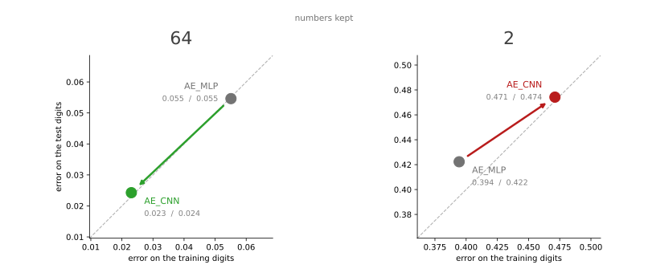
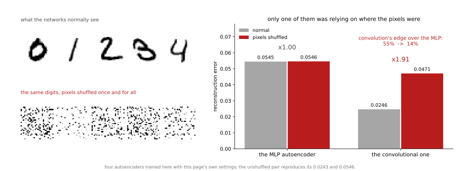
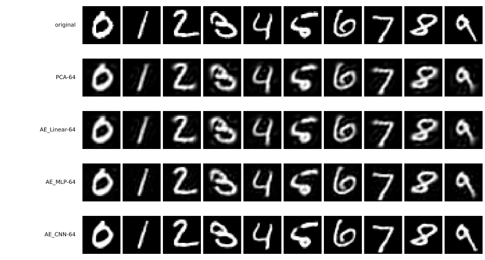

# AE_CNN — 잠재 차원이 클 때만 이긴다

<div class="leadbox" markdown>

**들어가는 이야기** — 같은 바꿈인데 한 번은 벌고 한 번은 잃는다

이 쪽은 사다리의 마지막 칸이다. 바꾸는 것은 하나뿐 — 줄이는 쪽을 **완전 연결에서 컨볼루션으로** 고쳐 짠다. 지금까지 한 칸 오를 때마다 성적이 좋아졌으니 이번에도 그러리라 여기기 쉽다.

절반만 맞다.



**두 화살표는 똑같은 바꿈이다.** 그런데 왼쪽에서는 아래로 가고 오른쪽에서는 위로 간다. 내려가면 좋아진 것이고 올라가면 나빠진 것이다.

가로로도 읽어 보라. 두 화살표 모두 **왼쪽으로** 간다 — 컨볼루션이 늘 더 적은 수로 일한다는 뜻이다. 다만 그 「적음」의 크기가 다르다. 64개를 남길 때는 217,408개에서 105,216개로 **절반**인데, 2개를 남길 때는 201,474개에서 **7,938개**로 25분의 1이 된다.

여기에 뒤집힘의 실마리가 있다. 적게 쓰고도 잘하면 미덕이지만, **너무 적으면 쓸 것이 모자란다.** 64개를 남길 때 미덕이던 그 적음이 2개를 남길 때는 손해가 된다.

사다리를 「위로 갈수록 좋다」로 읽으면 이 뒤집힘을 설명할 수 없다. 설명하려면 **칸마다 무엇을 좋게 만드는지**를 뜯어 보아야 하고, 그 조건이 맞지 않는 자리에서는 윗칸이 아랫칸보다 못할 수 있다는 것도 받아들여야 한다. 이 쪽은 까닭으로 둘을 드는데, 둘 가운데 어느 쪽이 더 큰지는 가리지 못한다.

</div>

스텝4는 인코더를 컨볼루션으로 바꾼다. [3장 스텝3 → 스텝4](../../ch03/mnist/04_cnn.md)와 같은 생각이며, 다만 가르기가 아니라 되살리기에 건다.

```python
"""스텝4: 컨볼루션 오토인코더.

mnist_judge.pt는 5.1절 첫 쪽에서 학습해 둔 것을 읽어 쓴다.
규약은 이 장 전체와 같다. Adam 1e-3, 배치 100, 씨앗 42, 인코더 100 에포크.
"""

import torch
import torch.nn as nn
import torch.nn.functional as F
import torch.optim as optim
from torch.utils.data import DataLoader, TensorDataset
import torchvision
import torchvision.transforms as transforms

SEED, BATCH, LR, AE_EPOCHS = 42, 100, 1e-3, 100
device = torch.device("mps" if torch.backends.mps.is_available() else "cpu")

tf = transforms.Compose([transforms.ToTensor(),
                         transforms.Normalize((0.1307,), (0.3081,))])
tr_ds = torchvision.datasets.MNIST("./data", train=True, download=True, transform=tf)
te_ds = torchvision.datasets.MNIST("./data", train=False, download=True, transform=tf)


def materialize(ds):
    xs, ys = [], []
    for x, y in DataLoader(ds, batch_size=2000, shuffle=False):
        xs.append(x); ys.append(y)
    return torch.cat(xs), torch.cat(ys)


Xtr_img, _ = materialize(tr_ds)
Xte_img, yte = materialize(te_ds)
Xtr, Xte = Xtr_img.flatten(1), Xte_img.flatten(1)


class JudgeCNN(nn.Module):
    def __init__(self):
        super().__init__()
        self.conv1 = nn.Conv2d(1, 32, 3, padding=1)
        self.conv2 = nn.Conv2d(32, 64, 3, padding=1)
        self.pool = nn.MaxPool2d(2, 2); self.dropout = nn.Dropout(0.25)
        self.fc1 = nn.Linear(64 * 7 * 7, 128); self.fc2 = nn.Linear(128, 10)

    def forward(self, x):
        x = self.pool(torch.relu(self.conv1(x)))
        x = self.pool(torch.relu(self.conv2(x)))
        return self.fc2(self.dropout(torch.relu(self.fc1(x.flatten(1)))))


judge = JudgeCNN().to(device)
judge.load_state_dict(torch.load("mnist_judge.pt", weights_only=True))
judge.eval()


@torch.no_grad()
def identity(flat):
    pred = torch.cat([judge(flat[i:i + 1000].reshape(-1, 1, 28, 28).to(device))
                      .argmax(1).cpu() for i in range(0, len(flat), 1000)])
    return 100.0 * (pred == yte).float().mean().item()


def train_ae(cls, k, X):
    """되살리기만 배운다. 라벨은 한 번도 쓰지 않는다.

    씨앗은 모델을 **만들기 전에** 뿌린다. 만들어 둔 모델을 받는 꼴로 쓰면
    초깃값이 씨앗 밖에 남아 돌릴 때마다 수가 달라진다.
    """
    torch.manual_seed(SEED)
    model = cls(k).to(device)
    opt = optim.Adam(model.parameters(), lr=LR)
    g = torch.Generator().manual_seed(SEED)
    loader = DataLoader(TensorDataset(X), batch_size=BATCH, shuffle=True, generator=g)
    for _ in range(AE_EPOCHS):
        model.train()
        for (xb,) in loader:
            xb = xb.to(device)
            opt.zero_grad()
            F.mse_loss(model(xb), xb).backward()
            opt.step()
    return model.eval()


@torch.no_grad()
def reconstruct(model, X):
    return torch.cat([model(X[i:i + 1000].to(device)).cpu()
                      for i in range(0, len(X), 1000)])


# === 스텝4: 인코더를 컨볼루션으로 =============================================
class ConvAE(nn.Module):
    """컨볼루션으로 줄이고 마지막에만 k차원으로 좁힌다."""

    def __init__(self, k):
        super().__init__()
        self.enc = nn.Sequential(
            nn.Conv2d(1, 16, 3, padding=1), nn.ReLU(), nn.MaxPool2d(2),   # 14
            nn.Conv2d(16, 32, 3, padding=1), nn.ReLU(), nn.MaxPool2d(2),  # 7
            nn.Flatten(), nn.Linear(32 * 7 * 7, k))
        self.dec = nn.Sequential(
            nn.Linear(k, 32 * 7 * 7), nn.ReLU(), nn.Unflatten(1, (32, 7, 7)),
            nn.ConvTranspose2d(32, 16, 2, stride=2), nn.ReLU(),
            nn.ConvTranspose2d(16, 1, 2, stride=2))

    def forward(self, x):
        return self.dec(self.enc(x))


if __name__ == "__main__":
  for k in (64, 2):
    # 컨볼루션은 펼치지 않은 (N, 1, 28, 28)을 받는다
    m = train_ae(ConvAE, k, Xtr_img)
    rec = reconstruct(m, Xte_img)
    enc_p = sum(p.numel() for p in m.enc.parameters())
    print(f"  ae_conv{k:<2d}  복원 MSE {((rec - Xte_img) ** 2).mean():.5f}  "
          f"인코더 {enc_p:,}  같은 숫자로 {identity(rec.flatten(1)):.2f}%")
```

**출력:**

```
  ae_conv64  복원 MSE 0.02427  인코더 105,216  같은 숫자로 98.52%
  ae_conv2   복원 MSE 0.47423  인코더 7,938  같은 숫자로 61.78%
```

| 잠재 차원 64 | 복원 MSE | 인코더 파라메터 | 같은 숫자로 |
|---|---|---|---|
| [AE_MLP](03_ae_mlp.md) | 0.0546 | 217,408 | 98.51% |
| **AE_CNN** | **0.0243** | **105,216** | 98.52% |

**파라메터를 절반만 쓰고 복원 오차를 56% 줄인다.**

<div class="storybox" markdown>

**그림으로 보는 AI 1.** 번 것이 아니라 빌린 것이다 — 돌려 달라고 해 보면 안다

위에서 「웨이트를 자리마다 다시 쓰는 덕」이라 적었다. 그 수법을 처음 성공시킨 사람은 1989년 얀 르쿤(Yann LeCun)과 여섯 동료다. 손으로 쓴 **우편번호**를 읽히는 일이었다.

그들이 든 까닭은 솜씨도 속도도 아니었다. 그물에 **미리 넣어 줄 수 있는 앎**이었다. 가까이 붙은 화소끼리는 한패라는 것, 그리고 어느 자리에서 쓸모 있는 눈은 **다른 자리에서도 쓸모 있다**는 것. 둘 다 손글씨 그림이라서 참인 말이지, 어떤 자료에서나 참인 말이 아니다.

그러니 이 쪽이 번 56%는 **빌린 앎**일 수 있다. 빌린 것이면 돌려 달라고 해 볼 수 있다. 화소 784자리의 차례를 **한 번 섞어 못박아 두고**, 학습 그림과 시험 그림에 똑같이 걸어 처음부터 다시 가르쳐 보았다. 섞는 것은 자리뿐이라 먹의 양도 담긴 것도 그대로다 — 다만 **이웃이 더는 이웃이 아니다.**



**완전 연결 쪽은 꿈쩍도 하지 않는다.** 0.05448에서 0.05460, **1.00배**다. 그럴 수밖에 없다 — 784개를 어떤 차례로 받든 첫 레이어의 웨이트를 같이 섞어 두면 똑같아지므로, 그 그물에게 섞인 문제와 안 섞인 문제는 **글자 그대로 같은 문제**다.

**컨볼루션 쪽은 1.91배가 된다.** 0.02465에서 0.04705로 거의 두 배다. 왼쪽 아래 그림을 보면 까닭이 눈에 보인다. 작은 창을 옮겨 가며 훑어야 하는데, 창 안에 들어오는 것이 더 이상 한 덩어리가 아니다.

**다만 영까지 떨어지지는 않는다.** 섞은 뒤에도 컨볼루션 쪽이 여전히 낫다(0.0471 대 0.0546). 완전 연결 대비 앞섬이 **55%에서 14%로** 줄 뿐이다. 곧 이 쪽이 번 것 가운데 **네 몫에 셋쯤**이 「이웃이 정말 이웃이었다」에서 왔고, 나머지 한 몫은 다른 데서 왔다.

그 나머지가 무엇인지는 **재지 않았다.** 짐작할 거리는 있다. 이 구조의 인코더 끝에는 1,568개를 64개로 줄이는 완전 연결 레이어가 하나 더 붙어 있고, 자리를 섞어도 그 레이어는 제 일을 그대로 한다 — 바로 아래 「그런데 잠재 차원이 2이면 진다」 절이 컨볼루션이 지는 까닭으로 지목한 그 레이어다. 짐작일 뿐이니 떼어 내고 다시 재야 안다.

그리고 섞어 본 것은 **MNIST 하나, 순열 하나**다. 다른 순열로 다시 하면 1.91배가 그대로 나오지는 않을 것이다. 믿을 것은 그 수가 아니라 **두 그물이 갈렸다는 사실**과 갈린 방향이다.

_확인한 곳 — Y. LeCun, B. Boser, J. S. Denker, D. Henderson, R. E. Howard, W. Hubbard, L. D. Jackel, "Backpropagation Applied to Handwritten Zip Code Recognition", *Neural Computation* **1**(4), 541–551 (1989). 자료는 미국 우편물에서 모은 손글씨 우편번호다. 본문에서 「미리 넣어 줄 수 있는 앎」이라 한 것이 그 글이 말하는 **구조에 넣는 사전 지식**이고, 「가까이 붙은 화소끼리 한패」가 **국소 수용영역**(local receptive field), 「어느 자리에서 쓸모 있는 눈은 다른 자리에서도」가 **웨이트 공유**(weight sharing)다. **위 네 수는 그 글의 것이 아니다** — 이 쪽의 규약(씨앗 42, Adam $10^{-3}$, 배치 100, 100 에포크, 잠재 64)으로 네 벌을 따로 학습해 여기서 쟀고, 섞지 않은 두 벌이 이 쪽의 0.0243과 [5.1절](03_ae_mlp.md)의 0.0546을 되살린다(0.02465와 0.05448, MPS 의 실행 간 흔들림 안). 순열은 씨앗 7로 뽑은 784자리의 고정 순열 하나이며 전단사라 화소값의 모임이 그대로이므로 MSE 를 견줄 수 있다. 셈하는 코드는 `figures/make_figures.py` 에 있다._

</div> [3장 연습문제 9](../../ch03/mnist/04_cnn.md)가 분류에서 재었던 것이 되살리기에서도 그대로 나온다 — 그 문항은 파라메터 예산을 맞추어 두고 컨볼루션과 다층 퍼셉트론을 견주어 컨볼루션이 1.5%포인트 이기는 것을 보았다. 웨이트를 자리마다 다시 쓰는 덕이며, [4.6절 연습문제 6](../../ch04/03_vgg16_transfer.md)이 그 기제를 완전 연결 레이어와 나란히 적어 둔다.

[PCA](01_pca.md)에서 여기까지 오면 복원 오차가 0.0953에서 0.0243으로 **75% 줄었다.** [CIFAR-10 쪽](05_cifar_classification.md)의 CIFAR-10 사다리가 잠재 차원 64에서 평평했던 것과 정반대다.



---

## 1. 그런데 잠재 차원이 2이면 진다

| 잠재 차원 2 | 복원 MSE | 인코더 파라메터 | 같은 숫자로 |
|---|---|---|---|
| [AE_MLP](03_ae_mlp.md) | **0.422** | 201,474 | **70.13%** |
| AE_CNN | 0.474 | 7,938 | 61.78% |

**순서가 뒤집힌다.** 까닭은 두 가지로 보인다.

**첫째, 마지막 완전 연결 레이어가 공간 구조를 어차피 뭉갠다.** 컨볼루션이 $(32, 7, 7)$까지 이웃 관계를 살려 왔더라도, 그것을 2개의 수로 줄이는 것은 완전 연결 레이어다. 잠재 차원이 2이면 그 레이어가 병목이라 앞쪽의 수고가 전달되지 않는다.

**둘째, 이 구조에서 컨볼루션 인코더의 파라메터가 25배 적다**(7,938 대 201,474). 잠재 차원이 64일 때는 그 적음이 장점이었지만, 잠재 차원이 2여서 표현력이 이미 빠듯한 자리에서는 손해가 된다.

그러므로 **"컨볼루션이 낫다"는 말은 잠재 차원에 딸린 말이다.** 잠재 차원 64에서 얻은 결론을 잠재 차원 2로 옮기면 틀린다.

---

## 2. 두 자가 서로 다른 말을 한다

네 스텝을 두 자로 나란히 보면 순위가 갈린다.

| 잠재 차원 64 | 복원 MSE | 같은 숫자로 |
|---|---|---|
| [PCA](01_pca.md) | 0.0953 | 97.81% |
| [AE_Linear](02_ae_linear.md) | 0.0958 | 97.83% |
| [AE_MLP](03_ae_mlp.md) | 0.0546 | 98.51% |
| AE_CNN | **0.0243** | 98.52% |

MSE로 보면 AE_CNN이 PCA보다 **네 배** 좋다. 숫자 정체로 보면 **0.71%포인트** 차이뿐이고, AE_MLP와는 0.01%포인트로 사실상 같다.

**두 자가 서로 다른 성질을 재기 때문이다.** 게다가 잠재 차원 64에서는 네 복원 방식이 모두 98% 언저리에 몰려 있어 남은 차이를 읽어 내기도 어렵다. (그 언저리가 천장이라는 뜻은 아니다 — 원본의 98.83%도 넘을 수 있다는 것을 [5.1절 개요](index.md)의 연습문제가 다룬다.)

**무엇이 가장 좋은 표현인가는 무엇을 재느냐가 정한다.** 잠재 차원 2에서는 두 자가 같은 순서를 주고(AE_MLP가 양쪽 모두 1등), 잠재 차원 64에서는 갈린다.

---

## 3. 네 스텝을 돌아보며

| 스텝 | 더한 생각 | 잠재 차원 64 MSE | 앞 칸 대비 |
|---|---|---|---|
| [1 PCA](01_pca.md) | 없음 — 닫힌 형태 | 0.0953 | — |
| [2 AE_Linear](02_ae_linear.md) | 경사 하강법 | 0.0958 | **+0.5%** (지고 있다) |
| [3 AE_MLP](03_ae_mlp.md) | 비선형성 | 0.0546 | −43% |
| 4 AE_CNN | 이웃 관계 | **0.0243** | −56% |

스텝2가 아무것도 못 벌고 스텝3·4가 크게 번다. 같은 MNIST의 [분류 사다리](../../ch04/01_two_ladders.md)는 **거꾸로**였다 — +10.32 → +5.55 → +1.31로, 첫 스텝이 가장 크게 벌고 뒤로 갈수록 줄었다. 되살리기에서는 뒤로 갈수록 커진다.

그리고 되살리기는 여기서 끝이다. 다음 물음은 [AE_MLP 절](03_ae_mlp.md)이 남긴 것이다. **되살릴 수 있다면 만들 수도 있는가?** [5.2절](../latent_generative/index.md)이 답한다.

---

## 연습문제

<div class="drillbox" markdown>

**연습문제 1.** <span class="diff med" title="중간"></span>
잠재 차원 64에서 AE_CNN은 AE_MLP보다 MSE가 56% 낮은데 숫자 정체는 0.01%포인트밖에 좋지 않다. 이 둘이 어긋나는 까닭을 설명하고, 어긋남이 사라지게 하려면 실험을 어떻게 바꾸어야 할지 말하라.

</div>

??? success "풀이"
    라벨 일치율이 높은 구간에서는 작은 차이를 해석하기 어렵다. 원본의 98.83%가 상한인 것은 아니며, 복원된 형태와 심판의 반응에 따라 이를 넘을 수도 있다. MSE가 줄어드는 방향과 심판이 라벨을 바꾸는 방향이 같지 않기 때문에 두 지표가 다르게 움직인다.

    어긋남을 드러내려면 **천장을 낮추면 된다.** 잠재 차원을 2나 4로 줄이면 두 자 모두 포화에서 벗어나고, 실제로 잠재 차원 2에서는 순위가 갈린다(AE_MLP 70.13% 대 AE_CNN 61.78%).

    다른 방법도 있다. 심판을 더 까다롭게 만드는 것이다. 맞혔는지가 아니라 **심판의 확신도**를 재면 98% 언저리에서도 차이가 남는다. [5.2절](../latent_generative/index.md)과 [5.3절](../generative/index.md)이 표본을 잴 때 이 방법을 쓴다.

---

<div class="drillbox" markdown>

**연습문제 2.** <span class="diff hard" title="어려움"></span>
본문은 잠재 차원 2에서 컨볼루션이 지는 까닭을 두 가지로 짐작했다. 둘 가운데 어느 쪽이 맞는지 가르는 실험을 설계하라.

</div>

??? success "풀이"
    두 짐작은 **병목 레이어 탓**과 **파라메터 수 탓**이었다. 가르려면 하나를 고정하고 다른 하나만 바꾸면 된다.

    **파라메터를 맞추어 본다.** 컨볼루션 인코더의 채널을 늘려(16, 32 → 64, 128) 파라메터를 AE_MLP와 비슷하게 만든 뒤 잠재 차원 2에서 다시 잰다. 개선이 없다면 파라메터 수만으로 설명하기 어렵다는 근거가 된다. 최적화와 구조 차이는 여전히 남는다.

    **병목을 없애 본다.** 잠재 차원을 2가 아니라 $(2, 7, 7)$처럼 **공간을 지닌 모양**으로 두면 마지막 완전 연결 레이어가 사라진다. 수의 개수는 98개로 늘지만, 공간 구조가 병목을 통과하는지를 볼 수 있다. [CIFAR-10 쪽](05_cifar_classification.md)이 CIFAR-10에서 같은 것을 재었고, 납작한 헤드와 공간 헤드가 10.53%포인트 갈렸다.

    한 가지 더 두면 좋다. **AE_MLP의 파라메터를 컨볼루션 수준으로 줄이는** 대조군이다. 은닉 레이어를 256에서 8로 줄이면 파라메터가 비슷해진다. 다만 공간형 잠재 표현은 차원도 98개로 늘어나므로, 98차원 벡터 대조군을 함께 두어야 공간 구조의 효과를 더 잘 분리할 수 있다.

    이런 식으로 원인을 좁혀 가는 것이 [4.3절](../../ch04/07_distillation.md)의 대조군과 같은 생각이다. 본문이 "두 가지로 보인다"고만 적고 단정하지 않은 까닭도 이 실험을 하지 않았기 때문이다.

---

<div class="drillbox" markdown>

**연습문제 3.** <span class="diff easy" title="쉬움"></span>
잠재 차원을 64에서 2로 줄일 때 인코더 파라메터가 어떻게 달라지는지 두 구조에서 비교하여라.

| | $k = 64$ | $k = 2$ | 줄어든 몫 |
|---|---|---|---|
| [AE_MLP](03_ae_mlp.md) | 217,408 | 201,474 | ? |
| AE_CNN | 105,216 | 7,938 | ? |

몫을 계산하고, 두 구조에서 **정반대로** 나오는 까닭을 레이어별로 밝혀라.

</div>

??? success "풀이"
    ```python
    mlp = (784*256 + 256 + 256*64 + 64, 784*256 + 256 + 256*2 + 2)
    cnn = (105_216, 7_938)
    for name, (a, b) in [("MLP", mlp), ("CNN", cnn)]:
        print(f"{name}: {a:,} -> {b:,}  = {100*(a-b)/a:.1f}% 줄어듦")
    ```

    ```
    MLP: 217,408 -> 201,474  = 7.3% 줄어듦
    CNN: 105,216 -> 7,938  = 92.5% 줄어듦
    ```

    **7.3% 대 92.5%다.** 같은 일을 했는데 한쪽은 거의 그대로이고 한쪽은 열세 분의 일이 된다. 레이어별로 쪼개면 까닭이 바로 보인다.

    | | $k$와 무관한 부분 | $k$에 딸린 부분 ($k=64$) |
    |---|---|---|
    | **MLP** $784 \to 256 \to k$ | $784 \times 256 + 256 = $ **200,960** | $256k + k = 16{,}448$ |
    | **CNN** conv, conv, $1568 \to k$ | 컨볼루션 둘 = **4,800** | $1568k + k = 100{,}416$ |

    컨볼루션 둘은 $1 \times 16 \times 9 + 16 = 160$과 $16 \times 32 \times 9 + 32 = 4{,}640$으로 다 합쳐 4,800개뿐이다. 웨이트를 자리마다 다시 쓰기 때문이다.

    그래서 **무게가 실린 자리가 반대다.**

    - MLP에서는 $k$와 상관없는 첫 레이어가 전체의 92~99.7%다. $k$를 줄여도 거의 줄어들 것이 없다.
    - CNN에서는 $k$에 딸린 마지막 완전 연결 레이어가 $k = 64$에서 전체의 95%다. $k$를 줄이면 거의 다 줄어든다.

    이것이 본문의 "잠재 차원이 2이면 진다"와 이어진다. 잠재 차원 2에서 컨볼루션 인코더의 파라메터가 7,938개뿐인 것은 **컨볼루션이 작아서가 아니라 마지막 레이어가 작아져서**다. 표현력이 빠듯한 자리에서 그 레이어까지 얇아지니 손해가 된다.

    곧 "컨볼루션은 파라메터를 아낀다"는 말도 어디를 세느냐에 달려 있다. 컨볼루션 부분만 보면 늘 아끼지만, **인코더 전체를 보면 병목으로 가는 완전 연결 레이어가 계산을 지배한다.**

