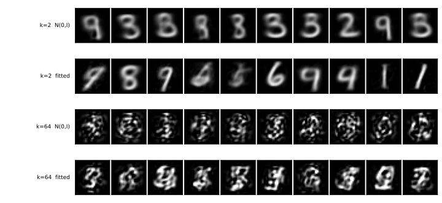

# 잠재 표현을 아무 데서나 뽑으면

<div class="leadbox" markdown>

**들어가는 이야기** — 되살릴 수 있으면 만들 수도 있지 않을까

여기까지 네 스텝을 걸어 왔고, 마지막 기계는 숫자 한 장을 **64개의 수**로 줄였다가 거의 그대로 되살린다. 줄이고 펴는 일이 그만큼 된다.

그렇다면 당연해 보이는 생각이 하나 있다. 펴는 쪽은 64개의 수를 받아 그림을 내놓는 기계다. 그러니 **아무 수 64개나 집어넣으면 본 적 없는 새 숫자가 나와야 하지 않는가?** 넣을 수만 있으면 공짜로 만들기를 얻는 셈이다.

해 보면 나오지 않는다. 획이 어지럽게 흩어진 것이 나오고, 0부터 9 가운데 어느 것이라고도 부를 수 없다. 더 얄궂은 것은 **남기는 수가 2개일 때는 꽤 잘 된다**는 점이다. 64개일 때 무너진다. 보통은 수를 많이 쥔 쪽이 유리한데 여기서는 거꾸로다.

그러니 이 쪽이 묻는 것은 「왜 안 되는가」만이 아니다. **왜 하필 더 큰 쪽에서 안 되는가**이고, 그 답이 다음 절이 고치려는 바로 그것이다.

</div>

되살리기는 네 스텝으로 끝냈다. 이제 **만들기**를 한 번 해 보고 이 절을 닫는다.

생각은 간단하다. 디코더는 잠재 표현을 받아 그림을 내놓는 함수다. 그러니 **있어 본 적 없는 잠재 표현**를 하나 지어내 넣으면, 있어 본 적 없는 그림이 나와야 한다. 점 열 개를 뽑아 넣어 보자.

---

## 1. 어디서 뽑을 것인가

여기서 곧바로 물음이 생긴다. **어디서 뽑는가?**

오토인코더의 로스는 `mse_loss(dec(enc(x)), x)` 하나뿐이다. 그 식 어디에도 잠재 표현이 어떤 모양으로 퍼져 있어야 한다는 말이 없다. 그러니 뽑을 자리는 우리가 **골라야** 하고, 고른 만큼 답도 달라진다.

가장 그럴듯한 두 가지를 모두 해 본다.

- **$N(0, I)$** — 아무것도 모른 채 표준 정규분포에서 뽑는다
- **맞춘 정규분포** — 진짜 잠재 표현들의 평균과 표준편차를 재어, 그 모양에 맞춘 정규분포에서 뽑는다

잠재 차원도 둘 다 본다. 2와 64다.

---

## 2. 코드

```python
"""잠재 표현을 아무 데서나 뽑으면 어떻게 되는가.

5.1절에서 학습한 AE_MLP를 그대로 쓴다. 되살리기는 배웠으니, 이번에는
없던 잠재 표현을 넣어 없던 그림을 만들어 본다. mnist_judge.pt는 이 절 첫 쪽에서
학습해 둔 것을 읽어 쓴다.
"""

import matplotlib
matplotlib.use("Agg")
import matplotlib.pyplot as plt
import torch
import torch.nn as nn
import torch.nn.functional as F
import torch.optim as optim
from torch.utils.data import DataLoader, TensorDataset
import torchvision
import torchvision.transforms as transforms

SEED, BATCH, LR, AE_EPOCHS = 42, 100, 1e-3, 100
N_SAMPLE = 5000
MEAN, STD = 0.1307, 0.3081
device = torch.device("mps" if torch.backends.mps.is_available() else "cpu")
plt.rcParams["svg.fonttype"] = "path"

tf = transforms.Compose([transforms.ToTensor(),
                         transforms.Normalize((MEAN,), (STD,))])
tr_ds = torchvision.datasets.MNIST("./data", train=True, download=True, transform=tf)
te_ds = torchvision.datasets.MNIST("./data", train=False, download=True, transform=tf)


def materialize(ds):
    xs = [x for x, _ in DataLoader(ds, batch_size=2000, shuffle=False)]
    return torch.cat(xs).flatten(1)


Xtr, Xte = materialize(tr_ds), materialize(te_ds)


# === 심판 (5.1절 첫 쪽에서 학습해 둔 것) ====================================
class JudgeCNN(nn.Module):
    def __init__(self):
        super().__init__()
        self.conv1 = nn.Conv2d(1, 32, 3, padding=1)
        self.conv2 = nn.Conv2d(32, 64, 3, padding=1)
        self.pool = nn.MaxPool2d(2, 2); self.dropout = nn.Dropout(0.25)
        self.fc1 = nn.Linear(64 * 7 * 7, 128); self.fc2 = nn.Linear(128, 10)

    def forward(self, x):
        x = self.pool(torch.relu(self.conv1(x)))
        x = self.pool(torch.relu(self.conv2(x)))
        return self.fc2(self.dropout(torch.relu(self.fc1(x.flatten(1)))))


judge = JudgeCNN().to(device)
judge.load_state_dict(torch.load("mnist_judge.pt", weights_only=True))
judge.eval()


@torch.no_grad()
def read(flat):
    """심판에게 읽히고 (평균 확신도, 클래스 균형도, 최대 클래스 몫, 그 숫자)를 돌려준다."""
    p = torch.cat([torch.softmax(judge(flat[i:i + 1000].reshape(-1, 1, 28, 28).to(device)), 1).cpu()
                   for i in range(0, len(flat), 1000)])
    conf, lab = p.max(1)
    share = torch.bincount(lab, minlength=10).float() / len(lab)
    nz = share[share > 0]
    balance = float(-(nz * nz.log()).sum() / torch.tensor(10.0).log())
    return conf.mean().item(), balance, share.max().item(), int(share.argmax())


# === 5.1절의 AE_MLP 그대로 ==================================================
class MLPAE(nn.Module):
    def __init__(self, k):
        super().__init__()
        self.enc = nn.Sequential(nn.Linear(784, 256), nn.ReLU(), nn.Linear(256, k))
        self.dec = nn.Sequential(nn.Linear(k, 256), nn.ReLU(), nn.Linear(256, 784))

    def forward(self, x):
        return self.dec(self.enc(x))


def train_ae(k):
    torch.manual_seed(SEED)
    m = MLPAE(k).to(device)
    opt = optim.Adam(m.parameters(), lr=LR)
    g = torch.Generator().manual_seed(SEED)
    loader = DataLoader(TensorDataset(Xtr), batch_size=BATCH, shuffle=True, generator=g)
    for _ in range(AE_EPOCHS):
        m.train()
        for (xb,) in loader:
            xb = xb.to(device)
            opt.zero_grad()
            F.mse_loss(m(xb), xb).backward()
            opt.step()
    return m.eval()


if __name__ == "__main__":
    print(f"진짜 시험 이미지에 심판이 주는 확신도 {read(Xte)[0]:.3f}")

    rows = []
    for k in (2, 64):
        m = train_ae(k)
        with torch.no_grad():
            z = torch.cat([m.enc(Xte[i:i + 1000].to(device)).cpu()
                           for i in range(0, len(Xte), 1000)])
        with torch.no_grad():
            rec = torch.cat([m(Xte[i:i + 1000].to(device)).cpu()
                             for i in range(0, len(Xte), 1000)])
        print(f"\n=== 잠재 차원 {k}")
        print(f"  진짜 잠재 표현: 좌표 std {z.std(0).mean():.2f}  "
              f"범위 [{z.min():.1f}, {z.max():.1f}]")
        print(f"  되살린 그림  확신도 {read(rec)[0]:.3f}")

        torch.manual_seed(0)
        for name, pts in [("N(0, I)", torch.randn(N_SAMPLE, k)),
                          ("맞춘 정규분포", torch.randn(N_SAMPLE, k) * z.std(0) + z.mean(0))]:
            with torch.no_grad():
                img = m.dec(pts.to(device)).cpu()
            conf, bal, top, digit = read(img)
            print(f"  {name:12s} 확신도 {conf:.3f}  클래스 균형도 {bal:.3f}  "
                  f"가장 많은 클래스 {100 * top:.1f}% (숫자 {digit})")
            rows.append((f"k={k}  {'N(0,I)' if 'N(' in name else 'fitted'}", img[:10]))

    # === 열 장씩 그려 둔다 ===================================================
    fig, axes = plt.subplots(len(rows), 10, figsize=(10, 4.6))
    for r, (label, imgs) in enumerate(rows):
        for c in range(10):
            axes[r, c].imshow((imgs[c].reshape(28, 28) * STD + MEAN).clamp(0, 1),
                              cmap="gray", vmin=0, vmax=1)
            axes[r, c].set_xticks([]); axes[r, c].set_yticks([])
        axes[r, 0].text(-0.15, 0.5, label, transform=axes[r, 0].transAxes,
                        ha="right", va="center", fontsize=9)
    fig.subplots_adjust(left=0.17, right=0.99, top=0.99, bottom=0.01,
                        wspace=0.05, hspace=0.08)
    fig.savefig("ae_sampling.svg", transparent=True)
    print("\nwrote ae_sampling.svg")
```

**출력:**

```
진짜 시험 이미지에 심판이 주는 확신도 0.992

=== 잠재 차원 2
  진짜 잠재 표현: 좌표 std 3.86  범위 [-15.5, 12.8]
  되살린 그림  확신도 0.900
  N(0, I)      확신도 0.869  클래스 균형도 0.490  가장 많은 클래스 69.2% (숫자 3)
  맞춘 정규분포      확신도 0.862  클래스 균형도 0.976  가장 많은 클래스 14.8% (숫자 7)

=== 잠재 차원 64
  진짜 잠재 표현: 좌표 std 0.90  범위 [-6.7, 5.6]
  되살린 그림  확신도 0.988
  N(0, I)      확신도 0.776  클래스 균형도 0.438  가장 많은 클래스 72.7% (숫자 3)
  맞춘 정규분포      확신도 0.783  클래스 균형도 0.533  가장 많은 클래스 66.7% (숫자 3)

wrote ae_sampling.svg
```

---

## 3. 뽑은 점 열 개씩



**아래 두 줄을 보라.** 잠재 차원 64에서 뽑은 열 장은 숫자가 아니다. 흰 획이 어지럽게 흩어져 있을 뿐, 어느 것도 0부터 9 가운데 하나라고 부를 수 없다. 뽑는 자리를 바꾸어도 그대로다.

그런데 **위의 두 줄은 숫자다.** 잠재 차원 2에서 뽑은 것들은 2, 6, 8, 9, 4처럼 또렷하게 읽힌다. 같은 수법인데 차원만 바꾸었을 뿐이다.

---

## 4. 틀린 설명 하나를 먼저 지운다

"$N(0, I)$가 잠재 표현의 크기와 맞지 않아서"라고 설명하고 싶어진다. 잠재 차원 2에서는 실제로 그렇다 — 진짜 잠재 표현의 좌표 표준편차가 **3.86**이고 범위가 $[-15.5,\ 12.8]$이니, $N(0, I)$는 너무 작아 가운데만 들쑤신다. 그래서 클래스 균형도가 0.490으로 주저앉고 3 하나가 69%를 차지한다. 맞춘 정규분포로 바꾸면 **0.976**까지 올라간다. 크기를 맞추어 준 것이 효과가 있었다.

**그런데 잠재 차원 64에서는 그 설명이 통하지 않는다.** 거기서는 진짜 잠재 표현의 좌표 표준편차가 **0.90**이다. $N(0, I)$가 이미 거의 맞는 크기다. 그런데도 결과가 흩어진 획 뭉치이고, 크기를 정확히 맞추어 주어도(0.438 → 0.533) 그림은 달라지지 않는다.

곧 **크기의 문제가 아니다.**

---

## 5. 그러면 무엇이 문제인가

64개의 수가 이루는 공간에서 진짜 잠재 표현들은 **얇고 굽은 자리**에만 모여 있다. 좌표마다 따로 정규분포를 두고 곱한 것은 그 자리를 담지 못한다. 좌표 하나하나의 크기는 맞출 수 있어도, 좌표들이 **서로 어떻게 묶여 있는지**는 담기지 않기 때문이다.

차원이 높을수록 이 어긋남이 커진다. 맞춘 정규분포에서 뽑은 점은 거의 언제나 진짜 잠재 표현들이 사는 자리 **바깥**에 떨어지고, 디코더는 그런 입력을 받아 본 적이 없다. 받아 본 적 없는 입력에 디코더가 무엇을 내놓을지는 아무도 약속한 바가 없다.

잠재 차원 2에서 통했던 까닭도 같은 말로 설명된다. **2차원에는 빗나갈 자리가 거의 없다.**

### 「바깥」과 「높을수록」을 수로 재어 두면

위 두 문단은 말로는 맞다. 수로 재어 보면 어느 쪽이 얼마나 맞는지가 갈린다.


왼쪽이 **"차원이 높을수록"**이다. 좌표를 $d$개만 떼어 놓고, 좌표끼리의 묶임을 버린 정규분포가 참 분포보다 몇 배 넓은 자리를 덮는지 쟀다. $d = 2$에서 **1.01배**다 — 바로 위 문단의 "2차원에는 빗나갈 자리가 거의 없다"가 글자 그대로 맞다. 그리고 $d = 8$까지도 1.07배로 거의 평평하다. 그러다 32에서 5.5배, 48에서 44.8배, **64에서 576배**가 된다. 고르게 커지는 것이 아니라 **늦게 터진다.**

오른쪽은 **"바깥에 떨어진다"**를 조심해서 읽으라는 칸이다. 그 말을 **거리로** 재면 보이지 않는다. 뽑은 점에서 가장 가까운 진짜 잠재 표현까지의 거리를 진짜끼리 가장 가까운 거리로 나누면 잠재 2에서 1.46배, 잠재 64에서 **1.63배**다. 거의 같다. 64차원에서 뽑은 점이 유난히 더 외딴 데로 가는 것이 아니다.

**그러니 어긋나는 것은 "얼마나 멀리"가 아니라 "어느 쪽으로"다.** 뽑은 점은 알맞은 거리에 있으면서, 진짜 잠재 표현들이 한 번도 가 보지 않은 **방향**에 놓인다. 576배라는 수가 그 가 보지 않은 방향들이 차지하는 넓이다.

!!! warning "이 두 자가 재지 않은 것"
    둘 다 **잠재 표현의 모양만** 본 것이고, 디코더가 그 자리에서 무엇을 내놓는지는 재지 않았다. 넓은 자리를 덮는다는 것과 거기서 나온 그림이 숫자가 아니라는 것은 **따로 확인해야 할 두 가지**이며, 이 쪽이 확인한 것은 뒤엣것뿐이다.

    그리고 왼쪽 곡선은 **64차원 잠재 표현에서 좌표를 $d$개 떼어 본 것**이지 $d$차원 오토인코더를 따로 학습한 것이 아니다. $d$차원으로 처음부터 학습하면 그 좌표들이 다르게 묶일 수 있으므로, 이 곡선을 "잠재 차원을 $d$로 두면 이렇게 된다"로 읽으면 안 된다.

위 수는 이 절이 저장해 둔 오토인코더로 쟀고 다시 학습하지 않았다. 셈하는 코드는 `figures/make_figures.py`에 있다.

<div class="defn" markdown>

### 정의 1. 이 쪽이 겪은 것 { .dfn }

오토인코더가 배운 것은 **디코더**이고, 배우지 않은 것은 **잠재 표현의 분포**다. 로스가 요구한 적이 없기 때문이다. 그래서 만들려고 할 때 "어디서 뽑는가"라는 물음이 남고, 그 물음에는 **모델이 아니라 우리가** 답해야 한다. 차원이 높으면 어떤 답을 골라도 빗나간다.

</div>

---

## 6. 확신도만 보면 속는다

심판에게 물어보면 어떻게 될까. 잠재 차원 64에서 넷을 나란히 재어 보자.

| | 확신도 |
|---|---|
| 진짜 시험 이미지 | 0.992 |
| AE_MLP-64가 **되살린** 그림 | 0.988 |
| AE_MLP-64에서 **뽑은** 그림 | **0.783** |

**확신도는 분명히 떨어진다.** 0.988에서 0.783이니 심판이 아주 눈이 먼 것은 아니다. 뽑은 그림이 되살린 그림보다 못하다는 것 정도는 안다.

그런데 0.783이라는 수를 **혼자 놓고 보면** 꽤 높아 보인다. [5.2절의 VAE 쪽](../latent_generative/01_vae.md)이 이 자의 양 끝을 재어 두었는데, 균등 잡음이 0.490이고 가우스 잡음이 0.324다. 저 획 뭉치들은 잡음보다 한참 위에 있다. 저 획 뭉치들을 보지 않은 채 0.783만 받아 들면 "그럭저럭 숫자를 만들어 내는 모델"이라고 적게 된다.

**얼마나 위험한지는 다음 절과 견주면 드러난다.** [5.2절](../latent_generative/index.md)이 VAE-64에서 뽑은 표본의 확신도를 **0.769**로 적는다. 그 표본들은 보면 숫자다. 곧

$$
\underbrace{0.783}_{\text{획 뭉치}} \;>\; \underbrace{0.769}_{\text{숫자}}
$$

확신도로 줄을 세우면 **오토인코더가 VAE를 이긴다.** 순서가 거꾸로다.

!!! warning "확신도 하나로는 잡지 못한다"
    이 쪽의 실패를 잡아내는 것은 셋이다 — 눈으로 보는 것, **클래스 균형도**(0.533 대 VAE의 0.877), 그리고 **되살린 것과 뽑은 것의 간격**이다.

    마지막 것이 쓸모 있다. 잠재 차원 2에서는 되살린 그림이 0.900이고 뽑은 그림이 0.862로 거의 붙어 있는데(뽑기가 통하는 자리다), 64에서는 0.988과 0.783으로 크게 벌어진다. **그 간격이 "잠재 표현 구름을 빗나갔다"의 크기다.**

    자를 여럿 두는 까닭이 이것이다. [장 개요](../index.md)가 자를 넷 세운 것도, [5.3절](../generative/index.md)이 "열 장으로 판단하지 말 것"이라 적어 둔 것도 같은 이유다. 심판이 확신한다는 말은 "숫자처럼 생긴 무언가"라는 뜻이지 "숫자"라는 뜻이 아니다.

---

## 7. 다음 절이 고치는 것

고칠 길은 둘 가운데 하나다. 뽑을 자리를 더 잘 찾아내거나, **애초에 잠재 표현이 뽑기 좋은 모양으로 놓이도록 학습을 바꾸거나.**

[5.2절](../latent_generative/index.md)이 둘째 길을 간다. 로스에 항을 하나 더해 잠재 표현의 분포 자체를 $N(0, I)$ 쪽으로 밀어 두는 것이다. 그러면 "어디서 뽑는가"가 더 이상 물음이 아니다 — **$N(0, I)$에서 뽑으면 된다**고 모델이 약속한 셈이 되기 때문이다.

그 절이 재어 보면 잠재 차원 64에서 클래스 균형도가 0.541에서 **0.877**로 올라간다. 이 쪽에서 본 0.533이 그 0.541이다.

---

## 연습문제

<div class="drillbox" markdown>

**연습문제 1.** <span class="diff easy" title="쉬움"></span>
잠재 차원 2에서는 $N(0, I)$가 0.490이고 맞춘 정규분포가 0.976인데, 잠재 차원 64에서는 0.438과 0.533으로 둘 다 낮다. 크기를 맞추어 주는 것이 한쪽에서만 듣는 까닭을 출력의 **좌표 std** 두 값으로 설명하라.

</div>

??? success "풀이"
    출력이 그 두 수를 찍어 둔다. 잠재 차원 2의 진짜 잠재 표현은 좌표 표준편차가 **3.86**이고 64의 것은 **0.90**이다.

    곧 잠재 차원 2에서 $N(0, I)$는 **네 배 가까이 작다.** 진짜 잠재 표현들이 $[-15.5,\ 12.8]$에 퍼져 있는데 표준 정규분포는 대부분 $[-3,\ 3]$ 안에서 뽑으므로, 잠재 표현 구름의 **한가운데만** 들쑤신다. 가운데에 무엇이 있든 그것만 자꾸 나오고, 그래서 3 하나가 69%를 차지한다. 크기를 맞추어 주면 바깥까지 닿아 열 가지가 고루 나온다(0.976).

    잠재 차원 64에서는 $N(0, I)$가 이미 거의 맞는 크기다(0.90 대 1). 맞추어 줄 것이 별로 없으니 고쳐 봐야 0.438에서 0.533으로 조금 움직일 뿐이고, **그림은 양쪽 다 획 뭉치다.** 크기가 맞는데도 실패한다는 것이 이 쪽의 요점이다.

---

<div class="drillbox" markdown>

**연습문제 2.** <span class="diff med" title="중간"></span>
맞춘 정규분포는 좌표마다 평균과 표준편차를 따로 재어 곱한 것이다. 이것이 진짜 잠재 표현 구름을 담지 못하는 까닭을 말하고, **담아 보려는** 더 나은 방법을 하나 들어라. 그 방법을 써도 남는 문제는 무엇인가?

</div>

??? success "풀이"
    좌표마다 따로 재어 곱하면 **좌표끼리의 관계가 통째로 지워진다.** 1번 좌표가 클 때 2번 좌표도 큰 경향이 있더라도, 곱해 만든 분포는 둘을 독립으로 다룬다. 진짜 잠재 표현 구름이 비스듬히 기울어 있거나 굽어 있으면 그 모양은 남지 않는다.

    **한 걸음 나은 방법은 공분산까지 맞추는 것이다.** 잠재 표현들의 공분산 행렬을 재어 다변량 정규분포에서 뽑으면 좌표끼리의 **선형** 관계는 담긴다. 기울어진 타원까지는 따라간다.

    **남는 문제는 굽은 것이다.** 잠재 표현 구름이 휘어 있으면 어떤 타원으로도 덮을 수 없다. 타원을 데이터에 맞추면 빈 곳까지 함께 덮게 되고, 그 빈 곳에서 뽑은 점이 다시 디코더가 본 적 없는 입력이 된다. [AE_MLP 쪽](03_ae_mlp.md)의 잠재 공간 그림에서 클래스 사이가 비어 있던 것이 그것이다.

    그래서 [5.2절](../latent_generative/index.md)은 분포를 **따라가는** 대신 분포를 **밀어 놓는** 쪽을 고른다. 맞출 수 없다면 맞추기 쉬운 모양이 되도록 학습을 바꾸면 된다.

---

<div class="drillbox" markdown>

**연습문제 3.** <span class="diff hard" title="어려움"></span>
이 쪽은 잠재 차원 2와 64만 재었다. 그 사이에서 **어디서부터 무너지는지**를 알아보는 실험을 설계하라. 무엇을 자로 쓸 것이며, 이 쪽이 쓴 두 자 가운데 어느 것을 믿어야 하는가?

</div>

??? success "풀이"
    $k$를 2, 4, 8, 16, 32, 64로 두고 같은 일을 되풀이하면 된다. 각 $k$마다 AE_MLP를 학습하고, 맞춘 정규분포에서 5,000장을 뽑아 재는 것이다.

    **자는 클래스 균형도를 쓴다.** 이 쪽이 보인 그대로 확신도는 쓸 수 없다 — 잠재 차원 64의 획 뭉치에 0.783을 주어 되살린 그림의 0.777과 거의 같았다. 무너지는 것을 확신도는 보지 못한다.

    눈으로 보는 것도 함께 두어야 한다. 클래스 균형도는 "열 가지가 고루 나오는가"만 재므로, 열 가지 획 뭉치를 고루 만들어 내는 모델이 있다면 높은 점수를 받을 수 있다. 두 자가 서로를 받쳐 준다.

    짚어 둘 것이 하나 더 있다. $k$를 바꾸면 모델의 파라메터 수도 함께 바뀌므로, 무너짐이 차원 탓인지 모델 크기 탓인지 가려야 한다. [AE_MLP 쪽](03_ae_mlp.md)의 연습문제 3이 그 교란이 작다는 것을 세어 두었다 — 인코더가 201,474개에서 217,408개로 7.3%만 달라진다. 그 7.3%를 적어 두고 읽으면 된다.

    그리고 시드 하나로는 모자라다. 이 쪽의 수는 모두 시드 42로 학습한 모델 하나에서 뽑은 것이라, 무너지는 자리를 $k$ 하나까지 좁히려면 시드를 여러 개 돌려 흔들림을 함께 재야 한다.
