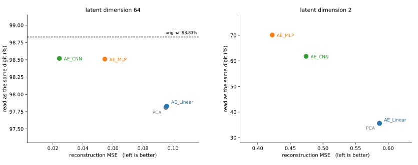
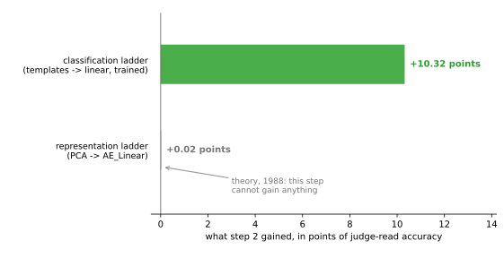

# 차원축소 — 네 스텝 전체

<div class="leadbox" markdown>

**들어가는 이야기** — 숫자 한 장에 수가 몇 개나 필요한가

MNIST의 숫자 한 장은 가로 28칸 세로 28칸, 곧 **784개의 수**다. 그런데 그 784개가 아무렇게나 적힌 것은 아니다. 가장자리는 거의 언제나 비어 있고, 획이 지나간 자리 옆은 또 획일 때가 많다. 한 칸을 가리고 맞혀 보라면 이웃만 보고도 거의 맞힐 수 있다.

그렇다면 **784개가 다 필요한 것은 아니다.** 몇 개면 되는가? 64개로 줄였다가 다시 784개로 펴면 사람이 알아볼 수 있는 숫자가 나올까?

이 절은 점점 영리한 방법으로 네 번 시험한다. 그런데 **둘째 방법은 첫째보다 조금도 낫지 않고**(0.0953 대 0.0958), **넷째 방법은 64개로 줄일 때는 이기는데 2개로 줄일 때는 진다.** 더 똑똑하게 만들었는데 더 나아지지 않거나, 나아지는지가 형편에 따라 달라지는 것이다. 왜 그런지가 이 절이 얻는 것이고, 거기서 「언제 배우는 것이 값어치가 있는가」라는 물음이 나온다.

</div>

[3장](../../ch03/index.md)과 [4장](../../ch04/index.md)은 **가르는** 법을 배웠다. 이 장은 **만드는** 법을 배운다.

그런데 첫스텝은 만들기가 아니라 **되살리기**다. 그림을 몇 개의 수로 줄였다가 그 수만으로 다시 그려 낼 수 있다면, 그 수들은 그림에 있던 것을 쥐고 있다는 뜻이다. 없던 수를 넣어 없던 그림을 만드는 일은 그다음이다.

---

## 1. 왜 MNIST로 돌아오는가

[4장](../../ch04/index.md)은 MNIST가 너무 쉽다며 CIFAR-10으로 옮겨 갔다. 그 판단은 **정확도라는 자**에서 옳았다. 99.21%에 이르면 남은 오차가 1%포인트도 되지 않아 다음 스텝을 잴 수 없었다.

이 장은 자가 다르다. 그리고 그 자에서는 MNIST가 전혀 포화하지 않았다.

| | 4장이 CIFAR-10을 고른 까닭 | 이 장이 MNIST로 돌아온 까닭 |
|---|---|---|
| 재는 것 | 시험 정확도 | 복원 품질, 그리고 나중에는 표본 품질 |
| MNIST의 형편 | 99.21%로 포화 | **숫자 형태를 눈으로 비교하기 쉬운 데이터** |

MNIST는 숫자의 형태가 단순해 복원 결과를 시각적으로 비교하기 쉽고, CIFAR-10은 자연 사진의 세부가 복잡해 눈으로 품질을 판단하기가 더 어렵다. 다만 눈으로 보기 쉽다는 것이 이 데이터만의 몫은 아니어서, 잠재 공간을 2차원으로 그려 보는 일은 다른 데이터에도 쓸 수 있다.

**어느 데이터가 알맞은가는 무엇을 재려느냐가 정한다.** 4장과 이 장이 서로 다른 답을 낸 것이 그 보기다.

---

## 2. 재는 자가 둘이다

**복원 MSE** — 되살린 그림이 원본과 화소 단위로 얼마나 가까운가. 이 사다리가 실제로 최소화하는 값이다.

**같은 숫자로 읽히는 비율** — 되살린 그림을 [3장 스텝4](../../ch03/mnist/04_cnn.md)의 컨볼루션 뉴럴 넷트웍에 넣어, 원래 라벨과 같게 읽는 비율을 센다. 이 절에서 쓰는 심판은 같은 구조를 **5 에포크** 학습해 **98.83%**를 얻은 것이다. 3장 스텝4의 규약은 10 에포크이므로 예산이 절반이고, 그만큼 정확도도 조금 아래다.

자를 둘 두는 까닭이 있다. MSE는 "화소가 가깝다"만 말할 뿐 **"3이 아직 3인가"**는 말해 주지 않는다. 뒤에 보겠지만 두 자는 자주 서로 다른 답을 낸다.

!!! note "심판의 98.83%에 대하여"
    [4.1절](../../ch04/01_two_ladders.md)이 같은 구조를 10 에포크·시드 다섯 개로 재었을 때 **99.23~99.36**이었다. 여기의 98.83%는 그 띠보다 0.40%포인트 아래인데, 까닭은 시드가 아니라 **예산**이다 — 이 심판은 5 에포크만 돈다. [3장 스텝4](../../ch03/mnist/04_cnn.md)도 "5 에포크로 재던 때에는 값이 다섯 번의 띠 밖에 있었다"고 적어 두었다.

    곧 98.83%는 3장이 보고한 99.21%를 재현한 값이 아니다. 이 절에 필요한 것은 가장 좋은 심판이 아니라 **모든 줄이 같은 심판을 쓰는 것**이므로, 예산을 절반으로 둔 채 고정했다.

    같은 심판을 쓰면 평가 조건을 맞출 수 있다. 다만 심판 자체의 오류와 복원본에 대한 반응 차이가 있으므로, 이 점수는 사람의 판단이나 완전한 품질 척도를 대신하지 않는다.

### 심판을 만들어 두는 코드

이 절의 모든 쪽이 이 심판을 쓴다. 한 번 학습해 파일로 남겨 두고 뒤에서는 읽어 쓴다.

```python
"""심판 CNN을 학습해 mnist_judge.pt로 남긴다.

3장 스텝4와 같은 구조이며, 학습은 5 에포크다(그 쪽의 규약은 10 에포크다).
이 장의 모든 절이 이 파일을 읽어,
되살린 그림과 만들어 낸 그림이 아직 숫자로 읽히는지를 잰다.
"""

import torch
import torch.nn as nn
import torch.nn.functional as F
import torch.optim as optim
from torch.utils.data import DataLoader, TensorDataset
import torchvision
import torchvision.transforms as transforms

SEED, BATCH, LR, EPOCHS = 42, 100, 1e-3, 5
device = torch.device("mps" if torch.backends.mps.is_available() else "cpu")

# === 자료 ===================================================================
tf = transforms.Compose([transforms.ToTensor(),
                         transforms.Normalize((0.1307,), (0.3081,))])
tr_ds = torchvision.datasets.MNIST("./data", train=True, download=True, transform=tf)
te_ds = torchvision.datasets.MNIST("./data", train=False, download=True, transform=tf)


def materialize(ds):
    """DataLoader를 한 번 돌려 텐서로 펼쳐 둔다. 뒤에서 되풀이해 쓰기 편하다."""
    xs, ys = [], []
    for x, y in DataLoader(ds, batch_size=2000, shuffle=False):
        xs.append(x); ys.append(y)
    return torch.cat(xs), torch.cat(ys)


Xtr_img, ytr = materialize(tr_ds)          # (60000, 1, 28, 28)
Xte_img, yte = materialize(te_ds)
print(f"자료 {tuple(Xtr_img.flatten(1).shape)}")


# === 심판 ===================================================================
class JudgeCNN(nn.Module):
    """3장 스텝4의 구조 그대로."""

    def __init__(self):
        super().__init__()
        self.conv1 = nn.Conv2d(1, 32, 3, padding=1)
        self.conv2 = nn.Conv2d(32, 64, 3, padding=1)
        self.pool = nn.MaxPool2d(2, 2)
        self.dropout = nn.Dropout(0.25)
        self.fc1 = nn.Linear(64 * 7 * 7, 128)
        self.fc2 = nn.Linear(128, 10)

    def forward(self, x):
        x = self.pool(torch.relu(self.conv1(x)))
        x = self.pool(torch.relu(self.conv2(x)))
        return self.fc2(self.dropout(torch.relu(self.fc1(x.flatten(1)))))


# === 학습 ===================================================================
if __name__ == "__main__":
    torch.manual_seed(SEED)
    judge = JudgeCNN().to(device)
    opt = optim.Adam(judge.parameters(), lr=LR)
    # 섞는 차례를 전역 난수와 떼어 놓는다 (4.1절 「이 표를 믿어도 되는가」 참고)
    g = torch.Generator().manual_seed(SEED)
    loader = DataLoader(TensorDataset(Xtr_img, ytr), batch_size=BATCH,
                        shuffle=True, generator=g)

    for _ in range(EPOCHS):
        judge.train()
        for xb, yb in loader:
            opt.zero_grad()
            F.cross_entropy(judge(xb.to(device)), yb.to(device)).backward()
            opt.step()

    judge.eval()
    with torch.no_grad():
        pred = torch.cat([judge(Xte_img[i:i + 1000].to(device)).argmax(1).cpu()
                          for i in range(0, len(Xte_img), 1000)])
    acc = 100.0 * (pred == yte).float().mean()
    torch.save(judge.state_dict(), "mnist_judge.pt")
    print(f"심판 CNN {acc:.2f}%  -> mnist_judge.pt")
```

**출력:**

```
자료 (60000, 784)
심판 CNN 98.83%  -> mnist_judge.pt
```

MPS에서 45초쯤 걸린다. 한 번만 돌려 두면 이 장의 모든 쪽이 `mnist_judge.pt`를 읽어 쓴다.

---

## 3. 사다리는 3장·4장과 같은 네 스텝이다

| | 분류 사다리 (3·4장) | 이 절의 표현 사다리 |
|---|---|---|
| 1 | 템플릿 — 닫힌 형태 | [**PCA**](01_pca.md) — 닫힌 형태 |
| 2 | 선형 + 소프트맥스 | [**AE_Linear**](02_ae_linear.md) |
| 3 | 다층 퍼셉트론 | [**AE_MLP**](03_ae_mlp.md) |
| 4 | 컨볼루션 뉴럴 넷트웍 | [**AE_CNN**](04_ae_cnn.md) |

같은 네 생각을 다른 목표에 건다. 라벨은 한 번도 쓰지 않는다.

규약도 그대로다. Adam $10^{-3}$, 배치 100, 시드 42이며, 인코더는 100 에포크를 돈다 — 20 에포크로는 모자라다는 것을 [CIFAR-10 쪽](05_cifar_classification.md)에서 보게 된다.

---

## 4. 네 스텝의 결과

잠재 차원을 64로 두었을 때다.

| 잠재 차원 64 | 복원 MSE | 같은 숫자로 | 인코더 파라메터 |
|---|---|---|---|
| 원본 (784차원) | 0 | **98.83%** | — |
| [PCA](01_pca.md) | 0.0953 | 97.81% | 50,176 |
| [AE_Linear](02_ae_linear.md) | 0.0958 | 97.83% | 50,240 |
| [AE_MLP](03_ae_mlp.md) | 0.0546 | 98.51% | 217,408 |
| [AE_CNN](04_ae_cnn.md) | **0.0243** | 98.52% | 105,216 |

잠재 차원을 2로 두면 차이가 훨씬 크게 벌어진다.

| 잠재 차원 2 | 복원 MSE | 같은 숫자로 |
|---|---|---|
| [PCA](01_pca.md) | 0.5865 | **35.66%** |
| [AE_Linear](02_ae_linear.md) | 0.5867 | 35.54% |
| [AE_MLP](03_ae_mlp.md) | **0.4223** | **70.13%** |
| [AE_CNN](04_ae_cnn.md) | 0.4742 | 61.78% |

두 표를 한 평면에 겹쳐 놓으면 셋 가운데 둘이 바로 보인다.



왼쪽에서 네 점은 **가로로만 벌어진다.** 세로로는 1%포인트 안에 모여 있고 그 위가 바로 원본의 98.83%다. 오른쪽에서는 두 축이 함께 움직인다. 그리고 두 그림 모두에서 **PCA와 AE_Linear가 한 점에 겹쳐 있다** — 이 절이 증명하려는 것이 그 겹침이다.

미리 짚어 둘 것이 셋이다.

**첫째, 스텝2가 아무것도 벌지 못한다.** [분류 사다리](../../ch04/01_two_ladders.md)에서는 같은 수법이 10.32%포인트를 벌었는데 여기서는 +0.02%포인트로, 0과 구별되지 않는다. 까닭은 [AE_Linear](02_ae_linear.md)가 다룬다.

**둘째, 잠재 차원에 따라 순위가 뒤집힌다.** 잠재 차원 64에서는 AE_CNN이 이기고 잠재 차원 2에서는 AE_MLP가 이긴다. [AE_CNN](04_ae_cnn.md)이 그 까닭을 본다.

**셋째, 두 자가 자주 어긋난다.** 잠재 차원 64에서 MSE는 네 배 차이인데 숫자 정체는 0.7%포인트 차이다. 이것도 [AE_CNN](04_ae_cnn.md)에서 정리한다.

---

<div class="storybox" markdown>

**그림으로 보는 AI 1.** 둘째 칸은 오르기 전에 이미 평평한 줄 알고 있었다

바로 위 표에서 스텝2가 아무것도 벌지 못한다. 0.02%포인트니 0이나 마찬가지다. 실험이 잘못된 것처럼 보이지만 그렇지 않다. **이 답은 1988년에 이미 나와 있었다.**

그해 에르베 부를라르(Hervé Bourlard)와 이브 캄프(Yves Kamp)가 네 쪽짜리 글을 냈다. 두 사람이 따져 본 것은 이 절의 스텝2가 하는 바로 그 일이다 — 그림을 좁은 통로로 밀어 넣었다가 다시 펼쳐서 원래 그림을 되살리도록 넷트웍을 가르치는 일. 종이 위에서 계산해 보니 **아무리 가르쳐도 PCA가 이미 주는 답보다 나은 자리에는 닿을 수 없었다.** 가르치는 솜씨가 모자라서가 아니라 더 나은 자리 자체가 없어서다. 이듬해 피에르 발디(Pierre Baldi)와 쿠르트 호르니크(Kurt Hornik)가 "가다가 엉뚱한 데 빠져 멈출 함정도 없다"는 것까지 보탰다.

두 마을을 잇는 가장 짧은 길을 찾으라는데 이미 누가 자로 직선을 그어 놓은 것과 같다. 하루 종일 걸어 다녀도 직선보다 짧은 길은 나오지 않는다. 걸어 보는 일이 쓸데없다는 뜻은 아니고, **거기서 새로 얻을 것이 없다**는 뜻이다.



**눈여겨볼 것은 똑같은 수법이 다른 사다리에서는 가장 크게 벌었다는 점이다.** 두 스텝2는 글자 그대로 같은 움직임이다 — 공식으로 답을 한 번에 내는 대신, 조금씩 고쳐 가며 배우게 한다. 3·4장의 분류 사다리에서는 그것이 10.32%포인트를 벌었다. 여기서는 0.02%포인트다. 500배 넘게 차이 난다.

갈린 자리는 **앞 칸이 이미 정답이었는가**다. 분류 사다리의 앞 칸은 숫자마다 평균 모양을 하나씩 만들어 두고 가장 닮은 것을 고르는 방법이었다. 그 방법은 "3은 이렇게 생겼다"만 알 뿐 "여기에 획이 있으면 3이 아니다"는 모른다. 정답이 아니었으니 배워서 채울 자리가 넓었다. PCA는 다르다. "되살렸을 때 어긋남이 가장 작게"라는 목표라면 PCA가 **이미 정답**이다. 채울 자리가 없다.

**그러니 "가르치면 좋아진다"는 사다리의 법칙이 아니다.** 가르치는 일이 값어치를 가지려면 앞 칸에 정답이 없거나, 있더라도 그 정답이 우리가 재려는 것과 어긋나 있어야 한다. 이 절이 스텝2를 굳이 밟는 까닭은 그래서 성적이 아니라 **대비**이고, [AE_Linear 쪽](02_ae_linear.md)이 그 자리를 자세히 본다.

한 가지 조심할 것이 있다. 1988년의 답이 못박는 것은 **가르칠 때 쓴 그림들**에서의 어긋남이다. 위 표의 값은 가르칠 때 쓰지 않은 새 그림들에서 쟀으므로, 0.02%포인트라는 작은 차이를 그 답 하나로 설명해 버릴 수는 없다. 이론이 말해 주는 것은 "여기서는 벌 것이 없다"는 데까지다.

_확인한 곳 — H. Bourlard, Y. Kamp, "Auto-association by multilayer perceptrons and singular value decomposition", *Biological Cybernetics* **59**, 291–294 (1988). P. Baldi, K. Hornik, "Neural networks and principal component analysis: Learning from examples without local minima", *Neural Networks* **2**(1), 53–58 (1989). 두 글이 말하는 것은 닿는 **자리**가 PCA와 같다는 데까지이며, 그 자리를 가리키는 **눈금까지** 같아진다는 뜻은 아니다 — 그 갈림은 [26장](../../ch25/architecture/04_ae_principal_manifold.md)이 재어서 본다. 그림의 두 수는 [4.1절](../../ch04/01_two_ladders.md)과 바로 위 표에서 옮겼고 여기서 다시 재지 않았다._

</div>

---

## 연습문제

<div class="drillbox" markdown>

**연습문제 1.** <span class="diff med" title="중간"></span>
위의 상자는 심판의 98.83%가 낮아도 괜찮다고 말한다 — "같은 심판을 쓰면 평가 조건을 맞출 수 있다."

이 논리가 **막아 주는 것과 막아 주지 못하는 것**을 가려라. 잠재 차원 64의 네 줄이 어디에 놓이는지 셈해 보고, [AE_MLP](03_ae_mlp.md)의 98.51%와 [AE_CNN](04_ae_cnn.md)의 98.52%를 두고 "둘이 같다"고 말할 수 있는지 따져라.

</div>

??? success "풀이"
    ```python
    judge = 98.83
    rows = [("PCA-64", 97.81), ("AE_Linear-64", 97.83),
            ("AE_MLP-64", 98.51), ("AE_CNN-64", 98.52)]
    for n, v in rows:
        print(f"{n:14} {v:6.2f}%   심판까지 {judge - v:.2f}%p")
    lo, hi = min(v for _, v in rows), max(v for _, v in rows)
    print(f"네 줄이 놓인 폭 {hi - lo:.2f}%p")   # 손으로 적지 않는다
    ```

    ```
    PCA-64          97.81%   심판까지 1.02%p
    AE_Linear-64    97.83%   심판까지 1.00%p
    AE_MLP-64       98.51%   심판까지 0.32%p
    AE_CNN-64       98.52%   심판까지 0.31%p
    네 줄이 놓인 폭 0.71%p
    ```

    **같은 심판은 평가 조건을 통일한다.** 그러나 심판이 특정 복원 방식에 더 유리하게 반응할 수 있으므로, 같은 심판을 쓴다고 바이어스가 제거되거나 다른 심판에서도 순서와 간격이 같아지는 것은 아니다.

    **막아 주지 못하는 것은 분해능이다.** 네 줄이 겨우 0.71%포인트 안에 몰려 있고, 위의 둘은 심판 자신의 정확도에서 0.3%포인트 안에 들어와 있다. 이 자리에서 98.51과 98.52의 차이, 곧 **0.01%포인트**를 두고 무엇을 말하려면 심판이 그만큼 가늘게 재야 하는데, 시험 데이터 10,000장에서 0.01%포인트는 **한 장**이다. 한 장으로는 아무것도 말할 수 없다.

    그러므로 "둘이 같다"는 말은 **"이 자로는 가를 수 없다"**로 적어야 맞다. 실제로 다른 자는 둘을 또렷이 가른다 — 복원 MSE는 0.0546과 0.0243으로 56% 차이다. 같은 두 모델을 한 자는 같다 하고 다른 자는 두 배 차이라 한다.

    !!! warning "98.83%는 천장이 아니다"
        "복원본이 원본보다 잘 읽힐 수는 없으니 98.83%가 천장"이라고 생각하기 쉽다. **그렇지 않다.** 이 장의 [cVAE](../latent_generative/03_cvae.md)는 잠재 차원 2에서 정체 **99.96%**를 받는다. 심판 자신의 98.83%보다 높다.

        까닭은 복원본이 원본보다 **읽기 쉬울 수 있다**는 데 있다. 되살리기와 만들기는 전형적인 모양으로 매끄럽게 미는 쪽이라, 사람이 알아보기 어려운 별난 손글씨가 반듯한 숫자로 바뀐다. 심판이 원본에서 틀리던 1.17%의 일부가 복원본에서는 맞는다.

        곧 98.83%는 천장이 아니라 **눈금의 한 자리**일 뿐이다. 그 언저리에서 분해능이 나빠지는 것은 여전히 사실이지만, 넘을 수 없는 선으로 읽으면 틀린다.

    고치는 길은 자를 바꾸는 것이다. 맞혔는지(0 또는 1)가 아니라 **심판의 확신도**를 재면 98% 언저리에서도 눈금이 남는다. [AE_CNN 쪽](04_ae_cnn.md)의 연습문제가 그것을 제안하고, [5.2절](../latent_generative/index.md)과 [5.3절](../generative/index.md)이 표본을 잴 때 실제로 그 자를 쓴다.

