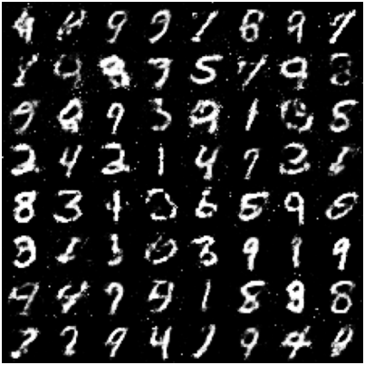

# GAN — 목표 그림을 버린다

<div class="leadbox" markdown>

**들어가는 이야기** — 위조꾼과 감정사를 함께 키운다

가짜 돈을 만드는 사람과 그것을 가려내는 사람을 한 방에 넣고 같이 연습시킨다고 해 보자. 위조꾼은 들키지 않는 것이 목표이고 감정사는 가려내는 것이 목표다. 둘이 서로를 이기려 애쓰는 동안 양쪽 다 늘고, **위조꾼에게 진짜 돈을 베껴 그리라고 한 적은 한 번도 없다.**

이 쪽이 그 수법이다. 그리는 쪽에게 보여 주는 것은 정답 그림이 아니라 가려내는 쪽의 판정 하나뿐이다.

잘 된다. 앞 절의 흐릿함이 걷히고, 같은 숫자를 얼마나 여러 모양으로 그리는지를 재는 자에서 **0.628이 0.953으로** 뛴다.

그런데 이 쪽에서 가장 오래 기억할 것은 그 수가 아니라 **읽는 법이 달라진다**는 사실이다. 지금까지는 로스가 내려가면 좋아지는 것이었다. 여기서는 그렇지 않다. 상대가 계속 바뀌므로 로스가 오르내리는 것이 정상이고, 심지어 **로스만 보고 두 모델 가운데 하나를 고르면 틀린 쪽을 고른다.** 이 쪽에는 지은이가 그 함정에 빠졌다가 바로잡은 자리도 그대로 적혀 있다.

</div>

지금까지의 모든 모델은 **정답 그림과 얼마나 가까운가**를 로스로 삼았다. [오토인코더](../dimreduction/03_ae_mlp.md)도 [VAE](../latent_generative/01_vae.md)도 $\lVert \hat{x} - x \rVert^2$을 줄인다.

GAN에는 그런 항이 없다. 대신 **판별기**를 하나 더 두고 둘을 겨루게 한다.

| | 하는 일 |
|---|---|
| 생성기 $G$ | 잡음 $z$를 받아 그림을 내놓는다 |
| 판별기 $D$ | 그림을 받아 진짜인지 만든 것인지 맞힌다 |

$D$는 잘 맞히려 하고, $G$는 $D$가 틀리게 하려 한다. **$G$의 로스에는 어떤 그림을 그려야 한다는 목표가 없다.** 판별기를 속이기만 하면 된다.

```python
"""GAN. 목표 그림 없이, 판별기를 속이는 것만으로 배운다.

mnist_judge.pt는 5.1절에서 학습해 둔 것을 읽어 쓴다.
GAN은 [-1, 1]로 두고 tanh로 내놓으므로, 심판에 넣기 전에 정규화를 되돌린다.
"""

import time

import torch
import torch.nn as nn
import torch.optim as optim
from torch.utils.data import DataLoader, TensorDataset
import torchvision
import torchvision.transforms as transforms

SEED, BATCH, ZDIM, EPOCHS = 42, 100, 64, 30
N_SAMPLE = 5000
JM, JS = 0.1307, 0.3081                 # 심판이 기대하는 정규화
device = torch.device("mps" if torch.backends.mps.is_available() else "cpu")

# 이 절만 [-1, 1]을 쓴다 — 생성기가 tanh로 내놓기 때문이다
tf = transforms.Compose([transforms.ToTensor(),
                         transforms.Normalize((0.5,), (0.5,))])
tr = torchvision.datasets.MNIST("./data", train=True, download=True, transform=tf)
te = torchvision.datasets.MNIST("./data", train=False, download=True, transform=tf)
Xtr = torch.cat([x for x, _ in DataLoader(tr, batch_size=2000, shuffle=False)])
Xte = torch.cat([x for x, _ in DataLoader(te, batch_size=2000, shuffle=False)])
yte = torch.cat([y for _, y in DataLoader(te, batch_size=2000, shuffle=False)])


class JudgeCNN(nn.Module):
    def __init__(self):
        super().__init__()
        self.conv1 = nn.Conv2d(1, 32, 3, padding=1)
        self.conv2 = nn.Conv2d(32, 64, 3, padding=1)
        self.pool = nn.MaxPool2d(2, 2); self.dropout = nn.Dropout(0.25)
        self.fc1 = nn.Linear(64 * 7 * 7, 128); self.fc2 = nn.Linear(128, 10)

    def forward(self, x):
        x = self.pool(torch.relu(self.conv1(x)))
        x = self.pool(torch.relu(self.conv2(x)))
        return self.fc2(self.dropout(torch.relu(self.fc1(x.flatten(1)))))


judge = JudgeCNN().to(device)
judge.load_state_dict(torch.load("mnist_judge.pt", weights_only=True))
judge.eval()


@torch.no_grad()
def predict(x_pm1):
    """[-1,1] -> [0,1] -> 심판 정규화 -> 심판."""
    xj = (((x_pm1 + 1) / 2) - JM) / JS
    p = torch.cat([torch.softmax(judge(xj[i:i + 1000].to(device)), 1).cpu()
                   for i in range(0, len(xj), 1000)])
    conf, pred = p.max(1)
    return conf, pred


def within_class_var(imgs01, group, min_n=20):
    """같은 클래스로 묶인 것들의 화소 분산을, 무리 크기로 가중해 평균낸다."""
    vs, ws = [], []
    for d in range(10):
        g = imgs01[group == d]
        if len(g) < min_n:
            continue
        vs.append(g.flatten(1).var(0).mean().item()); ws.append(len(g))
    return sum(v * w for v, w in zip(vs, ws)) / sum(ws) if vs else 0.0


# 진짜 자료의 기준선 — 여기서는 심판이 아니라 진짜 라벨로 묶는다
REAL_VAR = within_class_var((Xte + 1) / 2, yte)


def evaluate(samples_pm1, tag):
    conf, pred = predict(samples_pm1)
    share = torch.bincount(pred, minlength=10).float()
    share = share / share.sum()
    nz = share[share > 0]
    bal = (-(nz * nz.log()).sum() / torch.tensor(10.0).log()).item()
    wv = within_class_var((samples_pm1 + 1) / 2, pred)
    print(f"  {tag:14s} 확신도 {conf.mean():.3f}  고름 {bal:.3f}  "
          f"최대몫 {share.max():.3f}  클래스안 다양함 {wv / REAL_VAR:.3f}", flush=True)


def train_gan(Gc, Dc, tag):
    torch.manual_seed(SEED)
    G, D = Gc().to(device), Dc().to(device)
    # GAN 표준값. 이 장의 Adam 1e-3으로는 학습되지 않는다
    oG = optim.Adam(G.parameters(), lr=2e-4, betas=(0.5, 0.999))
    oD = optim.Adam(D.parameters(), lr=2e-4, betas=(0.5, 0.999))
    gg = torch.Generator().manual_seed(SEED)
    ld = DataLoader(TensorDataset(Xtr), batch_size=BATCH, shuffle=True, generator=gg)
    bce = nn.BCEWithLogitsLoss()
    t0 = time.time()
    for ep in range(EPOCHS):
        G.train(); D.train(); dl = gl = nb = 0.0
        for (xb,) in ld:
            xb = xb.to(device); n = xb.size(0)
            ones = torch.ones(n, 1, device=device)
            zeros = torch.zeros(n, 1, device=device)

            # 판별기: 진짜는 1, 가짜는 0
            fake = G(torch.randn(n, ZDIM, device=device))
            lossD = bce(D(xb), ones) + bce(D(fake.detach()), zeros)
            oD.zero_grad(); lossD.backward(); oD.step()

            # 생성기: 판별기가 진짜라고 하게 만든다
            lossG = bce(D(fake), ones)
            oG.zero_grad(); lossG.backward(); oG.step()

            dl += lossD.item(); gl += lossG.item(); nb += 1
        if ep == 0 or (ep + 1) % 10 == 0:
            print(f"    [{tag}] {ep+1:2d}/{EPOCHS}  D {dl/nb:.4f}  G {gl/nb:.4f}", flush=True)
    print(f"  {tag} 완료 ({time.time()-t0:.0f}s)", flush=True)
    return G.eval()


def sample(G, n=N_SAMPLE):
    with torch.no_grad():
        gg = torch.Generator().manual_seed(SEED)
        z = torch.randn(n, ZDIM, generator=gg)
        return torch.cat([G(z[i:i + 1000].to(device)).cpu()
                          for i in range(0, n, 1000)])


if __name__ == "__main__":
  # === 생성기도 판별기도 촘촘한 레이어다 — VAE와 같은 구조 ======================
  class GMLP(nn.Module):
      def __init__(self):
          super().__init__()
          self.net = nn.Sequential(
              nn.Linear(ZDIM, 256), nn.LeakyReLU(0.2),
              nn.Linear(256, 512), nn.LeakyReLU(0.2),
              nn.Linear(512, 784), nn.Tanh())

      def forward(self, z):
          return self.net(z).reshape(-1, 1, 28, 28)


  class DMLP(nn.Module):
      def __init__(self):
          super().__init__()
          self.net = nn.Sequential(
              nn.Flatten(), nn.Linear(784, 512), nn.LeakyReLU(0.2),
              nn.Linear(512, 256), nn.LeakyReLU(0.2), nn.Linear(256, 1))

      def forward(self, x):
          return self.net(x)


  G = train_gan(GMLP, DMLP, "gan_mlp")
  evaluate(sample(G), "gan_mlp")
```

**출력:**

```
    [gan_mlp]  1/30  D 0.8111  G 1.6870
    [gan_mlp] 10/30  D 0.5891  G 2.6065
    [gan_mlp] 20/30  D 1.0257  G 1.3596
    [gan_mlp] 30/30  D 1.0369  G 1.3102
  gan_mlp 완료 (202s)
  gan_mlp        확신도 0.908  고름 0.945  최대몫 0.214  클래스안 다양함 0.953
```

`fake.detach()`는 판별기 학습 중 생성기까지 역전파하지 않도록 연결을 끊는다. 이를 빼면 생성기에 불필요한 그래디언트가 쌓이고 같은 그래프를 다시 역전파할 때 오류가 날 수 있다. 다만 판별기 최적화기만 `step()`하면 생성기 파라메터가 그 순간 갱신되는 것은 아니다. 생성기 단계의 `zero_grad()` 위치에 따라서도 영향이 달라진다.

이 페이지의 생성기와 판별기는 모두 완전 연결 레이어를 사용한다. VAE와 같은 계열의 부품을 쓰지만 구조와 학습 설정이 동일하지는 않다. 따라서 아래 개선을 로스만 바꾼 효과로 분리할 수는 없다.

---

## 1. 결과



숫자로 읽히기는 한다. 그런데 **획 둘레와 배경에 점이 흩어져 있다.** 완전 연결 생성기가 784개 화소를 저마다 따로 내놓기 때문이며, 이웃한 화소가 서로 비슷해야 한다는 것을 아무 데서도 배우지 않았다. 다음 쪽이 고치는 것이 이것이다.

| 잠재 차원 64 | 확신도 | 클래스 균형도 | 클래스 안 다양함 |
|---|---|---|---|
| 진짜 데이터 | — | — | **1.00** |
| [VAE-64](../latent_generative/01_vae.md) | 0.758 | 0.887 | 0.628 |
| **GAN (MLP)** | **0.908** | **0.945** | **0.953** |

**클래스 안 다양함이 0.628에서 0.953으로 뛴다.** 진짜 MNIST의 클래스 내 화소 분산 대비 0.953이다. 확신도도 0.758에서 0.908로 오른다.

다만 **이 줄은 시드 하나의 값이고, 그 가운데 운이 좋은 쪽이다.** [절 소개](index.md) 5절이 같은 모델을 시드 다섯 개로 다시 학습해 재어 두었다.

| GAN (MLP), 다섯 벌 | 범위 | 평균 |
|---|---|---|
| 확신도 | 0.903~0.911 | 0.908 |
| 클래스 균형도 | 0.913~0.937 | — |
| 클래스 안 다양함 | **0.831~0.905** | **0.878** |

0.953은 그 범위 **밖**이다. 그러므로 "0.953으로 뛴다"는 **"0.88 언저리로 뛴다"**로 읽어야 하고, 뛴다는 것 자체는 그대로다 — VAE의 범위가 0.621~0.630이라 두 범위가 0.2만큼 떨어져 있다.

이 표의 VAE 줄과 GAN 줄은 학습 설정도 다르다([절 소개](index.md) 2절). 로스만 바꾼 대조가 아니므로 차이를 로스 하나의 몫으로 읽어서는 안 된다.

VAE 줄의 0.758과 0.887은 [5.2절](../latent_generative/01_vae.md)이 적은 0.769, 0.877과 다르다. 이 절이 모든 줄을 $[0, 1]$로 자른 뒤 재기 때문이며, 까닭은 [절 소개](index.md)에 적어 두었다. **이 표 안에서만 견주어야 한다.**

---

## 2. 왜 선명해지는가

까닭은 **평균**에 있다.

VAE는 화소별 제곱오차를 줄인다. 잠재 표현 하나에 어울리는 그림이 여럿일 때, 제곱오차를 가장 작게 만드는 답은 그 여럿의 **평균**이다. 획이 두꺼운 3과 얇은 3 사이에서 고민하면 중간 굵기의 흐릿한 3을 내놓는 것이 로스상 유리하다.

이 책이 같은 현상을 이미 세 번 만났다.

| 어디서 | 무엇을 평균했나 | 결과 |
|---|---|---|
| [4장 스텝1](../../ch04/01_two_ladders.md) | 클래스별 학습 이미지 | 색 얼룩이 된 템플릿 |
| [5.1절 PCA-2](../dimreduction/01_pca.md) | 2차원으로 사영한 뒤 되살림 | 4와 9가 둘 다 7이 됨 |
| [5.2절 VAE](../latent_generative/01_vae.md) | 잠재 표현 하나에 어울리는 그림들 | 흐릿한 표본 |

셋 다 같은 일이다. **제곱오차는 애매할 때 평균을 고른다.**

GAN의 로스에는 목표 그림이 없다. 판별기는 흐릿한 그림을 **가짜라고 말한다.** 진짜 MNIST에 흐릿한 그림이 없기 때문이다. 그러므로 평균을 내면 손해다. **평균을 낼 이유가 사라지니 선명해진다.**

---

## 3. 로스 곡선을 믿지 마라

이 책의 다른 모든 모델에서는 로스가 내려가면 좋아지는 것이었다. GAN에서는 그렇지 않다.

| 에포크 | $D$ | $G$ |
|---|---|---|
| 1 | 0.811 | 1.687 |
| 10 | **0.589** | **2.607** |
| 20 | 1.026 | 1.360 |
| 30 | **1.037** | **1.310** |

이론상 균형점은 $D = 2\ln 2 \approx 1.386$, $G = \ln 2 \approx 0.693$이다. 판별기가 진짜와 가짜를 구별하지 못해 둘 다 0.5를 내놓는 상태다.

10 에포크에서 판별기가 앞서다가(0.589) 되돌아왔다. 다만 **되돌아온 것은 판별기 쪽뿐이다** — $L_D$는 1.037로 균형 1.386에 꽤 다가섰지만 $L_G$는 1.310으로 균형 0.693의 1.89배다. 연습문제 3이 이 두 수에서 $D$의 출력을 거꾸로 짚어 본다.

!!! warning "지은이가 여기서 틀렸다"
    이 실험을 돌리면서 10 에포크의 $D = 0.589$를 보고 "판별기가 이기고 있으니 곧 무너질 것"이라 적었다. 20 에포크에서 되돌아왔다. 세 점으로 추세를 말하지 말라는 [4.1절 연습문제 5](../../ch04/01_two_ladders.md)의 경고를 또 어긴 것이다.

    GAN에서는 그 경고가 더 세게 적용된다. 두 로스가 **서로 물려 있기** 때문이다. 판별기가 바뀌면 생성기의 목적도 달라진다. 생성기가 반드시 따라붙는 것은 아니며 진동이나 붕괴가 생길 수도 있다. 오르내리는 것이 **정상**이다.

    실무의 규칙은 이렇다. **로스만으로 판단하지 말고 표본을 뽑아 함께 평가하라.** 다른 생성 모델에서도 학습 로스와 표본 평가를 함께 보는 것이 필요하다.

<div class="storybox" markdown>

**그림으로 보는 AI 1.** 누구나 옮겨 적는 그 식은, 아무도 돌리지 않는다

바로 위에서 균형점 $2\ln 2$와 $\ln 2$를 적었다. 그 수는 두 쪽이 겨루는 놀이의 셈에서 나오고, 그 놀이를 처음 적은 글은 2014년 이언 굿펠로(Ian Goodfellow)와 일곱 동료의 것이다.

그 글 앞머리에 놀이의 규칙이 식 하나로 적혀 있다. 교과서도 강의도 거의 언제나 그 식을 옮겨 적는다. 그런데 **그 식은 이 쪽의 코드에 없다.** 같은 글 3절에서 지은이들이 손수 버렸기 때문이다.

까닭은 이렇다. 그림을 지어내는 쪽이 아직 서툴 때, 가려내는 쪽은 그 그림을 보자마자 가짜라고 단언한다. 그럴 때 원래 식은 지어내는 쪽에 **어디를 어떻게 고치라는 기별을 거의 주지 않는다.** 가장 서툴러서 기별이 가장 아쉬운 때에 기별이 끊기는 셈이다. 숙제를 돌려주며 「전부 틀렸다」고만 적어 주는 선생과 같다 — 틀렸다는 것은 이미 알고, 어디를 고칠지는 여전히 모른다.


왼쪽 칸이 그 꼴이다. 두 식이 주는 기별의 세기는 가려내는 쪽이 매긴 점수 $D$에 대해 각각 $D$와 $1 - D$라서, 비가 꼭 $D/(1-D)$다. **둘이 똑같아지는 자리는 $D = 0.5$ 하나뿐**이고, 그 자리가 바로 위에서 균형점이라 적은 곳이다. 거기서 멀어질수록 버려진 식만 홀로 약해진다.

오른쪽 칸은 **위 표를 되짚은 것**이다. 이 쪽 코드가 $L_G$를 적는 방식 덕에 그 값에서 $D$를 거꾸로 셈할 수 있다. 10 에포크 — 가려내는 쪽이 앞섰다고 위에서 적은 그 줄 — 에서 버려진 식을 썼더라면 기별이 **12.6배 희미했을 것**이다. 지은이가 「곧 무너지겠다」고 잘못 읽은 그 자리가, 하필 두 식이 가장 크게 갈리는 자리였다.

그러니 이 쪽의 `bce(D(fake), ones)` 한 줄은 식을 대충 옮긴 것이 아니다. **논문이 스스로 갈아 끼운 쪽**이다.

**다만 「원래 식이 틀렸다」는 뜻은 아니다.** 균형점을 셈할 때 쓰는 것은 여전히 원래 식이고, 위에 적은 $2\ln 2$와 $\ln 2$도 거기서 나온다. 두 식은 표본 하나하나에 대해 **어느 쪽으로 고칠지는 똑같이 가리키고, 얼마나 세게 밀지만 다르다.** 그리고 오른쪽 칸은 **돌려 본 것이 아니다** — 버려진 식으로 학습한 GAN이 실제로 얼마나 더딜지는, 돌려 보기 전에는 이 쪽도 말할 수 없다.

_확인한 곳 — I. Goodfellow, J. Pouget-Abadie, M. Mirza, B. Xu, D. Warde-Farley, S. Ozair, A. Courville, Y. Bengio, "Generative Adversarial Nets", *NIPS 2014* (arXiv:1406.2661). 식을 갈아 끼운 대목은 그 글 3절이다 — 원문은 "In practice, equation 1 may not provide sufficient gradient for $G$ to learn well … $\log(1 - D(G(z)))$ saturates" 이고, 그래서 $\log(1-D(G(z)))$를 줄이는 대신 $\log D(G(z))$를 키우자고 적는다. 앞엣것을 **미니맥스(saturating) 로스**, 뒤엣것을 **비포화(non-saturating) 로스**라 부르며, 본문에서 「기별의 세기」라 한 것은 그래디언트의 크기, 「놀이의 셈에서 나온 균형점」은 그 글 정리 1의 전역 최적점이다. **오른쪽 칸의 배수는 논문의 수가 아니다** — 이 쪽 코드가 쓰는 $L_G = -\log D$에서 에포크 평균을 되짚어 $D$의 기하평균을 얻고 $(1-D)/D$를 셈한 것이며, `figures/make_figures.py`에 그대로 있다._

</div>

[다음 쪽](02_dcgan.md)의 DCGAN은 로스 곡선이 이보다 훨씬 나빠 보이는데 표본은 더 좋다.

---

## 연습문제

<div class="drillbox" markdown>

**연습문제 1.** <span class="diff easy" title="쉬움"></span>
판별기를 학습할 때 `fake.detach()`를 빼면 무슨 일이 일어나는가?

</div>

??? success "풀이"
    **생성기에 불필요한 그래디언트가 계산된다.** 그 그래디언트를 생성기 갱신에 사용하면 원래 생성기 목적과 다른 방향으로 학습할 수 있다. 그러나 `oD.step()`만으로 생성기 웨이트가 바뀌지는 않는다. 다음 생성기 단계 전에 그래디언트를 지우는지, 같은 그래프를 재사용하는지를 함께 확인해야 한다.

    떼어 놓지 않으면 `lossD`를 줄이는 역전파가 생성기의 웨이트까지 흘러간다. `lossD`는 가짜를 가짜라고 맞히면 작아지므로, 그 그래디언트를 따라 생성기를 갱신하면 **더 알아보기 쉬운 가짜를 만들도록** 움직인다. 생성기가 제 목적과 정반대로 학습되는 계산이다.

    `optimizer` 두 개를 따로 두었으니 괜찮다고 생각하기 쉽지만 그렇지 않다. `oD.step()`은 판별기 파라메터만 갱신하더라도, 그래디언트는 이미 생성기에 **쌓여** 있다. 다음 `oG.step()`이 그 오염된 그래디언트를 함께 쓴다. `oG.zero_grad()`를 부르는 자리에 따라 증상이 달라져 찾기 어려운 버그가 된다.

---

<div class="drillbox" markdown>

**연습문제 2.** <span class="diff med" title="중간"></span>
본문은 제곱오차가 "애매할 때 평균을 고른다"고 했다. 이를 간단한 계산으로 보여라.

</div>

??? success "풀이"
    어떤 입력에 대해 정답이 $y_1, \dots, y_n$ 가운데 하나인데 무엇인지 모른다고 하자. 하나의 값 $\hat{y}$를 내놓아야 하고 제곱오차로 평가받는다면, 기대 로스는

    $$
    L(\hat{y}) = \frac{1}{n}\sum_{i=1}^{n} (\hat{y} - y_i)^2
    $$

    이다. 미분해서 0으로 두면

    $$
    \frac{dL}{d\hat{y}} = \frac{2}{n}\sum_{i=1}^{n} (\hat{y} - y_i) = 0
    \quad\Longrightarrow\quad
    \hat{y} = \frac{1}{n}\sum_{i=1}^{n} y_i
    $$

    **평균이 유일한 최적해다.** 그 평균이 실제로 있을 법한 그림인지는 제곱오차가 묻지 않는다.

    화소마다 이 일이 벌어지므로, 획이 지나갈 수도 안 지나갈 수도 있는 자리는 중간 밝기가 된다. 그것이 흐릿함의 정체다.

    판별기는 다르다. "이 값이 진짜 데이터에 있을 법한가"를 묻고, 중간 밝기의 획은 진짜 MNIST에 없으므로 벌을 준다. **평균이 최적해가 아니게 만드는 것**이 GAN이 한 일이다.

---

<div class="drillbox" markdown>

**연습문제 3.** <span class="diff med" title="중간"></span>
본문의 로스 곡선을 보고 "잘 학습되고 있다"인지 "무너지고 있다"인지 판단할 수 있는가? 판단할 수 없다면 무엇을 보아야 하는가?

</div>

??? success "풀이"
    **판단할 수 없다.** [DCGAN](02_dcgan.md)은 판별기가 줄곧 앞섰고 격차가 벌어졌는데도 표본은 더 좋았다.

    로스는 극단적인 값이나 수치 오류를 진단하는 단서지만, 값 하나로 학습 붕괴를 확정할 수는 없다. 특히 이 코드의 비포화 생성기 로스에서는 강한 판별기가 항상 생성기 그래디언트를 없앤다고 단정할 수 없다. 로스와 함께 표본 품질, 클래스 분포, 다양성을 살펴본다.

    보아야 할 것은 **표본**이다. 주기적으로 뽑아 [이 절의 세 자](index.md)로 재는 것이 유일하게 믿을 만한 방법이다. 이 절은 30 에포크 끝에서 한 번 쟀지만, 실무에서는 몇 에포크마다 재어 가장 좋았던 때의 웨이트를 남긴다. [3장 스텝3](../../ch03/mnist/03_mlp.md)의 체크포인트와 같은 생각이며, 고르는 기준만 정확도에서 표본 품질로 바뀐다.

---

<div class="drillbox" markdown>

**연습문제 4.** <span class="diff hard" title="어려움"></span>
본문은 30 에포크의 $D = 1.037$을 두고 "균형 가까이 갔다"고 적는다. 로스를 **거꾸로 풀어** 판별기가 실제로 어떤 값을 내놓고 있는지 알아보라.

표준 GAN의 로스는 이렇다.

$$
L_D = -\log D(x) - \log\bigl(1 - D(G(z))\bigr), \qquad L_G = -\log D(G(z))
$$

$L_D = 1.037$, $L_G = 1.310$에서 $D(x)$와 $D(G(z))$를 구하고, 균형값 0.5와 비교하여라. 그리고 이렇게 거꾸로 푸는 일이 **왜 엄밀하지 않은지** 밝혀라.

</div>

??? success "풀이"
    $L_G$부터 풀면 $D(G(z))$가 바로 나오고, 그것을 $L_D$에 넣으면 $D(x)$가 나온다.

    ```python
    import math

    L_D, L_G = 1.037, 1.310
    dgz = math.exp(-L_G)                       # G 로스에서
    rest = L_D - (-math.log(1 - dgz))           # D 로스에서 가짜 쪽 몫을 뺀다
    dx = math.exp(-rest)
    print(f"D(G(z)) = {dgz:.3f}")
    print(f"D(x)    = {dx:.3f}")
    print(f"이론 균형: D = {2*math.log(2):.3f}, G = {math.log(2):.3f}")
    ```

    ```
    D(G(z)) = 0.270
    D(x)    = 0.486
    이론 균형: D = 1.386, G = 0.693
    ```

    **"균형 가까이"는 두 수 가운데 하나에만 맞는 말이다.** $L_D$는 1.037로 균형 1.386보다 25% 낮아 가까운 편이지만, $L_G$는 1.310으로 균형 0.693의 **1.89배**다. 생성기 쪽은 균형에서 멀다.

    위 역산은 모든 판별기 출력이 같은 상수라는 가정에서만 성립한다. 평균 로스만으로 실제 진짜 표본의 산술평균 판별 확률이 0.486이라거나 판별기가 전반적으로 진짜를 의심한다고 결론 내릴 수는 없다.

    **거꾸로 푸는 일이 엄밀하지 않은 까닭**은 로스가 배치 평균이기 때문이다. 찍힌 값은

    $$
    L_G = \overline{-\log D(G(z))}
    $$

    이고, 여기서 $\exp(-L_G)$를 취하면

    $$
    \exp\bigl(\overline{\log D(G(z))}\bigr) = D(G(z))\text{의 기하평균}
    $$

    이 된다. 산술평균이 아니다. 기하평균은 산술평균보다 작거나 같으므로, **0.270은 실제 평균 확률의 아래끝**이다. 참값은 그보다 크다.

    이것은 [DDPM 쪽](../diffusion/01_ddpm.md) 연습문제에서 본 것과 같은 함정이다 — 평균과 비선형 함수의 순서를 바꾸면 값이 한 방향으로 어긋난다. 여기서는 $-\log$가 아래로 볼록해서 그렇다.

    그러므로 이 계산이 말해 주는 것은 "판별기가 정확히 0.486과 0.270을 내놓는다"가 아니라, **"하나의 값으로 설명하자면 그 언저리이고, 어느 쪽도 0.5가 아니다"**이다. 정확한 값을 알려면 로스가 아니라 $D$의 출력을 직접 찍어야 한다. 그리고 그것이 본문이 말하는 "로스를 보지 말고 표본을 뽑아 재라"의 또 다른 꼴이다.

