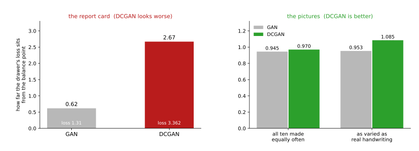
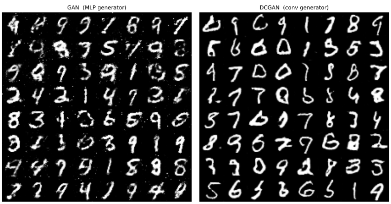
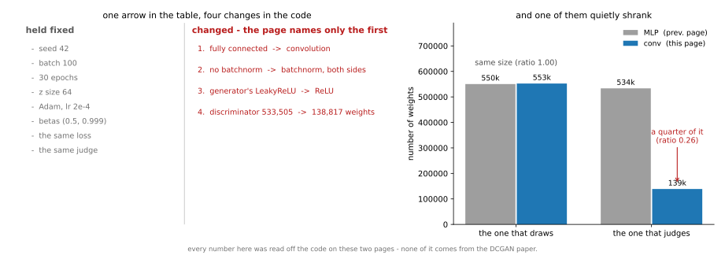
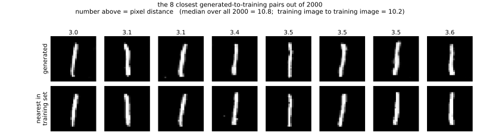
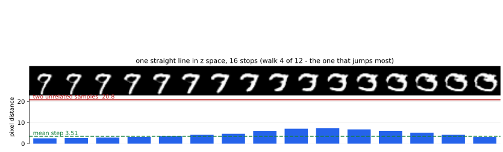
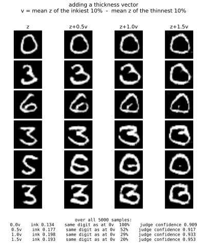
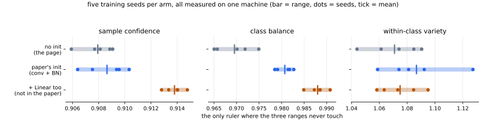
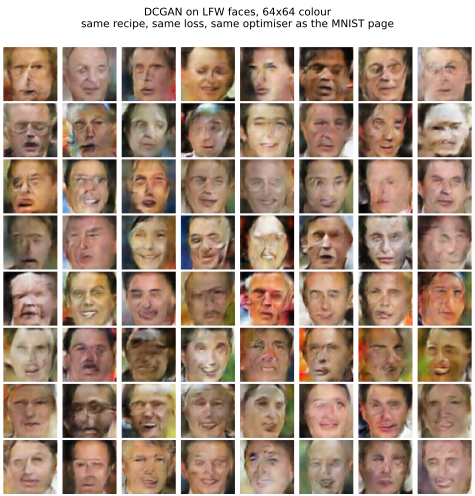
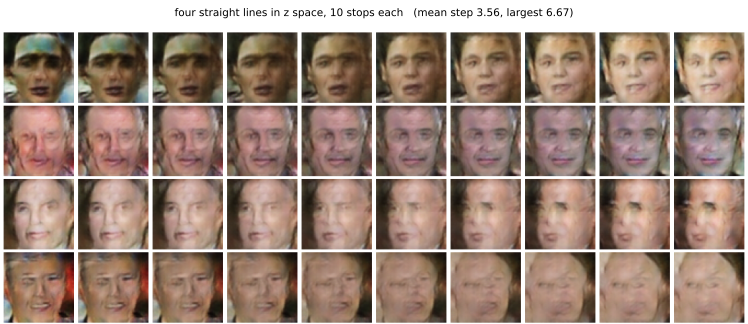
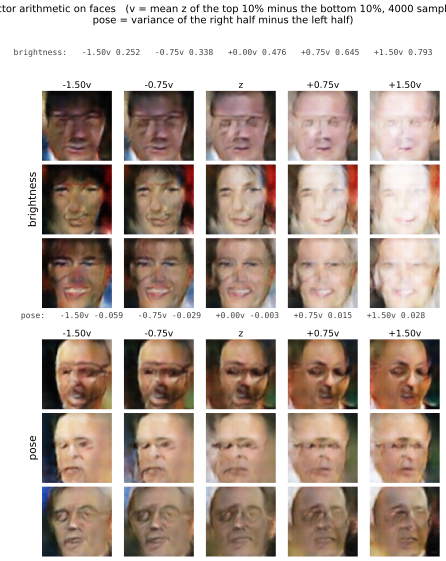

# DCGAN — 만들기에도 이웃 관계가 있다

<div class="leadbox" markdown>

**들어가는 이야기** — 성적표가 더 나쁜데 결과물이 더 좋다

이 쪽은 앞 쪽의 모델에서 딱 한 가지를 바꾼다. 그리는 쪽과 가려내는 쪽을 그림의 **이웃 관계를 살리는 형태**로 고쳐 짠다. 5.1절이 복원에서 한 일을 이번에는 만들기에서 한다.

그렇게 하고 두 가지를 나란히 보면 서로 반대를 가리킨다. 오른쪽 두 자는 둘 다 **[3장에서 만들어 둔 분류기](../../ch03/mnist/04_cnn.md)**가 뽑은 그림을 읽어 매긴 것이다.



**왼쪽만 보면 이 쪽이 망가지고 있는 것 같다.** 앞 쪽의 모델은 이론상 균형점 가까이 되돌아오는데, 이 쪽은 끝까지 멀찍이 떨어져 있고 그 거리가 오히려 벌어진다.

**오른쪽을 보면 반대다.** 같은 두 모델을 만들어 낸 그림으로 재면 이 쪽이 두 자 모두에서 낫다. 획 둘레에 흩어지던 점 얼룩이 사라지고 선이 매끈해진다.

둘 가운데 하나를 **왼쪽만 보고 고르라면 틀린 쪽을 고르게 된다.** 앞 쪽이 「로스 곡선을 믿지 마라」고 적어 둔 말의 가장 뚜렷한 증거가 여기 있고, 그래서 이 절은 수를 적을 때마다 **그림을 함께 본다.**

</div>

[GAN](01_gan.md)은 로스를 바꾸어 선명함을 얻었다. 구조는 여전히 완전 연결 레이어이었다. DCGAN은 그 구조를 **전치 컨볼루션**으로 바꾼다.

```python
"""DCGAN. 로스는 그대로 두고 구조만 컨볼루션으로 바꾼다.

mnist_judge.pt는 5.1절에서 학습해 둔 것을 읽어 쓴다.
GAN은 [-1, 1]로 두고 tanh로 내놓으므로, 평가 분류기에 넣기 전에 정규화를 되돌린다.
"""

import time

import torch
import torch.nn as nn
import torch.optim as optim
from torch.utils.data import DataLoader, TensorDataset
import torchvision
import torchvision.transforms as transforms

SEED, BATCH, ZDIM, EPOCHS = 42, 100, 64, 30
N_SAMPLE = 5000
JM, JS = 0.1307, 0.3081                 # 평가 분류기가 기대하는 정규화
device = torch.device("mps" if torch.backends.mps.is_available() else "cpu")

# 이 절만 [-1, 1]을 쓴다 — 생성기가 tanh로 내놓기 때문이다
tf = transforms.Compose([transforms.ToTensor(),
                         transforms.Normalize((0.5,), (0.5,))])
tr = torchvision.datasets.MNIST("./data", train=True, download=True, transform=tf)
te = torchvision.datasets.MNIST("./data", train=False, download=True, transform=tf)
Xtr = torch.cat([x for x, _ in DataLoader(tr, batch_size=2000, shuffle=False)])
Xte = torch.cat([x for x, _ in DataLoader(te, batch_size=2000, shuffle=False)])
yte = torch.cat([y for _, y in DataLoader(te, batch_size=2000, shuffle=False)])


class JudgeCNN(nn.Module):
    def __init__(self):
        super().__init__()
        self.conv1 = nn.Conv2d(1, 32, 3, padding=1)
        self.conv2 = nn.Conv2d(32, 64, 3, padding=1)
        self.pool = nn.MaxPool2d(2, 2); self.dropout = nn.Dropout(0.25)
        self.fc1 = nn.Linear(64 * 7 * 7, 128); self.fc2 = nn.Linear(128, 10)

    def forward(self, x):
        x = self.pool(torch.relu(self.conv1(x)))
        x = self.pool(torch.relu(self.conv2(x)))
        return self.fc2(self.dropout(torch.relu(self.fc1(x.flatten(1)))))


judge = JudgeCNN().to(device)
judge.load_state_dict(torch.load("mnist_judge.pt", weights_only=True))
judge.eval()


@torch.no_grad()
def predict(x_pm1):
    """[-1,1] -> [0,1] -> 평가 분류기 정규화 -> 평가 분류기."""
    xj = (((x_pm1 + 1) / 2) - JM) / JS
    p = torch.cat([torch.softmax(judge(xj[i:i + 1000].to(device)), 1).cpu()
                   for i in range(0, len(xj), 1000)])
    conf, pred = p.max(1)
    return conf, pred


def within_class_var(imgs01, group, min_n=20):
    """같은 클래스로 묶인 것들의 화소 분산을, 무리 크기로 가중해 평균낸다."""
    vs, ws = [], []
    for d in range(10):
        g = imgs01[group == d]
        if len(g) < min_n:
            continue
        vs.append(g.flatten(1).var(0).mean().item()); ws.append(len(g))
    return sum(v * w for v, w in zip(vs, ws)) / sum(ws) if vs else 0.0


# 진짜 자료의 기준선 — 여기서는 평가 분류기가 아니라 진짜 라벨로 묶는다
REAL_VAR = within_class_var((Xte + 1) / 2, yte)


def evaluate(samples_pm1, tag):
    conf, pred = predict(samples_pm1)
    share = torch.bincount(pred, minlength=10).float()
    share = share / share.sum()
    nz = share[share > 0]
    bal = (-(nz * nz.log()).sum() / torch.tensor(10.0).log()).item()
    wv = within_class_var((samples_pm1 + 1) / 2, pred)
    print(f"  {tag:14s} 확신도 {conf.mean():.3f}  균형도 {bal:.3f}  "
          f"최대몫 {share.max():.3f}  클래스안 다양함 {wv / REAL_VAR:.3f}", flush=True)


def train_gan(Gc, Dc, tag):
    torch.manual_seed(SEED)
    G, D = Gc().to(device), Dc().to(device)
    # GAN 표준값. 이 장의 Adam 1e-3으로는 학습되지 않는다
    oG = optim.Adam(G.parameters(), lr=2e-4, betas=(0.5, 0.999))
    oD = optim.Adam(D.parameters(), lr=2e-4, betas=(0.5, 0.999))
    gg = torch.Generator().manual_seed(SEED)
    ld = DataLoader(TensorDataset(Xtr), batch_size=BATCH, shuffle=True, generator=gg)
    bce = nn.BCEWithLogitsLoss()
    t0 = time.time()
    for ep in range(EPOCHS):
        G.train(); D.train(); dl = gl = nb = 0.0
        for (xb,) in ld:
            xb = xb.to(device); n = xb.size(0)
            ones = torch.ones(n, 1, device=device)
            zeros = torch.zeros(n, 1, device=device)

            # 판별기: 진짜는 1, 가짜는 0
            fake = G(torch.randn(n, ZDIM, device=device))
            lossD = bce(D(xb), ones) + bce(D(fake.detach()), zeros)
            oD.zero_grad(); lossD.backward(); oD.step()

            # 생성기: 판별기가 진짜라고 하게 만든다
            lossG = bce(D(fake), ones)
            oG.zero_grad(); lossG.backward(); oG.step()

            dl += lossD.item(); gl += lossG.item(); nb += 1
        if ep == 0 or (ep + 1) % 10 == 0:
            print(f"    [{tag}] {ep+1:2d}/{EPOCHS}  D {dl/nb:.4f}  G {gl/nb:.4f}", flush=True)
    print(f"  {tag} 완료 ({time.time()-t0:.0f}s)", flush=True)
    return G.eval()


def sample(G, n=N_SAMPLE):
    with torch.no_grad():
        gg = torch.Generator().manual_seed(SEED)
        z = torch.randn(n, ZDIM, generator=gg)
        return torch.cat([G(z[i:i + 1000].to(device)).cpu()
                          for i in range(0, n, 1000)])


if __name__ == "__main__":
  # === 촘촘한 레이어를 컨볼루션으로 바꾼다 ==========================================
  class GConv(nn.Module):
      """작은 피처 맵에서 시작해 전치 컨볼루션으로 두 번 키운다."""

      def __init__(self):
          super().__init__()
          self.fc = nn.Sequential(nn.Linear(ZDIM, 128 * 7 * 7),
                                  nn.BatchNorm1d(128 * 7 * 7), nn.ReLU())
          self.net = nn.Sequential(
              nn.ConvTranspose2d(128, 64, 4, 2, 1),
              nn.BatchNorm2d(64), nn.ReLU(),                      # 7 -> 14
              nn.ConvTranspose2d(64, 1, 4, 2, 1), nn.Tanh())      # 14 -> 28

      def forward(self, z):
          return self.net(self.fc(z).reshape(-1, 128, 7, 7))


  class DConv(nn.Module):
      """3장의 CNN과 하는 일이 거의 같다. 그림을 받아 수 하나를 내놓는다."""

      def __init__(self):
          super().__init__()
          self.net = nn.Sequential(
              nn.Conv2d(1, 64, 4, 2, 1), nn.LeakyReLU(0.2),                        # 28 -> 14
              nn.Conv2d(64, 128, 4, 2, 1), nn.BatchNorm2d(128), nn.LeakyReLU(0.2), # 14 -> 7
              nn.Flatten(), nn.Linear(128 * 7 * 7, 1))

      def forward(self, x):
          return self.net(x)


  G = train_gan(GConv, DConv, "dcgan")
  evaluate(sample(G), "dcgan")
  # 아래 블록이 읽어, 네 자가 못 보는 것을 따로 잰다
  torch.save(G.state_dict(), "mnist_dcgan_g.pt")
```

**출력:**

```
    [dcgan]  1/30  D 0.3718  G 2.5620
    [dcgan] 10/30  D 0.3873  G 2.7085
    [dcgan] 20/30  D 0.2937  G 3.1807
    [dcgan] 30/30  D 0.3053  G 3.3621
  dcgan 완료 (948s)
  dcgan          확신도 0.909  균형도 0.970  최대몫 0.162  클래스안 다양함 1.085
```

작은 피처 맵에서 시작해 두 번 키워 $28 \times 28$로 만든다. [3장의 스텝3 → 스텝4](../../ch03/mnist/04_cnn.md)와 같은 수법이며, 다만 이번에는 **읽는 쪽이 아니라 그리는 쪽**이다.

판별기도 컨볼루션으로 바꾼다. 이쪽은 3장의 CNN과 하는 일이 거의 같다. 그림을 받아 하나의 수를 내놓는다.

---

## 1. 결과

| | 확신도 | 클래스 균형도 | 클래스 안 다양함 | 학습 시간 |
|---|---|---|---|---|
| [GAN (MLP)](01_gan.md) | 0.908 | 0.945 | 0.953 | 202초 |
| **DCGAN** | 0.909 | **0.970** | **1.085** | 948초 |

**확신도는 비긴다**(0.908 대 0.909). 갈리는 것은 나머지 둘이다.

다만 이 표는 시드 하나이고, **두 칸이 저마다의 다섯 벌 범위 밖에 있다** — GAN 의 다양함 0.953(범위 0.831~0.905)과 DCGAN 의 확신도 0.909(범위 0.899~0.906)다. [절 소개](index.md) 5절의 범위로 다시 적으면 이렇다.

| 다섯 벌 | 확신도 | 클래스 균형도 | 클래스 안 다양함 |
|---|---|---|---|
| [GAN (MLP)](01_gan.md) | 0.903~0.911 | 0.913~0.937 | 0.831~0.905 (평균 0.878) |
| **DCGAN** | 0.899~0.906 | **0.966~0.978** | **1.055~1.121** (평균 1.084) |

**결론은 흔들리지 않고 오히려 세진다.** 확신도는 범위가 겹쳐 비기는 것이 맞고, 클래스 안 다양함의 앞섬은 시드 하나로 보면 0.132인데 다섯 벌 평균으로 보면 **0.206**으로 더 벌어진다. 0.953이 유난히 잘 뽑힌 한 벌이었기 때문이다.

학습 시간이 4.7배라는 점도 적어 둔다. 전치 컨볼루션이 비싸다. 완전 연결 레이어는 한 번의 행렬 곱으로 784개의 화소를 한꺼번에 내놓지만, 전치 컨볼루션은 화소마다 이웃을 훑으며 $7 \to 14 \to 28$로 두 번 키운다. 게다가 판별기 쪽도 함께 컨볼루션이 되었으니 매 스텝마다 두 배로 문다.

---

## 2. 두 스텝이 서로 다른 것을 바꾸었다



같은 씨앗의 같은 $z$ 64개를 두 생성기에 넣은 것이다. 다만 **칸끼리 짝지어 보지는 말 것** — 따로 학습한 두 생성기는 같은 $z$를 서로 다른 숫자로 보낸다. 견줄 것은 칸 대 칸이 아니라 **획의 결**이다.

왼쪽의 얼룩이 오른쪽에서는 거의 사라졌다. 확신도는 0.908에서 0.909로 제자리인데 클래스 안 다양함이 0.953에서 1.085로 올라간 것이 이 차이다.

| 스텝 | 바꾼 것 | 얻은 것 |
|---|---|---|
| VAE → [GAN](01_gan.md) | **로스** (제곱오차 → 적대적) | 클래스 안 다양함 0.628 → 0.953 |
| GAN → DCGAN | **구조** (완전 연결 → 컨볼루션) | 0.953 → 1.085, 클래스 균형도 0.945 → 0.970 |

**나누어 재었기에 할 수 있는 말이다.** DCGAN만 돌렸다면 0.628에서 1.085까지 오른 것을 보고도 로스 덕인지 구조 덕인지 가릴 수 없었다. 중간에 MLP GAN을 둔 까닭이 이것이며, [4.3절](../../ch04/07_distillation.md)이 단일 모델 교사를 대조군으로 둔 것과 같은 생각이다.

VAE에서 MLP GAN으로 바꾼 차이가 MLP GAN에서 DCGAN으로 바꾼 차이보다 컸다. 그러나 앞의 변화에는 로스·구조·학습 설정이 함께 포함되어 있으므로 이를 로스만의 기여율로 부를 수는 없다.

<div class="storybox" markdown>

**그림으로 보는 AI 1.** 화살표 하나에 네 가지가 들어 있다

DCGAN이라는 이름을 붙인 글은 2015년 11월 알렉 래드퍼드(Alec Radford)와 두 동료의 것이다. 그 글이 내놓은 것은 **한 가지 생각이 아니라 목록**이다. 이렇게 쌓으면 그럭저럭 학습되더라는 요령 대여섯 개를 적어 둔 것이고, 그 글 스스로 수없이 많은 형태를 돌려 보고 건진 것이라 밝힌다.

바로 위 표는 이 쪽으로 넘어오며 바꾼 것을 한 칸에 적었다 — 「구조(완전 연결 → 컨볼루션)」. 그런데 두 쪽의 코드를 나란히 놓고 세어 보면 바뀐 것이 **넷**이고, 그 가운데 셋이 저 목록에 그대로 있는 항목이다.



왼쪽 목록이 그 넷이다. 완전 연결을 컨볼루션으로 바꾼 것은 위 표가 적은 그대로다. 나머지 셋은 적혀 있지 않다. **층마다 값의 크기를 고르게 맞춰 주는 장치**가 앞 쪽에는 하나도 없었는데 이 쪽에는 양쪽에 다 붙었고, 그리는 쪽이 쓰던 문턱이 음수를 조금 흘려보내던 것에서 아예 막는 것으로 바뀌었다. 그리고 넷째가 가장 조용하다.

**가려내는 쪽이 작아졌다.** 품은 수가 533,505개에서 138,817개로, 사분의 일(0.26배)이 되었다. 바로 아래 3절이 두 모델의 로스 곡선을 나란히 놓고 DCGAN 쪽이 줄곧 앞섰다고 적는데, 그 두 줄은 **크기가 네 배 다른 둘**을 견준 것이다.

반대로 **그리는 쪽은 거의 꼭 같다** — 550,416개와 552,513개, 비로 1.00이다. 이것은 이 쪽 실험의 미덕이다. 그림이 좋아진 것을 「수를 더 많이 썼으니까」로 설명할 수는 없다.

**그러니 이 쪽의 결론이 틀렸다는 말이 아니다.** 획이 매끈해진 것은 그림으로 보이고, 시드 다섯 벌로 다시 재어도 0.206으로 오히려 벌어졌다. 흔들리는 것은 결론이 아니라 **값을 어디에 돌릴 것인가**다. 위 표는 그 공을 컨볼루션 한 가지에 돌리는데, 이 실험만으로는 고르개 덕인지 문턱 덕인지 가릴 수 없다. 가리려면 넷을 하나씩 떼어 내고 네 번 더 돌려야 하고, 이 쪽은 그러지 않았다.

재미있는 것은 **이 쪽이 그 말을 할 줄 안다는 점**이다. 바로 위 문단이 VAE에서 GAN으로 넘어간 걸음을 두고 「로스·구조·학습 설정이 함께 포함되어 있으므로」라며 똑같은 조심을 한다. 그 자를 한 걸음 더 왼쪽에만 대고 이 걸음에는 대지 않았다.

_확인한 곳 — A. Radford, L. Metz, S. Chintala, "Unsupervised Representation Learning with Deep Convolutional Generative Adversarial Networks", *ICLR 2016* (arXiv:1511.06434, 2015년 11월). 그 글 3절이 요령을 **Architecture guidelines** 라는 목록으로 적어 두었고, 본문에서 「층마다 값의 크기를 고르게 맞춰 주는 장치」라 한 것이 **배치 정규화**(batch normalization), 「문턱」이 활성화 함수, 「음수를 조금 흘려보내던 문턱」이 LeakyReLU 다. 목록에 든 세 항목은 풀링을 스트라이드 컨볼루션으로 바꾸라는 것, 양쪽에 배치 정규화를 쓰라는 것, 생성기에는 출력만 빼고 ReLU 를 쓰라는 것이다. 그 글의 제목이 가리키듯 거기서 내세운 성과는 그림이 아니라 **판별기가 익힌 표현을 분류에 쓰는 것**이었다. **왼쪽 목록과 오른쪽 막대의 수는 모두 이 책 두 쪽의 코드에서 읽은 것이고 그 글의 수가 아니다** — `figures/make_figures.py` 가 거기 적힌 모듈을 그대로 세워 센다._

</div>

### 목록을 하나씩 대어 보면

바로 위 상자가 「그 글이 내놓은 것은 목록이다」라고 적었으니, 그 목록을 이 쪽의 코드에 하나씩 대어 보는 편이 낫다. 왼쪽은 논문이 **Architecture guidelines** 로 적은 다섯 줄과 4절이 적은 학습 설정이고, 오른쪽은 위 블록의 `GConv`·`DConv`·`train_gan` 이 실제로 하는 일이다.

| 논문이 적어 둔 것 | 이 쪽 |
|---|---|
| 풀링을 스트라이드 컨볼루션으로 (판별기) | ✅ `Conv2d(..., 4, 2, 1)` 둘, 풀링 없음 |
| 전치 컨볼루션으로 키우기 (생성기) | ✅ `ConvTranspose2d(..., 4, 2, 1)` 둘 |
| 양쪽에 배치 정규화 | ✅ 생성기 둘, 판별기 하나 |
| …단 **생성기 출력과 판별기 입력에는 걸지 말 것** | ✅ 둘 다 안 걸었다 |
| 생성기는 출력만 빼고 ReLU, 출력은 Tanh | ✅ |
| 판별기는 LeakyReLU, 기울기 0.2 | ✅ `LeakyReLU(0.2)` |
| Adam, 러닝레이트 0.0002, $\beta_1 = 0.5$ | ✅ `lr=2e-4, betas=(0.5, 0.999)` |
| 미니배치 128 | ➖ 100. 이 장의 규약을 따랐다 |
| **웨이트를 $N(0,\ 0.02)$ 로 초기화** | ❌ **안 했다** — 5절이 넣어 보고 잰다 |

**아홉 줄 가운데 여덟이 맞고 하나가 비어 있다.** 비어 있는 줄이 논문 4절의 한 문장인데, 이 쪽은 PyTorch 기본 초기화를 그대로 쓴다.

!!! note "생성기 첫 줄이 `Linear` 인 것은 어긋남이 아니다"
    널리 쓰이는 구현은 생성기의 첫 줄을 $(N, 100, 1, 1)$ 짜리 잡음에 거는 `ConvTranspose2d(100, 1024, 4, 1, 0)` 으로 적는데, 이 쪽은 `Linear(ZDIM, 128 * 7 * 7)` 다음에 모양만 바꾼다. **둘은 같은 셈이다** — $1 \times 1$ 에 거는 $4 \times 4$ 전치 컨볼루션은 겹치는 자리가 하나도 없으므로 그냥 $100 \times (1024 \cdot 4 \cdot 4)$ 행렬 곱이다. 웨이트를 꺼내 직접 곱해 보면 차이가 **정확히 0** 이다.

    논문 그림도 그 자리를 「project and reshape」라 적는다. **이 쪽이 작은 것은 적힌 방식이 아니라 수**다.


**같은 꼴인데 눈금이 다르다.** 왼쪽은 $64 \times 64$ 컬러를 1024채널에서 시작해 네 번 키우고, 오른쪽은 $28 \times 28$ 흑백을 128채널에서 두 번 키운다. 가장 넓은 자리에서 들고 있는 수가 131,072개와 12,544개로 **열 배** 차이다. 아래 5절이 재는 것이 「논문의 요령이 이 눈금에서도 듣는가」이므로, 들으면 들은 대로 안 들으면 안 들은 대로 **이 눈금의 이야기**로 읽어야 한다.

마지막 줄의 빈칸은 **재면 메울 수 있다.** 아래 5절이 초기화만 바꾸어 시드 다섯 벌씩 다시 돌리는데, **클래스 균형도가 0.970에서 0.981로 오르고 범위가 겹치지 않는다.**

---

## 3. 로스 곡선이 더 나빠 보이는데 표본은 더 좋다

| 에포크 | [GAN](01_gan.md) $D$ | $G$ | DCGAN $D$ | $G$ |
|---|---|---|---|---|
| 1 | 0.811 | 1.687 | 0.372 | 2.562 |
| 10 | 0.589 | 2.607 | 0.387 | 2.709 |
| 20 | 1.026 | 1.360 | 0.294 | 3.181 |
| 30 | **1.037** | **1.310** | **0.305** | **3.362** |

MLP 쪽은 균형점($D \approx 1.386$)으로 되돌아갔다. DCGAN은 처음부터 끝까지 판별기가 앞섰고 격차가 **벌어지기까지** 했다.

그런데 표본은 DCGAN 쪽이 더 좋다. 클래스 균형도도 다양함도 높다.

이것이 [앞 쪽](01_gan.md)이 말한 "로스 곡선을 믿지 마라"의 가장 뚜렷한 증거다. 두 모델 가운데 **로스만 보고 고르면 틀린 쪽을 고른다.**

---

## 4. 자 넷이 함께 못 보는 것

[장 개요](../index.md)가 세운 자는 넷인데, **넷이 한 목소리로 못 보는 것이 하나 있다.** 학습 그림을 외워 두었다가 그대로 뱉는 모델은 숫자다움도 균형도도 다양함도 만점이고 값도 1이다 — **이 장에서 가장 좋은 모델로 나온다.** 네 자가 모두 **나온 그림만** 보기 때문이고, 베껴 온 그림은 나온 형태로는 진짜와 구별할 길이 없다.

DCGAN 논문도 같은 자리에서 멈췄고, 그래서 **자가 아닌 검사를 둘** 두었다. 점수를 매기지 않고 「베낀 것이 아니다」만 보이는 검사다. 여기에 **셋째를 하나 더 붙인다** — 베끼지 않았다는 것과 **몇 가지 형태를 되풀이하지 않는다**는 것은 다른 말이기 때문이다. 코드는 **위 블록에 이어 붙인다** — 위에서 학습해 저장한 것을 읽으므로 새로 학습하지 않는다.

```python
"""네 자가 못 보는 것을 잰다 — 베꼈는가, 끊기는가, 뭉쳤는가. 위 블록에 이어 붙인다.

이 장의 자 넷은 **학습 그림을 통째로 외워 그대로 뱉는 모델을 잡지 못한다.**
그런 모델은 숫자다움도 균형도도 다양함도 만점이고 값도 1 이다. 넷이 한
목소리로 못 보는 자리이므로 자를 더 들이대야 한다.

앞의 둘은 DCGAN 논문이 쓴 검사이고 **둘 다 점수를 매기는 자가 아니다.**

  (가) 베낀 것이 아님을 보인다. 여기서는 뽑은 그림마다 **가장 가까운 학습
      그림까지의 화소 거리**를 재고, 학습 그림끼리의 거리와 견준다. 베낀
      것이라면 0 에 가까워야 한다.
  (나) 잠재 공간을 걸으면 매끄럽다. z 둘을 잇는 직선 위를 걸으며 디코딩해
      이웃한 칸끼리 얼마나 달라지는지를 잰다. 외운 조각을 이어 붙인 것이면
      어느 자리에서 툭 끊긴다.
  (다) 클래스 **안**에서 뭉치지 않았다. 「클래스 안 다양함」은 화소 분산이라
      자리를 덜 맞추기만 해도 점수를 버는데([절 소개] 1절이 한 칸 옮기기로
      보였다), 이 검사는 **뽑은 것끼리 가장 가까운 이웃까지의 거리**를 본다.
      몇 가지 형태를 되풀이한다면 그 거리가 진짜끼리의 거리보다 훨씬 짧아야
      한다.

(다) 는 한쪽으로만 말할 수 있는 자다. 자리가 흔들리면 이 거리는 **늘어나므로**,
짧게 나왔다면 그것은 진짜로 뭉친 것이다. 반대로 길게 나온 것을 두고
「진짜보다 다양하다」고 읽어서는 안 된다 — 거기서는 화소 분산과 같은 애매함을
그대로 물려받는다.

읽는 것: 위 블록이 남긴 mnist_dcgan_g.pt.
실행: 이 쪽의 코드를 파일로 갈무리해 저장소 뿌리에서 돌린다.
"""

N_WALK, N_STEP = 12, 16          # 걷는 길 수, 길 하나의 칸 수


@torch.no_grad()
def nn_within(flat):
    """제 무리 안에서 가장 가까운 이웃까지. 자기 자신은 뺀다."""
    d = torch.cdist(flat, flat)
    d.fill_diagonal_(float("inf"))
    return d.min(1).values.cpu()


@torch.no_grad()
def nearest_train(imgs, chunk=200):
    """그림마다 가장 가까운 학습 그림까지의 화소 거리."""
    ref = Xtr.reshape(len(Xtr), -1).to(device)
    out = []
    for i in range(0, len(imgs), chunk):
        q = imgs[i:i + chunk].reshape(-1, ref.shape[1]).to(device)
        out.append(torch.cdist(q, ref).min(1).values.cpu())
    return torch.cat(out)


@torch.no_grad()
def check_memory(G):
    g = torch.Generator().manual_seed(SEED)
    fake = G(torch.randn(2000, ZDIM, generator=g).to(device)).cpu()

    # 학습 그림끼리의 간격 — 견줄 자리.
    real_nn = nn_within(Xtr[:2000].reshape(2000, -1).to(device))

    fake_nn = nearest_train(fake)
    print(f"  (가) 가장 가까운 학습 그림까지의 화소 거리 (중앙값)")
    print(f"       학습 그림끼리         {real_nn.median():.3f}")
    print(f"       뽑은 그림에서         {fake_nn.median():.3f}"
          f"   ({fake_nn.median() / real_nn.median():.2f}배)")
    print(f"       그 간격 안에 든 가짜   {int((fake_nn <= real_nn.median()).sum())}장 / 2,000")


@torch.no_grad()
def walk(G):
    g = torch.Generator().manual_seed(SEED)
    a = torch.randn(N_WALK, ZDIM, generator=g)
    b = torch.randn(N_WALK, ZDIM, generator=g)
    w = torch.linspace(0, 1, N_STEP)[:, None, None]      # (step, 1, 1)
    z = (1 - w) * a[None] + w * b[None]                  # (step, walk, ZDIM)
    im = G(z.reshape(-1, ZDIM).to(device)).cpu().reshape(N_STEP, N_WALK, -1)

    step = (im[1:] - im[:-1]).pow(2).sum(-1).sqrt()      # 이웃 칸 사이의 거리

    # 견줄 자리: 서로 상관없는 두 그림 사이의 거리. 한 걸음이 이만큼이면
    # 걷는 것이 아니라 매번 딴 그림으로 건너뛰는 것이다.
    far = G(torch.randn(400, ZDIM,
                        generator=torch.Generator().manual_seed(SEED + 1)
                        ).to(device)).cpu().reshape(400, -1)
    indep = (far[:200] - far[200:]).pow(2).sum(-1).sqrt().median()

    print(f"\n  (나) 잠재 공간을 {N_WALK}번 걸으며 칸마다 얼마나 달라지는가")
    print(f"       한 걸음의 평균       {step.mean():.3f}")
    print(f"       한 걸음의 최대       {step.max():.3f}"
          f"   (평균의 {step.max() / step.mean():.2f}배)")
    print(f"       상관없는 두 그림 사이 {indep:.3f}"
          f"   (한 걸음의 {indep / step.mean():.1f}배)")
    print(f"       가장 큰 걸음이 길 전체에서 차지하는 몫 "
          f"{100 * (step.max(0).values / step.sum(0)).max():.1f}%"
          f"   (고르면 {100 / (N_STEP - 1):.1f}%)")


@torch.no_grad()
def check_clumping(G):
    g = torch.Generator().manual_seed(SEED)
    fake = G(torch.randn(2000, ZDIM, generator=g).to(device)).cpu()
    _, cls = predict(fake)

    gg = torch.Generator().manual_seed(SEED)
    idx = torch.randperm(len(Xte), generator=gg)[:2000]
    real, real_cls = Xte[idx], yte[idx]

    f = nn_within(fake.reshape(2000, -1).to(device))
    r = nn_within(real.reshape(2000, -1).to(device))
    print(f"\n  (다) 뽑은 그림끼리 가장 가까운 이웃까지 (중앙값)")
    print(f"       진짜끼리             {r.median():.3f}")
    print(f"       뽑은 것끼리           {f.median():.3f}"
          f"   ({f.median() / r.median():.2f}배)")

    # 숫자마다 따로 — 무리가 크면 이웃이 가까워지므로 장수를 맞춘다.
    fw = rw = tot = 0.0
    worst = None
    for d in range(10):
        a, b = fake[cls == d], real[real_cls == d]
        n = min(len(a), len(b))
        if n < 30:
            continue
        va = nn_within(a[:n].reshape(n, -1).to(device)).median().item()
        vb = nn_within(b[:n].reshape(n, -1).to(device)).median().item()
        fw += va * n; rw += vb * n; tot += n
        if worst is None or va / vb < worst[1]:
            worst = (d, va / vb, n)
    print(f"       숫자별 (장수 맞춤)     {fw / tot:.3f} 대 {rw / tot:.3f}"
          f"   ({fw / rw:.2f}배)")
    print(f"       가장 뭉친 숫자는 {worst[0]}      {worst[1]:.2f}배 ({worst[2]}장)")
    print(f"       가장 닮은 두 장       {f.min():.3f}   진짜끼리 {r.min():.3f}")


if __name__ == "__main__":
    Gm = GConv().to(device)
    Gm.load_state_dict(torch.load("mnist_dcgan_g.pt", map_location="cpu",
                                  weights_only=True))
    Gm.eval()
    check_memory(Gm)
    walk(Gm)
    check_clumping(Gm)
```

**출력:**

```
  (가) 가장 가까운 학습 그림까지의 화소 거리 (중앙값)
       학습 그림끼리         10.182
       뽑은 그림에서         10.798   (1.06배)
       그 간격 안에 든 가짜   791장 / 2,000

  (나) 잠재 공간을 12번 걸으며 칸마다 얼마나 달라지는가
       한 걸음의 평균       3.514
       한 걸음의 최대       7.379   (평균의 2.10배)
       상관없는 두 그림 사이 20.793   (한 걸음의 5.9배)
       가장 큰 걸음이 길 전체에서 차지하는 몫 11.8%   (고르면 6.7%)

  (다) 뽑은 그림끼리 가장 가까운 이웃까지 (중앙값)
       진짜끼리             10.756
       뽑은 것끼리           11.624   (1.08배)
       숫자별 (장수 맞춤)     11.957 대 10.492   (1.14배)
       가장 뭉친 숫자는 2      1.00배 (115장)
       가장 닮은 두 장       4.826   진짜끼리 2.465
```

### (가) 베낀 것이라면 거리가 0이어야 한다

| 가장 가까운 학습 그림까지 (화소 거리, 중앙값) | |
|---|---|
| 학습 그림끼리 | **10.182** |
| 뽑은 그림에서 | **10.798** |

**1.06배다.** 뽑은 그림은 학습 그림끼리 떨어진 만큼 학습 그림에서 떨어져 있다 — 베껴 온 것이라면 0 언저리여야 한다. 2,000장 가운데 791장이 그 중앙 간격 안에 드는데, 두 분포가 겹친다면 절반쯤이 들 자리이니 **조금 바깥에 놓인 셈**이다.

중앙값은 가운데를 보는 자이니, **가장 의심스러운 쪽**을 따로 보아야 한다. 2,000장 가운데 학습 그림에 가장 바짝 붙은 여덟 장과 그 짝을 나란히 놓았다.



**가장 가까운 짝조차 베낀 것이 아니다.** 기울기가 다르고 굵기가 다르고 아래쪽 꺾임이 다르다. 그림 위에 적힌 수가 화소 거리인데 가장 붙은 짝이 **2.96**이다(이 수는 출력 블록에 없다 — 그림을 그리는 `figures/make_figures.py` 가 같은 2,000장에서 읽은 것이다). 아래 (다)가 **진짜 그림 2,000장 가운데 가장 닮은 두 장**을 2.465로 재어 두었으니, 진짜끼리도 그만큼은 붙는다.

!!! warning "여덟이 모두 1인 것이 이 자의 한계를 말해 준다"
    고른 것이 아니라 거리 순으로 여덟을 끊었더니 **전부 1**이 나왔다. 까닭은 간단하다 — 화소 거리는 켜진 화소가 적을수록 작아지고, 1은 이 열 가지 가운데 잉크가 가장 적다. 곧 이 자는 **가는 숫자를 베꼈다고 의심하는 쪽으로 기울어 있다.**

    뒤집으면 **0이나 8을 베꼈다면 이 자가 늦게 잡는다**는 뜻이기도 하다. 중앙값 1.06배는 열 가지를 섞어 잰 것이므로 그 기울기가 어느 정도 상쇄되지만, 숫자마다 따로 재지 않은 수라는 것은 적어 두어야 한다.

### (나) 걷는 것인가, 건너뛰는 것인가

$z$ 둘을 잇는 직선 위를 16칸으로 걸으며 칸마다 그림이 얼마나 달라지는지를 쟀다. 외운 조각을 이어 붙인 것이라면 **어느 자리에서 툭 끊겨야** 한다.

| | |
|---|---|
| 한 걸음 | 3.514 |
| 가장 큰 걸음 | 7.379 (평균의 2.10배) |
| **상관없는 두 그림 사이** | **20.793** (한 걸음의 5.9배) |



**열두 길 가운데 가장 크게 튄 길**을 골라 그린 것이다. 끊긴다면 거기서 끊길 것이기 때문이다. 7이 한 칸씩 기울고 획이 메워지다가 3을 거쳐 둥근 모양이 된다 — 어느 칸에서도 **딴 그림으로 갈아타지 않는다.**

DCGAN 논문도 같은 그림을 싣고 같은 식으로 읽었다. 침실 사진으로 학습한 모델에서 아홉 점 사이를 걸으며 「창문 없는 방이 큰 창문이 있는 방으로 천천히 바뀌고」, 「텔레비전처럼 보이던 것이 창문으로 바뀌어 가는」 줄을 짚는다. 숫자에서는 7이 3이 된다.

**아래 막대의 마지막 줄이 견줄 자리다.** 끊긴다는 것은 한 걸음이 「상관없는 두 그림」만큼 벌어진다는 뜻인데, 가장 큰 걸음조차 그 **3분의 1**이다. 길 전체에서 그 걸음이 차지하는 몫도 11.8%로, 고를 때의 6.7%보다 크긴 하지만 한 칸이 길을 삼키지는 않는다.

### (다) 몇 가지 형태로 뭉치지 않았는가

[절 소개](index.md)가 세운 **클래스 안 다양함**이 이것을 보라고 둔 자인데, 그 자는 화소 분산이라 **자리를 덜 맞추기만 해도 점수를 번다.** 진짜 숫자를 한 칸 옮기면 1.000이 1.105로 오른다는 것을 그 절이 보였다. 그래서 이 쪽의 1.085를 두고 「더 다양하다」와 「덜 가운데에 있다」를 가를 수 없었다.

여기서는 다른 셈을 쓴다 — **뽑은 그림끼리 가장 가까운 이웃까지의 거리**다. 몇 가지 형태를 되풀이한다면 뽑은 것들이 서로 바짝 붙어 있어야 한다.

| 가장 가까운 이웃까지 (화소 거리, 중앙값) | 뽑은 것끼리 | 진짜끼리 | 비 |
|---|---|---|---|
| 2,000장 통째로 | 11.624 | 10.756 | 1.08 |
| **숫자마다 따로** (장수 맞춤) | **11.957** | **10.492** | **1.14** |
| 가장 뭉친 숫자 (2) | | | 1.00 |

**뭉치지 않았다.** 되풀이하고 있다면 이 비가 0.3이나 0.5처럼 나와야 하는데, 가장 뭉친 한 숫자에서도 1.00이다. 2,000장 가운데 가장 닮은 두 장마저 4.826 떨어져 있어, 진짜끼리의 2.465보다 **오히려 멀다.**

숫자마다 따로 재는 까닭은 무리가 크면 이웃이 저절로 가까워지기 때문이다. 그래서 숫자별로는 진짜와 **장수를 맞추어** 쟀다.

!!! note "이 검사는 한쪽으로만 말한다"
    자리가 흔들리면 이 거리는 **늘어난다.** 그러므로 짧게 나왔다면 그것은 진짜로 뭉친 것이고, 이 검사는 **「뭉쳤다」를 잡는 쪽으로는 믿을 수 있다.**

    거꾸로는 안 된다. 1.14를 두고 「진짜보다 다양하다」고 읽으면 **클래스 안 다양함의 1.085와 똑같은 애매함**에 다시 걸린다. 덜 가운데에 있어도 이 수는 오른다.

!!! warning "이 셋이 보이지 않는 것"
    **(가)는 화소 거리로만 본 것이다.** 학습 그림을 한 칸 밀거나 획을 조금 굵게 한 것도 화소로는 멀어진다. 「거의 베낀 것」은 이 자로 잡히지 않는다.

    **(나)는 매끄러움이 좋다는 뜻이 아니다.** 진짜 그림 둘을 화소에서 그냥 섞어도 걸음은 완벽하게 고르다 — 가운데가 둘이 겹친 유령 그림일 뿐이다. 매끄러움은 **끊김이 없다는 것만** 말하고, 지나가는 자리가 숫자다운지는 말해 주지 않는다. 그것을 보는 자가 위의 숫자다움이다.

    그리고 **세 검사 모두 이 쪽에서만 돌렸다.** 이 장의 다른 모델들이 베끼지 않았다고 믿을 근거는 학습 방식뿐이고, 그것은 측정이 아니다.

<div class="storybox" markdown>

**그림으로 보는 AI 2.** 얼굴에서 되던 벡터 산수를 숫자에서 해 보면

DCGAN 글에서 가장 많이 퍼 날라진 그림은 표본도 로스 곡선도 아니다. **얼굴을 더하고 빼는 그림**이다. 왼쪽을 보는 얼굴 넷의 $z$를 평균 내고 오른쪽을 보는 얼굴 넷의 평균을 뺀 것을 **「돌리기 벡터」**라 부른 뒤, 아무 얼굴의 $z$에 그것을 더해 가며 **고개를 돌렸다.** 여기서 $z$는 생성기에 넣는 수 묶음이고, 산수는 그 묶음끼리 더하고 빼는 것뿐이다.

**그 절은 `king` $-$ `man` $+$ `woman` $=$ `queen` 으로 시작한다.** 비유로 끌어온 것이 아니라 글이 첫 문장에 적어 둔 것이다 — 단어 벡터에서 그런 구조가 보였으니 그림의 $z$에서도 보이는지 알아보았다는 것이 그 절의 동기다. [6장](../../embeddings/05_pretrained.md)이 그 단어 쪽을 다룬다. 다른 점은 거기서는 **단어마다 벡터가 하나씩** 있었고 여기서는 **벡터를 넣으면 그림이 나온다**는 것이다.

이 쪽의 생성기로 똑같이 해 보았다. 숫자에는 안경이 없으니 **획의 굵기**로 한다. 뽑은 5,000장의 잉크 양을 재어 **가장 굵은 10%의 $z$ 평균에서 가장 가는 10%의 $z$ 평균을 뺀 것**을 굵기 벡터 $v$라 하고, 가운데쯤 굵기의 그림에 $0.5v$, $1.0v$, $1.5v$를 더해 간다.



**굵어지기는 한다.** 잉크 양이 0.134에서 0.177, 0.198로 오른다. 벡터가 굵기를 담고 있는 것은 맞다.

**그런데 숫자가 바뀐다.** 같은 숫자로 남은 것이 $0.5v$에서 벌써 **52%**, $1.0v$에서 **29%**다. 그림에서도 3이 둥근 0이 되고 5가 6이 된다. 얼굴에서는 안경만 생기고 사람은 그대로였는데, 여기서는 **굵기만 따로 떼어지지 않는다.**

까닭은 재어 보면 나온다. 가장 가는 10%는 **1이 44%, 7이 20%**이고, 가장 굵은 10%는 **0이 29%, 6이 16%, 8이 12%**다. 곧 이 「굵기 벡터」는 굵기만 담은 것이 아니라 **1·7에서 0·6·8로 가는 벡터**다. MNIST에서는 굵기와 숫자가 얽혀 있어서, 굵기로 고른 양 끝이 곧 숫자로 고른 양 끝이 된다.

**그리고 이 쪽이 줄곧 말해 온 것이 여기서 한 번 더 나온다.** 숫자가 20%만 남은 $1.5v$에서 평가 분류기의 확신도는 0.909에서 **0.953으로 올랐다.** 망가지는 동안 성적표는 좋아진다.

그러니 이 산수가 말해 주는 것은 「잠재 공간에 뜻이 있다」까지이고, 「뜻마다 축이 따로 있다」는 아니다. 얼굴에서 잘 떨어진 까닭은 안경과 사람됨이 자료 안에서 **따로 움직였기** 때문이지 모델이 그것을 갈라 두었기 때문이 아니다.

_확인한 곳 — A. Radford, L. Metz, S. Chintala, "Unsupervised Representation Learning with Deep Convolutional Generative Adversarial Networks", *ICLR 2016* (arXiv:1511.06434). 그 글 **6.3.2절 「Vector Arithmetic on Face Samples」**이다. 첫 문장이 미콜로프의 단어 벡터를 들며 「vector("King") $-$ vector("Man") $+$ vector("Woman")의 가장 가까운 이웃이 Queen이었다」고 적고, 그런 구조가 $z$에서도 나타나는지 보았다고 잇는다. **평균을 쓴 까닭도 적혀 있다** — 원문은 "Experiments working on only single samples per concept were unstable, but averaging the Z vector for three examplars showed consistent and stable generations"이고, 「돌리기 벡터」는 그림 8의 것으로 "created from four averaged samples of faces looking left vs looking right"다. **위 그림과 수는 모두 이 책의 생성기(`mnist_dcgan_g.pt`)에서 나온 것이고 그 글의 수가 아니다** — 재는 코드는 `figures/make_figures.py` 의 `fig_dcgan_thickness()` 다._

</div>

---

## 5. 빠진 한 줄을 메워 본다 — 웨이트 초기화

2절의 표에서 비어 있던 줄이 하나였다. 논문 4절이 **웨이트를 평균 0, 표준편차 0.02인 정규분포로 초기화했다**고 적어 두었는데 이 쪽은 PyTorch 기본값을 쓴다. 다른 여덟 줄이 다 맞으니, 그 한 줄만 바꾸어 다시 재면 그 줄이 하는 일이 그대로 드러난다.

**세 갈래를 돌렸다.** 널리 쓰이는 `weights_init` 은 `Conv*` 와 `BatchNorm*` 만 손대는데, 논문의 구조에는 `Linear` 가 아예 없어서 규칙이 적혀 있지 않기 때문이다. 그런데 이 쪽의 생성기는 **파라메터 552,513개 가운데 407,680개가 첫 `Linear`** 에 있다(73.8%). 규칙을 글자 그대로 따르면 **네 개 가운데 세 개를 손대지 않은 채** 재게 된다.

| 갈래 | 무엇을 바꾸나 |
|---|---|
| `none` | 아무것도. **이 쪽이 지금 싣고 있는 것** |
| `conv` | `Conv2d`·`ConvTranspose2d` 를 $N(0,\ 0.02)$, `BatchNorm` 웨이트를 $N(1,\ 0.02)$ 에 바이어스 0 |
| `all` | 거기에 `Linear` 까지 $N(0,\ 0.02)$ 에 바이어스 0 |

갈래마다 시드 다섯 벌(42\~46)을 **이 기계에서 새로 학습했다.** 돌리는 코드는 `experiments/ch05_dcgan_init.py` 에 있고, 모델·규약·자는 위 블록에서 글자 그대로 가져왔다. `none` 의 시드 42가 **0.909 · 0.970 · 0.162 · 1.085** 로 위 출력과 네 자리까지 같으니, 세 갈래를 견주어도 되는 자리다.

| 다섯 벌 | 확신도 | 클래스 균형도 | 최대 클래스 | 클래스 안 다양함 |
|---|---|---|---|---|
| `none` | 0.906\~0.909 (0.908) | 0.965\~0.975 (0.970) | 0.152\~0.164 | 1.044\~1.090 (1.071) |
| `conv` | 0.906\~0.910 (0.909) | **0.979\~0.983** (0.981) | 0.152\~0.159 | 1.059\~1.127 (1.087) |
| `all` | **0.913\~0.915** (0.914) | **0.985\~0.991** (0.988) | 0.137\~0.153 | 1.058\~1.095 (1.075) |



**가운데 칸만 세 줄이 떨어져 있다.** 클래스 균형도에서 세 범위가 서로 하나도 겹치지 않는다. 0.975 < 0.979 이고 0.983 < 0.985다. 이 절이 [절 소개](index.md) 5절에서 세운 기준 — 다섯 벌 범위가 겹치면 차이라 부르지 않는다 — 으로 보면, 이것은 차이다. 그리고 **한 칸씩 오른다**: 0.970 → 0.981 → 0.988.

나머지 셋은 그렇지 않다.

- **클래스 안 다양함은 셋이 모두 겹친다**(1.044\~1.090, 1.059\~1.127, 1.058\~1.095). 초기화는 이 자를 움직이지 않는다.
- **최대 클래스 몫**도 겹친다. 균형도와 같은 것을 재는 자인데 이쪽은 가장 큰 칸 하나만 보므로 덜 민감하다.
- **확신도는 `all` 에서만 갈린다**(0.909까지 대 0.913부터). `conv` 와 `none` 은 비긴다.

**그러니 논문의 그 한 줄은 이 쪽에서도 일을 한다 — 자 하나에서.** 얻는 것은 열 가지를 더 고루 만드는 것이고, 획이 더 다양해지는 것은 아니다. 2절의 표가 「구조를 바꾸어 0.945에서 0.970으로」라고 적은 그 칸을, 초기화 한 줄이 **0.970에서 0.981로** 한 번 더 민다.

!!! warning "가장 크게 민 것은 논문이 적지 않은 줄이다"
    `conv` 에서 `all` 로 가는 걸음이 `none` 에서 `conv` 로 가는 걸음만큼 크다(0.011과 0.011). 그런데 `all` 은 **논문에 없는 갈래**다. 그 구조에는 `Linear` 가 없으니 적을 까닭도 없었다.

    이것을 「논문이 빠뜨렸다」로 읽으면 안 된다. **이 쪽이 논문에 없는 `Linear` 를 끼워 넣었기 때문에 생긴 줄**이고, 그래서 규칙에 적혀 있지 않은 것이다. 읽을 것은 이쪽이다 — **구조를 바꾸면 따라오는 규칙도 바꾸어 주어야 하는데, 베껴 온 규칙은 그것을 알려 주지 않는다.**

**이 쪽의 본문 수는 바꾸지 않았다.** 위의 표와 그림은 모두 `none` 으로 잰 것이고 그대로 둔다. 초기화를 넣어 다시 재면 [GAN](01_gan.md)과의 견줌이 「구조를 바꾼 것」이 아니라 「구조와 초기화를 함께 바꾼 것」이 되어, 2절이 애써 나누어 놓은 두 스텝이 도로 뭉친다. **이 절이 사려는 것은 더 좋은 DCGAN이 아니라 한 걸음에 한 가지만 바꾼 기록**이다.

!!! note "두 가지를 적어 둔다"
    **첫째, 위 세 줄은 한 기계에서 한 번에 잰 것이다.** 1절이 실은 다섯 벌 범위와는 확신도 칸이 어긋난다 — 거기는 0.899\~0.906이고 여기 `none` 은 0.906\~0.909다. 시드 묶음도 기계도 다르니 **갈래끼리 견주는 것은 위 표 안에서만 한다.** 같은 까닭으로 1절의 표와 그림은 그대로 두었다.

    **둘째, 널리 쓰이는 `weights_init` 을 그대로 베끼면 이 쪽에서는 터진다.** 그 함수는 `m.__class__.__name__.find("Conv")` 로 레이어를 가리는데, 이 쪽의 모듈 이름이 `GConv`·`DConv` 라서 **바깥 모듈 자신이 걸린다**(`'GConv' object has no attribute 'weight'`). 이름이 아니라 타입으로 가려야 한다. 그리고 그 함수가 컨볼루션의 바이어스를 건드리지 않는 것은 널리 쓰이는 구현이 `bias=False` 를 쓰기 때문인데, 이 쪽의 컨볼루션에는 바이어스가 있으므로 0으로 두었다.

---

## 6. 왜 이 글이 그토록 많이 읽혔나

이 쪽이 지금까지 한 일을 모으면 그 물음에 답할 수 있다. 세 가지가 겹친다.

### (가) 베껴 쓸 수 있는 요령 목록을 내놓았다

GAN은 2014년에 나왔는데 **학습이 자주 망가졌다.** 이 글이 내놓은 것은 새 로스도 새 이론도 아니고, 「이렇게 쌓으면 그럭저럭 되더라」는 **다섯 줄짜리 목록**이다(2절의 표가 그 목록이다). 목록에 붙은 제목부터가 「안정적인 깊은 컨볼루션 GAN을 위한 구조 지침」이고, 그 앞 문단은 **여러 자료에 걸쳐 안정적으로 학습되는** 구조를 찾았다고 적는다.

목록이라는 것이 값이다. 이론은 읽어야 쓰지만 목록은 **베껴 쓰면 된다.** 그래서 한동안 「GAN을 짠다」는 말이 사실상 「DCGAN 구조에서 시작한다」는 말이었다.

### (나) 그 목록이 재어 보면 실제로 듣는다

이 쪽이 재어 둔 것을 한 줄에 모으면 이렇다.


**걸음마다 올라가고, 다섯 벌 범위가 서로 겹치지 않는다.** MLP GAN의 0.913\~0.937이 구조를 바꾸어 0.966\~0.978이 되고, 논문의 초기화를 더하면 0.979\~0.983, 거기에 `Linear`까지 하면 0.985\~0.991이다.

가운데 두 줄은 **같은 모델을 서로 다른 기계에서 다섯 벌씩 잰 것**인데 0.966\~0.978과 0.965\~0.975로 거의 포개진다. 이 자에서는 기계를 건너 읽어도 된다는 뜻이고, 그래서 맨 윗줄과 맨 아랫줄을 한 그림에 둘 수 있었다.

!!! warning "이 사다리를 「요령 하나하나의 몫」으로 읽으면 안 된다"
    둘째 칸은 네 가지를 한꺼번에 바꾼 것이다(2절 상자가 센 그대로 — 컨볼루션·배치 정규화·활성화·판별기 크기). 가르려면 넷을 하나씩 떼고 네 번 더 돌려야 한다. **셋째·넷째 칸만 한 가지씩 바꾼 것**이다.

### (다) 만들어 낸 그림 말고 **잠재 공간**을 보였다

4절의 두 그림이 그 글의 것을 이 생성기로 다시 한 것이다. 직선 위를 걸으면 매끄럽게 이어지고(그 글은 침실 사진에서 「텔레비전이 창문으로 바뀌어 가는」 줄을 짚었다), $z$끼리 더하고 빼면 뜻이 따라 움직인다. **그림이 좋아졌다는 말보다 이쪽이 셌다** — 모델이 외운 것이 아니라 **무언가를 배웠다**는 주장이 되기 때문이다.

---

### 그런데 글이 내세운 것은 그림이 아니었다

제목을 다시 보면 **Unsupervised Representation Learning**이다. 그 글이 표로 내놓은 성과는 그림이 아니라 **판별기를 피처 추출기로 쓴 분류 정확도**다.

| 그 글이 잰 것 | 수 |
|---|---|
| CIFAR-10, 판별기 피처 $+$ L2-SVM | **82.8%** (K-means 쪽 최고가 82.0%) |
| SVHN, 라벨 1,000개만 쓰고 같은 방식 | 오차 **22.48%** |

**둘 다 이 책이 재지 않은 수이고, 둘 다 이 쪽이 하는 이야기와 상관이 없다.** 그런데 사람들이 이 글을 기억하는 까닭은 저 표가 아니라 **목록과 그림** 쪽이다. 글이 내세운 것과 글이 쓰인 자리가 어긋난 보기이고, 그런 일이 드물지 않다.

_위 두 수와 목록 제목은 arXiv:1511.06434 를 받아 대조한 것이다 — 3절 끝의 「Architecture guidelines for stable Deep Convolutional GANs」, 5.1절의 "This achieves 82.8% accuracy, out performing all K-means based approaches", 5.2절의 "achieves state of the art (for classification using 1000 labels) at 22.48% test error". 견줄 자리로 적은 82.0% 는 그 글이 인용한 Coates & Ng (2011) 의 수다. **그 글의 그림은 가져오지 않았다** — arXiv 의 기본 배포 허가는 arXiv 가 배포할 권리만 주고 제삼자의 재배포 권리를 주지 않으므로, 이 쪽의 그림은 모두 같은 실험을 이 책의 생성기로 다시 해서 그린 것이다._

### 그리고 우리가 따라 하지 못한 것 하나

그 글에는 더 놀라운 실험이 하나 더 있다. 판별기가 아니라 **생성기** 쪽을 건드리는 것인데, 침실 그림에서 창문에 해당하는 피처 맵 200개를 찾아 **꺼 버렸더니 네트워크가 창문을 그리는 것을 거의 잊었다.**

이 쪽의 생성기로 같은 것을 해 보았다. 둘째로 높은 컨볼루션 레이어의 피처 맵 **64개**를 공간 평균 내어, 「평가 분류기가 0이라 읽는가」를 맞히는 로지스틱 회귀를 맞추고 웨이트가 큰 쪽부터 껐다. **대조군이 핵심이다** — 맵을 끄면 그림이 그냥 망가지면서 어떤 숫자든 줄 수 있으므로, 같은 수를 **무작위로** 끈 것과 견주지 않으면 아무 말도 할 수 없다.

| 끈 맵 | 고른 것 | **무작위로 같은 수** | 확신도 |
|---|---|---|---|
| 끄기 전 | 13.5% | | 0.909 |
| 상위 4 | 13.2% | 14.5% | 0.901 |
| 상위 8 | 12.6% | 14.1% | 0.894 |
| 상위 16 | 11.9% | 13.2% | 0.882 |
| 양수 전부(32) | **8.3%** | **10.4%** | **0.821** |

**갈라지지 않는다.** 고른 맵을 꺼서 0이 줄기는 하는데 **무작위로 같은 수를 꺼도 비슷하게 준다.** 맨 아랫줄에서 2.1%포인트가 벌어지기는 하지만, 거기서는 확신도가 0.909에서 **0.821**까지 떨어져 있다 — 그림이 통째로 망가지는 중이다. 「0만 골라 지웠다」와 「다 망가뜨렸더니 0도 줄었다」를 가를 수 없다.

재는 코드는 `experiments/ch05_dcgan_forget.py`에 있다.

놀랄 일은 아니다. 저쪽은 채널이 1024개에서 시작하는 생성기이고 침실에는 **떼어 낼 물건**이 따로 있다. 이 쪽은 채널 128개에서 시작하고 MNIST의 「0」은 획에서 떼어 낼 수 있는 부품이 아니다. **크기와 자료가 달라지면 같은 수법이 같은 것을 보여 주지 않는다** — 이 절이 처음부터 해 온 이야기이기도 하다.

---

## 7. 눈금을 맞추면 — 64×64 컬러 얼굴

2절의 대조표는 아홉 줄 가운데 여덟을 지키고 하나를 비웠고, 5절이 그 하나를 메웠다. 그래도 남는 물음이 있다. **이 모든 것이 $28 \times 28$ 흑백에서만 되는 이야기인가?**

이 장이 줄곧 MNIST만 쓴 데에는 까닭이 있다. [장 개요](../index.md)가 아홉 모델을 **같은 네 자**로 줄 세우는 장이고, 자를 하나라도 바꾸면 그 줄이 끊긴다. 그래서 이 절만 따로 한 번 더 돌렸다 — **논문이 쓴 크기 그대로** $64 \times 64$ 컬러로, 그리고 이번에는 2절 표의 **아홉 줄을 전부** 지켜서.

| | 이 쪽의 MNIST판 | 7절의 얼굴판 |
|---|---|---|
| 자료 | MNIST 60,000장, $28 \times 28$ 흑백 | LFW 13,233장을 좌우 뒤집어 26,466장, $64 \times 64$ 컬러 |
| 생성기 | $z$ 64 → 128×7×7 → 두 번 키움 | $z$ 100 → 512×4×4 → **네 번** 키움 |
| 파라메터 | 생성기 552,513 | 생성기 **3,576,704** |
| 초기화 | 없음 | $N(0,\ 0.02)$ |
| 첫 레이어 | `Linear` + reshape | `ConvTranspose2d(100, 512, 4, 1, 0)` |

로스도 옵티마이저도 학습 루프도 **위 블록과 글자까지 같다.** 바뀐 것은 자료와 채널 수뿐이다.



**같은 차림표가 얼굴에서도 돈다.** 고칠 것은 채널 수와 키우는 횟수뿐이었다.

### 걷기도 그대로다

4절이 숫자에서 한 것을 여기서 그대로 한다. $z$ 둘을 잇는 직선 위를 열 칸 걷는다.



얼굴 하나가 다른 얼굴로 **천천히** 건너간다. 중간 칸이 전부 얼굴이고, 어느 자리에서도 툭 끊기지 않는다. 논문이 침실에서 보인 그림이 이것이다.

### 벡터 산수 — 하나는 되고 하나는 안 된다

4절 끝의 「그림으로 보는 AI 2」가 숫자에서 굵기 벡터를 만들어 보았는데, 굵기와 숫자가 얽혀 있어 깨끗하지 않았다. 얼굴에서는 어떨까. 라벨이 없으므로 **재어서** 고른다. 그림에서 바로 잴 수 있는 두 가지를 썼다.

- **밝기** — 그림 전체 화소의 평균
- **고개 돌림** — 오른쪽 절반의 분산에서 왼쪽 절반의 분산을 뺀 것. 고개를 돌리면 한쪽은 매끈한 볼이 되고 다른 쪽에 귀와 머리가 들어오므로 **부호가 있는** 값이 된다. 논문 그림 8의 「돌리기 벡터」를 노린 것이다



**밝기는 된다.** 0.252 → 0.476 → 0.793으로 고르게 오르고, 그림에서도 같은 사람이 그대로 밝아진다.

**고개 돌림은 수만 움직인다.** $-0.059$에서 $+0.028$로 단조롭게 가는데 **그림은 고개를 돌리지 않는다.** 그늘이 한쪽으로 몰리고 배경색이 바뀔 뿐이다.

!!! danger "이것이 이 절에서 가장 조심할 자리다"
    내가 「고개 돌림」이라 이름 붙인 것은 사실 **오른쪽 절반과 왼쪽 절반의 분산 차이**다. 그 값을 키우는 길은 고개를 돌리는 것 말고도 있다 — **한쪽에 그늘을 지우면 된다.** 모델은 더 싼 길을 골랐다.

    그러니 「수가 단조롭게 움직였다」는 **그 벡터가 내가 생각한 것을 담았다는 뜻이 아니다.** 이름은 내가 붙였고 모델은 식만 보았다. 자를 세울 때마다 이 책이 되풀이해 온 이야기다 — [5.1절 마지막 쪽](../dimreduction/06_sampling.md)의 「3이 66.7%」도, 바로 위 4절의 굵기 벡터도 같았다. 여기서는 **그림이 함께 있어서** 속지 않았다.

### 이 얼굴들에 대해 말할 수 없는 것

**잰 것이 하나도 없다.** 이 장의 자 넷은 모두 MNIST 평가 분류기 위에 서 있어서 얼굴에는 댈 수가 없다. 위의 그림들은 「보기 좋다」는 증거일 뿐이고, 이 절이 1절부터 6절까지 쌓아 온 **수는 하나도 따라오지 않았다.** 이 쪽이 줄곧 「열 장으로 판단하지 말라」고 적어 놓고, 마지막 절에서 예순네 장을 보이고 있는 셈이다.

**그리고 20 에포크에서 멈췄다.** 120을 돌릴 작정이었는데 기계가 스왑을 쓰기 시작해 한 에포크에 19분까지 늘어졌다. 윤곽이 뭉개진 것이 그 탓도 있다. 논문은 **300만 장**을 썼고 여기는 그 0.4%인 13,233장이다.

돌리는 코드는 `experiments/ch05_dcgan_faces.py`에 있다. **LFW 원본 사진은 이 저장소에 담지 않는다** — 돌릴 때 `sklearn` 이 받아 온다.

---

## 8. 사다리의 끝

[5.1절](../dimreduction/index.md)부터 아홉 모델을 걸어 왔다.

| | 모델 | 새로 할 수 있게 된 일 |
|---|---|---|
| 5.1 | PCA → AE_CNN | 줄였다 되살린다 |
| 5.2 | VAE → cVAE | 표본을 만든다, 원하는 숫자를 만든다 |
| 5.3 | GAN → DCGAN | **선명한 표본을 만든다** |

스텝마다 새로 할 수 있게 되는 일이 있었고, 스텝마다 값을 치렀다. VAE는 복원을 내주고 샘플링을 샀고, GAN은 인코더를 내주고 선명함을 샀다.

**무엇이 가장 좋은 모델인가에 답이 없는 까닭이 그것이다.** 이 장이 [5.1절](../dimreduction/index.md)부터 되풀이해 온 이야기이며, 자를 바꾸면 순위도 바뀐다.

---

## 연습문제

<div class="drillbox" markdown>

**연습문제 1.** <span class="diff med" title="중간"></span>
DCGAN의 클래스 안 다양함이 1.085로 1을 넘었다. "진짜보다 다양하다"가 아니라면 무엇일 수 있는가? 가려내는 방법을 적어라.

</div>

??? success "풀이"
    이 자는 **평가 분류기가 같은 클래스로 묶은 표본들** 사이의 분산이므로, 묶기가 틀리면 값이 부풀려진다. 평가 분류기가 7로 읽은 그림 가운데 사람이 보기에 7이 아닌 것이 섞이면 그 무리가 실제보다 다양해 보인다.

    **가려내는 방법 하나.** 확신도가 높은 표본만 골라 다시 재는 것이다.

    ```python
    keep = conf > 0.9                    # 평가 분류기가 확신하는 것만
    within = within_class_var(samples[keep], pred[keep])
    ```

    값이 줄어들면 묶기 오류와 표본 선택 효과를 의심할 수 있다. 높은 확신도만으로 분류가 옳다는 보장은 없고, 반드시 1 아래로 내려갈 필요도 없다. 그대로 1을 넘으면 다른 까닭을 찾아야 한다.

    **방법 둘.** 진짜 데이터를 같은 방식으로 다시 재어 본다. 곧 **진짜 라벨 대신 평가 분류기의 예측으로** 묶어 분산을 구한다. 진짜 데이터조차 이렇게 재면 1을 넘는다면, 1이라는 기준선 자체가 두 가지 다른 방식으로 계산된 값을 견준 것이라 공정하지 않았다는 뜻이다.

    둘째 방법이 더 근본적이다. 본문의 분모는 **진짜 라벨**로 묶어 쟀고 분자는 **평가 분류기의 예측**으로 묶어 쟀다. 같은 방식으로 맞추지 않은 것이 1을 넘긴 원인일 수 있다.

---

<div class="drillbox" markdown>

**연습문제 2.** <span class="diff hard" title="어려움"></span>
이 절은 생성기만 컨볼루션으로 바꾼 것이 아니라 판별기도 함께 바꾸었다. 둘 가운데 어느 쪽이 이득을 가져왔는지 가리려면 어떻게 해야 하는가?

</div>

??? success "풀이"
    **네 가지를 다 돌려야 한다.** 생성기와 판별기를 각각 완전 연결/컨볼루션으로 두면 $2 \times 2$가 된다.

    | | 판별기 완전 연결 | 판별기 컨볼루션 |
    |---|---|---|
    | 생성기 완전 연결 | [GAN](01_gan.md) | ? |
    | 생성기 컨볼루션 | ? | DCGAN |

    본문은 대각선 두 칸만 재었으므로 둘의 몫을 나눌 수 없다.

    **어느 쪽이 더 중요할지 짐작해 보면** 판별기 쪽일 수 있다. 생성기는 결국 판별기가 주는 신호를 따라가므로, 판별기가 이웃 관계를 볼 줄 알아야 "이 획은 이어져 있지 않다" 같은 것을 지적할 수 있다. 완전 연결 판별기도 여러 화소의 관계를 학습할 수 있지만 국소성과 웨이트 공유를 구조적으로 주지는 않으므로, 그러면 생성기가 아무리 좋은 구조여도 배울 것이 없다.

    이 짐작을 확인하려면 위 표의 빈 칸 두 개를 채우면 된다. [4.3절](../../ch04/07_distillation.md)이 대조군으로 이득을 둘로 나눈 것과 같은 방식이며, 본문이 "두 스텝이 서로 다른 것을 바꾸었다"고만 적고 판별기 몫을 따로 말하지 않은 까닭도 이 실험을 하지 않았기 때문이다.

---

<div class="drillbox" markdown>

**연습문제 3.** <span class="diff easy" title="쉬움"></span>
본문은 「VAE에서 MLP GAN으로 바꾼 차이가 MLP GAN에서 DCGAN으로 바꾼 차이보다 컸다」고 적는다. 두 스텝이 가져간 몫을 셈해 비로 적고, **그 비가 시드를 바꾸어도 그대로인지** [개요](index.md)의 시드 다섯 개 범위로 확인하라.

</div>

??? success "풀이"
    클래스 안 다양함으로 재면 이렇다.

    ```python
    loss  = 0.953 - 0.628      # VAE -> GAN : 로스를 바꾸었다
    struct = 1.085 - 0.953     # GAN -> DCGAN : 구조를 바꾸었다
    total = 1.085 - 0.628
    print(f"로스 {loss:+.3f} ({100*loss/total:.0f}%)  구조 {struct:+.3f} ({100*struct/total:.0f}%)")
    print(f"로스가 구조보다 {loss/struct:.1f}배")
    ```

    ```
    로스 +0.325 (71%)  구조 +0.132 (29%)
    로스가 구조보다 2.5배
    ```

    **단일 시드의 지표 증가량을 나누면 두 단계의 비중은 약 71%와 29%다.** 이것은 원인의 기여율이 아니다. 첫 단계에는 VAE에서 GAN으로 바꾼 여러 조건이 포함된다. 따라서 71%와 29%를 로스와 구조의 인과적 기여로 해석하지 않는다.

    시드 다섯 개 범위로 보면 두 스텝 모두 살아남는다.

    | 스텝 | 앞 범위 | 뒤 범위 | 떨어진 틈 |
    |---|---|---|---|
    | 로스 (VAE → GAN) | 0.621\~0.630 | 0.831\~0.905 | **0.201** |
    | 구조 (GAN → DCGAN) | 0.831\~0.905 | 1.055\~1.121 | **0.150** |

    두 쌍 모두 범위가 겹치지 않으므로, 이 다섯 시드에서는 방향이 일관되었다. 그러므로 "로스 쪽이 더 컸다"는 말은 재어서 할 수 있는 말이다.

    **그런데 비는 그대로가 아니다.** 위의 2.5배는 시드 42 한 벌로 잰 것이고, 그 가운데 GAN의 0.953이 제 범위(0.831\~0.905) **위로 벗어난 값**이다. 다섯 벌 평균(0.627 · 0.878 · 1.084)으로 같은 셈을 다시 하면 이렇다.

    | | 로스 몫 | 구조 몫 | 비 |
    |---|---|---|---|
    | 시드 42 | +0.325 (71%) | +0.132 (29%) | **2.5배** |
    | 다섯 벌 평균 | +0.251 (55%) | +0.206 (45%) | **1.2배** |

    **2.5배가 1.2배가 된다.** 방향은 남지만 「큰 몫」이라 부를 만한 차이는 아니고, 거의 반반이다. 위 범위 표의 틈(0.201과 0.150)으로 셈해도 1.3배로 같은 자리에 온다.

    까닭은 바로 위 표에 이미 적혀 있다. 구조 스텝이 0.132에서 **0.206으로 벌어지면** 전체에서 로스 스텝이 차지하는 몫은 **반드시** 줄어든다. 그 산수를 여기까지 가져오지 않으면, 한 벌에서 잘 뽑힌 수가 결론의 세기를 정하게 된다.

    **다만 "구조"가 한 가지 변화가 아니다.** 이 스텝에서 생성기와 판별기가 **함께** 컨볼루션이 되었다. 그러므로 0.132가 생성기 쪽에서 온 것인지 판별기 쪽에서 온 것인지, 아니면 둘이 나눈 것인지는 이 두 점으로 가를 수 없다. 본문이 판별기 몫을 따로 말하지 않은 까닭이고, 연습문제 2가 가리키는 빈 칸이 그것이다.

    곧 같은 대조군 수법을 한 번 더 써야 하는 자리다 — 생성기만 컨볼루션으로 바꾼 줄을 하나 두면 0.132가 둘로 갈린다.

