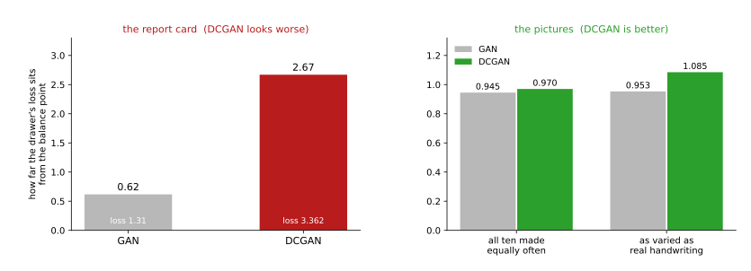
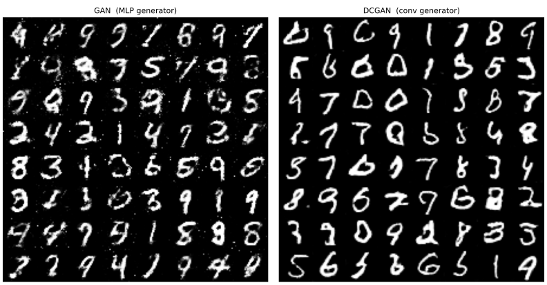
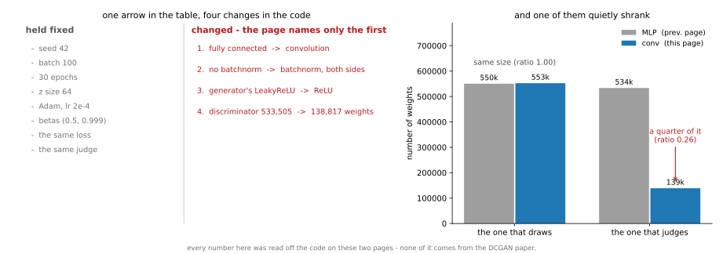

# DCGAN — 만들기에도 이웃 관계가 있다

<div class="leadbox" markdown>

**들어가는 이야기** — 성적표가 더 나쁜데 결과물이 더 좋다

이 쪽은 앞 쪽의 기계에서 딱 한 가지를 바꾼다. 그리는 쪽과 가려내는 쪽을 그림의 **이웃 관계를 살리는 꼴**로 고쳐 짠다. 5.1절이 되살리기에서 한 일을 이번에는 만들기에서 한다.

그렇게 하고 두 가지를 나란히 보면 서로 반대를 가리킨다.



**왼쪽만 보면 이 쪽이 망가지고 있는 것 같다.** 앞 쪽의 기계는 이론상 균형점 가까이 되돌아오는데, 이 쪽은 끝까지 멀찍이 떨어져 있고 그 거리가 오히려 벌어진다.

**오른쪽을 보면 반대다.** 같은 두 기계를 만들어 낸 그림으로 재면 이 쪽이 두 자 모두에서 낫다. 획 둘레에 흩어지던 점 얼룩이 사라지고 선이 매끈해진다.

둘 가운데 하나를 **왼쪽만 보고 고르라면 틀린 쪽을 고르게 된다.** 앞 쪽이 「로스 곡선을 믿지 마라」고 적어 둔 말의 가장 뚜렷한 증거가 여기 있고, 그래서 이 절은 수를 적을 때마다 **그림을 함께 본다.**

</div>

[GAN](01_gan.md)은 로스를 바꾸어 선명함을 얻었다. 구조는 여전히 완전 연결 레이어이었다. DCGAN은 그 구조를 **전치 컨볼루션**으로 바꾼다.

```python
"""DCGAN. 로스는 그대로 두고 구조만 컨볼루션으로 바꾼다.

mnist_judge.pt는 5.1절에서 학습해 둔 것을 읽어 쓴다.
GAN은 [-1, 1]로 두고 tanh로 내놓으므로, 심판에 넣기 전에 정규화를 되돌린다.
"""

import time

import torch
import torch.nn as nn
import torch.optim as optim
from torch.utils.data import DataLoader, TensorDataset
import torchvision
import torchvision.transforms as transforms

SEED, BATCH, ZDIM, EPOCHS = 42, 100, 64, 30
N_SAMPLE = 5000
JM, JS = 0.1307, 0.3081                 # 심판이 기대하는 정규화
device = torch.device("mps" if torch.backends.mps.is_available() else "cpu")

# 이 절만 [-1, 1]을 쓴다 — 생성기가 tanh로 내놓기 때문이다
tf = transforms.Compose([transforms.ToTensor(),
                         transforms.Normalize((0.5,), (0.5,))])
tr = torchvision.datasets.MNIST("./data", train=True, download=True, transform=tf)
te = torchvision.datasets.MNIST("./data", train=False, download=True, transform=tf)
Xtr = torch.cat([x for x, _ in DataLoader(tr, batch_size=2000, shuffle=False)])
Xte = torch.cat([x for x, _ in DataLoader(te, batch_size=2000, shuffle=False)])
yte = torch.cat([y for _, y in DataLoader(te, batch_size=2000, shuffle=False)])


class JudgeCNN(nn.Module):
    def __init__(self):
        super().__init__()
        self.conv1 = nn.Conv2d(1, 32, 3, padding=1)
        self.conv2 = nn.Conv2d(32, 64, 3, padding=1)
        self.pool = nn.MaxPool2d(2, 2); self.dropout = nn.Dropout(0.25)
        self.fc1 = nn.Linear(64 * 7 * 7, 128); self.fc2 = nn.Linear(128, 10)

    def forward(self, x):
        x = self.pool(torch.relu(self.conv1(x)))
        x = self.pool(torch.relu(self.conv2(x)))
        return self.fc2(self.dropout(torch.relu(self.fc1(x.flatten(1)))))


judge = JudgeCNN().to(device)
judge.load_state_dict(torch.load("mnist_judge.pt", weights_only=True))
judge.eval()


@torch.no_grad()
def predict(x_pm1):
    """[-1,1] -> [0,1] -> 심판 정규화 -> 심판."""
    xj = (((x_pm1 + 1) / 2) - JM) / JS
    p = torch.cat([torch.softmax(judge(xj[i:i + 1000].to(device)), 1).cpu()
                   for i in range(0, len(xj), 1000)])
    conf, pred = p.max(1)
    return conf, pred


def within_class_var(imgs01, group, min_n=20):
    """같은 클래스로 묶인 것들의 화소 분산을, 무리 크기로 가중해 평균낸다."""
    vs, ws = [], []
    for d in range(10):
        g = imgs01[group == d]
        if len(g) < min_n:
            continue
        vs.append(g.flatten(1).var(0).mean().item()); ws.append(len(g))
    return sum(v * w for v, w in zip(vs, ws)) / sum(ws) if vs else 0.0


# 진짜 자료의 기준선 — 여기서는 심판이 아니라 진짜 라벨로 묶는다
REAL_VAR = within_class_var((Xte + 1) / 2, yte)


def evaluate(samples_pm1, tag):
    conf, pred = predict(samples_pm1)
    share = torch.bincount(pred, minlength=10).float()
    share = share / share.sum()
    nz = share[share > 0]
    bal = (-(nz * nz.log()).sum() / torch.tensor(10.0).log()).item()
    wv = within_class_var((samples_pm1 + 1) / 2, pred)
    print(f"  {tag:14s} 확신도 {conf.mean():.3f}  고름 {bal:.3f}  "
          f"최대몫 {share.max():.3f}  클래스안 다양함 {wv / REAL_VAR:.3f}", flush=True)


def train_gan(Gc, Dc, tag):
    torch.manual_seed(SEED)
    G, D = Gc().to(device), Dc().to(device)
    # GAN 표준값. 이 장의 Adam 1e-3으로는 학습되지 않는다
    oG = optim.Adam(G.parameters(), lr=2e-4, betas=(0.5, 0.999))
    oD = optim.Adam(D.parameters(), lr=2e-4, betas=(0.5, 0.999))
    gg = torch.Generator().manual_seed(SEED)
    ld = DataLoader(TensorDataset(Xtr), batch_size=BATCH, shuffle=True, generator=gg)
    bce = nn.BCEWithLogitsLoss()
    t0 = time.time()
    for ep in range(EPOCHS):
        G.train(); D.train(); dl = gl = nb = 0.0
        for (xb,) in ld:
            xb = xb.to(device); n = xb.size(0)
            ones = torch.ones(n, 1, device=device)
            zeros = torch.zeros(n, 1, device=device)

            # 판별기: 진짜는 1, 가짜는 0
            fake = G(torch.randn(n, ZDIM, device=device))
            lossD = bce(D(xb), ones) + bce(D(fake.detach()), zeros)
            oD.zero_grad(); lossD.backward(); oD.step()

            # 생성기: 판별기가 진짜라고 하게 만든다
            lossG = bce(D(fake), ones)
            oG.zero_grad(); lossG.backward(); oG.step()

            dl += lossD.item(); gl += lossG.item(); nb += 1
        if ep == 0 or (ep + 1) % 10 == 0:
            print(f"    [{tag}] {ep+1:2d}/{EPOCHS}  D {dl/nb:.4f}  G {gl/nb:.4f}", flush=True)
    print(f"  {tag} 완료 ({time.time()-t0:.0f}s)", flush=True)
    return G.eval()


def sample(G, n=N_SAMPLE):
    with torch.no_grad():
        gg = torch.Generator().manual_seed(SEED)
        z = torch.randn(n, ZDIM, generator=gg)
        return torch.cat([G(z[i:i + 1000].to(device)).cpu()
                          for i in range(0, n, 1000)])


if __name__ == "__main__":
  # === 촘촘한 레이어를 컨볼루션으로 바꾼다 ==========================================
  class GConv(nn.Module):
      """작은 피처 맵에서 시작해 전치 컨볼루션으로 두 번 키운다."""

      def __init__(self):
          super().__init__()
          self.fc = nn.Sequential(nn.Linear(ZDIM, 128 * 7 * 7),
                                  nn.BatchNorm1d(128 * 7 * 7), nn.ReLU())
          self.net = nn.Sequential(
              nn.ConvTranspose2d(128, 64, 4, 2, 1),
              nn.BatchNorm2d(64), nn.ReLU(),                      # 7 -> 14
              nn.ConvTranspose2d(64, 1, 4, 2, 1), nn.Tanh())      # 14 -> 28

      def forward(self, z):
          return self.net(self.fc(z).reshape(-1, 128, 7, 7))


  class DConv(nn.Module):
      """3장의 CNN과 하는 일이 거의 같다. 그림을 받아 수 하나를 내놓는다."""

      def __init__(self):
          super().__init__()
          self.net = nn.Sequential(
              nn.Conv2d(1, 64, 4, 2, 1), nn.LeakyReLU(0.2),                        # 28 -> 14
              nn.Conv2d(64, 128, 4, 2, 1), nn.BatchNorm2d(128), nn.LeakyReLU(0.2), # 14 -> 7
              nn.Flatten(), nn.Linear(128 * 7 * 7, 1))

      def forward(self, x):
          return self.net(x)


  G = train_gan(GConv, DConv, "dcgan")
  evaluate(sample(G), "dcgan")
```

**출력:**

```
    [dcgan]  1/30  D 0.3718  G 2.5620
    [dcgan] 10/30  D 0.3873  G 2.7085
    [dcgan] 20/30  D 0.2937  G 3.1807
    [dcgan] 30/30  D 0.3053  G 3.3621
  dcgan 완료 (948s)
  dcgan          확신도 0.909  고름 0.970  최대몫 0.162  클래스안 다양함 1.085
```

작은 피처 맵에서 시작해 두 번 키워 $28 \times 28$로 만든다. [3장의 스텝3 → 스텝4](../../ch03/mnist/04_cnn.md)와 같은 수법이며, 다만 이번에는 **읽는 쪽이 아니라 그리는 쪽**이다.

판별기도 컨볼루션으로 바꾼다. 이쪽은 3장의 CNN과 하는 일이 거의 같다. 그림을 받아 하나의 수를 내놓는다.

---

## 1. 결과

| | 확신도 | 클래스 균형도 | 클래스 안 다양함 | 학습 시간 |
|---|---|---|---|---|
| [GAN (MLP)](01_gan.md) | 0.908 | 0.945 | 0.953 | 202초 |
| **DCGAN** | 0.909 | **0.970** | **1.085** | 948초 |

**확신도는 비긴다**(0.908 대 0.909). 갈리는 것은 나머지 둘이다.

다만 이 표는 시드 하나이고, **두 칸이 저마다의 다섯 벌 범위 밖에 있다** — GAN 의 다양함 0.953(범위 0.831~0.905)과 DCGAN 의 확신도 0.909(범위 0.899~0.906)다. [절 소개](index.md) 5절의 범위로 다시 적으면 이렇다.

| 다섯 벌 | 확신도 | 클래스 균형도 | 클래스 안 다양함 |
|---|---|---|---|
| [GAN (MLP)](01_gan.md) | 0.903~0.911 | 0.913~0.937 | 0.831~0.905 (평균 0.878) |
| **DCGAN** | 0.899~0.906 | **0.966~0.978** | **1.055~1.121** (평균 1.084) |

**결론은 흔들리지 않고 오히려 세진다.** 확신도는 범위가 겹쳐 비기는 것이 맞고, 클래스 안 다양함의 앞섬은 시드 하나로 보면 0.132인데 다섯 벌 평균으로 보면 **0.206**으로 더 벌어진다. 0.953이 유난히 잘 뽑힌 한 벌이었기 때문이다.

학습 시간이 4.7배라는 점도 적어 둔다. 전치 컨볼루션이 비싸다. 완전 연결 레이어는 한 번의 행렬 곱으로 784개의 화소를 한꺼번에 내놓지만, 전치 컨볼루션은 화소마다 이웃을 훑으며 $7 \to 14 \to 28$로 두 번 키운다. 게다가 판별기 쪽도 함께 컨볼루션이 되었으니 매 스텝마다 두 배로 문다.

---

## 2. 두 스텝이 서로 다른 것을 바꾸었다



같은 씨앗의 같은 $z$ 64개를 두 생성기에 넣은 것이다. 다만 **칸끼리 짝지어 보지는 말 것** — 따로 학습한 두 생성기는 같은 $z$를 서로 다른 숫자로 보낸다. 견줄 것은 칸 대 칸이 아니라 **획의 결**이다.

왼쪽의 얼룩이 오른쪽에서는 거의 사라졌다. 확신도는 0.908에서 0.909로 제자리인데 클래스 안 다양함이 0.953에서 1.085로 올라간 것이 이 차이다.

| 스텝 | 바꾼 것 | 얻은 것 |
|---|---|---|
| VAE → [GAN](01_gan.md) | **로스** (제곱오차 → 적대적) | 클래스 안 다양함 0.628 → 0.953 |
| GAN → DCGAN | **구조** (완전 연결 → 컨볼루션) | 0.953 → 1.085, 클래스 균형도 0.945 → 0.970 |

**나누어 재었기에 할 수 있는 말이다.** DCGAN만 돌렸다면 0.628에서 1.085까지 오른 것을 보고도 로스 덕인지 구조 덕인지 가릴 수 없었다. 중간에 MLP GAN을 둔 까닭이 이것이며, [4.3절](../../ch04/07_distillation.md)이 단일 모델 교사를 대조군으로 둔 것과 같은 생각이다.

VAE에서 MLP GAN으로 바꾼 차이가 MLP GAN에서 DCGAN으로 바꾼 차이보다 컸다. 그러나 앞의 변화에는 로스·구조·학습 설정이 함께 포함되어 있으므로 이를 로스만의 기여율로 부를 수는 없다.

<div class="storybox" markdown>

**그림으로 보는 AI 1.** 화살표 하나에 네 가지가 들어 있다

DCGAN이라는 이름을 붙인 글은 2015년 11월 알렉 래드퍼드(Alec Radford)와 두 동료의 것이다. 그 글이 내놓은 것은 **한 가지 생각이 아니라 목록**이다. 이렇게 쌓으면 그럭저럭 학습되더라는 요령 대여섯 개를 적어 둔 것이고, 그 글 스스로 수없이 많은 꼴을 돌려 보고 건진 것이라 밝힌다.

바로 위 표는 이 쪽으로 넘어오며 바꾼 것을 한 칸에 적었다 — 「구조(완전 연결 → 컨볼루션)」. 그런데 두 쪽의 코드를 나란히 놓고 세어 보면 바뀐 것이 **넷**이고, 그 가운데 셋이 저 목록에 그대로 있는 항목이다.



왼쪽 목록이 그 넷이다. 완전 연결을 컨볼루션으로 바꾼 것은 위 표가 적은 그대로다. 나머지 셋은 적혀 있지 않다. **층마다 값의 크기를 고르게 맞춰 주는 장치**가 앞 쪽에는 하나도 없었는데 이 쪽에는 양쪽에 다 붙었고, 그리는 쪽이 쓰던 문턱이 음수를 조금 흘려보내던 것에서 아예 막는 것으로 바뀌었다. 그리고 넷째가 가장 조용하다.

**가려내는 쪽이 작아졌다.** 품은 수가 533,505개에서 138,817개로, 사분의 일(0.26배)이 되었다. 바로 아래 3절이 두 모델의 로스 곡선을 나란히 놓고 DCGAN 쪽이 줄곧 앞섰다고 적는데, 그 두 줄은 **크기가 네 배 다른 둘**을 견준 것이다.

반대로 **그리는 쪽은 거의 꼭 같다** — 550,416개와 552,513개, 비로 1.00이다. 이것은 이 쪽 실험의 미덕이다. 그림이 좋아진 것을 「수를 더 많이 썼으니까」로 설명할 수는 없다.

**그러니 이 쪽의 결론이 틀렸다는 말이 아니다.** 획이 매끈해진 것은 그림으로 보이고, 시드 다섯 벌로 다시 재어도 0.206으로 오히려 벌어졌다. 흔들리는 것은 결론이 아니라 **값을 어디에 돌릴 것인가**다. 위 표는 그 공을 컨볼루션 한 가지에 돌리는데, 이 실험만으로는 고르개 덕인지 문턱 덕인지 가릴 수 없다. 가리려면 넷을 하나씩 떼어 내고 네 번 더 돌려야 하고, 이 쪽은 그러지 않았다.

재미있는 것은 **이 쪽이 그 말을 할 줄 안다는 점**이다. 바로 위 문단이 VAE에서 GAN으로 넘어간 걸음을 두고 「로스·구조·학습 설정이 함께 포함되어 있으므로」라며 똑같은 조심을 한다. 그 자를 한 걸음 더 왼쪽에만 대고 이 걸음에는 대지 않았다.

_확인한 곳 — A. Radford, L. Metz, S. Chintala, "Unsupervised Representation Learning with Deep Convolutional Generative Adversarial Networks", *ICLR 2016* (arXiv:1511.06434, 2015년 11월). 그 글 3절이 요령을 **Architecture guidelines** 라는 목록으로 적어 두었고, 본문에서 「층마다 값의 크기를 고르게 맞춰 주는 장치」라 한 것이 **배치 정규화**(batch normalization), 「문턱」이 활성화 함수, 「음수를 조금 흘려보내던 문턱」이 LeakyReLU 다. 목록에 든 세 항목은 풀링을 스트라이드 컨볼루션으로 바꾸라는 것, 양쪽에 배치 정규화를 쓰라는 것, 생성기에는 출력만 빼고 ReLU 를 쓰라는 것이다. 그 글의 제목이 가리키듯 거기서 내세운 성과는 그림이 아니라 **판별기가 익힌 표현을 분류에 쓰는 것**이었다. **왼쪽 목록과 오른쪽 막대의 수는 모두 이 책 두 쪽의 코드에서 읽은 것이고 그 글의 수가 아니다** — `figures/make_figures.py` 가 거기 적힌 모듈을 그대로 세워 센다._

</div>

---

## 3. 로스 곡선이 더 나빠 보이는데 표본은 더 좋다

| 에포크 | [GAN](01_gan.md) $D$ | $G$ | DCGAN $D$ | $G$ |
|---|---|---|---|---|
| 1 | 0.811 | 1.687 | 0.372 | 2.562 |
| 10 | 0.589 | 2.607 | 0.387 | 2.709 |
| 20 | 1.026 | 1.360 | 0.294 | 3.181 |
| 30 | **1.037** | **1.310** | **0.305** | **3.362** |

MLP 쪽은 균형점($D \approx 1.386$)으로 되돌아갔다. DCGAN은 처음부터 끝까지 판별기가 앞섰고 격차가 **벌어지기까지** 했다.

그런데 표본은 DCGAN 쪽이 더 좋다. 클래스 균형도도 다양함도 높다.

이것이 [앞 쪽](01_gan.md)이 말한 "로스 곡선을 믿지 마라"의 가장 뚜렷한 증거다. 두 모델 가운데 **로스만 보고 고르면 틀린 쪽을 고른다.**

---

## 4. 사다리의 끝

[5.1절](../dimreduction/index.md)부터 아홉 모델을 걸어 왔다.

| | 모델 | 새로 할 수 있게 된 일 |
|---|---|---|
| 5.1 | PCA → AE_CNN | 줄였다 되살린다 |
| 5.2 | VAE → cVAE | 표본을 만든다, 원하는 숫자를 만든다 |
| 5.3 | GAN → DCGAN | **선명한 표본을 만든다** |

스텝마다 새로 할 수 있게 되는 일이 있었고, 스텝마다 값을 치렀다. VAE는 되살리기를 내주고 샘플링을 샀고, GAN은 인코더를 내주고 선명함을 샀다.

**무엇이 가장 좋은 모델인가에 답이 없는 까닭이 그것이다.** 이 장이 [5.1절](../dimreduction/index.md)부터 되풀이해 온 이야기이며, 자를 바꾸면 순위도 바뀐다.

---

## 연습문제

<div class="drillbox" markdown>

**연습문제 1.** <span class="diff med" title="중간"></span>
DCGAN의 클래스 안 다양함이 1.085로 1을 넘었다. "진짜보다 다양하다"가 아니라면 무엇일 수 있는가? 가려내는 방법을 적어라.

</div>

??? success "풀이"
    이 자는 **심판이 같은 클래스로 묶은 표본들** 사이의 분산이므로, 묶기가 틀리면 값이 부풀려진다. 심판이 7로 읽은 그림 가운데 사람이 보기에 7이 아닌 것이 섞이면 그 무리가 실제보다 다양해 보인다.

    **가려내는 방법 하나.** 확신도가 높은 표본만 골라 다시 재는 것이다.

    ```python
    keep = conf > 0.9                    # 심판이 확신하는 것만
    within = within_class_var(samples[keep], pred[keep])
    ```

    값이 줄어들면 묶기 오류와 표본 선택 효과를 의심할 수 있다. 높은 확신도만으로 분류가 옳다는 보장은 없고, 반드시 1 아래로 내려갈 필요도 없다. 그대로 1을 넘으면 다른 까닭을 찾아야 한다.

    **방법 둘.** 진짜 데이터를 같은 방식으로 다시 재어 본다. 곧 **진짜 라벨 대신 심판의 예측으로** 묶어 분산을 구한다. 진짜 데이터조차 이렇게 재면 1을 넘는다면, 1이라는 기준선 자체가 두 가지 다른 방식으로 계산된 값을 견준 것이라 공정하지 않았다는 뜻이다.

    둘째 방법이 더 근본적이다. 본문의 분모는 **진짜 라벨**로 묶어 쟀고 분자는 **심판의 예측**으로 묶어 쟀다. 같은 방식으로 맞추지 않은 것이 1을 넘긴 원인일 수 있다.

---

<div class="drillbox" markdown>

**연습문제 2.** <span class="diff hard" title="어려움"></span>
이 절은 생성기만 컨볼루션으로 바꾼 것이 아니라 판별기도 함께 바꾸었다. 둘 가운데 어느 쪽이 이득을 가져왔는지 가리려면 어떻게 해야 하는가?

</div>

??? success "풀이"
    **네 가지를 다 돌려야 한다.** 생성기와 판별기를 각각 완전 연결/컨볼루션으로 두면 $2 \times 2$가 된다.

    | | 판별기 완전 연결 | 판별기 컨볼루션 |
    |---|---|---|
    | 생성기 완전 연결 | [GAN](01_gan.md) | ? |
    | 생성기 컨볼루션 | ? | DCGAN |

    본문은 대각선 두 칸만 재었으므로 둘의 몫을 나눌 수 없다.

    **어느 쪽이 더 중요할지 짐작해 보면** 판별기 쪽일 수 있다. 생성기는 결국 판별기가 주는 신호를 따라가므로, 판별기가 이웃 관계를 볼 줄 알아야 "이 획은 이어져 있지 않다" 같은 것을 지적할 수 있다. 완전 연결 판별기도 여러 화소의 관계를 학습할 수 있지만 국소성과 웨이트 공유를 구조적으로 주지는 않으므로, 그러면 생성기가 아무리 좋은 구조여도 배울 것이 없다.

    이 짐작을 확인하려면 위 표의 빈 칸 두 개를 채우면 된다. [4.3절](../../ch04/07_distillation.md)이 대조군으로 이득을 둘로 나눈 것과 같은 방식이며, 본문이 "두 스텝이 서로 다른 것을 바꾸었다"고만 적고 판별기 몫을 따로 말하지 않은 까닭도 이 실험을 하지 않았기 때문이다.

---

<div class="drillbox" markdown>

**연습문제 3.** <span class="diff easy" title="쉬움"></span>
본문은 "큰 몫은 로스가 가져갔다"고 적는다. 두 스텝이 가져간 몫을 셈해 비로 적고, 두 스텝이 모두 **시드를 바꾸어도 살아남는지** [개요](index.md)의 시드 다섯 개 범위로 확인하라.

</div>

??? success "풀이"
    클래스 안 다양함으로 재면 이렇다.

    ```python
    loss  = 0.953 - 0.628      # VAE -> GAN : 로스를 바꾸었다
    struct = 1.085 - 0.953     # GAN -> DCGAN : 구조를 바꾸었다
    total = 1.085 - 0.628
    print(f"로스 {loss:+.3f} ({100*loss/total:.0f}%)  구조 {struct:+.3f} ({100*struct/total:.0f}%)")
    print(f"로스가 구조보다 {loss/struct:.1f}배")
    ```

    ```
    로스 +0.325 (71%)  구조 +0.132 (29%)
    로스가 구조보다 2.5배
    ```

    **단일 시드의 지표 증가량을 나누면 두 단계의 비중은 약 71%와 29%다.** 이것은 원인의 기여율이 아니다. 첫 단계에는 VAE에서 GAN으로 바꾼 여러 조건이 포함된다. 따라서 71%와 29%를 로스와 구조의 인과적 기여로 해석하지 않는다.

    시드 다섯 개 범위로 보면 두 스텝 모두 살아남는다.

    | 스텝 | 앞 범위 | 뒤 범위 | 떨어진 틈 |
    |---|---|---|---|
    | 로스 (VAE → GAN) | 0.621\~0.630 | 0.831\~0.905 | **0.201** |
    | 구조 (GAN → DCGAN) | 0.831\~0.905 | 1.055\~1.121 | **0.150** |

    두 쌍 모두 범위가 겹치지 않으므로, 이 다섯 시드에서는 방향이 일관되었다. 그러므로 "로스가 더 큰 몫"이라는 말은 재어서 할 수 있는 말이다.

    **다만 "구조"가 한 가지 변화가 아니다.** 이 스텝에서 생성기와 판별기가 **함께** 컨볼루션이 되었다. 그러므로 0.132가 생성기 쪽에서 온 것인지 판별기 쪽에서 온 것인지, 아니면 둘이 나눈 것인지는 이 두 점으로 가를 수 없다. 본문이 판별기 몫을 따로 말하지 않은 까닭이고, 연습문제 2가 가리키는 빈 칸이 그것이다.

    곧 같은 대조군 수법을 한 번 더 써야 하는 자리다 — 생성기만 컨볼루션으로 바꾼 줄을 하나 두면 0.132가 둘로 갈린다.

