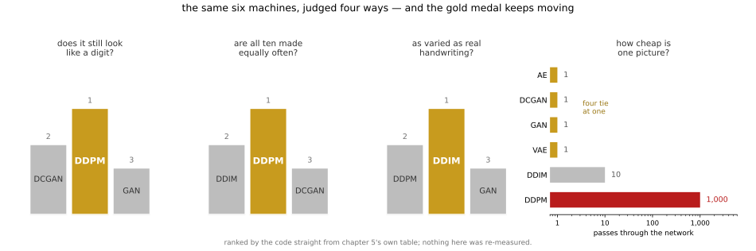
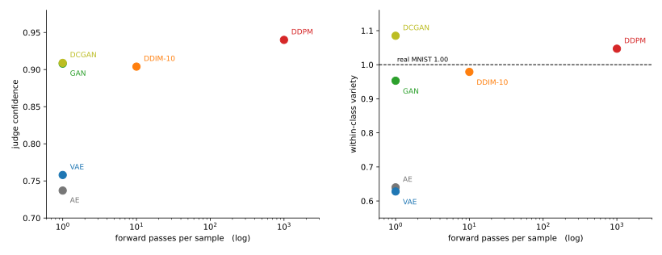
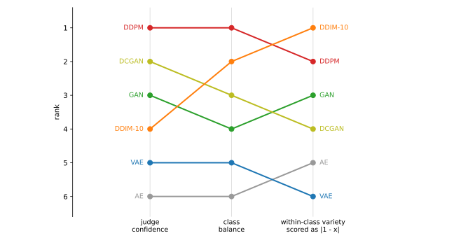

# 5장: MNIST와 CIFAR-10으로 보는 생성

**들어가는 이야기** — 답지가 없는 시험을 어떻게 채점하는가

앞의 두 장에서는 채점이 쉬웠다. 그림을 한 장 주고 몇 번인지 맞히게 한 다음, 맞은 것을 세면 그만이었다. **답지가 있었기 때문이다.** 99.21%라는 수에는 다툴 여지가 없다. 틀린 그림을 하나하나 꺼내 볼 수도 있다.

이 장에서는 그 답지가 사라진다. 기계에게 시킬 일이 「이 그림이 몇 번이냐」가 아니라 **「아무 숫자나 하나 그려 봐라」**이기 때문이다. 그렇게 나온 그림에는 맞고 틀림이 없다. 세상에 없던 그림이니 견줄 원본도 없고, 설령 원본을 하나 정해 둔다 해도 **옳은 답이 여럿**이다 — 굵게 쓴 7도 7이고 삐딱하게 쓴 7도 7이다.

그래서 이 장은 **기계 여섯을 세우고 자 네 개를 만들어** 재어 본다. 이 자 네 개는 다음과 같다.

| 자 | 묻는 것 | 좋은 쪽 |
|---|---|---|
| **숫자다움** | 아직 숫자처럼 보이는가 | 높을수록 |
| **고름** | 열 가지를 고루 만드는가 | 높을수록 |
| **다양함** | 같은 숫자를 여러 모양으로 그리는가 | **1에 가까울수록** |
| **값** | 한 장에 품이 얼마나 드는가 | 적을수록 |

첫째 자는 3장에서 만들어 둔 분류기에게 보여 주고 얼마나 자신 있어 하는지로 잰다. 둘째는 0만 잔뜩 그려 놓고 숫자를 그렸다 할 수 없으니 필요하고, 셋째는 7을 늘 똑같은 7로만 그려도 곤란하니 필요하다.

**셋째만 「높을수록 좋다」가 아니라는 데 눈길을 둘 것.** 진짜 손글씨를 1로 두고 잰 값이라 **1을 넘으면 넘은 만큼 어긋난 것**이다. 이 어정쩡함이 뒤에서 말썽을 일으킨다.

여섯 기계는 오토인코더, VAE, GAN, DCGAN, DDPM, DDIM이다. 앞에서부터 차례로 지어 가며 자 넷을 들이댄다.

**금메달이 한자리에 머물지 않는다.** 앞의 두 자에서는 DDPM이 1등인데, 「진짜 손글씨만큼 다양한가」로 보면 DDIM이 1등으로 올라선다. 그리고 넷째 칸을 보라 — 앞의 두 자를 휩쓴 그 DDPM이 **값으로는 꼴찌**다. 그림 한 장에 신경망을 천 번 지나가야 해서, 5,000장을 뽑는 데 42분이 걸린다. 다른 넷은 한 번이면 끝난다.

더 얄궂은 일도 있다. 셋째 자에서 **진짜 손글씨보다 높은 점수를 받는 기계가 나온다.** 사람보다 글씨를 잘 쓴다는 뜻일 리는 없다. 그 자가 재고 있는 것이 우리가 「다양함」이라 부르려던 것과 **조금 어긋나 있다**는 뜻이다. 자를 만들어 놓고 그 자가 무엇을 재는지 다시 캐물어야 하는 자리가 이 장에는 여러 번 나온다.

그러니 이 장이 끝에 내놓는 것은 「가장 좋은 기계」가 아니다. 내놓는 것은 둘이다. **무엇을 재고 싶은지 먼저 정하지 않으면 순위를 매길 수 없다**는 것, 그리고 자마다 **무엇을 보고 무엇을 못 보는지**다.

미리 적어 둘 것이 하나 있다. 이 장이 재는 자리는 **거의 다 MNIST** — 28×28에 검정과 흰색뿐인 손글씨 — 다. 딱 한 쪽만 컬러 사진인 [CIFAR-10](dimreduction/05_cifar_classification.md)으로 나가는데, **하필 그 쪽에서 MNIST가 준 결론이 무너진다.** 손글씨에서 크게 벌던 수법이 사진에서는 아무것도 벌지 못한다.

그러니 이 장이 얻는 순위와 간격이 더 크고 복잡한 그림에서도 그대로일 것이라고는 **말할 수 없다.** 그 한 쪽이 바로 그 증거다. 이 장이 보이려는 것은 어느 기계가 이기느냐가 아니라 **재는 일 자체가 어렵다**는 쪽이다.

[3장](../ch03/index.md)과 [4장](../ch04/index.md)은 **가르는** 법을 다뤘다. 그림을 받아 이름을 붙이는 일이며, 잘했는지는 정확도 하나로 잴 수 있었다.

이 장은 **만드는** 법을 다룬다. 이름을 받아 그림을 내놓거나, 아무것도 받지 않고 그럴듯한 그림을 내놓는 일이다. 그리고 그 순간 **정확도라는 자가 사라진다.** 없던 그림이 얼마나 그럴듯한지를 재는 자는 따로 마련해야 한다.

---

## 왜 MNIST로 돌아오는가

4장은 MNIST가 너무 쉽다며 CIFAR-10으로 옮겨 갔다. 이 장은 되돌아온다. 모순처럼 보이지만 **자가 바뀌었기 때문**이다.

| | 4장 | 5장 |
|---|---|---|
| 재는 것 | 시험 정확도 | 복원 품질, 표본 품질 |
| MNIST | 99.21%로 **포화** | 포화와 거리가 멀다 |
| 결정적인 이유 | 잴 여지가 없다 | **눈으로 판정할 수 있다** |

MNIST는 단순한 숫자 영상이어서 복원본과 생성 표본의 형태를 눈으로 비교하기 쉽다. CIFAR-10의 저해상도 자연 사진은 더 복잡해 시각적 판단이 어렵다. 다만 눈으로 보는 것은 어느 데이터에서도 품질을 확정하지 못하고, 2차원 잠재 공간을 그려 보는 일도 MNIST에서만 되는 것은 아니다.

**어느 데이터가 알맞은가는 무엇을 재려느냐가 정한다.** 3장과 4장이 MNIST를 버린 것도, 이 장이 도로 집는 것도 같은 원칙을 따른 결과다.

---

## 두 사다리

이 장은 두 번 오른다. 앞의 사다리는 **인코더가 있는** 모델들이고, 뒤의 사다리는 **없는** 모델들이다. 그 갈림이 곧 잴 수 있는 것의 갈림이기도 하다.

| 사다리 | 절 | 모델 | 새로 할 수 있게 되는 일 |
|---|---|---|---|
| 되살리기 | [5.1](dimreduction/index.md) | PCA → 선형 AE → AE_MLP → AE_CNN | 줄였다 되살린다 |
| 만들기 | [5.2 잠재공간](latent_generative/index.md) | VAE → β-VAE → cVAE | **표본을 만든다**, 원하는 숫자를 만든다 |
| 만들기 | [5.3 적대적](generative/index.md) | GAN → DCGAN | **선명한 표본을 만든다** |
| 만들기 | [5.4 확산](diffusion/index.md) | DDPM → DDIM | **표본 품질을 끌어올린다** — 값을 시간으로 내고(DDPM), 그 시간을 되산다(DDIM) |

앞 사다리의 네 스텝은 [3장](../ch03/index.md)·[4장](../ch04/index.md)의 네 스텝과 생각이 하나씩 짝을 이룬다. 닫힌 형태, 선형 학습, 비선형성, 이웃 관계. 목표만 가르기에서 되살리기로 바뀐다.

뒤 사다리의 GAN → DCGAN도 같은 짝이다. 촘촘한 레이어를 컨볼루션으로 바꾸는 3장 스텝3 → 스텝4의 수법을 만들기에 그대로 건다.

---

## 재는 자를 먼저 마련한다

만들기에서 가장 흔한 실패는 **"내 눈에는 좋아 보인다"로 끝나는 것**이다. 이 장은 그것을 피하려고 자를 넷 둔다.

| 자 | 무엇을 잡아내는가 | 쓰이는 곳 |
|---|---|---|
| 복원 MSE | 화소가 얼마나 가까운가 | 5.1 |
| **심판 CNN** | 되살린·만들어 낸 그림이 **아직 숫자인가** | 모든 절 |
| 클래스 균형도 | 열 가지를 고루 만드는가 (클래스 **사이**) | 5.2, 5.3, 5.4 |
| 클래스 안 다양함 | 같은 숫자를 여러 모양으로 만드는가 (클래스 **안**) | 5.3, 5.4 |

**자가 늘어난 순서가 곧 이 장의 줄거리다.** 5.1은 복원 MSE 하나로 충분했는데, 만들기로 넘어가자 "화소가 가깝다"가 뜻을 잃어 심판이 필요해졌고, 심판이 확신해도 한 숫자만 만들 수 있어 클래스 균형도가 필요해졌고, 고루 만들어도 같은 모양만 찍어 낼 수 있어 클래스 안 다양함이 필요해졌다. **자를 하나 만들 때마다 그 자가 못 보는 빈틈이 드러난다.**

심판은 [3장 스텝4](../ch03/mnist/04_cnn.md)의 컨볼루션 뉴럴 넷트웍을 같은 구조로 5 에포크 학습한 것이며 시험 정확도 **98.83%**다(그 쪽의 규약은 10 에포크다). 책이 이미 만들어 둔 모델을 자로 쓴다는 점이 값지다. 표본 품질을 두고 말로 다투는 대신, 모든 절이 같은 수로 이야기할 수 있다.

---

## 5.1이 이미 보인 것

| 잠재 차원 64 | 복원 MSE | 같은 숫자로 읽히는 비율 |
|---|---|---|
| PCA | 0.0953 | 97.81% |
| 선형 AE | 0.0958 | 97.83% |
| AE_MLP | 0.0546 | 98.51% |
| AE_CNN | **0.0243** | 98.52% |

선형 오토인코더의 복원값은 PCA와 가까웠다. 제곱오차를 최소화하는 선형 복원의 최적 부분공간이 PCA라는 이론과 부합하지만, 한 번의 수치 비교가 정리를 증명하는 것은 아니다.

그리고 잠재 차원을 2로 줄이면 PCA는 **숫자를 바꾸어 놓는다.** 4도 9도 7로 되살아나고, 같은 숫자로 읽히는 비율이 35.66%까지 떨어진다. 같은 2차원에서 [AE_MLP](dimreduction/03_ae_mlp.md)는 70.13%를 지킨다.

그런데 거기서 **순서가 뒤집힌다.** 차원 64에서 가장 좋던 [AE_CNN](dimreduction/04_ae_cnn.md)이 차원 2에서는 61.78%로 AE_MLP보다 아래다. 어느 모델이 나은지는 **몇 차원으로 줄이느냐까지 말해야** 정해진다.

---

## 5.2가 고쳐 놓은 것

5.1이 남긴 물음은 "어디서 뽑아야 없던 그림이 나오는가"였다. [5.2절](latent_generative/index.md)이 그것을 재어 보니 답이 **차원에 달려 있었다.**

| 뽑은 표본 5,000장 | 클래스 균형도 | 가장 많은 클래스 |
|---|---|---|
| 오토인코더, 잠재 차원 2 | 0.973 | 15% |
| 오토인코더, 잠재 차원 64 | 0.541 | **3이 66%** |
| VAE ($\beta=1$), 잠재 차원 64 | **0.877** | 3이 36% |

곧 오토인코더가 무너지는 것은 차원 64에서다. 2차원에서는 맞춘 정규분포에서 뽑아도 열 가지가 거의 고르게 나오는데, 64차원에서는 셋 하나가 3분의 2를 차지한다. VAE는 같은 64차원에서 0.877을 지킨다. 평균 확신도는 두 모델이 가까웠으므로(0.777 대 0.769) 갈리는 것은 품질이 아니라 **고름**이다.

---

## 5.3과 5.4가 더한 것

5.2까지의 자로는 아직 못 보는 것이 남아 있었다. 고루 만들어도 **같은 숫자를 늘 같은 모양으로** 찍어 낼 수 있다. 넷째 자인 클래스 안 다양함이 그것을 잡는다 — 진짜 데이터를 1.00으로 두고 견준다.

| 잠재 차원 64 | 확신도 | 클래스 균형도 | 클래스 안 다양함 | 순전파 |
|---|---|---|---|---|
| 진짜 데이터 | — | — | **1.00** | — |
| 오토인코더 | 0.737 | 0.580 | 0.640 | 1 |
| VAE | 0.758 | 0.887 | 0.628 | 1 |
| [GAN](generative/01_gan.md) | 0.908 | 0.945 | 0.953 | 1 |
| [DCGAN](generative/02_dcgan.md) | 0.909 | **0.970** | 1.085 | 1 |
| [**DDPM**](diffusion/01_ddpm.md) | **0.940** | **0.986** | 1.047 | 1,000 |
| [DDIM 10스텝](diffusion/02_ddim.md) | 0.904 | 0.971 | 0.979 | 10 |

넷째 자가 비로소 갈라놓는 것은 **인코더가 있는 쪽과 없는 쪽**이다. 오토인코더와 VAE는 0.64와 0.63으로 진짜 데이터의 3분의 2에 머무는데, 둘의 클래스 균형도는 0.580과 0.887로 크게 다르다. 곧 **고름과 다양함은 다른 자이고**, 앞의 두 자로는 이 차이를 볼 수 없었다.

마지막 줄이 이 장의 맺음이다. DDPM은 넷째 자까지 데려와 놓고 순전파를 **1,000번** 쓴다. DDIM은 같은 모델을 다시 학습하지 않고 10번으로 줄이면서 확신도를 0.940에서 0.904로 내준다. 값이 품질에서 시간으로 옮겨 갔고, **그 시간을 얼마에 되살지가 고를 수 있는 것이 되었다.**

이 장에 나오는 모델을 모두 한 평면에 올린 그림이다. **먼저 축이 무엇인지부터 읽자.**

**가로축은 값이다.** 그림 한 장을 만들려고 넷트웍을 몇 번 돌려야 하는지를 센다. 로그 눈금이라 한 칸 옮길 때마다 **열 배**다. 그래서 $10^0$ 은 한 번, $10^3$ 은 천 번이다. 오토인코더·VAE·GAN·DCGAN은 넣으면 바로 그림이 나오니 한 번이고, DDPM은 잡음을 천 번에 걸쳐 조금씩 걷어 내므로 천 번이다.

**왼쪽 세로축은 "숫자처럼 보이는가"다.** [3장에서 만든 심판](../ch03/mnist/04_cnn.md)에게 만든 그림을 보여 주고, 심판이 "이건 7이야"라고 말할 때 **얼마나 자신 있어 하는지**를 적은 값이다. 높을수록 또렷한 숫자다.

**오른쪽 세로축은 "여러 모양으로 그리는가"다.** 같은 7이라도 사람마다 다르게 쓰는데, 만든 그림들이 그만큼 서로 다른지를 잰다. 여기서는 **진짜 MNIST를 1.00으로 두고** 견주므로 — 그림 속 점선이 그것이다 — **높을수록 좋은 것이 아니라 1.00에 가까울수록 좋다.** 1.00보다 크면 진짜보다 더 들쭉날쭉하다는 뜻이다.

이제 세 가지가 보인다.

**하나, 공짜로 오른 구간이 있다.** 왼쪽 칸에서 네 모델이 모두 가로축 1에 모여 있는데, 오토인코더는 0.737, VAE는 0.758인데 GAN과 DCGAN은 0.908과 0.909까지 올라가 있다. **값은 똑같이 한 번인데 세로로만 올라갔다.** 더 오래 돌려서 얻은 것이 아니라 만드는 방식을 바꿔서 얻은 것이다.

**둘, 그 다음부터는 값을 치른다.** DDPM은 천 번을 써서 가장 높은 0.940에 닿는다. 그리고 DDIM은 같은 모델을 다시 학습하지 않고 **열 번**만에 0.904까지 간다 — 값을 100분의 1로 줄이고 높이는 거의 지킨 것이다.

**셋, 두 칸의 등수가 다르다.** 이것이 가장 눈여겨볼 자리다. DCGAN은 왼쪽에서 둘째인데, 오른쪽에서는 1.085로 **1.00에서 가장 멀다.** 거꾸로 DDIM은 왼쪽에서 넷째인데 오른쪽에서는 0.979로 **1.00에 가장 가깝다.** 같은 그림들을 같은 날 재었는데 **어느 자로 보느냐에 따라 이긴 모델이 바뀐다.** 바로 아래 상자가 그 이야기다.

!!! warning "이 그림의 순서를 방법의 순위로 읽지 말 것"
    네 생성 모델(GAN·DCGAN·DDPM·DDIM)은 **서로 아주 가깝다.** 확신도는 0.904에서 0.940까지 0.036, 클래스 균형도는 0.945에서 0.986까지 0.041, 다양함은 1.00에서 떨어진 거리로 0.021에서 0.085까지 0.064 안에 모두 들어온다.

    그런데 [5.3절](generative/index.md)이 시드 다섯 개로 재어 둔 GAN의 다양함 **스프레드가 0.074**다. **한 모델을 시드만 바꿔 다시 돌렸을 때 움직이는 폭이, 네 모델을 가르는 폭보다 넓다.** 적어도 그 자에서는 이 그림이 순위를 매긴 것이 아니라 흔들림을 본 것이다.

    까닭은 **MNIST가 이 비교에 너무 쉽기 때문**이다. 모드가 열 개뿐이고 모양이 단순해서, 몇 가지만 그리고 마는 실패를 피하기도 쉽고 눈에 띄기도 쉽다. 심판이 진짜 MNIST를 98.83%로 읽으니 올라갈 자리도 1%포인트 남짓뿐이다.

    그래서 이 그림에서 자연스럽게 나오는 결론 — "DCGAN이 1,000분의 1 값으로 DDPM만큼 한다" — 은 **이 데이터에서 맞고 일반으로는 틀리다.** 모드가 훨씬 많고 자세한 데이터로 가면 갈라진다. 그 자리를 수로 보인 것이 프라풀라 다리왈(Prafulla Dhariwal)과 알렉스 니콜(Alex Nichol)의 「확산 모델이 이미지 합성에서 GAN을 이긴다」(*NeurIPS* 2021)이며, 제목이 이미 이 장의 MNIST가 보여 주지 못한 것을 말한다.

---

**그림으로 보는 AI 1.** 자를 고르는 일이 곧 답을 고르는 일이다

이 장은 첫 줄에서 **정확도라는 자가 사라진다**고 적고, 그 자리에 자 넷을 세웠다. 자를 바꾸면 답도 바뀐다는 것을 수로 보인 글이 있다. 루카스 타이스(Lucas Theis)와 아론 판 덴 오르트(Aäron van den Oord), 마티아스 베트게(Matthias Bethge)가 2016년에 낸 「생성 모델의 평가에 관하여」다.

세 사람이 살펴본 것은 그때 다들 쓰던 자 셋이다. 하나는 **모델이 진짜 그림을 보고 "이런 그림이 나올 법하다"고 얼마나 세게 말하는가**를 점수로 매긴 것이고, 또 하나는 같은 점수를 다른 셈법으로 어림잡은 것이며, 나머지 하나는 **사람이 눈으로 보고 그럴듯한가**다.

결론은 **셋이 서로 따로 논다**는 것이었다. 첫째 자로 1등인 모델이 셋째 자로는 꼴찌일 수 있고 그 반대도 된다. 그림이 커지고 복잡해질수록 더 어긋난다. 그러니 "이 모델이 좋다"는 말은 **어느 자로 쟀는지를 빼고는 뜻이 서지 않는다.**

**이 장의 표에서도 똑같이 일어난다.** 위 그림은 바로 앞 표의 여섯 모델을 자마다 등수로 바꾼 것뿐이다. 같은 모델, 같은 그림 한 벌인데 선이 서로 엇갈린다. DDIM 10스텝은 첫째 자로는 넷째인데 셋째 자로는 **1등**이다. DCGAN은 둘째에서 넷째로 내려간다. 오토인코더와 VAE는 꼴찌 자리를 서로 바꾼다 — 열 가지를 고루 그리는지로 보면 VAE가 한참 낫고(0.887 대 0.580), 같은 숫자를 여러 모양으로 그리는지로 보면 오토인코더가 조금 낫다(1.00에서 0.360 대 0.372만큼 떨어져 있다).

**그러니 자 넷을 둔 것은 꼼꼼해서가 아니라 그래야만 해서다.** 하나로 줄이는 순간 그 하나가 고르는 답만 남는다. 이 장이 표를 넷으로 적고 어느 칸이 굵은지를 매번 다르게 두는 까닭이 여기에 있다.

다만 자가 많다고 답이 나오지도 않는다. 넷을 모아도 "그래서 어느 모델이 가장 좋은가"는 여전히 대답되지 않는다 — **무엇에 쓸 것인지를 먼저 정해야** 그 가운데 어느 자를 볼지가 정해진다. 타이스 등이 글 끝에 적은 것도 그것이다. 이 장이 할 수 있는 일은 자마다 다른 답이 나온다는 사실을 숨기지 않는 데까지다.

_확인한 곳 — L. Theis, A. van den Oord, M. Bethge, "A note on the evaluation of generative models", *ICLR 2016* (arXiv:1511.01844). 세 자가 서로 어긋날 수 있다는 것과 평가는 쓰임새를 정한 뒤에 해야 한다는 결론이 그 글의 것이다. 본문에 풀어 쓴 세 자는 차례로 평균 로그가능도, 파젠 창 추정, 사람이 보는 표본 품질이다. **위 그림의 등수는 그 글과 무관하며, 이 장의 표를 자마다 다시 줄 세운 것이다** — 그림의 세 자는 이 책이 쓰는 것(심판 확신도·클래스 균형도·클래스 안 다양함)이지 그 글이 다룬 셋이 아니다. 다양함을 $\lvert 1 - x \rvert$로 보는 것은 [5.3절 개요](generative/index.md)가 적어 둔 읽기를 따랐다._

---

!!! note "이 장과 뒤 장들의 관계"
    차원 축소는 [25장](../ch24/index.md), 오토인코더는 [26장](../ch25/index.md), 변분 오토인코더는 [27장](../ch26/index.md), GAN은 [30장](../ch29/index.md), 확산 모델은 [31장](../ch30/index.md)이 본격적으로 다룬다. 라벨 없이 쓸 만한 표현을 배우는 일은 [14장 자기 지도 학습](../ch13/index.md)이 다룬다.

    이 장의 몫은 다르다. 이론을 미리 맛보이는 자리가 아니라, **하나의 데이터와 하나의 규약 위에서 열한 모델을 나란히 세워 무엇이 새로 가능해지는지를 재는 자리**다.
