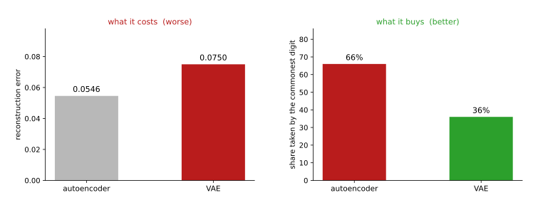
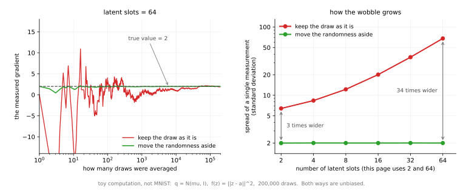
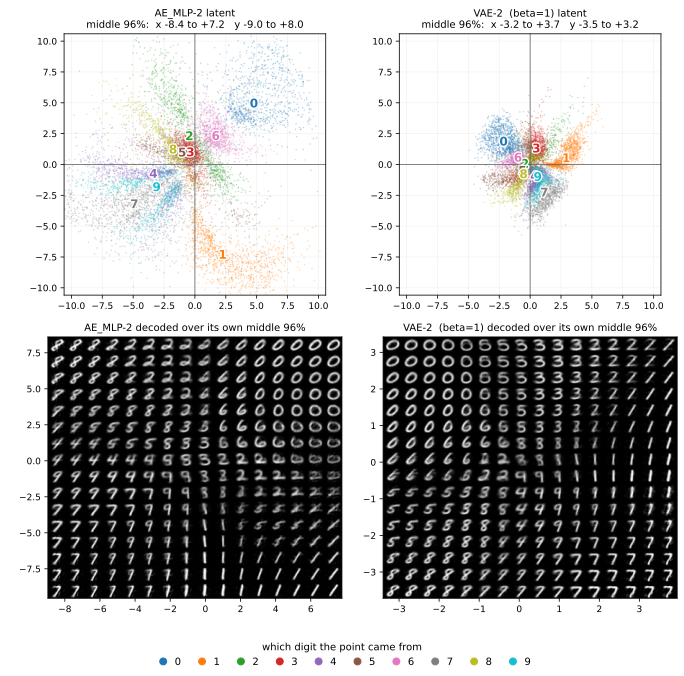
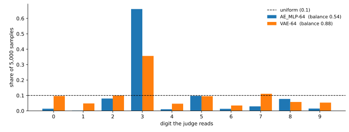
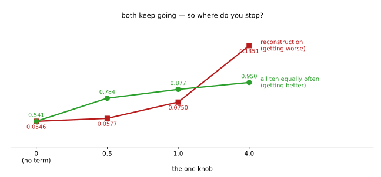
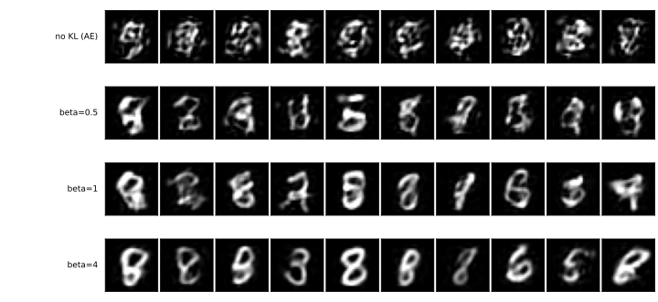
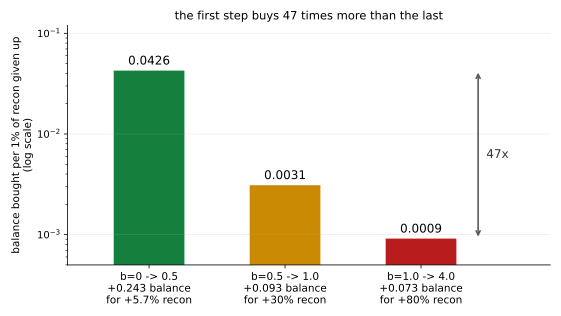
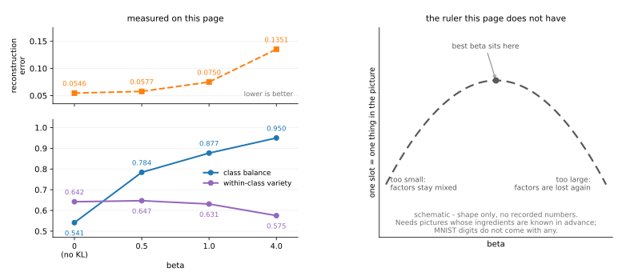

# VAE — 잠재 표현을 사전분포 쪽으로 민다, 그리고 β로 얼마나 밀지 고른다

<div class="leadbox" markdown>

**들어가는 이야기** — 흐릿해졌는데 더 좋아졌다고 말할 수 있는가

이 쪽의 기계를 앞 절의 기계와 나란히 놓으면 **복원은 더 못한다.** 수만 보면 뒤로 간 것이다.



왼쪽이 **치른 값**이고 오른쪽이 **산 것**이다. 오른쪽을 세는 법은 이렇다 — 뽑은 그림을 **[3장에서 만들어 둔 분류기](../../ch03/mnist/04_cnn.md)**에게 보여 몇 번이라 읽는지 적어 두고, 가장 많이 나온 하나가 전체에서 차지하는 몫을 센다. 열 가지가 고루 나오면 10% 언저리여야 한다.

오른쪽을 잠시 들여다볼 만하다. 앞 절의 기계에서 5,000장을 뽑으면 그 가운데 **셋에 둘이 같은 숫자**다. 열 가지를 만들라고 했는데 3만 잔뜩 그려 놓는 것이다. 이 쪽의 기계는 그 쏠림을 절반 아래로 푼다.

그러니 「복원이 나빠졌다」는 수 하나로 뒤로 갔다고 할 수 없다. 두 기계는 **같은 시험을 치른 것이 아니다.** 앞 절의 기계는 「보여 준 그림을 되살려라」만 배웠고, 이 쪽의 기계는 거기에 「네가 만드는 수들을 정해진 모양으로 모아 두어라」를 하나 더 받았다.

이 쪽을 읽을 때 조심할 것이 그것이다. **수 하나가 나빠졌다는 말과 모델이 나빠졌다는 말은 다르다.** 무엇을 재는 자인지, 그리고 그 자가 우리가 사려던 것을 재고 있는지를 먼저 물어야 한다.

</div>

VAE는 잠재 표현을 점 하나로 내놓지 않는다. **분포**로 내놓는다. 인코더가 평균 $\mu$와 로그 분산 $\log \sigma^2$을 내고, 거기서 뽑은 $z$를 디코딩한다.

수를 세어 두면 헷갈리지 않는다. 잠재 차원이 100이면 인코더가 뱉는 것은 $\mu \in \mathbb{R}^{100}$과 $\log \sigma^2 \in \mathbb{R}^{100}$, 곧 **200개**다. 그렇다고 잠재 차원이 200이 되는 것은 아니다. 그 200개는 $\mathbb{R}^{100}$ 위의 분포 하나를 적는 데 쓰이고, 거기서 뽑은 $z$는 여전히 100차원이다. 오토인코더가 100개를 내놓던 자리에서 VAE는 **같은 자리를 가리키는 분포**를 내놓는다.

$$
z = \mu + \sigma \odot \varepsilon, \qquad \varepsilon \sim N(0, I)
$$

이렇게 적는 까닭은 **그래디언트가 흐르게** 하기 위해서다. $z$를 직접 뽑으면 뽑는 연산에 미분이 정의되지 않지만, 무작위성을 $\varepsilon$으로 밀어내면 $\mu$와 $\sigma$로 그래디언트가 흐른다. 이를 **리파라메리제이션 기법**이라 한다.

---

<div class="storybox" markdown>

**그림으로 보는 AI 1.** 리파라메리제이션이 바꾼 것은 되느냐 마느냐가 아니라 **그래디언트 추정량의 분산**이다

바로 위에서 뽑는 자리를 옮겨 적은 것이 **리파라메리제이션**이다. 이 수법이 처음 나온 자리는 디데릭 킹마(Diederik Kingma)와 막스 벨링(Max Welling)이 2013년 끝 무렵에 올린 글이다. 제목에는 VAE라는 이름이 없다. 그 이름은 글 가운데쯤에 **보기 하나**로 나올 뿐이고, 글이 내놓은 것은 모델이 아니라 **추정량** — 참값을 바로 셀 수 없을 때 표본으로 어림잡는 계산법 — 이었다.

위 문단은 "뽑기를 그대로 두면 길이 아예 막힌다"로 읽히기 쉽다. 그런데 그 글은 **다른 길을 알고 있었고, 적어 두었다.**

기호를 먼저 정해 두자. 인코더가 내놓는 분포를 $q_\phi(z) = N(\mu_\phi,\ \sigma_\phi^2)$라 하고($\phi$가 인코더의 파라메터다), 뽑은 $z$로 재는 값을 $f(z)$라 하자. 우리가 알고 싶은 것은 그 **평균을 $\phi$로 미분한 그래디언트** — 파라메터를 어느 쪽으로 얼마나 움직여야 로스가 줄어드는지 알려 주는 수 — 다.

!!! note "$\mathbb{E}$ 아래에 적는 것은 **무엇으로 평균 내는가**다"
    $\mathbb{E}_{\varepsilon \sim N(0, I)}[\,\cdot\,]$는 「$\varepsilon$이 주어졌을 때」라는 **조건이 아니다.** $\varepsilon$을 $N(0, I)$에서 수없이 뽑아 **그것들에 걸쳐 평균 낸다**는 뜻이고, 평균을 내고 나면 $\varepsilon$은 식에서 사라진다. 아래 첨자는 **평균 내는 대상**을 적는 자리다.

**걸림돌은 하나다.** 평균은 $\int f(z)\, q_\phi(z)\, dz$인데 $\phi$가 **적분 안의 분포에** 들어 있어서, $\nabla_\phi$를 평균 기호 안으로 그냥 밀어 넣을 수 없다. 두 추정량은 이것을 **서로 다르게 피한다.**

**첫째 길 — 분포에서 $\phi$를 빼낸다(리파라메리제이션).** $z = \mu_\phi + \sigma_\phi \varepsilon$으로 고쳐 적으면 뽑는 것은 $\phi$와 상관없는 $\varepsilon$뿐이고 $\phi$는 $f$ 안으로 옮겨 간다. **평균 내는 분포가 $\phi$를 모르게 되었으니** 미분을 안으로 넣어도 된다.

$$
\nabla_\phi\, \mathbb{E}_{z \sim q_\phi}\!\left[f(z)\right] \;=\; \mathbb{E}_{\varepsilon \sim N(0, I)}\!\left[\nabla_\phi\, f(\mu_\phi + \sigma_\phi \varepsilon)\right]
$$

**둘째 길 — 분포를 그대로 두고 미분한다(점수함수 추정량).** 적분 안에서 $q_\phi$를 미분한 다음, 로그 미분 한 줄로 다시 평균 꼴로 되돌린다.

$$
\begin{aligned}
\nabla_\phi \int f(z)\, q_\phi(z)\, dz
&= \int f(z)\; \nabla_\phi q_\phi(z)\; dz \\[2pt]
&= \int f(z)\; q_\phi(z)\, \nabla_\phi \log q_\phi(z)\; dz \\[2pt]
&= \mathbb{E}_{z \sim q_\phi}\!\left[f(z)\, \nabla_\phi \log q_\phi(z)\right]
\end{aligned}
$$

**둘째 줄이 전부다.** $\log$를 미분하면 $\nabla_\phi \log q_\phi = \nabla_\phi q_\phi / q_\phi$이니 양변에 $q_\phi$를 곱하면 $\nabla_\phi q_\phi = q_\phi\, \nabla_\phi \log q_\phi$다. 적분 안에 $q_\phi$가 **도로 생겼으므로** 셋째 줄에서 평균으로 적을 수 있다. $\nabla_\phi \log q_\phi(z)$를 **점수함수**(score function)라 해서 이것을 **점수함수 추정량**이라 부르고, 강화학습에서는 REINFORCE라 한다.

**두 식의 차이가 그대로 분산의 차이다.** 앞의 것은 $f$의 기울기를 쓰니 「어느 쪽으로 가야 좋아지는지」를 바로 안다. 뒤의 것은 $f$의 **값 하나**만 쓴다 — 눈을 감고 한 발 딛어 보고 좋았으면 그쪽을 더 자주 딛는 식이다. 잠재 차원이 64면 딛을 방향이 64가지인데 돌아오는 소식은 여전히 수 하나뿐이니, 차원이 늘수록 짐작이 흐려진다. **아래 그림의 오른쪽 칸이 올라가는 까닭이 이것이다.**

두 사람이 그것을 버린 까닭은 안 되기 때문이 아니다. 글에 적힌 말은 이 추정량이 **분산이 아주 커서**(variance) 자기들 목적에는 쓸 수 없다는 것이었다.

**여기서 분산이 열쇠다.** 평균이 참값에 맞는지와 **한 번 재서 참값 가까이 나오는지**는 다른 문제인데, 뒤엣것을 재는 자가 분산이고 그 제곱근이 표준편차다. 그리고 **두 추정량은 평균이 같다.** 몸무게 저울 둘을 떠올리면 된다. 하나는 올라설 때마다 1킬로그램쯤 들쭉날쭉하고 다른 하나는 30킬로그램쯤 들쭉날쭉한다. 둘 다 수없이 올라서서 평균을 내면 같은 몸무게가 나오니 **둘 다 치우치지 않았다**(unbiased). 그러나 **한 번 올라서서 쓸 수 있는 것은 앞의 것뿐**이고, 학습은 스텝마다 한 번씩만 올라선다.



오른쪽 칸이 요점이다. 표준편차는 **잠재 차원이 몇이냐에 달려 있다.** 리파라메리제이션 쪽은 차원이 2든 64든 그대로인데, 점수함수 추정량은 차원이 늘수록 커져 64에서 **34배**가 된다.

여러 번 뽑아 평균 내면 되지 않을까. 되기는 하는데 **아주 더디다.** $n$개를 뽑아 평균 낸 값의 표준편차는 하나만 뽑았을 때의 $1/\sqrt{n}$이라, 백 개를 뽑아야 십분의 일이 된다. 그러니 34배를 따라잡으려면 $\sqrt{n} = 34$, 곧 **$n = 1{,}156$개**다 — 리파라메리제이션이 한 번에 하는 일을 **천 번 넘게 뽑아야** 따라온다.

이 쪽은 잠재 차원을 2와 64로 두고 잰다. 차원 2에서는 3배 남짓이라 견딜 만한데 64에서는 34배다. **이 쪽이 쓰는 두 설정 사이에서만도 열 배 넘게 벌어지는 셈이다.**

그러니 리파라메리제이션이 산 것은 "막힌 길을 뚫은 것"이 아니라 **"그래디언트 추정량의 분산을 잠재 차원과 상관없게 만든 것"**이다.

다만 위 그림이 말해 주지 않는 것이 셋이다. **첫째, 장난감 계산이다** — 점수함수 추정량으로 이 쪽의 VAE를 실제로 학습해 본 사람은 여기 없고, 그쪽이 얼마나 느릴지는 재어 보아야 안다. **둘째, 분산은 줄일 수 있다** — 표본을 여럿 뽑아 평균 내거나 **기준선**(baseline, 참값에 영향을 주지 않으면서 분산만 깎는 항)을 빼는 손질이 있고 실제로 그렇게 쓴다. **셋째, 리파라메리제이션이 늘 되는 것은 아니다** — 뽑는 변수가 0 아니면 1처럼 **이산**이면 $z = \mu + \sigma\varepsilon$ 꼴로 고쳐 적을 수 없고, 그런 자리에서는 점수함수 추정량으로 돌아가야 한다. 이 쪽이 고른 길은 언제나 옳은 길이 아니라 **이 자리에서 분산이 더 싼 길**이다.

_확인한 곳 — D. P. Kingma, M. Welling, "Auto-Encoding Variational Bayes", *ICLR 2014* (arXiv:1312.6114). 「아주 크게 흔들려서 우리 목적에는 쓸 수 없다」는 그 글 2.2절의 문장이다(원문 "This gradient estimator exhibits very high variance … and is impractical for our purposes"). 「variational auto-encoder」가 3절 제목에 **보기**로 붙어 있다는 것도 그 글의 짜임이다. 본문의 **점수함수 추정량**은 score function estimator이고 강화학습 쪽 이름이 REINFORCE, **리파라메리제이션**은 reparameterization trick, **기준선**은 baseline이다. 그 글이 재어 보고한 것은 변분 하한과 주변 로그가능도이고 표본의 품질이 아니므로, 이 쪽의 표는 그 글과 무관한 이 책의 측정이다. **위 그림의 수는 논문의 것도 이 쪽의 것도 아니고 `figures/make_figures.py`가 돌린 장난감 계산에서 나왔다** — 잠재 칸 2개와 64개만 이 쪽이 쓰는 두 값에 맞추었다._

</div>

---

그리고 로스에 항을 하나 더한다.

$$
L = \underbrace{\lVert \hat{x} - x \rVert^2}_{\text{복원}} \;+\; \beta \underbrace{D_{\mathrm{KL}}\!\left(N(\mu, \sigma^2) \,\|\, N(0, I)\right)}_{\text{사전분포로 끌어당기기}}
$$

둘째 항이 **잠재 표현마다의 분포를 $N(0, I)$ 쪽으로 민다.** 모든 잠재 표현이 그쪽으로 밀리면 잠재 표현 전체의 분포도 $N(0, I)$에 가까워지고, 그러면 **$N(0, I)$에서 그냥 뽑으면 된다.** [앞 쪽](index.md)이 오토인코더에서 겪은 "어디서 뽑아야 하는가"라는 문제를, 뽑을 자리를 **미리 정해 버리는** 방식으로 없앤다.

$\beta$는 모델의 일부가 아니라 **그 밀기를 얼마나 세게 할지 정하는 하이퍼파라메터**다. 1부터 2절까지는 $\beta = 1$에 세워 두고, **3절에서 0부터 4까지 돌려 본다.** 그 손잡이를 키운 설정에 **β-VAE**라는 이름이 따로 붙어 있지만 기계는 같은 기계다 — 아래 코드의 `train_vae` 가 $\beta$를 인수로 받는 것이 그 뜻이다.

```python
"""VAE. 로스에 KL 항을 더해 잠재 표현을 앞분포 쪽으로 민다.

mnist_judge.pt는 5.1절에서 학습해 둔 것을 읽어 쓴다.
구조와 규약은 5.1절 AE_MLP와 같다. 달라지는 것은 로스뿐이다.
"""

import torch
import torch.nn as nn
import torch.nn.functional as F
import torch.optim as optim
from torch.utils.data import DataLoader, TensorDataset
import torchvision
import torchvision.transforms as transforms

SEED, BATCH, LR, EPOCHS = 42, 100, 1e-3, 100
N_SAMPLE = 5000
device = torch.device("mps" if torch.backends.mps.is_available() else "cpu")

tf = transforms.Compose([transforms.ToTensor(),
                         transforms.Normalize((0.1307,), (0.3081,))])
tr_ds = torchvision.datasets.MNIST("./data", train=True, download=True, transform=tf)
te_ds = torchvision.datasets.MNIST("./data", train=False, download=True, transform=tf)


def materialize(ds):
    xs, ys = [], []
    for x, y in DataLoader(ds, batch_size=2000, shuffle=False):
        xs.append(x.flatten(1)); ys.append(y)
    return torch.cat(xs), torch.cat(ys)


Xtr, ytr = materialize(tr_ds)
Xte, yte = materialize(te_ds)


class JudgeCNN(nn.Module):
    def __init__(self):
        super().__init__()
        self.conv1 = nn.Conv2d(1, 32, 3, padding=1)
        self.conv2 = nn.Conv2d(32, 64, 3, padding=1)
        self.pool = nn.MaxPool2d(2, 2); self.dropout = nn.Dropout(0.25)
        self.fc1 = nn.Linear(64 * 7 * 7, 128); self.fc2 = nn.Linear(128, 10)

    def forward(self, x):
        x = self.pool(torch.relu(self.conv1(x)))
        x = self.pool(torch.relu(self.conv2(x)))
        return self.fc2(self.dropout(torch.relu(self.fc1(x.flatten(1)))))


judge = JudgeCNN().to(device)
judge.load_state_dict(torch.load("mnist_judge.pt", weights_only=True))
judge.eval()


@torch.no_grad()
def judge_probs(flat):
    return torch.cat([torch.softmax(
        judge(flat[i:i + 1000].reshape(-1, 1, 28, 28).to(device)), 1).cpu()
        for i in range(0, len(flat), 1000)])


def sample_stats(flat):
    """표본을 평가 분류기에 넣어 확신도와 클래스 균형도를 잰다.

    균형도는 평가 분류기가 읽은 클래스 분포의 엔트로피를 균등분포로 나눈 값이다.
    1이면 열 가지가 고르게 나왔고, 0에 가까우면 한 가지로 쏠렸다.
    """
    p = judge_probs(flat)
    conf, pred = p.max(1)
    share = torch.bincount(pred, minlength=10).float()
    share = share / share.sum()
    nz = share[share > 0]
    bal = (-(nz * nz.log()).sum() / torch.tensor(10.0).log()).item()
    return conf.mean().item(), bal, share.max().item()


class VAE(nn.Module):
    """잠재 표현을 점이 아니라 분포로 내놓는다. n_cond>0이면 조건부(cVAE)."""

    def __init__(self, k, n_cond=0):
        super().__init__()
        self.k, self.n_cond = k, n_cond
        self.enc = nn.Sequential(nn.Linear(784 + n_cond, 256), nn.ReLU())
        self.mu = nn.Linear(256, k)
        self.logvar = nn.Linear(256, k)
        self.dec = nn.Sequential(nn.Linear(k + n_cond, 256), nn.ReLU(),
                                 nn.Linear(256, 784))

    def encode(self, x, c=None):
        h = self.enc(x if c is None else torch.cat([x, c], 1))
        return self.mu(h), self.logvar(h)

    def decode(self, z, c=None):
        return self.dec(z if c is None else torch.cat([z, c], 1))

    def forward(self, x, c=None):
        mu, logvar = self.encode(x, c)
        # 리파라메리제이션: 무작위성을 eps로 밀어내어 mu, logvar로 그래디언트가 흐르게 한다
        z = mu + torch.exp(0.5 * logvar) * torch.randn_like(mu)
        return self.decode(z, c), mu, logvar


def onehot(y):
    return F.one_hot(y, 10).float()


def train_vae(k, beta, cond):
    torch.manual_seed(SEED)
    m = VAE(k, 10 if cond else 0).to(device)
    opt = optim.Adam(m.parameters(), lr=LR)
    g = torch.Generator().manual_seed(SEED)
    loader = DataLoader(TensorDataset(Xtr, ytr), batch_size=BATCH,
                        shuffle=True, generator=g)
    for _ in range(EPOCHS):
        m.train()
        for xb, yb in loader:
            xb = xb.to(device)
            c = onehot(yb).to(device) if cond else None
            opt.zero_grad()
            xh, mu, lv = m(xb, c)
            # 화소에 대해 합, 표본에 대해 평균 — 가우스 가능도의 꼴
            rec = F.mse_loss(xh, xb, reduction="sum") / xb.size(0)
            kl = -0.5 * torch.sum(1 + lv - mu.pow(2) - lv.exp()) / xb.size(0)
            (rec + beta * kl).backward()
            opt.step()
    return m.eval()


# === 잠재 차원 2와 64에서 각각 ===================================================
if __name__ == "__main__":
  for k in (2, 64):
    m = train_vae(k, beta=1.0, cond=False)

    with torch.no_grad():
        # 복원은 뽑지 않고 평균을 쓴다
        rec = torch.cat([m.decode(m.encode(Xte[i:i + 1000].to(device))[0]).cpu()
                         for i in range(0, len(Xte), 1000)])
        # 표본은 앞분포 N(0, I)에서 그냥 뽑는다 — 이것이 VAE가 산 것이다
        g = torch.Generator().manual_seed(SEED)
        z = torch.randn(N_SAMPLE, k, generator=g)
        s = torch.cat([m.decode(z[i:i + 1000].to(device)).cpu()
                       for i in range(0, N_SAMPLE, 1000)])

    pred = judge_probs(rec).argmax(1)
    ident = 100.0 * (pred == yte).float().mean()
    conf, bal, _ = sample_stats(s)
    tag = f"vae{k}_beta1.0"
    print(f"  {tag:14s} 복원 {((rec - Xte) ** 2).mean():.5f}  "
          f"정체 {ident:.2f}%  확신도 {conf:.3f}  균형도 {bal:.3f}")

    # 5.3절이 이 모델을 읽어, 오토인코더·GAN과 같은 자로 다시 잰다
    torch.save(m.state_dict(), f"mnist_vae{k}_beta1.0.pt")
```

**출력:**

```
  vae2_beta1.0   복원 0.42744  정체 71.28%  확신도 0.793  균형도 0.950
  vae64_beta1.0  복원 0.07499  정체 98.06%  확신도 0.769  균형도 0.877
```

은닉 레이어 규모와 학습 설정은 5.1절의 AE_MLP와 비슷하다. 다만 VAE는 평균과 로그 분산을 따로 출력하고 잠재 변수를 샘플링하므로 구조와 동작도 달라진다. Adam $10^{-3}$, 배치 100, 100 에포크를 쓰고, 여기서는 $\beta = 1$에 세워 둔다.

---

## 1. 잠재 차원 2에서는 VAE가 이기지 못한다

| 잠재 차원 2 | 복원 MSE | 정체 | 표본 확신도 | 표본 클래스 균형도 |
|---|---|---|---|---|
| [AE_MLP-2](../dimreduction/03_ae_mlp.md) | **0.4223** | 70.13% | **0.859** | **0.973** |
| VAE-2 ($\beta = 1$) | 0.4274 | 71.28% | 0.793 | 0.950 |

**네 칸 가운데 셋에서 VAE가 진다.** 복원은 1.2% 나쁘고, 표본 확신도와 클래스 균형도도 조금씩 낮다.

당연한 결과다. 2차원에서는 오토인코더의 잠재 표현이 이미 한 덩어리로 모여 있어 뽑는 데 아무 문제가 없었다. **고칠 것이 없는데 고치는 값만 치른 계산**이다. KL 항은 복원을 희생시키는데, 그 희생으로 사는 것이 여기서는 없다.



**위 두 칸은 같은 축을 쓴다.** 그래서 점구름의 크기를 눈으로 바로 견줄 수 있다 — VAE 쪽이 훨씬 작게 뭉쳐 있다. 수로는 가운데 96%가 오토인코더 $[-8.4,\ 7.2]$에 VAE $[-3.2,\ 3.7]$이니 **절반도 안 된다.**

KL 항이 한 일이 거기 그대로 보인다. VAE의 잠재 표현은 $N(0, 1)$이 사는 자리로 끌려 들어왔고, 오토인코더는 아무도 자리를 정해 주지 않아 제가 편한 대로 퍼졌다. 아래 두 칸의 축이 서로 다른 것도 같은 까닭이다 — 각 모델이 **제 잠재 표현이 놓인 범위**를 훑기 때문이다.

**다만 아래 두 칸을 「표본이 좋다」는 증거로 읽으면 안 된다.** 격자는 각 모델에게 **제 잠재 표현이 놓인 상자를 통째로 알려 주고** 그 안을 고르게 훑은 것이다. 두 모델 모두 「어디서 뽑아야 하는가」를 **답으로 받아 놓고** 디코딩한 셈이니, 이 절이 묻는 물음과 다른 것을 재고 있다. 아래 칸이 말해 주는 것은 **「제 자리 안에서는 디코더가 숫자를 만든다」**뿐이다.

!!! note "격자는 구름이 아니라 **상자**를 훑는다"
    `linspace`로 가로세로를 각각 나누어 모든 짝을 만들었으므로, 격자는 잠재 표현이 놓인 **직사각형**을 덮는다. 그런데 위 칸을 보면 점들은 바람개비 꼴이라 **상자의 네 귀퉁이에는 아무것도 없다.** 그 귀퉁이에서 나온 그림은 잠재 표현이 가 본 적 없는 자리에서 나온 것이다.

    2차원에서는 그래도 숫자가 나온다 — 상자와 구름이 크게 다르지 않기 때문이다. 이 간격이 벌어지는 것이 잠재 64이고, [개요](index.md)가 그것을 **576배**로 잰다.

**물음에 답하는 것은 위의 표다.** 거기서는 아무도 자리를 알려 주지 않고 뽑는 분포를 정해 5,000장을 꺼내며, 그렇게 재어도 네 수가 거의 같다. **2차원에서는 자리를 정해 준 보람이 나타나지 않는 것이다.** 눈금이 다른 것과 결과가 다른 것은 **따로 확인해야 할 두 가지**이고, 여기서는 앞엣것만 다르다.

!!! note "교과서 그림에 대하여"
    "오토인코더의 잠재 공간에는 빈 곳이 있고 VAE가 그것을 메운다"는 그림을 흔히 본다. 2차원에서 실제로 재어 보면 **그 차이가 거의 없다**(클래스 균형도 0.973 대 0.950).

    그 그림이 틀렸다기보다, **2차원에서 그릴 수 있는 것과 실제로 문제가 되는 것이 다르다.** 진짜 실패는 그릴 수 없는 차원에서 일어난다.

---

## 2. 잠재 차원 64에서 갈린다

| 잠재 차원 64 | 복원 MSE | 정체 | 표본 확신도 | 표본 클래스 균형도 |
|---|---|---|---|---|
| [AE_MLP-64](../dimreduction/03_ae_mlp.md) | **0.0546** | 98.51% | 0.777 | **0.541** |
| VAE-64 ($\beta = 1$) | 0.0750 | 98.06% | 0.769 | **0.877** |

**확신도는 거의 그대로인데 클래스 균형도가 0.541에서 0.877로 뛴다.**

이것이 이 절의 핵심이다. KL 항이 사는 것은 **표본이 더 숫자다워지는 것**이 아니라 **열 가지를 고루 만들게 되는 것**이다. 낱장으로 보면 두 모델의 표본이 비슷하게 그럴듯하다. 5,000장을 모아 세어 보아야 차이가 드러난다.

### 왜 하필 균형도만 뛰는가

이 수 하나가 이 절이 서 있는 자리이므로 까닭을 따로 적어 둔다. 먼저 **오토인코더를 어디서 뽑았는지**부터 분명히 해야 한다. 여기서 헷갈리면 뒤가 전부 어긋난다.

!!! warning "오토인코더는 $N(0, I)$에서 뽑은 것이 아니다"
    [개요](index.md) 1절의 코드는 `z = torch.randn(5000, k) * z_real.std(0) + z_real.mean(0)`, 곧 **그 모델 자신의 잠재 표현에 맞춘** 정규분포다. 위 표의 0.541이 그 값이다.

    그러니 「VAE에게만 좋은 자리를 골라 주었다」는 반론은 성립하지 않는다. 오토인코더에게 **제 집을 찾아 주고도** 0.541이다. [5.1절의 마지막 쪽](../dimreduction/06_sampling.md)이 둘을 나란히 쟀다 — $N(0, I)$에서 0.438, 맞추어 주면 0.533이니 자리를 맞추는 것이 버는 값은 **0.095뿐**이다.

**첫째, 크기는 애초에 문제가 아니었다.** 잠재 64에서 오토인코더의 좌표 표준편차가 **0.90**이라 $N(0, I)$가 이미 거의 맞는 크기다.

**둘째, 어긋나는 것은 「얼마나 멀리」가 아니라 「어느 쪽으로」다.** 가리는 방법은 **잠재 2를 대조로 두는 것**이다 — 같은 오토인코더인데 거기서는 뽑기가 잘 된다(균형도 0.973). 그러니 **잠재 2에서도 같은 값을 내는 자는 범인이 아니다.**

| 오토인코더에서 잰 것 | 잠재 2 — 뽑기가 **되는** 쪽 | 잠재 64 — **안 되는** 쪽 |
|---|---|---|
| 뽑은 점에서 가장 가까운 진짜까지 $\div$ 진짜끼리의 간격 | $0.083 \div 0.057 =$ **1.5배** | $7.438 \div 4.550 =$ **1.6배** |
| 맞춘 정규분포가 덮는 부피 $\div$ 진짜 잠재 표현이 차지한 부피 | **1.01배** | **576배** |

**첫 줄은 못 가른다.** 64차원에서 뽑은 점이 유난히 더 외딴 데로 가는 것이 아니다. 원점에서 잰 거리도 같은 말을 한다 — 점마다 **노름** $\lVert z \rVert$를 구해 1만 개의 중앙값을 보면 진짜 잠재 표현이 **8.03**, 뽑은 점이 **8.06**이다.

**가르는 것은 둘째 줄뿐이고 570배 차이다.** 좌표마다 따로 맞춘 정규분포는 좌표끼리의 묶임을 버리므로, 진짜 잠재 표현이 굽은 띠로 놓여 있으면 그 띠를 감싸는 타원을 그리면서 **띠 바깥의 빈 자리까지 함께** 덮는다. 뽑은 점은 알맞은 거리에 있으면서 인코더가 **한 번도 가 본 적 없는 방향**에 놓인다. 이 부피를 어떻게 셈하는지, 그리고 576배가 실은 **축 하나당 10%**일 뿐이라는 것은 [개요](index.md) 5절이 적는다.

**셋째, 그래서 망가지는 방식이 「엉망」이 아니라 「같은 답」이다.** 가 보지 않은 자리에서 디코더가 내놓는 것은 잡음이 아니다. 아래 확신도 표가 그 증거다 — 오토인코더 표본의 확신도 0.777은 VAE의 0.769와 거의 같고 가우스 잡음의 0.324보다 한참 높다. **낱장으로는 멀쩡한 숫자다.** 다만 디코더가 그 넓은 빈 자리를 **제 기본 모양 하나**로 보내므로, 5,000장 가운데 3,305장이 3으로 읽히고 1은 11장뿐이다.

**VAE가 고치는 것이 바로 그 어긋남이고, 고치는 길이 둘이다.**

**(가) 학습 때 받던 분포와 뽑을 때 쓰는 분포를 같게 만든다.** KL 항이 학습 중에 $q(z \mid x)$를 $N(0, I)$ 쪽으로 밀고, 만들 때도 $N(0, I)$에서 뽑는다. 디코더에게 **학습 중 가 보던 자리**를 묻는 것이다. 정말 그렇게 되었는지는 6절이 재는데, 좌표 64개의 표준편차가 평균 0.997이고 1에서 크게 벗어난 좌표가 하나도 없다.

**(나) 학습 때 점이 아니라 구름을 보여 준다.** 오토인코더의 디코더는 그림 하나당 **정확히 한 점** $\mu(x)$만 본다. 점과 점 사이는 학습이 한 번도 건드리지 않으므로 거기서 무엇이 나올지 아무도 요구한 적이 없다. VAE는 $z = \mu + \sigma \odot \varepsilon$이라 **에포크마다 다른 점**이 들어가므로, 디코더는 그림마다 **그 둘레 전체**를 숫자로 만들어야 한다. 사이가 메워지는 것이 덤이 아니라 요구 그 자체다.

**이 둘이 얼마나 들었는지는 [개요](index.md) 5절이 잰다.** 576배가 VAE에서 **1.59배**로 내려가고, 디코더에게 본 자리를 주면 오토인코더도 균형도 **0.998**을 낸다 — 위의 간격은 디코더의 솜씨가 아니라 **자리의 차이**였다는 뜻이다.

그러니 **회색 선은 꿈쩍 않고 초록 선만 뛰는 그림**이 우연이 아니다. 오토인코더가 못 하던 것은 「숫자처럼 보이게 그리기」가 아니라 **「물을 때마다 다르게 답하기」**였다.

### 확신도 0.77은 어느 만큼인가

0.769라는 수만 보아서는 좋은지 나쁜지 알 수 없다. **양 끝을 재어 두면** 눈금이 생긴다.

| 평가 분류기에 무엇을 보였나 | 평균 확신도 | 확신 > 0.9 |
|---|---|---|
| 진짜 시험 데이터 | **0.992** | 97.8% |
| AE_MLP-64 표본 | 0.777 | 41.4% |
| VAE-64 표본 | 0.769 | 39.7% |
| 균등 잡음 | 0.490 | 0.5% |
| 가우스 잡음 | 0.324 | 0.0% |
| 검은 화면 | 0.119 | 0.0% |

두 가지를 알 수 있다.

**첫째, 이 자는 쓸 만하다.** 평가 분류기는 진짜 숫자에 0.992를 주고 순수한 잡음에는 0.32~0.49를 준다. 잡음 가운데 0.9를 넘는 것은 0.5%도 되지 않는다. 분류기가 처음 보는 입력에 함부로 확신하는 일이 흔하다는 점을 생각하면(그 이야기는 [43장](../../ch42/index.md)이 다룬다) 이 평가 분류기는 뜻밖에 잘 가려낸다.

**둘째, 비슷한 확신도가 같은 표본 품질을 뜻하지는 않는다.** 평균 확신도는 두 모델에서 가까웠지만 형태, 클래스 분포와 클래스 안 다양성은 다를 수 있다. 평가 분류기는 이 잡음 예시를 구별했을 뿐, 모든 분포 밖 입력이나 인위적인 표본에 신뢰성 있게 반응한다고 보장하지 않는다.

그러므로 오토인코더의 표본이 못 쓸 것은 아니다. 하나하나는 VAE의 것만큼 그럴듯하다. 문제는 **그 가운데 셋 중 둘이 3이라는 것**이다.



오토인코더 표본은 **3으로 크게 치우친다.** 5,000장 가운데 3,305장이 3으로 읽히고, 1은 11장뿐이다. VAE도 3으로 기울지만(35.6%) 나머지 아홉 가지가 3.5~11%로 살아 있다.

두 모델이 3으로 기우는 원인은 이 결과만으로 확정할 수 없다. 디코더가 전형적인 평균 형태에 치우쳤거나 샘플링 분포가 학습된 잠재 표현과 맞지 않았을 가능성이 있다. 특히 높은 차원의 정규분포 표본은 평균점 자체보다 일정 반지름의 영역에 몰리므로, 평균 언저리가 가장 자주 뽑힌다는 설명은 부정확하다.

---

## 3. 손잡이를 돌린다 — β를 0에서 4까지

2절까지 기계에게 요구를 둘 주었다. 보여 준 그림을 되살릴 것, 그리고 만드는 잠재 표현을 $N(0, I)$ 쪽으로 모아 둘 것. 그 둘 사이의 손잡이가 로스에 이미 달려 있었다.

0으로 돌리면 둘째 요구가 아예 사라져 [5.1절의 오토인코더](../dimreduction/03_ae_mlp.md)와 같은 계산이 되고, 키울수록 둘째가 첫째를 밀어낸다. 네 자리에 세워 재어 본다.

코드는 **위 블록에 이어 붙인다.** 모델도 데이터도 규약도 그대로 두고 $\beta$만 바꾸므로, 새로 쓸 것은 자 하나뿐이다.

```python
"""VAE 의 KL 항에 달린 무게 beta 를 돌려 본다 — 위 블록에 이어 붙인다.

위 블록이 정의한 Xte, yte, device, SEED, N_SAMPLE, judge_probs,
sample_stats, train_vae 를 그대로 쓴다. 모델 클래스도 그대로다. beta 는
train_vae 가 이미 인수로 받고 있으므로 새로 만들 기계가 없다.

새로 더하는 것은 자 하나다. 같은 클래스로 읽힌 표본들끼리 얼마나 다른지를
진짜 MNIST 의 그것으로 나눈 값으로, 5절이 "확인해야 한다"고 적어 둘 자를
여기서 미리 꺼내 둔다.

beta = 0 줄은 돌리지 않는다. KL 항이 없으면 5.1 절의 오토인코더와 같은
계산이 되므로, 그 절이 이미 보고한 수를 아래 표에 옮겨 적는다.

실행: 이 쪽의 코드를 파일로 갈무리해 저장소 뿌리에서 돌린다.
"""


def to01(x):
    """정규화를 풀어 화소를 [0, 1]로 되돌린다."""
    return (x * 0.3081 + 0.1307).clamp(0, 1)


def within_class_var(imgs01, group, min_n=20):
    """같은 클래스로 묶인 것들의 화소 분산을, 무리 크기로 가중해 평균낸다."""
    vs, ws = [], []
    for d in range(10):
        g = imgs01[group == d]
        if len(g) < min_n:
            continue
        vs.append(g.flatten(1).var(0).mean().item()); ws.append(len(g))
    return sum(v * w for v, w in zip(vs, ws)) / sum(ws) if vs else 0.0


REAL_VAR = within_class_var(to01(Xte), yte)        # 진짜 MNIST를 1로 둔다

# === 잠재 차원 64에서 beta 만 바꾸어 가며 ========================================
if __name__ == "__main__":
  for beta in (0.5, 1.0, 4.0):
      m = train_vae(64, beta=beta, cond=False)

      with torch.no_grad():
          rec = torch.cat([m.decode(m.encode(Xte[i:i + 1000].to(device))[0]).cpu()
                           for i in range(0, len(Xte), 1000)])
          g = torch.Generator().manual_seed(SEED)
          z = torch.randn(N_SAMPLE, 64, generator=g)
          s = torch.cat([m.decode(z[i:i + 1000].to(device)).cpu()
                         for i in range(0, N_SAMPLE, 1000)])

      pred = judge_probs(rec).argmax(1)
      ident = 100.0 * (pred == yte).float().mean()
      conf, bal, _ = sample_stats(s)
      # 5절이 "확인해야 한다"고 적어 둔 셋째 자
      div = within_class_var(to01(s), judge_probs(s).argmax(1)) / REAL_VAR
      print(f"  vae64_beta{beta}  복원 {((rec - Xte) ** 2).mean():.5f}  "
            f"정체 {ident:.2f}%  확신도 {conf:.3f}  균형도 {bal:.3f}  "
            f"클래스 안 다양함 {div:.3f}")
```

**출력:**

```
  vae64_beta0.5  복원 0.05773  정체 98.25%  확신도 0.774  균형도 0.784  클래스 안 다양함 0.647
  vae64_beta1.0  복원 0.07499  정체 98.06%  확신도 0.769  균형도 0.877  클래스 안 다양함 0.631
  vae64_beta4.0  복원 0.13512  정체 95.52%  확신도 0.794  균형도 0.950  클래스 안 다양함 0.575
```

| 잠재 차원 64 | 복원 MSE | 정체 | 확신도 | 클래스 균형도 |
|---|---|---|---|---|
| KL 없음 ($\beta = 0$) | **0.0546** | 98.51% | 0.777 | 0.541 |
| $\beta = 0.5$ | 0.0577 | 98.25% | 0.774 | 0.784 |
| $\beta = 1.0$ | 0.0750 | 98.06% | 0.769 | 0.877 |
| $\beta = 4.0$ | 0.1351 | 95.52% | 0.794 | **0.950** |

**복원은 꾸준히 나빠지고 분포 커버리지는 꾸준히 좋아진다.** $\beta$는 그 사이를 조절하는 손잡이다.

!!! note "가운데 줄이 위 블록의 출력과 글자까지 같다"
    $\beta = 1.0$ 줄의 네 수 `0.07499  98.06%  0.769  0.877`은 1절 앞의 블록이 찍은 `vae64_beta1.0` 줄과 **완전히 같다.** 같은 `train_vae` 를 같은 시드로 같은 인수에 불렀으니 같아야 맞고, 실제로 그렇다.

    그러니 이 표는 **새 기계 넷을 견주는 표가 아니다.** 같은 기계를 네 자리에 세운 표이고, $\beta = 1$ 자리는 이미 1절과 2절에서 본 그 기계다. 달라지는 것이 로스의 숫자 하나뿐이라는 것을 이 한 줄이 증명한다.

그리고 **확신도는 어느 줄에서도 크게 움직이지 않는다**(0.769~0.794). 확신도는 뽑은 그림마다 평가 분류기의 소프트맥스 최댓값을 받아 평균 낸 것으로 $1/10$에서 1 사이다([절 개요](index.md)의 3절이 이 쪽의 자들을 식으로 적는다). 손잡이가 건드리는 것은 "얼마나 숫자다운가"가 아니라 "몇 가지를 만드는가"다.



**둘 다 끝까지 간다.** 돌릴수록 한쪽은 계속 나빠지고 다른 쪽은 계속 좋아진다.

가지런한 것이 반가운 일만은 아니다. **꺾이는 자리가 없으면 「여기서 멈추라」고 말해 주는 것도 없다.** 오르다 꺾이는 산이라면 꼭대기를 고르면 되지만, 이 그림에는 꼭대기가 없다. 그러니 멈출 자리를 정하는 것은 자가 아니라 **무엇에 쓸 것인지를 아는 사람**이다.

---



줄마다 열 장씩, 모두 $N(0, I)$에서 뽑아 디코딩한 것이다. 맨 윗줄은 KL 항이 없는 쪽, 곧 [5.1절의 오토인코더](../dimreduction/03_ae_mlp.md)이며 [그 절의 마지막 쪽](../dimreduction/06_sampling.md)이 보인 그대로 **숫자가 아니다.**

$\beta$가 커질수록 숫자 꼴이 또렷해진다. 그리고 **맨 아랫줄을 보라.** $\beta = 4$의 표본은 복원이 가장 나쁜 설정에서 나온 것인데도 가장 깨끗하다 — 획이 굵고 둥글며, 하나같이 교과서에 실릴 법한 모양이다. 5절이 그 "하나같이"를 따진다.

---

## 4. 주고받는 비율이 고르지 않다

| | 클래스 균형도가 오른 몫 | 복원이 나빠진 몫 |
|---|---|---|
| $\beta{=}0$ → $\beta{=}0.5$ | +0.243 | **+5.7%** |
| $\beta{=}0.5$ → $\beta{=}1.0$ | +0.093 | +30% |
| $\beta{=}1.0$ → $\beta{=}4.0$ | +0.073 | +80% |



위 그림은 표의 두 열을 **나눈 것**이다 — 오른 몫을 내준 몫으로 나누어, 복원 1%를 내주고 사는 균형도의 양으로 바꾸었다.

**첫 스텝이 가장 싸다.** 복원을 5.7%만 내주고 분포 커버리지의 대부분(0.541 → 0.784)을 산다. 그 뒤로는 같은 만큼을 사는 데 점점 비싸진다.

이 네 설정에서는 $\beta=0.5$에서 비교적 작은 복원 로스로 클래스 균형도가 개선되었다. 그러나 한 번의 비교로 최적값을 정할 수는 없다. 복원과 표본 품질의 목적, 로스 항의 합산·평균 방식까지 함께 고려해야 한다.

---

## 5. 이 자가 못 보는 것

$\beta = 4$ 줄을 다시 보라. 복원은 가장 나쁜데 **확신도는 가장 높다**(0.794). 이상해 보이지만 까닭이 있다. KL이 세지면 디코더가 매끄럽고 **전형적인** 숫자를 내놓게 되고, 평가 분류기는 별난 진짜 3보다 반듯한 3에 더 확신한다.

여기서 이 절이 쓰는 자의 한계가 드러난다.

!!! warning "클래스 균형도는 클래스 **사이**의 다양함만 잰다"
    숫자 열 가지를 딱 한 가지 모양씩만, 늘 똑같이 그려 내는 모델을 생각해 보자. 확신도는 1에 가깝고 클래스 균형도도 1이 된다. **이 절의 자로는 만점이지만 생성 모델로서는 쓸모가 없다.** 같은 3만 5,000번 그리는 것과 다양한 3을 그리는 것을 구별하지 못한다.

    [5.3절](../generative/index.md)이 이 빈틈을 메우려 자를 하나 더 만든다. 같은 클래스로 읽힌 표본들 사이의 화소 분산을 진짜 데이터의 그것으로 나눈 값이다. 그 자로 재면 VAE($\beta{=}1$)는 0.628, 곧 **진짜 데이터의 클래스 내 화소 분산의 약 63%를 가진다. 이것이 모든 의미의 다양성이 63%라는 뜻은 아니다.**

### 그 자로 네 줄을 모두 재면

위의 상자는 $\beta = 4$가 단조로워지고 있을지 모른다고만 적고 넘어갔다. 3절의 코드가 그 자를 함께 찍게 하여 네 설정을 모두 재었다. KL 없음 줄은 [5.1절의 오토인코더](../dimreduction/03_ae_mlp.md)를 같은 자로 잰 0.642다.

| | 클래스 균형도 | 클래스 안 다양함 |
|---|---|---|
| KL 없음 | 0.541 | 0.642 |
| $\beta = 0.5$ | 0.784 | **0.647** |
| $\beta = 1.0$ | 0.877 | 0.631 |
| $\beta = 4.0$ | 0.950 | **0.575** |

**첫 스텝은 여기서도 공짜다.** $\beta$를 0에서 0.5로 올리면 클래스 균형도가 0.541에서 0.784로 뛰는데 클래스 안 다양함은 0.642에서 0.647로 **오히려 조금 올라간다.** 4절이 "첫 스텝이 가장 싸다"고 한 것이 **셋째 자에서도** 그렇다.

**$\beta = 4$는 다르다.** 거기서는 클래스 균형도를 0.073 더 사는 값으로 클래스 안 다양함을 0.631에서 0.575로 **0.056 내준다.** 곧 상자가 걱정한 일이 실제로 일어나고 있다 — 열 가지를 더 고르게 만들되 **같은 숫자는 점점 같은 모양으로** 만든다. 3절 그림의 맨 아랫줄이 유난히 매끄럽고 둥글었던 것이 그것이다.

!!! note "0.056이 흔들림보다 큰가"
    이 자의 흔들림을 따로 재지는 않았다. 대신 **다른 실행과 맞대어 볼 수 있다.** [5.3절](../generative/index.md)이 잘린 규약으로 따로 학습해 보고한 값이 오토인코더 0.640, VAE($\beta{=}1$) 0.628인데, 위에서 잰 값은 0.642와 0.631이다. 규약도 실행도 다른데 **0.002와 0.003**밖에 벌어지지 않는다.

    이 자는 그만큼 안정적이고, $\beta = 1$에서 $\beta = 4$로 가며 잃는 0.056은 그보다 **스무 배 가까이** 크다. 다만 두 실행을 맞댄 어림이지 스프레드를 잰 것은 아니므로, 더 다투려면 시드를 여러 개 돌려야 한다.

---

<div class="storybox" markdown>

**그림으로 보는 AI 2.** 손잡이를 만든 사람들이 보려던 것은 이 쪽의 자에 없다

3절부터 5절까지 손잡이를 0에서 4까지 돌리며 세 가지를 쟀다. 그 손잡이에 이름을 붙이고 처음 돌려 본 사람들은 2017년 구글 딥마인드의 아이리나 히긴스(Irina Higgins)와 일곱 동료다.

그들이 손잡이를 키운 까닭은 이 쪽이 잰 것들과 다르다. 그들이 보려던 것은 **잠재 칸 하나가 그림 속 한 가지만 맡는가**였다. 얼굴 그림이라면 첫째 칸은 고개 돌린 각도만, 둘째 칸은 밝기만 바꾸는 식이다. 손잡이가 여럿 달린 라디오를 떠올리면 된다 — 하나를 돌리면 소리 크기만, 다른 하나를 돌리면 방송국만 바뀌어야 쓸 만한 라디오다. 손잡이 하나를 건드렸는데 소리와 방송국이 함께 바뀌면 쓰기 어렵다.

그 자로 보면 손잡이는 **한 방향으로만 가지 않는다.** 그들이 적은 것은 "값이 너무 작아도 너무 커도 칸이 도로 뒤섞인다"는 뒤집힌 U자다. 곧 **가장 좋은 자리가 가운데 어딘가에 있고, 거기를 지나치면 다시 나빠진다.** 이 쪽이 쓴 자 셋 가운데 그 되돌아감을 보여 줄 수 있는 자는 하나도 없다.



**잴 수 없었던 까닭이 분명하다.** 그 자를 쓰려면 그림마다 "이것은 각도 얼마, 크기 얼마, 모양 무엇으로 만들었다"는 **재료표**가 딸려 있어야 한다. 그래서 그들은 그런 그림을 아예 직접 찍어 냈다 — 모양 셋(하트·타원·네모)에 가로 32자리, 세로 32자리, 크기 6단계, 돌림 40단계를 모두 곱해 737,280장이다. MNIST의 손글씨에는 그런 표가 없다. 누가 어떤 각도와 굵기로 썼는지 아무도 적어 두지 않았다.

**게다가 두 4는 같은 4가 아니다.** 그들은 손잡이 값을 날것으로 적지 않고 잠재 칸 수와 그림의 화소 수로 나누어 적었으며, 칸이 많아질수록 값도 커져야 한다고 보고했다. 이 쪽의 4와 그 글의 4를 나란히 놓고 견줄 수 없다는 뜻이다. 4절이 "로스 항의 합산·평균 방식까지 함께 고려해야 한다"고 적어 둔 것이 이 이야기다.

**그렇다고 이 쪽의 측정이 헛것은 아니다.** 손잡이를 돌리면 복원을 내주고 다른 것을 산다는 맞바꿈 자체는 그들도 적었다 — 잘 갈라진 표현은 흐릿한 복원을 낳고 가장 또렷한 복원은 도로 뒤섞인 표현에서 나온다고. 위 그림의 왼쪽 두 칸이 그 맞바꿈을 이 쪽의 자로 다시 본 것이다.

다만 여기까지다. 이 쪽의 $\beta = 4$가 그 글의 설정보다 낫다거나 못하다고는 말할 수 없고, **이 쪽에서 손잡이를 더 키우면 어디서 되돌아가는지도 말할 수 없다.** 재료표가 딸린 그림을 가져오기 전까지 그 물음은 열려 있다.

_확인한 곳 — I. Higgins, L. Matthey, A. Pal, C. Burgess, X. Glorot, M. Botvinick, S. Mohamed, A. Lerchner, "β-VAE: Learning Basic Visual Concepts with a Constrained Variational Framework", *ICLR 2017* (Google DeepMind). 본문에서 「잠재 칸 하나가 그림 속 한 가지만 맡는가」라 한 것이 그 글의 **disentanglement**이고, 「재료표」는 데이터를 만든 **생성 요인**(generative factors), 그것을 재는 자는 그 글이 함께 내놓은 **disentanglement metric**이다. 뒤집힌 U자("inverted U curve")와 "일반으로 $\beta > 1$이 필요하다", 값을 잠재 칸 수 $m$과 입력 크기 $n$으로 나누어 $\beta_{\mathrm{norm}} = \beta m / n$으로 적는다는 것, 737,280장짜리 2D 도형 데이터(모양 3 × 가로 32 × 세로 32 × 크기 6 × 돌림 40), 그리고 "잘 갈라진 표현은 흐릿한 복원을 낳고 뒤섞인 표현이 가장 또렷한 복원을 낳는다"는 관찰이 모두 그 글의 것이다. 그 글의 실험 데이터는 celebA·3D 얼굴·3D 의자·2D 도형이며 **MNIST는 들어 있지 않다.** 위 그림 왼쪽 두 칸의 수는 모두 이 쪽의 표에서 옮긴 것이고 여기서 다시 재지 않았다. **오른쪽 칸에는 수가 없다** — 뒤집힌 U자라는 꼴만 옮긴 그림이며 그 사실을 그림 안에도 적어 두었다._

</div>

---

## 6. 요구한 대로 되었는가 — 모아서 재어 본다

3절에서 5절까지는 손잡이를 돌리며 **밖으로 나온 그림**을 쟀다. 이 절은 **안을 연다** — KL 항이 요구한 것이 정말 이루어졌는지 잠재 공간을 직접 재어 본다. 손잡이는 $\beta = 1$에 되돌려 둔다.

KL 항은 잠재 표현을 $N(0, I)$ 쪽으로 **밀** 뿐이고 복원 항이 반대로 당긴다. 둘이 겨룬 끝에 어디에 앉았는지는 **재어 보아야** 안다.

재는 대상에 이름이 있다. 그림 하나가 받는 분포 $q(z \mid x)$를 **모든 그림에 걸쳐 합친 것**을 **집계 사후** $q(z) = \mathbb{E}_x\, q(z \mid x)$라 하고, 생성할 때 실제로 쓰는 것은 사전 $p(z) = N(0, I)$다. 둘이 어긋난 자리가 **디코더가 학습 중 거의 가 보지 않은 자리**이고, 그 어긋남을 [27.2절 「사전 분포」](../../ch26/architecture/prior.md)가 자세히 다룬다.

!!! warning "여기서 틀리기 쉬운 것 하나 — 평균만 모으면 안 된다"
    인코더가 내놓는 것은 평균 $\mu(x)$와 분산 $\sigma^2(x)$ 둘이다. 그런데 **$\mu$만 모아 놓고 그것을 $q(z)$라 여기기 쉽다.** 실제 $q(z)$는 그림마다의 종 모양을 모두 포개 놓은 것이라 퍼짐이 더 넓다 — 좌표마다

    $$
    \operatorname{Var}_{q(z)}[z_j] \;=\; \operatorname{Var}_x[\mu_j(x)] \;+\; \mathbb{E}_x\!\left[\sigma_j^2(x)\right]
    $$

    이고, $\mu$만 보면 **오른쪽 항을 통째로 빠뜨려** 어긋남을 크게 과장한다. [27.2절](../../ch26/architecture/prior.md)이 「$\mu(x)$만 모으면 실제 $q(z)$ 표본과 다른 분포를 평가하게 된다」고 적어 둔 것이 이것이다. 아래 코드는 **둘 다** 찍어 나란히 둔다.

```python
"""VAE 가 요구한 대로 되었는가 — 잠재 표현을 모아 사전 분포와 견준다.

생성할 때 쓰는 분포가 사전 p(z) = N(0, I) 이고, 실제로 모델이 내놓는 잠재
표현을 모두 모은 것이 집계 사후 q(z) 다. 둘이 어긋나면 디코더가 학습 중
거의 본 적 없는 자리에서 그림을 만들게 된다.

재는 길이 둘이다.

  (가) 좌표마다 q(z) 의 표준편차를 잰다. 요구대로 되었다면 모두 1 이다.
       **인코더의 평균 mu 만 모으면 안 된다** — q(z) 는 그림마다의 분포를
       모두 합친 것이라 퍼짐이 Var(mu) + E[sigma^2] 다. mu 만 보면 더
       좁게 나와 어긋남을 과장한다. 둘 다 찍어 견준다.
  (나) N(0, I) 에서 뽑기와 q(z) 에 맞춘 정규분포에서 뽑기를 견준다.
       정말 맞았다면 둘이 같은 값을 내야 한다.

읽는 것: 1절 앞의 블록이 남긴 mnist_vae64_beta1.0.pt 와
5.1절 개요가 남긴 mnist_judge.pt.
실행: 이 쪽의 코드를 파일로 갈무리해 저장소 뿌리에서 돌린다.
"""
import torch
import torch.nn as nn
import torchvision
import torchvision.transforms as transforms
from torch.utils.data import DataLoader

SEED, N_SAMPLE, K = 42, 5000, 64
device = torch.device("mps" if torch.backends.mps.is_available() else "cpu")
tf = transforms.Compose([transforms.ToTensor(),
                         transforms.Normalize((0.1307,), (0.3081,))])
te_ds = torchvision.datasets.MNIST("./data", train=False, download=True,
                                   transform=tf)
Xte = torch.cat([x.flatten(1) for x, _ in DataLoader(te_ds, batch_size=2000)])


class VAE(nn.Module):
    def __init__(self, k, n_cond=0):
        super().__init__()
        self.enc = nn.Sequential(nn.Linear(784 + n_cond, 256), nn.ReLU())
        self.mu = nn.Linear(256, k); self.logvar = nn.Linear(256, k)
        self.dec = nn.Sequential(nn.Linear(k + n_cond, 256), nn.ReLU(),
                                 nn.Linear(256, 784))


class JudgeCNN(nn.Module):
    def __init__(self):
        super().__init__()
        self.conv1 = nn.Conv2d(1, 32, 3, padding=1)
        self.conv2 = nn.Conv2d(32, 64, 3, padding=1)
        self.pool = nn.MaxPool2d(2, 2); self.dropout = nn.Dropout(0.25)
        self.fc1 = nn.Linear(64 * 7 * 7, 128); self.fc2 = nn.Linear(128, 10)

    def forward(self, x):
        x = self.pool(torch.relu(self.conv1(x)))
        x = self.pool(torch.relu(self.conv2(x)))
        return self.fc2(self.dropout(torch.relu(self.fc1(x.flatten(1)))))


def load(cls, path, *a):
    m = cls(*a)
    m.load_state_dict(torch.load(path, map_location="cpu", weights_only=True))
    return m.eval().to(device)


@torch.no_grad()
def read(flat):
    """평가 분류기에 읽히고 (평균 확신도, 클래스 균형도, 가장 많은 클래스 몫, 그 숫자)."""
    p = torch.cat([judge(flat[i:i + 1000].reshape(-1, 1, 28, 28).to(device))
                   .softmax(1).cpu() for i in range(0, len(flat), 1000)])
    conf, lab = p.max(1)
    share = torch.bincount(lab, minlength=10).float() / len(lab)
    nz = share[share > 0]
    bal = float(-(nz * nz.log()).sum() / torch.tensor(10.0).log())
    return float(conf.mean()), bal, float(share.max()), int(share.argmax())


@torch.no_grad()
def main():
    c, b, mx, d = read(Xte)
    print(f"  진짜 시험 그림 10,000장   확신도 {c:.3f}  균형도 {b:.3f}  "
          f"가장 많은 숫자 {mx * 100:.1f}% ({d})")

    h = torch.cat([vae.enc(Xte[i:i + 1000].to(device)).cpu()
                   for i in range(0, len(Xte), 1000)])
    mu = vae.mu(h.to(device)).cpu()
    sig2 = vae.logvar(h.to(device)).exp().cpu()

    sd_mu = mu.std(0)                              # mu 만 모은 퍼짐 (틀린 자)
    sd_q = (mu.var(0) + sig2.mean(0)).sqrt()       # 집계 사후 q(z) 의 퍼짐

    print(f"\n  (가) 좌표 {K}개의 표준편차        (요구대로라면 모두 1.000)")
    print(f"       mu 만 모으면    평균 {sd_mu.mean():.3f}  "
          f"최소 {sd_mu.min():.3f}  최대 {sd_mu.max():.3f}")
    print(f"       q(z) 를 모으면  평균 {sd_q.mean():.3f}  "
          f"최소 {sd_q.min():.3f}  최대 {sd_q.max():.3f}")
    for t in (0.1, 0.9):
        print(f"         {t} 보다 작은 좌표    mu 만 {int((sd_mu < t).sum()):2d}개"
              f"      q(z) {int((sd_q < t).sum()):2d}개")

    dead = sd_mu < 0.1
    print(f"\n       mu 가 거의 움직이지 않는 {int(dead.sum())}개 좌표에서 "
          f"E[sigma^2] {sig2.mean(0)[dead].mean():.3f}  -> q(z) std "
          f"{sd_q[dead].mean():.3f}")
    print(f"       나머지 {int((~dead).sum())}개 좌표에서            "
          f"E[sigma^2] {sig2.mean(0)[~dead].mean():.3f}  -> q(z) std "
          f"{sd_q[~dead].mean():.3f}")

    print()
    g = torch.Generator().manual_seed(SEED)
    base = torch.randn(N_SAMPLE, K, generator=g)
    for name, pts in [("N(0, I)", base),
                      ("q(z) 에 맞춘 정규분포", base * sd_q + mu.mean(0))]:
        s = torch.cat([vae.dec(pts[i:i + 1000].to(device)).cpu()
                       for i in range(0, N_SAMPLE, 1000)])
        c, b, mx, d = read(s)
        print(f"  (나) {name:22s} 확신도 {c:.3f}  균형도 {b:.3f}  "
              f"가장 많은 숫자 {mx * 100:.1f}% ({d})")


if __name__ == "__main__":
    vae = load(VAE, "mnist_vae64_beta1.0.pt", K)
    judge = load(JudgeCNN, "mnist_judge.pt")
    main()
```

**출력:**

```
  진짜 시험 그림 10,000장   확신도 0.992  균형도 0.999  가장 많은 숫자 11.4% (1)

  (가) 좌표 64개의 표준편차        (요구대로라면 모두 1.000)
       mu 만 모으면    평균 0.657  최소 0.040  최대 1.084
       q(z) 를 모으면  평균 0.997  최소 0.933  최대 1.089
         0.1 보다 작은 좌표    mu 만 14개      q(z)  0개
         0.9 보다 작은 좌표    mu 만 39개      q(z)  0개

       mu 가 거의 움직이지 않는 14개 좌표에서 E[sigma^2] 0.955  -> q(z) std 0.978
       나머지 50개 좌표에서            E[sigma^2] 0.273  -> q(z) std 1.002

  (나) N(0, I)                확신도 0.769  균형도 0.877  가장 많은 숫자 35.6% (3)
  (나) q(z) 에 맞춘 정규분포         확신도 0.777  균형도 0.884  가장 많은 숫자 34.7% (3)
```

### (가) 모아 놓고 보면 $N(0, I)$가 맞다

| 좌표 64개의 표준편차 | 평균 | 최소 | 0.9보다 작은 좌표 |
|---|---|---|---|
| $\mu$만 모으면 | 0.657 | **0.040** | **39개** |
| $q(z)$를 모으면 | **0.997** | 0.933 | **0개** |


**두 줄이 전혀 다른 이야기를 한다.** 윗줄만 보면 64개 가운데 39개가 1에 한참 못 미치고 14개는 아예 죽은 것처럼 보인다. 아랫줄을 보면 **평균 0.997**에 가장 작은 좌표도 0.933이다. 1에서 벗어난 좌표가 하나도 없다.

갈라지는 자리가 출력의 마지막 두 줄에 있다.

- $\mu$가 거의 움직이지 않는 **14개** 좌표에서 $\mathbb{E}[\sigma^2]$가 **0.955**다. 그 좌표에서는 **사후가 사전 그 자체**다. 그림이 무엇이든 $N(0, 1)$을 돌려준다 — 아무 정보도 싣지 않는다는 뜻이고, 그래서 $q(z)$의 퍼짐은 0.978로 1에 붙는다.
- 나머지 **50개**에서는 $\mathbb{E}[\sigma^2]$가 **0.273**으로 작다. 정보를 싣고 있고, 모자란 몫을 $\mu$의 퍼짐이 채워 합이 1.002가 된다.

곧 **이 VAE는 요구한 대로 했다.** 좌표마다 보면 집계 사후가 사전과 거의 같다. 다만 그 가운데 14개는 **아무것도 담지 않음으로써** 맞춘 것이다.

### (나) 그래서 뽑는 자리를 바꾸어도 달라지지 않는다

| 뽑는 자리 | 확신도 | 균형도 | 가장 많은 숫자 |
|---|---|---|---|
| $N(0, I)$ | 0.769 | 0.877 | 3이 35.6% |
| $q(z)$에 맞춘 정규분포 | 0.777 | **0.884** | 3이 34.7% |

**0.007 차이다.** (가)에서 본 대로 $q(z)$가 이미 $N(0, I)$ 언저리이니 맞추어 줄 것이 거의 없다.

오토인코더에서는 같은 처방이 **0.438에서 0.533으로 0.095**를 벌었다([5.1절 마지막 쪽](../dimreduction/06_sampling.md)). 열 배 넘는 차이인데 거기서는 그러고도 실패였다. **VAE가 산 것이 이것이다** — 뽑을 자리를 두고 고민할 일이 없어진 것.

**좌표끼리의 묶임까지 보는 자는 [개요](index.md)의 5절에 있다.** (가)는 좌표를 하나씩 따로 보므로 좌표 64개가 저마다 퍼짐 1을 가지면서도 서로 얽혀 있을 수 있는데, 거기서 그 얽힘을 재면 오토인코더가 **575.66배**인 반면 VAE는 **1.59배**다. 같은 절이 「디코더가 못하는 것인가, 자리가 나쁜 것인가」도 갈라서 재어, **디코더에게 본 자리를 주면 오토인코더도 균형도 0.998을 낸다**는 것을 보인다.

### 그런데도 진짜에는 한참 못 미친다

| | 균형도 | 가장 많은 숫자 |
|---|---|---|
| 진짜 시험 그림 10,000장 | **0.999** | 1이 11.4% |
| VAE-64 표본 5,000장 | 0.877 | 3이 **35.6%** |

**여기가 이 절에서 가장 조심해서 읽을 자리다.** (가)가 「사전과 집계 사후가 맞다」고 했는데 표본은 여전히 3으로 크게 기운다. 모순이 아니다 — (가)가 잰 것은 **좌표마다의 퍼짐**뿐이다. 좌표들이 **서로 어떻게 묶여 있는지**, 그리고 그 자리에서 **디코더가 무엇을 내놓는지**는 재지 않았다.

[27.2절](../../ch26/architecture/prior.md)이 그 둘을 모두 경고한다. 분포가 어긋난 것만이 나쁜 출력의 원인이 아니라 **디코더의 표현력과 관측 모형도** 함께 작용하며, 생성 그림의 분류기 확신도는 **간접적인 자료일 뿐** 어긋남의 자리나 크기를 직접 재지 않는다.

그리고 그 절은 왜 이런 맞바꿈이 생기는지도 적어 둔다. KL 항이 벌하는 것이 실은 둘이다.

$$
\mathbb{E}_x D_{\mathrm{KL}}\!\left(q(z \mid x) \,\|\, p(z)\right)
\;=\; I_q(X; Z) \;+\; D_{\mathrm{KL}}\!\left(q(z) \,\|\, p(z)\right)
$$

오른쪽 둘째 항이 **집계 사후를 사전에 맞추라**는 요구이고, 첫째 항은 **잠재 표현이 입력 정보를 얼마나 싣는지**에 매기는 값이다. 하나를 줄이려면 다른 하나를 내주게 된다. **위에서 본 14개 좌표가 그 거래의 영수증이다** — 첫째 항을 0으로 만들어 둘째 항을 샀다.

**그리고 이 식이 3절의 손잡이가 왜 손잡이인지를 설명한다.** $\beta$를 키우면 왼쪽 전체가 무거워지므로 오른쪽 **둘 다** 눌린다. 둘째 항이 눌리는 것이 분포 커버리지가 좋아지는 일이고, 첫째 항이 눌리는 것이 잠재 표현에 실리는 정보가 줄어 복원이 나빠지는 일이다. 4절의 표에서 두 열이 끝까지 반대 방향으로 간 까닭이 한 식에 들어 있다. 5절이 잰 셋째 자가 내려앉는 것도 같은 자리에서 나온다 — 정보를 덜 실으면 같은 숫자를 서로 다르게 그릴 재료가 모자란다.

그러니 「오토인코더는 못 하고 VAE는 한다」로 읽으면 반만 맞다. 정확히는 — **요구한 좌표별 퍼짐은 얻었고, 뽑을 자리를 고민할 필요도 없어졌지만, 그 대가로 64개 가운데 14개를 비웠고, 그러고도 표본의 균형도는 0.877로 진짜의 0.999에 닿지 못한다.**

손잡이를 돌려 닿을 수 있는 데까지가 3절의 0.950이었다. 그보다 나아가려면 로스의 무게가 아니라 **다른 것**을 바꾸어야 한다. 조건을 더 받는 길이 [cVAE](03_cvae.md)이고, 기계의 구조를 바꾸는 길이 [컨볼루션 VAE](04_conv_vae.md)다. 사전 자체를 바꾸는 길 — 가우시안 혼합이나 VampPrior — 은 [27.2절](../../ch26/architecture/prior.md)이 다룬다.

---

## 연습문제

<div class="drillbox" markdown>

**연습문제 1.** <span class="diff easy" title="쉬움"></span>
리파라메리제이션 없이 $z \sim N(\mu, \sigma^2)$을 그냥 뽑아 쓰면 무엇이 안 되는가?

</div>

??? success "풀이"
    **그래디언트가 인코더로 흐르지 않는다.**

    `torch.normal(mu, sigma)`는 $\mu$와 $\sigma$를 받아 수를 내놓지만, 그 연산은 뽑기이지 미분할 수 있는 함수가 아니다. 역전파가 $z$까지 와서 멈춘다. 샘플을 통한 경로에서는 인코더로 유효한 그래디언트를 전달하지 못한다. KL 항이 있으면 그 항을 통해 인코더는 여전히 갱신될 수 있다.

    $z = \mu + \sigma \varepsilon$으로 적으면 무작위성이 $\varepsilon$에 몰리고, $\varepsilon$은 학습할 것이 아니므로 그래디언트가 필요 없다. 남은 $\mu$와 $\sigma$에 대한 연산은 덧셈과 곱셈이라 미분이 잘 정의된다.

    **무작위성을 파라메터에서 떼어 내어 입력 쪽으로 밀어내는 것**이 이 요령의 전부다.

---

<div class="drillbox" markdown>

**연습문제 2.** <span class="diff med" title="중간"></span>
잠재 차원 2에서는 VAE가 오토인코더를 이기지 못하고 잠재 차원 64에서는 크게 이긴다. 이 사실만으로 "잠재 차원은 크게 두는 편이 낫다"고 말할 수 있는가?

</div>

??? success "풀이"
    **말할 수 없다.** 잠재 차원을 키우면 VAE의 **상대적** 이득이 커질 뿐, 절대적으로 좋아진다는 뜻이 아니다.

    실제로 두 가지가 함께 일어난다. 잠재 차원이 커지면 복원이 좋아지고(0.4274 → 0.0750), 동시에 **샘플링이 어려워진다.** 오토인코더의 클래스 균형도가 0.973에서 0.541로 무너지는 것이 그 증거다. VAE는 그 무너짐을 되돌리는 것이지 없는 이득을 만드는 것이 아니다.

    그리고 [cVAE](03_cvae.md)에서는 잠재 차원이 크면 **조건이 먹지 않는다.** 99.66%에서 73.64%로 떨어진다. 잠재 차원을 키우면 잠재 공간을 다루기가 어려워진다는 이야기가 이 절에서만 두 번 나온다.

    잠재 차원은 **무엇을 하려느냐에 따라** 정할 일이다. 복원이 목적이면 크게, 다루기가 목적이면 작게. 하나의 답이 없다.

---

<div class="drillbox" markdown>

**연습문제 3.** <span class="diff med" title="중간"></span>
$\beta = 4$ 줄은 복원이 네 설정 가운데 가장 나쁜데 표본 확신도는 가장 높다(0.794). 이것을 보고 「$\beta = 4$가 가장 좋은 표본을 만든다」고 읽는 독자가 있다. **이 쪽에 적힌 수만으로** 그 읽기를 반박하라.

</div>

??? success "풀이"
    **세 가지로 반박된다. 셋 다 이 쪽의 표에 있다.**

    **첫째, 확신도는 「숫자다움」이 아니라 「전형성」을 잰다.** 5절이 그 까닭을 적었다 — KL이 세지면 디코더가 매끄럽고 전형적인 숫자를 내놓게 되고, 평가 분류기는 별난 진짜 3보다 반듯한 3에 더 확신한다. 그러니 확신도가 오른 것이 「더 숫자답다」는 증거가 되지 못한다.

    **둘째, 눈금을 보면 0.794는 높은 수가 아니다.** 2절이 양 끝을 재어 두었다. 진짜 시험 데이터가 **0.992**, 순수한 잡음이 0.32~0.49다. 0.794는 네 설정 가운데 가장 높을 뿐이고 진짜와는 한참 떨어져 있다. 게다가 네 줄이 0.769~0.794 안에 모여 있어 **그 폭 자체가 좁다** — 손잡이가 건드리는 것이 확신도가 아니라는 뜻이다.

    **셋째, 셋째 자가 반대로 간다.** 5절의 표에서 $\beta = 4$의 클래스 안 다양함은 **0.575로 네 설정 가운데 가장 낮다.** 열 가지는 가장 고르게 만들지만(균형도 0.950) **같은 숫자는 가장 비슷하게** 만든다. 3절 그림의 맨 아랫줄이 유난히 매끄럽고 둥글었던 것이 눈으로 본 같은 사실이다.

    여기에 복원 0.1351이 $\beta = 0$의 0.0546의 **2.5배**라는 것을 더하면, $\beta = 4$는 「가장 좋은」 설정이 아니라 **한 자를 몰아주고 둘을 내준** 설정이다.

    그리고 이 물음에는 「그럼 어느 $\beta$가 가장 좋은가」라는 답이 없다. 3절이 적은 대로 네 자 어디에도 **꺾이는 자리가 없어서**, 멈출 곳을 정하는 것은 자가 아니라 무엇에 쓸 것인지를 아는 사람이다.

---

<div class="drillbox" markdown>

**연습문제 4.** <span class="diff hard" title="어려움"></span>
오토인코더의 표본 클래스 균형도는 잠재 차원 2에서 **0.973**인데 잠재 차원 64에서 **0.541**로 주저앉는다. VAE는 0.950에서 0.877로 조금만 내려간다. 그리고 잠재 차원 64의 오토인코더는 **한 클래스가 표본의 66.1%**를 차지한다([개요](index.md)의 표).

왜 **차원이 커질 때만** 이 일이 생기는지 밝혀라. 아래 계산이 도움이 된다 — 표준정규 $N(0, I_d)$에서 뽑은 점의 길이가 전형적인 길이 $\sqrt{d}$의 **절반도 안 될** 확률을 $d$마다 구해 보라.

</div>

??? success "풀이"
    ```python
    from scipy.stats import chi

    for d in (1, 2, 8, 16, 64, 256):
        print(f"d={d:4}  전형적 길이 {d**0.5:6.2f}  "
              f"그 절반 아래일 확률 {chi.cdf(0.5 * d**0.5, df=d):.2e}  "
              f"길이의 상대 스프레드 {chi.std(df=d) / chi.mean(df=d):.3f}")
    ```

    ```
    d=   1  전형적 길이   1.00  그 절반 아래일 확률 3.83e-01  길이의 상대 스프레드 0.756
    d=   2  전형적 길이   1.41  그 절반 아래일 확률 2.21e-01  길이의 상대 스프레드 0.523
    d=   8  전형적 길이   2.83  그 절반 아래일 확률 1.90e-02  길이의 상대 스프레드 0.254
    d=  16  전형적 길이   4.00  그 절반 아래일 확률 1.10e-03  길이의 상대 스프레드 0.178
    d=  64  전형적 길이   8.00  그 절반 아래일 확률 1.33e-10  길이의 상대 스프레드 0.089
    d= 256  전형적 길이  16.00  그 절반 아래일 확률 1.99e-37  길이의 상대 스프레드 0.044
    ```

    **차원이 커지면 뽑은 점이 얇은 껍질에 몰린다.** 2차원에서는 다섯 번에 한 번쯤 안쪽에 떨어지고 길이의 스프레드도 52%나 되어, 뽑은 점들이 공간을 두루 덮는다. 64차원에서는 길이가 8 언저리에서 9%밖에 흔들리지 않고, 안쪽에 떨어질 확률이 $10^{-10}$이다. 곧 **중심도 바깥도 아니고 오직 반지름 8의 껍질**에서만 점이 나온다.

    여기에 오토인코더의 사정을 겹치면 답이 나온다. 오토인코더의 로스에는 **잠재 표현을 어떤 모양으로 퍼뜨리라는 요구가 없다.** 그래서 잠재 표현은 데이터가 놓인 대로, 곧 굽고 치우친 얇은 덩어리로 놓인다. 뽑을 때는 그 모양을 모르니 차원별 평균과 표준편차만 맞춰 뽑는데, 그렇게 뽑은 점은 **위의 껍질 위에** 떨어진다.

    - **2차원:** 이 모델에서는 맞춘 정규분포에서 뽑은 표본의 클래스 균형도가 높았다. 평면에서도 데이터 영역과 샘플링 분포는 크게 어긋날 수 있다.
    - **64차원:** 각 좌표의 평균·표준편차만 맞춘 분포는 실제 잠재 표현의 상관과 구조를 놓칠 수 있다. 다만 껍질 계산만으로 데이터 영역을 완전히 비껴갔다고 증명할 수는 없다.

    KL 항은 조건부 잠재 분포를 사전분포에 가깝게 유도하여 학습과 생성 시 분포의 차이를 줄이는 역할을 한다. 사전분포와 전체 잠재 표현 분포가 정확히 같아지는 것은 아니며, 이 결과의 균형도 개선을 껍질 현상 하나로 설명할 수는 없다.

    !!! note "이 계산은 모델이 아니라 수학이다"
        위 표는 MNIST를 재서 얻은 것이 아니라 $\chi$ 분포에서 바로 나온 값이다. 그래서 "오토인코더의 잠재 표현이 정말 껍질을 비껴가는가"는 이 표가 말해 주지 않는다 — 그것은 실제 잠재 표현을 꺼내 길이를 재어 보아야 한다. 이 표가 말해 주는 것은 **차원이 커지면 그런 비껴감이 생길 여지가 폭발적으로 커진다**는 것뿐이다.

        본문이 2차원 그림을 두고 "그릴 수 있는 것과 실제로 문제가 되는 것이 다르다"고 적은 까닭이 여기에 있다.

