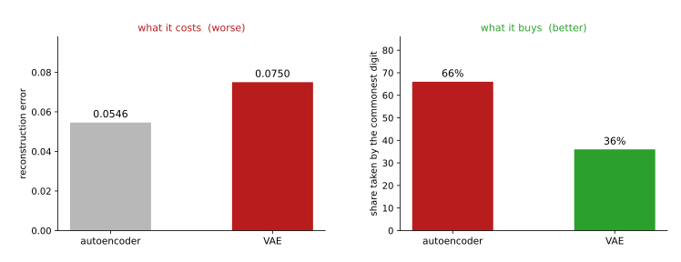
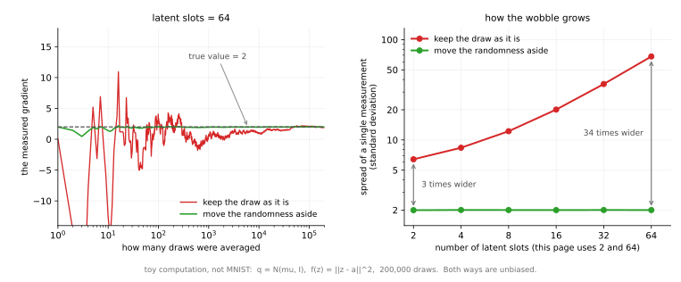
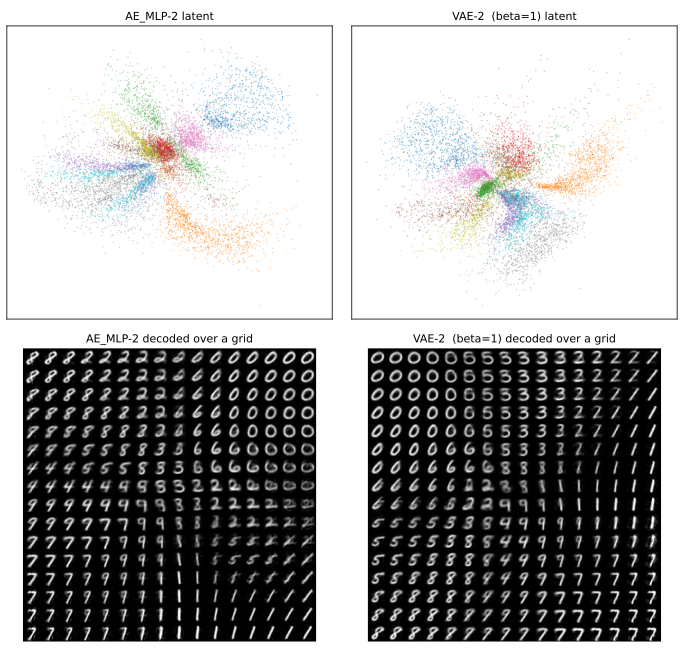
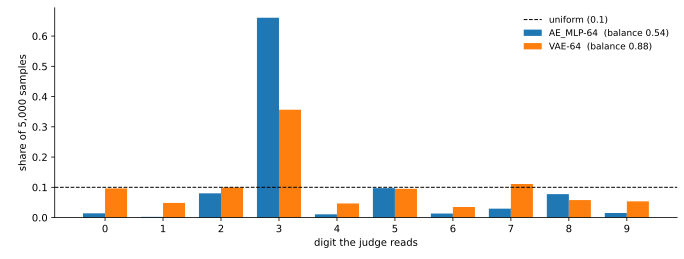

# VAE — 잠재 표현을 사전분포 쪽으로 민다

<div class="leadbox" markdown>

**들어가는 이야기** — 흐릿해졌는데 더 좋아졌다고 말할 수 있는가

이 쪽의 기계를 앞 절의 기계와 나란히 놓으면 **되살리기는 더 못한다.** 수만 보면 뒤로 간 것이다.



왼쪽이 **치른 값**이고 오른쪽이 **산 것**이다. 오른쪽을 세는 법은 이렇다 — 뽑은 그림을 **[3장에서 만들어 둔 분류기](../../ch03/mnist/04_cnn.md)**에게 보여 몇 번이라 읽는지 적어 두고, 가장 많이 나온 하나가 전체에서 차지하는 몫을 센다. 열 가지가 고루 나오면 10% 언저리여야 한다.

오른쪽을 잠시 들여다볼 만하다. 앞 절의 기계에서 5,000장을 뽑으면 그 가운데 **셋에 둘이 같은 숫자**다. 열 가지를 만들라고 했는데 3만 잔뜩 그려 놓는 것이다. 이 쪽의 기계는 그 쏠림을 절반 아래로 푼다.

그러니 「되살리기가 나빠졌다」는 수 하나로 뒤로 갔다고 할 수 없다. 두 기계는 **같은 시험을 치른 것이 아니다.** 앞 절의 기계는 「보여 준 그림을 되살려라」만 배웠고, 이 쪽의 기계는 거기에 「네가 만드는 수들을 정해진 모양으로 모아 두어라」를 하나 더 받았다.

이 쪽을 읽을 때 조심할 것이 그것이다. **수 하나가 나빠졌다는 말과 모델이 나빠졌다는 말은 다르다.** 무엇을 재는 자인지, 그리고 그 자가 우리가 사려던 것을 재고 있는지를 먼저 물어야 한다.

</div>

VAE는 잠재 표현을 점 하나로 내놓지 않는다. **분포**로 내놓는다. 인코더가 평균 $\mu$와 로그 분산 $\log \sigma^2$을 내고, 거기서 뽑은 $z$를 디코딩한다.

수를 세어 두면 헷갈리지 않는다. 잠재 차원이 100이면 인코더가 뱉는 것은 $\mu \in \mathbb{R}^{100}$과 $\log \sigma^2 \in \mathbb{R}^{100}$, 곧 **200개**다. 그렇다고 잠재 차원이 200이 되는 것은 아니다. 그 200개는 $\mathbb{R}^{100}$ 위의 분포 하나를 적는 데 쓰이고, 거기서 뽑은 $z$는 여전히 100차원이다. 오토인코더가 100개를 내놓던 자리에서 VAE는 **같은 자리를 가리키는 분포**를 내놓는다.

$$
z = \mu + \sigma \odot \varepsilon, \qquad \varepsilon \sim N(0, I)
$$

이렇게 적는 까닭은 **그래디언트가 흐르게** 하기 위해서다. $z$를 직접 뽑으면 뽑는 연산에 미분이 정의되지 않지만, 무작위성을 $\varepsilon$으로 밀어내면 $\mu$와 $\sigma$로 그래디언트가 흐른다. 이를 **리파라메리제이션 기법**이라 한다.

---

<div class="storybox" markdown>

**그림으로 보는 AI 1.** 안 되던 일을 되게 한 것이 아니라, 너무 흔들리던 일을 쓸 만하게 했다

바로 위에서 뽑는 자리를 옮겨 적었다. 이 수법이 처음 나온 자리는 디데릭 킹마(Diederik Kingma)와 막스 벨링(Max Welling)이 2013년 끝 무렵에 올린 글이다. 제목에는 VAE라는 이름이 없다. 그 이름은 글 가운데쯤에 **보기 하나**로 나올 뿐이고, 글이 내놓은 것은 모델이 아니라 **어떤 수를 어림잡는 방법**이었다.

위 문단은 "뽑기를 그대로 두면 길이 아예 막힌다"로 읽히기 쉽다. 그런데 그 글은 **다른 길을 알고 있었고, 적어 두었다.** 뽑기를 그대로 둔 채로도 고칠 방향을 알아내는 셈법이 그 전부터 있었다. 두 사람이 그것을 버린 까닭은 안 되기 때문이 아니다. 글에 적힌 말은 "이 어림법은 **아주 크게 흔들려서** 우리 목적에는 쓸 수 없다"였다.

두 방법은 **같은 값을 잰다.** 몸무게 저울 둘을 떠올리면 된다. 하나는 올라설 때마다 1킬로그램쯤 들쭉날쭉하고 다른 하나는 30킬로그램쯤 들쭉날쭉한다. 둘 다 수없이 올라서서 평균을 내면 같은 몸무게가 나온다. 그러나 **한 번 올라서서 쓸 수 있는 것은 앞의 것뿐**이다.



오른쪽 칸이 요점이다. 흔들리는 폭은 **잠재 칸이 몇 개냐에 달려 있다.** 무작위성을 옆으로 민 쪽은 칸이 2개든 64개든 폭이 그대로인데, 뽑기를 그대로 둔 쪽은 칸이 늘수록 넓어져 64개에서 **34배**가 된다. 흔들림은 여러 번 뽑아 평균 내면 줄지만 그 값은 폭의 제곱으로 든다. 34배 넓으면 같은 만큼 믿으려고 **1,155배**를 더 뽑아야 한다는 뜻이다.

이 쪽은 잠재 차원을 2와 64로 두고 잰다. 칸이 2개일 때는 폭이 3배 남짓이라 견딜 만한데, 64개가 되면 34배다. **이 쪽이 쓰는 두 설정 사이에서만도 열 배 넘게 벌어지는 셈이다.**

그러니 이 수법이 산 것은 "막힌 길을 뚫은 것"이 아니라 **"재는 값의 흔들림을 잠재 칸 수와 상관없게 만든 것"**이다.

다만 위 그림이 말해 주지 않는 것이 셋이다. **첫째, 장난감 계산이다** — 흔들리는 쪽으로 이 쪽의 VAE를 실제로 학습해 본 사람은 여기 없고, 그쪽이 얼마나 느릴지는 재어 보아야 안다. **둘째, 흔들림은 줄일 수 있다** — 여러 번 뽑아 평균 내거나 기준값을 빼는 손질이 있고, 실제로 그렇게 쓴다. **셋째, 옆으로 미는 이 수법이 늘 되는 것은 아니다** — 뽑는 값이 0 아니면 1처럼 띄엄띄엄하면 이렇게 고쳐 적을 수 없고, 그런 자리에서는 흔들리는 쪽으로 돌아가야 한다. 이 쪽이 고른 길은 언제나 옳은 길이 아니라 **이 자리에서 더 싼 길**이다.

_확인한 곳 — D. P. Kingma, M. Welling, "Auto-Encoding Variational Bayes", *ICLR 2014* (arXiv:1312.6114). 「아주 크게 흔들려서 우리 목적에는 쓸 수 없다」는 그 글 2.2절의 문장이다(원문 "This gradient estimator exhibits very high variance … and is impractical for our purposes"). 「variational auto-encoder」가 3절 제목에 **보기**로 붙어 있다는 것도 그 글의 짜임이다. 본문에서 「고칠 방향을 알려 주는 수」라 한 것은 그래디언트, 「뽑기를 그대로 둔 채 쓰는 셈법」은 점수함수 추정량(score function estimator, REINFORCE), 「무작위성을 옆으로 미는 일」은 이 쪽의 리파라메리제이션 기법이다. 그 글이 재어 보고한 것은 변분 하한과 주변 로그가능도이고 표본의 품질이 아니므로, 이 쪽의 표는 그 글과 무관한 이 책의 측정이다. **위 그림의 수는 논문의 것도 이 쪽의 것도 아니고 `figures/make_figures.py`가 돌린 장난감 계산에서 나왔다** — 잠재 칸 2개와 64개만 이 쪽이 쓰는 두 값에 맞추었다._

</div>

---

그리고 로스에 항을 하나 더한다.

$$
L = \underbrace{\lVert \hat{x} - x \rVert^2}_{\text{되살리기}} \;+\; \beta \underbrace{D_{\mathrm{KL}}\!\left(N(\mu, \sigma^2) \,\|\, N(0, I)\right)}_{\text{사전분포로 끌어당기기}}
$$

둘째 항이 **잠재 표현마다의 분포를 $N(0, I)$ 쪽으로 민다.** 모든 잠재 표현이 그쪽으로 밀리면 잠재 표현 전체의 분포도 $N(0, I)$에 가까워지고, 그러면 **$N(0, I)$에서 그냥 뽑으면 된다.** [앞 쪽](index.md)이 오토인코더에서 겪은 "어디서 뽑아야 하는가"라는 문제를, 뽑을 자리를 **미리 정해 버리는** 방식으로 없앤다.

```python
"""VAE. 로스에 KL 항을 더해 잠재 표현을 앞분포 쪽으로 민다.

mnist_judge.pt는 5.1절에서 학습해 둔 것을 읽어 쓴다.
구조와 규약은 5.1절 AE_MLP와 같다. 달라지는 것은 로스뿐이다.
"""

import torch
import torch.nn as nn
import torch.nn.functional as F
import torch.optim as optim
from torch.utils.data import DataLoader, TensorDataset
import torchvision
import torchvision.transforms as transforms

SEED, BATCH, LR, EPOCHS = 42, 100, 1e-3, 100
N_SAMPLE = 5000
device = torch.device("mps" if torch.backends.mps.is_available() else "cpu")

tf = transforms.Compose([transforms.ToTensor(),
                         transforms.Normalize((0.1307,), (0.3081,))])
tr_ds = torchvision.datasets.MNIST("./data", train=True, download=True, transform=tf)
te_ds = torchvision.datasets.MNIST("./data", train=False, download=True, transform=tf)


def materialize(ds):
    xs, ys = [], []
    for x, y in DataLoader(ds, batch_size=2000, shuffle=False):
        xs.append(x.flatten(1)); ys.append(y)
    return torch.cat(xs), torch.cat(ys)


Xtr, ytr = materialize(tr_ds)
Xte, yte = materialize(te_ds)


class JudgeCNN(nn.Module):
    def __init__(self):
        super().__init__()
        self.conv1 = nn.Conv2d(1, 32, 3, padding=1)
        self.conv2 = nn.Conv2d(32, 64, 3, padding=1)
        self.pool = nn.MaxPool2d(2, 2); self.dropout = nn.Dropout(0.25)
        self.fc1 = nn.Linear(64 * 7 * 7, 128); self.fc2 = nn.Linear(128, 10)

    def forward(self, x):
        x = self.pool(torch.relu(self.conv1(x)))
        x = self.pool(torch.relu(self.conv2(x)))
        return self.fc2(self.dropout(torch.relu(self.fc1(x.flatten(1)))))


judge = JudgeCNN().to(device)
judge.load_state_dict(torch.load("mnist_judge.pt", weights_only=True))
judge.eval()


@torch.no_grad()
def judge_probs(flat):
    return torch.cat([torch.softmax(
        judge(flat[i:i + 1000].reshape(-1, 1, 28, 28).to(device)), 1).cpu()
        for i in range(0, len(flat), 1000)])


def sample_stats(flat):
    """표본을 심판에 넣어 확신도와 클래스 고름을 잰다.

    고름은 심판이 읽은 클래스 분포의 엔트로피를 균등분포로 나눈 값이다.
    1이면 열 가지가 고르게 나왔고, 0에 가까우면 한 가지로 쏠렸다.
    """
    p = judge_probs(flat)
    conf, pred = p.max(1)
    share = torch.bincount(pred, minlength=10).float()
    share = share / share.sum()
    nz = share[share > 0]
    bal = (-(nz * nz.log()).sum() / torch.tensor(10.0).log()).item()
    return conf.mean().item(), bal, share.max().item()


class VAE(nn.Module):
    """잠재 표현을 점이 아니라 분포로 내놓는다. n_cond>0이면 조건부(cVAE)."""

    def __init__(self, k, n_cond=0):
        super().__init__()
        self.k, self.n_cond = k, n_cond
        self.enc = nn.Sequential(nn.Linear(784 + n_cond, 256), nn.ReLU())
        self.mu = nn.Linear(256, k)
        self.logvar = nn.Linear(256, k)
        self.dec = nn.Sequential(nn.Linear(k + n_cond, 256), nn.ReLU(),
                                 nn.Linear(256, 784))

    def encode(self, x, c=None):
        h = self.enc(x if c is None else torch.cat([x, c], 1))
        return self.mu(h), self.logvar(h)

    def decode(self, z, c=None):
        return self.dec(z if c is None else torch.cat([z, c], 1))

    def forward(self, x, c=None):
        mu, logvar = self.encode(x, c)
        # 리파라메리제이션: 무작위성을 eps로 밀어내어 mu, logvar로 그래디언트가 흐르게 한다
        z = mu + torch.exp(0.5 * logvar) * torch.randn_like(mu)
        return self.decode(z, c), mu, logvar


def onehot(y):
    return F.one_hot(y, 10).float()


def train_vae(k, beta, cond):
    torch.manual_seed(SEED)
    m = VAE(k, 10 if cond else 0).to(device)
    opt = optim.Adam(m.parameters(), lr=LR)
    g = torch.Generator().manual_seed(SEED)
    loader = DataLoader(TensorDataset(Xtr, ytr), batch_size=BATCH,
                        shuffle=True, generator=g)
    for _ in range(EPOCHS):
        m.train()
        for xb, yb in loader:
            xb = xb.to(device)
            c = onehot(yb).to(device) if cond else None
            opt.zero_grad()
            xh, mu, lv = m(xb, c)
            # 화소에 대해 합, 표본에 대해 평균 — 가우스 가능도의 꼴
            rec = F.mse_loss(xh, xb, reduction="sum") / xb.size(0)
            kl = -0.5 * torch.sum(1 + lv - mu.pow(2) - lv.exp()) / xb.size(0)
            (rec + beta * kl).backward()
            opt.step()
    return m.eval()


# === 잠재 차원 2와 64에서 각각 ===================================================
if __name__ == "__main__":
  for k in (2, 64):
    m = train_vae(k, beta=1.0, cond=False)

    with torch.no_grad():
        # 복원은 뽑지 않고 평균을 쓴다
        rec = torch.cat([m.decode(m.encode(Xte[i:i + 1000].to(device))[0]).cpu()
                         for i in range(0, len(Xte), 1000)])
        # 표본은 앞분포 N(0, I)에서 그냥 뽑는다 — 이것이 VAE가 산 것이다
        g = torch.Generator().manual_seed(SEED)
        z = torch.randn(N_SAMPLE, k, generator=g)
        s = torch.cat([m.decode(z[i:i + 1000].to(device)).cpu()
                       for i in range(0, N_SAMPLE, 1000)])

    pred = judge_probs(rec).argmax(1)
    ident = 100.0 * (pred == yte).float().mean()
    conf, bal, _ = sample_stats(s)
    tag = f"vae{k}_beta1.0"
    print(f"  {tag:14s} 복원 {((rec - Xte) ** 2).mean():.5f}  "
          f"정체 {ident:.2f}%  확신도 {conf:.3f}  고름 {bal:.3f}")

    # 5.3절이 이 모델을 읽어, 오토인코더·GAN과 같은 자로 다시 잰다
    torch.save(m.state_dict(), f"mnist_vae{k}_beta1.0.pt")
```

**출력:**

```
  vae2_beta1.0   복원 0.42744  정체 71.28%  확신도 0.793  고름 0.950
  vae64_beta1.0  복원 0.07499  정체 98.06%  확신도 0.769  고름 0.877
```

은닉 레이어 규모와 학습 설정은 5.1절의 AE_MLP와 비슷하다. 다만 VAE는 평균과 로그 분산을 따로 출력하고 잠재 변수를 샘플링하므로 구조와 동작도 달라진다. Adam $10^{-3}$, 배치 100, 100 에포크를 사용하며, 이 페이지는 $\beta=1$을 비교한다.

---

## 1. 잠재 차원 2에서는 VAE가 이기지 못한다

| 잠재 차원 2 | 복원 MSE | 정체 | 표본 확신도 | 표본 클래스 균형도 |
|---|---|---|---|---|
| [AE_MLP-2](../dimreduction/03_ae_mlp.md) | **0.4223** | 70.13% | **0.859** | **0.973** |
| VAE-2 ($\beta = 1$) | 0.4274 | 71.28% | 0.793 | 0.950 |

**네 칸 가운데 셋에서 VAE가 진다.** 복원은 1.2% 나쁘고, 표본 확신도와 클래스 균형도도 조금씩 낮다.

당연한 결과다. 2차원에서는 오토인코더의 잠재 표현이 이미 한 덩어리로 모여 있어 뽑는 데 아무 문제가 없었다. **고칠 것이 없는데 고치는 값만 치른 계산**이다. KL 항은 되살리기를 희생시키는데, 그 희생으로 사는 것이 여기서는 없다.



그림으로도 둘이 크게 다르지 않다. VAE 쪽이 원점 둘레로 조금 더 둥글게 모여 있지만, 둘 다 격자를 훑으면 숫자가 고르게 나온다.

!!! note "교과서 그림에 대하여"
    "오토인코더의 잠재 공간에는 빈 곳이 있고 VAE가 그것을 메운다"는 그림을 흔히 본다. 2차원에서 실제로 재어 보면 **그 차이가 거의 없다**(클래스 균형도 0.973 대 0.950).

    그 그림이 틀렸다기보다, **2차원에서 그릴 수 있는 것과 실제로 문제가 되는 것이 다르다.** 진짜 실패는 그릴 수 없는 차원에서 일어난다.

---

## 2. 잠재 차원 64에서 갈린다

| 잠재 차원 64 | 복원 MSE | 정체 | 표본 확신도 | 표본 클래스 균형도 |
|---|---|---|---|---|
| [AE_MLP-64](../dimreduction/03_ae_mlp.md) | **0.0546** | 98.51% | 0.777 | **0.541** |
| VAE-64 ($\beta = 1$) | 0.0750 | 98.06% | 0.769 | **0.877** |

**확신도는 거의 그대로인데 클래스 균형도가 0.541에서 0.877로 뛴다.**

이것이 이 절의 핵심이다. KL 항이 사는 것은 **표본이 더 숫자다워지는 것**이 아니라 **열 가지를 고루 만들게 되는 것**이다. 낱장으로 보면 두 모델의 표본이 비슷하게 그럴듯하다. 5,000장을 모아 세어 보아야 차이가 드러난다.

### 확신도 0.77은 어느 만큼인가

0.769라는 수만 보아서는 좋은지 나쁜지 알 수 없다. **양 끝을 재어 두면** 눈금이 생긴다.

| 심판에게 무엇을 보였나 | 평균 확신도 | 확신 > 0.9 |
|---|---|---|
| 진짜 시험 데이터 | **0.992** | 97.8% |
| AE_MLP-64 표본 | 0.777 | 41.4% |
| VAE-64 표본 | 0.769 | 39.7% |
| 균등 잡음 | 0.490 | 0.5% |
| 가우스 잡음 | 0.324 | 0.0% |
| 검은 화면 | 0.119 | 0.0% |

두 가지를 알 수 있다.

**첫째, 이 자는 쓸 만하다.** 심판은 진짜 숫자에 0.992를 주고 순수한 잡음에는 0.32~0.49를 준다. 잡음 가운데 0.9를 넘는 것은 0.5%도 되지 않는다. 분류기가 처음 보는 입력에 함부로 확신하는 일이 흔하다는 점을 생각하면(그 이야기는 [43장](../../ch42/index.md)이 다룬다) 이 심판은 뜻밖에 잘 가려낸다.

**둘째, 비슷한 확신도가 같은 표본 품질을 뜻하지는 않는다.** 평균 확신도는 두 모델에서 가까웠지만 형태, 클래스 분포와 클래스 안 다양성은 다를 수 있다. 심판은 이 잡음 예시를 구별했을 뿐, 모든 분포 밖 입력이나 인위적인 표본에 신뢰성 있게 반응한다고 보장하지 않는다.

그러므로 오토인코더의 표본이 못 쓸 것은 아니다. 하나하나는 VAE의 것만큼 그럴듯하다. 문제는 **그 가운데 셋 중 둘이 3이라는 것**이다.



오토인코더 표본은 **3으로 크게 치우친다.** 5,000장 가운데 3,305장이 3으로 읽히고, 1은 11장뿐이다. VAE도 3으로 기울지만(35.6%) 나머지 아홉 가지가 3.5~11%로 살아 있다.

두 모델이 3으로 기우는 원인은 이 결과만으로 확정할 수 없다. 디코더가 전형적인 평균 형태에 치우쳤거나 샘플링 분포가 학습된 잠재 표현과 맞지 않았을 가능성이 있다. 특히 높은 차원의 정규분포 표본은 평균점 자체보다 일정 반지름의 영역에 몰리므로, 평균 언저리가 가장 자주 뽑힌다는 설명은 부정확하다.

---

## 연습문제

<div class="drillbox" markdown>

**연습문제 1.** <span class="diff easy" title="쉬움"></span>
리파라메리제이션 없이 $z \sim N(\mu, \sigma^2)$을 그냥 뽑아 쓰면 무엇이 안 되는가?

</div>

??? success "풀이"
    **그래디언트가 인코더로 흐르지 않는다.**

    `torch.normal(mu, sigma)`는 $\mu$와 $\sigma$를 받아 수를 내놓지만, 그 연산은 뽑기이지 미분할 수 있는 함수가 아니다. 역전파가 $z$까지 와서 멈춘다. 샘플을 통한 경로에서는 인코더로 유효한 그래디언트를 전달하지 못한다. KL 항이 있으면 그 항을 통해 인코더는 여전히 갱신될 수 있다.

    $z = \mu + \sigma \varepsilon$으로 적으면 무작위성이 $\varepsilon$에 몰리고, $\varepsilon$은 학습할 것이 아니므로 그래디언트가 필요 없다. 남은 $\mu$와 $\sigma$에 대한 연산은 덧셈과 곱셈이라 미분이 잘 정의된다.

    **무작위성을 파라메터에서 떼어 내어 입력 쪽으로 밀어내는 것**이 이 요령의 전부다.

---

<div class="drillbox" markdown>

**연습문제 2.** <span class="diff med" title="중간"></span>
잠재 차원 2에서는 VAE가 오토인코더를 이기지 못하고 잠재 차원 64에서는 크게 이긴다. 이 사실만으로 "잠재 차원은 크게 두는 편이 낫다"고 말할 수 있는가?

</div>

??? success "풀이"
    **말할 수 없다.** 잠재 차원을 키우면 VAE의 **상대적** 이득이 커질 뿐, 절대적으로 좋아진다는 뜻이 아니다.

    실제로 두 가지가 함께 일어난다. 잠재 차원이 커지면 되살리기가 좋아지고(0.4274 → 0.0750), 동시에 **샘플링이 어려워진다.** 오토인코더의 클래스 균형도가 0.973에서 0.541로 무너지는 것이 그 증거다. VAE는 그 무너짐을 되돌리는 것이지 없는 이득을 만드는 것이 아니다.

    그리고 [cVAE](03_cvae.md)에서는 잠재 차원이 크면 **조건이 먹지 않는다.** 99.66%에서 73.64%로 떨어진다. 잠재 차원을 키우면 잠재 공간을 다루기가 어려워진다는 이야기가 이 절에서만 두 번 나온다.

    잠재 차원은 **무엇을 하려느냐에 따라** 정할 일이다. 되살리기가 목적이면 크게, 다루기가 목적이면 작게. 하나의 답이 없다.

---

<div class="drillbox" markdown>

**연습문제 3.** <span class="diff hard" title="어려움"></span>
오토인코더의 표본 클래스 균형도는 잠재 차원 2에서 **0.973**인데 잠재 차원 64에서 **0.541**로 주저앉는다. VAE는 0.950에서 0.877로 조금만 내려간다. 그리고 잠재 차원 64의 오토인코더는 **한 클래스가 표본의 66.1%**를 차지한다([개요](index.md)의 표).

왜 **차원이 커질 때만** 이 일이 생기는지 밝혀라. 아래 계산이 도움이 된다 — 표준정규 $N(0, I_d)$에서 뽑은 점의 길이가 전형적인 길이 $\sqrt{d}$의 **절반도 안 될** 확률을 $d$마다 구해 보라.

</div>

??? success "풀이"
    ```python
    from scipy.stats import chi

    for d in (1, 2, 8, 16, 64, 256):
        print(f"d={d:4}  전형적 길이 {d**0.5:6.2f}  "
              f"그 절반 아래일 확률 {chi.cdf(0.5 * d**0.5, df=d):.2e}  "
              f"길이의 상대 스프레드 {chi.std(df=d) / chi.mean(df=d):.3f}")
    ```

    ```
    d=   1  전형적 길이   1.00  그 절반 아래일 확률 3.83e-01  길이의 상대 스프레드 0.756
    d=   2  전형적 길이   1.41  그 절반 아래일 확률 2.21e-01  길이의 상대 스프레드 0.523
    d=   8  전형적 길이   2.83  그 절반 아래일 확률 1.90e-02  길이의 상대 스프레드 0.254
    d=  16  전형적 길이   4.00  그 절반 아래일 확률 1.10e-03  길이의 상대 스프레드 0.178
    d=  64  전형적 길이   8.00  그 절반 아래일 확률 1.33e-10  길이의 상대 스프레드 0.089
    d= 256  전형적 길이  16.00  그 절반 아래일 확률 1.99e-37  길이의 상대 스프레드 0.044
    ```

    **차원이 커지면 뽑은 점이 얇은 껍질에 몰린다.** 2차원에서는 다섯 번에 한 번쯤 안쪽에 떨어지고 길이의 스프레드도 52%나 되어, 뽑은 점들이 공간을 두루 덮는다. 64차원에서는 길이가 8 언저리에서 9%밖에 흔들리지 않고, 안쪽에 떨어질 확률이 $10^{-10}$이다. 곧 **중심도 바깥도 아니고 오직 반지름 8의 껍질**에서만 점이 나온다.

    여기에 오토인코더의 사정을 겹치면 답이 나온다. 오토인코더의 로스에는 **잠재 표현을 어떤 모양으로 퍼뜨리라는 요구가 없다.** 그래서 잠재 표현은 데이터가 놓인 대로, 곧 굽고 치우친 얇은 덩어리로 놓인다. 뽑을 때는 그 모양을 모르니 차원별 평균과 표준편차만 맞춰 뽑는데, 그렇게 뽑은 점은 **위의 껍질 위에** 떨어진다.

    - **2차원:** 이 모델에서는 맞춘 정규분포에서 뽑은 표본의 클래스 균형도가 높았다. 평면에서도 데이터 영역과 샘플링 분포는 크게 어긋날 수 있다.
    - **64차원:** 각 좌표의 평균·표준편차만 맞춘 분포는 실제 잠재 표현의 상관과 구조를 놓칠 수 있다. 다만 껍질 계산만으로 데이터 영역을 완전히 비껴갔다고 증명할 수는 없다.

    KL 항은 조건부 잠재 분포를 사전분포에 가깝게 유도하여 학습과 생성 시 분포의 차이를 줄이는 역할을 한다. 사전분포와 전체 잠재 표현 분포가 정확히 같아지는 것은 아니며, 이 결과의 균형도 개선을 껍질 현상 하나로 설명할 수는 없다.

    !!! note "이 계산은 모델이 아니라 수학이다"
        위 표는 MNIST를 재서 얻은 것이 아니라 $\chi$ 분포에서 바로 나온 값이다. 그래서 "오토인코더의 잠재 표현이 정말 껍질을 비껴가는가"는 이 표가 말해 주지 않는다 — 그것은 실제 잠재 표현을 꺼내 길이를 재어 보아야 한다. 이 표가 말해 주는 것은 **차원이 커지면 그런 비껴감이 생길 여지가 폭발적으로 커진다**는 것뿐이다.

        본문이 2차원 그림을 두고 "그릴 수 있는 것과 실제로 문제가 되는 것이 다르다"고 적은 까닭이 여기에 있다.

