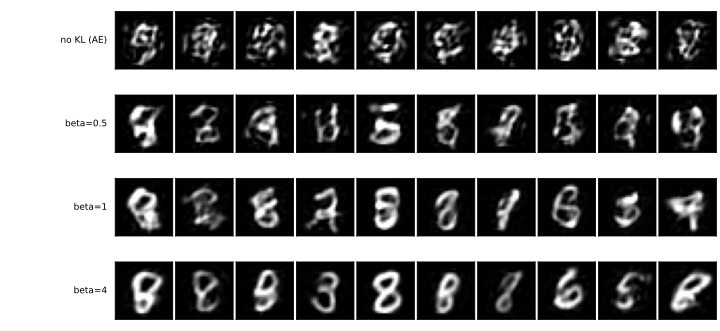

# β-VAE — 되살리기와 분포 커버리지를 맞바꾸는 손잡이

[VAE](01_vae.md)의 로스에 이미 $\beta$가 있었다.

$$
L = \lVert \hat{x} - x \rVert^2 \;+\; \beta \, D_{\mathrm{KL}}\!\left(N(\mu, \sigma^2) \,\|\, N(0, I)\right)
$$

앞 쪽은 $\beta = 1$로 두었다. 이 쪽은 그 값을 돌려 본다.

---

## 1. 훑어 보면 두 열이 나란히 단조롭다

잠재 차원 64에서 잰 결과다. 맨 윗줄은 KL 항이 아예 없는 것, 곧 [5.1절의 오토인코더](../dimreduction/03_ae_mlp.md)다.

```python
"""beta-VAE. KL 항의 무게를 돌려 가며 되살리기와 덮기를 맞바꾼다.

mnist_judge.pt는 5.1절에서 학습해 둔 것을 읽어 쓴다.
구조와 규약은 5.1절 AE_MLP와 같다. 달라지는 것은 로스뿐이다.
"""

import torch
import torch.nn as nn
import torch.nn.functional as F
import torch.optim as optim
from torch.utils.data import DataLoader, TensorDataset
import torchvision
import torchvision.transforms as transforms

SEED, BATCH, LR, EPOCHS = 42, 100, 1e-3, 100
N_SAMPLE = 5000
device = torch.device("mps" if torch.backends.mps.is_available() else "cpu")

tf = transforms.Compose([transforms.ToTensor(),
                         transforms.Normalize((0.1307,), (0.3081,))])
tr_ds = torchvision.datasets.MNIST("./data", train=True, download=True, transform=tf)
te_ds = torchvision.datasets.MNIST("./data", train=False, download=True, transform=tf)


def materialize(ds):
    xs, ys = [], []
    for x, y in DataLoader(ds, batch_size=2000, shuffle=False):
        xs.append(x.flatten(1)); ys.append(y)
    return torch.cat(xs), torch.cat(ys)


Xtr, ytr = materialize(tr_ds)
Xte, yte = materialize(te_ds)


class JudgeCNN(nn.Module):
    def __init__(self):
        super().__init__()
        self.conv1 = nn.Conv2d(1, 32, 3, padding=1)
        self.conv2 = nn.Conv2d(32, 64, 3, padding=1)
        self.pool = nn.MaxPool2d(2, 2); self.dropout = nn.Dropout(0.25)
        self.fc1 = nn.Linear(64 * 7 * 7, 128); self.fc2 = nn.Linear(128, 10)

    def forward(self, x):
        x = self.pool(torch.relu(self.conv1(x)))
        x = self.pool(torch.relu(self.conv2(x)))
        return self.fc2(self.dropout(torch.relu(self.fc1(x.flatten(1)))))


judge = JudgeCNN().to(device)
judge.load_state_dict(torch.load("mnist_judge.pt", weights_only=True))
judge.eval()


@torch.no_grad()
def judge_probs(flat):
    return torch.cat([torch.softmax(
        judge(flat[i:i + 1000].reshape(-1, 1, 28, 28).to(device)), 1).cpu()
        for i in range(0, len(flat), 1000)])


def sample_stats(flat):
    """표본을 심판에 넣어 확신도와 클래스 고름을 잰다.

    고름은 심판이 읽은 클래스 분포의 엔트로피를 균등분포로 나눈 값이다.
    1이면 열 가지가 고르게 나왔고, 0에 가까우면 한 가지로 쏠렸다.
    """
    p = judge_probs(flat)
    conf, pred = p.max(1)
    share = torch.bincount(pred, minlength=10).float()
    share = share / share.sum()
    nz = share[share > 0]
    bal = (-(nz * nz.log()).sum() / torch.tensor(10.0).log()).item()
    return conf.mean().item(), bal, share.max().item()


def to01(x):
    """정규화를 풀어 화소를 [0, 1]로 되돌린다."""
    return (x * 0.3081 + 0.1307).clamp(0, 1)


def within_class_var(imgs01, group, min_n=20):
    """같은 클래스로 묶인 것들의 화소 분산을, 무리 크기로 가중해 평균낸다."""
    vs, ws = [], []
    for d in range(10):
        g = imgs01[group == d]
        if len(g) < min_n:
            continue
        vs.append(g.flatten(1).var(0).mean().item()); ws.append(len(g))
    return sum(v * w for v, w in zip(vs, ws)) / sum(ws) if vs else 0.0


REAL_VAR = within_class_var(to01(Xte), yte)        # 진짜 MNIST를 1로 둔다


class VAE(nn.Module):
    """잠재 표현을 점이 아니라 분포로 내놓는다. n_cond>0이면 조건부(cVAE)."""

    def __init__(self, k, n_cond=0):
        super().__init__()
        self.k, self.n_cond = k, n_cond
        self.enc = nn.Sequential(nn.Linear(784 + n_cond, 256), nn.ReLU())
        self.mu = nn.Linear(256, k)
        self.logvar = nn.Linear(256, k)
        self.dec = nn.Sequential(nn.Linear(k + n_cond, 256), nn.ReLU(),
                                 nn.Linear(256, 784))

    def encode(self, x, c=None):
        h = self.enc(x if c is None else torch.cat([x, c], 1))
        return self.mu(h), self.logvar(h)

    def decode(self, z, c=None):
        return self.dec(z if c is None else torch.cat([z, c], 1))

    def forward(self, x, c=None):
        mu, logvar = self.encode(x, c)
        # 리파라메리제이션: 무작위성을 eps로 밀어내어 mu, logvar로 그래디언트가 흐르게 한다
        z = mu + torch.exp(0.5 * logvar) * torch.randn_like(mu)
        return self.decode(z, c), mu, logvar


def onehot(y):
    return F.one_hot(y, 10).float()


def train_vae(k, beta, cond):
    torch.manual_seed(SEED)
    m = VAE(k, 10 if cond else 0).to(device)
    opt = optim.Adam(m.parameters(), lr=LR)
    g = torch.Generator().manual_seed(SEED)
    loader = DataLoader(TensorDataset(Xtr, ytr), batch_size=BATCH,
                        shuffle=True, generator=g)
    for _ in range(EPOCHS):
        m.train()
        for xb, yb in loader:
            xb = xb.to(device)
            c = onehot(yb).to(device) if cond else None
            opt.zero_grad()
            xh, mu, lv = m(xb, c)
            # 화소에 대해 합, 표본에 대해 평균 — 가우스 가능도의 꼴
            rec = F.mse_loss(xh, xb, reduction="sum") / xb.size(0)
            kl = -0.5 * torch.sum(1 + lv - mu.pow(2) - lv.exp()) / xb.size(0)
            (rec + beta * kl).backward()
            opt.step()
    return m.eval()


if __name__ == "__main__":
  # === 잠재 차원 64에서 beta 만 바꾸어 가며 ========================================
  for beta in (0.5, 1.0, 4.0):
      m = train_vae(64, beta=beta, cond=False)

      with torch.no_grad():
          rec = torch.cat([m.decode(m.encode(Xte[i:i + 1000].to(device))[0]).cpu()
                           for i in range(0, len(Xte), 1000)])
          g = torch.Generator().manual_seed(SEED)
          z = torch.randn(N_SAMPLE, 64, generator=g)
          s = torch.cat([m.decode(z[i:i + 1000].to(device)).cpu()
                         for i in range(0, N_SAMPLE, 1000)])

      pred = judge_probs(rec).argmax(1)
      ident = 100.0 * (pred == yte).float().mean()
      conf, bal, _ = sample_stats(s)
      # 3절이 "확인해야 한다"고 적어 둔 셋째 자
      div = within_class_var(to01(s), judge_probs(s).argmax(1)) / REAL_VAR
      print(f"  vae64_beta{beta}  복원 {((rec - Xte) ** 2).mean():.5f}  "
            f"정체 {ident:.2f}%  확신도 {conf:.3f}  고름 {bal:.3f}  "
            f"클래스 안 다양함 {div:.3f}")
```

**출력:**

```
  vae64_beta0.5  복원 0.05773  정체 98.25%  확신도 0.774  고름 0.784  클래스 안 다양함 0.647
  vae64_beta1.0  복원 0.07499  정체 98.06%  확신도 0.769  고름 0.877  클래스 안 다양함 0.631
  vae64_beta4.0  복원 0.13512  정체 95.52%  확신도 0.794  고름 0.950  클래스 안 다양함 0.575
```

| 잠재 차원 64 | 복원 MSE | 정체 | 확신도 | 클래스 균형도 |
|---|---|---|---|---|
| KL 없음 ($\beta = 0$) | **0.0546** | 98.51% | 0.777 | 0.541 |
| $\beta = 0.5$ | 0.0577 | 98.25% | 0.774 | 0.784 |
| $\beta = 1.0$ | 0.0750 | 98.06% | 0.769 | 0.877 |
| $\beta = 4.0$ | 0.1351 | 95.52% | 0.794 | **0.950** |

**복원은 꾸준히 나빠지고 분포 커버리지는 꾸준히 좋아진다.** $\beta$는 그 사이를 조절하는 손잡이다.

그리고 **확신도는 어느 줄에서도 크게 움직이지 않는다**(0.769~0.794). 손잡이가 건드리는 것은 "얼마나 숫자다운가"가 아니라 "몇 가지를 만드는가"다.

---



줄마다 열 장씩, 모두 $N(0, I)$에서 뽑아 디코딩한 것이다. 맨 윗줄은 KL 항이 없는 쪽, 곧 [5.1절의 오토인코더](../dimreduction/03_ae_mlp.md)이며 [그 절의 마지막 쪽](../dimreduction/06_sampling.md)이 보인 그대로 **숫자가 아니다.**

$\beta$가 커질수록 숫자 꼴이 또렷해진다. 그리고 **맨 아랫줄을 보라.** $\beta = 4$의 표본은 복원이 가장 나쁜 설정에서 나온 것인데도 가장 깨끗하다 — 획이 굵고 둥글며, 하나같이 교과서에 실릴 법한 모양이다. 3절이 그 "하나같이"를 따진다.

---

## 2. 주고받는 비율이 고르지 않다

| | 클래스 균형도가 오른 몫 | 복원이 나빠진 몫 |
|---|---|---|
| $\beta{=}0$ → $\beta{=}0.5$ | +0.243 | **+5.7%** |
| $\beta{=}0.5$ → $\beta{=}1.0$ | +0.093 | +30% |
| $\beta{=}1.0$ → $\beta{=}4.0$ | +0.073 | +80% |

**첫 스텝이 가장 싸다.** 되살리기를 5.7%만 내주고 분포 커버리지의 대부분(0.541 → 0.784)을 산다. 그 뒤로는 같은 만큼을 사는 데 점점 비싸진다.

이 네 설정에서는 $\beta=0.5$에서 비교적 작은 복원 로스로 클래스 균형도가 개선되었다. 그러나 한 번의 비교로 최적값을 정할 수는 없다. 복원과 표본 품질의 목적, 로스 항의 합산·평균 방식까지 함께 고려해야 한다.

---

## 3. 이 자가 못 보는 것

$\beta = 4$ 줄을 다시 보라. 복원은 가장 나쁜데 **확신도는 가장 높다**(0.794). 이상해 보이지만 까닭이 있다. KL이 세지면 디코더가 매끄럽고 **전형적인** 숫자를 내놓게 되고, 심판은 별난 진짜 3보다 반듯한 3에 더 확신한다.

여기서 이 절이 쓰는 자의 한계가 드러난다.

!!! warning "클래스 균형도는 클래스 **사이**의 다양함만 잰다"
    숫자 열 가지를 딱 한 가지 모양씩만, 늘 똑같이 그려 내는 모델을 생각해 보자. 확신도는 1에 가깝고 클래스 균형도도 1이 된다. **이 절의 자로는 만점이지만 생성 모델로서는 쓸모가 없다.** 같은 3만 5,000번 그리는 것과 다양한 3을 그리는 것을 구별하지 못한다.

    [5.3절](../generative/index.md)이 이 빈틈을 메우려 자를 하나 더 만든다. 같은 클래스로 읽힌 표본들 사이의 화소 분산을 진짜 데이터의 그것으로 나눈 값이다. 그 자로 재면 VAE($\beta{=}1$)는 0.628, 곧 **진짜 데이터의 클래스 내 화소 분산의 약 63%를 가진다. 이것이 모든 의미의 다양성이 63%라는 뜻은 아니다.**

### 그 자로 네 줄을 모두 재면

위의 상자는 $\beta = 4$가 단조로워지고 있을지 모른다고만 적고 넘어갔다. 코드가 그 자를 함께 찍게 하여 네 설정을 모두 재었다. KL 없음 줄은 [5.1절의 오토인코더](../dimreduction/03_ae_mlp.md)를 같은 자로 잰 0.642다.

| | 클래스 균형도 | 클래스 안 다양함 |
|---|---|---|
| KL 없음 | 0.541 | 0.642 |
| $\beta = 0.5$ | 0.784 | **0.647** |
| $\beta = 1.0$ | 0.877 | 0.631 |
| $\beta = 4.0$ | 0.950 | **0.575** |

**첫 스텝은 여기서도 공짜다.** $\beta$를 0에서 0.5로 올리면 클래스 균형도가 0.541에서 0.784로 뛰는데 클래스 안 다양함은 0.642에서 0.647로 **오히려 조금 올라간다.** 2절이 "첫 스텝이 가장 싸다"고 한 것이 **셋째 자에서도** 그렇다.

**$\beta = 4$는 다르다.** 거기서는 클래스 균형도를 0.073 더 사는 값으로 클래스 안 다양함을 0.631에서 0.575로 **0.056 내준다.** 곧 상자가 걱정한 일이 실제로 일어나고 있다 — 열 가지를 더 고르게 만들되 **같은 숫자는 점점 같은 모양으로** 만든다. 1절 그림의 맨 아랫줄이 유난히 매끄럽고 둥글었던 것이 그것이다.

!!! note "0.056이 흔들림보다 큰가"
    이 자의 흔들림을 따로 재지는 않았다. 대신 **다른 실행과 맞대어 볼 수 있다.** [5.3절](../generative/index.md)이 잘린 규약으로 따로 학습해 보고한 값이 오토인코더 0.640, VAE($\beta{=}1$) 0.628인데, 위에서 잰 값은 0.642와 0.631이다. 규약도 실행도 다른데 **0.002와 0.003**밖에 벌어지지 않는다.

    이 자는 그만큼 안정적이고, $\beta = 1$에서 $\beta = 4$로 가며 잃는 0.056은 그보다 **스무 배 가까이** 크다. 다만 두 실행을 맞댄 어림이지 스프레드를 잰 것은 아니므로, 더 다투려면 시드를 여러 개 돌려야 한다.
