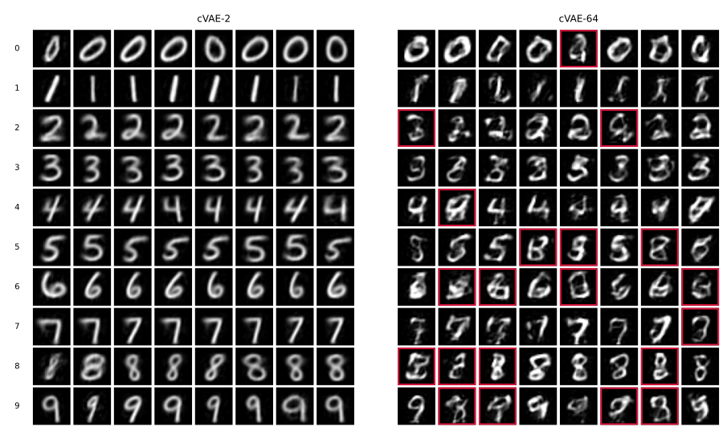
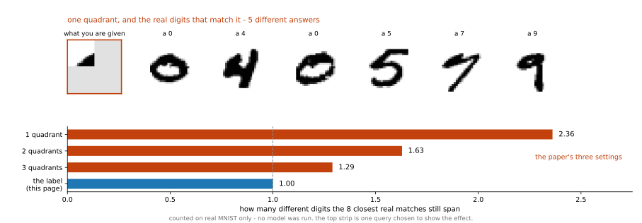
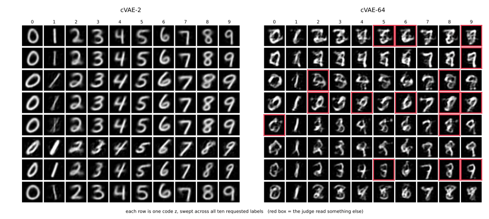

# cVAE — 원하는 숫자를 만들기

<div class="leadbox" markdown>

**들어가는 이야기** — 7을 달라고 했는데 큰 기계가 더 말을 안 듣는다

여기까지의 기계는 숫자를 만들 수는 있어도 **어느 숫자를 만들지 고를 수가 없었다.** 뽑아 보고 나온 것을 받아들일 뿐이다. 이 쪽은 「7을 그려라」라고 시킬 수 있게 고친다. 고치는 법은 뜻밖에 간단해서, 학습할 때 그림과 함께 **정답 이름표를 같이 넣어 주면** 된다.

잘 된다. 수를 2개만 쓰는 작은 기계에게 7을 달라고 하면 **99.66%**가 7로 나온다.

그런데 수를 64개 쓰는 **큰 기계는 73.64%**다. 넷에 하나는 딴 숫자를 내놓는다. 기계를 키웠는데 말을 더 안 듣는다.

보통은 큰 쪽이 유리하니 이상하게 들린다. 그리고 「큰 기계가 모자라서」도 아니다 — 이 쪽이 재어 보면 그 큰 기계는 제대로 된 수를 넣어 주기만 하면 98%가 넘게 말을 듣는다.

그러니 물음은 **「누가 말을 안 듣는가」**가 된다. 이름표인가, 넣어 준 수인가, 아니면 둘이 서로 다투고 있는가. 이 쪽은 그 다툼을 수로 재어 누가 이기는지까지 본다.

</div>

[VAE](01_vae.md)는 뽑으면 **무엇이 나올지 모르는** 모델이었다. 라벨을 함께 넣으면 고를 수 있게 된다. 인코더와 디코더 모두에 원-핫 라벨을 이어 붙인다.

```python
"""cVAE. 라벨을 함께 넣어 원하는 숫자를 만든다.

mnist_judge.pt는 5.1절에서 학습해 둔 것을 읽어 쓴다.
구조와 규약은 5.1절 AE_MLP와 같다. 달라지는 것은 로스뿐이다.
"""

import torch
import torch.nn as nn
import torch.nn.functional as F
import torch.optim as optim
from torch.utils.data import DataLoader, TensorDataset
import torchvision
import torchvision.transforms as transforms

SEED, BATCH, LR, EPOCHS = 42, 100, 1e-3, 100
N_SAMPLE = 5000
device = torch.device("mps" if torch.backends.mps.is_available() else "cpu")

tf = transforms.Compose([transforms.ToTensor(),
                         transforms.Normalize((0.1307,), (0.3081,))])
tr_ds = torchvision.datasets.MNIST("./data", train=True, download=True, transform=tf)
te_ds = torchvision.datasets.MNIST("./data", train=False, download=True, transform=tf)


def materialize(ds):
    xs, ys = [], []
    for x, y in DataLoader(ds, batch_size=2000, shuffle=False):
        xs.append(x.flatten(1)); ys.append(y)
    return torch.cat(xs), torch.cat(ys)


Xtr, ytr = materialize(tr_ds)
Xte, yte = materialize(te_ds)


class JudgeCNN(nn.Module):
    def __init__(self):
        super().__init__()
        self.conv1 = nn.Conv2d(1, 32, 3, padding=1)
        self.conv2 = nn.Conv2d(32, 64, 3, padding=1)
        self.pool = nn.MaxPool2d(2, 2); self.dropout = nn.Dropout(0.25)
        self.fc1 = nn.Linear(64 * 7 * 7, 128); self.fc2 = nn.Linear(128, 10)

    def forward(self, x):
        x = self.pool(torch.relu(self.conv1(x)))
        x = self.pool(torch.relu(self.conv2(x)))
        return self.fc2(self.dropout(torch.relu(self.fc1(x.flatten(1)))))


judge = JudgeCNN().to(device)
judge.load_state_dict(torch.load("mnist_judge.pt", weights_only=True))
judge.eval()


@torch.no_grad()
def judge_probs(flat):
    return torch.cat([torch.softmax(
        judge(flat[i:i + 1000].reshape(-1, 1, 28, 28).to(device)), 1).cpu()
        for i in range(0, len(flat), 1000)])


def sample_stats(flat):
    """표본을 심판에 넣어 확신도와 클래스 고름을 잰다.

    고름은 심판이 읽은 클래스 분포의 엔트로피를 균등분포로 나눈 값이다.
    1이면 열 가지가 고르게 나왔고, 0에 가까우면 한 가지로 쏠렸다.
    """
    p = judge_probs(flat)
    conf, pred = p.max(1)
    share = torch.bincount(pred, minlength=10).float()
    share = share / share.sum()
    nz = share[share > 0]
    bal = (-(nz * nz.log()).sum() / torch.tensor(10.0).log()).item()
    return conf.mean().item(), bal, share.max().item()


def to01(x):
    """정규화를 풀어 화소를 [0, 1]로 되돌린다."""
    return (x * 0.3081 + 0.1307).clamp(0, 1)


def within_class_var(imgs01, group, min_n=20):
    """같은 클래스로 묶인 것들의 화소 분산을, 무리 크기로 가중해 평균낸다."""
    vs, ws = [], []
    for d in range(10):
        g = imgs01[group == d]
        if len(g) < min_n:
            continue
        vs.append(g.flatten(1).var(0).mean().item()); ws.append(len(g))
    return sum(v * w for v, w in zip(vs, ws)) / sum(ws) if vs else 0.0


REAL_VAR = within_class_var(to01(Xte), yte)        # 진짜 MNIST를 1로 둔다


class VAE(nn.Module):
    """잠재 표현을 점이 아니라 분포로 내놓는다. n_cond>0이면 조건부(cVAE)."""

    def __init__(self, k, n_cond=0):
        super().__init__()
        self.k, self.n_cond = k, n_cond
        self.enc = nn.Sequential(nn.Linear(784 + n_cond, 256), nn.ReLU())
        self.mu = nn.Linear(256, k)
        self.logvar = nn.Linear(256, k)
        self.dec = nn.Sequential(nn.Linear(k + n_cond, 256), nn.ReLU(),
                                 nn.Linear(256, 784))

    def encode(self, x, c=None):
        h = self.enc(x if c is None else torch.cat([x, c], 1))
        return self.mu(h), self.logvar(h)

    def decode(self, z, c=None):
        return self.dec(z if c is None else torch.cat([z, c], 1))

    def forward(self, x, c=None):
        mu, logvar = self.encode(x, c)
        # 리파라메리제이션: 무작위성을 eps로 밀어내어 mu, logvar로 그래디언트가 흐르게 한다
        z = mu + torch.exp(0.5 * logvar) * torch.randn_like(mu)
        return self.decode(z, c), mu, logvar


def onehot(y):
    return F.one_hot(y, 10).float()


def train_vae(k, beta, cond):
    torch.manual_seed(SEED)
    m = VAE(k, 10 if cond else 0).to(device)
    opt = optim.Adam(m.parameters(), lr=LR)
    g = torch.Generator().manual_seed(SEED)
    loader = DataLoader(TensorDataset(Xtr, ytr), batch_size=BATCH,
                        shuffle=True, generator=g)
    for _ in range(EPOCHS):
        m.train()
        for xb, yb in loader:
            xb = xb.to(device)
            c = onehot(yb).to(device) if cond else None
            opt.zero_grad()
            xh, mu, lv = m(xb, c)
            # 화소에 대해 합, 표본에 대해 평균 — 가우스 가능도의 꼴
            rec = F.mse_loss(xh, xb, reduction="sum") / xb.size(0)
            kl = -0.5 * torch.sum(1 + lv - mu.pow(2) - lv.exp()) / xb.size(0)
            (rec + beta * kl).backward()
            opt.step()
    return m.eval()


if __name__ == "__main__":
  # === 라벨을 인코더와 디코더 양쪽에 넣는다 ===================================
  models = {}
  for k in (2, 64):
      m = train_vae(k, beta=1.0, cond=True)
      models[k] = m                      # 4절이 이 둘을 그대로 다시 쓴다

      with torch.no_grad():
          # 복원: 진짜 라벨을 함께 준다 (그래서 정체가 부풀려진다)
          rec = torch.cat([
              m.decode(m.encode(Xte[i:i + 1000].to(device),
                                onehot(yte[i:i + 1000]).to(device))[0],
                       onehot(yte[i:i + 1000]).to(device)).cpu()
              for i in range(0, len(Xte), 1000)])

          # 만들기: 열 가지를 고루 요청하고, 그대로 나왔는지 심판에게 묻는다
          g = torch.Generator().manual_seed(SEED)
          z = torch.randn(N_SAMPLE, k, generator=g)
          want = torch.arange(N_SAMPLE) % 10
          c = onehot(want)
          s = torch.cat([m.decode(z[i:i + 1000].to(device),
                                  c[i:i + 1000].to(device)).cpu()
                         for i in range(0, N_SAMPLE, 1000)])

      got = judge_probs(s).argmax(1)
      cond_acc = 100.0 * (got == want).float().mean()
      # 클래스 안 다양함 — 3절이 "확인해야 한다"고 적어 둔 자다
      div = within_class_var(to01(s), got) / REAL_VAR
      # 정체와 고름도 함께 찍는다. 5절이 이 두 수를 읽지 말라고 말하기 위해서다
      ident = 100.0 * (judge_probs(rec).argmax(1) == yte).float().mean()
      conf, bal, _ = sample_stats(s)
      tag = f"cvae{k}"
      # 확신도도 찍는다. 절 첫 쪽의 표가 이 값을 인용하므로, 어느 쪽에서도
      # 찍지 않으면 읽는 이가 그 수를 다시 얻을 길이 없다
      print(f"  {tag:7s} 복원 {((rec - Xte) ** 2).mean():.5f}  "
            f"조건 정확도 {cond_acc:.2f}%  정체 {ident:.2f}%  "
            f"확신도 {conf:.3f}  고름 {bal:.3f}  클래스 안 다양함 {div:.3f}")
```

**출력:**

```
  cvae2   복원 0.34787  조건 정확도 99.66%  정체 99.96%  확신도 0.986  고름 1.000  클래스 안 다양함 0.380
  cvae64  복원 0.07618  조건 정확도 73.64%  정체 98.79%  확신도 0.861  고름 0.964  클래스 안 다양함 0.538
```

만들 때는 원하는 숫자의 원-핫과 $z \sim N(0, I)$을 함께 넣는다. 그리고 **정말 그 숫자가 나왔는지 심판에게 물으면** 조건이 먹혔는지를 수로 알 수 있다. 생성 모델에 정확도를 매길 수 있는 드문 자리이며, 책이 [3장](../../ch03/mnist/04_cnn.md)에서 분류기를 만들어 두었기에 가능하다.

확신도도 함께 찍는다. 잠재 차원 64에서 **0.861**인데, 같은 규약으로 잰 [VAE-64](01_vae.md)의 0.769보다 뚜렷이 높다. 라벨을 함께 받으니 디코더가 "무엇을 그릴지"를 더듬을 일이 없어, 더 전형적인 숫자를 내놓는 쪽으로 기운다. [개요](index.md)의 표가 인용하는 값이 이것이다.

---

## 1. 만든 그림

줄마다 한 숫자씩, 0부터 9까지 여덟 장씩 요청해 만든 것이다. **심판이 요청과 다르게 읽은 칸에는 테두리를 둘렀다.**



**왼쪽은 여든 칸이 모두 맞다.** 7을 달라면 7이 나온다. 조건 정확도 99.66%가 그림으로는 이렇게 보인다.

**오른쪽은 스무 칸이 틀렸다**(여든 칸 가운데 60칸만 맞으니 75%이고, 5,000장으로 재면 73.64%다). 5와 6과 8과 9의 줄이 특히 어지럽다.

그런데 **왼쪽을 한 줄씩 따라 읽어 보라.** 0 여덟 개가 서로 거의 같고, 1 여덟 개도 거의 같다. 말은 잘 듣는데 **늘 같은 것을 그린다.**

---

## 2. 잠재 차원이 클수록 조건이 덜 먹힌다

| | 복원 MSE | 조건 정확도 | 정체 | 클래스 균형도 |
|---|---|---|---|---|
| cVAE-2 | **0.3479** | **99.66%** | 99.96% | 1.000 |
| cVAE-64 | 0.0762 | **73.64%** | 98.79% | 0.964 |

오른쪽 두 칸은 눈이 먼저 가는 자리인데 **직접 비교에 주의할 수치**다. 까닭은 5절에 적는다. 여기서 볼 것은 왼쪽 두 칸뿐이다.

99.66%에서 73.64%로 떨어진다. 잠재 차원을 키우면 되살리기는 좋아지는데 **말을 듣지 않는다.**

---

## 3. 복원 쪽 수가 까닭을 말해 준다

같은 잠재 차원의 조건 없는 [VAE](01_vae.md)와 비교하여 보자.

| 잠재 표현 | VAE 복원 | cVAE 복원 | 라벨이 도운 몫 |
|---|---|---|---|
| 2 | 0.4274 | **0.3479** | **19% 좋아짐** |
| 64 | 0.0750 | 0.0762 | 없음 |

**잠재 차원 2에서는 라벨을 제공한 모델의 복원오차가 더 낮았다.** 라벨이 종류 정보를 제공해 잠재 표현이 모양을 담는 데 더 쓰일 수 있다. 그러나 종류와 모양이 완전히 분리되었다는 것은 별도 검증이 필요한 가설이다.

**잠재 차원 64에서는 라벨 제공에 따른 복원 개선이 관측되지 않았다.** 디코더가 잠재 변수의 종류 정보를 더 이용했을 가능성이 있지만, 잠재 분포의 불일치와 최적화 문제도 원인일 수 있다.

**두 수가 같은 것을 가리킨다.** 라벨이 되살리기를 돕지 않는 자리에서 조건도 먹지 않는다. 서로 다른 두 측정이 하나의 설명으로 모인다는 점이 이 결과를 믿을 만하게 만든다.

그리고 [VAE 쪽](01_vae.md)에서 본 것과 같은 이야기다. 잠재 차원을 키우면 잠재 공간을 **다루기가 어려워진다.** 샘플링도 어려워지고 조건도 먹지 않는다.

### 말을 잘 듣는 쪽이 값을 치른다

1절의 그림에서 왼쪽 줄들이 서로 닮아 보였던 것은 눈의 착각이 아니다. 코드가 함께 찍는 **클래스 안 다양함**이 그것을 수로 말한다. 진짜 MNIST의 클래스 안 화소 분산을 1로 두고 잰 값이다.

| | 조건 정확도 | 클래스 안 다양함 |
|---|---|---|
| cVAE-2 | **99.66%** | **0.380** |
| cVAE-64 | 73.64% | 0.538 |

**말을 가장 잘 듣는 모델이 가장 단조롭다.** cVAE-2는 여든 칸을 다 맞히는 대신 같은 숫자를 늘 비슷한 모양으로 그린다. 진짜 손글씨가 가진 흔들림의 **38%**밖에 내지 못한다.

견줄 자리가 있다. [5.3절](../generative/index.md)이 같은 자로 잰 표에서 조건 없는 VAE-64가 0.628이고 GAN이 0.953, DCGAN이 1.085다. 곧 라벨을 받아 쥔 쪽이 **조건 없는 VAE보다도 단조롭다.** (다른 실행에서 잰 값들이므로 소수점 아래 한 자리까지 다투지는 말 것.)

까닭을 짐작할 수 있다. 숫자의 종류를 라벨이 알려 주면, 잠재 변수 $z$가 나머지 — 획의 기울기와 굵기 — 만 담으면 된다. 잠재 차원이 2일 때 그 나머지를 담을 자리가 두 개뿐이니 담기지 않은 것은 **디코더가 평균으로 메운다.** 그래서 말은 잘 듣고 모양은 평균에 가깝다.

**조건을 건다는 것은 공짜가 아니다.** 얻는 것은 "무엇을 그릴지 고를 수 있다"이고, 이 자리에서 치르는 값은 "같은 것만 그린다"이다.

<div class="storybox" markdown>

**그림으로 보는 AI 1.** 이 장치를 만든 사람들이 쥐여 준 조건은 라벨이 아니었다

cVAE라는 이름을 붙인 글은 2015년 손기혁(Kihyuk Sohn)과 두 동료의 것이다. 그 글도 MNIST로 실험을 했다. 그런데 **거기서 모델에 쥐여 준 조건은 「7을 그려라」가 아니었다.** 숫자 그림을 넷으로 자른 뒤 **한 조각, 두 조각, 세 조각**을 주고 나머지를 채우게 했다.

조건을 그렇게 고른 까닭이 있다. 그들이 풀려던 것은 **답이 여럿인 문제**였다. 조각 하나만 보여 주면 그 뒤에 올 수 있는 숫자가 여럿이고, 그 여럿을 **골고루 내놓는 것**이 그 글이 바란 일이었다.



위 띠가 그 「여럿」이다. 왼쪽 위 조각에 그어진 획 하나로 시작하는 진짜 숫자를 찾아보면 0도 있고 4도 5도 7도 9도 있다. 모델을 쓴 것이 아니라 **진짜 MNIST끼리만 견준 것**이다.

아래 막대는 조건이 답을 얼마나 좁히는지를 센 것이다. 조각 하나를 주면 가장 비슷한 진짜 숫자 여덟 장이 평균 **2.36가지** 숫자에 걸쳐 있고, 세 조각을 주면 1.29까지 좁혀진다. 그리고 **라벨을 주면 1.00이다** — 셈할 것도 없이, 7을 달라면 답은 7뿐이다.

**그러니 이 쪽이 쥐여 준 조건은 그 글의 조건보다 훨씬 세다.** 「어떤 숫자인가」라는 흔들림이 통째로 없어진다. 남는 흔들림은 「어떤 필체인가」 하나뿐이고, 바로 위에서 잰 **클래스 안 다양함이 그 남은 흔들림**이다. cVAE-2가 0.380밖에 내지 못한다는 것은, 흔들릴 자리가 하나만 남았는데 그 하나조차 잘 흔들지 못한다는 말이다.

재미있는 것은 이 쪽이 적은 「말을 잘 듣는 쪽이 값을 치른다」가 **그 글이 애초에 겨냥한 바로 그 다툼**이라는 점이다. 조건을 주면서도 여러 답을 내놓게 하는 일 — 그것이 어려워서 그 글이 쓰인 것이고, 이 쪽은 조건을 가장 센 꼴로 놓고 그 어려움을 다시 만난 것이다.

**다만 어느 조건이 더 낫다는 말은 아니다.** 라벨은 이 장이 묻는 「원하는 숫자를 만들 수 있는가」에 꼭 맞는 조건이고, 조각으로 바꾸면 그 물음 자체가 달라진다. 그리고 위 막대의 2.36은 「가장 가까운 여덟 장」이라는 자로 잰 값이라 **여덟을 바꾸면 수도 바뀐다.** 순서가 뒤집히지 않는다는 것만 믿을 일이지 그 수를 그대로 들고 다닐 것은 아니다.

_확인한 곳 — K. Sohn, H. Lee, X. Yan, "Learning Structured Output Representation using Deep Conditional Generative Models", *NIPS 2015*. 그 글이 다루는 문제를 **structured output prediction** 이라 하고, MNIST 실험에서 그림을 네 사분면으로 나눈 뒤 한둘셋을 입력으로 주고 나머지를 맞히게 한다. 본문에서 「답이 여럿인 문제」라 한 것이 **one-to-many mapping**, 「골고루 내놓는 일」이 그 글이 결정적 모델과 견주며 내세운 **다양한 그럴듯한 출력**이고, 거기서 조건으로 쓰인 $x$는 라벨이 아니라 그림의 일부다. 그 글의 다른 실험은 새와 얼굴 사진의 **영역 분할**이다. **위 그림의 수는 그 글의 것이 아니다** — 학습 MNIST 12,000장에서 주어진 자리가 가장 가까운 여덟 장을 찾아 그 라벨이 몇 가지인지 센 것이고, 질의 800개의 평균이다(`figures/make_figures.py`). 위 띠의 질의 한 장만은 효과가 잘 보이도록 고른 것이며, 거의 빈 조각은 아무것과나 맞으므로 먹의 양이 중앙값 위인 것 중에서 골랐다._

</div>

---

## 4. 잠재 표현을 열 가지 라벨에 걸어 본다

3절은 복원 쪽 수로 **에둘러** 짚었다. 곧바로 물을 수도 있다. 잠재 표현 하나를 쥐고 열 가지 라벨을 차례로 걸어 보면, 디코더가 라벨을 듣는지 듣지 않는지가 그대로 드러난다.

```python
# === 잠재 표현과 라벨이 다투면 누가 이기는가 =====================================
# 위 루프가 models에 담아 둔 두 모델을 그대로 쓴다

N_SWEEP = 2000


@torch.no_grad()
def decode_with(m, z, lab):
    """잠재 표현 z를 모두 같은 라벨 lab으로 복호한다."""
    c = onehot(torch.full((len(z),), lab))
    return torch.cat([m.decode(z[i:i + 500].to(device), c[i:i + 500].to(device)).cpu()
                      for i in range(0, len(z), 500)])


@torch.no_grad()
def encode_all(m, X, y):
    """시험 집합을 통째로 인코딩해 평균과 표준편차를 돌려준다."""
    mus, sds = [], []
    for i in range(0, len(X), 1000):
        mu, lv = m.encode(X[i:i + 1000].to(device), onehot(y[i:i + 1000]).to(device))
        mus.append(mu.cpu()); sds.append((0.5 * lv).exp().cpu())
    return torch.cat(mus), torch.cat(sds)


@torch.no_grad()
def ask(m, z, want):
    """잠재 표현 z로 want를 그려 달라 하고, 심판에게 맞는지 묻는다."""
    s = torch.cat([m.decode(z[i:i + 500].to(device),
                            onehot(want[i:i + 500]).to(device)).cpu()
                   for i in range(0, len(z), 500)])
    conf, got = judge_probs(s).max(1)
    return (100.0 * (got == want).float().mean().item(), conf.mean().item(),
            within_class_var(to01(s), got) / REAL_VAR)


for k, m in models.items():
    print(f"  cvae{k}")

    # --- 잠재 표현 하나를 열 가지 라벨에 모두 걸어 본다 -------------------------
    g = torch.Generator().manual_seed(11)
    z = torch.randn(N_SWEEP, k, generator=g)
    got = torch.zeros(N_SWEEP, 10, dtype=torch.long)
    conf = torch.zeros(N_SWEEP, 10)
    for lab in range(10):
        conf[:, lab], got[:, lab] = judge_probs(decode_with(m, z, lab)).max(1)
    obeyed = got == torch.arange(10)
    # 말을 듣지 않은 칸들이 한 숫자로 쏠리면, 그 잠재 표현에게 좋아하는 숫자가 있다는 뜻
    piles = [torch.bincount(got[i][~obeyed[i]], minlength=10).max().item()
             / int((~obeyed[i]).sum())
             for i in range(N_SWEEP) if int((~obeyed[i]).sum()) >= 2]
    print(f"    열 가지 가운데 말을 들은 라벨    {obeyed.float().sum(1).mean():.2f}개")
    print(f"    열 가지를 모두 들은 잠재 표현    {100 * (obeyed.sum(1) == 10).float().mean():.1f}%")
    print(f"    안 들은 칸이 한 숫자로 쏠린 몫   {100 * sum(piles) / len(piles):.1f}%"
          f"   (쏠림이 없으면 10%, 잠재 표현 {len(piles)}개로 잰 값)")
    print(f"    심판 확신도   말을 들을 때 {conf[obeyed].mean():.3f}"
          f"   안 들을 때 {conf[~obeyed].mean():.3f}")

    # --- 진짜 그림에서 얻은 잠재 표현에 다른 라벨을 걸어 본다 -------------------
    mu_te, sd_te = encode_all(m, Xte, yte)
    gs = torch.Generator().manual_seed(1)
    idx = torch.randperm(len(Xte), generator=gs)[:5000]
    yA = yte[idx]
    yB = (yA + 1 + torch.randint(0, 9, (5000,), generator=gs)) % 10
    sw = torch.cat([m.decode(mu_te[idx][i:i + 500].to(device),
                             onehot(yB[i:i + 500]).to(device)).cpu()
                    for i in range(0, 5000, 500)])
    gsw = judge_probs(sw).argmax(1)
    print(f"    라벨을 바꿔 걸면   새 라벨이 이김 {100.0 * (gsw == yB).float().mean():.2f}%"
          f"   잠재 표현이 이김 {100.0 * (gsw == yA).float().mean():.2f}%")

    # --- 디코더 자체는 멀쩡한가: 진짜 사후분포에서 뽑아 넣어 본다 ----------
    gp = torch.Generator().manual_seed(7)
    pick = torch.randperm(len(Xte), generator=gp)[:5000]
    z_post = mu_te[pick] + sd_te[pick] * torch.randn(5000, k, generator=gp)
    a, c_, _ = ask(m, z_post, yte[pick])
    print(f"    사후분포에서 뽑은 잠재 표현   조건 정확도 {a:.2f}%   확신도 {c_:.3f}")

    # --- 사전분포가 어긋나 있는가: 반지름과 차원별 둘째 적률 ---------------
    gr = torch.Generator().manual_seed(SEED)
    z_pri = torch.randn(5000, k, generator=gr)
    m2 = (mu_te.pow(2) + sd_te.pow(2)).mean(0)
    print(f"    ||z||  사전 {z_pri.norm(dim=1).mean():.2f}"
          f"   사후 {z_post.norm(dim=1).mean():.2f}"
          f"      E[z_i^2] 사후 {m2.mean():.3f} (사전은 1.000)")
    kl_dim = (0.5 * (mu_te.pow(2) + sd_te.pow(2) - 1 - 2 * sd_te.log())).mean(0)
    print(f"    살아 있는 차원 {int((kl_dim > 0.01).sum())}/{k}"
          f"   KL 합계 {kl_dim.sum():.2f} nats")

    # --- 좁혀 뽑으면 고쳐지는가 -------------------------------------------
    for sig in (0.25, 0.5, 0.75, 1.0):
        gt = torch.Generator().manual_seed(SEED)
        want = torch.arange(5000) % 10
        a, c_, d_ = ask(m, sig * torch.randn(5000, k, generator=gt), want)
        print(f"    sigma {sig:.2f}   조건 정확도 {a:6.2f}%   확신도 {c_:.3f}"
              f"   클래스 안 다양함 {d_:.3f}")
```

**출력:**

```
  cvae2
    열 가지 가운데 말을 들은 라벨    9.98개
    열 가지를 모두 들은 잠재 표현    98.0%
    안 들은 칸이 한 숫자로 쏠린 몫   100.0%   (쏠림이 없으면 10%, 잠재 표현 8개로 잰 값)
    심판 확신도   말을 들을 때 0.987   안 들을 때 0.571
    라벨을 바꿔 걸면   새 라벨이 이김 99.50%   잠재 표현이 이김 0.12%
    사후분포에서 뽑은 잠재 표현   조건 정확도 99.94%   확신도 0.991
    ||z||  사전 1.26   사후 1.31      E[z_i^2] 사후 1.200 (사전은 1.000)
    살아 있는 차원 2/2   KL 합계 6.32 nats
    sigma 0.25   조건 정확도 100.00%   확신도 0.996   클래스 안 다양함 0.074
    sigma 0.50   조건 정확도 100.00%   확신도 0.995   클래스 안 다양함 0.201
    sigma 0.75   조건 정확도  99.92%   확신도 0.991   클래스 안 다양함 0.304
    sigma 1.00   조건 정확도  99.66%   확신도 0.986   클래스 안 다양함 0.380
  cvae64
    열 가지 가운데 말을 들은 라벨    7.49개
    열 가지를 모두 들은 잠재 표현    10.1%
    안 들은 칸이 한 숫자로 쏠린 몫   67.1%   (쏠림이 없으면 10%, 잠재 표현 1363개로 잰 값)
    심판 확신도   말을 들을 때 0.909   안 들을 때 0.735
    라벨을 바꿔 걸면   새 라벨이 이김 65.34%   잠재 표현이 이김 15.10%
    사후분포에서 뽑은 잠재 표현   조건 정확도 98.42%   확신도 0.986
    ||z||  사전 7.99   사후 7.91      E[z_i^2] 사후 0.986 (사전은 1.000)
    살아 있는 차원 49/64   KL 합계 48.33 nats
    sigma 0.25   조건 정확도  99.56%   확신도 0.976   클래스 안 다양함 0.051
    sigma 0.50   조건 정확도  95.58%   확신도 0.942   클래스 안 다양함 0.182
    sigma 0.75   조건 정확도  86.00%   확신도 0.898   클래스 안 다양함 0.355
    sigma 1.00   조건 정확도  73.64%   확신도 0.861   클래스 안 다양함 0.538
```

맨 아래 `sigma 1.00` 줄이 절 첫머리의 조건 정확도·확신도·다양함과 같은 값이다. 다른 길로 같은 수에 닿았으니 이 블록이 같은 모델을 재고 있다는 뜻이다.

### 잠재 표현마다 좋아하는 숫자가 있다

위 2,000개 가운데 앞의 여덟 개를 그려 보면 이렇다. 고른 것이 아니라 앞에서부터 여덟 개다.



**왼쪽은 한 줄이 한 가지 필체다.** 줄마다 기울기와 굵기가 다르고, 그 줄 안에서는 열 가지 숫자가 같은 필체로 쓰여 있다. 여섯째 줄은 비스듬하고 셋째 줄은 굵다. 연습문제 2가 그려 보라고 한 그림이 바로 이것이며, **라벨이 정체를 맡고 잠재 표현이 모양을 맡았다**는 말을 눈으로 본 것이다.

**오른쪽은 줄을 따라 읽을 수가 없다.** 같은 잠재 표현인데 칸마다 필체가 달라지고, 테두리가 둘린 칸이 줄마다 몇 개씩 있다.

cVAE-2는 열 가지 가운데 **9.98개**를 듣는다. 잠재 표현 하나로 열 가지를 모두 제대로 그려 내는 비율이 **98.0%**다. 잠재 표현을 아무리 바꾸어도 라벨이 시키는 대로 그린다.

cVAE-64는 **7.49개**다. 열 가지를 모두 듣는 잠재 표현은 **10.1%**뿐이니, 잠재 표현 열에 아홉은 어느 라벨에선가 말을 듣지 않는다.

결정적인 수는 그 다음 줄이다. 말을 듣지 않은 칸들이 **한 숫자로 쏠리는 몫이 67.1%**다. 쏠림이 없다면 10%여야 한다. 곧 그 잠재 표현은 어느 라벨을 받든 **같은 숫자로 돌아가려 한다.** 잠재 표현마다 좋아하는 숫자가 있는 것이다.

!!! warning "cVAE-2의 100.0%는 읽지 말 것"
    두 칸 이상 어긴 잠재 표현이 **여덟 개**뿐이라 그 몫은 재어진 수가 아니다. 코드가 분모를 함께 찍는 까닭이 이것이다. cVAE-64 쪽은 1,363개로 잰 값이다.

라벨을 바꿔 걸어 보면 같은 것이 더 또렷하다. 진짜 그림에서 얻은 잠재 표현에 **다른** 라벨을 걸면, cVAE-2는 새 라벨이 **99.50%** 이기고 잠재 표현이 이기는 일은 **0.12%**뿐이다. cVAE-64는 새 라벨이 **65.34%**, 잠재 표현이 **15.10%**다. 잠재 표현이 라벨과 **다툰다.**

### 어지러운 칸과 틀린 칸은 같은 칸이다

1절의 그림에는 흠이 두 가지로 보인다. 테두리가 둘린 칸(요청과 다른 숫자)과, 테두리는 없는데 획이 어지러운 칸이다. 1의 줄에는 테두리가 하나도 없는데도 글씨가 흔들린다.

그런데 둘을 따로 설명할 까닭이 없다. 심판의 확신도가 그렇게 말한다.

| | 말을 들은 칸 | 말을 듣지 않은 칸 |
|---|---|---|
| cVAE-2 | 0.987 | 0.571 |
| cVAE-64 | 0.909 | **0.735** |

**말을 듣지 않은 칸이 곧 어지러운 칸이다.** 잠재 표현이 "8"이라 하고 라벨이 "5"라 할 때 디코더가 내놓는 것은 8도 5도 아닌 **타협**이다. 타협한 그림은 숫자가 틀린 동시에 모양이 무너져 있다. 흠이 두 가지인 것이 아니라 **한 가지 흠을 두 번 본 것**이다.

(cVAE-2의 0.571은 마흔 칸 남짓으로 잰 값이니 역시 자릿수만 보라.)

### 디코더 탓도, 사전분포 탓도 아니다

떠오르기 쉬운 범인이 둘 있는데 둘 다 아니다.

**디코더가 약한 것이 아니다.** 진짜 그림을 인코딩해 얻은 잠재 표현을 그대로 넣으면 cVAE-64도 조건 정확도 **98.42%**에 확신도 **0.986**이다. 1절 그림의 어지러움이 자취도 없다. 모자란 것은 디코더의 힘이 아니라 **넣어 준 잠재 표현**다.

**사전분포가 어긋난 것도 아니다.** "$N(0, I)$에서 뽑은 잠재 표현이 학습 때 본 적 없는 자리에 떨어진다"는 설명이 흔히 쓰이는데, 재어 보면 이 자리에서는 들어맞지 않는다.

| cVAE-64 | 사전분포 | 사후분포 |
|---|---|---|
| $\lVert z \rVert$ 평균 | 7.99 | 7.91 |
| 차원별 $E[z_i^2]$ | 1.000 | 0.986 |

반지름도 차원별 둘째 적률도 거의 같다. 살아 있는 차원도 **49/64**라 무너진 차원이 적으니 사후 붕괴도 아니다.

다만 이 두 자가 맞는다고 두 분포가 같다는 뜻은 **아니다.** 차원마다 따로 보면 맞아도 차원들이 **서로 얽힌 꼴**은 다를 수 있고, 위의 두 수는 그것을 재지 못한다. 그러니 여기서 할 수 있는 말은 "흔히 드는 그 설명이 이 자리에서는 잘 받쳐지지 않는다"까지다.

곧바로 말해 주는 것은 다음 표다. **까닭은 분포의 모양이 아니라 짝짓기에 있다.**

| cVAE-64 | 잠재 표현과 라벨의 짝 | 조건 정확도 |
|---|---|---|
| 사후분포 잠재 표현 + 그 잠재 표현의 라벨 | 맞음 | **98.42%** |
| 사전분포 잠재 표현 + 요청한 라벨 | 상관없음 | 73.64% |
| 사후분포 잠재 표현 + 바꿔 건 라벨 | 어긋남 | **65.34%** |

사후분포에서 뽑은 잠재 표현은 그것을 낳은 그림의 숫자와 짝이 맞다. 사전분포에서 뽑은 잠재 표현이 좋아하는 숫자는 **요청한 라벨과 아무 상관이 없다** — 열에 아홉은 어긋난 짝이다. 그래서 73.64%가 "맞는 짝"과 "일부러 어긋낸 짝" 사이에 놓인다. 세 줄이 하나의 눈금 위에 있다.

### 좁혀 뽑으면 고쳐지는가

사전분포를 좁혀 $z \sim N(0, \sigma^2 I)$에서 뽑는 수법이 있다. GAN 쪽에서 쓰는 것이다.

| $\sigma$ | cVAE-64 조건 정확도 | 클래스 안 다양함 |
|---|---|---|
| 0.25 | **99.56%** | **0.051** |
| 0.50 | 95.58% | 0.182 |
| 0.75 | 86.00% | 0.355 |
| 1.00 | 73.64% | 0.538 |

**고쳐진다.** $\sigma = 0.25$에서 99.56%이니 cVAE-2와 나란하다. 그런데 클래스 안 다양함이 **0.051**이다. 바로 앞 절에서 cVAE-2가 치른 값이 0.380이었는데, 그보다도 일곱 배 단조롭다.

까닭은 뻔하다. $\sigma$를 줄이면 잠재 표현이 원점으로 모이고, 원점 언저리의 잠재 표현은 아무 숫자도 좋아하지 않는다. 다툴 상대가 없어지니 라벨이 이긴다. 곧 **잠재 표현을 포기하고 라벨만 쓰는 쪽으로 물러선 것**이며, 그래서 늘 같은 그림이 나온다.

$\sigma$는 고치는 손잡이가 아니라 앞 절이 말한 **그 맞바꿈 위를 미끄러지는 손잡이**다. 잠재 차원을 2로 줄이는 것과 $\sigma$를 줄이는 것이 같은 값을 치른다. cVAE-2는 그 손잡이의 한쪽 끝에 서 있는 셈이다.

---

## 5. 이 표의 다른 수치는 읽지 말 것

!!! warning "조건부 모델의 지표는 다르게 해석한다"
    라벨을 고르게 요청해도 모델이 조건을 무시하면 출력 클래스는 불균형할 수 있다. 클래스 균형도가 높아도 요청과 다른 숫자를 고르게 만들 수 있으므로 조건 정확도를 함께 본다. 복원할 때 진짜 라벨을 제공한 정체 점수는 조건 없는 모델과 정보 조건이 다르다. 복원 MSE, 조건 정확도, 표본 품질과 다양성을 함께 평가한다.

    정체 점수는 라벨 조건을 이용한 복원 결과로 해석하고, 조건 없는 모델과 직접적인 순위 비교를 피한다.

    조건 정확도와 복원 MSE 외에 **클래스 안 다양함**도 함께 보아야 한다. 코드가 그것을 찍는다.

---

## 연습문제

<div class="drillbox" markdown>

**연습문제 1.** <span class="diff hard" title="어려움"></span>
조건 정확도가 잠재 차원 64에서 73.64%로 떨어졌다. 잠재 차원을 바꾸지 않고 이를 고칠 방법을 두 가지 들고, 각각이 무엇을 대가로 치르는지 말하라.

</div>

??? success "풀이"
    문제의 뿌리는 **디코더가 라벨을 쓰지 않아도 되는 것**이다. $z$ 안에 정체가 들어 있기 때문이다. 고치려면 $z$가 정체를 담지 못하게 하거나, 라벨을 쓰지 않으면 손해를 보게 해야 한다.

    **하나, $\beta$를 키운다.** KL을 세게 걸면 $z$가 사전분포로 눌려 정보를 덜 담게 되고, 부족한 만큼 디코더가 라벨에 기댄다. 대가는 [β-VAE 쪽](02_beta_vae.md)에서 본 그대로다. 되살리기가 나빠진다.

    **둘, 로스에 항을 더한다.** 만들어 낸 표본을 분류기에 넣어 요청한 라벨과 맞는지를 로스에 넣는다. 조건을 **직접** 요구하는 계산이다. 대가는 분류기가 따로 필요하다는 것과, 분류기가 좋아하는 전형적인 모양으로 쏠릴 위험이다([β-VAE 쪽](02_beta_vae.md)의 함정과 같다).

    셋째 길도 있다. $z$에서 정체를 **적대적으로 지우는** 것이다. $z$로부터 라벨을 맞히려는 작은 분류기를 두고 인코더는 그것을 방해하도록 학습시킨다. 대가는 학습이 불안정해지는 것이며, 그 불안정함이 [5.3절](../generative/index.md)의 주제이기도 하다.

    넷째 길은 **학습을 건드리지 않고 뽑기만 좁히는 것**인데, 4절이 그것을 재어 두었다. $\sigma = 0.25$로 뽑으면 99.56%까지 오른다. 다만 이것은 고친 것이 아니다 — 클래스 안 다양함이 0.051로 떨어지니, 조건을 얻자고 $z$를 아예 버린 셈이다. 위의 세 길이 모두 "$z$가 정체를 덜 담게 한다"인 데 비해 이 길은 "$z$를 쓰지 않는다"에 가깝다.

---

<div class="drillbox" markdown>

**연습문제 2.** <span class="diff med" title="중간"></span>
cVAE-2의 잠재 차원 2개는 무엇을 담고 있겠는가? 확인하는 방법을 적어라.

</div>

??? success "풀이"
    라벨이 정체를 맡았으므로 잠재 표현에 남는 것은 **모양**이다. 그래디언트, 획 굵기, 고리 크기 같은 것들이 후보다.

    확인은 **같은 $z$를 열 가지 라벨에 걸어 보는 것**으로 한다.

    ```python
    z = torch.randn(1, 2).repeat(10, 1)          # 같은 잠재 표현
    c = F.one_hot(torch.arange(10), 10).float()  # 라벨만 0~9
    imgs = model.decode(z, c)
    ```

    잠재 표현이 정말 모양만 담고 있다면, 열 장이 **서로 다른 숫자인데 같은 그래디언트와 굵기**를 지녀야 한다. $z$를 바꾸어 여러 줄을 그리면 각 줄이 한 가지 필체가 된다.

    반대로 열 장이 제멋대로면 잠재 표현과 라벨이 얽혀 있다는 뜻이다.

    **4절이 이것을 잠재 표현 2,000개로 재어 두었다.** cVAE-2는 열 가지 가운데 9.98개를 듣고 cVAE-64는 7.49개를 듣는다. 그리고 cVAE-64가 듣지 않은 칸은 67.1%가 한 숫자로 쏠린다 — 잠재 표현마다 좋아하는 숫자가 있다는 뜻이고, 그것이 조건 정확도 73.64%의 다른 얼굴이다.

    이 그림은 **분리된 표현**(disentanglement)을 눈으로 보는 흔한 방법이기도 하다. 라벨이라는 하나의 축이 나머지와 깔끔히 갈라졌는지를 본다.
