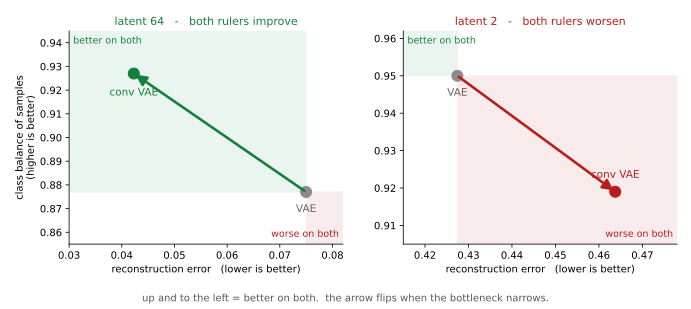
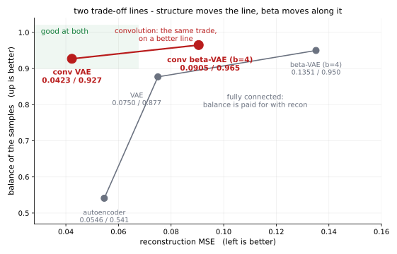

# 스텝4 컨볼루션 VAE — 통로가 넓을 때만 번다

<div class="leadbox" markdown>

**들어가는 이야기** — 같은 걸음인데 한 번은 벌고 한 번은 잃는다

이 장에서 **컨볼루션으로 바꾸는 걸음**은 세 번 나온다. [5.1절](../dimreduction/04_ae_cnn.md)이 되살리기에서 한 번, [5.3절](../generative/02_dcgan.md)이 만들기에서 한 번, 그리고 여기서 한 번이다. 앞의 둘에서 모두 좋아졌으니 이번에도 그러리라 여기기 쉽다.

**절반만 맞다.** 그리고 어느 절반인지가 5.1절과 **글자 그대로 같다.**

바꾸는 것은 하나뿐이다. 그림을 펼쳐 한 줄로 늘어놓는 대신, **이웃한 화소를 함께 보는 꼴**로 줄이는 쪽과 펴는 쪽을 다시 짠다. 로스도, 자료도, 학습 설정도 그대로 둔다.



**왼쪽에서는 초록 칸으로 가고 오른쪽에서는 붉은 칸으로 간다.** 수를 64개 남길 때는 되살리기도 좋아지고 열 가지를 고루 만드는 것도 좋아지는데, 2개만 남길 때는 둘 다 나빠진다.

그러니 「컨볼루션이 그림에 더 알맞다」는 말로는 설명이 안 된다. 그 말이 맞다면 통로가 좁을 때도 맞아야 한다.

**이 쪽은 그 까닭을 밝히지 못한다.** [5.1절의 같은 자리](../dimreduction/04_ae_cnn.md)가 흔히 드는 짐작 셋을 하나씩 재어 셋 다 지웠고, 그 쪽도 모른다고 적고 닫는다. 여기서 새로 얻는 것은 **그 뒤집힘이 VAE에서도 똑같이 일어난다**는 사실 하나다. 한 번은 우연일 수 있지만 두 번은 성질에 가깝다.

</div>

[앞의 세 쪽](index.md)은 모두 줄이는 쪽과 펴는 쪽을 **완전 연결**로 지었다. 784개 수를 한 줄로 늘어놓고 256개로, 다시 64개로 줄이는 식이다. 그 방식은 **이웃이라는 것을 모른다** — 화소 번호 100과 101이 그림에서 나란히 붙어 있다는 사실이 어디에도 들어 있지 않다.

[5.1절 스텝4](../dimreduction/04_ae_cnn.md)가 되살리기에서 그것을 고쳤고, 이 쪽이 같은 고침을 VAE에 놓는다.

| | 줄이는 쪽 | 그 위에 얹은 것 | 파라메터 (잠재 64) |
|---|---|---|---|
| [VAE](01_vae.md) | 완전 연결 784 → 256 | 평균·로그분산 머리 둘 | 451,984 |
| 스텝4 | **컨볼루션** 1 → 16 → 32 | 같음 | **309,681** |

**파라메터가 오히려 줄었다.** 컨볼루션은 필터 하나를 그림 전체에서 돌려 쓰므로 자리마다 웨이트를 따로 두지 않는다.

---

## 1. 바꾸는 것을 하나로 묶는다

27.2절에도 [컨볼루션 VAE](../../ch26/architecture/conv_vae.md)가 있는데 **그 구조를 그대로 가져오지 않았다.** 그 쪽은 BatchNorm을 넣고 출력에 시그모이드를 걸어 $[0, 1]$ 자료를 받는다. 이 절의 다른 쪽들은 정규화한 자료에 MSE를 쓴다. 섞으면 **무엇 때문에 달라졌는지** 알 수 없다.

그래서 몸통을 [5.1절 AE_CNN](../dimreduction/04_ae_cnn.md) 그대로 두고 머리만 둘로 나누었다. 그러면 이 쪽과 5.1절의 컨볼루션 걸음이 **같은 걸음**이 되어, 「5.1의 뒤집힘이 여기서도 일어나는가」를 공정하게 물을 수 있다.

27.2절 「구조 비교의 기준」이 같은 규율을 적어 둔다 — 전처리·잠재 차원·로스 합산 기준을 맞추고, 되살리기와 사전 표본 품질과 계산 비용을 **따로** 보며, 분류기 확신도 하나로 유효률을 정하지 말 것.

---

## 2. 코드

```python
"""스텝: 컨볼루션 VAE. 줄이는 쪽과 펴는 쪽을 컨볼루션으로 바꾼다.

5.1 은 AE_MLP -> AE_CNN 으로, 5.3 은 GAN -> DCGAN 으로 컨볼루션 걸음을
밟는다. 이 절만 밟지 않았다. 여기서 밟는다.

몸통은 「5.1 의 AE_CNN」 그대로이고 머리만 둘로 나누어 평균과 로그분산을
낸다. 27.2 의 ConvVAE(ch26/architecture/conv_vae.md)는 BatchNorm 과
Sigmoid 를 쓰는데, 그러면 이 장의 정규화와 MSE 규약이 함께 바뀌어
「컨볼루션으로 바꾼 몫」을 읽을 수 없다. 바꾸는 것은 하나여야 한다.

읽는 것: 5.1절 개요가 남긴 mnist_judge.pt.
실행: 이 쪽의 코드를 파일로 갈무리해 저장소 뿌리에서 돌린다.

규약은 이 절 그대로 — 씨앗 42, Adam 1e-3, 배치 100, 100 에포크, 표본 5,000장.
견줄 자리:  VAE-64  복원 0.07499  정체 98.06%  확신도 0.769  고름 0.877
            VAE-2   복원 0.42744  정체 71.28%  확신도 0.793  고름 0.950
"""
import torch, torch.nn as nn, torch.nn.functional as F, torch.optim as optim
from torch.utils.data import DataLoader, TensorDataset
import torchvision, torchvision.transforms as transforms

SEED, BATCH, LR, EPOCHS, N_SAMPLE = 42, 100, 1e-3, 100, 5000
device = torch.device("mps" if torch.backends.mps.is_available() else "cpu")
tf = transforms.Compose([transforms.ToTensor(),
                         transforms.Normalize((0.1307,), (0.3081,))])
tr = torchvision.datasets.MNIST("./data", train=True, download=True, transform=tf)
te = torchvision.datasets.MNIST("./data", train=False, download=True, transform=tf)


def mat(ds):
    xs, ys = [], []
    for x, y in DataLoader(ds, batch_size=2000, shuffle=False):
        xs.append(x); ys.append(y)
    return torch.cat(xs), torch.cat(ys)


Xtr_img, ytr = mat(tr)
Xte_img, yte = mat(te)
Xtr, Xte = Xtr_img.reshape(-1, 784), Xte_img.reshape(-1, 784)


class JudgeCNN(nn.Module):
    def __init__(self):
        super().__init__()
        self.conv1 = nn.Conv2d(1, 32, 3, padding=1)
        self.conv2 = nn.Conv2d(32, 64, 3, padding=1)
        self.pool = nn.MaxPool2d(2, 2); self.dropout = nn.Dropout(0.25)
        self.fc1 = nn.Linear(64 * 7 * 7, 128); self.fc2 = nn.Linear(128, 10)

    def forward(self, x):
        x = self.pool(torch.relu(self.conv1(x)))
        x = self.pool(torch.relu(self.conv2(x)))
        return self.fc2(self.dropout(torch.relu(self.fc1(x.flatten(1)))))


judge = JudgeCNN().to(device)
judge.load_state_dict(torch.load("mnist_judge.pt", map_location=device,
                                 weights_only=True))
judge.eval()


class ConvVAE(nn.Module):
    """5.1 AE_CNN 의 몸통에 머리만 둘로 — 평균과 로그분산.

    n_cond > 0 이면 인코더는 원핫을 10채널로 펼쳐 그림에 붙이고,
    디코더는 z 에 원핫을 이어 붙인다 (27.2 conv_cvae 와 같은 방식).
    """

    def __init__(self, k, n_cond=0):
        super().__init__()
        self.n_cond = n_cond
        self.enc = nn.Sequential(
            nn.Conv2d(1 + n_cond, 16, 3, padding=1), nn.ReLU(), nn.MaxPool2d(2),
            nn.Conv2d(16, 32, 3, padding=1), nn.ReLU(), nn.MaxPool2d(2),
            nn.Flatten())
        self.mu = nn.Linear(32 * 7 * 7, k)
        self.logvar = nn.Linear(32 * 7 * 7, k)
        self.fc = nn.Linear(k + n_cond, 32 * 7 * 7)
        self.dec_body = nn.Sequential(
            nn.ReLU(), nn.Unflatten(1, (32, 7, 7)),
            nn.ConvTranspose2d(32, 16, 2, stride=2), nn.ReLU(),
            nn.ConvTranspose2d(16, 1, 2, stride=2), nn.Flatten())

    def encode(self, x, c=None):
        x = x.reshape(-1, 1, 28, 28)
        if self.n_cond:
            x = torch.cat([x, c.view(-1, 10, 1, 1).expand(-1, 10, 28, 28)], 1)
        h = self.enc(x)
        return self.mu(h), self.logvar(h)

    def decode(self, z, c=None):
        if self.n_cond:
            z = torch.cat([z, c], 1)
        return self.dec_body(self.fc(z))

    def forward(self, x, c=None):
        mu, lv = self.encode(x, c)
        z = mu + torch.exp(0.5 * lv) * torch.randn_like(mu)
        return self.decode(z, c), mu, lv


def onehot(y):
    return F.one_hot(y, 10).float()


def train(k, cond):
    torch.manual_seed(SEED)
    m = ConvVAE(k, 10 if cond else 0).to(device)
    opt = optim.Adam(m.parameters(), lr=LR)
    g = torch.Generator().manual_seed(SEED)
    dl = DataLoader(TensorDataset(Xtr, ytr), batch_size=BATCH, shuffle=True,
                    generator=g)
    for _ in range(EPOCHS):
        m.train()
        for xb, yb in dl:
            xb = xb.to(device)
            c = onehot(yb).to(device) if cond else None
            opt.zero_grad()
            xh, mu, lv = m(xb, c)
            rec = F.mse_loss(xh, xb, reduction="sum") / xb.size(0)
            kl = -0.5 * torch.sum(1 + lv - mu.pow(2) - lv.exp()) / xb.size(0)
            (rec + kl).backward(); opt.step()
    return m.eval()


@torch.no_grad()
def probs(flat):
    return torch.cat([judge(flat[i:i + 1000].reshape(-1, 1, 28, 28).to(device))
                      .softmax(1).cpu() for i in range(0, len(flat), 1000)])


def read(flat):
    p = probs(flat); conf, lab = p.max(1)
    sh = torch.bincount(lab, minlength=10).float() / len(lab)
    nz = sh[sh > 0]
    bal = float(-(nz * nz.log()).sum() / torch.tensor(10.0).log())
    return float(conf.mean()), bal, float(sh.max()), lab


@torch.no_grad()
def evaluate(m, k, cond, tag):
    npar = sum(p.numel() for p in m.parameters())
    rec = torch.cat([m.decode(m.encode(Xte[i:i + 1000].to(device),
                                       onehot(yte[i:i + 1000]).to(device)
                                       if cond else None)[0],
                              onehot(yte[i:i + 1000]).to(device)
                              if cond else None).cpu()
                     for i in range(0, len(Xte), 1000)])
    ident = 100.0 * (probs(rec).argmax(1) == yte).float().mean()
    g = torch.Generator().manual_seed(SEED)
    z = torch.randn(N_SAMPLE, k, generator=g)
    if cond:
        want = torch.arange(N_SAMPLE) % 10
        s = torch.cat([m.decode(z[i:i + 1000].to(device),
                                onehot(want[i:i + 1000]).to(device)).cpu()
                       for i in range(0, N_SAMPLE, 1000)])
    else:
        want = None
        s = torch.cat([m.decode(z[i:i + 1000].to(device)).cpu()
                       for i in range(0, N_SAMPLE, 1000)])
    conf, bal, mx, lab = read(s)
    extra = ""
    if cond:
        extra = f"  조건정확도 {100.0 * (lab == want).float().mean():.2f}%"
    print(f"  {tag:16s} 파라메터 {npar:,}  복원 {((rec - Xte) ** 2).mean():.5f}  "
          f"정체 {ident:.2f}%{extra}  확신도 {conf:.3f}  고름 {bal:.3f}  "
          f"최대몫 {mx:.3f}", flush=True)


if __name__ == "__main__":
    for k in (64, 2):
        evaluate(train(k, False), k, False, f"convvae{k}")
```

**출력:**

```
  convvae64        파라메터 309,681  복원 0.04228  정체 98.14%  확신도 0.807  고름 0.927  최대몫 0.268
  convvae2         파라메터 17,909  복원 0.46375  정체 65.91%  확신도 0.780  고름 0.919  최대몫 0.204
```

---

## 3. 잠재 64에서는 네 자 모두 번다

| 잠재 차원 64 | 복원 MSE | 정체 | 표본 확신도 | 표본 균형도 | 파라메터 |
|---|---|---|---|---|---|
| [VAE](01_vae.md) | 0.07499 | 98.06% | 0.769 | 0.877 | 451,984 |
| **스텝4 컨볼루션 VAE** | **0.04228** | **98.14%** | **0.807** | **0.927** | **309,681** |

**복원 오차가 44% 줄었다.** 그러면서 파라메터는 31% 적다.

표본 쪽도 함께 좋아진다. 확신도가 0.769에서 0.807로 **+0.038** 오르는데, 이 절이 재어 둔 [샘플링 스프레드](index.md)가 VAE-64에서 0.010이니 그 **네 배**다. 균형도는 0.877에서 0.927로 **+0.050** 오르고 스프레드 0.013의 **네 배다.** 둘 다 표본을 다시 뽑는 것으로는 뒤집히지 않는다.

!!! note "스프레드를 빌려 쓴다"
    위에서 쓴 0.010과 0.013은 **VAE-64**에서 잰 **샘플링** 스프레드다. 이 쪽의 모델에서 다시 재지 않았고, **학습** 스프레드(시드를 바꾸어 다시 학습했을 때의 흔들림)는 두 모델 모두 재지 않았다. 학습 흔들림은 대개 샘플링 흔들림보다 크므로, 위 판정은 **어림자로 빌려 쓴 것**이다. 큰 차이는 견디지만 작은 차이는 그렇지 않다.

---

## 4. 잠재 2에서는 네 자 모두 잃는다

| 잠재 차원 2 | 복원 MSE | 정체 | 표본 확신도 | 표본 균형도 | 파라메터 |
|---|---|---|---|---|---|
| [VAE](01_vae.md) | **0.42744** | **71.28%** | **0.793** | **0.950** | 404,244 |
| 스텝4 컨볼루션 VAE | 0.46375 | 65.91% | 0.780 | 0.919 | 17,909 |

**방향이 전부 뒤집힌다.** 복원 오차가 8.5% 늘고, 되살린 그림이 같은 숫자로 읽히는 비율이 **5.37%포인트** 떨어진다.

여기서 눈에 띄는 것이 파라메터다. 잠재 2에서 컨볼루션 쪽은 17,909개로 **23배 적다.** 잠재 64에서는 1.5배 적었을 뿐인데 통로가 좁아지니 격차가 벌어진다. 완전 연결 쪽은 병목 앞뒤의 큰 레이어(784×256)를 그대로 지니는 반면, 컨볼루션 쪽은 그 자리에 필터 몇 장뿐이기 때문이다.

**그렇다고 「파라메터가 적어서 졌다」로 읽으면 안 된다.** [5.1절이 그 짐작을 재어서 지웠다](../dimreduction/04_ae_cnn.md) — 수를 맞춘 대조군을 세워도 설명이 서지 않았고, 과적합도 아니었으며(컨볼루션 쪽은 **학습 그림에서도** 더 틀렸다), 셋째 짐작도 흔들렸다. 그 쪽은 **모른다고 적고 닫는다.**

이 쪽이 더하는 것은 설명이 아니라 **되풀이**다. 되살리기만 시킨 기계에서 일어난 일이 **요구를 하나 더 건 기계에서도 똑같이** 일어난다. 바뀐 것이 로스인데도 뒤집히는 자리가 같다면, 까닭은 로스가 아니라 **좁은 통로와 컨볼루션이 만나는 자리**에 있을 것이다.

---

## 5. 그래서 이 절의 표는 어떻게 바뀌는가

| 잠재 차원 64 | 복원 MSE | 표본 확신도 | 표본 균형도 |
|---|---|---|---|
| [오토인코더](../dimreduction/03_ae_mlp.md) | 0.0546 | 0.777 | 0.541 |
| [VAE](01_vae.md) | 0.0750 | 0.769 | 0.877 |
| [β-VAE](02_beta_vae.md) ($\beta = 4$) | 0.1351 | 0.794 | 0.950 |
| **컨볼루션 VAE** | **0.0423** | 0.807 | 0.927 |



**맨 아랫줄이 맞바꿈 바깥에 있다.** 위의 세 줄은 되살리기를 팔아 고름을 샀다 — 복원이 0.0546에서 0.1351로 나빠지는 동안 고름이 0.541에서 0.950으로 올랐다. 컨볼루션 줄은 **복원이 가장 좋으면서 고름도 0.927**이다.

그러니 KL 항의 세기를 돌리는 것과 구조를 바꾸는 것은 **다른 손잡이**다. 앞의 것은 둘을 맞바꾸고, 뒤의 것은 둘을 함께 민다. 다만 **잠재 64에서만** 그렇다는 단서가 바로 위 4절이다.

---

## 연습문제

<div class="drillbox" markdown>

**연습문제 1.** <span class="diff easy" title="쉬움"></span> 잠재 64에서 컨볼루션 VAE의 파라메터가 VAE보다 적은 까닭을 레이어별로 세어 설명하라.

</div>

??? success "풀이"

    VAE의 인코더는 $784 \times 256 + 256 = 200{,}960$개로 시작한다. 컨볼루션 인코더는 $3 \times 3$ 필터 16장($1 \times 16 \times 9 + 16 = 160$)과 32장($16 \times 32 \times 9 + 32 = 4{,}640$)뿐이라 4,800개다. **필터를 자리마다 두지 않고 그림 전체에서 돌려 쓰기 때문**이다.

    대신 컨볼루션 쪽은 병목 앞뒤에 $32 \times 7 \times 7 = 1{,}568$개에서 64개로 가는 선형 레이어를 둘(평균·로그분산) 두고, 펴는 쪽에도 같은 크기의 레이어를 둔다. 그 세 레이어가 전체의 대부분이다. 합이 309,681개로 VAE의 451,984개보다 적다.

    잠재 2에서 격차가 23배로 벌어지는 것도 같은 셈이다. VAE는 $784 \times 256$ 레이어를 그대로 지니지만 컨볼루션 쪽은 $1{,}568 \times 2$로 줄어든다.

<div class="drillbox" markdown>

**연습문제 2.** <span class="diff medium" title="중간"></span> 3절은 확신도와 균형도의 변화를 **VAE-64에서 잰 샘플링 스프레드**로 판정했다. 이 판정이 약한 까닭 둘을 적고, 무엇을 더 재면 되는지 쓰라.

</div>

??? success "풀이"

    **첫째, 다른 모델의 스프레드다.** 0.010과 0.013은 VAE-64에서 잰 것이고 컨볼루션 VAE에서 다시 재지 않았다. 구조가 다르면 흔들림의 크기도 다를 수 있다.

    **둘째, 샘플링 스프레드일 뿐이다.** 같은 모델에서 $z$만 다시 뽑았을 때의 흔들림이라 공짜로 잴 수 있지만, 여기서 견주는 둘은 **서로 다르게 학습된 모델**이다. 거기에는 학습 스프레드가 걸리고 그쪽이 대개 더 크다.

    더 잴 것은 분명하다 — **두 모델을 시드 다섯 개씩 다시 학습해** 학습 스프레드를 재면 된다. [5.3절](../generative/index.md)이 네 모델에 대해 그것을 했다. 비싸지만 이 쪽의 +0.038과 +0.050이 참인지 가리는 길은 그것뿐이다.

<div class="drillbox" markdown>

**연습문제 3.** <span class="diff hard" title="어려움"></span> 4절은 잠재 2에서의 뒤집힘을 「파라메터가 적어서」로 읽지 말라고 적는다. 그 짐작을 이 쪽에서 직접 지우려면 어떤 대조군을 세워야 하는가. 설계하고, 무엇이 나오면 짐작이 서고 무엇이 나오면 무너지는지 미리 적으라.

</div>

??? success "풀이"

    **수를 맞춘 대조군**이 필요하다. 컨볼루션 VAE의 채널 수를 늘려(16·32 → 64·128쯤) 잠재 2에서의 파라메터를 VAE의 404,244개 가까이 맞춘 뒤 같은 규약으로 학습한다. 바뀌는 것이 파라메터 수뿐이 되도록 잠재 차원·로스·에포크는 그대로 둔다.

    **짐작이 서는 경우** — 수를 맞추었더니 복원 오차가 VAE의 0.42744 언저리까지 내려온다. 그러면 졌던 까닭이 정말 크기였다.

    **짐작이 무너지는 경우** — 수를 맞추어도 여전히 0.46 언저리에 머문다. 그러면 크기가 아니라 구조와 좁은 통로가 만나는 자리의 문제다.

    [5.1절이 이 설계를 실제로 돌렸고](../dimreduction/04_ae_cnn.md) 뒤엣것이 나왔다. 그래서 그 쪽이 모른다고 적는다. 여기서도 같은 결과가 나올 것이라 **짐작할 수는 있지만**, 로스가 다르므로 돌려 보기 전에는 말할 수 없다.
