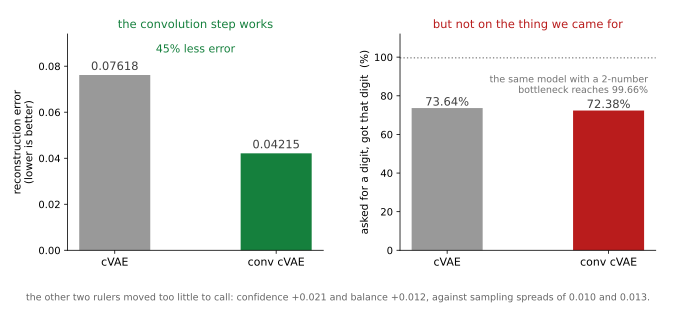
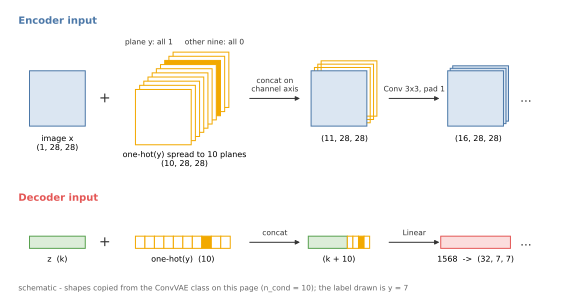
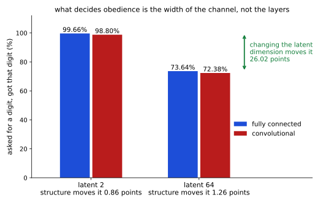
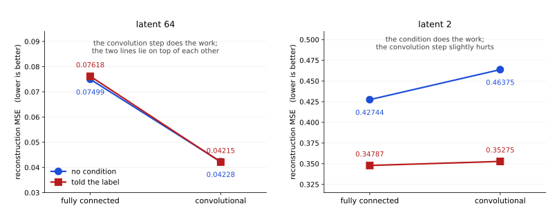

# 스텝5 컨볼루션 조건부 VAE — 고치지 못한 하나

<div class="leadbox" markdown>

**들어가는 이야기** — 셋은 고쳤는데 정작 물어본 하나를 못 고쳤다

[cVAE 쪽](03_cvae.md)에서 잠재 차원이 큰 모델이 조건을 덜 따르는 것을 보았다. 「7을 그려라」라고 시켰는데 **넷에 하나는 딴 숫자**가 나왔다(조건 정확도 73.64%). 잠재 차원이 2인 모델은 99.66%로 잘 듣는데 64인 모델이 그랬다.

[앞 쪽](04_conv_vae.md)에서 컨볼루션으로 바꾸는 걸음이 병목(잠재 차원)이 넓을 때 크게 벌었다. 그러면 자연스러운 생각이 하나 있다 — **그 걸음을 조건부 모델에도 놓으면 말을 더 잘 듣지 않을까.**

걸어 보았다.



**왼쪽에서는 걸음이 통한다.** 복원 오차가 45% 줄어 앞 쪽과 같은 크기로 번다.

**오른쪽에서는 통하지 않는다.** 73.64%가 72.38%가 된다. 올라가지 않았다.

이 엇갈림이 값지다. 같은 한 가지를 바꾸었는데 **어떤 지표는 크게 움직이고 어떤 지표는 꿈쩍도 하지 않는다면**, 그 둘은 서로 다른 것에 막혀 있다는 뜻이다. 복원을 막던 것은 구조였고, 말 듣기를 막던 것은 구조가 아니다.

그러면 무엇인가. [cVAE 쪽](03_cvae.md)이 이미 답에 가까이 갔다 — 같은 큰 모델에 **진짜 숫자를 인코딩해 얻은 잠재 표현**을 넣으면 98.42%로 말을 잘 듣는다. 모델의 표현력이 모자란 것이 아니라 **사전분포에서 뽑아 넣어 준 잠재 표현**이 모자란 것이다. 이 쪽은 모델을 더 좋게 만들어도 그 자리가 안 고쳐진다는 것을 **한 번 더** 보인다.

</div>

[앞 쪽](04_conv_vae.md)이 VAE에 컨볼루션 걸음을 놓았다. 이 쪽은 [cVAE](03_cvae.md)에 같은 걸음을 놓는다. 바꾸는 것은 역시 하나뿐이고, 조건을 다는 법도 그대로 둔다.

| | 인코더에 조건 달기 | 디코더에 조건 달기 |
|---|---|---|
| [cVAE](03_cvae.md) | 784개 수에 원핫 10개를 **이어 붙인다** | $z$에 원핫 10개를 이어 붙인다 |
| 스텝5 | 원핫을 **10채널로 펼쳐** 그림에 쌓는다 | 같음 |

**원핫 인코딩**(one-hot encoding)은 라벨 $y$를 길이 10인 벡터로 적는 것으로, $y$번째 칸만 1이고 나머지는 0이다. 아래에서 $\mathrm{onehot}(y)$라 적는다.

인코더 쪽이 달라지는 것은 받는 것이 1차원 벡터가 아니라 2차원 그림이기 때문이다. 원핫의 칸 하나하나를 $28 \times 28$ 크기의 판 한 장으로 넓혀(브로드캐스트) 조건 채널 열 장을 만든다.

$$
c_{j,h,w} \;=\; \mathrm{onehot}(y)_j \qquad (j = 0, \dots, 9;\;\; h, w = 1, \dots, 28)
$$

$j$는 채널 번호, $h$와 $w$는 세로·가로 자리다. 곧 $y$번째 판은 모든 칸이 1이고 나머지 아홉 판은 모든 칸이 0이다. 그림 $(1, 28, 28)$에 이 열 장을 **채널 방향으로 이어 붙여** $(11, 28, 28)$로 넣는다. 디코더는 [cVAE](03_cvae.md)와 똑같이 $z$ 뒤에 $\mathrm{onehot}(y)$를 이어 붙인 $k + 10$칸 벡터를 받는다.



위 그림은 **잰 수가 없는 도식**이고, 형태는 아래 코드의 `ConvVAE`에서 옮겼다(라벨은 7을 보기로 그렸다). 위쪽이 인코더의 입력, 아래쪽이 디코더의 입력이다. 인코더에서는 라벨이 **그림의 모든 자리에** 같은 값으로 깔리므로 $3 \times 3$ 필터가 어디를 보든 라벨을 함께 본다. 라벨이 들어가는 자리는 이 두 곳뿐이고, 그 뒤의 몸통은 [앞 쪽](04_conv_vae.md)과 같다. 조건을 이렇게 다는 것은 27.2절의 [컨볼루션 조건부 VAE](../../ch26/architecture/conv_cvae.md)가 쓰는 방식과 같다.

---

## 1. 코드

```python
"""스텝: 컨볼루션 조건부 VAE. 조건을 단 채로 컨볼루션으로 바꾼다.

앞 쪽이 VAE 에 컨볼루션 걸음을 놓았다. 이 쪽은 cVAE 에 같은 걸음을 놓고
한 가지를 묻는다 — 「말을 더 잘 듣게 되는가」. cVAE-64 는 「7을 그려라」
라고 시켰을 때 73.64% 만 7 로 나왔다.

조건 다는 법은 27.2 의 conv_cvae(ch26/architecture/conv_cvae.md)와 같다.
인코더는 원핫을 10채널로 펼쳐 그림에 붙이고, 디코더는 z 에 이어 붙인다.
몸통은 앞 쪽의 ConvVAE 그대로다.

읽는 것: 5.1절 개요가 남긴 mnist_judge.pt.
실행: 이 쪽의 코드를 파일로 갈무리해 저장소 뿌리에서 돌린다.

규약은 이 절 그대로 — 시드 42, Adam 1e-3, 배치 100, 100 에포크, 표본 5,000장.
표본은 열 숫자를 500장씩 고르게 시킨다.
견줄 자리:  cVAE-64  복원 0.07618  조건정확도 73.64%  확신도 0.861  균형도 0.964
            cVAE-2   복원 0.34787  조건정확도 99.66%  확신도 0.986  균형도 1.000
"""
import torch, torch.nn as nn, torch.nn.functional as F, torch.optim as optim
from torch.utils.data import DataLoader, TensorDataset
import torchvision, torchvision.transforms as transforms

SEED, BATCH, LR, EPOCHS, N_SAMPLE = 42, 100, 1e-3, 100, 5000
device = torch.device("mps" if torch.backends.mps.is_available() else "cpu")
tf = transforms.Compose([transforms.ToTensor(),
                         transforms.Normalize((0.1307,), (0.3081,))])
tr = torchvision.datasets.MNIST("./data", train=True, download=True, transform=tf)
te = torchvision.datasets.MNIST("./data", train=False, download=True, transform=tf)


def mat(ds):
    xs, ys = [], []
    for x, y in DataLoader(ds, batch_size=2000, shuffle=False):
        xs.append(x); ys.append(y)
    return torch.cat(xs), torch.cat(ys)


Xtr_img, ytr = mat(tr)
Xte_img, yte = mat(te)
Xtr, Xte = Xtr_img.reshape(-1, 784), Xte_img.reshape(-1, 784)


class JudgeCNN(nn.Module):
    def __init__(self):
        super().__init__()
        self.conv1 = nn.Conv2d(1, 32, 3, padding=1)
        self.conv2 = nn.Conv2d(32, 64, 3, padding=1)
        self.pool = nn.MaxPool2d(2, 2); self.dropout = nn.Dropout(0.25)
        self.fc1 = nn.Linear(64 * 7 * 7, 128); self.fc2 = nn.Linear(128, 10)

    def forward(self, x):
        x = self.pool(torch.relu(self.conv1(x)))
        x = self.pool(torch.relu(self.conv2(x)))
        return self.fc2(self.dropout(torch.relu(self.fc1(x.flatten(1)))))


judge = JudgeCNN().to(device)
judge.load_state_dict(torch.load("mnist_judge.pt", map_location=device,
                                 weights_only=True))
judge.eval()


class ConvVAE(nn.Module):
    """5.1 AE_CNN 의 몸통에 헤드만 둘로 — 평균과 로그분산.

    n_cond > 0 이면 인코더는 원핫을 10채널로 펼쳐 그림에 붙이고,
    디코더는 z 에 원핫을 이어 붙인다 (27.2 conv_cvae 와 같은 방식).
    """

    def __init__(self, k, n_cond=0):
        super().__init__()
        self.n_cond = n_cond
        self.enc = nn.Sequential(
            nn.Conv2d(1 + n_cond, 16, 3, padding=1), nn.ReLU(), nn.MaxPool2d(2),
            nn.Conv2d(16, 32, 3, padding=1), nn.ReLU(), nn.MaxPool2d(2),
            nn.Flatten())
        self.mu = nn.Linear(32 * 7 * 7, k)
        self.logvar = nn.Linear(32 * 7 * 7, k)
        self.fc = nn.Linear(k + n_cond, 32 * 7 * 7)
        self.dec_body = nn.Sequential(
            nn.ReLU(), nn.Unflatten(1, (32, 7, 7)),
            nn.ConvTranspose2d(32, 16, 2, stride=2), nn.ReLU(),
            nn.ConvTranspose2d(16, 1, 2, stride=2), nn.Flatten())

    def encode(self, x, c=None):
        x = x.reshape(-1, 1, 28, 28)
        if self.n_cond:
            x = torch.cat([x, c.view(-1, 10, 1, 1).expand(-1, 10, 28, 28)], 1)
        h = self.enc(x)
        return self.mu(h), self.logvar(h)

    def decode(self, z, c=None):
        if self.n_cond:
            z = torch.cat([z, c], 1)
        return self.dec_body(self.fc(z))

    def forward(self, x, c=None):
        mu, lv = self.encode(x, c)
        z = mu + torch.exp(0.5 * lv) * torch.randn_like(mu)
        return self.decode(z, c), mu, lv


def onehot(y):
    return F.one_hot(y, 10).float()


def train(k, cond):
    torch.manual_seed(SEED)
    m = ConvVAE(k, 10 if cond else 0).to(device)
    opt = optim.Adam(m.parameters(), lr=LR)
    g = torch.Generator().manual_seed(SEED)
    dl = DataLoader(TensorDataset(Xtr, ytr), batch_size=BATCH, shuffle=True,
                    generator=g)
    for _ in range(EPOCHS):
        m.train()
        for xb, yb in dl:
            xb = xb.to(device)
            c = onehot(yb).to(device) if cond else None
            opt.zero_grad()
            xh, mu, lv = m(xb, c)
            rec = F.mse_loss(xh, xb, reduction="sum") / xb.size(0)
            kl = -0.5 * torch.sum(1 + lv - mu.pow(2) - lv.exp()) / xb.size(0)
            (rec + kl).backward(); opt.step()
    return m.eval()


@torch.no_grad()
def probs(flat):
    return torch.cat([judge(flat[i:i + 1000].reshape(-1, 1, 28, 28).to(device))
                      .softmax(1).cpu() for i in range(0, len(flat), 1000)])


def read(flat):
    p = probs(flat); conf, lab = p.max(1)
    sh = torch.bincount(lab, minlength=10).float() / len(lab)
    nz = sh[sh > 0]
    bal = float(-(nz * nz.log()).sum() / torch.tensor(10.0).log())
    return float(conf.mean()), bal, float(sh.max()), lab


@torch.no_grad()
def evaluate(m, k, cond, tag):
    npar = sum(p.numel() for p in m.parameters())
    rec = torch.cat([m.decode(m.encode(Xte[i:i + 1000].to(device),
                                       onehot(yte[i:i + 1000]).to(device)
                                       if cond else None)[0],
                              onehot(yte[i:i + 1000]).to(device)
                              if cond else None).cpu()
                     for i in range(0, len(Xte), 1000)])
    ident = 100.0 * (probs(rec).argmax(1) == yte).float().mean()
    g = torch.Generator().manual_seed(SEED)
    z = torch.randn(N_SAMPLE, k, generator=g)
    if cond:
        want = torch.arange(N_SAMPLE) % 10
        s = torch.cat([m.decode(z[i:i + 1000].to(device),
                                onehot(want[i:i + 1000]).to(device)).cpu()
                       for i in range(0, N_SAMPLE, 1000)])
    else:
        want = None
        s = torch.cat([m.decode(z[i:i + 1000].to(device)).cpu()
                       for i in range(0, N_SAMPLE, 1000)])
    conf, bal, mx, lab = read(s)
    extra = ""
    if cond:
        extra = f"  조건정확도 {100.0 * (lab == want).float().mean():.2f}%"
    print(f"  {tag:16s} 파라메터 {npar:,}  복원 {((rec - Xte) ** 2).mean():.5f}  "
          f"정체 {ident:.2f}%{extra}  확신도 {conf:.3f}  균형도 {bal:.3f}  "
          f"최대몫 {mx:.3f}", flush=True)


if __name__ == "__main__":
    for k in (64, 2):
        m = train(k, True)
        evaluate(m, k, True, f"convcvae{k}")
        # 아래 블록이 읽어, 조건이 잠재 표현의 자리를 바꾸는지 잰다
        torch.save(m.state_dict(), f"mnist_convcvae{k}.pt")
```

**출력:**

```
  convcvae64       파라메터 326,801  복원 0.04215  정체 98.81%  조건정확도 72.38%  확신도 0.882  균형도 0.976  최대몫 0.187
  convcvae2        파라메터 35,029  복원 0.35275  정체 99.89%  조건정확도 98.80%  확신도 0.981  균형도 1.000  최대몫 0.111
```

---

## 2. 잠재 64 — 셋은 번다

| 잠재 차원 64 | 복원 MSE | 정체 | **조건 정확도** | 표본 확신도 | 표본 균형도 |
|---|---|---|---|---|---|
| [cVAE](03_cvae.md) | 0.07618 | 98.79% | **73.64%** | 0.861 | 0.964 |
| 스텝5 컨볼루션 cVAE | **0.04215** | **98.81%** | **72.38%** | 0.882 | 0.976 |

**복원 오차가 45% 줄었다.** 앞 쪽의 컨볼루션 VAE가 44% 줄인 것과 같은 크기다. 조건을 달고 있어도 구조를 바꾼 몫은 그대로 들어온다.

나머지 둘은 **판정할 수 없다.** 확신도가 +0.021, 균형도가 +0.012 움직였는데 [이 절이 재어 둔 샘플링 스프레드](index.md)가 VAE-64에서 0.010과 0.013이다. 균형도는 스프레드 **안**이고 확신도는 두 배라 애매하다. 둘 다 그 자리에서 판정하지 않는 것이 옳다.

!!! note "균형도 0.976을 성적으로 읽지 말 것"
    조건부 모델은 뽑을 때 **열 숫자를 500장씩 고르게 요청한다.** 그러니 모델이 요청을 어지간히만 따르면 균형도는 높게 나온다. [3절](03_cvae.md)이 적어 둔 대로 이 수는 **조건 정확도와 함께** 읽어야 하고, 조건 없는 모델의 균형도와 맞대면 안 된다.

---

## 3. 그런데 조건 정확도는 움직이지 않는다

**73.64%에서 72.38%다.** 1.26%포인트 내려갔는데, 이 수의 스프레드를 아무도 재지 않았으므로 **「나빠졌다」고 적을 수 없다.** 적을 수 있는 것은 **「올라가지 않았다」**까지다.

그 판정만으로 충분하다. 이 쪽에 온 까닭이 「컨볼루션으로 바꾸면 말을 더 잘 들을까」였고, 답은 **아니오**다.

| 같은 물음을 네 번 물으면 | 조건 정확도 |
|---|---|
| [cVAE](03_cvae.md), 잠재 2 | **99.66%** |
| 스텝5, 잠재 2 | 98.80% |
| [cVAE](03_cvae.md), 잠재 64 | 73.64% |
| 스텝5, 잠재 64 | 72.38% |



**가르는 것은 구조가 아니라 잠재 차원이다.** 위의 두 줄과 아래 두 줄 사이가 26%포인트인데, 같은 차원 안에서 구조를 바꾼 몫은 1%포인트 남짓이다. 컨볼루션이냐 완전 연결이냐는 이 물음에서 **거의 아무것도 바꾸지 않는다.**

---

## 4. 그러면 무엇이 막고 있는가

[cVAE 쪽](03_cvae.md)이 그 물음을 세 막대로 열었다. 같은 잠재 64 모델에 **진짜 숫자를 인코딩해 얻은 잠재 표현**을 넣으면 조건 정확도가 **98.42%**로 올라간다. 모델은 조건을 따를 줄 안다. 못 따르는 것은 **사전분포 $N(0, I)$에서 샘플링한 잠재 표현을 받았을 때**다.

이 쪽이 더하는 것은 그 결론을 **독립적으로 한 번 더** 받치는 것이다. 모델의 표현력을 키우는 쪽으로 손을 대면 복원은 45% 좋아지는데 조건 따르기는 그대로다. **막고 있는 것이 모델 쪽에 없다**는 뜻이다.

[VAE 쪽](01_vae.md) 6절이 그 자리를 자세히 본다. **집계 사후**(aggregate posterior)는 인코더가 그림마다 내는 분포를 모든 그림에 걸쳐 평균한 것인데, 이것이 좌표마다 $N(0, I)$와 거의 같은데도 표본의 균형도가 진짜에 못 미쳤다. 좌표마다 맞는 것과 **좌표 사이의 상관 구조까지 맞는 것**은 다르다.

그러면 **조건을 달면 그 상관 구조가 달라지는가?** 달라진다면 여기가 범인일 수 있다. [개요](index.md) 5절의 지표로 재어 보면 되는데, 거기서는 조건 없는 모델만 쟀다.

```python
"""조건을 달면 잠재 표현이 사는 자리가 달라지는가 — 위 블록에 이어 붙인다.

4 절은 "좌표마다 맞는 것과 좌표 사이의 상관 구조까지 맞는 것은 다르고,
조건을 달아도 그 간격은 남는다" 고 적었다. 그 간격을 재는 지표가 [개요
5 절](index.md)에 있는데, 거기서는 조건 없는 모델만 쟀다. 여기서 조건을
단 쪽을 같은 지표로 잰다.

  덮는 부피 = 1/sqrt(det R),  R 은 상관 행렬
      N(0, I) 가 잠재 표현이 실제로 사는 자리보다 몇 배 넓은 자리를
      덮는가. 좌표마다의 크기는 맞추어 놓고 재므로 좌표 사이의 상관만
      남는다. 1 이면 딱 맞는 것이다.

검산용으로 [앞 쪽](04_conv_vae.md)의 조건 없는 컨볼루션 VAE 를 함께 잰다.
그 쪽이 1.80 배를 얻었으므로 같은 수가 나와야 같은 지표로 재는 것이고,
조건을 단 쪽과 나란히 두면 "조건이 자리를 바꾸는가" 가 바로 보인다.

읽는 것: 위 블록이 남긴 mnist_convcvae64.pt 와 mnist_convcvae2.pt,
그리고 [앞 쪽](04_conv_vae.md)이 남긴 mnist_convvae64.pt.
실행: 이 쪽의 코드를 파일로 갈무리해 저장소 뿌리에서 돌린다.
"""


def inflation(z):
    z = z.double()
    s = z.std(0)
    R = torch.cov(z.T) / (s[:, None] * s[None, :])
    return float(torch.exp(-0.5 * torch.linalg.slogdet(R)[1]))


@torch.no_grad()
def aggregated(m, k, cond):
    """집계 사후에서 뽑는다. mu 만 모으면 죽은 좌표 탓에 수가 뒤집힌다."""
    mus, lvs = [], []
    for i in range(0, len(Xte), 1000):
        x = Xte[i:i + 1000].to(device)
        c = onehot(yte[i:i + 1000]).to(device) if cond else None
        mu, lv = m.encode(x, c)
        mus.append(mu.cpu()); lvs.append(lv.cpu())
    mu, lv = torch.cat(mus), torch.cat(lvs)
    g = torch.Generator().manual_seed(SEED)
    return mu + (0.5 * lv).exp() * torch.randn(mu.shape, generator=g)


def grab(k, n_cond, path):
    m = ConvVAE(k, n_cond)
    m.load_state_dict(torch.load(path, map_location="cpu", weights_only=True))
    return m.eval().to(device)


if __name__ == "__main__":
    rows = [("컨볼루션 VAE-64  (검산: 1.80배)", 64, 0, "mnist_convvae64.pt"),
            ("컨볼루션 cVAE-64", 64, 10, "mnist_convcvae64.pt"),
            ("컨볼루션 cVAE-2 ", 2, 10, "mnist_convcvae2.pt")]
    for tag, k, nc, path in rows:
        z = aggregated(grab(k, nc, path), k, nc > 0)
        f = inflation(z)
        print(f"  {tag:30s} 덮는 부피 {f:6.2f}배   "
              f"축 하나당 {100 * (f ** (1 / k) - 1):5.2f}% 넓다   "
              f"좌표 표준편차 평균 {z.std(0).mean():.3f}")
```

**출력:**

```
  컨볼루션 VAE-64  (검산: 1.80배)       덮는 부피   1.80배   축 하나당  0.92% 넓다   좌표 표준편차 평균 0.990
  컨볼루션 cVAE-64                   덮는 부피   1.67배   축 하나당  0.80% 넓다   좌표 표준편차 평균 0.987
  컨볼루션 cVAE-2                    덮는 부피   1.00배   축 하나당  0.00% 넓다   좌표 표준편차 평균 1.049
```

**윗줄이 검산이다.** [앞 쪽](04_conv_vae.md)이 얻은 **1.80배**가 그대로 나오므로 같은 지표로 재고 있는 것이 맞다.

| 덮는 부피 — $N(0, I)$가 잠재 표현이 사는 자리의 몇 배를 덮는가 | | 축 하나당 |
|---|---|---|
| [컨볼루션 VAE-64](04_conv_vae.md) — 조건 없음 | 1.80배 | 0.92% |
| **컨볼루션 cVAE-64** | **1.67배** | 0.80% |
| **컨볼루션 cVAE-2** | **1.00배** | 0.00% |

**조건을 달아도 상관 구조는 달라지지 않는다.** 1.67배와 1.80배, 오히려 **조금 더 잘 맞는다.** [cVAE 쪽](03_cvae.md)도 같은 지표로 1.53배 대 1.59배를 얻었으니, **완전 연결에서도 컨볼루션에서도 같은 답**이다.

그러니 이 간격은 조건 따르기가 막힌 까닭이 **될 수 없다.** 같은 간격을 가진 조건 없는 컨볼루션 VAE는 균형도 0.927을 내는데, 조건을 달자마자 72.38%로 주저앉을 까닭이 이 수에는 없다. **간격은 남지만 조건 때문에 커진 것이 아니다.**

컨볼루션 cVAE-2가 **1.00배**로 딱 맞는 것도 나란히 읽어 둘 만하다. 2차원에서 조건 정확도가 98.80%인 것과 같은 방향이다. 다만 **부피 칸을 차원 사이에 걸쳐 견주면 안 된다** — 축마다의 어긋남을 차원 수만큼 곱한 수라 차원이 낮으면 애초에 커질 수 없다.

**그래서 4절의 답이 좁혀진다.** 막고 있는 것은 디코더의 표현력도 아니고(복원을 45% 고쳐도 안 움직인다), 잠재 표현이 사는 자리의 모양도 아니다(조건을 달아도 1.67배로 그대로다). [cVAE 쪽](03_cvae.md)이 가리킨 **짝짓기** — 어느 잠재 표현에 어느 라벨이 걸리느냐 — 가 남는다.

고치려면 손을 대야 할 곳이 **사전분포 쪽**이다. 27.2절 [「사전 분포」](../../ch26/architecture/prior.md)가 가우시안 혼합과 VampPrior를 다룬다 — 사전분포를 $N(0, I)$에 묶어 두지 않고 집계 사후에 맞추어 **배우게** 하는 길이다. 이 절은 거기까지 가지 않는다.

---

## 5. 이 절이 끝나는 자리

| 잠재 차원 64 | 복원 MSE | 표본 확신도 | 표본 균형도 | 조건 정확도 |
|---|---|---|---|---|
| [VAE](01_vae.md) | 0.0750 | 0.769 | 0.877 | — |
| [VAE](01_vae.md) ($\beta = 4$) | 0.1351 | 0.794 | 0.950 | — |
| [cVAE](03_cvae.md) | 0.0762 | 0.861 | 0.964 | 73.64% |
| [컨볼루션 VAE](04_conv_vae.md) | **0.0423** | 0.807 | 0.927 | — |
| 컨볼루션 cVAE | **0.0422** | 0.882 | 0.976 | 72.38% |

**네 쪽이 세 가지를 바꿨다.** KL 항의 가중치(β), 조건을 다는 것, 그리고 구조. 앞의 둘은 **트레이드오프**라 무엇을 사면 무엇을 내주는데, 셋째는 복원을 거의 공짜로 반 넘게 깎는다.

### 두 걸음이 거울상이다

위 표는 잠재 64만 보여 준다. 그런데 뒤의 두 걸음 — **컨볼루션으로 바꾸기**와 **조건 달기** — 은 잠재 2에서도 모두 재어 두었다. 여덟 칸이 다 있으니 가로질러 볼 수 있다.

맞대려면 잰 조건이 같아야 한다. 네 쪽이 **같은 설정**을 쓴다 — 시드 42, 배치 100, 학습률 $10^{-3}$, 100 에포크, 같은 MNIST 테스트 집합, 그리고 [5.1절 개요](../dimreduction/index.md)가 남긴 같은 평가 분류기(3장 스텝4와 같은 구조를 5에포크 학습해 98.83%를 얻은 것)에 넣는 같은 정체 공식이다. 수는 [VAE](01_vae.md)·[cVAE](03_cvae.md)·[컨볼루션 VAE](04_conv_vae.md)의 출력과 이 쪽 1절의 출력에서 옮겼다.

| 복원 MSE | 완전 연결 | 컨볼루션 | 컨볼루션이 바꾼 몫 |
|---|---|---|---|
| **잠재 64**, 조건 없음 | 0.07499 | **0.04228** | **−43.6%** |
| **잠재 64**, 조건 있음 | 0.07618 | **0.04215** | **−44.7%** |
| **잠재 2**, 조건 없음 | **0.42744** | 0.46375 | +8.5% |
| **잠재 2**, 조건 있음 | **0.34787** | 0.35275 | +1.4% |



**선이 겹치면 그 걸음이 아무것도 바꾸지 않은 것이다.** 잠재 64에서는 선 둘이 포개진 채 함께 떨어진다 — 일하는 것은 컨볼루션이고 조건은 복원을 0.31%밖에 못 바꾼다. 잠재 2에서는 거꾸로다. 선 둘이 멀찍이 떨어진 채 나란히 조금 오른다 — 일하는 것은 조건이고(−24%), 컨볼루션은 오히려 조금 해롭다.

같은 뒤집힘이 정체에서도 그대로다. 잠재 2에서 조건 없는 컨볼루션 VAE는 복원한 그림의 **65.91%**만 같은 숫자로 읽히는데, 조건을 달면 **99.89%**가 된다. 잠재 64에서는 98.14%와 98.81%로 붙어 있다.

!!! warning "잠재 2의 이 차이를 「더 좋은 모델」로 읽지 말 것"
    조건부 모델은 복원할 때도 샘플링할 때도 **참 라벨을 받는다.** 잠재 차원이 둘뿐일 때 조건 없는 모델은 그 둘로 「어느 숫자인가」와 「어떻게 쓰였나」를 **둘 다** 담아야 하는데, 조건부 모델은 앞엣것을 거저 받고 두 차원을 전부 글씨체에 쓴다. 라벨이 얹어 주는 것이 $\log_2 10 \approx 3.32$비트이니, 이것은 **같은 예산의 대결이 아니라 예산이 다른 둘의 대결**이다.

    그래서 정체 99.89%는 성적이 아니다 — 디코더가 무엇을 그릴지 듣고 그렸으므로 **숫자를 틀릴 수가 없다.** 같은 까닭으로 확신도와 균형도도 두 모델 사이에서 맞대면 안 된다 — 앞의 「균형도 0.976을 성적으로 읽지 말 것」 상자가 그 경고다. 가로질러 읽을 수 있는 지표는 **복원 MSE 하나**다.

    읽을 수 있는 것은 이만큼이다 — **좁은 병목이 굶주려 있던 것이 바로 그 3.32비트였다.** 병목이 넉넉하면 같은 3.32비트를 더 줘도 아무 일도 일어나지 않는다.

조건을 다는 데 드는 파라메터 비용은 잠재 차원과 무관하게 **정확히 17,120개**로 같다(309,681 → 326,801, 그리고 17,909 → 35,029). 비용은 고정인데 사 주는 것은 병목이 좁을수록 커진다. 잠재 64에서는 파라메터를 5.5% 더 쓰고 복원을 0.31% 얻는 반면, 잠재 2에서는 파라메터가 두 배가 되는 대신 24%를 얻는다.

그리고 **셋 다 손대지 못한 것이 하나** 남는다. 사전분포에서 샘플링한 잠재 표현을 넣었을 때 시킨 숫자가 나오는 비율, 곧 조건 정확도다. 이 세 가지로 안 되는 일이 있다는 것, 그것이 이 절이 다음 절에 넘기는 물음이다.

---

## 연습문제

<div class="drillbox" markdown>

**연습문제 1.** <span class="diff easy" title="쉬움"></span> 이 쪽의 인코더는 조건을 10채널로 펼쳐 그림에 쌓는다. 그렇게 하면 첫 컨볼루션 레이어의 파라메터가 몇 개 늘어나는가.

</div>

??? success "풀이"

    첫 레이어는 $3 \times 3$ 필터 16장이다. 조건이 없으면 입력 채널이 1이라 $1 \times 16 \times 9 + 16 = 160$개이고, 조건 10채널을 쌓으면 입력이 11채널이 되어 $11 \times 16 \times 9 + 16 = 1{,}600$개다. **1,440개 늘어난다.**

    디코더 쪽은 $z$에 원핫 10개를 이어 붙이므로 그 선형 레이어가 $10 \times 1{,}568 = 15{,}680$개 늘어난다. 합하면 전체가 309,681개에서 326,801개로 **17,120개** 늘어난 것과 맞는다.

<div class="drillbox" markdown>

**연습문제 2.** <span class="diff med" title="중간"></span> 2절은 균형도 0.976을 「성적으로 읽지 말라」고 적는다. 그렇다면 조건부 모델에서 균형도가 **낮게** 나왔다면 그것은 무엇을 뜻하는가. 조건 정확도와 어떻게 다른가.

</div>

??? success "풀이"

    열 숫자를 고르게 요청했는데 균형도가 낮다면, 모델이 **요청과 무관하게 특정 숫자로 쏠렸다**는 뜻이다. 조건을 아예 무시하고 늘 3을 그리는 극단이 그렇다.

    그러나 **조건 정확도가 낮아도 균형도는 높을 수 있다.** 틀린 숫자들이 열 가지에 고루 흩어지기만 하면 된다. 실제로 이 쪽의 모델이 그 형태에 가깝다 — 조건 정확도는 72.38%인데 균형도는 0.976이다.

    곧 균형도는 **클래스 불균형만** 보고 **시킨 것과 맞는지는 보지 못한다.** 조건부 모델에서 쓸모 있는 것은 조건 정확도 쪽이고, 균형도는 「클래스 불균형이라는 다른 실패」를 가려내는 보조다.

<div class="drillbox" markdown>

**연습문제 3.** <span class="diff hard" title="어려움"></span> 3절은 「구조가 아니라 잠재 차원이 가른다」고 적는다. 2와 64 사이에서 **어디서부터 무너지는지** 알아보는 실험을 설계하라. 무엇을 지표로 쓰고, 이 쪽이 쓴 지표 가운데 어느 것을 믿지 말아야 하는가.

</div>

??? success "풀이"

    잠재 차원을 2, 4, 8, 16, 32, 64로 두고 같은 규약으로 컨볼루션 cVAE를 학습해 **조건 정확도**를 잰다. 지표는 그것 하나로 충분하다 — 이 쪽이 보인 대로 구조를 바꾸어도 움직이지 않는 수이므로, 차원만 바꾸었을 때 움직인다면 그 움직임은 차원의 것이다.

    **믿지 말아야 할 것은 균형도다.** 연습문제 2가 보인 대로 열 숫자를 고르게 요청하는 한 균형도는 거의 항상 높게 나오고, 차원이 바뀌어도 그 성질은 그대로다. 확신도도 약하다 — [장 개요](../index.md)가 적어 둔 대로 본 적 없는 입력에서 과하게 자신만만해진다.

    한 가지 더 — 차원마다 **시드를 여럿 두어야** 한다. 이 쪽의 수는 모두 시드 하나이고, 무너지는 자리를 찾는 일은 작은 차이를 읽는 일이라 스프레드 없이는 어디가 꺾이는 자리인지 말할 수 없다. [5.1절의 마지막 쪽](../dimreduction/06_sampling.md)이 같은 설계를 연습문제로 남겨 두었다.
