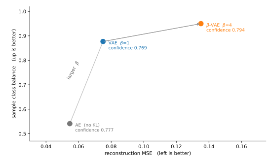
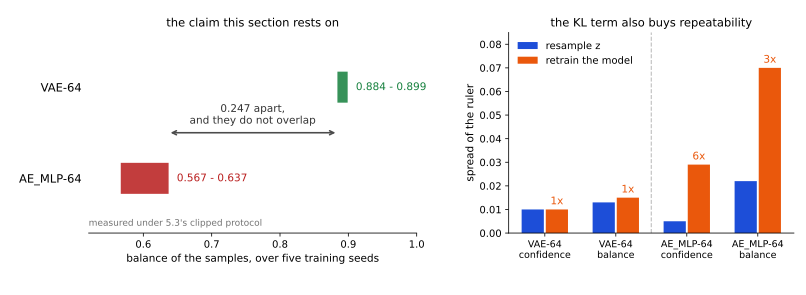

# 잠재 공간 생성 모델 — 전체 그림

<div class="leadbox" markdown>

**들어가는 이야기** — 뽑을 자리를 미리 정해 버리면 된다

앞 절이 벽에 부딪혔다. 숫자를 64개의 수로 줄였다 되살리는 것은 되는데, 아무 수 64개를 지어내 넣으면 숫자가 나오지 않았다. **어디서 뽑아야 하는지를 아무도 가르쳐 준 적이 없기 때문**이다.

이 절이 내놓는 수는 뜻밖에 간단하다. 뽑을 자리를 나중에 찾지 말고 **미리 정해 버린다.** 「네가 만드는 수들은 0 언저리에 둥글게 모여 있어야 한다」고 학습할 때부터 요구해 두는 것이다. 그러면 만들 때는 그 둥근 자리에서 뽑으면 된다.

그 요구를 걸면 무엇이 좋아질까. 자가 넷이다. 셋은 **[3장에서 만들어 둔 분류기](../../ch03/mnist/04_cnn.md)**가 쥐고 있다 — 뽑은 그림을 보여 **얼마나 자신 있어 하는지**가 하나, **몇 번이라 읽는지 세어** 열 가지가 고른지가 둘, 그리고 **같은 숫자라 읽힌 것끼리 서로 얼마나 다른지**가 셋이다. 넷째는 분류기와 상관없이 **그림 한 장을 만드는 데 기계를 몇 번 지나는지**를 센다.

**넷 다 1이 가장 좋은데, 1의 뜻도 바닥도 서로 다르다.** 회색의 1은 「무엇으로 읽든 늘 망설이지 않는다」이고 바닥은 0.1이다. 초록의 1은 「열 가지가 **정확히 같은 수만큼** 나온다」이고 바닥은 0이다. 파랑의 1은 「**진짜 손글씨만큼** 같은 숫자를 여러 모양으로 쓴다」이고, 이 자만 1을 넘을 수도 있다. 호박의 1은 「**한 번만 지나면 그림이 나온다**」이고, 여러 번 지나야 할수록 내려간다. 그러니 네 선의 높이를 **서로 견주면 안 된다.** 각자 제 천장까지 얼마나 갔는지만 보는 것이다. 이 수들을 어떻게 세는지는 [장 개요](../index.md)가 식까지 적어 두었고, 아래 3절에도 다시 적는다.

미리 재어 보면 이렇다.


**회색 선이 꿈쩍도 하지 않는다.** 0.777에서 0.828까지, 다섯을 지나도록 거의 평평하다. 표본이 더 「숫자다워지지」는 않는다는 뜻이다.

**파란 선이 그 값을 보여 준다.** 초록이 오르는 동안 파랑은 0.642에서 0.575로 **내려간다.** 열 가지를 고루 만들게 되는 대신 **같은 숫자를 점점 같은 모양으로** 그린다.

**넷째 점에서 파랑이 뛴다.** [컨볼루션 VAE](04_conv_vae.md)는 로스를 건드리지 않고 **구조만** 바꾸는데 0.575에서 **0.833**으로 오른다.

**그리고 다섯째 점이 그 뜻을 정한다.** 같은 컨볼루션 기계에 $\beta$ 손잡이를 똑같이 걸면 파랑이 **0.716**으로 다시 내려간다. 곧 **끝의 두 점은 가운데 두 점과 같은 걸음**이고, 가로축은 모델 다섯이 아니라 **기계 둘 × 손잡이 두 자리**다.

읽을 것은 **쌍끼리**다. 완전 연결에서 손잡이를 돌리면 0.631 → 0.575, 컨볼루션에서 돌리면 0.833 → 0.716. **구조는 두 자리 모두를 끌어올리지만 맞바꿈을 없애지는 못한다** — 오히려 컨볼루션 쪽에서 더 많이 내준다. 「선 바깥의 점 하나」가 아니라 **선이 둘**인 것이다.

**맨 위에 눕는 호박빛 선이 넷째 자다.** 다섯 모델이 모두 그림 한 장에 디코더를 **한 번만** 지나므로 목표선 위에 그대로 붙는다. 이 절에서는 아무것도 가르지 못한다는 뜻이고, 이 자가 일하는 곳은 [5.4절](../diffusion/index.md)이다 — 거기서 DDPM은 **1,000번**, DDIM은 10번을 쓴다.

초록의 0.541이 무엇인지 하나만 짚어 두자. **열 가지가 크게 쏠렸다는 뜻**이고, 실제로 5,000장을 뽑으면 **가장 많은 숫자 하나가 66%**를 차지한다. 그것이 0.950까지 오르면 쏠림이 거의 사라진다.

이것이 이 절을 읽는 열쇠다. 요구를 하나 더 걸어 산 것은 **그림이 좋아지는 것이 아니라 열 가지가 고루 나오는 것**이다. 값도 치른다 — 요구가 늘었으니 복원은 조금 못하게 된다.

한 가지만 미리 못 박아 두자. **요구를 걸었다고 해서 그대로 되는 것은 아니다.** 기계가 받은 요구는 둘이고, 둘이 서로 반대쪽으로 잡아끈다. 새 요구는 만드는 수들을 0 언저리로 모으라 하고, 먼저 걸어 둔 「보여 준 그림을 되살려라」는 그림마다 제자리를 따로 챙기라 한다. 한쪽을 다 들어주면 다른 쪽이 나빠지므로, **둘이 맞버티다 어디쯤에서 멈추는지는 재어 보아야 안다.**

실제로 재어 보면 끝까지 가지 못한다. 초록이 0.950까지 갔어도 **1은 아니다** — 진짜 손글씨를 같은 자로 재면 0.999다. [VAE 쪽](01_vae.md)의 6절이 만들어진 수들을 모아 요구한 모양과 맞대어 보는데, **모양은 요구한 대로 되었는데도** 뽑은 그림은 여전히 한 숫자로 기운다. 왜 그 둘이 따로 노는지가 그 꼭지의 물음이다.

그러니 이 절의 네 쪽은 **손잡이를 둘** 돌린다. [VAE](01_vae.md)가 맞바꿈을 세우고 그것을 $\beta$라는 손잡이로 만들며(그 손잡이를 키운 설정에 **β-VAE**라는 이름이 붙어 있다 — 기계는 같은 기계이므로 같은 쪽에서 다룬다), [cVAE](03_cvae.md)가 거기에 「원하는 숫자를 고른다」를 덧붙이면서 또 다른 값을 치른다.

**뒤의 두 쪽은 손잡이가 다르다.** [컨볼루션 VAE](04_conv_vae.md)와 [컨볼루션 cVAE](05_conv_cvae.md)는 요구를 건드리지 않고 **기계의 꼴**을 바꾼다 — 그림을 한 줄로 펴는 대신 이웃한 화소를 함께 보게 짠다. 5.1절과 5.3절이 저마다 밟은 걸음을 이 절도 밟는 것이다. 그 걸음은 **맞바꿈이 아니다.** 복원을 반 넘게 깎으면서 다른 자를 내주지 않는다 — 다만 통로가 넓을 때만 그렇고, 좁히면 방향이 통째로 뒤집힌다.

**위 그림에 cVAE가 없는 것은 일부러다.** 그 기계에는 「7을 그려라」라고 **시킬 수 있다.** 그러니 열 가지를 고루 달라고 시키면 고루 나온다 — 초록 자가 **재려던 것을 시켜서 얻는** 셈이라 같은 선에 올리면 크게 이긴 것처럼 보인다. 실제로 재어 보면 0.964로 가장 높은데, 같은 표본에서 **넷에 하나는 시킨 것과 다른 숫자**다. 초록 자는 틀린 숫자들이 고루 흩어져 있기만 하면 그것을 보지 못한다. 그래서 [cVAE 쪽](03_cvae.md)은 자를 바꾸어 **「시킨 숫자가 나왔는가」**를 묻는다. 그 수는 73.64%이고, [마지막 쪽](05_conv_cvae.md)이 컨볼루션으로 고쳐 보려다 **못 고친다.**

</div>

[5.1절](../dimreduction/index.md)은 복원을 익히고 물음 하나를 남겼다. 잠재 공간에서 점을 뽑아 디코딩하면 없던 그림이 나올 텐데, **어디서 뽑아야 하는가?**

그 절은 오토인코더로는 알 수 없다고 적었다. 이 절은 먼저 그 주장을 **재어 본다.** 그리고 그 주장이 반만 맞았음을 보인다.

---

## 1. 먼저 오토인코더에서 뽑아 본다

주장을 시험하려면 가장 그럴듯한 방법으로 뽑아 보아야 한다. 아래 세 줄은 **얼개만 적은 것**이고, 돌아가는 전체 코드는 5절에 있다. 오토인코더는 잠재 표현이 어떤 분포를 따르는지 알려 주지 않으므로, **실제 잠재 표현의 평균과 표준편차에 맞춘 정규분포**에서 뽑는 것이 가장 자연스러운 시도다.

[5.1절의 마지막 쪽](../dimreduction/06_sampling.md)이 이 실험을 먼저 했다. 아래는 같은 일을 **이 절의 규약으로 다시 돌린 별개의 실행**이므로, 두 쪽의 수가 소수점 아래에서 조금 다르다(확신도 0.859 대 0.862 따위). 어느 한쪽이 틀린 것이 아니라 **다시 돌리면 그만큼 움직인다**는 뜻이며, 그 움직임의 크기를 4절이 따로 잰다.

```text
z_real = encoder(X_test)                                  # 진짜 잠재 표현들
z = torch.randn(5000, k) * z_real.std(0) + z_real.mean(0) # 그 모양에 맞춰 뽑는다
samples = decoder(z)
```

5,000장을 뽑아 [5.1절](../dimreduction/index.md)의 평가 분류기(98.83%)에 넣었다.

| 오토인코더에서 뽑은 표본 | 확신도 | 확신 > 0.9 | 클래스 균형도 | 가장 많은 클래스의 몫 |
|---|---|---|---|---|
| AE_MLP-2 | 0.859 | **63.0%** | **0.973** | 15.4% |
| AE_MLP-64 | 0.777 | 41.4% | **0.541** | **66.1%** |

!!! warning "5.1절의 주장은 반만 맞았다"
    [그 절의 마지막 쪽](../dimreduction/06_sampling.md)이 점을 뽑아 넣어 보고 "어디서 뽑아야 숫자가 나오는지 알 수 없다"고 적었다. **잠재 차원이 2일 때는 틀린 말이다.** 맞춘 정규분포에서 뽑으면 63%가 평가 분류기가 확신하는 숫자이고, 열 가지가 거의 고르게 나온다(클래스 균형도 0.973).

    잠재 차원이 64일 때 무너진다. 확신하는 표본이 41%로 줄고, 무엇보다 **한 클래스가 66%를 차지한다.**

이 두 모델에서는 잠재 차원을 늘렸을 때 사후에 맞춘 대각 정규분포의 표본이 더 불균형해졌다. 높은 차원에서 실제 잠재 표현의 상관과 비선형 구조를 단일 대각 정규분포가 잘 따르지 못했을 가능성이 있다. 그러나 차원만이 원인이라고 확정하려면 잠재 표현 분포와 디코더의 반응을 추가로 분석해야 한다.

!!! note "가장 흔한 설명 하나는 여기서 들어맞지 않는다"
    이럴 때 흔히 드는 설명은 **"64차원에서는 뽑은 점이 진짜 잠재 표현이 하나도 없는 빈 곳에 떨어진다"**는 것이다. 위 표를 낸 바로 그 모델로 재어 보면 그렇지 않다.

    | | 진짜끼리 가장 가까운 이웃까지 | 뽑은 점에서 가장 가까운 진짜까지 | 비 |
    |---|---|---|---|
    | 잠재 2 | 0.057 | 0.083 | 1.5배 |
    | 잠재 64 | 4.550 | 7.438 | **1.6배** |

    둘 다 중앙값이다. **두 비가 거의 같다.** 곧 64차원에서 뽑은 점이 2차원에서 뽑은 점보다 유난히 더 외딴 곳에 떨어지는 것이 아니다. 원점에서 잰 거리도 어긋나지 않는다. 점마다 노름 $\lVert z \rVert$ 를 구해 1만 개의 중앙값을 보면 진짜 잠재 표현이 **8.03**, 뽑은 점이 **8.06**이다.

    그러니 어긋나는 것은 **"어디쯤에"가 아니라 "어느 쪽으로"**다. [5.1절의 마지막 쪽](../dimreduction/06_sampling.md)이 같은 두 모델로 그것을 재어 둔다 — 좌표끼리의 묶임을 버린 정규분포가 덮는 자리가 잠재 2에서는 참 분포보다 **1.01배** 넓을 뿐인데 잠재 64에서는 **576배** 넓다. 뽑은 점은 알맞은 거리에 있으면서 진짜 잠재 표현이 가 본 적 없는 방향에 놓인다. **디코더가 그 방향에서 무엇을 내놓는지**는 아래 5절이 따로 재는데, 거기서 같은 자를 다시 들어 575.66배를 얻으므로 이 576배와 같은 자로 잰 수임도 함께 확인된다. ([5.2절의 cVAE 쪽](03_cvae.md)이 조건부 모델에서 같은 종류의 설명을 재어 보고 역시 기각한다.)

    위 수는 저장해 둔 `mnist_ae_mlp64.pt` 로 잰 것이다. 그 체크포인트의 복원 MSE 가 0.05462 로 [5.1절](../dimreduction/03_ae_mlp.md)의 값과 같으므로 같은 모델이다.

---

## 2. 이 절의 세 모델

| 쪽 | 무엇을 더하는가 | 새로 할 수 있게 되는 일 |
|---|---|---|
| [VAE](01_vae.md) | 로스에 KL 항 | **$N(0, I)$에서 그냥 뽑는다** |
| [같은 쪽의 3절 — β-VAE](01_vae.md) | KL 항에 무게 $\beta$ | 복원과 분포 커버리지를 **손잡이로 조절한다** |
| [cVAE](03_cvae.md) | 라벨을 함께 넣는다 | **원하는 숫자를 고른다** |

셋 다 인코더를 지닌다는 점이 [5.3절](../generative/index.md)의 GAN과 다르다. 인코더가 있으므로 복원 MSE를 잴 수 있고, 주어진 그림을 잠재 표현으로 되돌릴 수 있다.

---

## 3. 미리 보는 결과

아래 표가 쓰는 자 셋을 먼저 적어 둔다. 셋 다 [3장의 분류기](../../ch03/mnist/04_cnn.md)가 읽어 준 것을 가공한 수이고, 전체 얼개는 [장 개요](../index.md)에 있다.

<div class="defn" markdown>

**정의. 정체 · 표본 확신도 · 표본 클래스 균형도**

평가 분류기에 그림을 넣으면 열 칸짜리 소프트맥스 $p = (p_0, \dots, p_9)$가 나온다.

**정체** — **되살린** 그림에 쓴다. 원본의 라벨 $y$가 있으므로 가장 큰 칸이 그것과 같은지 세면 된다. [5.1절](../dimreduction/03_ae_mlp.md)이 「같은 숫자로」라 부르는 수와 같은 것이다.

$$
\text{정체} \;=\; \frac{1}{N}\sum_i \mathbf{1}\!\left[\arg\max_j p^{(i)}_j = y_i\right]
\qquad 0 \sim 100\%
$$

**표본 확신도** — **만들어 낸** 그림에 쓴다. 정답이 없으니 무엇으로 읽었는지는 묻지 않고, 그 답에 얼마나 몰아주었는지만 본다.

$$
\text{확신도} \;=\; \frac{1}{N}\sum_i \max_j p^{(i)}_j
\qquad \tfrac{1}{10} \sim 1
$$

**표본 클래스 균형도** — 역시 만들어 낸 그림에 쓴다. $s_j$는 **평가 분류기가 $j$라 읽은 장수를 뽑은 장수로 나눈 것**이고(그러니 $\sum_j s_j = 1$), 그 몫들의 엔트로피를 고를 때의 값으로 나눈다.

$$
\text{균형도} \;=\; \frac{-\sum_j s_j \log s_j}{\log 10}
\qquad 0 \sim 1
$$

**KL 발산으로도 똑같이 적힌다.** 고른 분포를 $u = (1/10, \dots, 1/10)$이라 하면

$$
\text{균형도} \;=\; \frac{H(s)}{\log 10} \;=\; 1 - \frac{D_{\mathrm{KL}}(s \,\|\, u)}{\log 10}
$$

이 성립한다([장 개요](../index.md)가 셈을 적어 두었다). **이 절의 VAE 가 로스에 쓰는 바로 그 발산**이고, 거기서는 맞추라고 **벌을 주고** 여기서는 얼마나 어긋났는지 **잰다.**

앞의 둘은 **그림 한 장 안**을 보고 마지막 하나는 **그림 여러 장에 걸쳐** 본다. 그래서 늘 자신 있게 3만 그리는 모델이 확신도 1에 균형도 0을 받을 수 있다.

</div>

!!! note "표본은 어디서 뽑았는가 — 오토인코더만 자리가 다르다"
    뒤의 두 수는 **만들어 낸 그림 5,000장**에서 나온다. **VAE 쪽 세 줄은 $N(0, I)$에서 뽑는다.** 코드로는 `z = torch.randn(5000, 64)` 한 줄이다. 그 셋은 잠재 표현을 거기로 밀라는 요구를 **학습할 때 받았으므로** 거기가 제 집이다.

    **오토인코더 줄만 다르다.** 그 모델은 그런 요구를 받은 적이 없어 $N(0, I)$에 무엇을 두었는지 아무도 약속하지 않았다. 그래서 위 1절처럼 **그 모델 자신의 잠재 표현에 평균과 표준편차를 맞춘** 정규분포에서 뽑았다. 오토인코더에게 **가장 유리한** 자리를 찾아 준 것이고, 0.541이 그 값이다.

    **그러고도 0.541이다.** [5.1절의 마지막 쪽](../dimreduction/06_sampling.md)이 같은 모델로 둘을 나란히 쟀다 — $N(0, I)$에서 뽑으면 **0.438**, 맞추어 주면 **0.533**이다. 자리를 맞추어 주는 것이 버는 값은 0.095뿐이고 VAE의 0.877 근처에 가지 못한다(그 쪽은 규약이 조금 달라 수가 위 표와 정확히 같지는 않다).

    그러니 이 표는 오토인코더에게 불리하게 짜인 것이 아니다. **자리를 골라 주어도 안 되는 것**을 보이는 표이고, 이 절이 사는 것이 바로 그 「자리를 고를 필요가 없다」는 약속이다.

    곧 **0.541은 뽑는 분포를 잘못 골라서 나온 수가 아니다.** 잠재 차원 2에서는 이야기가 다른데 — 거기서는 맞추어 주면 0.490이 0.976까지 오른다 — 그 어긋남이 [5.1절 마지막 쪽](../dimreduction/06_sampling.md)의 주제다.

| 잠재 차원 64 | 복원 MSE | 정체 | 표본 확신도 | 표본 클래스 균형도 |
|---|---|---|---|---|
| 오토인코더 ([5.1절](../dimreduction/03_ae_mlp.md)) | **0.0546** | 98.51% | 0.777 | **0.541** |
| [VAE](01_vae.md) ($\beta = 1$) | 0.0750 | 98.06% | 0.769 | **0.877** |
| [VAE](01_vae.md) ($\beta = 4$, β-VAE) | 0.1351 | 95.52% | 0.794 | **0.950** |
| [컨볼루션 VAE](04_conv_vae.md) | **0.0423** | 98.14% | **0.807** | 0.927 |
| [컨볼루션 VAE](04_conv_vae.md) ($\beta = 4$) | 0.0905 | — | 0.828 | **0.965** |

**맨 아랫줄이 앞의 셋과 다른 갈래다.** 위의 세 줄은 KL 항의 세기를 돌린 것이라 **복원을 팔아 균형도를 산다** — 0.0546에서 0.1351로 나빠지는 동안 0.541에서 0.950으로 오른다. 컨볼루션 VAE는 그 줄 위에 없다. **복원이 가장 좋으면서 균형도도 0.927**이고, 바꾼 것은 로스가 아니라 **구조**다.

!!! note "이 표에 cVAE와 컨볼루션 cVAE가 없는 까닭"
    [cVAE](03_cvae.md)는 뽑을 때 **라벨을 함께 넣어** 「이 숫자를 그려라」라고 시킨다. 열 클래스를 고르게 요청하면 클래스 균형도는 거의 올라가게 되어 있으므로, 위 세 줄과 **같은 뜻의 수가 아니다.** 실제로 cVAE-64의 균형도는 0.964로 이 표의 어느 줄보다 높은데 조건 정확도는 **73.64%**다 — 넷에 하나가 요청과 다른 숫자인데도 그것들이 고루 흩어져 있어 균형도는 높게 나온다.

    조건부 모델은 **조건 정확도**로 재야 한다. 그 쪽의 「[이 표의 다른 수치는 읽지 말 것](03_cvae.md)」이 같은 이야기를 한다. [컨볼루션 cVAE](05_conv_cvae.md)도 조건부라 같은 까닭으로 뺐다(균형도 0.976, 조건 정확도 72.38%).

    **컨볼루션 VAE는 조건부가 아니므로 이 까닭이 걸리지 않는다.** 그래서 표에 넣었다.
| [cVAE](03_cvae.md) | 0.0762 | — | 0.861 | — |

한 줄로 적으면 이렇다. **KL 항이 사는 것은 표본이 더 숫자다워지는 것이 아니라 열 가지를 고루 만들게 되는 것이다.** 확신도는 0.777에서 0.769로 꿈쩍도 하지 않고 클래스 균형도만 0.541에서 0.877로 뛴다.



세 점이 **한 줄로 이어진다.** $\beta$는 모델을 좋게 만드는 손잡이가 아니라 **복원을 팔아 커버리지를 사는** 손잡이다. 점 옆에 적은 확신도가 0.769부터 0.794 사이에 머무는 것도 함께 보라 — 세로로는 0.541에서 0.950까지 움직이는 동안 그 수는 거의 제자리다.


잠재 차원 2의 비교에서는 VAE가 AE의 표본 지표를 넘지 못했다. 이 결과를 모든 2차원 잠재 모델에서 KL 항이 불필요하다는 결론으로 일반화하지 않는다.

---

## 4. 이 수들을 얼마나 믿을 수 있는가

[4.1절](../../ch04/01_two_ladders.md)이 세운 규율을 따른다. 시드는 42로 고정해 동일 환경에서 재현하기 쉽게 했다. 장치와 라이브러리 버전이 달라져도 완전히 같은 값이 보장되는 것은 아니다. 그러나 **고정은 되풀이를 보장할 뿐 그 값이 분포의 어디쯤인지는 말해 주지 않는다.**

흔들림의 출처가 둘이다.

**샘플링 흔들림** — 같은 모델에서 다른 $z$를 뽑으면 얼마나 달라지는가. 모델을 다시 쓰면 되므로 공짜다. 샘플링 시드 다섯 개로 재었다.

| | 확신도 (스프레드) | 클래스 균형도 (스프레드) |
|---|---|---|
| AE_MLP-2 | 0.855 (0.009) | 0.977 (0.008) |
| AE_MLP-64 | 0.779 (0.005) | 0.539 (0.022) |
| VAE-2 | 0.790 (0.013) | 0.952 (0.005) |
| VAE-64 | 0.762 (0.010) | 0.885 (0.013) |

핵심 차이인 **0.541 대 0.877**은 스프레드의 16~27배다. 표본을 다시 뽑는 것으로는 뒤집히지 않는다.

**학습 흔들림** — 시드가 다르면 다른 모델이 된다. 설정마다 다시 학습해야 하므로 비싸다. 이 절은 처음에 이것을 재지 않고 넘겼는데, 뒤에 [5.3절](../generative/index.md)이 네 모델을 시드 다섯 개씩 다시 학습하면서 함께 쟀다.

!!! warning "그 값을 이 표에 바로 옮겨 적을 수 없다"
    5.3절은 GAN과 공정하게 견주려고 출력을 $[0, 1]$로 자른 뒤 평가 분류기에 넣는다. 이 절은 자르지 않는다. 그래서 같은 AE_MLP-64가 이 절에서는 클래스 균형도 0.541, 5.3절에서는 0.580이 된다.

    아래 수는 모두 **5.3절의 잘린 규약**에서 잰 것이다. 이 표의 수와 직접 맞대면 안 되고, **각 평가 조건의 기록으로 따로** 읽어야 한다. 서로 다른 조건의 스프레드를 나눈 비도 직접적인 비교값은 아니다.

두 모델이 서로 다르게 나온다.

| 잠재 차원 64 | 샘플링 스프레드 (이 절) | 학습 스프레드 (5.3 규약) | 몇 배 |
|---|---|---|---|
| **VAE**-64 확신도 | 0.010 | 0.010 | **1배** |
| **VAE**-64 클래스 균형도 | 0.013 | 0.015 | **1배** |
| AE_MLP-64 확신도 | 0.005 | 0.029 | **6배** |
| AE_MLP-64 클래스 균형도 | 0.022 | 0.070 | **3배** |



**VAE는 다시 학습해도 다시 뽑는 것만큼밖에 안 움직인다.** 오토인코더는 서너 배에서 여섯 배까지 움직인다.

까닭을 짐작할 수 있다. KL 항이 잠재 분포를 $N(0, I)$에 붙들어 매므로, VAE는 **다시 학습해도 뽑는 자리가 같다.** 오토인코더의 잠재 표현 구름은 학습이 남기는 대로 놓이고, 거기에 맞춘 정규분포도 그때그때 다른 모양을 쫓는다.

**이것이 KL 항을 넣을 까닭 하나를 더 준다.** 이 절이 내세운 까닭은 균형도였는데(0.541 → 0.877), 여기에 **되풀이됨**이 붙는다. 잠재 공간을 붙들어 맨 쪽이 다시 학습해도 같은 곳에 내려앉는다.

그리고 이 절의 핵심 주장은 그대로 선다. 잘린 규약에서 두 범위는 0.567\~0.637과 0.884\~0.899로, **0.247만큼 떨어져 있고 겹치지 않는다.** 다만 위에 적은 "스프레드의 16\~27배"는 **샘플링** 스프레드로 나눈 값이다. 학습 스프레드로 나누면 3.5배이며, 여전히 뒤집히지 않되 **그만큼 넉넉하지는 않다.**

---

## 5. 디코더가 못하는 것인가, 뽑는 자리가 나쁜 것인가

1절이 「뽑은 점은 알맞은 거리에 있으면서 가 본 적 없는 **방향**에 놓인다」고 적었다. 거리로는 안 보이는 어긋남이니 **자를 바꾸어야** 하고, 바꾸고 나면 물음이 하나 더 남는다 — 오토인코더의 **디코더가 더 못하는 것인가**, 아니면 **뽑는 자리만 나쁜 것인가.** 아래가 둘을 가른다. 모델은 모두 저장해 둔 것을 읽어 쓰므로 학습이 없다.

```python
"""뽑는 자리가 나쁜 것인가, 디코더가 못하는 것인가 — 둘을 갈라 잰다.

1 절이 "뽑은 점은 알맞은 거리에 있으면서 가 본 적 없는 방향에 놓인다" 고
적었다. 거리로는 안 보이는 어긋남이므로 자를 바꾸어야 한다.

  (가) 덮는 부피.  정규분포가 차지하는 자리는 타원체이고 그 부피는 공분산
       행렬식의 제곱근에 비례한다. 뽑는 분포는 좌표마다 따로 잰 것이라
       공분산이 대각이므로, 두 부피의 비가 1/sqrt(det R) 하나로 줄어든다
       (R 은 상관 행렬). 좌표가 독립이면 R 이 단위행렬이라 정확히 1 이므로
       이 수에는 크기 차이가 들어오지 않고 좌표끼리의 묶임만 남는다.
  (나) 디코더를 따로 시험한다.  본 자리를 주면 - 진짜 잠재 표현과 그 가장
       가까운 이웃을 반씩 섞은 점 - 어떻게 하는가. 그리고 N(0, I) 표본을
       밖으로 늘려 방향은 그대로 두고 반지름만 키우면 무너지는가.

읽는 것: 5.1 절이 남긴 mnist_ae_mlp64.pt 와 mnist_judge.pt, 5.2 의 VAE 쪽이
남긴 mnist_vae64_beta1.0.pt.
실행: 이 쪽의 코드를 파일로 갈무리해 저장소 뿌리에서 돌린다.
"""
import torch
import torch.nn as nn
import torchvision
import torchvision.transforms as transforms
from torch.utils.data import DataLoader

SEED, K, N = 42, 64, 5000
device = torch.device("mps" if torch.backends.mps.is_available() else "cpu")
tf = transforms.Compose([transforms.ToTensor(),
                         transforms.Normalize((0.1307,), (0.3081,))])
te_ds = torchvision.datasets.MNIST("./data", train=False, download=True,
                                   transform=tf)
Xte = torch.cat([x.flatten(1) for x, _ in DataLoader(te_ds, batch_size=2000)])


class MLPAE(nn.Module):
    def __init__(self, k):
        super().__init__()
        self.enc = nn.Sequential(nn.Linear(784, 256), nn.ReLU(), nn.Linear(256, k))
        self.dec = nn.Sequential(nn.Linear(k, 256), nn.ReLU(), nn.Linear(256, 784))


class VAE(nn.Module):
    def __init__(self, k):
        super().__init__()
        self.enc = nn.Sequential(nn.Linear(784, 256), nn.ReLU())
        self.mu = nn.Linear(256, k); self.logvar = nn.Linear(256, k)
        self.dec = nn.Sequential(nn.Linear(k, 256), nn.ReLU(), nn.Linear(256, 784))


class JudgeCNN(nn.Module):
    def __init__(self):
        super().__init__()
        self.conv1 = nn.Conv2d(1, 32, 3, padding=1)
        self.conv2 = nn.Conv2d(32, 64, 3, padding=1)
        self.pool = nn.MaxPool2d(2, 2); self.dropout = nn.Dropout(0.25)
        self.fc1 = nn.Linear(64 * 7 * 7, 128); self.fc2 = nn.Linear(128, 10)

    def forward(self, x):
        x = self.pool(torch.relu(self.conv1(x)))
        x = self.pool(torch.relu(self.conv2(x)))
        return self.fc2(self.dropout(torch.relu(self.fc1(x.flatten(1)))))


def load(cls, path, *a):
    m = cls(*a)
    m.load_state_dict(torch.load(path, map_location="cpu", weights_only=True))
    return m.eval().to(device)


def inflation(z):
    """뽑는 분포가 잠재 표현이 사는 자리보다 몇 배 넓은 자리를 덮는가."""
    z = z.double()
    s = z.std(0)
    R = torch.cov(z.T) / (s[:, None] * s[None, :])
    return float(torch.exp(-0.5 * torch.linalg.slogdet(R)[1]))


@torch.no_grad()
def read(flat):
    """평가 분류기에 읽히고 (확신도, 균형도, 가장 많은 클래스 몫, 그 숫자)."""
    p = torch.cat([judge(flat[i:i + 1000].reshape(-1, 1, 28, 28).to(device))
                   .softmax(1).cpu() for i in range(0, len(flat), 1000)])
    conf, lab = p.max(1)
    share = torch.bincount(lab, minlength=10).float() / len(lab)
    nz = share[share > 0]
    bal = float(-(nz * nz.log()).sum() / torch.tensor(10.0).log())
    return float(conf.mean()), bal, float(share.max()), int(share.argmax())


@torch.no_grad()
def decode(dec, pts):
    return torch.cat([dec(pts[i:i + 1000].to(device)).cpu()
                      for i in range(0, len(pts), 1000)])


@torch.no_grad()
def main():
    z_ae = torch.cat([ae.enc(Xte[i:i + 1000].to(device)).cpu()
                      for i in range(0, len(Xte), 1000)])
    h = torch.cat([vae.enc(Xte[i:i + 1000].to(device)).cpu()
                   for i in range(0, len(Xte), 1000)])
    mu = vae.mu(h.to(device)).cpu()
    sig = (0.5 * vae.logvar(h.to(device))).exp().cpu()
    g = torch.Generator().manual_seed(SEED)
    qz = mu + sig * torch.randn(mu.shape, generator=g)      # VAE 가 가 본 자리
    dead = mu.std(0) < 0.1

    # === (가) 덮는 부피 ==========================================================
    # 거의 상수인 좌표가 있으면 상관 행렬이 특이해져 이 자가 부풀므로, 얽혀서
    # 나온 수인지 죽어서 나온 수인지 가르려고 그 좌표를 뺀 줄도 함께 찍는다.
    print(f"  거의 움직이지 않는 좌표 (std < 0.1)   "
          f"오토인코더 {int((z_ae.std(0) < 0.1).sum())}개   VAE 의 mu {int(dead.sum())}개")
    for name, z in [("오토인코더  좌표 64개", z_ae),
                    ("VAE  mu    좌표 64개", mu),
                    ("VAE  mu    살아 있는 좌표만", mu[:, ~dead]),
                    ("VAE  q(z)  좌표 64개", qz)]:
        f, d = inflation(z), z.shape[1]
        print(f"  (가) {name:26s} 덮는 부피 {f:9.2f}배  "
              f"축 하나당 {100 * (f ** (1 / d) - 1):5.2f}% 넓다  "
              f"헛자리 {100 * (1 - 1 / f):6.2f}%")

    # === (나) 디코더를 따로 시험한다 ==============================================
    print()
    base = torch.randn(N, K, generator=torch.Generator().manual_seed(SEED))
    for tag, z, dec in [("오토인코더", z_ae[:N], ae.dec), ("VAE      ", qz[:N], vae.dec)]:
        dd = torch.cdist(z, z); dd.fill_diagonal_(float("inf"))
        mid = 0.5 * (z + z[dd.min(1).indices])
        c, b, mx, dg = read(decode(dec, mid))
        near = torch.cdist(mid, z).min(1).values.median()
        print(f"  (나) {tag} 이웃과 반씩 섞은 점      확신도 {c:.3f}  균형도 {b:.3f}  "
              f"가장 많은 숫자 {mx * 100:.1f}% ({dg})  최근접진짜 {near:5.2f}")
    for k in (1.0, 2.0, 3.0):
        c, b, mx, dg = read(decode(vae.dec, base * k))
        near = torch.cdist(base * k, qz).min(1).values.median()
        print(f"  (나) VAE  N(0, I) 를 {k:.1f}배로 늘려   확신도 {c:.3f}  균형도 {b:.3f}  "
              f"가장 많은 숫자 {mx * 100:.1f}% ({dg})  최근접진짜 {near:5.2f}")


if __name__ == "__main__":
    ae = load(MLPAE, "mnist_ae_mlp64.pt", K)
    vae = load(VAE, "mnist_vae64_beta1.0.pt", K)
    judge = load(JudgeCNN, "mnist_judge.pt")
    main()
```

**출력:**

```
  거의 움직이지 않는 좌표 (std < 0.1)   오토인코더 0개   VAE 의 mu 14개
  (가) 오토인코더  좌표 64개              덮는 부피    575.66배  축 하나당 10.44% 넓다  헛자리  99.83%
  (가) VAE  mu    좌표 64개          덮는 부피   3930.42배  축 하나당 13.81% 넓다  헛자리  99.97%
  (가) VAE  mu    살아 있는 좌표만       덮는 부피      2.44배  축 하나당  1.80% 넓다  헛자리  59.05%
  (가) VAE  q(z)  좌표 64개          덮는 부피      1.59배  축 하나당  0.73% 넓다  헛자리  37.13%

  (나) 오토인코더 이웃과 반씩 섞은 점      확신도 0.983  균형도 0.998  가장 많은 숫자 12.0% (1)  최근접진짜  2.43
  (나) VAE       이웃과 반씩 섞은 점      확신도 0.973  균형도 0.994  가장 많은 숫자 13.4% (1)  최근접진짜  3.80
  (나) VAE  N(0, I) 를 1.0배로 늘려   확신도 0.769  균형도 0.877  가장 많은 숫자 35.6% (3)  최근접진짜  7.35
  (나) VAE  N(0, I) 를 2.0배로 늘려   확신도 0.868  균형도 0.903  가장 많은 숫자 29.4% (3)  최근접진짜 13.08
  (나) VAE  N(0, I) 를 3.0배로 늘려   확신도 0.909  균형도 0.896  가장 많은 숫자 29.4% (3)  최근접진짜 20.37
```

### (가) 덮는 부피 — 오토인코더 576배, VAE 1.59배

정규분포가 차지하는 자리는 타원체이고, 그 **부피는 공분산 행렬의 행렬식에 제곱근을 씌운 값에 비례**한다. 뽑는 분포는 좌표마다 따로 잰 표준편차 $s_i$로 지은 것이라 공분산이 대각 행렬이므로, 두 부피의 비가

$$
\text{배수} \;=\; \frac{\prod_i s_i}{\sqrt{\det \Sigma}} \;=\; \frac{1}{\sqrt{\det R}} \qquad (R = \text{상관 행렬})
$$

하나로 줄어든다. 좌표들이 서로 **독립이면 $R$이 단위행렬**이라 $\det R = 1$, 비가 정확히 1이다. 곧 이 수에는 **크기 차이가 한 톨도 들어오지 않고** 좌표끼리 묶여 있는 정도만 남는다.

| 어디서 뽑는가 | 사는 자리의 몇 배를 덮는가 | 축 하나당 | 덮은 자리 가운데 헛자리 |
|---|---|---|---|
| **오토인코더** — 제 잠재 표현에 맞춘 정규분포 | **575.66배** | 10.44% 넓다 | **99.83%** |
| **VAE** — $N(0, I)$ | **1.59배** | 0.73% 넓다 | **37.13%** |

뒤의 두 칸은 새로 잰 것이 아니라 배수 $r$에서 바로 나온다. **축 하나당은 $r^{1/64} - 1$** 이고(부피는 길이의 64제곱이니 64제곱근을 씌우면 축 하나 몫으로 돌아온다), **헛자리는 $1 - 1/r$** 이다.

$$
575.66^{1/64} = 1.1044 \;\rightarrow\; 10.44\% \qquad\qquad 1 - \frac{1}{575.66} = 0.9983 \;\rightarrow\; 99.83\%
$$

**윗줄이 가드다.** 1절이 인용한 576배가 다시 나오므로 같은 자로 재고 있는 것이 맞다. 그리고 **아랫줄이 답이다** — VAE에서는 1.59배, 뽑는 자리가 디코더가 학습 중 돌아다닌 자리와 **거의 같은 물건**이 되었다. 576배가 **축 하나당으로는 10%**일 뿐이라는 것도 함께 보아 두자. 1절의 거리 자에 아무것도 안 걸린 까닭이 바로 그것이다.

!!! warning "$\mu$만 재면 3930배가 나온다 — 그것은 얽힘이 아니라 **죽음**이다"
    출력에는 줄이 둘 더 있다. VAE의 $\mu$만 꺼내 잰 것인데, **$\mu$는 VAE의 잠재 변수가 아니다.** 잠재 변수는 $z = \mu + \sigma\varepsilon$이고 $\mu$는 진단하려고 꺼낸 조각이다.

    이 자는 상관 행렬의 행렬식을 쓰므로 **거의 움직이지 않는 좌표가 있으면 그 행렬이 특이해져** 값이 폭발한다 — 얽힘과는 상관이 없다. $\mu$에는 표준편차 0.04짜리 좌표가 **14개** 있고 오토인코더에는 **하나도 없다.** 그 14개를 빼고 남은 50개로 재면 $\mu$는 **2.44배**, 축 하나당 1.80%로 오토인코더의 10.44%보다 **훨씬 덜 얽혀 있다.**

    그러니 $\sigma$가 하는 큰 일은 묶임을 푸는 것이 아니라 **죽어 있던 14개 좌표를 되살리는 것**이다. 50개에서 2.44배이던 것이 64개 전부에서 1.59배가 되는 것이 그 몫이다.

!!! note "이것은 부피의 비이지 확률이 아니다"
    「헛자리 99.83%」를 「뽑은 점이 그 확률로 헛자리에 떨어진다」로 읽으면 안 된다. 뽑는 분포는 정규분포라 **타원체 안을 고르게 채우지 않는다.** 여기서 잰 것은 **자리의 넓이**뿐이다.

    그리고 이 셈은 참 분포를 **공분산이 같은 정규분포로 치고** 잰다. 진짜 구름이 굽어 있으면 그보다 좁은 자리를 차지하므로, 위의 수는 모두 **실제 어긋남의 아래끝**이다.

### (나) 본 자리를 주면 오토인코더도 0.998을 낸다

(가)는 잠재 표현의 **모양**만 보았다. 그 자리에서 디코더가 무엇을 내놓는지는 재지 않았으니 「디코더가 못한다」와 「자리가 나쁘다」를 아직 가르지 못했다. 실험이 둘이다.

**첫째, 본 자리를 주면 어떻게 하는가.** 진짜 잠재 표현과 그 **가장 가까운 이웃을 반씩 섞은 점**을 넣는다. 둘 다 인코더가 만든 점이므로 그 중간도 다양체 가까이 떨어진다.

| 디코더에 넣은 것 | 확신도 | 균형도 | 가장 많은 숫자 | 최근접 진짜 |
|---|---|---|---|---|
| **오토인코더** — 이웃과 반씩 섞은 점 | 0.983 | **0.998** | 1이 12.0% | 2.43 |
| **VAE** — 이웃과 반씩 섞은 점 | 0.973 | **0.994** | 1이 13.4% | 3.80 |
| 오토인코더 — 맞춘 정규분포에서 뽑기 (1절) | 0.777 | **0.541** | **3이 66.1%** | 7.44 |
| VAE — $N(0, I)$에서 뽑기 (3절) | 0.769 | 0.877 | 3이 35.6% | 7.35 |

**오토인코더의 디코더는 멀쩡하다.** 본 자리를 주면 균형도 **0.998**로 진짜 데이터의 0.999에 닿고 VAE와 차이가 없다. 곧 0.541과 0.877 사이의 간격은 **디코더의 솜씨 차이가 아니라 전부 「어디서 뽑느냐」의 차이**다.

**둘째, 멀리 가는 것 자체가 해로운가.** VAE의 $N(0, I)$ 표본을 밖으로 늘리면 **방향은 그대로 두고 반지름만** 커지는데, **안 무너진다** — 3배로 밀면 가장 가까운 진짜가 20이나 떨어지는데도 균형도가 0.877에서 **0.896**으로 오히려 조금 오르고 확신도는 0.909가 된다.

**두 실험을 겹치면 범인이 좁혀진다.** 무너지는 조건은 「멀리 갔다」가 아니라 **「써 본 적 없는 방향으로 갔다」**다. 배로 늘리기는 방향을 건드리지 않고, VAE의 잠재 공간은 거의 등방이라 어느 방향이든 이미 쓰던 방향이다. 반면 오토인코더의 맞춘 정규분포는 **좌표끼리의 묶임을 버려** 인코더가 한 번도 만들지 않은 **좌표 조합**으로 간다 — 거리는 멀쩡한데 방향이 처음이다.

그리고 **VAE는 그런 식으로 망가뜨릴 수가 없다.** 깨뜨릴 상관 구조가 1.59배어치뿐이기 때문이다. **(가)의 576배가 바로 그 공격면의 크기였다.**

!!! warning "이 실험이 보이지 않는 것"
    섞은 점이 잘 나온 것은 「디코더가 다양체 가까이에서 멀쩡하다」는 뜻이지 **「거기서 뽑으면 된다」는 뜻이 아니다.** 그 점을 만들려면 **진짜 그림의 잠재 표현이 이미 있어야** 하므로 없던 그림을 만드는 데는 쓸 수 없다.

    또 배로 늘리기는 **등방인 방향으로만** 멀어진 것이라, 「멀리 가도 괜찮다」가 모든 방향에서 참이라는 뜻은 아니다. 여기서 말할 수 있는 것은 **반지름만으로는 무너지지 않는다**는 것뿐이다.

### 이 자를 뒤의 세 쪽이 다시 든다

여기서 잰 두 수 — 오토인코더 **575.66배**, VAE **1.59배** — 는 이 절의 다른 쪽들이 **가드로 쓴다.** 제 모델을 재면서 이 수가 다시 나오는지 먼저 보고, 나오면 같은 자로 재고 있는 것이다.

| 어느 쪽이 | 무엇을 묻는가 | 답 |
|---|---|---|
| [컨볼루션 VAE](04_conv_vae.md) 5절 | 구조를 바꾸면 자리도 달라지는가 | **1.80배** — 거의 그대로. 구조는 **다른 길로** 번다 |
| [cVAE](03_cvae.md) 4절 | 조건을 달면 달라지는가 | **1.53배** — 거의 그대로 |
| [컨볼루션 cVAE](05_conv_cvae.md) 4절 | 둘을 함께 하면 | **1.67배** — 거의 그대로 |

**셋 다 거의 그대로다.** 그러니 이 자가 가르는 것은 **오토인코더와 VAE 사이 하나뿐**이고, KL 항을 건 뒤로 일어나는 일들 — 구조를 바꾸고 조건을 다는 일 — 은 **다른 곳에서** 벌고 잃는다. 어느 쪽인지는 그 쪽들이 저마다 밝힌다.

---

## 연습문제

<div class="drillbox" markdown>

**연습문제 1.** <span class="diff med" title="중간"></span>
본문은 오토인코더에서 뽑을 때 "잠재 표현의 평균과 표준편차에 맞춘 정규분포"를 썼다. 더 나은 방법을 두 가지 생각해 보고, 그래도 64차원에서 잘 안 될 까닭을 말하라.

</div>

??? success "풀이"
    **더 나은 방법.** 잠재 표현들에 가우시안 혼합을 맞춰 뽑거나, 실제 잠재 표현 가운데 이웃한 둘을 골라 그 사이를 이어 뽑을 수 있다. 어느 쪽이든 맞춘 정규분포 하나보다는 데이터가 놓인 자리를 잘 따라간다.

    **그래도 어려운 까닭.** 64차원에서 6만 개의 점은 **너무 성기다.** 데이터가 놓인 면이 몇 차원인지도 모르고, 그 면을 덮으려면 점이 차원 수에 따라 지수로 많이 필요하다. 어떤 분포를 사후에 맞추든 그 면을 정확히 따라가기 어렵다.

    [VAE](01_vae.md)가 다른 일을 하는 것이 여기서 드러난다. VAE는 **잠재 표현을 만든 뒤에 분포를 맞추지 않는다.** 학습하는 내내 조건부 잠재 분포가 사전분포에 가까워지도록 정칙화한다. 정확히 같은 분포가 된다는 보장은 없다. 사후에 맞추는 문제를 사전에 없애는 것이다.
