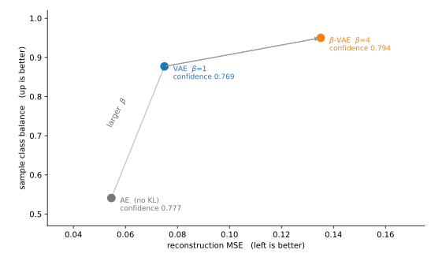

# 잠재 공간 생성 모델 — 전체 그림

<div class="leadbox" markdown>

**들어가는 이야기** — 뽑을 자리를 미리 정해 버리면 된다

앞 절이 벽에 부딪혔다. 숫자를 64개의 수로 줄였다 되살리는 것은 되는데, 아무 수 64개를 지어내 넣으면 숫자가 나오지 않았다. **어디서 뽑아야 하는지를 아무도 가르쳐 준 적이 없기 때문**이다.

이 절이 내놓는 수는 뜻밖에 간단하다. 뽑을 자리를 **나중에 찾지 말고 미리 정해 버린다.** 「네가 만드는 수들은 0 언저리에 둥글게 모여 있어야 한다」고 학습할 때부터 요구해 두는 것이다. 그러면 만들 때는 그 둥근 자리에서 뽑으면 된다.

값은 치른다. 그런 요구를 받은 기계는 되살리기를 조금 못하게 된다 — 요구가 하나 늘었으니 당연하다.

그런데 그 맞바꿈에서 **놀라운 자리가 하나 나온다.** 이 절의 표를 미리 보면, 요구를 걸어도 표본이 더 「숫자다워지지」는 않는다. 확신도는 0.777에서 0.769로 꿈쩍도 하지 않는다. 대신 **열 가지가 고루 나오는 정도**가 0.541에서 0.877로 뛴다. 산 것과 치른 것이 생각하던 것과 다르니, 무엇을 샀는지부터 정확히 적어 두어야 한다.

</div>

[5.1절](../dimreduction/index.md)은 되살리기를 익히고 물음 하나를 남겼다. 잠재 공간에서 점을 뽑아 디코딩하면 없던 그림이 나올 텐데, **어디서 뽑아야 하는가?**

그 절은 오토인코더로는 알 수 없다고 적었다. 이 절은 먼저 그 주장을 **재어 본다.** 그리고 그 주장이 반만 맞았음을 보인다.

---

## 1. 먼저 오토인코더에서 뽑아 본다

주장을 시험하려면 가장 그럴듯한 방법으로 뽑아 보아야 한다. 오토인코더는 잠재 표현이 어떤 분포를 따르는지 알려 주지 않으므로, **실제 잠재 표현의 평균과 표준편차에 맞춘 정규분포**에서 뽑는 것이 가장 자연스러운 시도다.

[5.1절의 마지막 쪽](../dimreduction/06_sampling.md)이 이 실험을 먼저 했다. 아래는 같은 일을 **이 절의 규약으로 다시 돌린 별개의 실행**이므로, 두 쪽의 수가 소수점 아래에서 조금 다르다(확신도 0.859 대 0.862 따위). 어느 한쪽이 틀린 것이 아니라 **다시 돌리면 그만큼 움직인다**는 뜻이며, 그 움직임의 크기를 4절이 따로 잰다.

```python
z_real = encoder(X_test)                                  # 진짜 잠재 표현들
z = torch.randn(5000, k) * z_real.std(0) + z_real.mean(0) # 그 모양에 맞춰 뽑는다
samples = decoder(z)
```

5,000장을 뽑아 [5.1절](../dimreduction/index.md)의 심판(98.83%)에 넣었다.

| 오토인코더에서 뽑은 표본 | 확신도 | 확신 > 0.9 | 클래스 균형도 | 가장 많은 클래스의 몫 |
|---|---|---|---|---|
| AE_MLP-2 | 0.859 | **63.0%** | **0.973** | 15.4% |
| AE_MLP-64 | 0.777 | 41.4% | **0.541** | **66.1%** |

!!! warning "5.1절의 주장은 반만 맞았다"
    [그 절의 마지막 쪽](../dimreduction/06_sampling.md)이 점을 뽑아 넣어 보고 "어디서 뽑아야 숫자가 나오는지 알 수 없다"고 적었다. **잠재 차원이 2일 때는 틀린 말이다.** 맞춘 정규분포에서 뽑으면 63%가 심판이 확신하는 숫자이고, 열 가지가 거의 고르게 나온다(클래스 균형도 0.973).

    잠재 차원이 64일 때 무너진다. 확신하는 표본이 41%로 줄고, 무엇보다 **한 클래스가 66%를 차지한다.**

이 두 모델에서는 잠재 차원을 늘렸을 때 사후에 맞춘 대각 정규분포의 표본이 더 불균형해졌다. 높은 차원에서 실제 잠재 표현의 상관과 비선형 구조를 단일 대각 정규분포가 잘 따르지 못했을 가능성이 있다. 그러나 차원만이 원인이라고 확정하려면 잠재 표현 분포와 디코더의 반응을 추가로 분석해야 한다.

!!! note "가장 흔한 설명 하나는 여기서 들어맞지 않는다"
    이럴 때 흔히 드는 설명은 **"64차원에서는 뽑은 점이 진짜 잠재 표현이 하나도 없는 빈 곳에 떨어진다"**는 것이다. 위 표를 낸 바로 그 모델로 재어 보면 그렇지 않다.

    | | 진짜끼리 가장 가까운 이웃까지 | 뽑은 점에서 가장 가까운 진짜까지 | 비 |
    |---|---|---|---|
    | 잠재 2 | 0.057 | 0.083 | 1.5배 |
    | 잠재 64 | 4.550 | 7.438 | **1.6배** |

    둘 다 중앙값이다. **두 비가 거의 같다.** 곧 64차원에서 뽑은 점이 2차원에서 뽑은 점보다 유난히 더 외딴 곳에 떨어지는 것이 아니다. 반지름도 어긋나지 않는다 — 잠재 64에서 진짜 잠재 표현의 반지름 중앙값이 8.03이고 뽑은 점이 8.06이다.

    그러니 어긋나는 것은 **"어디쯤에"가 아니라 "어느 쪽으로"**다. [5.1절의 마지막 쪽](../dimreduction/06_sampling.md)이 같은 두 모델로 그것을 재어 둔다 — 좌표끼리의 묶임을 버린 정규분포가 덮는 자리가 잠재 2에서는 참 분포보다 **1.01배** 넓을 뿐인데 잠재 64에서는 **576배** 넓다. 뽑은 점은 알맞은 거리에 있으면서 진짜 잠재 표현이 가 본 적 없는 방향에 놓인다. 다만 디코더가 그 방향에서 무엇을 내놓는지는 두 쪽 모두 재지 않았다. ([5.2절의 cVAE 쪽](03_cvae.md)이 조건부 모델에서 같은 종류의 설명을 재어 보고 역시 기각한다.)

    위 수는 저장해 둔 `mnist_ae_mlp64.pt` 로 잰 것이다. 그 체크포인트의 복원 MSE 가 0.05462 로 [5.1절](../dimreduction/03_ae_mlp.md)의 값과 같으므로 같은 모델이다.

---

## 2. 이 절의 세 모델

| 쪽 | 무엇을 더하는가 | 새로 할 수 있게 되는 일 |
|---|---|---|
| [VAE](01_vae.md) | 로스에 KL 항 | **$N(0, I)$에서 그냥 뽑는다** |
| [β-VAE](02_beta_vae.md) | KL 항에 무게 $\beta$ | 되살리기와 분포 커버리지를 **손잡이로 조절한다** |
| [cVAE](03_cvae.md) | 라벨을 함께 넣는다 | **원하는 숫자를 고른다** |

셋 다 인코더를 지닌다는 점이 [5.3절](../generative/index.md)의 GAN과 다르다. 인코더가 있으므로 복원 MSE를 잴 수 있고, 주어진 그림을 잠재 표현으로 되돌릴 수 있다.

---

## 3. 미리 보는 결과

| 잠재 차원 64 | 복원 MSE | 정체 | 표본 확신도 | 표본 클래스 균형도 |
|---|---|---|---|---|
| 오토인코더 ([5.1절](../dimreduction/03_ae_mlp.md)) | **0.0546** | 98.51% | 0.777 | **0.541** |
| [VAE](01_vae.md) ($\beta = 1$) | 0.0750 | 98.06% | 0.769 | **0.877** |
| [β-VAE](02_beta_vae.md) ($\beta = 4$) | 0.1351 | 95.52% | 0.794 | **0.950** |
| [cVAE](03_cvae.md) | 0.0762 | — | 0.861 | — |

한 줄로 적으면 이렇다. **KL 항이 사는 것은 표본이 더 숫자다워지는 것이 아니라 열 가지를 고루 만들게 되는 것이다.** 확신도는 0.777에서 0.769로 꿈쩍도 하지 않고 클래스 균형도만 0.541에서 0.877로 뛴다.



세 점이 **한 줄로 이어진다.** $\beta$는 모델을 좋게 만드는 손잡이가 아니라 **되살리기를 팔아 커버리지를 사는** 손잡이다. 점 옆에 적은 확신도가 0.769부터 0.794 사이에 머무는 것도 함께 보라 — 세로로는 0.541에서 0.950까지 움직이는 동안 그 수는 거의 제자리다.


잠재 차원 2의 비교에서는 VAE가 AE의 표본 지표를 넘지 못했다. 이 결과를 모든 2차원 잠재 모델에서 KL 항이 불필요하다는 결론으로 일반화하지 않는다.

---

## 4. 이 수들을 얼마나 믿을 수 있는가

[4.1절](../../ch04/01_two_ladders.md)이 세운 규율을 따른다. 시드는 42로 고정해 동일 환경에서 재현하기 쉽게 했다. 장치와 라이브러리 버전이 달라져도 완전히 같은 값이 보장되는 것은 아니다. 그러나 **고정은 되풀이를 보장할 뿐 그 값이 분포의 어디쯤인지는 말해 주지 않는다.**

흔들림의 출처가 둘이다.

**샘플링 흔들림** — 같은 모델에서 다른 $z$를 뽑으면 얼마나 달라지는가. 모델을 다시 쓰면 되므로 공짜다. 샘플링 시드 다섯 개로 재었다.

| | 확신도 (스프레드) | 클래스 균형도 (스프레드) |
|---|---|---|
| AE_MLP-2 | 0.855 (0.009) | 0.977 (0.008) |
| AE_MLP-64 | 0.779 (0.005) | 0.539 (0.022) |
| VAE-2 | 0.790 (0.013) | 0.952 (0.005) |
| VAE-64 | 0.762 (0.010) | 0.885 (0.013) |

핵심 차이인 **0.541 대 0.877**은 스프레드의 16~27배다. 표본을 다시 뽑는 것으로는 뒤집히지 않는다.

**학습 흔들림** — 시드가 다르면 다른 모델이 된다. 설정마다 다시 학습해야 하므로 비싸다. 이 절은 처음에 이것을 재지 않고 넘겼는데, 뒤에 [5.3절](../generative/index.md)이 네 모델을 시드 다섯 개씩 다시 학습하면서 함께 쟀다.

!!! warning "그 값을 이 표에 바로 옮겨 적을 수 없다"
    5.3절은 GAN과 공정하게 견주려고 출력을 $[0, 1]$로 자른 뒤 심판에 넣는다. 이 절은 자르지 않는다. 그래서 같은 AE_MLP-64가 이 절에서는 클래스 균형도 0.541, 5.3절에서는 0.580이 된다.

    아래 수는 모두 **5.3절의 잘린 규약**에서 잰 것이다. 이 표의 수와 직접 맞대면 안 되고, **각 평가 조건의 기록으로 따로** 읽어야 한다. 서로 다른 조건의 스프레드를 나눈 비도 직접적인 비교값은 아니다.

두 모델이 서로 다르게 나온다.

| 잠재 차원 64 | 샘플링 스프레드 (이 절) | 학습 스프레드 (5.3 규약) | 몇 배 |
|---|---|---|---|
| **VAE**-64 확신도 | 0.010 | 0.010 | **1배** |
| **VAE**-64 클래스 균형도 | 0.013 | 0.015 | **1배** |
| AE_MLP-64 확신도 | 0.005 | 0.029 | **6배** |
| AE_MLP-64 클래스 균형도 | 0.022 | 0.070 | **3배** |

**VAE는 다시 학습해도 다시 뽑는 것만큼밖에 안 움직인다.** 오토인코더는 서너 배에서 여섯 배까지 움직인다.

까닭을 짐작할 수 있다. KL 항이 잠재 분포를 $N(0, I)$에 붙들어 매므로, VAE는 **다시 학습해도 뽑는 자리가 같다.** 오토인코더의 잠재 표현 구름은 학습이 남기는 대로 놓이고, 거기에 맞춘 정규분포도 그때그때 다른 모양을 쫓는다.

**이것이 KL 항을 넣을 까닭 하나를 더 준다.** 이 절이 내세운 까닭은 고름이었는데(0.541 → 0.877), 여기에 **되풀이됨**이 붙는다. 잠재 공간을 붙들어 맨 쪽이 다시 학습해도 같은 곳에 내려앉는다.

그리고 이 절의 핵심 주장은 그대로 선다. 잘린 규약에서 두 범위는 0.567\~0.637과 0.884\~0.899로, **0.247만큼 떨어져 있고 겹치지 않는다.** 다만 위에 적은 "스프레드의 16\~27배"는 **샘플링** 스프레드로 나눈 값이다. 학습 스프레드로 나누면 3.5배이며, 여전히 뒤집히지 않되 **그만큼 넉넉하지는 않다.**

---

## 연습문제

<div class="drillbox" markdown>

**연습문제 1.** <span class="diff med" title="중간"></span>
본문은 오토인코더에서 뽑을 때 "잠재 표현의 평균과 표준편차에 맞춘 정규분포"를 썼다. 더 나은 방법을 두 가지 생각해 보고, 그래도 64차원에서 잘 안 될 까닭을 말하라.

</div>

??? success "풀이"
    **더 나은 방법.** 잠재 표현들에 가우시안 혼합을 맞춰 뽑거나, 실제 잠재 표현 가운데 이웃한 둘을 골라 그 사이를 이어 뽑을 수 있다. 어느 쪽이든 맞춘 정규분포 하나보다는 데이터가 놓인 자리를 잘 따라간다.

    **그래도 어려운 까닭.** 64차원에서 6만 개의 점은 **너무 성기다.** 데이터가 놓인 면이 몇 차원인지도 모르고, 그 면을 덮으려면 점이 차원 수에 따라 지수로 많이 필요하다. 어떤 분포를 사후에 맞추든 그 면을 정확히 따라가기 어렵다.

    [VAE](01_vae.md)가 다른 일을 하는 것이 여기서 드러난다. VAE는 **잠재 표현을 만든 뒤에 분포를 맞추지 않는다.** 학습하는 내내 조건부 잠재 분포가 사전분포에 가까워지도록 정칙화한다. 정확히 같은 분포가 된다는 보장은 없다. 사후에 맞추는 문제를 사전에 없애는 것이다.
