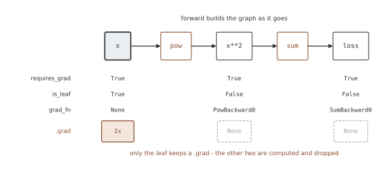
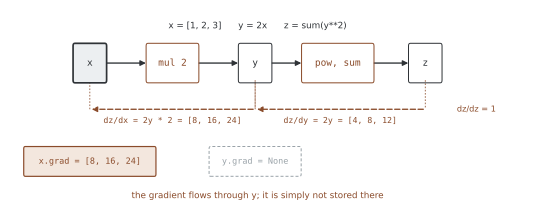
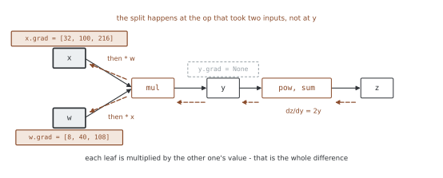
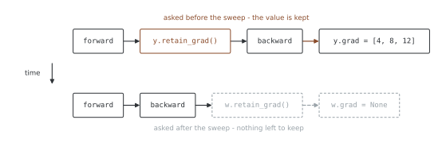

# 스칼라에 대한 기본 역전파

<div class="leadbox" markdown>

**들어가는 이야기** — 지나간 것과 남는 것

어떤 값을 조금 흔들었을 때 결과가 얼마나 따라 흔들리는지를 재는 일을 **미분**이라
하고, 파이토치는 그 값을 계산한 차례를 거꾸로 되짚으며 구한다 — **역전파**다.
그렇게 구해진 값을 **그래디언트**(gradient)라 부른다.

그러면 당연해 보이는 것이 하나 있다. 역전파 경로 위에 놓인 것은 저마다 제 몫의
그래디언트를 받아 들고 있을 것 같다. 길 위에 있었으니 말이다.

**이 쪽의 다섯째 절이 그것을 뒤집는다.** 역전파 경로 한가운데를 분명히 지나간
텐서를 역전파가 끝난 뒤 열어 보면 **비어 있다.** 빠뜨린 것이 아니라 그렇게
만들어 둔 것인데, 그 까닭을 알고 나면 트레인 루프마다 `opt.zero_grad()`를 왜
부르는지도 같이 풀린다.

</div>

$L = \sum_i x_i^2$ 하나를 끝까지 따라간다. 식은 단순하지만 그 과정에서 네 가지
속성이 각자 다른 일을 하고, 그 넷을 섞으면 뒤에 나오는 모든 것이 헷갈린다.

| | 무엇을 말하는가 |
|---|---|
| `requires_grad` | 이 텐서를 **따라갈** 것인가 |
| `is_leaf` | 이 텐서가 `.grad`를 **받을** 것인가 |
| `grad_fn` | 무엇이 이 텐서를 **만들었나** |
| `.grad` | 받은 그래디언트가 **쌓이는** 자리 |



같은 표를 그래프 위에 겹쳐 둔 것이다. **맨 윗줄과 맨 아랫줄이 어긋나는 것**이 이
쪽의 요점이다 — 셋 다 따라가지만 담기는 것은 하나뿐이다.

가장 자주 걸리는 것은 둘째 줄이다. 리프(leaf)가 아닌 텐서, 곧 다른 연산의 결과로 생긴 텐서는 **역전파에 참여하면서도
`.grad`를 받지 않는다.** 지나가기만 한다.

## 1. 코드

```python
"""스칼라 로스의 역전파 — 누가 .grad 를 받는가.

$L = \\sum_i x_i^2$ 하나를 끝까지 따라가며 네 가지를 가른다.

- `requires_grad` — 이 텐서를 따라갈 것인가
- `is_leaf`      — 이 텐서가 `.grad` 를 받을 것인가
- `grad_fn`      — 무엇이 이 텐서를 만들었나
- `.grad`        — 받은 그래디언트가 쌓이는 자리

리프가 아닌 텐서는 역전파에 참여하면서도 `.grad` 를 받지 않는다.
받고 싶으면 `retain_grad()` 로 부탁해야 한다.

실행: 이 쪽의 코드를 파일로 갈무리해 돌린다
"""
# warnings 는 파이썬 표준 라이브러리다. 4·5·6절에서 파이토치가 띄우는 경고문을
# 잠깐 끄는 데 쓴다.
import warnings

# 파이토치를 불러온다. 뒤에 나오는 torch.tensor, torch.randn 이 다 여기서 온다.
import torch


# 절 제목을 찍는 작은 도우미다. f"..." 는 문자열 안의 {title} 자리에 값을 끼워
# 넣는 파이썬 문법이고, \n 은 줄바꿈이라 제목 위에 빈 줄이 하나 생긴다.
def header(title):
    print(f"\n=== {title} ===")


def fn_name(t):
    """grad_fn 은 이름만 적는다. 객체를 그대로 찍으면 메모리 주소가
    따라 나와 돌릴 때마다 달라진다."""
    # t.grad_fn 은 「이 텐서를 만든 연산」을 가리키는 객체다. 연산으로 생긴 텐서가
    # 아니면 None 이다. type(...).__name__ 은 그 객체의 클래스 이름
    # (예: "SumBackward0")만 문자열로 꺼낸다.
    # 「A if 조건 else B」 는 조건이 참이면 A, 아니면 B 를 돌려주는 한 줄짜리 if 다.
    return type(t.grad_fn).__name__ if t.grad_fn is not None else None


# ========================================================================
# 1. 리프 텐서를 만든다
# ========================================================================

def make_leaf():
    header("1. 리프 텐서")
    # 난수의 시드를 0 으로 고정한다. 이렇게 해 두면 아래 randn 이 돌릴 때마다
    # 같은 수를 내놓아, 이 쪽에 실린 출력과 같은 값이 나온다.
    torch.manual_seed(0)
    # 텐서는 파이토치가 다루는 수의 묶음이다. torch.randn(3) 은 표준정규분포에서
    # 뽑은 수 3개를 담은 텐서를 만든다. 형태는 (3,) — 길이 3인 벡터다.
    #
    # requires_grad=True 는 「이 텐서로 미분할 것이니, 이 텐서가 들어간 계산을
    # 모두 기록해 두라」는 표시다. 이것을 경사 추적이라 한다. 기본값은 False 라
    # 적지 않으면 기록하지 않는다.
    x = torch.randn(3, requires_grad=True)
    # x.tolist() 는 텐서를 파이썬 리스트로 바꾼다. [round(v, 4) for v in ...] 는
    # 그 원소를 하나씩 소수점 아래 넷째 자리로 반올림해 새 리스트를 만든다.
    print("  x              :", [round(v, 4) for v in x.tolist()])
    # 역전파를 하기 전에 네 속성을 차례로 찍는다.
    print("  x.requires_grad:", x.requires_grad)      # True — 위에서 건 표시다
    # is_leaf 는 「다른 연산의 결과가 아니라 직접 만든 텐서인가」다. 그런 텐서를
    # 리프 텐서라 하고, 역전파가 그래디언트를 넣어 주는 것은 리프 텐서뿐이다.
    print("  x.is_leaf      :", x.is_leaf, " <- 내가 직접 만들었다")
    print("  x.grad_fn      :", fn_name(x), " <- 만든 연산이 없다")
    # .grad 는 역전파가 구한 그래디언트가 담기는 자리다. 아직은 비어 있어 None 이다.
    print("  x.grad         :", x.grad, " <- 아직 역전파를 안 했다")
    # 뒤의 forward() 와 backward() 가 같은 x 를 이어 쓰도록 돌려준다.
    return x


# ========================================================================
# 2. 순전파가 그래프를 세운다
# ========================================================================

def forward(x):
    header("2. 순전파")
    # 순전파는 식 L = sum_i x_i^2 을 그대로 적으면 된다. x ** 2 는 원소마다 제곱해
    # 형태 (3,) 인 텐서를 만들고(** 는 거듭제곱), .sum() 은 그 셋을 모두 더해
    # 수 하나로 만든다.
    #
    # x 가 경사 추적 중이므로 파이토치는 값을 계산하는 한편 「x 를 제곱하고 더해
    # loss 를 만들었다」는 것을 함께 적어 둔다. 이 기록이 계산 그래프다.
    loss = (x ** 2).sum()
    # .item() 은 수 하나짜리 텐서에서 그 수를 파이썬 실수로 꺼낸다.
    print("  loss = (x**2).sum() =", round(loss.item(), 6))
    # loss.shape 는 텐서의 형태다. 수 하나짜리(스칼라)는 차원이 없어 빈 튜플 ()
    # 로 찍힌다.
    print("  loss.shape   :", tuple(loss.shape), " <- 0차원, 스칼라다")
    # loss 는 연산으로 생긴 텐서라 리프가 아니다(False). 그래서 grad_fn 이 비어
    # 있지 않고, 마지막 연산 sum 을 가리키는 SumBackward0 이 들어 있다.
    print("  loss.is_leaf :", loss.is_leaf)
    print("  loss.grad_fn :", fn_name(loss))
    print("  x -> pow -> sum -> loss 로 이어진 그래프가 세워졌다")
    return loss


# ========================================================================
# 3. 역전파
# ========================================================================

def backward(x, loss):
    header("3. 역전파")
    # loss.backward() 가 역전파다. 순전파가 적어 둔 계산 그래프를 loss 에서 시작해
    # 거꾸로 따라가며 사슬 규칙으로 곱해 나가고, 그 결과 dL/dx 를 리프 텐서 x 의
    # .grad 에 넣어 준다. x.grad 의 형태는 x 와 같은 (3,) 이다.
    loss.backward()
    print("  x.grad     :", [round(v, 4) for v in x.grad.tolist()])
    # 손으로 미분하면 dL/dx_i = 2 * x_i 다. 그 값을 따로 계산해 견준다.
    # x.detach() 는 값은 같지만 계산 그래프에서 떼어 낸 텐서를 돌려준다. 견줄 값을
    # 구하는 일은 모델의 계산이 아니므로 기록에 남기지 않으려고 쓴다.
    print("  손으로 2x  :", [round(v, 4) for v in (2 * x.detach()).tolist()])
    # torch.allclose(a, b) 는 두 텐서의 모든 원소가 부동소수점 오차 안에서 같으면
    # True 를 준다.
    print("  같은가     :", torch.allclose(x.grad, 2 * x.detach()))
    print("  스칼라라 backward() 에 아무것도 안 주어도 된다")
    print("  위에서 내려온 그래디언트를 1 로 놓고 시작한다는 뜻이다")


# ========================================================================
# 4. 리프가 아닌 텐서는 .grad 를 받지 않는다
# ========================================================================

def non_leaf():
    header("4. 리프가 아닌 텐서")
    # 이번에는 손으로 따라가기 쉽게 값을 직접 적어 리프 텐서를 만든다. 형태 (3,).
    x = torch.tensor([1.0, 2.0, 3.0], requires_grad=True)
    y = 2 * x                 # 중간 텐서  y = [2, 4, 6] — 연산의 결과라 리프가 아니다
    z = (y ** 2).sum()        # 4 + 16 + 36 = 56 — 수 하나짜리, 로스 노릇을 한다
    # {값!s:5s} 에서 !s 는 값을 문자열로 바꾸라는 뜻이고 :5s 는 다섯 칸 너비로
    # 찍으라는 뜻이다. True 와 False 의 글자 수가 달라도 줄이 맞는다.
    print(f"  x  is_leaf={x.is_leaf!s:5s} grad_fn={fn_name(x)}")
    print(f"  y  is_leaf={y.is_leaf!s:5s} grad_fn={fn_name(y)}")
    print(f"  z  is_leaf={z.is_leaf!s:5s} grad_fn={fn_name(z)}")
    # z 에서 y 를 거쳐 x 까지 거꾸로 간다.   dz/dx = dz/dy * dy/dx = 2y * 2 = 8x
    z.backward()
    print("  x.grad :", x.grad.tolist(), " <- 받았다")      # 8x = [8, 16, 24]
    # 리프가 아닌 텐서의 .grad 를 읽으면 파이토치가 경고를 띄우고 None 을 준다.
    # with warnings.catch_warnings(): 블록 안에서 simplefilter("ignore") 를 부르면
    # 그 블록 안에서만 경고가 꺼지고, 블록을 나오면 원래대로 돌아온다.
    with warnings.catch_warnings():       # 경고문에 빌드 기계 경로가 붙어 나온다
        warnings.simplefilter("ignore")
        print("  y.grad :", y.grad, " <- 리프가 아니라 못 받는다")
    print("  읽으려 하면 파이토치가 경고를 띄운다 (여기서는 꺼 두었다)")
    print("  y 가 역전파에 참여하지 않은 것이 아니다. 지나가기만 한 것이다")


# ========================================================================
# 5. 리프가 둘이면 둘 다 받는다
# ========================================================================

def two_leaves():
    header("5. 리프가 둘")
    # 리프 텐서를 둘 만든다. 둘 다 경사 추적을 걸었으므로 둘 다 .grad 를 받는다.
    x = torch.tensor([1.0, 2.0, 3.0], requires_grad=True)
    w = torch.tensor([4.0, 5.0, 6.0], requires_grad=True)
    # * 는 같은 자리끼리 곱한다.   y = [1*4, 2*5, 3*6] = [4, 10, 18]
    y = x * w                       # 두 리프가 여기서 만난다
    z = (y ** 2).sum()              # 16 + 100 + 324 = 440
    # backward() 한 번이 곱셈 자리에서 두 길로 갈라져 x 와 w 를 한꺼번에 채운다.
    z.backward()
    print("  y = x * w  :", y.detach().tolist())
    print("  z = sum(y^2):", z.item())
    print("  x.grad     :", x.grad.tolist(), " <- 받았다")
    print("  w.grad     :", w.grad.tolist(), " <- 받았다")
    # y 는 연산의 결과라 이번에도 못 받는다. 4절처럼 경고를 꺼 두고 읽는다.
    with warnings.catch_warnings():
        warnings.simplefilter("ignore")
        print("  y.grad     :", y.grad, " <- 가운데라 못 받는다")
    # 손으로 구한 값과 견준다. 곱셈 y = x * w 의 미분은 상대편 값이다.
    #   dz/dx = dz/dy * dy/dx = 2y * w = [2*4*4, 2*10*5, 2*18*6] = [32, 100, 216]
    #   dz/dw = dz/dy * dy/dw = 2y * x = [2*4*1, 2*10*2, 2*18*3] = [8, 40, 108]
    print("  손으로 2y*w:", (2 * y.detach() * w.detach()).tolist())
    print("  손으로 2y*x:", (2 * y.detach() * x.detach()).tolist())
    print("  같은 y 를 지나왔는데 둘이 받는 값이 다르다")
    print("  갈라지는 자리에서 상대편 값이 곱해지기 때문이다")


# ========================================================================
# 6. retain_grad() 로 부탁한다
# ========================================================================

def retaining():
    header("6. retain_grad()")
    x = torch.tensor([1.0, 2.0, 3.0], requires_grad=True)
    y = 2 * x                          # 중간 텐서  y = [2, 4, 6]
    # retain_grad() 는 리프가 아닌 텐서에게 「이번 역전파에서 네 그래디언트를 버리지
    # 말고 .grad 에 남겨 달라」고 부탁하는 것이다.
    y.retain_grad()                    # 역전파 전에 불러야 한다
    # 로스를 변수에 담지 않고 만든 자리에서 바로 역전파한다. 4절의 z.backward() 와
    # 하는 일이 같다.
    (y ** 2).sum().backward()
    print("  y.grad      :", y.grad.tolist())                 # dz/dy = 2y = [4, 8, 12]
    print("  손으로 2y   :", (2 * y.detach()).tolist())
    print("  x.grad      :", x.grad.tolist())                 # dz/dx = 8x = [8, 16, 24]
    print("  손으로 8x   :", (8 * x.detach()).tolist(), " (dz/dx = 2y*2 = 8x)")
    print("  retain_grad 는 값을 남기고 retain_graph 는 그래프를 남긴다")
    print("  이름이 한 글자 차이라 섞이기 쉽다")

    # 차례를 바꿔 본다. 같은 계산을 하되 retain_grad() 를 역전파 「뒤에」 부른다.
    late = torch.tensor([1.0], requires_grad=True)    # 형태 (1,) 인 리프 텐서
    w = 2 * late                                      # 중간 텐서  w = [2]
    (w ** 2).sum().backward()
    # 역전파는 이미 끝났고 w 의 그래디언트는 버려진 뒤다. 남길 것이 없다.
    w.retain_grad()                    # 역전파 뒤에 부르면
    with warnings.catch_warnings():
        warnings.simplefilter("ignore")
        print("  역전파 뒤에 부르면 w.grad :", w.grad, " <- 늦었다")


def main():
    # 1~3절은 같은 x 와 loss 를 이어 쓰고, 4~6절은 저마다 텐서를 새로 만든다.
    x = make_leaf()
    loss = forward(x)
    backward(x, loss)
    non_leaf()
    two_leaves()
    retaining()


# 이 파일을 직접 돌렸을 때만 main() 을 부른다. 다른 파일이 import 로 불러올
# 때는 함수만 정의되고 아무것도 실행되지 않는다.
if __name__ == "__main__":
    main()
```

**출력:**

```
=== 1. 리프 텐서 ===
  x              : [1.541, -0.2934, -2.1788]
  x.requires_grad: True
  x.is_leaf      : True  <- 내가 직접 만들었다
  x.grad_fn      : None  <- 만든 연산이 없다
  x.grad         : None  <- 아직 역전파를 안 했다

=== 2. 순전파 ===
  loss = (x**2).sum() = 7.207892
  loss.shape   : ()  <- 0차원, 스칼라다
  loss.is_leaf : False
  loss.grad_fn : SumBackward0
  x -> pow -> sum -> loss 로 이어진 그래프가 세워졌다

=== 3. 역전파 ===
  x.grad     : [3.082, -0.5869, -4.3576]
  손으로 2x  : [3.082, -0.5869, -4.3576]
  같은가     : True
  스칼라라 backward() 에 아무것도 안 주어도 된다
  위에서 내려온 그래디언트를 1 로 놓고 시작한다는 뜻이다

=== 4. 리프가 아닌 텐서 ===
  x  is_leaf=True  grad_fn=None
  y  is_leaf=False grad_fn=MulBackward0
  z  is_leaf=False grad_fn=SumBackward0
  x.grad : [8.0, 16.0, 24.0]  <- 받았다
  y.grad : None  <- 리프가 아니라 못 받는다
  읽으려 하면 파이토치가 경고를 띄운다 (여기서는 꺼 두었다)
  y 가 역전파에 참여하지 않은 것이 아니다. 지나가기만 한 것이다

=== 5. 리프가 둘 ===
  y = x * w  : [4.0, 10.0, 18.0]
  z = sum(y^2): 440.0
  x.grad     : [32.0, 100.0, 216.0]  <- 받았다
  w.grad     : [8.0, 40.0, 108.0]  <- 받았다
  y.grad     : None  <- 가운데라 못 받는다
  손으로 2y*w: [32.0, 100.0, 216.0]
  손으로 2y*x: [8.0, 40.0, 108.0]
  같은 y 를 지나왔는데 둘이 받는 값이 다르다
  갈라지는 자리에서 상대편 값이 곱해지기 때문이다

=== 6. retain_grad() ===
  y.grad      : [4.0, 8.0, 12.0]
  손으로 2y   : [4.0, 8.0, 12.0]
  x.grad      : [8.0, 16.0, 24.0]
  손으로 8x   : [8.0, 16.0, 24.0]  (dz/dx = 2y*2 = 8x)
  retain_grad 는 값을 남기고 retain_graph 는 그래프를 남긴다
  이름이 한 글자 차이라 섞이기 쉽다
  역전파 뒤에 부르면 w.grad : None  <- 늦었다
```

## 2. 리프란 내가 만든 것이다

```
x.requires_grad: True
x.is_leaf      : True    <- 내가 직접 만들었다
x.grad_fn      : None    <- 만든 연산이 없다
x.grad         : None    <- 아직 역전파를 안 했다
```

`is_leaf`가 참이라는 것은 **그래프를 거꾸로 거슬러 올라가 더 갈 곳이 없다**는
뜻이다. 내가 `torch.randn(3, requires_grad=True)`으로 만들었으니 그 위에 아무것도
없다.

그래서 `grad_fn`이 `None`이다. 둘은 같은 사실을 두 방향에서 말한다 — 만든 연산이
없으면 리프이고, 리프이면 만든 연산이 없다.

`.grad`가 `None`인 것은 아직 아무것도 안 했기 때문이다. 0이 아니라 `None`인
것에 뜻이 있다. 「Autograd 관련 속성」에서 보았듯 옵티마이저는 이 둘을 다르게
취급한다.

## 3. 순전파가 그래프를 세운다

```
loss.shape   : ()          <- 0차원, 스칼라다
loss.is_leaf : False
loss.grad_fn : SumBackward0
```

`loss = (x ** 2).sum()` 한 줄을 적었을 뿐인데 `x → pow → sum → loss`라는 그래프가
세워졌다. `grad_fn`이 `SumBackward0`인 것은 마지막 연산이 `sum`이었다는 뜻이고,
그 `SumBackward0`이 다시 `PowBackward0`을 가리키고 있다.

## 4. 스칼라이면 `backward()`에 아무것도 안 준다

```
x.grad     : [3.082, -0.5869, -4.3576]
손으로 2x  : [3.082, -0.5869, -4.3576]
```

$\partial L/\partial x_i = 2x_i$가 그대로 나왔다.

`loss.backward()`에 인자를 안 준 것은 **위에서 내려온 그래디언트를 1로 놓는다**는
뜻이다. 로스가 0차원이므로 "로스 자신에 대한 로스의 미분"이 1이고, 거기서
사슬 규칙이 시작된다. 스칼라가 아니면 그 1을 손으로 주어야 하고, 그것이 뒤에 나오는
벡터-야코비안 곱이다.

## 5. 리프가 아니면 `.grad`를 받지 않는다

```
x  is_leaf=True  grad_fn=None
y  is_leaf=False grad_fn=MulBackward0
z  is_leaf=False grad_fn=SumBackward0

x.grad : [8.0, 16.0, 24.0]   <- 받았다
y.grad : None                <- 리프가 아니라 못 받는다
```



`y = 2 * x`는 분명히 역전파에 참여했다. $x$가 그래디언트를 받으려면 $y$를 거쳐야 하기
때문이다. **그림에서 역전파 화살표가 `y`를 그대로 통과한다.** 그런데도 `y.grad`가
`None`이다.

**참여하는 것과 보관하는 것이 다르다.** 중간 텐서의 그래디언트는 계산되어 다음 칸으로
넘겨진 다음 버려진다. 모델 하나에 중간 텐서가 수백만 개일 수 있으니, 전부 들고
있으면 메모리가 남아나지 않는다.

읽으려 하면 파이토치가 경고를 띄운다. 그냥 "없다"가 아니라 **"받고 싶으면
`retain_grad()`를 부르라"**고 알려 주는 경고다.

## 6. 리프가 둘이면 둘 다 받는다

여기까지는 리프가 하나였다. 외줄이라 역전파 경로도 하나였고, 받는 것도 하나였다.
실제 모델은 그렇지 않다 — 레이어 하나에도 `weight`와 `bias`가 리프로 둘 있다.

리프 둘이 한자리에서 만나게 해 본다.

```
y = x * w  : [4.0, 10.0, 18.0]
z = sum(y^2): 440.0
x.grad     : [32.0, 100.0, 216.0]   <- 받았다
w.grad     : [8.0, 40.0, 108.0]     <- 받았다
y.grad     : None                   <- 가운데라 못 받는다
```



**짚고 갈 것이 셋이다.**

**리프 둘이 모두 받았다.** 역전파 경로가 갈라져 양쪽 끝까지 간다. 트레인이 가능한
까닭이 이것이다 — 로스 하나를 역전파하면 모델의 모든 파라메터가 **한 번에** 제
몫을 받는다.

**가운데 `y`는 여전히 못 받는다.** 리프가 둘로 늘어도 규칙은 그대로다. 받는 것은
**내가 만든 것**뿐이다.

**둘이 받은 값이 다르다.** 같은 `y`를 지나왔는데 `[32, 100, 216]`과
`[8, 40, 108]`이다. 까닭은 갈라지는 자리에 있다.

$$
\frac{\partial z}{\partial x} = \frac{\partial z}{\partial y}\cdot\frac{\partial y}{\partial x} = 2y \cdot w,
\qquad
\frac{\partial z}{\partial w} = \frac{\partial z}{\partial y}\cdot\frac{\partial y}{\partial w} = 2y \cdot x
$$

$2y$까지는 **같은 값이 내려온다.** 거기서 한쪽은 $w$를, 다른 쪽은 $x$를 곱한다 —
곱셈의 미분이 **상대편**이기 때문이다. 그림에서 갈래가 `y`가 아니라 **곱셈
칸에서** 생기는 까닭도 이것이다. 입력을 둘 받은 것은 `y`가 아니라 그 연산이다.

!!! note "리프가 셋, 넷이어도 같다"
    역전파는 연산마다 「내가 받은 입력들에게 각각 얼마를 넘길지」를 계산할 뿐이다.
    그 입력이 몇 개든 규칙이 달라지지 않는다. 레이어 수백 개짜리 모델에서도 하는
    일은 이 그림을 깊게 포갠 것뿐이다.

    다만 **같은 리프가 두 길로 도달하면** 이야기가 하나 붙는다. 그때는 두 몫이
    그 리프 하나에 **더해진다** — 「경사 누적」의 그 더하기이고,
    [Autograd 바닥부터 만들기](autograd_from_scratch.md)가 그 자리를 잘못
    구현하면 어떻게 되는지를 재어 보인다.

## 7. `retain_grad()`는 역전파 **전에** 불러야 한다

```
y.grad      : [4.0, 8.0, 12.0]
손으로 2y   : [4.0, 8.0, 12.0]
x.grad      : [8.0, 16.0, 24.0]
손으로 8x   : [8.0, 16.0, 24.0]   (dz/dx = 2y*2 = 8x)
```

둘 다 손으로 계산한 값과 맞는다. 사슬 규칙이 그대로 보인다 —
$\frac{dz}{dx} = \frac{dz}{dy}\frac{dy}{dx} = 2y \cdot 2 = 8x$.

순서가 중요하다.

```
역전파 뒤에 부르면 w.grad : None   <- 늦었다
```



`retain_grad()`는 "이번 역전파에서 네 그래디언트를 남겨 달라"는 부탁이므로, 역전파가
끝난 뒤에 불러 봐야 소용이 없다. 다시 순전파부터 해야 한다.

그리고 이름이 비슷한 둘을 갈라 두자.

| | 무엇을 남기는가 |
|---|---|
| `retain_grad()` | 그 텐서의 **그래디언트 값** |
| `retain_graph=True` | 역전파가 쓰려고 그래프에 저장해 둔 **값** |

## 연습문제

<div class="drillbox" markdown>

**연습문제 1.** <span class="diff easy" title="쉬움"></span>
$f(x) = x^3 - 2x^2 + x$에 대해 autograd로 $f'(3)$을 구하고 손으로 미분한 값과
견주어라. `f` 자체의 `.grad`는 왜 `None`인가?

</div>

??? success "풀이"
    ```python
    # 본문 코드에 이어서 돌린다(import torch 가 되어 있다).
    # 수 하나짜리 리프 텐서 x = 3 을 만들고 경사 추적을 건다.
    x = torch.tensor(3.0, requires_grad=True)
    # 순전파. 식을 그대로 적는다.   f(3) = 27 - 2*9 + 3 = 12
    f = x ** 3 - 2 * x ** 2 + x
    # 역전파. f 가 수 하나짜리라 인자 없이 부르고, df/dx 가 x.grad 에 담긴다.
    f.backward()
    print("  f(3)   :", f.item())            # .item() 은 텐서에서 파이썬 수를 꺼낸다
    print("  x.grad :", x.grad.item())
    # 손으로 미분한 f'(x) = 3x^2 - 4x + 1 에 x = 3 을 넣는다.   27 - 12 + 1 = 16
    print("  손으로 3x^2-4x+1 =", 3 * 3 ** 2 - 4 * 3 + 1)
    # f 는 연산으로 생긴 텐서라 리프가 아니다. 그래서 f.grad 는 채워지지 않는다.
    print("  f.is_leaf :", f.is_leaf)
    ```

    ```
      f(3)   : 12.0
      x.grad : 16.0
      손으로 3x^2-4x+1 = 16
      f.is_leaf : False
    ```

    $f'(x) = 3x^2 - 4x + 1$이므로 $f'(3) = 27 - 12 + 1 = 16$이다.

    `f.grad`가 `None`인 까닭은 5절 그대로다. `f`는 계산으로 생긴 텐서라 리프가
    아니고, 리프가 아니면 `.grad`를 받지 않는다. 게다가 여기서 `f`는 역전파의
    **출발점**이므로 "위에서 내려온 그래디언트"가 곧 1인데, 그 1을 어디에 저장할
    까닭도 없다.

---

<div class="drillbox" markdown>

**연습문제 2.** <span class="diff med" title="중간"></span>
`x`가 `requires_grad=True`일 때, `y = x.detach() * 2`로 만든 `y`에
`retain_grad()`를 부르면 어떻게 되는가? 그리고 그 `y`로 로스를 만들어
`backward()`하면?

</div>

??? success "풀이"
    ```python
    x = torch.tensor([1.0, 2.0], requires_grad=True)     # 형태 (2,) 인 리프 텐서
    # x.detach() 는 값은 같지만 계산 그래프에서 떼어 낸 텐서를 돌려준다. 거기에
    # 2 를 곱한 y = [2, 4] 는 x 와 이어진 기록이 없다.
    y = x.detach() * 2
    print("  y.requires_grad :", y.requires_grad)
    print("  y.is_leaf       :", y.is_leaf)
    # try 블록 안에서 오류가 나면 프로그램이 멈추지 않고 except 블록으로 넘어간다.
    # 오류가 안 나면 try 의 다음 줄(「통과」)이 찍힌다. RuntimeError 는 파이토치가
    # 「이 연산은 할 수 없다」고 거절할 때 내는 오류이고, e 에 그 오류가 담긴다.
    try:
        y.retain_grad()
        print("  retain_grad() 통과")
    except RuntimeError as e:
        # str(e) 는 오류문이다. splitlines()[0] 으로 첫 줄만, [:60] 으로 그 앞
        # 60 글자만 잘라 찍는다.
        print("  retain_grad() :", str(e).splitlines()[0][:60])
    # 같은 방식으로, y 로 만든 로스를 역전파해 본다.
    try:
        (y ** 2).sum().backward()
    except RuntimeError as e:
        print("  backward() :", str(e).splitlines()[0][:66])
    ```

    ```
      y.requires_grad : False
      y.is_leaf       : True
      retain_grad() : can't retain_grad on Tensor that has requires_grad=False
      backward() : element 0 of tensors does not require grad and does not have
    ```

    세 가지가 다 뜻밖일 수 있다.

    **`y`는 리프다.** `detach()`가 그래프를 끊었으므로 `y`는 그래프 바깥에 있고,
    그래프 바깥에 있다는 말과 리프라는 말은 같다. `requires_grad`가 `False`인
    텐서는 언제나 리프다.

    **`retain_grad()`가 거절한다.** 반가운 일이다 — `requires_grad=False`인
    텐서에는 애초에 남길 그래디언트가 없으므로, 조용히 통과시켜 두었다가 나중에
    `.grad`가 `None`인 것을 보고 헤매는 대신 그 자리에서 알려 준다.

    **`backward()`도 터진다.** 뒤로 걸어갈 길이 없기 때문이다. `detach()`가 끊은
    자리에서 그래프가 끝났으므로 `x`까지 갈 수 없고, 엔진이 `element 0 of tensors
    does not require grad`라고 거절한다.

    셋을 합치면 이렇다. **`detach()` 뒤로는 아무 그래디언트도 흐르지 않고, 파이토치가
    그것을 세 번 다 알려 준다.** 조용히 틀리는 쪽이 아니라 터져 주는 쪽이다.

    여기서 가져갈 것은 **`requires_grad=False`와 `is_leaf=True`가 같이 다닌다**는
    점이다. 「Autograd 관련 속성」의 표에서 네 조합 중 셋만 있던 까닭이 이것이다.

---

<div class="drillbox" markdown>

**연습문제 3.** <span class="diff hard" title="어려움"></span>
같은 리프 텐서로 로스를 **세 번** 만들어 `backward()`를 세 번 부르되, 사이에
그래디언트를 지우지 않는다. `x.grad`가 어떻게 변하는가? 그리고 **중간에
`retain_grad()`한 텐서**는 어떻게 되는가?

</div>

??? success "풀이"
    ```python
    # x 는 루프 바깥에서 한 번만 만든다. 세 바퀴가 모두 이 텐서 하나를 쓴다.
    x = torch.tensor([1.0, 2.0], requires_grad=True)
    for i in range(1, 4):              # range(1, 4) 는 1, 2, 3 — 세 바퀴 돈다
        y = 2 * x                      # y = [2, 4] — 바퀴마다 새로 만들어지는 텐서다
        y.retain_grad()                # 리프가 아닌 y 도 .grad 를 남기게 부탁한다
        # 로스 sum(y^2) 을 만들어 바로 역전파한다. 한 번의 몫은
        #   dz/dy = 2y = [4, 8],   dz/dx = 2y * 2 = 8x = [8, 16]
        # 이다. x.grad 를 지우지 않았으므로 이 몫이 바퀴마다 x.grad 에 더해진다.
        (y ** 2).sum().backward()
        print(f"  {i}번째  x.grad = {x.grad.tolist()}   y.grad = {y.grad.tolist()}")
    ```

    ```
      1번째  x.grad = [8.0, 16.0]   y.grad = [4.0, 8.0]
      2번째  x.grad = [16.0, 32.0]   y.grad = [4.0, 8.0]
      3번째  x.grad = [24.0, 48.0]   y.grad = [4.0, 8.0]
    ```

    **`x.grad`는 쌓이는데 `y.grad`는 안 쌓인다.**

    까닭은 둘의 수명이 다르기 때문이다. `x`는 바깥에 있는 **같은 텐서**라서 세
    번의 그래디언트가 전부 그 하나에 더해진다. 반면 `y`는 반복마다 `2 * x`로 **새로
    만들어지는** 텐서다. 매번 다른 객체이므로 쌓일 자리가 없고, 지난 바퀴의 `y`는
    버려진다.

    이것이 트레인 루프에서 `opt.zero_grad()`를 매 스텝 불러야 하는 까닭 전부다.
    파라메터는 루프 바깥에 있는 리프라 지우지 않으면 계속 쌓이고, 중간 엑티베이션 값은
    매 스텝 새로 만들어지므로 신경 쓸 일이 없다.

    쌓이는 것이 기능이라는 점도 기억해 둘 만하다. 「메모리 관리」의 그래디언트 누적은
    이 성질을 일부러 쓰는 것이다 — 배치를 쪼개 여러 번 `backward()`하고 한 번
    `step()`한다.
