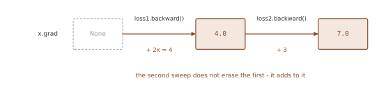
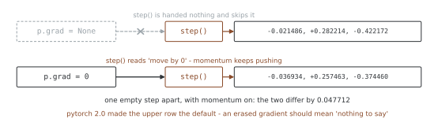
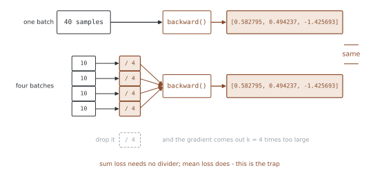
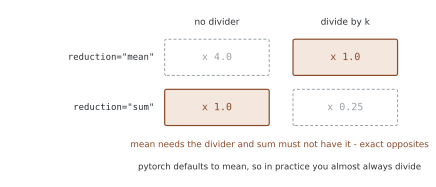

# 경사 누적

<div class="leadbox" markdown>

**들어가는 이야기** — 불편한 기본값

파이토치는 `backward()`를 부를 때마다 그래디언트를 `.grad`에 **덮어쓰지 않고 더한다.** 그래서 트레인
루프마다 지난 값을 지우는 줄을 한 줄 넣어야 하고, 그 줄을 빠뜨리면 트레인이
조용히 망가진다. 「지우는 줄을 잊지 마라」는 파이토치를 처음 배울 때 가장 먼저
듣는 말 가운데 하나다.

왜 덮어쓰도록 만들지 않았을까. **그 불편이 기능이기 때문이다.** 한 번에 올릴 수
없을 만큼 큰 배치를 네 조각으로 쪼개 네 번 역전파하고 한 번만 `step()`하면,
통째로 한 것과 **같은 그래디언트**가 나온다 — 이것을 **그래디언트 누적**(gradient accumulation)이라 한다. 큰 모델을 작은 그래픽카드에서 트레인하는 코드가
거의 다 쓰는 길이고, 이 쪽이 그 「같다」를 재어서 보인다.

다만 단서가 둘 붙는다. 하나는 **한 줄만 빠뜨려도 결과가 정확히 네 배가 되는**
자리이고, 다른 하나는 아무리 정확히 해도 **같아지지 않는 모델**이 있다는
것이다. 둘 다 재어서 확인한다 — 앞엣것은 본문에서, 뒤엣것은 연습문제에서.

</div>

`.grad`는 덮어쓰지 않고 **더한다.** 그래서 트레인 루프마다 지워야 하고, 지우는
줄을 빼먹으면 지난 스텝의 그래디언트가 섞인다.

처음 보면 불편한 기본값이다. 왜 덮어쓰지 않을까. **기능이기 때문이다.** 배치를
쪼개 여러 번 역전파하고 한 번만 `step()`하면 큰 배치와 같은 그래디언트가 나오고, 로스가
여럿일 때 따로 역전파해 더할 수도 있다.

이 쪽은 그 "같다"가 정말 같은지 재어 본다. 결론부터 적으면 **그냥 쪼개서는
같아지지 않는다.** 배치를 $k$조각으로 쪼갰다면 조각마다 **로스를 $k$로 나누어
주어야** 하고, 그 한 줄을 빼면 그래디언트가 정확히 $k$배가 된다.

까닭은 `reduction`에 있다. 파이토치의 로스 함수는 거의 다 `reduction="mean"`이
기본값이라 조각마다 **그 조각의 평균**을 내는데, $k$개를 더하면 전체 평균이
아니라 그 $k$배가 되기 때문이다. 4절 「쪼개서 쌓으면 큰 배치와 같은가」가 `sum`과
`mean`을 나란히 놓고 재고, 연습문제 2가 `sum`에서는 거꾸로 **나누면 틀린다**는
것까지 확인한다.

## 1. 코드

```python
"""그래디언트 누적 — 기본값이 더하기인 까닭.

`.grad` 는 덮어쓰지 않고 **더한다**. 그래서 트레인 루프마다 지워야 하고,
지우지 않으면 지난 스텝의 그래디언트가 섞인다.

버그처럼 보이지만 기능이다. 배치를 쪼개 여러 번 역전파하고 한 번만
갱신하면 큰 배치와 **같은 그래디언트**가 나온다. 이 쪽은 그것이 정말 같은지
재어 본다. 다만 `mean` 로스에서는 쪼갠 수로 나누어 주어야 한다.

실행: 이 쪽의 코드를 파일로 갈무리해 돌린다
"""
# 파이토치를 불러온다. 뒤에 나오는 torch.tensor, torch.randn 이 다 여기서 온다.
import torch


# 절 제목을 찍는 작은 도우미다. f"..." 는 문자열 안의 {title} 자리에 값을 끼워
# 넣는 파이썬 문법이고, \n 은 줄바꿈이다.
def header(title):
    print(f"\n=== {title} ===")


# ========================================================================
# 1. 지우지 않으면 쌓인다
# ========================================================================

def accumulates():
    header("1. 지우지 않으면 쌓인다")
    # torch.tensor(2.0) 은 수 2.0 하나를 담은 텐서를 만든다. 텐서는 파이토치가
    # 다루는 수의 묶음이다. requires_grad=True 는 「이 텐서로 미분할 것이니, 이
    # 텐서가 들어간 계산을 모두 기록해 두라」는 표시다. 이것을 경사 추적이라 한다.
    x = torch.tensor(2.0, requires_grad=True)
    # .grad 는 역전파가 구한 그래디언트가 담기는 자리다. 아직 역전파를 한 번도
    # 안 했으므로 0 이 아니라 None 이다.
    print("  처음 x.grad :", x.grad)
    # 첫째 로스 x^2 을 만들어 바로 역전파한다(** 는 거듭제곱). backward() 는
    # 기록해 둔 계산을 거꾸로 따라가 미분값을 x.grad 에 넣는다.   d(x^2)/dx = 2x = 4
    (x ** 2).backward()
    # .item() 은 수 하나짜리 텐서에서 그 수를 파이썬 실수로 꺼낸다.
    print("  loss1 = x^2 뒤 :", x.grad.item(), " (2x = 4)")
    # x.grad 를 지우지 않은 채 둘째 로스 3x 를 역전파한다.   d(3x)/dx = 3
    # backward() 는 x.grad 를 3 으로 바꾸지 않고 있던 4 에 더한다.   4 + 3 = 7
    (3 * x).backward()
    print("  loss2 = 3x 뒤  :", x.grad.item(), " (4 + 3 = 7)")
    print("  두 로스의 그래디언트가 더해졌다. 덮어쓰지 않는다")


# ========================================================================
# 2. 지우는 두 길이 스텝을 다르게 만든다
# ========================================================================

def two_ways_to_clear():
    header("2. zero_() 와 None")
    x = torch.tensor(2.0, requires_grad=True)
    (x ** 2).backward()                 # x.grad = 4 가 담겼다
    # 지우는 첫째 길. zero_() 는 x.grad 텐서를 「제자리에서」 0 으로 채운다. 이름
    # 끝의 밑줄 _ 은 새 텐서를 만들지 않고 그 텐서 자체를 고친다는 파이토치의
    # 표기다. 텐서는 그대로 남고 값만 0 이 된다.
    x.grad.zero_()
    # type(...).__name__ 은 그 값의 자료형 이름을 문자열로 꺼낸다.
    print("  zero_() 뒤 :", x.grad, " 자료형", type(x.grad).__name__)
    # 지우는 둘째 길. 텐서를 아예 치우고 「없음」으로 되돌린다.
    x.grad = None
    print("  None 으로   :", x.grad, " 자료형", type(x.grad).__name__)

    # 모멘텀이 있으면 이 둘이 다른 스텝을 만든다
    # torch.nn 은 레이어와 로스 함수가 모여 있는 모듈이다. nn 이라는 짧은 이름으로
    # 불러온다.
    import torch.nn as nn
    got = []                            # 두 경우의 웨이트를 차례로 모아 둘 리스트
    # 같은 실험을 두 번 한다. 다른 것은 그래디언트를 None 으로 지우느냐(True)
    # 0 으로 지우느냐(False) 하나뿐이다.
    for set_to_none in (True, False):
        # 난수의 시드를 0 으로 고정한다. 두 바퀴가 똑같은 초기화와 똑같은 데이터로
        # 시작하므로, 결과가 다르면 지우는 방법 탓이다.
        torch.manual_seed(0)
        # nn.Linear(3, 1) 은 입력 3개를 받아 출력 1개를 내는 레이어다. 파라메터는
        # 웨이트(형태 (1, 3))와 바이어스(형태 (1,))이고, 무작위로 초기화된다.
        m = nn.Linear(3, 1)
        # 옵티마이저는 그래디언트를 보고 파라메터를 고쳐 주는 객체다. SGD 는 경사
        # 하강법이고, m.parameters() 로 고칠 파라메터를 넘긴다. lr 는 러닝레이트,
        # momentum=0.9 는 지난 스텝의 움직임을 0.9 배로 이어 가라는 뜻이다.
        opt = torch.optim.SGD(m.parameters(), lr=0.1, momentum=0.9)
        # 배치 하나를 만든다. 입력 xb 는 형태 (5, 3) — 표본 5개, 피처 3개.
        # 맞혀야 할 값 yb 는 형태 (5, 1).
        xb, yb = torch.randn(5, 3), torch.randn(5, 1)
        # m(xb) 가 순전파다(출력 형태 (5, 1)). mse_loss 는 출력과 yb 의 차이를
        # 제곱해 평균 낸 로스이고, 거기서 바로 역전파해 파라메터의 .grad 를 채운다.
        nn.functional.mse_loss(m(xb), yb).backward()
        # step() 이 파라메터를 한 스텝 옮긴다. 이때 모멘텀이 이번 움직임을 기억한다.
        opt.step()
        # 옵티마이저가 맡은 모든 파라메터의 .grad 를 지운다. set_to_none=True 면
        # None 으로, False 면 0 으로 채운 텐서로 남긴다.
        opt.zero_grad(set_to_none=set_to_none)
        opt.step()                      # 그래디언트가 빈 채로 한 스텝 더
        # 두 스텝 뒤의 웨이트를 갈무리한다. detach() 는 계산 그래프에서 떼어 낸
        # 텐서를 주고, flatten() 은 형태 (1, 3) 을 (3,) 으로 펴고, clone() 은 값을
        # 복사한다.
        got.append(m.weight.detach().flatten().clone())
    print("  모멘텀을 켜고 빈 스텝을 한 번 더 밟으면")
    # {v:+.6f} 는 부호를 붙여(+) 소수점 아래 여섯 자리까지 찍으라는 뜻이다.
    print("    set_to_none=True :", [f"{v:+.6f}" for v in got[0].tolist()])
    print("    set_to_none=False:", [f"{v:+.6f}" for v in got[1].tolist()])
    # 두 웨이트의 차이에 절댓값(abs)을 씌워 가장 큰 것(max) 하나를 찍는다.
    print("    차이", f"{(got[0] - got[1]).abs().max():.6f}",
          "— None 은 건너뛰고 0 은 모멘텀이 민다")


# ========================================================================
# 3. 일부러 쌓기 — 큰 배치와 같은가
# ========================================================================

def micro_batching():
    header("3. 쪼개서 쌓으면 큰 배치와 같은가")
    torch.manual_seed(0)
    # 표본 40개짜리 데이터를 만든다. X 는 형태 (40, 3), Y 는 형태 (40, 1).
    X, Y = torch.randn(40, 3), torch.randn(40, 1)
    # 웨이트의 출발값. 형태 (3, 1). 아래 함수들이 모두 이 값을 복사해 시작하므로
    # 견주는 조건이 같다.
    W0 = torch.randn(3, 1)

    # --- 통째로: 40개를 한 번에 넣고 역전파 한 번 ---------------------------------
    def whole(reduction):
        # clone() 으로 W0 을 복사하고 requires_grad_(True) 로 그 복사본에 경사
        # 추적을 건다(밑줄 _ 은 제자리에서 고친다는 뜻). w 가 리프 텐서, 곧 직접
        # 만들어 .grad 를 받는 텐서가 된다.
        w = W0.clone().requires_grad_(True)
        # @ 는 행렬 곱이다. X @ w 는 (40, 3) @ (3, 1) = (40, 1) — 표본마다 예측값
        # 하나다. Y 를 빼고 제곱하면 표본마다의 제곱오차, 형태 (40, 1).
        sq = (X @ w - Y) ** 2
        # reduction 이 "mean" 이면 40개의 평균을, 아니면 합을 로스로 삼아 역전파한다.
        (sq.mean() if reduction == "mean" else sq.sum()).backward()
        # 그래디언트를 복사해 돌려준다. 형태는 w 와 같은 (3, 1).
        return w.grad.clone()

    # --- 쪼개서: k 조각으로 나누어 역전파 k 번, .grad 는 지우지 않는다 -------------
    def split(reduction, k=4, rescale=True):
        w = W0.clone().requires_grad_(True)
        n = len(X) // k                  # 조각 하나의 크기  40 // 4 = 10  (// 는 몫)
        for i in range(k):               # i = 0, 1, 2, 3
            # X[i*n:(i+1)*n] 은 i 번째 조각이다. i = 0 이면 0~9 번, i = 1 이면
            # 10~19 번 표본을 잘라 낸다. 형태 (10, 3). sq 는 형태 (10, 1).
            sq = (X[i * n:(i + 1) * n] @ w - Y[i * n:(i + 1) * n]) ** 2
            # 조각의 로스. mean 이면 「이 조각 10개」의 평균이다.
            part = sq.mean() if reduction == "mean" else sq.sum()
            if rescale and reduction == "mean":
                part = part / k          # 평균의 평균이 되지 않게 맞춘다
            # 사이에 지우는 줄이 없으므로 네 조각의 그래디언트가 w.grad 에 쌓인다.
            part.backward()
        return w.grad.clone()

    # sum 과 mean 두 로스에서 통째로 한 것(a)과 쪼개서 쌓은 것(b)을 견준다.
    for red in ("sum", "mean"):
        a, b = whole(red), split(red)
        # {red:5s} 는 다섯 칸 너비로 찍어 줄을 맞춘다. flatten() 은 형태 (3, 1) 을
        # (3,) 으로 펴고, tolist() 는 파이썬 리스트로 바꾸고, round(v, 6) 은 소수점
        # 아래 여섯째 자리로 반올림한다.
        print(f"  {red:5s} 통째로 {[round(v, 6) for v in a.flatten().tolist()]}")
        print(f"        쪼개서 {[round(v, 6) for v in b.flatten().tolist()]}")
        # torch.allclose 는 두 텐서의 모든 원소가 오차 안에서 같으면 True 다.
        # atol=1e-5 는 0.00001 까지의 차이를 같다고 봐 준다는 뜻이다.
        print(f"        같은가 {torch.allclose(a, b, atol=1e-5)}")
    # mean 로스인데 k 로 나누는 줄을 뺀 경우. 조각 평균 넷이 그대로 쌓인다.
    bad = split("mean", rescale=False)
    print("  mean 인데 k 로 안 나누면 같은가:",
          torch.allclose(whole("mean"), bad, atol=1e-5))
    # 원소끼리 나누어 몇 배인지 본다. 첫 원소 하나만 꺼내 찍는다.
    print("    배수:", round((bad / whole("mean")).flatten()[0].item(), 4),
          "= 쪼갠 수 k")

    # 나누기를 끝으로 미루면 — 수는 같다
    def split_late(k=4):
        w = W0.clone().requires_grad_(True)
        n = len(X) // k
        for i in range(k):
            sq = (X[i * n:(i + 1) * n] @ w - Y[i * n:(i + 1) * n]) ** 2
            sq.mean().backward()         # 나누지 않고 그대로 쌓는다
        # 로스가 아니라 쌓인 그래디언트를 제자리에서 k 로 나눈다(/= 는 나누어 다시
        # 담는다).
        w.grad /= k                      # 다 쌓은 뒤에 한 번만
        return w.grad.clone()

    print("  나누는 자리를 끝으로 미루면")
    print("    조각마다 나눔:", [round(v, 6) for v in split("mean").flatten().tolist()])
    print("    끝에서 한 번:", [round(v, 6) for v in split_late().flatten().tolist()])
    print("    같은가:", torch.allclose(split("mean"), split_late(), atol=1e-6),
          "<- 미분이 선형이니 수는 같다")

    # 그런데 그 사이에 서는 것이 있다
    # late=False 면 조각마다 로스를 4 로 나누고(앞에서 나눔), late=True 면 다 쌓고
    # 클리핑까지 한 뒤에 그래디언트를 4 로 나눈다(끝에서 나눔).
    def clipped(late):
        w = W0.clone().requires_grad_(True)
        n = len(X) // 4
        for i in range(4):
            sq = (X[i * n:(i + 1) * n] @ w - Y[i * n:(i + 1) * n]) ** 2
            (sq.mean() if late else sq.mean() / 4).backward()
        # norm() 은 그래디언트 벡터의 크기(원소 제곱합의 제곱근)다. 클리핑이 보게
        # 될 크기를 미리 적어 둔다.
        norm_before = w.grad.norm().item()
        # 그래디언트 클리핑 — 그래디언트의 크기가 max_norm 을 넘으면 방향은 둔 채
        # 크기가 max_norm 이 되도록 줄인다. 넘지 않으면 그대로 둔다. [w] 는 대상
        # 파라메터의 리스트이고, 밑줄 _ 이 붙었으니 w.grad 를 제자리에서 고친다.
        torch.nn.utils.clip_grad_norm_([w], max_norm=1.0)   # 사이에 서는 줄
        if late:
            w.grad /= 4                  # 1.0 으로 깎인 것을 또 4 로 나눈다
        # (클리핑 전의 크기, 마지막에 남은 크기) 두 수를 함께 돌려준다.
        return norm_before, w.grad.norm().item()

    print("  그래디언트 클리핑을 사이에 끼우면")
    # (late 값, 이름표) 짝을 차례로 꺼내 두 경우를 돌린다.
    for late, tag in [(False, "앞에서 나눔"), (True, "끝에서 나눔")]:
        before, after = clipped(late)
        # {before:7.4f} 는 일곱 칸 너비에 소수점 아래 네 자리로 찍는다.
        print(f"    {tag}  클리핑이 본 크기 {before:7.4f}"
              f"  -> 최종 크기 {after:.4f}")
    print("    같은 max_norm=1.0 인데 결과가 다르다 — 자를 때의 크기가 달랐다")


# ========================================================================
# 4. 로스가 여럿일 때
# ========================================================================

def several_losses():
    header("4. 로스가 여럿일 때")
    # 두 로스가 「같은 순전파」에서 나오는 경우를 본다. 예측 h = 2 * x 를 한 번
    # 만들고, 그 h 하나로 로스 둘을 잰다. 모델의 출력 하나에 로스를 여럿 거는
    # 실제 상황과 같은 형태다.
    #
    # 첫째 길 — 두 로스를 더해 하나로 만든 뒤 역전파를 한 번 한다.
    x = torch.tensor([1.0, 2.0, 3.0], requires_grad=True)     # 형태 (3,)
    h = x * 2                           # 예측 [2, 4, 6] — 두 로스가 함께 쓰는 중간값
    # ((h - 4) ** 2).mean() 은 4 와의 제곱오차 평균(MSE)이고, h.abs().mean() 은
    # 절댓값의 평균(L1)이다. a.add(b) 는 a + b 와 같다. 곧 MSE + 0.1 * L1 이다.
    ((h - 4) ** 2).mean().add(0.1 * h.abs().mean()).backward()
    combined = x.grad.clone()           # 견주려고 복사해 둔다
    print("  합쳐서 한 번 :", [round(v, 6) for v in combined.tolist()])

    # 둘째 길 — 같은 값의 리프 텐서를 새로 만들어 두 로스를 따로 역전파한다.
    y = torch.tensor([1.0, 2.0, 3.0], requires_grad=True)
    h = y * 2                           # 순전파는 한 번뿐이다
    mse = ((h - 4) ** 2).mean()         # (4 + 0 + 4) / 3
    l1 = h.abs().mean()                 # (2 + 4 + 6) / 3 = 4
    # backward() 는 보통 역전파를 마치면 계산 그래프에 저장해 둔 값을 놓아 준다.
    # 두 로스가 h = y * 2 라는 같은 노드를 지나므로, 첫 역전파가 그 노드의 값을
    # 놓아 버리면 둘째 역전파가 지나갈 수 없다. retain_graph=True 는 놓지 말고
    # 남겨 두라는 뜻이다. 빼고 돌리면 둘째 backward() 가 RuntimeError 를 낸다.
    mse.backward(retain_graph=True)        # 그래프를 남겨 두어야 한다
    # d(MSE)/dy = 2(h - 4)/3 * 2 = [-8/3, 0, 8/3]
    print("  MSE 만 하고   :", [round(v, 6) for v in y.grad.tolist()])
    # d(0.1 * L1)/dy = 0.1 * sign(h)/3 * 2 = [1/15, 1/15, 1/15]. y.grad 에 더해진다.
    (0.1 * l1).backward()
    print("  L1 까지 더하면:", [round(v, 6) for v in y.grad.tolist()])
    print("  합쳐서 한 번과 같은가:", torch.allclose(combined, y.grad))
    print("  쌓이는 성질 덕분에 로스를 따로 역전파해도 된다")
    print("  다만 두 로스가 같은 중간값 h 를 지나니 retain_graph=True 가 필요하다")


def main():
    # 네 절은 서로 텐서를 주고받지 않는다. 저마다 새로 만들어 쓴다.
    accumulates()
    two_ways_to_clear()
    micro_batching()
    several_losses()


# 이 파일을 직접 돌렸을 때만 main() 을 부른다. 다른 파일이 import 로 불러올
# 때는 함수만 정의되고 아무것도 실행되지 않는다.
if __name__ == "__main__":
    main()
```

**출력:**

```
=== 1. 지우지 않으면 쌓인다 ===
  처음 x.grad : None
  loss1 = x^2 뒤 : 4.0  (2x = 4)
  loss2 = 3x 뒤  : 7.0  (4 + 3 = 7)
  두 로스의 그래디언트가 더해졌다. 덮어쓰지 않는다

=== 2. zero_() 와 None ===
  zero_() 뒤 : tensor(0.)  자료형 Tensor
  None 으로   : None  자료형 NoneType
  모멘텀을 켜고 빈 스텝을 한 번 더 밟으면
    set_to_none=True : ['-0.021486', '+0.282214', '-0.422172']
    set_to_none=False: ['-0.036934', '+0.257463', '-0.374460']
    차이 0.047712 — None 은 건너뛰고 0 은 모멘텀이 민다

=== 3. 쪼개서 쌓으면 큰 배치와 같은가 ===
  sum   통째로 [23.311787, 19.769474, -57.027729]
        쪼개서 [23.311785, 19.769472, -57.027725]
        같은가 True
  mean  통째로 [0.582795, 0.494237, -1.425693]
        쪼개서 [0.582795, 0.494237, -1.425693]
        같은가 True
  mean 인데 k 로 안 나누면 같은가: False
    배수: 4.0 = 쪼갠 수 k
  나누는 자리를 끝으로 미루면
    조각마다 나눔: [0.582795, 0.494237, -1.425693]
    끝에서 한 번: [0.582795, 0.494237, -1.425693]
    같은가: True <- 미분이 선형이니 수는 같다
  그래디언트 클리핑을 사이에 끼우면
    앞에서 나눔  클리핑이 본 크기  1.6176  -> 최종 크기 1.0000
    끝에서 나눔  클리핑이 본 크기  6.4703  -> 최종 크기 0.2500
    같은 max_norm=1.0 인데 결과가 다르다 — 자를 때의 크기가 달랐다

=== 4. 로스가 여럿일 때 ===
  합쳐서 한 번 : [-2.6, 0.066667, 2.733333]
  MSE 만 하고   : [-2.666667, 0.0, 2.666667]
  L1 까지 더하면: [-2.6, 0.066667, 2.733333]
  합쳐서 한 번과 같은가: True
  쌓이는 성질 덕분에 로스를 따로 역전파해도 된다
  다만 두 로스가 같은 중간값 h 를 지나니 retain_graph=True 가 필요하다
```

## 2. 더해진다

```
loss1 = x^2 뒤 : 4.0   (2x = 4)
loss2 = 3x 뒤  : 7.0   (4 + 3 = 7)
```



두 번째 역전파가 첫 번째 결과를 지우지 않았다. $4 + 3 = 7$이다. `.grad`는
**덮어쓰는 칸이 아니라 더해 담는 그릇**이다.

트레인 루프에서 이것을 안 지우면 어떻게 되는가. 스텝마다 지금까지의 그래디언트가 전부
더해진 값으로 갱신하게 되므로, **스텝이 점점 커지고 방향도 옛 그래디언트에 끌린다.**
발산하기도 하고, 운이 나쁘면 발산하지 않은 채 조금 나쁜 자리로 수렴해서
알아채지 못한다.

## 3. 지우는 두 길

```
zero_() 뒤 : tensor(0.)   자료형 Tensor
None 으로   : None         자료형 NoneType
```

메모리를 아끼는 차이로만 설명되는 일이 많은데, **스텝이 달라진다.**

```
set_to_none=True  : -0.021486  +0.282214  -0.422172
set_to_none=False : -0.036934  +0.257463  -0.374460
차이 0.047712
```



모멘텀을 켜 두고 그래디언트가 빈 채로 한 스텝 더 밟아 보았다. `None`이면 `step()`이
그 파라메터를 **건너뛰고**, 0이면 "0만큼 움직여라"로 읽혀 **모멘텀이 계속
민다.**

파이토치 2.0부터 `zero_grad()`의 기본값이 `set_to_none=True`인 까닭이 이것이다.
그래디언트를 지웠다는 말은 "이번에는 할 말이 없다"는 뜻이어야 한다.

## 4. 쪼개서 쌓으면 큰 배치와 같은가

```
sum   통째로 [23.311787, 19.769474, -57.027729]
      쪼개서 [23.311785, 19.769472, -57.027725]   같은가 True

mean  통째로 [0.582795, 0.494237, -1.425693]
      쪼개서 [0.582795, 0.494237, -1.425693]      같은가 True
```



40개를 한 번에 넣은 것과 10개씩 네 번 넣어 쌓은 것이 **같다.** (소수점 여섯째
자리에서 보이는 차이는 더하는 순서가 달라 생긴 부동소수점 오차다.)

그래서 GPU 메모리가 모자라 배치 256을 못 올릴 때, 64씩 네 번 돌려 쌓고 한 번
`step()`하면 배치 256과 같은 트레인이 된다. 「메모리 관리」에서 본 그 기법이다.

### `mean`에서는 나누어야 한다

```
mean 인데 k 로 안 나누면 같은가: False
  배수: 4.0 = 쪼갠 수 k
```

`sum` 로스는 그냥 쌓으면 맞는다. 쪼갠 조각들의 합이 전체의 합이니까.

`mean`은 다르다. 조각마다 **그 조각의 평균**을 내므로, 넷을 더하면 전체 평균의
**4배**가 된다. 정확히 쪼갠 수만큼이다. 그래서 조각마다 $k$로 나누어 주어야
한다.

```python
# 트레인 루프 안의 두 줄만 떼어 적은 것이다(이 조각만으로는 돌아가지 않는다).
# criterion 은 로스 함수, pred 는 모델의 출력, y 는 맞혀야 할 값이고,
# accumulation_steps 가 쪼갠 수 k 다.
loss = criterion(pred, y) / accumulation_steps    # 이 한 줄
loss.backward()                                   # 1/k 로 줄인 몫이 .grad 에 쌓인다
```

이 줄을 빼먹으면 **실효 러닝레이트가 $k$배**가 된다. 트레인이 터지면 금방 알지만,
터지지 않을 만큼만 크면 "왜 이 설정이 더 안 좋지"로 끝난다.

### 나누는 자리는 왜 `backward()` 앞인가

`backward()`는 **더하기만 한다.** 평균을 내 주지 않으므로 $k$로 줄이는 일은
사람이 적어야 하는데, 그렇다면 **다 쌓은 뒤에 한 번** 나누면 안 되는가? 수만
보면 된다.

```
나누는 자리를 끝으로 미루면
  조각마다 나눔: [0.582795, 0.494237, -1.425693]
  끝에서 한 번: [0.582795, 0.494237, -1.425693]
  같은가: True <- 미분이 선형이니 수는 같다
```

미분은 선형이므로 **$k$번 나누어 쌓으나 쌓아 놓고 한 번 나누나 같다.** 그런데도
관용적으로 앞에서 나눈다. 까닭은 속도가 아니라 **그 사이에 서는 줄들** 때문이다.

```python
# 트레인 루프의 몸통만 떼어 적은 것이다(이 조각만으로는 돌아가지 않는다).
# i 는 지금까지 지나온 조각의 번호(0부터), k 는 쪼갠 수다.
loss.backward()                                        # 이미 1/k 로 쌓였다
# % 는 나머지다. k 조각을 다 쌓았을 때, 곧 k 번에 한 번만 아래를 한다.
if (i + 1) % k == 0:
    # scaler 는 혼합 정밀도 트레인의 GradScaler 다. 키워서 쌓아 둔 그래디언트를
    # 원래 스케일로 되돌린다.
    scaler.unscale_(optimizer)                         # ← 여기가
    # 그래디언트의 크기가 1.0 을 넘으면 1.0 이 되도록 줄인다(그래디언트 클리핑).
    nn.utils.clip_grad_norm_(model.parameters(), 1.0)  # ← 그 사이다
    # 옵티마이저가 파라메터를 한 스텝 옮기고, 다음 k 조각을 위해 .grad 를 지운다.
    optimizer.step(); optimizer.zero_grad()
```

`clip_grad_norm_`은 그래디언트의 **크기**를 보고 자른다. 그러니 자를 때 그 크기가
$k$배로 부풀어 있으면 다른 데서 잘린다.

```
그래디언트 클리핑을 사이에 끼우면
  앞에서 나눔  클리핑이 본 크기  1.6176  -> 최종 크기 1.0000
  끝에서 나눔  클리핑이 본 크기  6.4703  -> 최종 크기 0.2500
  같은 max_norm=1.0 인데 결과가 다르다 — 자를 때의 크기가 달랐다
```

같은 `max_norm=1.0`인데 한쪽은 `1.0000`으로, 다른 쪽은 `0.2500`으로 끝났다.
정확히 $1/k$다. 뒤에서 나누면 클리핑이 **4배짜리 그래디언트**를 보고 1.0으로 깎은
다음 그것을 또 4로 나누기 때문이다. 혼합 정밀도의 `GradScaler`도 같은 자리에
서고, 조각마다 $k$배인 값을 쌓는 동안 `float16`에서 오버플로가 날 여지도 그만큼 는다.

그래서 **뒤에서 나누려면 이 줄들보다 앞에 끼워 넣어야** 하는데, 그러면 「끝에서
한 번」이 아니라 결국 같은 자리로 돌아온다. 처음부터 로스를 나누면 한 줄로
끝난다.

!!! note "세 가지를 갈라 둔다"
    「경사 누적」이라는 말 아래 서로 다른 셋이 붙어 있다. 목적이 다르다.

    | | 무엇을 위한 것인가 |
    |---|---|
    | 쪼개서 쌓는 것 자체 | **메모리** — 시간을 치르고 산다 |
    | 조각마다 $k$로 나누기 | **정확성** — 안 하면 그래디언트가 $k$배다 |
    | 나누기를 `backward()` 앞에 두기 | **클리핑·`GradScaler`와의 순서** |

    첫 줄이 특히 헷갈린다. 그래디언트 누적은 **빨라지는 기법이 아니다.** 통째로
    올릴 수만 있으면 통째가 언제나 빠르다 — 순전파와 역전파를 $k$번 하니까.
    쓰는 까닭은 하나뿐이다. **배치 256이 메모리에 안 올라가는데 배치 256의
    그래디언트가 필요할 때.** 그 거래가 얼마짜리인지는
    [큰 배치를 위한 경사 누적](19_gradient_accumulation_for_large_batches.md)이
    두 축으로 잰다.

## 5. 로스가 여럿일 때

```
합쳐서 한 번 : [-2.6, 0.066667, 2.733333]
MSE 만 하고   : [-2.666667, 0.0, 2.666667]
L1 까지 더하면: [-2.6, 0.066667, 2.733333]
합쳐서 한 번과 같은가: True
```

`(mse + 0.1 * l1).backward()`와 `mse.backward()` 다음 `(0.1 * l1).backward()`가
같은 결과를 준다. 쌓이는 성질 덕분이다.

둘째 길에는 `retain_graph=True`가 필요하다. 두 로스가 같은 순전파의 중간값
`h = y * 2`를 **함께 지나므로**, 첫 역전파가 그 노드에 저장된 값을 놓아 주면 둘째가
걸을 길이 없다. 필요한 까닭은 「로스가 둘이라서」가 아니라 **중간 노드를 나누어
쓰기 때문**이다 — 두 로스가 리프 텐서만 함께 쓰고 그 뒤의 계산이 서로 겹치지
않으면 `retain_graph` 없이도 된다. 모델의 출력 하나에 로스를 여럿 거는 흔한
경우는 앞엣것이다.

실전에서는 대개 합쳐서 한 번 부르는 쪽이 낫다 — 그래프를 한 번만 걸으므로 빠르고
`retain_graph`도 필요 없다. 따로 부르는 것이 쓸모 있는 자리는 **로스마다 다른
파라메터 묶음에 그래디언트를 보내야 할 때**(GAN의 제너레이터·디스크리미네이터 같은 경우)다.

## 연습문제

<div class="drillbox" markdown>

**연습문제 1.** <span class="diff easy" title="쉬움"></span>
`zero_grad()`를 빼먹은 트레인 루프를 다섯 스텝 돌려 `w.grad`가 어떻게 변하는지
보라. 제대로 지운 쪽과 견주어라.

</div>

??? success "풀이"
    ```python
    # 본문 코드에 이어서 돌린다(import torch 가 되어 있다).
    # 같은 트레인 루프를 두 번 돈다. clear 가 True 면 스텝마다 그래디언트를
    # 지우고, False 면 지우지 않는다.
    for label, clear in (("지운다  ", True), ("안 지운다", False)):
        # 파라메터 w 를 5 에서 시작한다. 로스 (w - 1)^2 이 가장 작은 곳은 w = 1 이다.
        w = torch.tensor(5.0, requires_grad=True)
        for step in range(5):          # 다섯 스텝
            # 첫 스텝에는 w.grad 가 아직 None 이라 지울 것이 없다. 그래서 None 이
            # 아닐 때만 zero_() 로 제자리에서 0 으로 채운다.
            if clear and w.grad is not None:
                w.grad.zero_()
            # 순전파와 역전파.   d/dw (w - 1)^2 = 2(w - 1) — 첫 스텝에는 2*4 = 8
            ((w - 1) ** 2).backward()
            # 경사 하강법 한 스텝. 파라메터를 고치는 일은 모델의 계산이 아니므로
            # torch.no_grad() 블록 안에서 해 기록을 남기지 않는다. -= 는 w 를 새로
            # 만들지 않고 제자리에서 고친다. 러닝레이트는 0.1 이다.
            with torch.no_grad():
                w -= 0.1 * w.grad      # 첫 스텝: 5 - 0.1 * 8 = 4.2
        # {값:8.4f} 는 여덟 칸 너비에 소수점 아래 네 자리로 찍는다.
        print(f"  {label}  w = {w.item():8.4f}   마지막 grad = {w.grad.item():8.4f}")
    ```

    ```
      지운다    w =   2.3107   마지막 grad =   3.2768
      안 지운다  w =  -2.2397   마지막 grad =  14.2208
    ```

    참값은 $w = 1$이다. 지운 쪽은 5에서 2.31까지 내려왔고, 안 지운 쪽은 **1을
    지나쳐 −2.24까지 넘어갔다.**

    스텝마다 지난 그래디언트가 더해지니 스텝이 점점 커지고, 최솟값에 닿은 뒤에도 그
    관성으로 지나쳐 버린다. 여기서는 발산까지 가지 않았지만, 러닝레이트가 조금만
    컸어도 터졌을 것이다.

    **터지면 차라리 다행이다.** 이 보기처럼 "조금 나쁜 답"으로 끝나면 버그가
    숨는다.

---

<div class="drillbox" markdown>

**연습문제 2.** <span class="diff med" title="중간"></span>
배치 32를 한 번에 쓰는 것과 8씩 네 번 쌓는 것이 같아지려면 로스를 어떻게
적어야 하는가? `reduction="mean"`과 `"sum"` 두 경우를 모두 확인하라.

</div>

??? success "풀이"
    ```python
    # torch.nn.functional 에는 로스 함수가 함수 꼴로 모여 있다. F 라는 이름으로
    # 불러온다. (import torch 는 본문 코드에서 이미 했다.)
    import torch.nn.functional as F

    torch.manual_seed(0)               # 난수를 고정해 돌릴 때마다 같은 수가 나오게 한다
    # 배치 32개. X 는 형태 (32, 4), Y 는 형태 (32, 1), 웨이트의 출발값 W0 은 (4, 1).
    X, Y = torch.randn(32, 4), torch.randn(32, 1)
    W0 = torch.randn(4, 1)

    # 로스의 reduction, 쪼갠 수 k, 조각 로스를 k 로 나눌지(divide)를 받아
    # 쌓인 그래디언트를 돌려준다.
    def run(reduction, k, divide):
        # W0 을 복사해 경사 추적을 건다. w 가 .grad 를 받는 리프 텐서다.
        w = W0.clone().requires_grad_(True)
        if k == 1:
            # 통째로. X @ w 는 행렬 곱으로 낸 예측값, 형태 (32, 1) 이다. mse_loss 는
            # 예측값과 Y 의 제곱오차를 reduction 에 따라 평균("mean") 내거나
            # 더한다("sum").
            F.mse_loss(X @ w, Y, reduction=reduction).backward()
        else:
            n = 32 // k                # 조각 하나의 크기  32 // 4 = 8
            for i in range(k):
                # i 번째 조각(표본 i*n 번부터 (i+1)*n - 1 번까지)의 로스.
                l = F.mse_loss(X[i*n:(i+1)*n] @ w, Y[i*n:(i+1)*n],
                               reduction=reduction)
                # divide 가 참이면 k 로 나눈 로스를, 아니면 그대로 역전파한다.
                # 지우지 않으므로 w.grad 에 쌓인다.
                (l / k if divide else l).backward()
        return w.grad.clone()          # 형태 (4, 1)

    for red in ("mean", "sum"):
        base = run(red, 1, False)      # 견줄 기준 — 32개를 통째로 넣은 그래디언트
        for divide in (False, True):
            g = run(red, 4, divide)    # 8개씩 네 번 쌓은 그래디언트
            # 기준의 몇 배인지 원소끼리 나누어 보고 첫 원소 하나를 꺼낸다.
            r = (g / base).flatten()[0].item()
            # {divide!s:5s} 는 True/False 를 문자열로 바꿔 다섯 칸 너비로 찍는다.
            # allclose 는 두 텐서가 오차(atol=1e-5) 안에서 같으면 True 다.
            print(f"  {red:5s} k=4 나누기={divide!s:5s}  "
                  f"전체 대비 {r:.4f}배  같은가 {torch.allclose(base, g, atol=1e-5)}")
    ```

    ```
      mean  k=4 나누기=False  전체 대비 4.0000배  같은가 False
      mean  k=4 나누기=True   전체 대비 1.0000배  같은가 True
      sum   k=4 나누기=False  전체 대비 1.0000배  같은가 True
      sum   k=4 나누기=True   전체 대비 0.2500배  같은가 False
    ```

    **정확히 반대다.**

    

    | | 나누어야 하는가 |
    |---|---|
    | `reduction="mean"` | **그렇다** — 안 나누면 $k$배 |
    | `reduction="sum"` | **아니다** — 나누면 $1/k$배 |

    까닭은 한 줄로 적힌다. `sum`은 쪼개도 합이 보존되지만 `mean`은 보존되지
    않는다. 조각 평균 넷을 더하면 전체 평균의 네 배다.

    파이토치의 로스 함수가 거의 다 `reduction="mean"`을 기본값으로 두고 있으므로,
    **실전에서는 거의 언제나 나누어야 한다**고 기억해 두면 맞는다.

    조각 크기가 고르지 않으면(마지막 조각이 짧을 때) `/k`도 정확하지 않다.
    엄밀히 하려면 조각마다 `len(batch) / total`을 곱해야 한다.

---

<div class="drillbox" markdown>

**연습문제 3.** <span class="diff hard" title="어려움"></span>
그래디언트 누적이 큰 배치와 "같다"고 했다. **같지 않은 것**은 무엇인가? 배치 정규화가
들어 있는 모델에서 확인하라.

</div>

??? success "풀이"
    ```python
    # torch.nn 은 레이어가 모여 있는 모듈이다. (import torch 는 본문 코드에서 했다.)
    import torch.nn as nn

    torch.manual_seed(0)
    X = torch.randn(32, 4)             # 배치 32개, 피처 4개 — 형태 (32, 4)

    # 배치를 k 조각으로 쪼개 쌓은 그래디언트와, 배치 정규화가 그동안 모은 평균을
    # 돌려준다. k = 1 이면 통째로다.
    def grads(k):
        # 모델을 만들기 직전에 시드를 다시 박는다. 그래야 k 가 달라도 모델의
        # 초기화가 똑같다.
        torch.manual_seed(0)
        # nn.Sequential 은 레이어를 차례로 이어 붙인 모델이다.
        #   nn.Linear(4, 8)    입력 4개 -> 출력 8개
        #   nn.BatchNorm1d(8)  배치 정규화 — 그 배치의 평균과 표준편차로 8개 피처를
        #                      저마다 정규화한다
        #   nn.Linear(8, 1)    입력 8개 -> 출력 1개
        net = nn.Sequential(nn.Linear(4, 8), nn.BatchNorm1d(8), nn.Linear(8, 1))
        net.zero_grad()                # 모든 파라메터의 .grad 를 비우고 시작한다
        n = 32 // k                    # 조각 하나의 크기
        for i in range(k):
            # 조각을 모델에 넣고(출력 형태 (n, 1)), 출력을 제곱해(pow(2)) 모두 더한
            # 것을 로스로 삼는다. sum 로스이므로 쪼개도 합은 그대로인데, 여기서는
            # 조각마다 k 로 나누어 쌓는다. 통째(k = 1)일 때는 1 로 나누니 그대로다.
            (net(X[i * n:(i + 1) * n]).pow(2).sum() / k).backward()
        # net.parameters() 는 모델의 모든 파라메터를 차례로 내준다. 저마다의 .grad
        # 를 한 줄로 펴서(flatten) torch.cat 으로 이어 붙이면 긴 벡터 하나가 된다.
        g = torch.cat([p.grad.flatten() for p in net.parameters()])
        # net[1] 은 둘째 레이어, 곧 배치 정규화다. running_mean 은 지나간 배치들의
        # 평균을 이동평균으로 모아 둔 값이다. 형태 (8,).
        rm = net[1].running_mean.clone()
        return g, rm

    g1, rm1 = grads(1)                 # 32개를 통째로
    g4, rm4 = grads(4)                 # 8개씩 네 번
    # allclose 는 두 텐서의 모든 원소가 오차(atol) 안에서 같으면 True 다.
    print("  그래디언트가 같은가        :", torch.allclose(g1, g4, atol=1e-5))
    print("  가장 큰 차이         :", f"{(g1 - g4).abs().max():.6f}")
    print("  running_mean 이 같은가:", torch.allclose(rm1, rm4, atol=1e-6))
    print("  running_mean[:3] 통째:", [round(v, 5) for v in rm1[:3].tolist()])
    print("  running_mean[:3] 쪼갬:", [round(v, 5) for v in rm4[:3].tolist()])
    ```

    ```
      그래디언트가 같은가        : False
      가장 큰 차이         : 16.036142
      running_mean 이 같은가: False
      running_mean[:3] 통째: [-0.04642, -0.01221, -0.03849]
      running_mean[:3] 쪼갬: [-0.16165, -0.04048, -0.13295]
    ```

    **그래디언트도 다르고 `running_mean`도 다르다.**

    배치 정규화는 **그 배치 안에서** 평균과 표준편차를 낸다. 32개로 낸 통계와
    8개로 낸 통계는 다르므로, 정규화된 값이 달라지고 따라서 그래디언트도 달라진다.
    4절에서 같았던 것은 모델에 배치 간 상호작용이 없었기 때문이다.

    차이가 작지도 않다. 가장 큰 그래디언트 성분이 **16이나 벌어진다.**

    `running_mean`은 더 어긋난다. 쪼개면 갱신이 네 번 일어나므로 이동평균이 네
    스텝 가고, 값이 서너 배로 벌어졌다. 통계가 다른 속도로 쌓인다는 뜻이다.

    그래서 그래디언트 누적이 큰 배치와 같다는 말에는 단서가 붙는다 —
    **표본끼리 섞이지 않는 모델에서만** 그렇다. 배치 정규화가 있으면 다르고,
    대조 학습처럼 배치 안에서 짝을 짓는 로스도 다르다.

    실전의 해법은 배치 정규화를 **그룹 정규화나 레이어 정규화로 바꾸는 것**이다.
    둘 다 표본마다 따로 통계를 내므로 배치 크기에 휘둘리지 않고, 그래서 그래디언트
    누적과도 잘 맞는다. 큰 모델을 작은 GPU에서 트레인하는 코드가 거의 배치
    정규화를 쓰지 않는 까닭이 이것이다.
