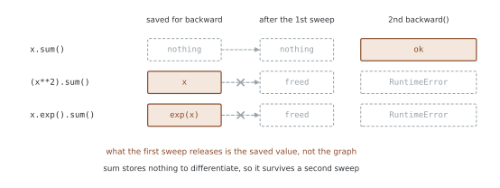
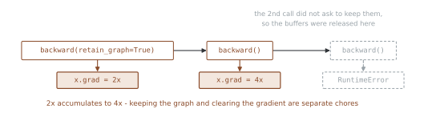
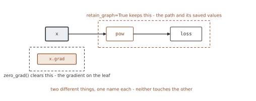

# retain_graph

<div class="leadbox" markdown>

**들어가는 이야기** — 같은 코드가 어떤 식에서는 터진다

파이토치를 쓰다 보면 반드시 한 번은 만나는 오류문이 있다. 미분을 두 번 구하려
했더니 **「이 길은 이미 한 번 지나갔다」**며 거절하는 것이다. 그래서 「미분은 한
번만 구할 수 있다」고 외워 두게 된다.

그런데 그 규칙은 틀렸다. **똑같이 두 번 구해도 멀쩡히 되는 식이 있다.** 식이
더 쉬워서도, 더 짧아서도 아니다. 이 쪽의 첫 실험이 세 식을 나란히 놓고 가르는
자리를 짚는다.

그리고 오류문을 보자마자 붙이게 되는 그 `retain_graph=True`는 **대개 잘못된
고침**이다. 무엇을 붙들어 두는 말인지, 그리고 비슷하게 생긴 다른 이름과 어떻게
다른지를 갈라 두지 않으면 메모리만 더 쥔 채로 넘어가게 된다.

</div>

`backward()`를 두 번 부르면 터진다고 흔히 말한다. 정확하지 않다. 터지는 그래프가
있고 **안 터지는 그래프가 있다.**

터지는 까닭은 그래프가 사라져서가 아니라 **역전파가 저장해 둔 값이
해제되어서**다. 저장할 것이 없는 연산은 두 번 걸어도 멀쩡하다.

그 「저장해 둔 값」이 꼭 중간값인 것은 아니다. $x^2$을 미분하려면 $x$가 있어야
하니 **리프가 저장되기도 한다.** 리프(leaf)는 연산의 결과가 아니라 사용자가 직접
만든 텐서, 곧 계산 그래프의 맨 끝 입력이다. 3절이 그것을 재어 보인다.

그리고 이 쪽에서 가장 자주 섞이는 것이 하나 더 있다. `retain_graph`는 그래디언트를
지우는 일과 **아무 상관이 없다.**

| | 무엇을 맡는가 |
|---|---|
| `retain_graph=True` | 순전파가 세운 길과 **역전파가 저장해 둔 값** |
| `zero_grad()` | 리프에 쌓인 그래디언트를 **`None`으로** (기본값) |
| `.grad.zero_()` | 리프에 쌓인 그래디언트를 **0으로 채운 텐서**로 |

## 1. 코드

```python
"""계산 그래프 재사용 — 무엇이 해제되고 무엇이 남는가.

`backward()` 를 두 번 부르면 터진다고 흔히 말한다. 정확히는
**역전파가 저장해 둔 값이 해제되어** 터지는 것이고, 저장할 것이
없는 그래프는 두 번 불러도 멀쩡하다.

저장되는 것이 꼭 중간값인 것은 아니다 — `x**2` 는 `x` 자신을 저장하고,
`x` 는 리프다.

`retain_graph=True` 는 그 값을 남겨 달라는 부탁이다. 그래디언트를 지우는
일과는 아무 상관이 없다 — 흔히 섞이는 자리다.

- 그래프: 순전파가 세운 길과 거기 저장된 값. `retain_graph` 가 맡는다
- 그래디언트: 리프에 쌓이는 값. `zero_grad()` 가 맡는다

실행: 이 쪽의 코드를 파일로 갈무리해 돌린다
"""
# 파이토치를 불러온다. 뒤에 나오는 torch.tensor, torch.randn 이 다 여기서 온다.
import torch


# 절 제목을 찍는 작은 도우미다. f"..." 는 문자열 안의 {title} 자리에 값을 끼워
# 넣는 파이썬 문법이고, \n 은 줄바꿈이다.
def header(title):
    print(f"\n=== {title} ===")


# ========================================================================
# 1. 두 번 부르면 터지는 그래프와 안 터지는 그래프
# ========================================================================

def twice():
    header("1. 두 번 부르면")
    # 세 식을 (이름, 식을 만드는 함수, 까닭) 세 개짜리 묶음으로 늘어놓는다.
    # 「lambda t: t.sum()」 은 t 를 받아 t.sum() 을 돌려주는 이름 없는 함수다.
    #   t.sum()        원소를 모두 더한다
    #   (t ** 2).sum() 원소마다 제곱해(** 는 거듭제곱) 더한다
    #   t.exp().sum()  원소마다 e 의 거듭제곱을 취해 더한다
    builders = (("x.sum()", lambda t: t.sum(), "저장할 것이 없다"),
                ("(x**2).sum()", lambda t: (t ** 2).sum(), "x 를 저장한다"),
                ("x.exp().sum()", lambda t: t.exp().sum(), "exp(x) 를 저장한다"))
    # 묶음을 하나씩 꺼내 expr, build, why 에 나누어 담는다.
    for expr, build, why in builders:
        # 식마다 리프 텐서, 곧 직접 만든 텐서를 새로 만든다. 형태 (2,).
        # requires_grad=True 는 「이 텐서로 미분할 것이니, 이 텐서가 들어간 계산을
        # 모두 기록해 두라」는 표시다. 이것을 경사 추적이라 한다.
        x = torch.tensor([1.0, 2.0], requires_grad=True)
        # 순전파. y 는 수 하나짜리 텐서다. 파이토치는 값을 계산하는 한편 「y 를
        # x 로 어떻게 만들었는가」를 함께 적어 둔다. 이 기록이 계산 그래프다.
        y = build(x)
        # 첫째 역전파. backward() 는 계산 그래프를 y 에서 시작해 거꾸로 따라가며
        # dy/dx 를 구해 x.grad 에 넣는다. 다 끝나면 미분하려고 그래프에 저장해
        # 두었던 값을 놓아 준다.
        y.backward()
        # 같은 y 에 한 번 더 부른다. try 블록 안에서 오류가 나면 프로그램이 멈추지
        # 않고 except 블록으로 넘어간다. 오류가 안 나면 try 의 다음 줄이 찍힌다.
        # RuntimeError 는 파이토치가 「이 연산은 할 수 없다」고 거절할 때 내는
        # 오류이고, e 에 그 오류가 담긴다.
        try:
            y.backward()
            # {expr:14s} 는 열네 칸 너비로 찍어 줄을 맞춘다.
            print(f"  {expr:14s} 두 번째도 된다   ({why})")
        except RuntimeError as e:
            # str(e) 는 오류문이다. splitlines()[0] 으로 첫 줄만, [:40] 으로 그 앞
            # 40 글자만 잘라 찍는다.
            print(f"  {expr:14s} {str(e).splitlines()[0][:40]}...  ({why})")
    print("  '그래프가 사라져서' 가 아니라 '저장해 둔 값이 해제되어서' 다")


# ========================================================================
# 2. 놓아줄 때 무엇이 사라지는가
# ========================================================================

def what_is_released():
    # 셋 다 파이썬 표준 라이브러리다. 이 함수에서만 쓰므로 여기서 불러온다.
    #   gc      쓰이지 않는 객체를 치우는 가비지 컬렉터
    #   sys     getrefcount — 어떤 객체를 가리키는 참조가 몇 개인지 센다
    #   weakref 약한 참조 — 객체를 붙들지 않고 「아직 살아 있나」만 물어볼 수 있다
    import gc
    import sys
    import weakref
    header("2. 놓아줄 때 무엇이 사라지는가")

    # 난수의 시드를 고정한다. 아래에서 뽑는 텐서가 돌릴 때마다 같은 값이 된다.
    torch.manual_seed(0)
    # (가) 그래프만 붙들고 있던 값 — 메모리에서 풀린다
    # torch.randn(1000, 1000) 은 표준정규분포에서 뽑은 수로 채운 형태
    # (1000, 1000) 인 텐서다. 값은 쓰지 않고 살아 있는지만 보므로 시드가 필요 없다.
    a = torch.randn(1000, 1000, requires_grad=True)
    mid = a * 2                  # 중간값. 형태 (1000, 1000)
    # mid ** 2 를 미분하려면 mid 가 있어야 하므로 계산 그래프가 mid 를 저장해 둔다.
    out = (mid ** 2).sum()
    # 약한 참조를 건다. ref() 를 부르면 mid 가 살아 있을 때는 그 텐서를, 메모리에서
    # 사라졌으면 None 을 준다. 약한 참조 자신은 mid 를 살려 두지 않는다.
    ref = weakref.ref(mid)
    del mid                      # 이제 이것을 붙든 것은 그래프뿐이다
    gc.collect()                 # 치울 것이 있으면 지금 치우게 한다
    print("  (가) 그래프만 붙들던 중간값")
    print("       역전파 전 살아 있나 :", ref() is not None)
    # 역전파가 끝나면 그래프가 저장해 둔 값을 놓는다. 붙드는 것이 더 없으니
    # 그 텐서가 메모리에서 사라진다.
    out.backward()
    gc.collect()
    print("       역전파 뒤 살아 있나 :", ref() is not None, " <- 풀렸다")

    # (나) 내가 들고 있는 리프가 저장된 경우 — 값은 그대로다
    b = torch.tensor([1.0, 2.0, 3.0], requires_grad=True)
    y = b ** 2                   # PowBackward0 는 b 자신을 저장한다
    print("  (나) 저장된 것이 리프일 때")
    # y.grad_fn 은 「y 를 만든 연산」을 가리키는 객체(여기서는 PowBackward0)다.
    # _saved_self 는 그 연산이 역전파에 쓰려고 저장해 둔 입력, 곧 b 의 값이다.
    print("       역전파 전 저장된 값 :", y.grad_fn._saved_self.tolist())
    y.sum().backward()
    # 역전파 뒤에 같은 저장값을 읽어 본다. 이미 놓아 준 뒤라 파이토치가 거절한다.
    try:
        y.grad_fn._saved_self
    except RuntimeError as e:
        print("       역전파 뒤 읽으려면 :", str(e).splitlines()[0][:46])
    # 변수 b 로 쥐고 있는 텐서 자체는 그대로다. detach() 는 계산 그래프에서 떼어 낸
    # 텐서를 주고, tolist() 는 그것을 파이썬 리스트로 바꾼다.
    print("       그런데 b 는         :", b.detach().tolist(), " <- 멀쩡하다")
    print("  풀리는 것은 값이 아니라 '역전파에 쓰겠다' 고 걸어 둔 표다")

    # (다) 가르는 것은 리프냐가 아니라 누가 붙들고 있느냐다
    # keep — 역전파에 retain_graph=True 를 줄 것인가
    # hold — 역전파 뒤에도 중간값을 내 변수 m 으로 쥐고 있을 것인가
    def survives(keep, hold):
        c = torch.tensor([3.0], requires_grad=True)
        m = c * 2                        # 리프가 아니다
        z = (m ** 2).sum()               # 그래프가 m 을 저장한다
        r = weakref.ref(m)               # m 이 살아 있는지 지켜볼 약한 참조
        # retain_graph=True 면 역전파가 끝나도 그래프가 저장해 둔 값을 놓지 않는다.
        # False(기본값)면 놓는다.
        z.backward(retain_graph=keep)
        if not hold:
            del m                        # 내 쪽 참조를 놓는다
        gc.collect()
        return "산다" if r() is not None else "죽는다"

    print("  (다) 리프가 아닌 중간값이 역전파 뒤에 살아 있나")
    # 표의 머리줄이다. {'':20s} 는 빈칸 스무 칸이고, {...:>14s} 의 > 는 그 너비
    # 안에서 오른쪽으로 붙여 찍으라는 뜻이다.
    print(f"       {'':20s}{'내가 쥐고 있다':>14s}{'놓았다':>12s}")
    # 줄마다 retain_graph 의 값을, 칸마다 쥐고 있었는지를 바꿔 네 경우를 다 돌린다.
    for keep in (False, True):
        print(f"       retain_graph={str(keep):7s}"
              f"{survives(keep, True):>12s}{survives(keep, False):>14s}")

    # (라) 파이썬 참조 수로는 안 보인다
    d = torch.tensor([3.0], requires_grad=True)
    e = d * 2                    # 중간값 — 내 변수 e 와 그래프가 함께 붙든다
    f = (e ** 2).sum()
    # sys.getrefcount(o) 는 o 를 가리키는 파이썬 참조의 수다. 세는 동안 함수의
    # 인자 자리가 하나를 더 가리키므로 1 을 뺀다.
    rc = lambda o: sys.getrefcount(o) - 1      # getrefcount 제 몫 하나를 뺀다
    print("  (라) 파이썬 참조 수로 재 보면")
    print("       역전파 전 참조 수   :", rc(e))
    f.backward()
    print("       역전파 뒤 참조 수   :", rc(e), " <- 안 움직인다")
    # 계산 그래프를 손으로 한 칸 거슬러 올라간다. f.grad_fn 은 마지막 연산 sum 이고,
    # next_functions[0][0] 은 그 바로 앞 연산, 곧 e ** 2 의 PowBackward0 다.
    pow_node = f.grad_fn.next_functions[0][0]
    try:
        pow_node._saved_self     # 저장해 둔 e 를 읽어 본다
    except RuntimeError:
        print("       그런데 저장값을 읽으면 거절한다 — 그래프 쪽 몫은 풀렸다")
    print("       파이토치가 붙드는 손은 C++ 쪽이라 파이썬 수에 안 잡힌다")


# ========================================================================
# 3. retain_graph 가 하는 일
# ========================================================================

def retaining():
    header("3. retain_graph=True")
    # 난수의 시드를 0 으로 고정한다. 아래 randn 이 돌릴 때마다 같은 수를 내놓아
    # 이 쪽에 실린 출력과 같은 값이 나온다.
    torch.manual_seed(0)
    x = torch.randn(3, requires_grad=True)     # 형태 (3,) 인 리프 텐서
    loss = (x ** 2).sum()                      # 순전파는 여기서 한 번만 한다
    # 첫째 역전파. retain_graph=True 로 「저장해 둔 값을 놓지 말라」고 부탁한다.
    # x.grad 에 d(loss)/dx = 2x 가 담긴다.
    loss.backward(retain_graph=True)
    # x.grad.tolist() 는 그래디언트를 파이썬 리스트로 바꾸고, round(v, 4) 는
    # 원소마다 소수점 아래 넷째 자리로 반올림한다.
    print("  1번째 뒤 x.grad :", [round(v, 4) for v in x.grad.tolist()])
    # 둘째 역전파. x.grad 를 지우지 않았으므로 2x 가 한 번 더 더해져 4x 가 된다.
    # 이번에는 retain_graph 를 주지 않았으니 끝나면서 저장값을 놓는다.
    loss.backward()                       # 남겨 둔 그래프를 다시 쓴다
    print("  2번째 뒤 x.grad :", [round(v, 4) for v in x.grad.tolist()])
    print("  2x 가 두 번 더해져 4x 가 되었다")
    print("  손으로 4x        :", [round(v, 4) for v in (4 * x.detach()).tolist()])
    # 셋째 역전파는 거절당한다.
    try:
        loss.backward()                   # 이번에는 안 남겼으므로
    except RuntimeError as e:
        print("  3번째:", str(e).splitlines()[0][:56])
    print("  마지막 역전파에는 retain_graph 를 주지 않는 것이 보통이다")


# ========================================================================
# 4. 그래프와 그래디언트는 다른 것이다
# ========================================================================

def graph_is_not_grad():
    header("4. 섞이는 자리")
    torch.manual_seed(0)
    x = torch.randn(3, requires_grad=True)

    loss = (x ** 2).sum()
    loss.backward(retain_graph=True)      # 그래프를 남기고 역전파 — x.grad = 2x
    # clone() 은 값을 복사한 새 텐서를 준다. 복사해 두지 않으면 아래 zero_() 가
    # first 까지 0 으로 만든다.
    first = x.grad.clone()
    # zero_() 는 x.grad 를 제자리에서 0 으로 채운다. 이름 끝의 밑줄 _ 은 새 텐서를
    # 만들지 않고 그 텐서 자체를 고친다는 파이토치의 표기다.
    x.grad.zero_()                        # 그래디언트만 지운다
    loss.backward()                       # 그래프는 아직 살아 있다
    # 0 에서 다시 2x 가 담겼으므로 first 와 같다. torch.allclose 는 두 텐서의 모든
    # 원소가 부동소수점 오차 안에서 같으면 True 를 준다.
    print("  그래디언트를 지워도 그래프는 그대로:",
          torch.allclose(first, x.grad))
    print("  retain_graph 는 그래프를, zero_() 는 그래디언트를 맡는다")

    x.grad.zero_()                        # 다시 0 으로 지우고
    fresh = (x ** 2).sum()                # 순전파를 다시 하면
    fresh.backward()                      # 새 그래프라 retain 이 필요 없다
    print("  순전파를 다시 하면 새 그래프가 생긴다:",
          torch.allclose(first, x.grad))
    print("  트레인 루프가 이렇게 돈다. 그래서 retain_graph 가 거의 필요 없다")


# ========================================================================
# 5. 정말 필요한 두 자리
# ========================================================================

def when_needed():
    header("5. 정말 필요한 두 자리")

    # (가) 한 번의 순전파에서 나온 로스 둘을 따로 역전파할 때
    x = torch.tensor([1.0, 2.0], requires_grad=True)
    h = x * 3                              # 둘이 함께 쓰는 중간값
    a = (h ** 2).sum()                     # h = [3, 6] 이므로 9 + 36 = 45
    b = h.abs().sum()                      # abs 는 절댓값. 3 + 6 = 9
    # da/dx = 2h * 3 = [18, 36]
    a.backward(retain_graph=True)          # h 를 b 도 써야 한다
    # db/dx = sign(h) * 3 = [3, 3]. x.grad 에 더해져 [21, 39] 가 된다.
    b.backward()
    print("  (가) 로스 둘을 따로:", [round(v, 4) for v in x.grad.tolist()])
    # 견줄 값 — 같은 계산을 새 리프 텐서로 다시 하되, 두 로스를 더해 한 번만
    # 역전파한다.
    y = torch.tensor([1.0, 2.0], requires_grad=True)
    g = y * 3
    ((g ** 2).sum() + g.abs().sum()).backward()
    print("       합쳐서 한 번  :", [round(v, 4) for v in y.grad.tolist()])
    print("       같다. 다만 따로 부르려면 retain_graph 가 필요하다")

    # (나) 그래디언트의 그래디언트 — create_graph 가 retain_graph 를 켠다
    z = torch.tensor([2.0], requires_grad=True)       # 형태 (1,)
    # torch.autograd.grad(출력, 입력) 은 backward() 와 달리 그래디언트를 .grad 에
    # 쌓지 않고 값으로 돌려준다. 돌려주는 것이 한 개짜리 튜플이라 「first, =」 로
    # 그 하나를 꺼낸다.
    # create_graph=True 는 「그래디언트를 구하는 계산도 계산 그래프에 기록하라」는
    # 뜻이다. 그래야 first 를 한 번 더 미분할 수 있다.
    first, = torch.autograd.grad((z ** 3).sum(), z, create_graph=True)   # 3z^2 = 12
    # 1차 도함수 first 를 z 로 다시 미분한다.   d(3z^2)/dz = 6z = 12
    second, = torch.autograd.grad(first.sum(), z)
    print("  (나) f = z^3, z = 2")
    # .item() 은 수 하나짜리 텐서에서 그 수를 파이썬 실수로 꺼낸다.
    print("       1차 도함수 3z^2 =", first.item(), " 손으로", 3 * 2 ** 2)
    print("       2차 도함수 6z   =", second.item(), " 손으로", 6 * 2)
    print("       create_graph=True 는 retain_graph 까지 켜 준다")


def main():
    # 다섯 절은 서로 텐서를 주고받지 않는다. 저마다 새로 만들어 쓴다.
    twice()
    what_is_released()
    retaining()
    graph_is_not_grad()
    when_needed()


# 이 파일을 직접 돌렸을 때만 main() 을 부른다. 다른 파일이 import 로 불러올
# 때는 함수만 정의되고 아무것도 실행되지 않는다.
if __name__ == "__main__":
    main()
```

**출력:**

```
=== 1. 두 번 부르면 ===
  x.sum()        두 번째도 된다   (저장할 것이 없다)
  (x**2).sum()   Trying to backward through the graph a s...  (x 를 저장한다)
  x.exp().sum()  Trying to backward through the graph a s...  (exp(x) 를 저장한다)
  '그래프가 사라져서' 가 아니라 '저장해 둔 값이 해제되어서' 다

=== 2. 놓아줄 때 무엇이 사라지는가 ===
  (가) 그래프만 붙들던 중간값
       역전파 전 살아 있나 : True
       역전파 뒤 살아 있나 : False  <- 풀렸다
  (나) 저장된 것이 리프일 때
       역전파 전 저장된 값 : [1.0, 2.0, 3.0]
       역전파 뒤 읽으려면 : Trying to backward through the graph a second 
       그런데 b 는         : [1.0, 2.0, 3.0]  <- 멀쩡하다
  풀리는 것은 값이 아니라 '역전파에 쓰겠다' 고 걸어 둔 표다
  (다) 리프가 아닌 중간값이 역전파 뒤에 살아 있나
                                 내가 쥐고 있다         놓았다
       retain_graph=False            산다           죽는다
       retain_graph=True             산다            산다
  (라) 파이썬 참조 수로 재 보면
       역전파 전 참조 수   : 2
       역전파 뒤 참조 수   : 2  <- 안 움직인다
       그런데 저장값을 읽으면 거절한다 — 그래프 쪽 몫은 풀렸다
       파이토치가 붙드는 손은 C++ 쪽이라 파이썬 수에 안 잡힌다

=== 3. retain_graph=True ===
  1번째 뒤 x.grad : [3.082, -0.5869, -4.3576]
  2번째 뒤 x.grad : [6.164, -1.1737, -8.7152]
  2x 가 두 번 더해져 4x 가 되었다
  손으로 4x        : [6.164, -1.1737, -8.7152]
  3번째: Trying to backward through the graph a second time (or d
  마지막 역전파에는 retain_graph 를 주지 않는 것이 보통이다

=== 4. 섞이는 자리 ===
  그래디언트를 지워도 그래프는 그대로: True
  retain_graph 는 그래프를, zero_() 는 그래디언트를 맡는다
  순전파를 다시 하면 새 그래프가 생긴다: True
  트레인 루프가 이렇게 돈다. 그래서 retain_graph 가 거의 필요 없다

=== 5. 정말 필요한 두 자리 ===
  (가) 로스 둘을 따로: [21.0, 39.0]
       합쳐서 한 번  : [21.0, 39.0]
       같다. 다만 따로 부르려면 retain_graph 가 필요하다
  (나) f = z^3, z = 2
       1차 도함수 3z^2 = 12.0  손으로 12
       2차 도함수 6z   = 12.0  손으로 12
       create_graph=True 는 retain_graph 까지 켜 준다
```

## 2. 터지는 그래프와 안 터지는 그래프

| 식 | 두 번째 `backward()` | 까닭 |
|---|---|---|
| `x.sum()` | **된다** | 저장할 것이 없다 |
| `(x**2).sum()` | `RuntimeError` | `x`를 저장해 둔다 |
| `x.exp().sum()` | `RuntimeError` | `exp(x)`를 저장해 둔다 |



$\frac{d}{dx}x^2 = 2x$를 계산하려면 $x$가 있어야 하고, $\frac{d}{dx}e^x = e^x$를
계산하려면 $e^x$가 있어야 한다. 첫 역전파가 끝나면 파이토치는 그 버퍼를 놓아
준다 — 보통은 다시 쓸 일이 없으니 메모리를 돌려주는 것이 맞다.

반면 `sum`의 미분은 1이라 아무것도 필요 없다. 그래서 두 번째도 그냥 된다.

**"같은 코드가 어떤 식에서는 터지고 어떤 식에서는 안 터진다"**는 것이 여기서
나온다. 오류 메시지만 보고 `retain_graph=True`를 붙이기 전에, 왜 그 값이
필요한지를 보는 편이 낫다.

## 3. 놓아줄 때 무엇이 사라지는가

「해제된다」는 말이 두 가지를 가리킨다. 갈라서 재어 둔다.

```
(가) 그래프만 붙들던 중간값
     역전파 전 살아 있나 : True
     역전파 뒤 살아 있나 : False  <- 풀렸다

(나) 저장된 것이 리프일 때
     역전파 전 저장된 값 : [1.0, 2.0, 3.0]
     역전파 뒤 읽으려면 : Trying to backward through the graph a second
     그런데 b 는         : [1.0, 2.0, 3.0]  <- 멀쩡하다
```

**(가) 그래프만 붙들던 값은 정말 메모리에서 사라진다.** 이름을 지어 두지 않은
중간 활성화 값이 여기 해당한다. 약한 참조로 지켜보면 역전파 뒤에 정말 없어진다.
깊은 뉴럴 네트워크에서 역전파가 끝나는 순간 메모리가 내려가는 까닭이 이것이고,
「[경사 추적을 언제 멈출 것인가](07_when_to_stop_tracking_grads.md)」이 아끼는 것도
같은 몫이다.

**(나) 내가 들고 있는 텐서가 저장된 경우에는 값이 안 사라진다.** `b`는 그대로
있다. 풀리는 것은 그 값이 아니라 **「이것을 역전파에 쓰겠다」고 걸어 둔 표**다.
표가 없어졌으니 두 번째 역전파가 거절당하는 것이지, 값이 없어서가 아니다.

**둘 다 두 번째 `backward()`는 거절당한다.** 거절의 까닭은 같고, 메모리에서
벌어지는 일만 다르다.

그리고 **(가)와 (나)를 가르는 기준이 「리프냐」가 아니다.** 리프가 아닌 중간값을
놓고, 내가 변수로 쥐고 있을 때와 놓았을 때를 따로 재면 이렇게 갈린다.

```
  (다) 리프가 아닌 중간값이 역전파 뒤에 살아 있나
                            내가 쥐고 있다         놓았다
  retain_graph=False            산다           죽는다
  retain_graph=True             산다            산다
```

왼쪽 칸을 보라. **리프가 아닌데도** `retain_graph=False`로 살아남는다. 내가 변수로
쥐고 있기 때문이다. 그러니 규칙은 하나로 적힌다.

> 역전파가 놓아 주는 것은 **그래프만 붙들고 있던 것**이다.

**리프가 늘 살아남는 까닭도 이것이다.** 리프라서가 아니라, 리프는 내가 만들어 변수에
담아 둔 것이므로 **언제나 내 쪽 참조가 하나 더 있기 때문**이다. 거꾸로 중간값이
대개 사라지는 까닭도 특별할 것이 없다 — `out = (a * 2).exp().sum()`처럼 한 줄로
이으면 중간값에 이름이 없어서, 그래프가 유일한 참조다.

**이것은 참조 수(reference count) 이야기다.** 그래프가 제 참조를 놓아도 다른
참조가 남아 있으면 합이 0이 아니므로 메모리는 풀리지 않는다. 그런데 **파이썬의
참조 수로 재면 아무것도 안 보인다.**

```
(라) 파이썬 참조 수로 재 보면
     역전파 전 참조 수   : 2
     역전파 뒤 참조 수   : 2  <- 안 움직인다
     그런데 저장값을 읽으면 거절한다 — 그래프 쪽 몫은 풀렸다
     파이토치가 붙드는 손은 C++ 쪽이라 파이썬 수에 안 잡힌다
```

`sys.getrefcount`가 세는 것은 **파이썬 객체를 가리키는 참조**뿐이다. 그래프가
저장값을 붙드는 손은 C++ 쪽 참조(`TensorImpl`·`StorageImpl`을 가리키는
`intrusive_ptr`)여서 거기 안 잡힌다. 그래서 수는 그대로인데 `_saved_self`는
그때부터 거절한다 — 풀렸다는 증거는 수가 아니라 **그쪽**에서 나온다.

| | 누가 붙드나 | 역전파(`retain_graph=False`)가 놓는가 |
|---|---|---|
| 내 변수 | 파이썬 참조 | **안 놓는다** |
| 그래프의 저장값 | C++ 쪽 참조 | **놓는다** |
| 저장소 메모리 | 위 둘의 합 | **합이 0일 때만** 풀린다 |

!!! warning "값이 살아 있는 것과 다시 역전파할 수 있는 것은 다르다"
    (다) 표의 왼쪽 칸에서 중간값이 멀쩡히 살아 있는데도 두 번째 `backward()`는
    여전히 거절당한다. `retain_graph`가 붙드는 것은 저장값만이 아니라
    **그래프 구조와 「이미 한 번 썼다」는 표**까지이기 때문이다.

    그러니 「값이 아직 메모리에 있으니 한 번 더 역전파할 수 있겠지」는 안 통한다.
    두 번 역전파하려면 **역전파 전에** `retain_graph=True`를 적어 두어야 한다.

!!! note "그래서 `retain_graph=True`가 비싸다"
    그 말이 막는 것은 **이 놓아줌 자체**다. 중간 활성화 값을 계속 쥐고 있게 되고,
    모델이 깊을수록 그 몫이 크다. 오류문을 보자마자 붙이는 것이 왜 「대개
    잘못된 고침」인지가 여기 있다 — 터지지는 않게 되지만 스텝마다 메모리를
    더 쥔다.

## 4. `retain_graph=True`

```
1번째 뒤 x.grad : [3.082, -0.5869, -4.3576]
2번째 뒤 x.grad : [6.164, -1.1737, -8.7152]
손으로 4x        : [6.164, -1.1737, -8.7152]
```



같은 그래프를 두 번 걸었으므로 $2x$가 두 번 더해져 $4x$가 되었다. **그래디언트가
쌓이는 것은 그래프를 남긴 것과 별개**이고, 지우고 싶으면 따로 지워야 한다.

세 번째는 터진다. 두 번째 호출에 `retain_graph`를 주지 않았기 때문이다. 그래서
여러 번 걸을 때는 **마지막 호출에만 빼는** 것이 보통이다 — 그래야 버퍼가 제때
풀린다.

## 5. 섞이는 자리

```
그래디언트를 지워도 그래프는 그대로: True
순전파를 다시 하면 새 그래프가 생긴다: True
```



`x.grad.zero_()`를 불러도 그래프는 살아 있다. 둘은 다른 것을 가리킨다 —
**그림의 두 테두리가 겹치지 않는 것**이 그 말이다.

그리고 둘째 줄이 **트레인 루프에서 `retain_graph`가 거의 필요 없는 까닭**이다.
루프는 스텝마다 순전파를 다시 하고, 그때마다 새 그래프가 생긴다. 지난 그래프는
쓸 일이 없으니 놓아 주는 것이 맞다.

> `backward()`가 두 번째 호출에서 터진다고 `retain_graph=True`를 붙이는 것은
> 대개 **잘못된 고침**이다. 진짜 문제는 순전파를 다시 해야 할 자리에서 안 하고
> 있는 것이고, 붙여 두면 터지지는 않으면서 메모리를 스텝마다 더 쥔다.

## 6. 정말 필요한 두 자리

```
(가) 로스 둘을 따로: [21.0, 39.0]
     합쳐서 한 번  : [21.0, 39.0]

(나) f = z^3, z = 2
     1차 도함수 3z^2 = 12.0   손으로 12
     2차 도함수 6z   = 12.0   손으로 12
```

**(가) 한 번의 순전파에서 나온 로스 둘을 따로 역전파할 때.** 둘이 같은 중간값
`h`를 쓰므로 첫 역전파가 그것을 놓아 주면 안 된다. 다만 합쳐서 한 번 부르면
같은 답이 나오고 더 빠르다 — 따로 불러야 하는 것은 로스마다 다른 파라메터에
그래디언트를 보낼 때다.

**(나) 그래디언트의 그래디언트를 구할 때.** $f = z^3$에서 1차가 $3z^2 = 12$, 2차가 $6z = 12$로
둘 다 손으로 계산한 값과 맞는다. 여기서는 `create_graph=True`를 썼는데, 그것이
`retain_graph`까지 켜 준다 — 그래디언트 자체를 미분하려면 그래디언트를 만든 그래프가
살아 있어야 하기 때문이다.

## 연습문제

<div class="drillbox" markdown>

**연습문제 1.** <span class="diff easy" title="쉬움"></span>
`y = x.sin().sum()`과 `y = x.sum().sin()`은 둘 다 스칼라다. 어느 쪽이 두 번
`backward()`할 수 있는가? **먼저 짐작하고** 확인하라.

</div>

??? success "풀이"
    짐작의 근거는 2절이다. 역전파가 **무엇을 저장해야 하는지** 보면 된다.

    - `x.sin().sum()`: $\frac{d}{dx}\sin x = \cos x$이므로 **$x$를 저장**해야 한다
    - `x.sum().sin()`: 먼저 더해 스칼라를 만든 다음 $\sin$을 취한다. 저장되는 것은
      **0차원 스칼라** 하나뿐이다

    ```python
    # 본문 코드에 이어서 돌린다(import torch 가 되어 있다).
    # 두 식을 (이름, 식을 만드는 함수) 짝으로 늘어놓고 하나씩 꺼낸다.
    # 「lambda t: ...」 은 t 를 받아 그 식의 값을 돌려주는 이름 없는 함수다.
    for expr, build in (("x.sin().sum()", lambda t: t.sin().sum()),
                        ("x.sum().sin()", lambda t: t.sum().sin())):
        x = torch.tensor([1.0, 2.0], requires_grad=True)   # 식마다 새 리프 텐서
        y = build(x)                   # 순전파 — 두 식 모두 수 하나짜리 텐서를 낸다
        y.backward()                   # 첫째 역전파. 끝나면 저장해 둔 값을 놓는다
        # 둘째 역전파. try 안에서 오류(RuntimeError)가 나면 except 로 넘어가고,
        # 안 나면 「두 번째도 된다」가 찍힌다.
        try:
            y.backward()
            print(f"  {expr:14s} 두 번째도 된다")
        except RuntimeError as e:
            # 오류문의 첫 줄에서 앞 38 글자만 잘라 찍는다.
            print(f"  {expr:14s} {str(e).splitlines()[0][:38]}...")
    ```

    ```
      x.sin().sum()  Trying to backward through the graph a...
      x.sum().sin()  Trying to backward through the graph a...
    ```

    **둘 다 터진다.** 짐작이 반만 맞았다.

    `x.sum().sin()`도 $\cos(\sum x)$를 계산하려면 $\sum x$가 있어야 하므로 저장할
    것이 있다. 크기가 작을 뿐(스칼라 하나) 저장은 저장이다.

    그래서 2절의 `x.sum()`이 통과한 것은 **저장할 것이 전혀 없는 아주 드문
    경우**였다. 실제 모델에서 두 번 `backward()`가 그냥 되는 일은 거의 없다고
    보아야 한다.

---

<div class="drillbox" markdown>

**연습문제 2.** <span class="diff med" title="중간"></span>
`retain_graph=True`를 쓰지 않고 같은 그래디언트를 두 번 얻으려면 어떻게 하는가? 두
방법의 결과가 같은지 확인하고, 어느 쪽이 나은지 적어라.

</div>

??? success "풀이"
    ```python
    # 본문 코드에 이어서 돌린다(import torch 가 되어 있다).
    torch.manual_seed(0)                      # 난수를 고정한다 — 본문 3절과 같은 x
    x = torch.randn(3, requires_grad=True)    # 형태 (3,) 인 리프 텐서

    loss = (x ** 2).sum()                     # 방법 1: 그래프를 남긴다
    loss.backward(retain_graph=True)          # 저장값을 남기고 역전파 — x.grad = 2x
    loss.backward()                           # 같은 그래프를 한 번 더 — x.grad = 4x
    way1 = x.grad.clone()                     # clone() 으로 복사해 둔다

    # 쌓인 그래디언트를 비운다. 안 비우면 방법 2 의 몫이 4x 위에 더 쌓인다.
    x.grad = None
    # _ 는 「이 변수는 쓰지 않는다」는 관례다. 두 번 되풀이하기만 한다.
    for _ in range(2):                        # 방법 2: 순전파를 다시 한다
        # 바퀴마다 로스를 새로 만드니 계산 그래프도 새로 생긴다. 그래서
        # retain_graph 없이도 두 번 역전파할 수 있다. 2x 가 두 번 쌓여 4x 다.
        (x ** 2).sum().backward()
    way2 = x.grad.clone()

    # torch.allclose 는 두 텐서의 모든 원소가 오차 안에서 같으면 True 다.
    print("  retain_graph :", [round(v, 4) for v in way1.tolist()])
    print("  다시 순전파   :", [round(v, 4) for v in way2.tolist()])
    print("  같은가        :", torch.allclose(way1, way2))
    ```

    ```
      retain_graph : [6.164, -1.1737, -8.7152]
      다시 순전파   : [6.164, -1.1737, -8.7152]
      같은가        : True
    ```

    결과가 같다. 가르는 것은 **무엇을 아끼느냐**다.

    | | 아끼는 것 | 치르는 것 |
    |---|---|---|
    | `retain_graph` | 순전파를 다시 안 한다 | 중간값을 계속 들고 있다 |
    | 다시 순전파 | 메모리를 놓아 준다 | 순전파를 한 번 더 한다 |

    이것은 「메모리 관리」의 **그래디언트 체크포인팅과 정확히 같은 거래**다.
    메모리와 계산의 트레이드오프이고, 어느 쪽이 나은지는 어느 쪽이 모자라느냐에
    달렸다.

    파라메터가 바뀌지 않았다면 두 방법의 결과가 같지만, **바뀌었다면 다르다.**
    `retain_graph`는 옛 순전파의 값으로 계산하고 다시 순전파하는 쪽은 새 값으로
    계산한다. 트레인 루프 한가운데서는 거의 언제나 뒤쪽이 맞다.

---

<div class="drillbox" markdown>

**연습문제 3.** <span class="diff hard" title="어려움"></span>
$f(x) = x^3$의 2차 도함수를 `create_graph=True`로 구했다. **3차 도함수**도 구할
수 있는가? 그리고 `create_graph` 없이 2차를 구하려 하면 어떻게 되는가?

</div>

??? success "풀이"
    ```python
    # 본문 코드에 이어서 돌린다(import torch 가 되어 있다).
    z = torch.tensor([2.0], requires_grad=True)       # z = 2, 형태 (1,) 인 리프 텐서
    # torch.autograd.grad(출력, 입력) 은 그래디언트를 .grad 에 쌓지 않고 한 개짜리
    # 튜플로 돌려준다. 「g1, =」 가 그 하나를 꺼낸다. create_graph=True 는 그래디언트를
    # 구하는 계산도 계산 그래프에 기록하라는 뜻이라, 결과를 다시 미분할 수 있다.
    g1, = torch.autograd.grad((z ** 3).sum(), z, create_graph=True)   # 3z^2 = 12
    g2, = torch.autograd.grad(g1.sum(), z, create_graph=True)         # 6z   = 12
    # 마지막은 더 미분하지 않으므로 create_graph 를 주지 않는다.
    g3, = torch.autograd.grad(g2.sum(), z)                            # 6
    # {값:5.1f} 는 다섯 칸 너비에 소수점 아래 한 자리로 찍는다. {3*4} 처럼 중괄호
    # 안에 식을 적으면 계산한 값이 들어간다.
    print(f"  f=z^3, z=2     1차 {g1.item():5.1f} (3z^2={3*4})")
    print(f"                 2차 {g2.item():5.1f} (6z  ={6*2})")
    print(f"                 3차 {g3.item():5.1f} (6   =6)")

    # 견줄 자리 — 같은 계산을 create_graph 없이 한다.
    w = torch.tensor([2.0], requires_grad=True)
    h1, = torch.autograd.grad((w ** 3).sum(), w)      # create_graph 없이
    # 값은 12 로 같다. 그러나 기록이 없어 h1.requires_grad 가 False 다.
    print("  create_graph 없이 1차:", h1.item(),
          " requires_grad:", h1.requires_grad)
    # 그 h1 을 다시 미분해 본다. 오류(RuntimeError)가 나면 except 로 넘어가 오류문의
    # 첫 줄 앞 58 글자를 찍는다.
    try:
        torch.autograd.grad(h1.sum(), w)
    except RuntimeError as e:
        print("  그 1차를 다시 미분하면:", str(e).splitlines()[0][:58])
    ```

    ```
      f=z^3, z=2     1차  12.0 (3z^2=12)
                     2차  12.0 (6z  =12)
                     3차   6.0 (6   =6)
      create_graph 없이 1차: 12.0  requires_grad: False
      그 1차를 다시 미분하면: element 0 of tensors does not require grad and does not ha
    ```

    **3차까지 간다.** 몇 번이든 된다 — `create_graph=True`를 계속 켜 두면
    그래디언트를 만드는 과정 자체가 다시 그래프로 기록되기 때문이다.

    `create_graph` 없이 구한 1차는 `requires_grad=False`인 **그냥 숫자**다.
    값은 12로 맞지만 그것이 어디서 왔는지에 대한 기록이 없으므로, 다시 미분하려
    하면 「스칼라에 대한 기본 역전파」 연습문제 2에서 본 것과 같은 거절이 나온다.

    고차 미분이 실제로 쓰이는 자리가 있다. 메타 학습(MAML)에서 "한 스텝 트레인한
    뒤의 성능"을 미분할 때, WGAN-GP 같은 그래디언트 패널티에서 그래디언트의 크기를 로스에 넣을
    때가 그렇다. 둘 다 **그래디언트를 다시 미분**하므로 `create_graph=True`가 필수다.

    비용이 작지는 않다. 그래디언트를 만드는 그래프까지 들고 있어야 하므로 메모리가 대략
    두 배가 되고, 역전파가 한 단계 더 깊어진다.
