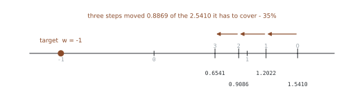
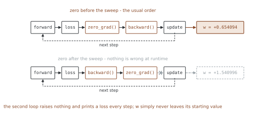
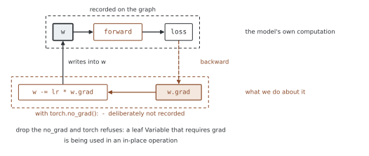

# 작은 트레인 단계

<div class="leadbox" markdown>

**들어가는 이야기** — 오류 없이 망가지는 버그

트레인이 안 될 때 사람들이 가장 먼저 찾는 것은 오류문이다. 그런데 **오류문이
안 뜨는 쪽이 더 고약하다.** 프로그램은 끝까지 돌고, 수치도 매 스텝 찍히고,
걸린 시간도 멀쩡한데, 모델만 조금도 배우지 않는 경우가 있다.

이 쪽의 트레인 루프는 다섯 줄뿐이다 — `zero_grad()` · 순전파 · 로스 ·
`backward()` · `step()`. 그 다섯 줄의 **차례를 한 칸만 바꾸면** 정확히 그 일이
일어난다. 세 스텝을 돌고 나서 값을 찍어 보면 처음 값과 소수점
여섯째 자리까지 같다.

무엇이 그렇게 만드는지는 셋째 절에서 본다. 다섯 줄짜리 루프에서도 생기는
일이니, 줄이 수백인 코드에서는 더 잘 숨는다.

</div>

점 세 개로 직선 하나를 맞춘다. 데이터가 작아 스텝마다 무슨 일이 일어나는지 전부
찍어 볼 수 있다.

트레인 루프 한 바퀴는 언제나 이 다섯이다.

1. **순전파** — 예측을 만든다
2. **로스** — 얼마나 틀렸는지 스칼라로 적는다
3. **그래디언트 지우기** — 지난 스텝의 그래디언트를 없앤다
4. **역전파** — 그래디언트를 채운다
5. **갱신** — `no_grad` 안에서 파라메터를 고친다

3번이 4번 **앞**에 오는 것이 중요하다. 뒤에 두면 방금 구한 그래디언트를 지우게 되고,
그러면 모델이 **한 스텝도 움직이지 않는다.** 3절에서 그 장면을 본다.

## 1. 코드

```python
"""가장 작은 트레인 루프 — 다섯 단계가 왜 그 순서인가.

점 세 개로 직선 하나를 맞춘다. 데이터가 작아 스텝마다 무슨 일이
일어나는지 전부 찍어 볼 수 있다.

루프 한 바퀴는 언제나 이 다섯이다.

1. 순전파 — 예측을 만든다
2. 로스 — 얼마나 틀렸는지 스칼라로 적는다
3. 그래디언트 지우기 — 지난 스텝의 그래디언트를 없앤다
4. 역전파 — 그래디언트를 채운다
5. 갱신 — no_grad 안에서 파라메터를 고친다

3번이 4번 **앞**에 오는 것이 중요하다. 뒤에 두면 방금 구한 그래디언트를
지우게 된다.

실행: 이 쪽의 코드를 파일로 갈무리해 돌린다
"""
# 파이토치를 불러온다. 뒤에 나오는 torch.tensor, torch.no_grad 가 다 여기서 온다.
import torch


# 절 제목을 찍는 작은 도우미다. f"..." 는 문자열 안의 {title} 자리에 값을 끼워
# 넣는 파이썬 문법이고, \n 은 줄바꿈이다.
def header(title):
    print(f"\n=== {title} ===")


# 데이터 — 점 세 개. 텐서는 파이토치가 다루는 수의 묶음이다. 대괄호를 두 겹으로
# 적었으므로 형태는 (3, 1) 이다 — 표본 3개, 표본마다 수 1개.
# X 가 입력, Y 가 맞혀야 할 값이다. 고칠 값이 아니므로 requires_grad 를 걸지 않는다.
X = torch.tensor([[-1.0], [0.0], [1.0]])
Y = torch.tensor([[1.0], [0.0], [-1.0]])      # 참값은 w=-1, b=0


# ========================================================================
# 1. 한 바퀴를 하나씩 찍어 본다
# ========================================================================

def one_step():
    header("1. 한 바퀴")
    # 난수의 시드를 0 으로 고정한다. 아래 randn 이 돌릴 때마다 같은 수(1.5410)를
    # 내놓아 이 쪽에 실린 출력과 같은 값이 나온다.
    torch.manual_seed(0)
    # 모델은 직선 y_hat = w * x + b 이고, 파라메터는 기울기 w(웨이트)와 절편
    # b(바이어스) 둘이다.
    #
    # torch.randn(1) 은 표준정규분포에서 뽑은 수 1개, torch.zeros(1) 은 0 한 개를
    # 담은 텐서다. 둘 다 형태 (1,). 이렇게 처음 값을 정하는 일이 초기화다.
    #
    # requires_grad=True 는 「이 텐서로 미분할 것이니, 이 텐서가 들어간 계산을
    # 모두 기록해 두라」는 표시다. 이것을 경사 추적이라 한다. 기본값은 False 라,
    # 트레인으로 고칠 값인 파라메터에만 True 로 건다.
    w = torch.randn(1, requires_grad=True)
    b = torch.zeros(1, requires_grad=True)
    # .item() 은 수 하나짜리 텐서에서 그 수를 파이썬 실수로 꺼낸다.
    # {값:+.4f} 는 부호를 붙여(+) 소수점 아래 네 자리까지 찍으라는 뜻이다.
    print(f"  처음  w={w.item():+.4f}  b={b.item():+.4f}")

    # 식을 그대로 적으면 순전파다. 형태 (3, 1) 인 X 에 형태 (1,) 인 w 를 곱하면
    # w 가 세 표본에 똑같이 곱해져(브로드캐스팅) y_hat 도 형태 (3, 1) 이 된다.
    # w 와 b 가 경사 추적 중이므로 파이토치는 값을 계산하는 한편 「y_hat 을 w 와
    # b 로 어떻게 만들었는가」를 함께 적어 둔다. 이 기록이 계산 그래프다.
    y_hat = X * w + b                                  # 1. 순전파
    # 예측과 참값의 차이를 제곱해(** 는 거듭제곱) 세 표본의 평균을 낸다. 평균
    # 제곱오차(MSE)이고, 수 하나짜리 텐서다.
    #   (2.541^2 + 0^2 + 2.541^2) / 3 = 4.3044
    loss = ((y_hat - Y) ** 2).mean()                   # 2. 로스
    # flatten() 은 형태 (3, 1) 을 (3,) 으로 펴고, tolist() 는 파이썬 리스트로
    # 바꾸고, round(v, 4) 는 원소마다 소수점 아래 넷째 자리로 반올림한다.
    print(f"  예측  {[round(v, 4) for v in y_hat.flatten().tolist()]}")
    print(f"  참값  {[round(v, 4) for v in Y.flatten().tolist()]}")
    print(f"  로스  {loss.item():.6f}")

    # .grad 는 역전파가 구한 그래디언트가 담기는 자리다. 역전파는 여기에 덮어쓰지
    # 않고 「더하므로」, 역전파 전에 지난 스텝의 값을 지워야 한다. 다만 첫 스텝에는
    # 아직 None 이라 지울 것이 없다. None 이 아닐 때만 zero_() 로 0 으로 채운다.
    # (이름 끝의 밑줄 _ 은 그 텐서를 제자리에서 고친다는 파이토치의 표기다.)
    print(f"  지우기 전 w.grad = {w.grad}")            # 3. 지우기
    if w.grad is not None:
        w.grad.zero_()
    # backward() 는 계산 그래프를 loss 에서 시작해 거꾸로 따라가며 사슬 규칙으로
    # 곱해 나가고, 그 결과를 경사 추적을 건 텐서의 .grad 에 넣어 준다. 한 번
    # 부르면 w.grad = dL/dw 와 b.grad = dL/db 가 한꺼번에 채워진다.
    loss.backward()                                    # 4. 역전파
    print(f"  역전파 뒤 w.grad = {w.grad.item():+.6f}  b.grad = {b.grad.item():+.6f}")

    # 손으로: dL/dw = (2/n) * sum (y_hat - y) * x
    # 같은 식으로 dL/db = (2/n) * sum (y_hat - y) 다. mean() 이 (1/n) * sum 을 한다.
    # y_hat.detach() 는 값은 같지만 계산 그래프에서 떼어 낸 텐서를 돌려준다. 견줄
    # 값을 구하는 일은 모델의 계산이 아니므로 기록에 남기지 않으려고 쓴다.
    #   dL/dw = (2/3) * (2.541 + 0 + 2.541) = 3.388
    #   dL/db = (2/3) * (-2.541 + 0 + 2.541) = 0
    hand_w = (2 * (y_hat.detach() - Y) * X).mean()
    hand_b = (2 * (y_hat.detach() - Y)).mean()
    print(f"  손으로    w.grad = {hand_w.item():+.6f}  b.grad = {hand_b.item():+.6f}")

    # 경사 하강법 한 스텝.   파라메터 ← 파라메터 - 러닝레이트 * 그래디언트
    # 그래디언트는 로스가 커지는 쪽을 가리키므로 반대쪽으로, 러닝레이트(여기서는
    # 0.1)만큼만 옮긴다.
    #
    # with torch.no_grad(): 블록 안의 계산은 기록하지 않는다. 파라메터를 고치는
    # 일은 모델의 계산이 아니므로 계산 그래프에 들어가면 안 된다.
    # w -= ... 는 w 를 새로 만들지 않고 「제자리에서」 고친다.
    with torch.no_grad():                              # 5. 갱신
        w -= 0.1 * w.grad         # 1.5410 - 0.1 * 3.3880 = 1.2022
        b -= 0.1 * b.grad         # 0 - 0.1 * 0 = 0
    print(f"  갱신 뒤  w={w.item():+.4f}  b={b.item():+.4f}")


# ========================================================================
# 2. 세 스텝 돌려 본다
# ========================================================================

def three_steps():
    header("2. 세 스텝")
    # 1절과 같은 시드로 같은 처음 값(w = 1.5410, b = 0)에서 다시 시작한다.
    torch.manual_seed(0)
    w = torch.randn(1, requires_grad=True)
    b = torch.zeros(1, requires_grad=True)
    # 1절의 다섯 단계를 세 번 되풀이한다. range(1, 4) 는 1, 2, 3 이다. 이렇게
    # 되풀이하는 것이 트레인 루프다.
    for step in range(1, 4):
        # 순전파와 로스를 한 줄에 적었다. 스텝마다 다시 계산하므로 계산 그래프도
        # 스텝마다 새로 생긴다.
        loss = ((X * w + b - Y) ** 2).mean()
        # 지난 스텝의 그래디언트를 지운다. 첫 스텝에는 None 이라 건너뛴다.
        if w.grad is not None:
            w.grad.zero_()
            b.grad.zero_()
        loss.backward()                   # 역전파 — w.grad 와 b.grad 를 채운다
        with torch.no_grad():             # 갱신 — 기록하지 않고 제자리에서 고친다
            w -= 0.1 * w.grad
            b -= 0.1 * b.grad
        # 찍히는 로스는 이 스텝에서 갱신하기 「전」의 값이고, w 와 b 는 갱신한
        # 「뒤」의 값이다.
        print(f"  {step}스텝  로스 {loss.item():.6f}  "
              f"w {w.item():+.4f}  b {b.item():+.4f}")
    print("  참값은 w=-1, b=0 이다. 로스가 줄고 w 가 -1 쪽으로 간다")


# ========================================================================
# 3. 지우기를 역전파 뒤에 두면
# ========================================================================

def wrong_order():
    header("3. 지우기를 역전파 뒤에 두면")
    # 같은 루프를 두 번 돈다. clear_first 가 True 면 역전파 「앞」에서 지우고(맞는
    # 차례), False 면 역전파 「뒤」에서 지운다(틀린 차례).
    for label, clear_first in (("지우고 역전파", True), ("역전파하고 지우기", False)):
        torch.manual_seed(0)              # 두 경우 모두 w = 1.5410 에서 시작한다
        w = torch.randn(1, requires_grad=True)
        # _ 는 「이 변수는 쓰지 않는다」는 관례다. 세 스텝 되풀이하기만 한다.
        for _ in range(3):
            # 여기서는 b 없이 y_hat = w * x 로만 맞춘다. 2절에서 b 가 내내 0 이었으니
            # w 의 움직임은 2절과 같다.
            loss = ((X * w - Y) ** 2).mean()
            if clear_first and w.grad is not None:
                w.grad.zero_()
            loss.backward()
            if not clear_first:
                w.grad.zero_()          # 방금 구한 그래디언트를 지운다
            with torch.no_grad():
                # 틀린 차례에서는 w.grad 가 0 이라 w 에서 0 을 뺀다. 오류는 안 난다.
                w -= 0.1 * w.grad
        # {label:18s} 는 열여덟 칸 너비로 찍어 줄을 맞춘다.
        print(f"  {label:18s} 세 스텝 뒤 w = {w.item():+.6f}")
    print("  뒤에 두면 w 가 처음 값에서 꼼짝도 하지 않는다")


# ========================================================================
# 4. no_grad 를 빼면
# ========================================================================

def without_no_grad():
    header("4. no_grad 를 빼면")
    torch.manual_seed(0)
    w = torch.randn(1, requires_grad=True)
    # 순전파 · 로스 · 역전파를 한 줄로 이어 적었다. w.grad 가 채워진다.
    ((X * w - Y) ** 2).mean().backward()
    # no_grad 블록 없이 갱신해 본다. w 는 리프 텐서(연산의 결과가 아니라 직접 만든
    # 텐서)이고 경사 추적 중이라, 제자리에서 고치려 하면 파이토치가 거절한다.
    # try 블록 안에서 오류가 나면 프로그램이 멈추지 않고 except 블록으로 넘어간다.
    # RuntimeError 가 그 거절이고 e 에 담긴다. str(e).splitlines()[0] 은 오류문의
    # 첫 줄이다.
    try:
        w -= 0.1 * w.grad
    except RuntimeError as e:
        print("  w -= ... 를 그냥 쓰면:", str(e).splitlines()[0])
    # 같은 줄을 no_grad 블록 안에 넣으면 된다. 위에서는 거절당해 w 가 그대로였으므로
    # 여기서 처음으로 한 스텝 간다.   1.5410 - 0.1 * 3.3880 = 1.2022
    with torch.no_grad():
        w -= 0.1 * w.grad
    print("  no_grad 안에서는 된다. w =", round(w.item(), 6))
    print("  갱신은 트레인의 일부가 아니라 트레인 바깥의 일이다")
    print("  그래서 그래프에 기록하지 않는다")


# ========================================================================
# 5. 옵티마이저가 대신해 준다
# ========================================================================

def with_optimizer():
    header("5. 옵티마이저로 적으면")
    torch.manual_seed(0)
    w = torch.randn(1, requires_grad=True)
    b = torch.zeros(1, requires_grad=True)
    # 옵티마이저는 그래디언트를 보고 파라메터를 고쳐 주는 객체다. SGD 는 경사
    # 하강법이다. 고칠 파라메터의 리스트 [w, b] 와 러닝레이트 lr 를 넘긴다.
    opt = torch.optim.SGD([w, b], lr=0.1)
    for _ in range(3):
        opt.zero_grad()                   # 3. 맡은 파라메터의 .grad 를 모두 지운다
        ((X * w + b - Y) ** 2).mean().backward()      # 1·2·4. 순전파 · 로스 · 역전파
        opt.step()                        # 5. 파라메터 ← 파라메터 - lr * 그래디언트
    print(f"  옵티마이저로  w {w.item():+.6f}  b {b.item():+.6f}")

    # 견줄 값 — 같은 시드에서 다시 시작해 2절의 손으로 적은 루프를 그대로 돈다.
    torch.manual_seed(0)
    w2 = torch.randn(1, requires_grad=True)
    b2 = torch.zeros(1, requires_grad=True)
    for _ in range(3):
        if w2.grad is not None:
            w2.grad.zero_()
            b2.grad.zero_()
        ((X * w2 + b2 - Y) ** 2).mean().backward()
        with torch.no_grad():
            w2 -= 0.1 * w2.grad
            b2 -= 0.1 * b2.grad
    print(f"  손으로        w {w2.item():+.6f}  b {b2.item():+.6f}")
    # torch.allclose(a, b) 는 두 텐서의 모든 원소가 부동소수점 오차 안에서 같으면
    # True 를 준다. w 끼리도 b 끼리도 같아야 True 가 찍힌다.
    print("  같은가:", torch.allclose(w, w2) and torch.allclose(b, b2))
    print("  opt.zero_grad() 가 3번, opt.step() 이 5번을 맡는다")


def main():
    # 다섯 절은 X, Y 만 함께 쓰고, 파라메터는 저마다 새로 만든다.
    one_step()
    three_steps()
    wrong_order()
    without_no_grad()
    with_optimizer()


# 이 파일을 직접 돌렸을 때만 main() 을 부른다. 다른 파일이 import 로 불러올
# 때는 함수만 정의되고 아무것도 실행되지 않는다.
if __name__ == "__main__":
    main()
```

**출력:**

```
=== 1. 한 바퀴 ===
  처음  w=+1.5410  b=+0.0000
  예측  [-1.541, 0.0, 1.541]
  참값  [1.0, 0.0, -1.0]
  로스  4.304441
  지우기 전 w.grad = None
  역전파 뒤 w.grad = +3.387995  b.grad = +0.000000
  손으로    w.grad = +3.387995  b.grad = +0.000000
  갱신 뒤  w=+1.2022  b=+0.0000

=== 2. 세 스텝 ===
  1스텝  로스 4.304441  w +1.2022  b +0.0000
  2스텝  로스 3.233113  w +0.9086  b +0.0000
  3스텝  로스 2.428427  w +0.6541  b +0.0000
  참값은 w=-1, b=0 이다. 로스가 줄고 w 가 -1 쪽으로 간다

=== 3. 지우기를 역전파 뒤에 두면 ===
  지우고 역전파            세 스텝 뒤 w = +0.654094
  역전파하고 지우기          세 스텝 뒤 w = +1.540996
  뒤에 두면 w 가 처음 값에서 꼼짝도 하지 않는다

=== 4. no_grad 를 빼면 ===
  w -= ... 를 그냥 쓰면: a leaf Variable that requires grad is being used in an in-place operation.
  no_grad 안에서는 된다. w = 1.202197
  갱신은 트레인의 일부가 아니라 트레인 바깥의 일이다
  그래서 그래프에 기록하지 않는다

=== 5. 옵티마이저로 적으면 ===
  옵티마이저로  w +0.654094  b +0.000000
  손으로        w +0.654094  b +0.000000
  같은가: True
  opt.zero_grad() 가 3번, opt.step() 이 5번을 맡는다
```

## 2. 한 바퀴를 손으로 따라가기

```
처음  w=+1.5410  b=+0.0000
예측  [-1.541, 0.0, 1.541]
참값  [1.0, 0.0, -1.0]
로스  4.304441
```

$x \in \{-1, 0, 1\}$에 대해 $y \in \{1, 0, -1\}$이므로 참값은 $w = -1$, $b = 0$이다.
처음 $w$가 $+1.54$이니 예측이 부호부터 반대다.

```
역전파 뒤 w.grad = +3.387995   b.grad = +0.000000
손으로    w.grad = +3.387995   b.grad = +0.000000
```

손으로 계산한 값과 맞는다. $L = \frac{1}{n}\sum(\hat{y} - y)^2$이므로

$$
\frac{\partial L}{\partial w} = \frac{2}{n}\sum (\hat{y}_i - y_i)\, x_i, \qquad
\frac{\partial L}{\partial b} = \frac{2}{n}\sum (\hat{y}_i - y_i)
$$

$b$의 그래디언트가 정확히 0인 것은 우연이 아니다. 데이터가 원점을 기준으로 대칭이라
오차의 합이 0이기 때문이다. 그래서 `b`는 세 스텝 내내 0에 머문다.



움직이는 쪽은 $w$인데, **세 스텝으로는 가야 할 거리의 3분의 1쯤**을 갔을
뿐이다. 로스가 줄었다는 말과 다 배웠다는 말은 다르다 — $w$는 아직 양수이고
목표는 $-1$이다.

## 3. 그래디언트를 지우는 자리가 역전파 **앞**이다

```
지우고 역전파        세 스텝 뒤 w = +0.654094
역전파하고 지우기     세 스텝 뒤 w = +1.540996
```



둘째 줄의 `+1.540996`은 **처음 값 그대로**다. 세 스텝을 돌았는데 조금도 움직이지
않았다.

까닭은 뻔하다. 역전파가 `w.grad`를 채워 놓았는데 그것을 지우고 나서 갱신하니,
움직이는 폭이 언제나 0이다. 로스는 계속 계산되고 오류도 안 나므로, **트레인이 안 되는데
돌아가기는 한다.**

> 이 버그는 로스 곡선이 평평한 직선으로 나오는 것으로 드러난다. 트레인이 안 될 때
> 러닝레이트나 모델을 의심하기 전에 **순서부터** 볼 자리다.

## 4. 갱신에 `no_grad`가 필요한 까닭

```
w -= ... 를 그냥 쓰면: a leaf Variable that requires grad is being used
                      in an in-place operation.
```

`w`는 리프(leaf) — 연산의 결과가 아니라 직접 만든 텐서 — 이고 경사 추적이 켜져 있다(`requires_grad=True`). 그 값을 제자리에서 바꾸면 이미 쌓아 둔 그래프가
가리키는 값과 달라지므로 파이토치가 막는다.



`torch.no_grad()` 안에서는 이 검사를 넘긴다. 그래도 되는 까닭은 **갱신이 트레인의
일부가 아니라 트레인 바깥의 일**이기 때문이다. $w \leftarrow w - \eta\,\partial L/\partial w$($\eta$는 러닝레이트)를
다시 미분할 일은 없다. 그러니 기록할 까닭도 없다.

`no_grad`를 안 쓰고 새 텐서를 만드는 길도 있다 — `w = w - 0.1 * w.grad`. 그런데
이러면 `w`가 **리프가 아니게 되어** 다음 스텝에서 `.grad`를 못 받는다. 그래서
제자리 갱신이 맞고, 제자리 갱신이려면 `no_grad`가 필요하다.

## 5. 옵티마이저는 3번과 5번을 맡는다

```
옵티마이저로  w +0.654094  b +0.000000
손으로        w +0.654094  b +0.000000
같은가: True
```

소수점 여섯째 자리까지 같다. `torch.optim.SGD`가 하는 일은 손으로 적은 그
두 줄이 전부다.

```python
# 트레인 루프의 몸통만 떼어 적은 것이다. opt 는 옵티마이저, loss 는 순전파로
# 만든 로스다.
opt.zero_grad()     # 3. 그래디언트 지우기
loss.backward()     # 4. 역전파
opt.step()          # 5. no_grad 안에서 갱신
```

옵티마이저를 쓰는 이점은 **파라메터가 많아질 때** 나온다. 모델 하나에 텐서가
수백 개인데 일일이 `if p.grad is not None: p.grad.zero_()`를 적을 수는 없다.
그리고 모멘텀이나 Adam처럼 **상태를 들고 있어야 하는** 갱신은 손으로 적기
어렵다.

## 연습문제

<div class="drillbox" markdown>

**연습문제 1.** <span class="diff easy" title="쉬움"></span>
2절에서 `b.grad`가 정확히 0이었다. 데이터를 $y \in \{2, 1, 0\}$으로 바꾸면
어떻게 되는가? **먼저 짐작하고** 확인하라.

</div>

??? success "풀이"
    참값이 달라진다. $x \in \{-1, 0, 1\}$에 $y \in \{2, 1, 0\}$이면 $w = -1$,
    $b = 1$인 직선이다. 이제 $b$가 0이 아니므로 그래디언트도 0이 아닐 것이다.

    ```python
    # 본문 코드에 이어서 돌린다(import torch 가 되어 있다).
    X = torch.tensor([[-1.0], [0.0], [1.0]])           # 입력. 형태 (3, 1)
    # 맞혀야 할 값 Y 만 바꿔 가며 두 번 돈다. 첫째가 본문의 데이터, 둘째가 전체를
    # 1 씩 올린 데이터다. (이름표, Y) 짝을 하나씩 꺼낸다.
    for name, Y in (("y = [1, 0, -1]", torch.tensor([[1.0], [0.0], [-1.0]])),
                    ("y = [2, 1,  0]", torch.tensor([[2.0], [1.0], [0.0]]))):
        # 시드를 다시 박아 두 경우 모두 같은 파라메터(w = 1.5410, b = 0)에서 잰다.
        torch.manual_seed(0)
        w = torch.randn(1, requires_grad=True)
        b = torch.zeros(1, requires_grad=True)
        # 순전파 · 로스(평균 제곱오차) · 역전파를 한 줄로 이어 적었다.
        ((X * w + b - Y) ** 2).mean().backward()
        # {값:+.6f} 는 부호를 붙여 소수점 아래 여섯 자리까지 찍는다.
        print(f"  {name}  w.grad {w.grad.item():+.6f}  b.grad {b.grad.item():+.6f}")
    ```

    ```
      y = [1, 0, -1]  w.grad +3.387995  b.grad +0.000000
      y = [2, 1,  0]  w.grad +3.387995  b.grad -2.000000
    ```

    **`w.grad`는 그대로이고 `b.grad`만 달라졌다.**

    $y$ 전체를 1씩 올린 것은 직선을 위로 평행이동한 것이므로 **기울기에 대한
    요구는 바뀌지 않는다.** 그래서 $\partial L/\partial w$가 같다.

    $b$ 쪽은 $\frac{2}{n}\sum(\hat y_i - y_i)$인데, 예측이 그대로인 채 목표만
    1씩 올라갔으니 오차 평균이 $-1$이 되어 그래디언트가 $-2$다. 음수이므로 $b$를
    **올리는** 방향으로 움직인다 — 맞는 방향이다.

---

<div class="drillbox" markdown>

**연습문제 2.** <span class="diff med" title="중간"></span>
4절에서 `w = w - 0.1 * w.grad`로 적으면 `w`가 리프가 아니게 된다고 했다. 확인하고,
**두 번째 스텝에서 무슨 일이 나는지** 보라.

</div>

??? success "풀이"
    ```python
    # 본문 코드에 이어서 돌린다(import torch 가 되어 있다).
    X = torch.tensor([[-1.0], [0.0], [1.0]])           # 입력. 형태 (3, 1)
    Y = torch.tensor([[1.0], [0.0], [-1.0]])           # 맞혀야 할 값. 형태 (3, 1)
    torch.manual_seed(0)                    # 본문과 같은 처음 값 w = 1.5410
    w = torch.randn(1, requires_grad=True)
    # is_leaf 는 「다른 연산의 결과가 아니라 직접 만든 텐서인가」다. 그런 텐서를
    # 리프 텐서라 하고, 역전파가 .grad 를 채워 주는 것은 리프 텐서뿐이다.
    print(f"  처음   is_leaf={w.is_leaf}  requires_grad={w.requires_grad}")

    # 첫째 스텝. 순전파 · 로스 · 역전파로 w.grad 를 채운다.
    ((X * w - Y) ** 2).mean().backward()
    # no_grad 도 -= 도 쓰지 않았다. 오른쪽의 뺄셈이 새 텐서를 만들고, w 라는
    # 이름이 이제 그 새 텐서를 가리킨다. 연산의 결과이므로 리프가 아니다.
    w = w - 0.1 * w.grad                    # 새 텐서를 만든다
    print(f"  갱신 뒤 is_leaf={w.is_leaf}  requires_grad={w.requires_grad}")

    # 둘째 스텝. 역전파는 오류 없이 돈다. 그러나 그래디언트는 처음의 리프 텐서로
    # 가고, 지금 w 가 가리키는 텐서의 .grad 는 채워지지 않는다.
    ((X * w - Y) ** 2).mean().backward()
    print(f"  두 번째 스텝의 w.grad = {w.grad}")
    ```

    ```
      처음   is_leaf=True  requires_grad=True
      갱신 뒤 is_leaf=False  requires_grad=True
      두 번째 스텝의 w.grad = None
    ```

    **`w.grad`가 `None`이다.** 그런데 오류는 나지 않는다.

    `w = w - 0.1 * w.grad`가 새 텐서를 만들었고, 그것은 연산의 결과이므로 리프가
    아니다. 「스칼라에 대한 기본 역전파」에서 본 대로 리프가 아니면 `.grad`를 받지
    않는다.

    그러니 두 번째 스텝에서 `w -= 0.1 * w.grad`를 하려 하면 `None`에 곱하기를
    시도해 `TypeError`로 터지거나, 옵티마이저를 쓴다면 **그 파라메터를 조용히
    건너뛴다.** 옵티마이저는 처음에 넘겨받은 텐서 객체를 들고 있는데, 이제 `w`라는
    이름은 다른 객체를 가리키고 있기 때문이다.

    이것이 파라메터 갱신을 **반드시 제자리로** 해야 하는 까닭이다. 그리고 제자리
    갱신은 리프에 막혀 있으므로 `no_grad`가 필요하다. 둘이 맞물려 있다.

---

<div class="drillbox" markdown>

**연습문제 3.** <span class="diff hard" title="어려움"></span>
3절에서 순서를 틀리면 모델이 안 움직였다. 그런데 **옵티마이저를 쓰면서** 같은
실수를 하면 어떻게 되는가? `opt.zero_grad()`를 `opt.step()` **뒤에** 두는 경우와
`loss.backward()` 뒤에 두는 경우를 각각 보라.

</div>

??? success "풀이"
    ```python
    # 본문 코드에 이어서 돌린다(import torch 가 되어 있다).
    X = torch.tensor([[-1.0], [0.0], [1.0]])           # 입력. 형태 (3, 1)
    Y = torch.tensor([[1.0], [0.0], [-1.0]])           # 맞혀야 할 값. 형태 (3, 1)

    # where 는 zero_grad() 를 둘 자리다. 세 스텝 트레인한 뒤의 w 를 돌려준다.
    def run(where):
        torch.manual_seed(0)               # 세 경우 모두 w = 1.5410 에서 시작한다
        w = torch.randn(1, requires_grad=True)
        # 옵티마이저 SGD(경사 하강법)에 고칠 파라메터 [w] 와 러닝레이트를 넘긴다.
        opt = torch.optim.SGD([w], lr=0.1)
        for _ in range(3):
            # 세 if 가운데 where 와 맞는 하나에서만 zero_grad() 가 불린다.
            if where == "앞":
                opt.zero_grad()            # w.grad 를 지운다
            # 순전파 · 로스 · 역전파. w.grad 가 채워진다.
            ((X * w - Y) ** 2).mean().backward()
            if where == "역전파 뒤":
                opt.zero_grad()            # 방금 채운 w.grad 를 지워 버린다
            opt.step()                     # w.grad 를 보고 w 를 한 스텝 옮긴다
            if where == "step 뒤":
                opt.zero_grad()            # 다 쓴 w.grad 를 지운다
        return w.item()                    # 텐서에서 파이썬 실수를 꺼내 돌려준다

    # {where:10s} 는 열 칸 너비로 찍어 줄을 맞춘다.
    for where in ("앞", "역전파 뒤", "step 뒤"):
        print(f"  zero_grad 를 {where:10s} 에 두면  w = {run(where):+.6f}")
    ```

    ```
      zero_grad 를 앞          에 두면  w = +0.654094
      zero_grad 를 역전파 뒤      에 두면  w = +1.540996
      zero_grad 를 step 뒤     에 두면  w = +0.654094
    ```

    세 가지 가운데 **둘은 맞고 하나는 틀린다.**

    - **앞에 두기** — 맞다. 가장 흔한 형태
    - **`step()` 뒤에 두기** — 맞다. 다음 바퀴가 시작될 때는 이미 비어 있으니
      "앞에 두기"와 같은 일이다
    - **역전파 뒤에 두기** — 틀린다. 방금 구한 그래디언트를 지우고 갱신하므로 `step()`이
      아무것도 안 한다

    `step()` 뒤에 두는 형태도 자주 보이고, 결과가 같다. 다만 **루프 바깥에서
    `backward()`를 한 번 더 부르는 코드**가 섞이면 앞에 두는 쪽이 안전하다 —
    "역전파 직전에 비어 있음을 보장한다"가 더 지키기 쉬운 약속이기 때문이다.

    그리고 틀린 경우가 **오류 없이 조용히** 지나간다는 점이 이 문제의 요점이다.
    `w`가 처음 값 그대로인 것을 눈으로 확인하지 않으면 모른다.
