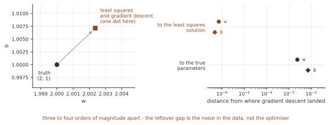
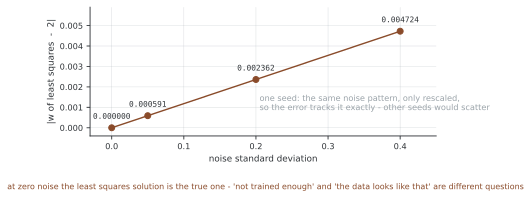
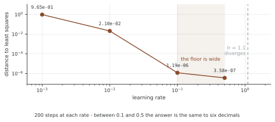
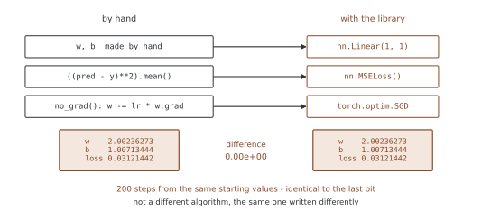
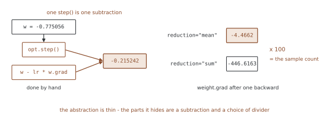

# 선형 회귀

<div class="leadbox" markdown>

**들어가는 이야기** — 참값을 찾는다는 말

점들을 만들 때 쓴 직선을 우리는 알고 있다. 거기에 조금씩 잡음(noise)을 섞어 점
백 개를 흩뿌려 놓고, 그 점들만 보고 직선을 되찾아 보라고 시킨다. 트레인이
잘되면 **처음 그 직선이 나와야** 할 것 같다.

안 나온다. 그리고 **얼마를 더 돌려도 안 나온다.**

그렇다고 트레인이 실패한 것도 아니다. 이 쪽은 세 수를 나란히 놓는다 — 점을 만들
때 쓴 **참 파라메터**, 그 백 개의 점에 가장 잘 맞는 **최소제곱해**(정규방정식이
한 번에 주는 값), 그리고 경사 하강법 루프가 닿은 수. 셋째는
둘째와 100만분의 1 언저리까지 같고 첫째와는 눈에 띄게 다르다.

가른 뒤에 남는 물음이 실전에서 쓰인다. 결과가 기대와 다를 때 **「덜 배웠나」와
「데이터가 그렇게 생겼나」는 다른 물음**이고, 뒤엣것은 아무리 오래 돌려도
안 고쳐진다.

</div>

$y = 2x + 1$에 잡음을 섞어 점 백 개를 만들고, 경사 하강으로 $w$와 $b$를 찾는다.
「작은 트레인 단계」의 루프를 그대로 쓰되 이번에는 **어디에 닿는지**를 묻는다.

흔히 "참값을 찾는다"고 말하는데 정확하지 않다. 경사 하강이 닿는 곳은
**최소제곱해**이고, 그것은 잡음 때문에 참값과 다르다. 세 수가 따로 있다.

| | |
|---|---|
| **참값** | 데이터를 만들 때 쓴 $w = 2$, $b = 1$ |
| **최소제곱해** | 이 백 개의 점에 가장 잘 맞는 직선 |
| **경사 하강의 결과** | 루프를 돌려 닿은 곳 |

이 쪽은 셋을 나란히 놓고 차이를 잰다. 최소제곱해는 되풀이 없이 식으로 바로
구해지므로 아래에서는 **해석해**(closed-form solution)라고도 부른다.

## 1. 코드

```python
"""밑바닥부터 짠 선형 회귀 — 경사 하강은 어디로 가는가.

`y = 2x + 1` 에 잡음을 섞어 점 백 개를 만들고, 경사 하강으로 `w` 와
`b` 를 찾는다. 「작은 트레인 단계」의 루프를 그대로 쓰되 이번에는
**어디에 닿는지**를 묻는다.

흔히 "참값을 찾는다" 고 말하는데 정확하지 않다. 경사 하강이 닿는
곳은 **최소제곱해**이고, 그것은 잡음 때문에 참값과 다르다. 이 쪽은
셋을 나란히 놓고 그 차이를 잰다.

실행: 이 쪽의 코드를 파일로 갈무리해 돌린다
"""
# 파이토치를 불러온다. 뒤에 나오는 torch.randn, torch.no_grad 가 다 여기서 온다.
import torch


# 절 제목을 찍는 작은 도우미다. f"...{title}..." 은 문자열 안의 중괄호 자리에
# 값을 끼워 넣는 파이썬 문법이고, \n 은 줄바꿈이라 제목 앞에 빈 줄이 하나 생긴다.
def header(title):
    print(f"\n=== {title} ===")


# 실험의 설정값 넷을 한 줄에 차례로 넣는다.
#   TRUE_W, TRUE_B — 데이터를 만들 때 쓰는 참 직선 y = 2x + 1 의 기울기와 절편
#   N              — 점의 개수 100
#   NOISE          — 잡음의 표준편차 0.2
TRUE_W, TRUE_B, N, NOISE = 2.0, 1.0, 100, 0.2


# 점 백 개를 만든다. noise=NOISE 처럼 적은 것은 기본값이다 — make_data() 로 부르면
# 잡음 0.2, 시드 42 를 쓰고, make_data(noise=0.4) 처럼 일부만 바꿔 부를 수도 있다.
def make_data(noise=NOISE, seed=42):
    # 난수의 시드를 고정한다. 시드가 같으면 아래 randn 이 늘 같은 수를 내놓으므로
    # 몇 번을 돌려도 같은 점 백 개가 나온다.
    torch.manual_seed(seed)
    # torch.randn(N, 1) 은 표준정규분포(평균 0, 표준편차 1)에서 뽑은 수로 채운
    # 「텐서」를 만든다. 텐서는 파이토치가 다루는 수의 묶음이고, 형태는 축마다 수가
    # 몇 개씩 들었는지다. 여기서는 (100, 1) — 행이 점 100개, 열이 입력값 1개다.
    x = torch.randn(N, 1)
    # 참 직선 위의 값에 잡음을 더한다. 둘째 randn 이 점마다 다른 잡음이고, noise 를
    # 곱해 표준편차를 맞춘다. 실수와 텐서의 곱·합은 원소마다 따로 계산되므로
    # y 도 형태가 (100, 1) 이다.
    y = TRUE_W * x + TRUE_B + noise * torch.randn(N, 1)
    return x, y


def closed_form(x, y):
    """최소제곱해를 바로 구한다. 경사 하강이 가야 할 곳이다."""
    # y ≈ w*x + b*1 을 행렬로 적으면 y ≈ X @ [w, b] 다. 그러려면 X 의 첫 열이 x,
    # 둘째 열이 모두 1 이어야 한다. ones_like(x) 는 x 와 형태가 같고 1 로 채운
    # 텐서이고, cat(..., dim=1) 이 둘을 열 방향으로 이어 붙인다. X 의 형태는 (100, 2).
    X = torch.cat([x, torch.ones_like(x)], dim=1)
    # lstsq 는 (X @ beta - y) 의 제곱합을 가장 작게 하는 beta 를 되풀이 없이 한 번에
    # 구한다(least squares). .solution 이 그 답이고 형태는 (2, 1) — 첫 행이 w,
    # 둘째 행이 b 다.
    beta = torch.linalg.lstsq(X, y).solution
    # beta[0], beta[1] 은 수 하나짜리 텐서다. .item() 은 그런 텐서에서 그 수를
    # 파이썬 실수로 꺼낸다.
    return beta[0].item(), beta[1].item()


# ========================================================================
# 1. 데이터
# ========================================================================

def show_data():
    header("1. 데이터")
    x, y = make_data()            # 기본값 그대로 — 잡음 0.2, 시드 42
    # {TRUE_W} 자리에 2.0 이 찍힌다. {NOISE}^2 의 ^2 는 그냥 글자다 — 「분산이 0.2 의
    # 제곱인 정규분포 잡음」이라고 읽히게 적은 것이다.
    print(f"  참 모델  y = {TRUE_W}x + {TRUE_B} + N(0, {NOISE}^2)")
    # x.min(), x.max() 는 텐서에서 가장 작은 값과 가장 큰 값이다.
    # :.3f 는 소수점 아래 세 자리까지 찍으라는 뜻이다.
    print(f"  표본 {N}개   x 범위 [{x.min():.3f}, {x.max():.3f}]")
    print(f"               y 범위 [{y.min():.3f}, {y.max():.3f}]")
    return x, y


# ========================================================================
# 2. 트레인
# ========================================================================

# 경사 하강법으로 w, b 를 찾는다. 한 스텝은 넷이다.
#   (1) 순전파 — 지금의 w, b 로 예측을 내고 로스를 잰다
#   (2) 지난 스텝의 그래디언트를 지운다
#   (3) 역전파 — 로스를 w, b 로 미분한 값(그래디언트)을 구한다
#   (4) 그래디언트의 반대쪽으로 w, b 를 조금 옮긴다
# lr 은 러닝레이트(한 스텝에 얼마나 옮길지), epochs 는 되풀이 횟수, log 는 중간
# 결과를 찍을 스텝 번호들이다. 기본값 () 는 빈 튜플이라 아무것도 찍지 않는다.
# 점 백 개를 스텝마다 전부 쓰므로 여기서는 에포크(데이터 한 바퀴)와 스텝이 같다.
def train(x, y, lr=0.1, epochs=1000, log=()):
    # 초기값도 시드로 고정한다. 그래야 러닝레이트만 바꿔 견줄 때 출발점이 같다.
    torch.manual_seed(0)
    # 찾을 값, 곧 파라메터 둘을 만든다. 둘 다 형태가 (1,) 인 수 하나짜리 텐서다.
    #   w — 웨이트(직선의 기울기). randn 으로 뽑은 수 1.5410 에서 출발한다
    #   b — 바이어스(직선의 절편). zeros 로 0 에서 출발한다
    # requires_grad=True 는 「이 텐서로 미분할 것이니, 이 텐서가 들어간 계산을 모두
    # 기록해 두라」는 표시다. 이것을 경사 추적이라 한다. 기본값은 False 라서 데이터
    # x, y 는 추적하지 않는다 — 트레인으로 고칠 값, 곧 파라메터에만 True 로 건다.
    w = torch.randn(1, requires_grad=True)
    b = torch.zeros(1, requires_grad=True)
    history = []                  # 스텝마다의 로스를 모아 둘 빈 리스트
    # range(1, epochs + 1) 은 1, 2, ..., epochs 다. 스텝 번호를 1 부터 세려는 것이다.
    for epoch in range(1, epochs + 1):
        # (1) 순전파 — 예측을 내고 로스를 잰다. 안쪽부터 읽는다.
        #   x * w + b   예측. x 는 (100, 1), w 와 b 는 (1,) 인데 파이토치가 같은 w, b 를
        #               100개 행에 똑같이 적용한다(브로드캐스팅). 결과는 (100, 1)
        #   - y         예측과 정답의 차 — 점마다 하나씩
        #   ** 2        제곱 (** 는 거듭제곱)
        #   .mean()     100개의 평균. 평균제곱오차(MSE)이고 수 하나짜리 텐서가 된다
        # w, b 가 경사 추적 중이므로 파이토치는 값을 계산하는 한편 「loss 를 무엇으로
        # 어떻게 만들었는지」를 함께 적어 둔다. 이 기록이 계산 그래프다.
        loss = ((x * w + b - y) ** 2).mean()
        # (2) 지난 스텝의 그래디언트를 지운다. backward() 는 .grad 를 새 값으로 바꾸지
        # 않고 거기에 「더한다」. 지우지 않으면 지난 스텝들의 그래디언트가 쌓여 틀린
        # 쪽으로 간다. 첫 스텝에는 아직 backward() 를 부른 적이 없어 .grad 가 None 이므로
        # 건너뛴다. zero_() 처럼 이름이 _ 로 끝나는 메서드는 텐서를 제자리에서 고친다.
        if w.grad is not None:
            w.grad.zero_()
            b.grad.zero_()
        # (3) 역전파 — 계산 그래프를 loss 에서 시작해 거꾸로 따라가며 사슬 규칙으로
        # 로스를 w, b 로 미분하고, 그 값(그래디언트)을 w.grad, b.grad 에 넣어 준다.
        loss.backward()
        # (4) 한 스텝 — 그래디언트는 로스가 가장 빨리 「커지는」 쪽을 가리킨다. 그래서
        # 반대쪽으로 러닝레이트만큼만 옮긴다.   파라메터 ← 파라메터 - lr * 그래디언트
        #
        # with torch.no_grad(): 블록 안의 계산은 기록하지 않는다. 파라메터를 고치는 일은
        # 모델의 계산이 아니므로 계산 그래프에 들어가면 안 된다. 이 블록 없이 경사 추적
        # 중인 w 를 제자리에서 고치면 파이토치가 오류를 낸다.
        #
        # w -= ... 는 w 를 새로 만들지 않고 「제자리에서」 고친다. w = w - ... 로 적으면
        # w 가 새 텐서로 바뀌어 파라메터가 아니게 된다.
        with torch.no_grad():
            w -= lr * w.grad
            b -= lr * b.grad
        # 이번 스텝의 로스를 파이썬 실수로 꺼내 적어 둔다. 이 loss 는 (4) 에서 옮기기
        # 「전」의 w, b 로 잰 값이다.
        history.append(loss.item())
        # 찍기로 한 스텝이면 한 줄 찍는다. 로스는 옮기기 전, w 와 b 는 옮긴 뒤의 값이다.
        #   :5d    정수를 다섯 칸에 맞춰        :.6f   소수점 아래 여섯 자리까지
        #   :+.6f  거기에 부호(+/-)를 늘 붙여
        if epoch in log:
            print(f"  {epoch:5d} 스텝  로스 {loss.item():.6f}  "
                  f"w {w.item():+.6f}  b {b.item():+.6f}")
    # 마지막 w, b 를 파이썬 실수로, 그리고 로스의 이력을 함께 돌려준다.
    return w.item(), b.item(), history


def run_training(x, y):
    header("2. 트레인")
    # 1000 스텝을 돌리며 1, 10, 100, 500, 1000 번째 스텝에서만 찍는다.
    w, b, hist = train(x, y, log=(1, 10, 100, 500, 1000))
    # hist[0] 은 첫 스텝의 로스, hist[-1] 은 마지막 스텝의 로스다(-1 은 끝에서 첫째).
    print(f"  로스가 {hist[0]:.4f} 에서 {hist[-1]:.6f} 로 내려갔다")
    return w, b


# ========================================================================
# 3. 어디에 닿았는가
# ========================================================================

# 세 수를 나란히 찍는다. x, y 는 데이터, w, b 는 경사 하강이 닿은 값이다.
def where_did_it_land(x, y, w, b):
    header("3. 참값 · 해석해 · 경사 하강")
    cw, cb = closed_form(x, y)    # 최소제곱해(해석해) — 식으로 한 번에 구한 답
    print(f"  참값      w={TRUE_W:.6f}  b={TRUE_B:.6f}")
    print(f"  최소제곱해 w={cw:.6f}  b={cb:.6f}")
    print(f"  경사 하강  w={w:.6f}  b={b:.6f}")
    # abs() 는 절댓값이다. :.2e 는 지수 표기로 찍는다 — 7.15e-07 은 7.15 × 10^-7.
    print(f"  해석해와의 차  w {abs(w - cw):.2e}   b {abs(b - cb):.2e}")
    print(f"  참값과의 차    w {abs(w - TRUE_W):.6f}   b {abs(b - TRUE_B):.6f}")
    print("  경사 하강은 참값이 아니라 해석해로 간다 — 차이가 백만분의 일보다 작다")
    print("  남은 차이는 알고리즘의 잘못이 아니라 잡음이 만든 것이다")


# ========================================================================
# 4. 잡음을 줄이면 해석해가 참값으로 간다
# ========================================================================

def noise_sweep():
    header("4. 잡음과 해석해")
    # 잡음의 표준편차만 바꿔 가며 데이터를 다시 만든다. 시드는 42 그대로라서 x 도
    # 잡음의 무늬도 같고 잡음의 크기만 달라진다. 0.0 이면 점이 모두 참 직선 위에 있다.
    for noise in (0.4, 0.2, 0.05, 0.0):
        x, y = make_data(noise=noise)
        # 여기서는 경사 하강을 돌리지 않는다. 경사 하강이 닿는 곳이 해석해임을 3번에서
        # 보았으므로, 해석해만 구해 참값 TRUE_W = 2 와 견준다.
        cw, cb = closed_form(x, y)
        print(f"  잡음 {noise:.2f}  해석해 w={cw:.6f} b={cb:.6f}  "
              f"참값과의 차 {abs(cw - TRUE_W):.6f}")
    print("  잡음이 0 이면 해석해가 참값과 정확히 같다")
    print("  그러니 '트레인이 덜 되었나' 와 '데이터가 그렇게 생겼나' 는 다른 물음이다")


# ========================================================================
# 5. 러닝레이트가 정하는 것
# ========================================================================

def learning_rates():
    header("5. 러닝레이트")
    x, y = make_data()            # 1번과 같은 데이터 (잡음 0.2, 시드 42)
    cw, cb = closed_form(x, y)    # 견줄 기준 — 가야 할 곳
    # 러닝레이트만 바꿔 200 스텝씩 돌린다. train 이 시드 0 으로 초기화하므로 다섯 번
    # 모두 같은 w, b 에서 출발하고, 달라지는 것은 러닝레이트뿐이다.
    for lr in (0.001, 0.01, 0.1, 0.5, 1.1):
        w, b, hist = train(x, y, lr=lr, epochs=200)
        # 해석해에서 얼마나 떨어졌나 — w 의 차와 b 의 차를 더한 것이다.
        gap = abs(w - cw) + abs(b - cb)
        # 발산했는지 가린다. 「A if 조건 else B」 는 조건이 참이면 A, 아니면 B 를 고르는
        # 파이썬 식이다. 조건은 둘 가운데 하나라도 참이면 참이다.
        #   not (gap == gap)  gap 이 nan(수가 아님)이다. nan 은 자기 자신과도 같지 않다
        #   gap > 1e3         해석해에서 1000 넘게 멀어졌다 (1e3 은 1000)
        state = "발산" if not (gap == gap) or gap > 1e3 else f"해석해와 {gap:.2e}"
        # :<6 은 여섯 칸에 왼쪽으로 붙여, :12.6f 는 열두 칸에 소수점 아래 여섯 자리로
        # 찍는다. hist[-1] 은 200번째 스텝의 로스다. inf 는 수가 너무 커져 넘친 것이다.
        print(f"  lr={lr:<6} 200 스텝 뒤 로스 {hist[-1]:12.6f}   {state}")
    print("  너무 작으면 못 닿고 너무 크면 튄다. 가운데가 넓다")


# 다섯 절을 차례로 돌린다. 1번이 만든 데이터 x, y 와 2번이 찾은 w, b 를 3번에
# 넘긴다. 4번과 5번은 제 데이터를 스스로 다시 만든다.
def main():
    x, y = show_data()
    w, b = run_training(x, y)
    where_did_it_land(x, y, w, b)
    noise_sweep()
    learning_rates()


# 이 파일을 직접 돌렸을 때만 main() 을 부른다. 다른 파일이 import 로 불러 쓸
# 때에는 부르지 않는다.
if __name__ == "__main__":
    main()
```

**출력:**

```
=== 1. 데이터 ===
  참 모델  y = 2.0x + 1.0 + N(0, 0.2^2)
  표본 100개   x 범위 [-2.206, 2.218]
               y 범위 [-3.320, 5.209]

=== 2. 트레인 ===
      1 스텝  로스 1.306861  w +1.642241  b +0.206942
     10 스텝  로스 0.050514  w +1.964850  b +0.905588
    100 스텝  로스 0.031214  w +2.002363  b +1.007134
    500 스텝  로스 0.031214  w +2.002363  b +1.007134
   1000 스텝  로스 0.031214  w +2.002363  b +1.007134
  로스가 1.3069 에서 0.031214 로 내려갔다

=== 3. 참값 · 해석해 · 경사 하강 ===
  참값      w=2.000000  b=1.000000
  최소제곱해 w=2.002362  b=1.007135
  경사 하강  w=2.002363  b=1.007134
  해석해와의 차  w 7.15e-07   b 4.77e-07
  참값과의 차    w 0.002363   b 0.007134
  경사 하강은 참값이 아니라 해석해로 간다 — 차이가 백만분의 일보다 작다
  남은 차이는 알고리즘의 잘못이 아니라 잡음이 만든 것이다

=== 4. 잡음과 해석해 ===
  잡음 0.40  해석해 w=2.004724 b=1.014270  참값과의 차 0.004724
  잡음 0.20  해석해 w=2.002362 b=1.007135  참값과의 차 0.002362
  잡음 0.05  해석해 w=2.000591 b=1.001784  참값과의 차 0.000591
  잡음 0.00  해석해 w=2.000000 b=1.000000  참값과의 차 0.000000
  잡음이 0 이면 해석해가 참값과 정확히 같다
  그러니 '트레인이 덜 되었나' 와 '데이터가 그렇게 생겼나' 는 다른 물음이다

=== 5. 러닝레이트 ===
  lr=0.001  200 스텝 뒤 로스     0.588221   해석해와 9.65e-01
  lr=0.01   200 스텝 뒤 로스     0.031519   해석해와 2.10e-02
  lr=0.1    200 스텝 뒤 로스     0.031214   해석해와 1.19e-06
  lr=0.5    200 스텝 뒤 로스     0.031214   해석해와 3.58e-07
  lr=1.1    200 스텝 뒤 로스          inf   발산
  너무 작으면 못 닿고 너무 크면 튄다. 가운데가 넓다
```

## 2. 로스가 100스텝에서 멈춘다

```
    1 스텝  로스 1.306861  w +1.642241  b +0.206942
   10 스텝  로스 0.050514  w +1.964850  b +0.905588
  100 스텝  로스 0.031214  w +2.002363  b +1.007134
  500 스텝  로스 0.031214  w +2.002363  b +1.007134
 1000 스텝  로스 0.031214  w +2.002363  b +1.007134
```

100스텝에서 이미 끝났다. 500스텝, 1000스텝의 값이 **소수점까지 똑같다.**

로스가 0으로 가지 않고 **0.031214에서 멈춘 것**이 중요하다. 더 돌려도 안
내려간다. 잡음이 섞인 데이터에서는 어떤 직선도 모든 점을 지날 수 없고, 남는
0.031이 바로 그 잡음의 분산에 해당한다 — 실제로 $0.2^2 = 0.04$에 가깝다.

## 3. 참값·해석해·경사 하강

```
참값       w=2.000000  b=1.000000
최소제곱해  w=2.002362  b=1.007135
경사 하강   w=2.002363  b=1.007134

해석해와의 차  w 7.15e-07   b 4.77e-07
참값과의 차    w 0.002363   b 0.007134
```



**경사 하강은 해석해에 100만분의 1 언저리까지 닿았다**(차이 $7 \times 10^{-7}$). 그리고 참값과는
0.0024만큼 떨어져 있다. 오른쪽 칸의 로그 스케일이 그 둘을 한자리에 놓는다 —
**세 자릿수에서 네 자릿수 차이**이므로, 왼쪽 칸에서는 두 점이 겹쳐 하나로
보인다.

그 0.0024는 **알고리즘의 잘못이 아니다.** 경사 하강은 제 할 일을 완벽하게
했다 — 주어진 백 개의 점에 대해 제곱오차를 가장 작게 만드는 직선을 찾았다.
그 직선이 참 직선과 조금 다른 것은, 백 개의 점이 잡음 때문에 참 직선에서
조금씩 비껴 있기 때문이다.

> 이 구별이 실전에서 중요하다. 트레인 결과가 기대와 다를 때 물어야 할 것이
> 둘이다. **"덜 배웠나"**(해석해에 못 닿았나)와 **"데이터가 그렇게
> 생겼나"**(해석해 자체가 거기 있나). 전자는 러닝레이트와 스텝 수의 문제이고,
> 후자는 아무리 오래 돌려도 안 고쳐진다.

## 4. 잡음을 줄이면 해석해가 참값으로 간다

| 잡음 | 최소제곱해 $w$ | 참값과의 차 |
|---|---|---|
| 0.40 | 2.004724 | 0.004724 |
| 0.20 | 2.002362 | 0.002362 |
| 0.05 | 2.000591 | 0.000591 |
| 0.00 | **2.000000** | **0.000000** |

잡음을 반으로 줄이면 차이도 거의 정확히 반이 된다. 잡음이 0이면 해석해가
참값과 **정확히** 같아진다.

이것이 3절의 주장을 뒷받침한다. 남은 차이는 **데이터가 가진 성질**이고,
데이터를 바꾸면 따라서 바뀐다.



**네 점이 원점을 지나는 직선 위에 놓인다.** 시드를 고정해 두었으므로 잡음의
무늬는 늘 같고 크기만 달라지며, 그래서 오차가 잡음에 정확히 비례한다 —
$0.004724 / 0.40$과 $0.002362 / 0.20$이 소수점 여섯째 자리까지 같다. 시드를
바꾸면 이 정확함은 사라지고 점들이 선 둘레로 흩어진다. **한 번 돌린 것은
재어 본 것이 아니다.**

표본 수를 늘려도 줄어든다 — 잡음이 평균되어 상쇄되기 때문이다. 연습문제 2에서
확인한다.

## 5. 러닝레이트

```
lr=0.001  200 스텝 뒤 로스     0.588221   해석해와 9.65e-01
lr=0.01   200 스텝 뒤 로스     0.031519   해석해와 2.10e-02
lr=0.1    200 스텝 뒤 로스     0.031214   해석해와 1.19e-06
lr=0.5    200 스텝 뒤 로스     0.031214   해석해와 3.58e-07
lr=1.1    200 스텝 뒤 로스          inf   발산
```



**쓸 수 있는 범위가 생각보다 넓다.** 0.1과 0.5가 둘 다 해석해에 닿았고, 그
사이 어디를 골라도 된다. 그림에서 바닥이 평평하게 눕는 구간이 그것이다.

양끝이 다르게 실패한다.

- **너무 작으면**(0.001) 조용히 못 닿는다. 로스가 0.588이니 트레인이 되긴 했고
  오류도 없다. 더 돌리면 닿는다 — 시간만 있으면
- **너무 크면**(1.1) `inf`로 터진다. 한눈에 보인다

둘 중 **작은 쪽이 더 위험하다.** 터지면 바로 알지만, 덜 배운 모델은 그럴듯한
수를 내놓는다. 「최적화 기초」에서 러닝레이트가 다른 어떤 선택보다 크게
작용한다고 재었는데, 그 말의 절반이 이 비대칭이다.

## 6. 같은 것을 라이브러리로 적으면

여기까지는 `w`와 `b`를 손으로 만들고, 로스를 손으로 적고, 갱신도 손으로 했다.
그 셋을 라이브러리에 넘긴다.

| 손으로 | 라이브러리 |
|---|---|
| `w`, `b`를 직접 만들고 들고 다님 | `nn.Linear(1, 1)` |
| `((pred - y) ** 2).mean()` | `nn.MSELoss()` |
| `with no_grad(): w -= lr * w.grad` | `torch.optim.SGD` |

편해지는 것은 분명하다. 그런데 **계산이 그대로인지**는 따로 물어야 한다. 결과가
기대와 다를 때 안 보이는 쪽을 의심하기는 어렵기 때문이다 — 많은 사람이 쓰는
코드니 맞겠지 싶은 것이다. 그 믿음은 대개 옳고, **한 번은 걷어 내고 확인해
두는 편**이 낫다. 이 자리가 그 한 번이다.

```python
"""nn.Module 로 옮기기 — 추상화를 걷어 내면 같은 수가 나오는가.

앞의 1~5절에서 손으로 관리한 세 가지를 라이브러리에 넘긴다.

| 손으로 | 라이브러리 |
|---|---|
| `w`, `b` 를 직접 만들고 들고 다님 | `nn.Linear(1, 1)` |
| `((pred - y) ** 2).mean()` | `nn.MSELoss()` |
| `with no_grad(): w -= lr * w.grad` | `torch.optim.SGD` |

편해지는 것은 분명한데, **계산이 그대로인지**는 따로 물어야 한다.
이 쪽은 두 길을 나란히 돌려 소수점까지 견준다.

실행: 이 쪽의 코드를 파일로 갈무리해 돌린다
"""
import torch
# torch.nn 은 레이어와 로스 함수를 모아 둔 꾸러미다. 관례대로 nn 이라고 줄여 부른다.
import torch.nn as nn


# 절 제목을 찍는 도우미다. \n 은 줄바꿈이고 {title} 자리에 제목이 끼워진다.
def header(title):
    print(f"\n=== {title} ===")


# 참 직선 y = 2x + 1 의 기울기와 절편, 그리고 점의 개수다.
TRUE_W, TRUE_B, N = 2.0, 1.0, 100


# 1~5절과 똑같은 점 백 개를 만든다. 시드가 42 로 같으므로 수까지 같다.
def make_data(seed=42):
    # 난수의 시드를 고정한다 — 몇 번을 돌려도 같은 수가 나온다.
    torch.manual_seed(seed)
    # 표준정규분포에서 뽑은 x. 형태는 (100, 1) — 행이 점 100개, 열이 입력값 1개다.
    x = torch.randn(N, 1)
    # 참 직선 위의 값에 표준편차 0.2 의 잡음을 더해 y 를 만든다. 형태는 (100, 1).
    return x, TRUE_W * x + TRUE_B + 0.2 * torch.randn(N, 1)


# ========================================================================
# 1. 손으로 짠 것
# ========================================================================

# 1~5절의 train 과 같은 루프다. 다른 점은 초기값 w0, b0 을 바깥에서 받는 것
# 하나다 — 라이브러리 쪽과 같은 자리에서 출발시키려는 것이다.
def by_hand(x, y, lr=0.1, epochs=200, w0=None, b0=None):
    # clone() 은 값이 같은 새 텐서를 만든다. 받은 w0 을 그대로 쓰면 아래 갱신이
    # w0 자체를 고쳐 버려, 뒤에 도는 라이브러리 쪽의 출발점이 달라진다.
    # requires_grad_(True) 는 그 텐서에 경사 추적을 건다 — 「이 텐서로 미분할 것이니
    # 이 텐서가 들어간 계산을 모두 기록해 두라」는 표시다.
    w = w0.clone().requires_grad_(True)
    b = b0.clone().requires_grad_(True)
    # 스텝 번호를 쓰지 않으므로 변수 이름을 _ 로 둔다. epochs 번 되풀이한다는 뜻이다.
    for _ in range(epochs):
        # 순전파 — x * w + b 가 예측이다. x 는 (100, 1), w 와 b 는 (1,) 이고 파이토치가
        # 같은 w, b 를 100개 행에 똑같이 적용한다(브로드캐스팅). 정답과의 차를 제곱해
        # (** 는 거듭제곱) 평균한 것이 로스다. 이 계산은 계산 그래프로 기록된다.
        loss = ((x * w + b - y) ** 2).mean()
        # 지난 스텝의 그래디언트를 지운다. backward() 는 .grad 에 「더하므로」 지우지
        # 않으면 쌓인다. 첫 스텝에는 .grad 가 아직 None 이라 건너뛴다.
        # zero_() 처럼 이름이 _ 로 끝나는 메서드는 텐서를 제자리에서 고친다.
        if w.grad is not None:
            w.grad.zero_()
            b.grad.zero_()
        # 역전파 — 계산 그래프를 거꾸로 따라가 로스를 w, b 로 미분한 값(그래디언트)을
        # w.grad, b.grad 에 넣는다.
        loss.backward()
        # 한 스텝 — 그래디언트의 반대쪽으로 lr 만큼 옮긴다. no_grad() 블록 안의 계산은
        # 기록하지 않는다. 파라메터를 고치는 일은 모델의 계산이 아니기 때문이다.
        # -= 는 텐서를 새로 만들지 않고 제자리에서 고친다.
        with torch.no_grad():
            w -= lr * w.grad
            b -= lr * b.grad
    # .item() 은 수 하나짜리 텐서에서 그 수를 파이썬 실수로 꺼낸다. loss 는 마지막
    # 스텝에서 옮기기 전에 잰 값이다.
    return w.item(), b.item(), loss.item()


# ========================================================================
# 2. 라이브러리로 짠 것
# ========================================================================

# 위의 by_hand 를 라이브러리의 세 조각으로 다시 적는다. 줄마다 짝이 있다.
def by_module(x, y, lr=0.1, epochs=200, w0=None, b0=None):
    # nn.Linear(1, 1) 은 입력 1개를 받아 출력 1개를 내는 레이어다. 웨이트
    # model.weight (형태 (1, 1)) 와 바이어스 model.bias (형태 (1,)) 를 스스로 만들어
    # 들고 있다. 둘 다 처음부터 경사 추적이 걸려 있고, 초기값은 무작위다.
    model = nn.Linear(1, 1)
    with torch.no_grad():                 # 같은 자리에서 시작하게 맞춘다
        # 그 무작위 초기값을 손으로 짠 쪽의 w0, b0 으로 덮어쓴다. copy_() 는 값을
        # 제자리에 베껴 넣고, view(1, 1) 은 형태 (1,) 인 w0 을 (1, 1) 로 바꿔 본다.
        # 파라메터를 제자리에서 고치는 일이므로 no_grad() 안에서 한다.
        model.weight.copy_(w0.view(1, 1))
        model.bias.copy_(b0)
    # nn.MSELoss() 는 평균제곱오차를 재는 로스 함수를 만든다. criterion(예측, 정답)
    # 으로 부르면 ((예측 - 정답) ** 2).mean() 을 돌려준다.
    criterion = nn.MSELoss()
    # 옵티마이저는 파라메터를 고치는 일을 맡는 객체다. model.parameters() 로 고칠
    # 텐서들(weight, bias)을 넘겨주고 러닝레이트를 알려 준다. SGD 는 경사 하강법이다.
    opt = torch.optim.SGD(model.parameters(), lr=lr)
    for _ in range(epochs):
        # 순전파. model(x) 가 레이어에 x 를 넣어 예측 (100, 1) 을 낸다 — x * w + b 의 짝.
        loss = criterion(model(x), y)
        # 옵티마이저가 맡은 모든 파라메터의 그래디언트를 지운다 — w.grad.zero_() 의 짝.
        opt.zero_grad()
        loss.backward()  # 역전파 — 손으로 짠 쪽과 똑같다
        # 맡은 모든 파라메터를 한 스텝 옮긴다 — no_grad 안의 w -= lr * w.grad 의 짝.
        opt.step()
    # weight 는 형태가 (1, 1) 이지만 수가 하나뿐이라 .item() 으로 꺼낼 수 있다.
    return model.weight.item(), model.bias.item(), loss.item()


def compare():
    header("1. 두 길이 같은 수를 주는가")
    x, y = make_data()            # 점 백 개 — 두 길이 같은 데이터를 쓴다
    # 초기값을 한 번만 뽑아 두 길에 똑같이 넘긴다. torch.randn(1) 은 표준정규분포에서
    # 뽑은 수 하나(형태 (1,)), torch.zeros(1) 은 0 하나다. 경사 추적은 걸지 않았다.
    torch.manual_seed(0)
    w0, b0 = torch.randn(1), torch.zeros(1)
    # 돌려받는 셋은 차례로 마지막 w, 마지막 b, 마지막 로스다 (h = 손으로, m = 모듈).
    hw, hb, hl = by_hand(x, y, w0=w0, b0=b0)
    mw, mb, ml = by_module(x, y, w0=w0, b0=b0)
    # :.8f 는 소수점 아래 여덟 자리까지 찍는다.
    print(f"  손으로      w {hw:.8f}  b {hb:.8f}  로스 {hl:.8f}")
    print(f"  nn.Module   w {mw:.8f}  b {mb:.8f}  로스 {ml:.8f}")
    # abs() 는 절댓값, :.2e 는 지수 표기다. 0.00e+00 은 정확히 0 이라는 뜻이다.
    print(f"  차이        w {abs(hw - mw):.2e}  b {abs(hb - mb):.2e}")
    print("  같은 자리에서 시작하면 소수점 끝까지 같다")


# ========================================================================
# 3. 무엇이 무엇을 대신하는가
# ========================================================================

def what_replaces_what():
    header("2. 바꿔치기")
    x, y = make_data()
    # 초기값을 맞추지 않은 새 레이어다. 여기서는 트레인하지 않고 한 번만 계산해 본다.
    model = nn.Linear(1, 1)

    print("  파라메터는 모델이 들고 있다")
    # named_parameters() 는 (이름, 파라메터 텐서) 짝을 차례로 내놓는다.
    # p.shape 가 형태이고 tuple() 로 감싸 (1, 1) 처럼 찍히게 한다. :8s 는 여덟 칸에
    # 맞춰 찍으라는 뜻이다.
    for name, p in model.named_parameters():
        print(f"    {name:8s} 형태 {tuple(p.shape)}  requires_grad {p.requires_grad}")

    pred = model(x)               # 순전파 — 예측. 형태 (100, 1)
    hand_loss = ((pred - y) ** 2).mean()  # 손으로 적은 MSE
    mse_loss = nn.MSELoss()(pred, y)      # 로스 함수를 만들자마자 불렀다
    # torch.allclose(a, b) 는 두 텐서가 아주 작은 오차 안에서 같으면 True 다.
    # 문자열 둘을 나란히 적으면 하나로 이어진다 — 줄이 길어 둘로 나눈 것이다.
    print(f"  로스  손으로 {hand_loss.item():.8f}  MSELoss {mse_loss.item():.8f}"
          f"  같은가 {torch.allclose(hand_loss, mse_loss)}")

    # nn.Linear 의 순전파를 손으로 적은 것이다. @ 는 행렬 곱, .t() 는 전치(행과
    # 열을 바꾼 것)다. x (100, 1) @ W.t() (1, 1) 은 (100, 1) 이고 거기에 bias 를 더한다.
    print("  모델의 순전파도 손으로 적은 것과 같다:",
          torch.allclose(model(x), x @ model.weight.t() + model.bias))


# ========================================================================
# 4. 모델이 커지면 손으로는 못 한다
# ========================================================================

def why_bother():
    header("3. 모델이 커지면")
    small = nn.Linear(1, 1)   # 텐서 둘 — weight 하나, bias 하나
    # nn.Sequential 은 레이어를 적은 차례대로 이어 붙인 모델이다. 784 → 256 → 128 → 10
    # 으로 줄어드는 Linear 셋이고, 사이의 nn.ReLU 는 음수를 0 으로 바꾸는 함수라
    # 파라메터가 없다. 그래서 파라메터 텐서는 weight 셋, bias 셋으로 여섯이다.
    big = nn.Sequential(nn.Linear(784, 256), nn.ReLU(),
                        nn.Linear(256, 128), nn.ReLU(),
                        nn.Linear(128, 10))
    # (이름, 모델) 짝 둘을 차례로 꺼내 파라메터를 센다.
    for name, m in (("nn.Linear(1,1)", small), ("3레이어 뉴럴 네트워크", big)):
        n_t = sum(1 for _ in m.parameters())      # 텐서의 개수
        n_p = sum(p.numel() for p in m.parameters())  # 수의 개수 — numel() 은 원소 수
        # :16s 는 열여섯 칸에 맞춰, :, 는 235,146 처럼 세 자리마다 쉼표를 넣어 찍는다.
        # 235,146 = (784*256 + 256) + (256*128 + 128) + (128*10 + 10) 이다.
        print(f"  {name:16s} 텐서 {n_t}개   수 {n_p:,}개")
    print("  텐서 여섯 개를 손으로 zero_() 하고 갱신하는 코드는 쓸 수 없다")
    print("  opt.zero_grad() 와 opt.step() 이 그것을 한 줄로 만든다")

    # momentum=0.9 를 주면 SGD 가 지난 스텝들의 그래디언트를 이어 가며 쓴다(모멘텀).
    # 그러려면 파라메터마다 지난 값을 담아 둘 버퍼가 하나씩 있어야 한다.
    opt = torch.optim.SGD(big.parameters(), lr=0.1, momentum=0.9)
    x = torch.randn(4, 784)       # 가짜 입력 — 784개짜리 표본 4개. 형태 (4, 784)
    # big(x) 는 형태가 (4, 10) 이다. backward() 는 수 하나에서 출발해야 하므로
    # .sum() 으로 다 더해 수 하나로 만든다. 여기서는 그래디언트만 생기면 된다.
    big(x).sum().backward()
    opt.step()                    # 첫 스텝 — 이때 버퍼가 만들어진다
    # opt.state 는 파라메터마다의 상태를 담은 사전이다. 파라메터 하나에 버퍼가 하나씩
    # (momentum_buffer) 들어 있으므로 다 세면 6 이다.
    state = sum(len(s) for s in opt.state.values())
    print(f"  게다가 모멘텀은 상태를 들고 있어야 한다. 버퍼 {state}개")


# ========================================================================
# 5. 추상화가 숨기는 것
# ========================================================================

def what_it_hides():
    header("4. 숨겨지는 것")
    model = nn.Linear(1, 1)       # 새 레이어 — 초기값은 무작위
    print("  model.weight 의 형태:", tuple(model.weight.shape), "= (out, in)")
    print("  그래서 순전파가 x @ W.t() 다 —「Linear 웨이트 관례」의 그 전치")

    x, y = make_data()
    # 한 스텝만 손으로 따라가 본다. 로스를 재고 역전파까지 한 뒤 —
    opt = torch.optim.SGD(model.parameters(), lr=0.1)
    loss = nn.MSELoss()(model(x), y)
    loss.backward()
    before = model.weight.item()  # 스텝 전의 w
    opt.step()                    # 옵티마이저가 한 스텝 옮긴다
    after = model.weight.item()   # 스텝 뒤의 w
    print(f"  opt.step() 한 스텝: {before:.6f} -> {after:.6f}")
    # 같은 한 스텝을 손으로 적는다.   w - lr * 그래디언트   (lr 은 위에서 준 0.1)
    # step() 은 .grad 를 건드리지 않으므로 weight.grad 에 그 그래디언트가 남아 있다.
    print(f"  손으로 w - lr*grad : "
          f"{before - 0.1 * model.weight.grad.item():.6f}")
    print("  step() 이 하는 일은 no_grad 안의 뺄셈 한 줄이다")

    print("  reduction 을 sum 으로 바꾸면 로스도 그래디언트도 N 배가 된다")
    # reduction 은 점마다의 제곱오차를 어떻게 한 수로 줄일지다. mean 은 평균(기본값),
    # sum 은 합이다. 합은 평균의 N = 100 배이므로 그래디언트도 100 배가 된다.
    for red in ("mean", "sum"):
        # 공정하게 견주려고 새 레이어 m2 를 만들어 model 의 지금 값을 베껴 넣는다.
        m2 = nn.Linear(1, 1)
        with torch.no_grad():
            m2.weight.copy_(model.weight)
            m2.bias.copy_(model.bias)
        # 로스 함수를 만들고, 불러서 로스를 재고, 곧바로 역전파한다 — 세 일이 한 줄이다.
        nn.MSELoss(reduction=red)(m2(x), y).backward()
        # :5s 는 다섯 칸에, :12.4f 는 열두 칸에 소수점 아래 네 자리로 찍는다.
        print(f"    reduction={red:5s} weight.grad {m2.weight.grad.item():12.4f}")


# 네 절을 차례로 돌린다.
def main():
    compare()
    what_replaces_what()
    why_bother()
    what_it_hides()


# 이 파일을 직접 돌렸을 때만 main() 을 부른다.
if __name__ == "__main__":
    main()
```

**출력:**

```
=== 1. 두 길이 같은 수를 주는가 ===
  손으로      w 2.00236273  b 1.00713444  로스 0.03121442
  nn.Module   w 2.00236273  b 1.00713444  로스 0.03121442
  차이        w 0.00e+00  b 0.00e+00
  같은 자리에서 시작하면 소수점 끝까지 같다

=== 2. 바꿔치기 ===
  파라메터는 모델이 들고 있다
    weight   형태 (1, 1)  requires_grad True
    bias     형태 (1,)  requires_grad True
  로스  손으로 2.32904792  MSELoss 2.32904792  같은가 True
  모델의 순전파도 손으로 적은 것과 같다: True

=== 3. 모델이 커지면 ===
  nn.Linear(1,1)   텐서 2개   수 2개
  3레이어 뉴럴 네트워크      텐서 6개   수 235,146개
  텐서 여섯 개를 손으로 zero_() 하고 갱신하는 코드는 쓸 수 없다
  opt.zero_grad() 와 opt.step() 이 그것을 한 줄로 만든다
  게다가 모멘텀은 상태를 들고 있어야 한다. 버퍼 6개

=== 4. 숨겨지는 것 ===
  model.weight 의 형태: (1, 1) = (out, in)
  그래서 순전파가 x @ W.t() 다 —「Linear 웨이트 관례」의 그 전치
  opt.step() 한 스텝: -0.775056 -> -0.215242
  손으로 w - lr*grad : -0.215242
  step() 이 하는 일은 no_grad 안의 뺄셈 한 줄이다
  reduction 을 sum 으로 바꾸면 로스도 그래디언트도 N 배가 된다
    reduction=mean  weight.grad      -4.4662
    reduction=sum   weight.grad    -446.6163
```

## 7. 같은 자리에서 출발하면 끝까지 같다

```
손으로      w 2.00236273  b 1.00713444  로스 0.03121442
nn.Module   w 2.00236273  b 1.00713444  로스 0.03121442
차이        w 0.00e+00  b 0.00e+00
```



**비트 단위로 같다.** 차이가 `0.00e+00`이지 "아주 작다"가 아니다.

같게 만들려고 한 일은 하나뿐이다 — `nn.Linear`의 초기값을 손으로 쓴 쪽과 맞춘
것. `model.weight.copy_(w0.view(1, 1))`가 그것이다. 초기값만 맞추면 그 뒤로는 완전히 같은
계산이 돈다.

그러니 `nn.Linear`·`MSELoss`·`SGD`는 **다른 알고리즘이 아니라 같은 알고리즘의
다른 표기**다. 둘을 견주어 결과가 다르다면 초기값이 다르거나, 어딘가에서
`reduction`이나 러닝레이트가 어긋난 것이다.

## 8. 무엇이 무엇을 대신하는가

```
weight   형태 (1, 1)  requires_grad True
bias     형태 (1,)    requires_grad True

로스  손으로 2.32904792   MSELoss 2.32904792   같은가 True
모델의 순전파도 손으로 적은 것과 같다: True
```

`nn.Linear`가 하는 일은 **텐서 둘을 들고 있다가 `x @ W.t() + b`를 하는 것**이
전부다. 「Linear 웨이트 관례」에서 그 전치가 왜 붙는지 보았다.

`MSELoss()(pred, y)`도 `((pred - y) ** 2).mean()`과 소수점까지 같다.

## 9. 그런데 왜 쓰는가

```
nn.Linear(1,1)   텐서 2개   수 2개
3레이어 뉴럴 네트워크    텐서 6개   수 235,146개
게다가 모멘텀은 상태를 들고 있어야 한다. 버퍼 6개
```

모델이 작을 때는 손으로 써도 된다. 커지면 못 쓴다.

- **파라메터 텐서가 여섯 개**만 되어도 `if p.grad is not None: p.grad.zero_()`를
  여섯 번 적어야 한다. 하나 빠뜨리면 그 텐서에서만 그래디언트가 쌓여(「경사 누적」),
  오류 없이 트레인이 틀어진다
- **모멘텀이나 Adam은 상태를 들고 있어야 한다.** 파라메터마다 버퍼를 하나씩
  만들어 스텝마다 갱신하는 일을 손으로 하기는 어렵다

그러니 옵티마이저의 가치는 "다른 알고리즘"이 아니라 **빠뜨릴 데가 없어지는 것**에
있다.

## 10. 추상화가 숨기는 것

```
opt.step() 한 스텝: -0.775056 -> -0.215242
손으로 w - lr*grad : -0.215242
```



`step()`이 하는 일은 `no_grad` 안의 뺄셈 한 줄이다. 숨겨져 있을 뿐 마법이 아니다.

숨겨져서 걸리는 자리가 하나 있다.

```
reduction=mean  weight.grad      -4.4662
reduction=sum   weight.grad    -446.6163
```

**정확히 100배**, 곧 표본 수 $N$만큼이다. `MSELoss`의 기본값이 `"mean"`이라
평소에는 생각할 일이 없는데, 어딘가에서 `"sum"`으로 바꾸면 **그래디언트가 $N$배가
되고 실효 러닝레이트도 $N$배**가 된다. 「경사 누적을 쓰는 트레인 루프」에서
마이크로배치를 나눌 때와 같은 함정이다.

## 연습문제

<div class="drillbox" markdown>

**연습문제 1.** <span class="diff easy" title="쉬움"></span>
2절에서 로스가 0.031214에 멈췄다. 이 수가 잡음의 크기와 어떤 관계인가?
잡음을 바꿔 가며 확인하라.

</div>

??? success "풀이"
    ```python
    # 본문 1절 코드의 make_data, train 을 그대로 쓴다. 잡음의 표준편차만 바꿔 가며
    # 데이터를 새로 만들고 300 스텝 트레인한다.
    for noise in (0.0, 0.05, 0.1, 0.2, 0.4):
        x, y = make_data(noise=noise)
        # hist 는 스텝마다의 로스다. w, b 는 여기서 쓰지 않는다.
        w, b, hist = train(x, y, epochs=300)
        # noise ** 2 는 잡음의 분산이다(** 는 거듭제곱). hist[-1] 은 마지막 스텝의 로스.
        # :.2f, :.4f, :.6f 는 소수점 아래 둘, 넷, 여섯 자리까지 찍는다.
        print(f"  잡음 {noise:.2f}  잡음^2 {noise ** 2:.4f}  "
              f"마지막 로스 {hist[-1]:.6f}")
    ```

    ```
      잡음 0.00  잡음^2 0.0000  마지막 로스 0.000000
      잡음 0.05  잡음^2 0.0025  마지막 로스 0.001951
      잡음 0.10  잡음^2 0.0100  마지막 로스 0.007804
      잡음 0.20  잡음^2 0.0400  마지막 로스 0.031214
      잡음 0.40  잡음^2 0.1600  마지막 로스 0.124858
    ```

    **마지막 로스가 잡음의 제곱에 비례한다.** 0.0400 대 0.031214, 0.1600 대
    0.124858 — 어느 쪽이든 약 0.78배다.

    MSE 로스가 제곱오차의 평균이고, 최선의 직선을 찾고 나면 남는 오차가 곧
    잡음이기 때문이다. 그래서 **로스의 하한이 잡음의 분산**이다.

    0.78배로 작은 데는 두 까닭이 섞여 있다. 하나는 직선이 잡음에 **조금
    끌려간** 것이다. 자유도 둘($w$와 $b$)을 써서 잡음의 일부를 흉내 냈고, 그만큼
    표본 안에서의 오차가 줄었다. 다만 표본 수가 100이니 그 효과는
    $1 - 2/100 = 0.98$쯤으로 작다. 나머지는 우연이다 — 시드 42로 뽑은 잡음 백 개가
    분산 그대로 나오지 않았고, 잡음의 무늬가 늘 같으므로 다섯 줄 모두 같은 0.78이
    나온다.

    실전에서 쓸 모양으로 바꾸면 이렇다. **로스가 0으로 안 가는 것이 정상이다.**
    0으로 가고 있다면 데이터에 잡음이 없거나, 모델이 잡음까지 외우고 있다는
    뜻이다.

---

<div class="drillbox" markdown>

**연습문제 2.** <span class="diff med" title="중간"></span>
4절은 잡음을 줄이면 해석해가 참값으로 간다고 했다. **표본 수를 늘리면** 어떤가?
잡음은 그대로 두고 $N$을 바꿔 가며 재어라.

</div>

??? success "풀이"
    ```python
    import math     # 제곱근 math.sqrt 를 쓰려고 불러온다

    # 표의 머리 줄이다. {'N':>6} 은 글자 N 을 여섯 칸에 오른쪽으로 붙여 찍는다.
    print(f"  {'N':>6}  {'해석해 w':>12}  {'참값과의 차':>12}  {'1/sqrt(N)':>10}")
    # 표본 수 n 을 열 배씩 늘린다. 잡음은 NOISE = 0.2 그대로다.
    for n in (10, 100, 1000, 10000, 100000):
        # n 마다 시드를 42 로 다시 맞추고 점 n 개를 뽑는다. x, y 의 형태는 (n, 1).
        torch.manual_seed(42)
        x = torch.randn(n, 1)
        y = TRUE_W * x + TRUE_B + NOISE * torch.randn(n, 1)
        # 최소제곱해를 구한다. X 는 첫 열이 x, 둘째 열이 1 인 (n, 2) 텐서이고, lstsq 가
        # (X @ beta - y) 의 제곱합을 가장 작게 하는 beta 를 준다. [0] 이 w 이고 .item() 이
        # 그 수를 파이썬 실수로 꺼낸다.
        X = torch.cat([x, torch.ones_like(x)], dim=1)
        cw = torch.linalg.lstsq(X, y).solution[0].item()
        # 참값 2 와의 차를, 이론이 말하는 줄어드는 빠르기 1/sqrt(n) 과 나란히 찍는다.
        print(f"  {n:>6}  {cw:12.6f}  {abs(cw - TRUE_W):12.6f}  "
              f"{1 / math.sqrt(n):10.4f}")
    ```

    ```
           N      해석해 w      참값과의 차   1/sqrt(N)
          10      2.079341      0.079341      0.3162
         100      2.002362      0.002362      0.1000
        1000      2.004283      0.004283      0.0316
       10000      1.997123      0.002877      0.0100
      100000      1.999741      0.000259      0.0032
    ```

    **줄기는 하는데 고르게 줄지 않는다.** 10에서 0.079, 10만에서 0.00026이니
    크게 보면 맞다. 그런데 **1000일 때가 100일 때보다 나쁘다**(0.0043 대 0.0024).

    $1/\sqrt{N}$은 **기댓값**이지 매번 그렇게 된다는 약속이 아니다. 표본 하나를
    뽑을 때마다 운이 섞이므로, 데이터를 열 배 모으고도 운 나쁘게 더 나빠질 수
    있다. 여기 적힌 수는 시드 42 하나로 뽑은 **한 번의 결과**다.

    제대로 재려면 시드를 여럿 써서 스프레드를 보아야 한다 — 이 책이 모델을 견줄 때
    늘 하는 일이다. 한 번 재고 "데이터를 열 배 늘렸더니 오히려 나빠졌다"고 적으면
    그것이 바로 잡음을 신호로 읽은 것이다.

    그래도 **큰 흐름은 분명하다.** 10과 10만 사이에서 300배가 줄었고, 그것은
    우연으로 설명되지 않는다.

---

<div class="drillbox" markdown>

**연습문제 3.** <span class="diff hard" title="어려움"></span>
5절에서 `lr=1.1`이 발산했다. **정확히 어디서** 경계가 생기는가? 그 경계를
데이터로부터 **미리 계산**할 수 있는지 확인하라.

</div>

??? success "풀이"
    ```python
    x, y = make_data()     # 본문과 같은 점 백 개 (잡음 0.2, 시드 42)
    # 경계 언저리의 러닝레이트 여섯으로 200 스텝씩 돌려 어디서 발산하는지 본다.
    for lr in (0.9, 0.95, 0.99, 1.0, 1.01, 1.05):
        w, b, hist = train(x, y, lr=lr, epochs=200)
        last = hist[-1]    # 마지막 스텝의 로스
        # last == last 가 거짓이면 nan 이다(nan 은 자기 자신과도 같지 않다). nan 이거나
        # 1000 을 넘으면 「발산」, 아니면 로스를 소수점 아래 여섯 자리로 적는다.
        state = "발산" if not (last == last) or last > 1e3 else f"{last:.6f}"
        print(f"  lr={lr:<5} 마지막 로스 {state}")

    # 경계를 데이터에서 미리 계산한다. X 는 첫 열이 x, 둘째 열이 1 인 (100, 2) 텐서다.
    X = torch.cat([x, torch.ones_like(x)], dim=1)
    # X.t() 는 전치, @ 는 행렬 곱이다. H 는 로스를 (w, b) 로 두 번 미분한 2×2 행렬이다.
    H = 2 * (X.t() @ X) / len(x)           # MSE 의 헤세 행렬
    # eigvalsh 는 대칭 행렬의 고윳값을 작은 것부터 차례로 준다. 여기서는 둘이다.
    ev = torch.linalg.eigvalsh(H)
    # tolist() 로 파이썬 리스트로 바꾸고 round(v, 4) 로 소수점 아래 네 자리까지 줄인다.
    print(f"  헤세의 고윳값 {[round(v, 4) for v in ev.tolist()]}")
    print(f"  이론 경계 2/최대고윳값 = {2 / ev.max().item():.6f}")
    ```

    ```
      lr=0.9   마지막 로스 0.031214
      lr=0.95  마지막 로스 0.036241
      lr=0.99  마지막 로스 발산
      lr=1.0   마지막 로스 발산
      lr=1.01  마지막 로스 발산
      lr=1.05  마지막 로스 발산
      헤세의 고윳값 [1.8427, 2.0908]
      이론 경계 2/최대고윳값 = 0.956556
    ```

    **이론이 0.9566이라 하고, 실제로 0.95와 0.99 사이에서 갈렸다.** 미리 계산할
    수 있다.

    까닭은 MSE가 **이차함수**이기 때문이다. 이차함수에서 경사 하강 한 스텝은
    각 고유방향의 오차에 $|1 - \eta \lambda|$를 곱한다. 그 값이 1보다 작아야
    줄어들므로

    $$
    |1 - \eta \lambda| < 1 \iff 0 < \eta < \frac{2}{\lambda}
    $$

    가장 까다로운 것은 가장 큰 고윳값이므로 경계가 $2/\lambda_{\max}$다.

    `lr=0.95`에서 로스가 0.036241로 **조금 높은 것**도 설명된다. 경계 바로
    아래라 가장 큰 고유방향이 거의 안 줄어들어, 200스텝으로는 다 못 내려갔다.
    경계에 가까울수록 안정하기는 해도 **느려진다.**

    여기서 가져갈 것이 둘이다.

    **첫째, 경계는 데이터가 정한다.** $\lambda_{\max}$는 $X^\top X$에서 나오므로
    입력의 크기와 상관구조에 달려 있다. 입력을 10배 키우면 고윳값이 100배가 되어
    쓸 수 있는 러닝레이트가 100분의 1로 줄어든다. **입력을 정규화하는 까닭이
    이것이다** — 모델을 위해서가 아니라 러닝레이트를 쓸 만하게 만들려고 한다.

    **둘째, 이 계산은 이차함수에서만 정확하다.** 뉴럴 네트워크의 로스는 이차가 아니므로
    헤세가 자리마다 바뀌고, 미리 계산한 경계가 트레인 도중에 달라진다. 그래도
    **크기의 자릿수**를 가늠하는 데는 쓸모가 있고, 「최적화 기초」에서 러닝레이트를
    자릿수 단위로 훑어본 것이 그래서다.

---

<div class="drillbox" markdown>

**연습문제 4.** <span class="diff easy" title="쉬움"></span>
`nn.Linear`의 초기 웨이트는 어디서 오는가? 입력 차원을 바꿔 가며 범위를 재고,
규칙을 찾아라.

</div>

??? success "풀이"
    ```python
    import math     # 제곱근 math.sqrt 를 쓰려고 불러온다

    torch.manual_seed(0)   # 초기값이 무작위이므로 시드를 고정한다
    # 입력 차원 d 를 열 배씩 늘려 가며 레이어를 새로 만든다.
    for d in (1, 10, 100, 1000):
        m = nn.Linear(d, 1)  # 웨이트의 형태는 (1, d) — (출력, 입력)
        bound = 1 / math.sqrt(d)  # 견주어 볼 범위 1/sqrt(d)
        # detach() 는 값은 같고 경사 추적만 끊은 텐서를 준다. 값만 들여다볼 것이므로
        # 계산 그래프와 떼어 놓는다.
        w = m.weight.detach()
        # w.min(), w.max() 는 가장 작은 웨이트와 가장 큰 웨이트다. (w.abs() > bound).any()
        # 는 절댓값이 범위를 넘는 웨이트가 하나라도 있는가이고, bool() 로 True/False 로
        # 바꿔 찍는다. :5d 는 다섯 칸에 정수로, :+.4f 는 부호를 붙여 소수점 아래 네 자리.
        print(f"  in={d:5d}  weight 범위 [{w.min():+.4f}, {w.max():+.4f}]  "
              f"1/sqrt(in) = {bound:.4f}  넘는가 {bool((w.abs() > bound).any())}")
    ```

    ```
      in=    1  weight 범위 [-0.0075, -0.0075]  1/sqrt(in) = 1.0000  넘는가 False
      in=   10  weight 범위 [-0.2603, +0.2507]  1/sqrt(in) = 0.3162  넘는가 False
      in=  100  weight 범위 [-0.0998, +0.0994]  1/sqrt(in) = 0.1000  넘는가 False
      in= 1000  weight 범위 [-0.0316, +0.0316]  1/sqrt(in) = 0.0316  넘는가 False
    ```

    **$U(-1/\sqrt{d_{in}},\, +1/\sqrt{d_{in}})$ 균등분포**다. 입력이 100개면
    ±0.1, 1000개면 ±0.0316 안에 들어간다.

    $1/\sqrt{d_{in}}$으로 줄이는 까닭은 「행렬 연산」의 어텐션 스케일링과 같다.
    출력 하나는 $d_{in}$개를 더한 값이므로, 웨이트의 크기를 그대로 두면 출력의
    표준편차가 $\sqrt{d_{in}}$으로 자란다. 레이어를 쌓으면 그것이 거듭 곱해져
    터지거나 사라진다.

    그래서 **초기화는 모델 구조가 정한다.** 손으로 `torch.randn`으로 파라메터를
    만들면 이 조정이 빠지고, 깊은 뉴럴 네트워크에서는 그것만으로 트레인이 안 되기도 한다.

---

<div class="drillbox" markdown>

**연습문제 5.** <span class="diff med" title="중간"></span>
옵티마이저가 **무엇을 들고 있는지** 들여다보라. `step()` 전후로 `opt.state`와
`opt.param_groups`가 어떻게 달라지는가?

</div>

??? success "풀이"
    ```python
    # 입력 3개, 출력 2개인 레이어다. weight 의 형태는 (2, 3), bias 는 (2,) 이다.
    m = nn.Linear(3, 2)
    # SGD 옵티마이저에 고칠 파라메터와 러닝레이트를 넘긴다. momentum=0.9 를 주면
    # 지난 스텝들의 그래디언트를 버퍼에 담아 이어 가며 쓴다.
    opt = torch.optim.SGD(m.parameters(), lr=0.1, momentum=0.9)
    # opt.state 는 파라메터마다의 상태를 담는 사전이다. 아직 스텝을 안 가서 비어 있다.
    print("  step 전 state:", dict(opt.state))
    # 난수의 시드를 고정한다. 아래에서 뽑는 텐서가 돌릴 때마다 같은 값이 된다.
    torch.manual_seed(0)
    # 가짜 입력 (4, 3) 을 넣어 출력 (4, 2) 를 내고, .sum() 으로 수 하나로 만들어
    # 역전파한다. backward() 는 수 하나에서 출발해야 하기 때문이다.
    m(torch.randn(4, 3)).sum().backward()
    opt.step()  # 첫 스텝 — 이때 상태가 만들어진다
    # .items() 는 (파라메터, 그 상태) 짝을 차례로 준다. 상태 st 도 사전이고
    # st['momentum_buffer'] 가 모멘텀 버퍼다.
    for p, st in opt.state.items():
        print(f"  파라메터 형태 {tuple(p.shape)} -> 상태 키 {list(st.keys())}  "
              f"버퍼 형태 {tuple(st['momentum_buffer'].shape)}")
    # param_groups 는 사전의 리스트다. 고칠 텐서들이 든 'params' 는 길어서 빼고
    # 러닝레이트 같은 설정값만 골라 찍는다.
    print("  param_groups:",
          [{k: v for k, v in g.items() if k != 'params'} for g in opt.param_groups])
    ```

    ```
      step 전 state: {}
      파라메터 형태 (2, 3) -> 상태 키 ['momentum_buffer']  버퍼 형태 (2, 3)
      파라메터 형태 (2,) -> 상태 키 ['momentum_buffer']  버퍼 형태 (2,)
      param_groups: [{'lr': 0.1, 'momentum': 0.9, 'dampening': 0, 'weight_decay': 0,
                      'nesterov': False, 'maximize': False, ...}]
    ```

    **`state`가 처음에는 비어 있다.** 첫 `step()`에서야 만들어진다 — 미리 잡아
    두면 쓰지도 않을 메모리를 차지하니까.

    만들어진 뒤에는 **파라메터마다 그 형태 그대로의 버퍼**가 하나씩 붙는다.
    모멘텀을 쓰면 모델 크기만큼 메모리가 더 든다는 뜻이고, Adam은 버퍼가 둘이라
    두 배가 든다. 「모델 체크포인트」에서 옵티마이저 상태를 같이 저장해야 했던
    것이 이것이다.

    `param_groups`는 하이퍼파라메터를 담는다. 여기에 손을 대면 트레인 도중에
    러닝레이트를 바꿀 수 있고, 스케줄러가 하는 일이 바로 그것이다 —
    `opt.param_groups[0]["lr"] = 새값`.

---

<div class="drillbox" markdown>

**연습문제 6.** <span class="diff hard" title="어려움"></span>
10절에서 `reduction="sum"`이 그래디언트를 $N$배로 만들었다. 그렇다면 `sum`으로 바꾸고도
**같은 트레인**을 하려면 러닝레이트를 어떻게 해야 하는가? 확인하라.

</div>

??? success "풀이"
    ```python
    # 한 가지 설정으로 처음부터 트레인하는 함수다. red 는 reduction("mean" 또는
    # "sum"), lr 은 러닝레이트다. x, y, w0, b0, N 은 본문 6절 코드의 것을 쓴다.
    def run(red, lr, epochs=200):
        m = nn.Linear(1, 1)    # 입력 1개, 출력 1개인 레이어
        # 세 번 모두 같은 초기값 w0, b0 에서 출발시킨다. copy_() 는 값을 제자리에 베껴
        # 넣고 view(1, 1) 은 w0 의 형태 (1,) 을 weight 의 형태 (1, 1) 로 맞춘다.
        # 파라메터를 제자리에서 고치므로 no_grad() 안에서 한다.
        with torch.no_grad():
            m.weight.copy_(w0.view(1, 1))
            m.bias.copy_(b0)
        # 옵티마이저(SGD = 경사 하강법)와 로스 함수(평균제곱오차)를 만든다.
        # reduction 이 "mean" 이면 제곱오차의 평균, "sum" 이면 합을 로스로 쓴다.
        opt = torch.optim.SGD(m.parameters(), lr=lr)
        crit = nn.MSELoss(reduction=red)
        for _ in range(epochs):
            opt.zero_grad()               # 지난 스텝의 그래디언트를 지운다
            crit(m(x), y).backward()      # 순전파 → 로스 → 역전파
            opt.step()                    # 파라메터를 한 스텝 옮긴다
        # .item() 은 수 하나짜리 텐서에서 그 수를 파이썬 실수로 꺼낸다.
        return m.weight.item(), m.bias.item()

    a = run("mean", 0.1)   # 기준 — 평균, lr 0.1
    b = run("sum", 0.1)    # 합으로만 바꾼다 — 그래디언트가 N 배
    c = run("sum", 0.1 / N)  # 합으로 바꾸고 lr 도 N 으로 나눈다
    # a[0] 이 w, a[1] 이 b 다. :.6f 는 소수점 아래 여섯 자리까지 찍는다.
    print(f"  mean, lr=0.1      w {a[0]:.6f} b {a[1]:.6f}")
    print(f"  sum,  lr=0.1      w {b[0]:.6f} b {b[1]:.6f}")
    print(f"  sum,  lr=0.1/N    w {c[0]:.6f} b {c[1]:.6f}")
    ```

    ```
      mean, lr=0.1      w 2.002363 b 1.007134
      sum,  lr=0.1      w nan b nan
      sum,  lr=0.1/N    w 2.002363 b 1.007134
    ```

    **러닝레이트를 $N$으로 나누면 소수점까지 같아진다.**

    그냥 `sum`으로 바꾸면 `nan`이다. 그래디언트가 100배이므로 스텝도 100배가 되고,
    연습문제 3에서 잰 안정 경계 0.9566을 한참 넘어선다.

    여기서 가져갈 것은 **`reduction`과 러닝레이트가 한 쌍**이라는 점이다. 둘 중
    하나만 바꾸면 트레인이 달라진다. 그리고 바뀌는 방향이 나쁜 쪽이면 `nan`으로
    바로 알지만, 반대 방향(예: `sum`을 `mean`으로 바꾸고 러닝레이트는 그대로
    두기)이면 스텝이 $N$분의 1로 줄어 **조용히 덜 배운다.**

    파이토치가 `reduction="mean"`을 기본값으로 둔 까닭이 이것이다. 평균은 배치
    크기에 휘둘리지 않으므로, 러닝레이트 하나를 정해 두면 배치를 바꿔도 대체로
    쓸 수 있다.
