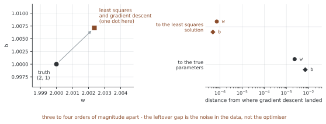
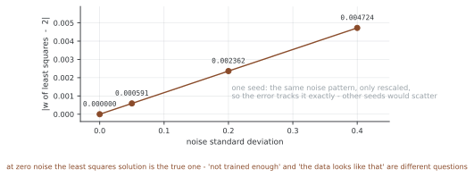
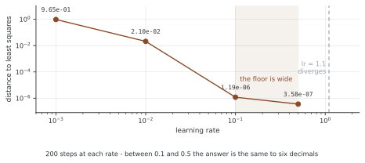
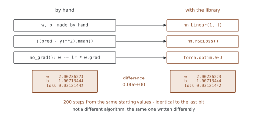
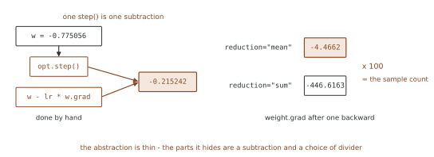

# 선형 회귀 — 어디에 닿는가, 그리고 라이브러리도 같은 데 닿는가

<div class="leadbox" markdown>

**들어가는 이야기** — 참값을 찾는다는 말

점들을 만들 때 쓴 직선을 우리는 알고 있다. 거기에 조금씩 어긋남을 섞어 점
백 개를 흩뿌려 놓고, 그 점들만 보고 직선을 되찾아 보라고 시킨다. 학습이
잘되면 **처음 그 직선이 나와야** 할 것 같다.

안 나온다. 그리고 **얼마를 더 돌려도 안 나온다.**

그렇다고 학습이 실패한 것도 아니다. 이 쪽은 세 수를 나란히 놓는다 — 점을 만들
때 쓴 수, 그 백 개의 점에 가장 잘 맞는 수, 그리고 루프가 닿은 수. 셋째는
둘째와 소수점 일곱 자리까지 같고 첫째와는 눈에 띄게 다르다.

가른 뒤에 남는 물음이 실전에서 쓰인다. 결과가 기대와 다를 때 **「덜 배웠나」와
「데이터가 그렇게 생겼나」는 다른 물음**이고, 뒤엣것은 아무리 오래 돌려도
안 고쳐진다.

</div>

$y = 2x + 1$에 잡음을 섞어 점 백 개를 만들고, 경사 하강으로 $w$와 $b$를 찾는다.
「최소 학습 단계」의 루프를 그대로 쓰되 이번에는 **어디에 닿는지**를 묻는다.

흔히 "참값을 찾는다"고 말하는데 정확하지 않다. 경사 하강이 닿는 곳은
**최소제곱해**이고, 그것은 잡음 때문에 참값과 다르다. 세 수가 따로 있다.

| | |
|---|---|
| **참값** | 데이터를 만들 때 쓴 $w = 2$, $b = 1$ |
| **최소제곱해** | 이 백 개의 점에 가장 잘 맞는 직선 |
| **경사 하강의 결과** | 루프를 돌려 닿은 곳 |

이 쪽은 셋을 나란히 놓고 차이를 잰다.

## 1. 코드

```python
"""밑바닥부터 짠 선형 회귀 — 경사 하강은 어디로 가는가.

`y = 2x + 1` 에 잡음을 섞어 점 백 개를 만들고, 경사 하강으로 `w` 와
`b` 를 찾는다. 「최소 학습 단계」의 루프를 그대로 쓰되 이번에는
**어디에 닿는지**를 묻는다.

흔히 "참값을 찾는다" 고 말하는데 정확하지 않다. 경사 하강이 닿는
곳은 **최소제곱해**이고, 그것은 잡음 때문에 참값과 다르다. 이 쪽은
셋을 나란히 놓고 그 차이를 잰다.

실행: 이 쪽의 코드를 파일로 갈무리해 돌린다
"""
import torch


def header(title):
    print(f"\n=== {title} ===")


TRUE_W, TRUE_B, N, NOISE = 2.0, 1.0, 100, 0.2


def make_data(noise=NOISE, seed=42):
    torch.manual_seed(seed)
    x = torch.randn(N, 1)
    y = TRUE_W * x + TRUE_B + noise * torch.randn(N, 1)
    return x, y


def closed_form(x, y):
    """최소제곱해를 바로 구한다. 경사 하강이 가야 할 곳이다."""
    X = torch.cat([x, torch.ones_like(x)], dim=1)
    beta = torch.linalg.lstsq(X, y).solution
    return beta[0].item(), beta[1].item()


# ========================================================================
# 1. 데이터
# ========================================================================

def show_data():
    header("1. 데이터")
    x, y = make_data()
    print(f"  참 모델  y = {TRUE_W}x + {TRUE_B} + N(0, {NOISE}^2)")
    print(f"  표본 {N}개   x 범위 [{x.min():.3f}, {x.max():.3f}]")
    print(f"               y 범위 [{y.min():.3f}, {y.max():.3f}]")
    return x, y


# ========================================================================
# 2. 학습
# ========================================================================

def train(x, y, lr=0.1, epochs=1000, log=()):
    torch.manual_seed(0)
    w = torch.randn(1, requires_grad=True)
    b = torch.zeros(1, requires_grad=True)
    history = []
    for epoch in range(1, epochs + 1):
        loss = ((x * w + b - y) ** 2).mean()
        if w.grad is not None:
            w.grad.zero_()
            b.grad.zero_()
        loss.backward()
        with torch.no_grad():
            w -= lr * w.grad
            b -= lr * b.grad
        history.append(loss.item())
        if epoch in log:
            print(f"  {epoch:5d} 걸음  로스 {loss.item():.6f}  "
                  f"w {w.item():+.6f}  b {b.item():+.6f}")
    return w.item(), b.item(), history


def run_training(x, y):
    header("2. 학습")
    w, b, hist = train(x, y, log=(1, 10, 100, 500, 1000))
    print(f"  로스가 {hist[0]:.4f} 에서 {hist[-1]:.6f} 로 내려갔다")
    return w, b


# ========================================================================
# 3. 어디에 닿았는가
# ========================================================================

def where_did_it_land(x, y, w, b):
    header("3. 참값 · 해석해 · 경사 하강")
    cw, cb = closed_form(x, y)
    print(f"  참값      w={TRUE_W:.6f}  b={TRUE_B:.6f}")
    print(f"  최소제곱해 w={cw:.6f}  b={cb:.6f}")
    print(f"  경사 하강  w={w:.6f}  b={b:.6f}")
    print(f"  해석해와의 차  w {abs(w - cw):.2e}   b {abs(b - cb):.2e}")
    print(f"  참값과의 차    w {abs(w - TRUE_W):.6f}   b {abs(b - TRUE_B):.6f}")
    print("  경사 하강은 참값이 아니라 해석해로 간다 — 소수점 일곱 자리까지")
    print("  남은 차이는 알고리즘의 잘못이 아니라 잡음이 만든 것이다")


# ========================================================================
# 4. 잡음을 줄이면 해석해가 참값으로 간다
# ========================================================================

def noise_sweep():
    header("4. 잡음과 해석해")
    for noise in (0.4, 0.2, 0.05, 0.0):
        x, y = make_data(noise=noise)
        cw, cb = closed_form(x, y)
        print(f"  잡음 {noise:.2f}  해석해 w={cw:.6f} b={cb:.6f}  "
              f"참값과의 차 {abs(cw - TRUE_W):.6f}")
    print("  잡음이 0 이면 해석해가 참값과 정확히 같다")
    print("  그러니 '학습이 덜 되었나' 와 '데이터가 그렇게 생겼나' 는 다른 물음이다")


# ========================================================================
# 5. 러닝레이트가 정하는 것
# ========================================================================

def learning_rates():
    header("5. 러닝레이트")
    x, y = make_data()
    cw, cb = closed_form(x, y)
    for lr in (0.001, 0.01, 0.1, 0.5, 1.1):
        w, b, hist = train(x, y, lr=lr, epochs=200)
        gap = abs(w - cw) + abs(b - cb)
        state = "발산" if not (gap == gap) or gap > 1e3 else f"해석해와 {gap:.2e}"
        print(f"  lr={lr:<6} 200 걸음 뒤 로스 {hist[-1]:12.6f}   {state}")
    print("  너무 작으면 못 닿고 너무 크면 튄다. 가운데가 넓다")


def main():
    x, y = show_data()
    w, b = run_training(x, y)
    where_did_it_land(x, y, w, b)
    noise_sweep()
    learning_rates()


if __name__ == "__main__":
    main()
```

**출력:**

```
=== 1. 데이터 ===
  참 모델  y = 2.0x + 1.0 + N(0, 0.2^2)
  표본 100개   x 범위 [-2.206, 2.218]
               y 범위 [-3.320, 5.209]

=== 2. 학습 ===
      1 걸음  로스 1.306861  w +1.642241  b +0.206942
     10 걸음  로스 0.050514  w +1.964850  b +0.905588
    100 걸음  로스 0.031214  w +2.002363  b +1.007134
    500 걸음  로스 0.031214  w +2.002363  b +1.007134
   1000 걸음  로스 0.031214  w +2.002363  b +1.007134
  로스가 1.3069 에서 0.031214 로 내려갔다

=== 3. 참값 · 해석해 · 경사 하강 ===
  참값      w=2.000000  b=1.000000
  최소제곱해 w=2.002362  b=1.007135
  경사 하강  w=2.002363  b=1.007134
  해석해와의 차  w 7.15e-07   b 4.77e-07
  참값과의 차    w 0.002363   b 0.007134
  경사 하강은 참값이 아니라 해석해로 간다 — 소수점 일곱 자리까지
  남은 차이는 알고리즘의 잘못이 아니라 잡음이 만든 것이다

=== 4. 잡음과 해석해 ===
  잡음 0.40  해석해 w=2.004724 b=1.014270  참값과의 차 0.004724
  잡음 0.20  해석해 w=2.002362 b=1.007135  참값과의 차 0.002362
  잡음 0.05  해석해 w=2.000591 b=1.001784  참값과의 차 0.000591
  잡음 0.00  해석해 w=2.000000 b=1.000000  참값과의 차 0.000000
  잡음이 0 이면 해석해가 참값과 정확히 같다
  그러니 '학습이 덜 되었나' 와 '데이터가 그렇게 생겼나' 는 다른 물음이다

=== 5. 러닝레이트 ===
  lr=0.001  200 걸음 뒤 로스     0.588221   해석해와 9.65e-01
  lr=0.01   200 걸음 뒤 로스     0.031519   해석해와 2.10e-02
  lr=0.1    200 걸음 뒤 로스     0.031214   해석해와 1.19e-06
  lr=0.5    200 걸음 뒤 로스     0.031214   해석해와 3.58e-07
  lr=1.1    200 걸음 뒤 로스          inf   발산
  너무 작으면 못 닿고 너무 크면 튄다. 가운데가 넓다
```

## 2. 로스가 100걸음에서 멈춘다

```
    1 걸음  로스 1.306861  w +1.642241  b +0.206942
   10 걸음  로스 0.050514  w +1.964850  b +0.905588
  100 걸음  로스 0.031214  w +2.002363  b +1.007134
  500 걸음  로스 0.031214  w +2.002363  b +1.007134
 1000 걸음  로스 0.031214  w +2.002363  b +1.007134
```

100걸음에서 이미 끝났다. 500걸음, 1000걸음의 값이 **소수점까지 똑같다.**

로스가 0으로 가지 않고 **0.031214에서 멈춘 것**이 중요하다. 더 돌려도 안
내려간다. 잡음이 섞인 데이터에서는 어떤 직선도 모든 점을 지날 수 없고, 남는
0.031이 바로 그 잡음의 크기다 — 실제로 $0.2^2 = 0.04$에 가깝다.

## 3. 참값·해석해·경사 하강

```
참값       w=2.000000  b=1.000000
최소제곱해  w=2.002362  b=1.007135
경사 하강   w=2.002363  b=1.007134

해석해와의 차  w 7.15e-07   b 4.77e-07
참값과의 차    w 0.002363   b 0.007134
```



**경사 하강은 해석해에 소수점 일곱 자리까지 닿았다.** 그리고 참값과는
0.0024만큼 떨어져 있다. 오른쪽 칸의 로그 눈금이 그 둘을 한자리에 놓는다 —
**세 자릿수에서 네 자릿수 차이**이므로, 왼쪽 칸에서는 두 점이 겹쳐 하나로
보인다.

그 0.0024는 **알고리즘의 잘못이 아니다.** 경사 하강은 제 할 일을 완벽하게
했다 — 주어진 백 개의 점에 대해 제곱오차를 가장 작게 만드는 직선을 찾았다.
그 직선이 참 직선과 조금 다른 것은, 백 개의 점이 잡음 때문에 참 직선에서
조금씩 비껴 있기 때문이다.

> 이 구별이 실전에서 중요하다. 학습 결과가 기대와 다를 때 물어야 할 것이
> 둘이다. **"덜 배웠나"**(해석해에 못 닿았나)와 **"데이터가 그렇게
> 생겼나"**(해석해 자체가 거기 있나). 전자는 러닝레이트와 걸음 수의 문제이고,
> 후자는 아무리 오래 돌려도 안 고쳐진다.

## 4. 잡음을 줄이면 해석해가 참값으로 간다

| 잡음 | 최소제곱해 $w$ | 참값과의 차 |
|---|---|---|
| 0.40 | 2.004724 | 0.004724 |
| 0.20 | 2.002362 | 0.002362 |
| 0.05 | 2.000591 | 0.000591 |
| 0.00 | **2.000000** | **0.000000** |

잡음을 반으로 줄이면 차이도 거의 정확히 반이 된다. 잡음이 0이면 해석해가
참값과 **정확히** 같아진다.

이것이 3절의 주장을 뒷받침한다. 남은 차이는 **데이터가 가진 성질**이고,
데이터를 바꾸면 따라서 바뀐다.



**네 점이 원점을 지나는 직선 위에 놓인다.** 씨앗을 고정해 두었으므로 잡음의
무늬는 늘 같고 크기만 달라지며, 그래서 오차가 잡음에 정확히 비례한다 —
$0.004724 / 0.40$과 $0.002362 / 0.20$이 소수점 여섯째 자리까지 같다. 씨앗을
바꾸면 이 정확함은 사라지고 점들이 선 둘레로 흩어진다. **한 번 돌린 것은
재어 본 것이 아니다.**

표본 수를 늘려도 줄어든다 — 잡음이 평균되어 상쇄되기 때문이다. 연습문제 2에서
확인한다.

## 5. 러닝레이트

```
lr=0.001  200 걸음 뒤 로스     0.588221   해석해와 9.65e-01
lr=0.01   200 걸음 뒤 로스     0.031519   해석해와 2.10e-02
lr=0.1    200 걸음 뒤 로스     0.031214   해석해와 1.19e-06
lr=0.5    200 걸음 뒤 로스     0.031214   해석해와 3.58e-07
lr=1.1    200 걸음 뒤 로스          inf   발산
```



**쓸 수 있는 범위가 생각보다 넓다.** 0.1과 0.5가 둘 다 해석해에 닿았고, 그
사이 어디를 골라도 된다. 그림에서 바닥이 평평하게 눕는 구간이 그것이다.

양끝이 다르게 실패한다.

- **너무 작으면**(0.001) 조용히 못 닿는다. 로스가 0.588이니 학습이 되긴 했고
  오류도 없다. 더 돌리면 닿는다 — 시간만 있으면
- **너무 크면**(1.1) `inf`로 터진다. 한눈에 보인다

둘 중 **작은 쪽이 더 위험하다.** 터지면 바로 알지만, 덜 배운 모델은 그럴듯한
수를 내놓는다. 「최적화 기초」에서 러닝레이트가 다른 어떤 선택보다 크게
작용한다고 재었는데, 그 말의 절반이 이 비대칭이다.

## 6. 같은 것을 라이브러리로 적으면

여기까지는 `w`와 `b`를 손으로 만들고, 로스를 손으로 적고, 갱신도 손으로 했다.
그 셋을 라이브러리에 넘긴다.

| 손으로 | 라이브러리 |
|---|---|
| `w`, `b`를 직접 만들고 들고 다님 | `nn.Linear(1, 1)` |
| `((pred - y) ** 2).mean()` | `nn.MSELoss()` |
| `with no_grad(): w -= lr * w.grad` | `torch.optim.SGD` |

편해지는 것은 분명하다. 그런데 **셈이 그대로인지**는 따로 물어야 한다. 결과가
기대와 다를 때 안 보이는 쪽을 의심하기는 어렵기 때문이다 — 많은 사람이 쓰는
코드니 맞겠지 싶은 것이다. 그 믿음은 대개 옳고, **한 번은 걷어 내고 확인해
두는 편**이 낫다. 이 자리가 그 한 번이다.

```python
"""nn.Module 로 옮기기 — 추상화를 걷어 내면 같은 수가 나오는가.

앞의 1~5절에서 손으로 관리한 세 가지를 라이브러리에 넘긴다.

| 손으로 | 라이브러리 |
|---|---|
| `w`, `b` 를 직접 만들고 들고 다님 | `nn.Linear(1, 1)` |
| `((pred - y) ** 2).mean()` | `nn.MSELoss()` |
| `with no_grad(): w -= lr * w.grad` | `torch.optim.SGD` |

편해지는 것은 분명한데, **셈이 그대로인지**는 따로 물어야 한다.
이 쪽은 두 길을 나란히 돌려 소수점까지 견준다.

실행: 이 쪽의 코드를 파일로 갈무리해 돌린다
"""
import torch
import torch.nn as nn


def header(title):
    print(f"\n=== {title} ===")


TRUE_W, TRUE_B, N = 2.0, 1.0, 100


def make_data(seed=42):
    torch.manual_seed(seed)
    x = torch.randn(N, 1)
    return x, TRUE_W * x + TRUE_B + 0.2 * torch.randn(N, 1)


# ========================================================================
# 1. 손으로 짠 것
# ========================================================================

def by_hand(x, y, lr=0.1, epochs=200, w0=None, b0=None):
    w = w0.clone().requires_grad_(True)
    b = b0.clone().requires_grad_(True)
    for _ in range(epochs):
        loss = ((x * w + b - y) ** 2).mean()
        if w.grad is not None:
            w.grad.zero_()
            b.grad.zero_()
        loss.backward()
        with torch.no_grad():
            w -= lr * w.grad
            b -= lr * b.grad
    return w.item(), b.item(), loss.item()


# ========================================================================
# 2. 라이브러리로 짠 것
# ========================================================================

def by_module(x, y, lr=0.1, epochs=200, w0=None, b0=None):
    model = nn.Linear(1, 1)
    with torch.no_grad():                 # 같은 자리에서 시작하게 맞춘다
        model.weight.copy_(w0.view(1, 1))
        model.bias.copy_(b0)
    criterion = nn.MSELoss()
    opt = torch.optim.SGD(model.parameters(), lr=lr)
    for _ in range(epochs):
        loss = criterion(model(x), y)
        opt.zero_grad()
        loss.backward()
        opt.step()
    return model.weight.item(), model.bias.item(), loss.item()


def compare():
    header("1. 두 길이 같은 수를 주는가")
    x, y = make_data()
    torch.manual_seed(0)
    w0, b0 = torch.randn(1), torch.zeros(1)
    hw, hb, hl = by_hand(x, y, w0=w0, b0=b0)
    mw, mb, ml = by_module(x, y, w0=w0, b0=b0)
    print(f"  손으로      w {hw:.8f}  b {hb:.8f}  로스 {hl:.8f}")
    print(f"  nn.Module   w {mw:.8f}  b {mb:.8f}  로스 {ml:.8f}")
    print(f"  차이        w {abs(hw - mw):.2e}  b {abs(hb - mb):.2e}")
    print("  같은 자리에서 시작하면 소수점 끝까지 같다")


# ========================================================================
# 3. 무엇이 무엇을 대신하는가
# ========================================================================

def what_replaces_what():
    header("2. 바꿔치기")
    x, y = make_data()
    model = nn.Linear(1, 1)

    print("  파라미터는 모델이 들고 있다")
    for name, p in model.named_parameters():
        print(f"    {name:8s} 모양 {tuple(p.shape)}  requires_grad {p.requires_grad}")

    pred = model(x)
    hand_loss = ((pred - y) ** 2).mean()
    mse_loss = nn.MSELoss()(pred, y)
    print(f"  로스  손으로 {hand_loss.item():.8f}  MSELoss {mse_loss.item():.8f}"
          f"  같은가 {torch.allclose(hand_loss, mse_loss)}")

    print("  모델의 순전파도 손으로 적은 것과 같다:",
          torch.allclose(model(x), x @ model.weight.t() + model.bias))


# ========================================================================
# 4. 모델이 커지면 손으로는 못 한다
# ========================================================================

def why_bother():
    header("3. 모델이 커지면")
    small = nn.Linear(1, 1)
    big = nn.Sequential(nn.Linear(784, 256), nn.ReLU(),
                        nn.Linear(256, 128), nn.ReLU(),
                        nn.Linear(128, 10))
    for name, m in (("nn.Linear(1,1)", small), ("3층 그물", big)):
        n_t = sum(1 for _ in m.parameters())
        n_p = sum(p.numel() for p in m.parameters())
        print(f"  {name:16s} 텐서 {n_t}개   수 {n_p:,}개")
    print("  텐서 여섯 개를 손으로 zero_() 하고 갱신하는 코드는 쓸 수 없다")
    print("  opt.zero_grad() 와 opt.step() 이 그것을 한 줄로 만든다")

    opt = torch.optim.SGD(big.parameters(), lr=0.1, momentum=0.9)
    x = torch.randn(4, 784)
    big(x).sum().backward()
    opt.step()
    state = sum(len(s) for s in opt.state.values())
    print(f"  게다가 모멘텀은 상태를 들고 있어야 한다. 버퍼 {state}개")


# ========================================================================
# 5. 추상화가 숨기는 것
# ========================================================================

def what_it_hides():
    header("4. 숨겨지는 것")
    model = nn.Linear(1, 1)
    print("  model.weight 의 모양:", tuple(model.weight.shape), "= (out, in)")
    print("  그래서 순전파가 x @ W.t() 다 —「Linear 웨이트 관례」의 그 전치")

    x, y = make_data()
    opt = torch.optim.SGD(model.parameters(), lr=0.1)
    loss = nn.MSELoss()(model(x), y)
    loss.backward()
    before = model.weight.item()
    opt.step()
    after = model.weight.item()
    print(f"  opt.step() 한 걸음: {before:.6f} -> {after:.6f}")
    print(f"  손으로 w - lr*grad : "
          f"{before - 0.1 * model.weight.grad.item():.6f}")
    print("  step() 이 하는 일은 no_grad 안의 뺄셈 한 줄이다")

    print("  reduction 을 sum 으로 바꾸면 로스도 경사도 N 배가 된다")
    for red in ("mean", "sum"):
        m2 = nn.Linear(1, 1)
        with torch.no_grad():
            m2.weight.copy_(model.weight)
            m2.bias.copy_(model.bias)
        nn.MSELoss(reduction=red)(m2(x), y).backward()
        print(f"    reduction={red:5s} weight.grad {m2.weight.grad.item():12.4f}")


def main():
    compare()
    what_replaces_what()
    why_bother()
    what_it_hides()


if __name__ == "__main__":
    main()
```

**출력:**

```
=== 1. 두 길이 같은 수를 주는가 ===
  손으로      w 2.00236273  b 1.00713444  로스 0.03121442
  nn.Module   w 2.00236273  b 1.00713444  로스 0.03121442
  차이        w 0.00e+00  b 0.00e+00
  같은 자리에서 시작하면 소수점 끝까지 같다

=== 2. 바꿔치기 ===
  파라미터는 모델이 들고 있다
    weight   모양 (1, 1)  requires_grad True
    bias     모양 (1,)  requires_grad True
  로스  손으로 2.32904792  MSELoss 2.32904792  같은가 True
  모델의 순전파도 손으로 적은 것과 같다: True

=== 3. 모델이 커지면 ===
  nn.Linear(1,1)   텐서 2개   수 2개
  3층 그물            텐서 6개   수 235,146개
  텐서 여섯 개를 손으로 zero_() 하고 갱신하는 코드는 쓸 수 없다
  opt.zero_grad() 와 opt.step() 이 그것을 한 줄로 만든다
  게다가 모멘텀은 상태를 들고 있어야 한다. 버퍼 6개

=== 4. 숨겨지는 것 ===
  model.weight 의 모양: (1, 1) = (out, in)
  그래서 순전파가 x @ W.t() 다 —「Linear 웨이트 관례」의 그 전치
  opt.step() 한 걸음: -0.775056 -> -0.215242
  손으로 w - lr*grad : -0.215242
  step() 이 하는 일은 no_grad 안의 뺄셈 한 줄이다
  reduction 을 sum 으로 바꾸면 로스도 경사도 N 배가 된다
    reduction=mean  weight.grad      -4.4662
    reduction=sum   weight.grad    -446.6163
```

## 7. 같은 자리에서 출발하면 끝까지 같다

```
손으로      w 2.00236273  b 1.00713444  로스 0.03121442
nn.Module   w 2.00236273  b 1.00713444  로스 0.03121442
차이        w 0.00e+00  b 0.00e+00
```



**비트 단위로 같다.** 차이가 `0.00e+00`이지 "아주 작다"가 아니다.

같게 만들려고 한 일은 하나뿐이다 — `nn.Linear`의 초기값을 손으로 쓴 쪽과 맞춘
것. `model.weight.copy_(w0)`가 그것이다. 초기값만 맞추면 그 뒤로는 완전히 같은
계산이 돈다.

그러니 `nn.Linear`·`MSELoss`·`SGD`는 **다른 알고리즘이 아니라 같은 알고리즘의
다른 표기**다. 둘을 견주어 결과가 다르다면 초기값이 다르거나, 어딘가에서
`reduction`이나 러닝레이트가 어긋난 것이다.

## 8. 무엇이 무엇을 대신하는가

```
weight   모양 (1, 1)  requires_grad True
bias     모양 (1,)    requires_grad True

로스  손으로 2.32904792   MSELoss 2.32904792   같은가 True
모델의 순전파도 손으로 적은 것과 같다: True
```

`nn.Linear`가 하는 일은 **텐서 둘을 들고 있다가 `x @ W.t() + b`를 하는 것**이
전부다. 「Linear 웨이트 관례」에서 그 전치가 왜 붙는지 보았다.

`MSELoss()(pred, y)`도 `((pred - y) ** 2).mean()`과 소수점까지 같다.

## 9. 그런데 왜 쓰는가

```
nn.Linear(1,1)   텐서 2개   수 2개
3층 그물          텐서 6개   수 235,146개
게다가 모멘텀은 상태를 들고 있어야 한다. 버퍼 6개
```

모델이 작을 때는 손으로 써도 된다. 커지면 못 쓴다.

- **파라미터가 여섯 개**만 되어도 `if p.grad is not None: p.grad.zero_()`를
  여섯 번 적어야 한다. 하나 빠뜨리면 「최소 학습 단계」 3절처럼 조용히 안 배운다
- **모멘텀이나 Adam은 상태를 들고 있어야 한다.** 파라미터마다 버퍼를 하나씩
  만들어 걸음마다 갱신하는 일을 손으로 하기는 어렵다

그러니 옵티마이저의 값은 "다른 알고리즘"이 아니라 **빠뜨릴 데가 없어지는 것**에
있다.

## 10. 추상화가 숨기는 것

```
opt.step() 한 걸음: -0.775056 -> -0.215242
손으로 w - lr*grad : -0.215242
```



`step()`이 하는 일은 `no_grad` 안의 뺄셈 한 줄이다. 숨겨져 있을 뿐 마법이 아니다.

숨겨져서 걸리는 자리가 하나 있다.

```
reduction=mean  weight.grad      -4.4662
reduction=sum   weight.grad    -446.6163
```

**정확히 100배**, 곧 표본 수 $N$만큼이다. `MSELoss`의 기본값이 `"mean"`이라
평소에는 생각할 일이 없는데, 어딘가에서 `"sum"`으로 바꾸면 **경사가 $N$배가
되고 실효 러닝레이트도 $N$배**가 된다. 「경사 누적」에서 마이크로배치를 나눌
때와 같은 함정이다.

## 연습문제

<div class="drillbox" markdown>

**연습문제 1.** <span class="diff easy" title="쉬움"></span>
2절에서 로스가 0.031214에 멈췄다. 이 수가 잡음의 크기와 어떤 관계인가?
잡음을 바꿔 가며 확인하라.

</div>

??? success "풀이"
    ```python
    for noise in (0.0, 0.05, 0.1, 0.2, 0.4):
        x, y = make_data(noise=noise)
        w, b, hist = train(x, y, epochs=300)
        print(f"  잡음 {noise:.2f}  잡음^2 {noise ** 2:.4f}  "
              f"마지막 로스 {hist[-1]:.6f}")
    ```

    ```
      잡음 0.00  잡음^2 0.0000  마지막 로스 0.000000
      잡음 0.05  잡음^2 0.0025  마지막 로스 0.001951
      잡음 0.10  잡음^2 0.0100  마지막 로스 0.007804
      잡음 0.20  잡음^2 0.0400  마지막 로스 0.031214
      잡음 0.40  잡음^2 0.1600  마지막 로스 0.124858
    ```

    **마지막 로스가 잡음의 제곱에 비례한다.** 0.0400 대 0.031214, 0.1600 대
    0.124858 — 어느 쪽이든 약 0.78배다.

    MSE 로스가 제곱오차의 평균이고, 최선의 직선을 찾고 나면 남는 오차가 곧
    잡음이기 때문이다. 그래서 **로스의 하한이 잡음의 분산**이다.

    0.78배로 조금 작은 것은 직선이 잡음에 **조금 끌려갔기** 때문이다. 자유도
    둘($w$와 $b$)을 써서 잡음의 일부를 흉내 냈고, 그만큼 표본 안에서의 오차가
    줄었다. 표본 수가 100이니 그 효과가 $1 - 2/100 = 0.98$쯤이어야 하는데
    0.78이 나온 것은 표본마다 다른 우연도 섞였기 때문이다.

    실전에서 쓸 모양으로 바꾸면 이렇다. **로스가 0으로 안 가는 것이 정상이다.**
    0으로 가고 있다면 데이터에 잡음이 없거나, 모델이 잡음까지 외우고 있다는
    뜻이다.

---

<div class="drillbox" markdown>

**연습문제 2.** <span class="diff med" title="중간"></span>
4절은 잡음을 줄이면 해석해가 참값으로 간다고 했다. **표본 수를 늘리면** 어떤가?
잡음은 그대로 두고 $N$을 바꿔 가며 재어라.

</div>

??? success "풀이"
    ```python
    import math

    print(f"  {'N':>6}  {'해석해 w':>12}  {'참값과의 차':>12}  {'1/sqrt(N)':>10}")
    for n in (10, 100, 1000, 10000, 100000):
        torch.manual_seed(42)
        x = torch.randn(n, 1)
        y = TRUE_W * x + TRUE_B + NOISE * torch.randn(n, 1)
        X = torch.cat([x, torch.ones_like(x)], dim=1)
        cw = torch.linalg.lstsq(X, y).solution[0].item()
        print(f"  {n:>6}  {cw:12.6f}  {abs(cw - TRUE_W):12.6f}  "
              f"{1 / math.sqrt(n):10.4f}")
    ```

    ```
           N      해석해 w      참값과의 차   1/sqrt(N)
          10      2.079341      0.079341      0.3162
         100      2.002362      0.002362      0.1000
        1000      2.004283      0.004283      0.0316
       10000      1.997123      0.002877      0.0100
      100000      1.999741      0.000259      0.0032
    ```

    **줄기는 하는데 고르게 줄지 않는다.** 10에서 0.079, 10만에서 0.00026이니
    크게 보면 맞다. 그런데 **1000일 때가 100일 때보다 나쁘다**(0.0043 대 0.0024).

    $1/\sqrt{N}$은 **기댓값**이지 매번 그렇게 된다는 약속이 아니다. 표본 하나를
    뽑을 때마다 운이 섞이므로, 데이터를 열 배 모으고도 운 나쁘게 더 나빠질 수
    있다. 여기 적힌 수는 씨앗 42 하나로 뽑은 **한 번의 결과**다.

    제대로 재려면 씨앗을 여럿 써서 퍼짐을 보아야 한다 — 이 책이 모델을 견줄 때
    늘 하는 일이다. 한 번 재고 "데이터를 열 배 늘렸더니 오히려 나빠졌다"고 적으면
    그것이 바로 잡음을 신호로 읽은 것이다.

    그래도 **큰 흐름은 분명하다.** 10과 10만 사이에서 300배가 줄었고, 그것은
    우연으로 설명되지 않는다.

---

<div class="drillbox" markdown>

**연습문제 3.** <span class="diff hard" title="어려움"></span>
5절에서 `lr=1.1`이 발산했다. **정확히 어디서** 경계가 생기는가? 그 경계를
데이터로부터 **미리 계산**할 수 있는지 확인하라.

</div>

??? success "풀이"
    ```python
    x, y = make_data()
    for lr in (0.9, 0.95, 0.99, 1.0, 1.01, 1.05):
        w, b, hist = train(x, y, lr=lr, epochs=200)
        last = hist[-1]
        state = "발산" if not (last == last) or last > 1e3 else f"{last:.6f}"
        print(f"  lr={lr:<5} 마지막 로스 {state}")

    X = torch.cat([x, torch.ones_like(x)], dim=1)
    H = 2 * (X.t() @ X) / len(x)           # MSE 의 헤세 행렬
    ev = torch.linalg.eigvalsh(H)
    print(f"  헤세의 고윳값 {[round(v, 4) for v in ev.tolist()]}")
    print(f"  이론 경계 2/최대고윳값 = {2 / ev.max().item():.6f}")
    ```

    ```
      lr=0.9   마지막 로스 0.031214
      lr=0.95  마지막 로스 0.036241
      lr=0.99  마지막 로스 발산
      lr=1.0   마지막 로스 발산
      lr=1.01  마지막 로스 발산
      lr=1.05  마지막 로스 발산
      헤세의 고윳값 [1.8427, 2.0908]
      이론 경계 2/최대고윳값 = 0.956556
    ```

    **이론이 0.9566이라 하고, 실제로 0.95와 0.99 사이에서 갈렸다.** 미리 계산할
    수 있다.

    까닭은 MSE가 **이차함수**이기 때문이다. 이차함수에서 경사 하강 한 걸음은
    각 고유방향의 오차에 $|1 - \eta \lambda|$를 곱한다. 그 값이 1보다 작아야
    줄어들므로

    $$
    |1 - \eta \lambda| < 1 \iff 0 < \eta < \frac{2}{\lambda}
    $$

    가장 까다로운 것은 가장 큰 고윳값이므로 경계가 $2/\lambda_{\max}$다.

    `lr=0.95`에서 로스가 0.036241로 **조금 높은 것**도 설명된다. 경계 바로
    아래라 가장 큰 고유방향이 거의 안 줄어들어, 200걸음으로는 다 못 내려갔다.
    경계에 가까울수록 안정하기는 해도 **느려진다.**

    여기서 가져갈 것이 둘이다.

    **첫째, 경계는 데이터가 정한다.** $\lambda_{\max}$는 $X^\top X$에서 나오므로
    입력의 크기와 상관구조에 달려 있다. 입력을 10배 키우면 고윳값이 100배가 되어
    쓸 수 있는 러닝레이트가 100분의 1로 줄어든다. **입력을 정규화하는 까닭이
    이것이다** — 모델을 위해서가 아니라 러닝레이트를 쓸 만하게 만들려고 한다.

    **둘째, 이 셈은 이차함수에서만 정확하다.** 신경망의 로스는 이차가 아니므로
    헤세가 자리마다 바뀌고, 미리 계산한 경계가 학습 도중에 달라진다. 그래도
    **크기의 자릿수**를 가늠하는 데는 쓸모가 있고, 「최적화 기초」에서 러닝레이트를
    자릿수 단위로 훑어본 것이 그래서다.

---

<div class="drillbox" markdown>

**연습문제 4.** <span class="diff easy" title="쉬움"></span>
`nn.Linear`의 초기 가중치는 어디서 오는가? 입력 차원을 바꿔 가며 범위를 재고,
규칙을 찾아라.

</div>

??? success "풀이"
    ```python
    import math

    torch.manual_seed(0)
    for d in (1, 10, 100, 1000):
        m = nn.Linear(d, 1)
        bound = 1 / math.sqrt(d)
        w = m.weight.detach()
        print(f"  in={d:5d}  weight 범위 [{w.min():+.4f}, {w.max():+.4f}]  "
              f"1/sqrt(in) = {bound:.4f}  넘는가 {bool((w.abs() > bound).any())}")
    ```

    ```
      in=    1  weight 범위 [-0.0075, -0.0075]  1/sqrt(in) = 1.0000  넘는가 False
      in=   10  weight 범위 [-0.2603, +0.2507]  1/sqrt(in) = 0.3162  넘는가 False
      in=  100  weight 범위 [-0.0998, +0.0994]  1/sqrt(in) = 0.1000  넘는가 False
      in= 1000  weight 범위 [-0.0316, +0.0316]  1/sqrt(in) = 0.0316  넘는가 False
    ```

    **$U(-1/\sqrt{d_{in}},\, +1/\sqrt{d_{in}})$ 균등분포**다. 입력이 100개면
    ±0.1, 1000개면 ±0.0316 안에 들어간다.

    $1/\sqrt{d_{in}}$으로 줄이는 까닭은 「행렬 연산」의 어텐션 scaling과 같다.
    출력 하나는 $d_{in}$개를 더한 값이므로, 가중치의 크기를 그대로 두면 출력의
    표준편차가 $\sqrt{d_{in}}$으로 자란다. 층을 쌓으면 그것이 거듭 곱해져
    터지거나 사라진다.

    그래서 **초기화는 모델 구조가 정한다.** 손으로 `torch.randn`으로 파라미터를
    만들면 이 조정이 빠지고, 깊은 그물에서는 그것만으로 학습이 안 되기도 한다.

---

<div class="drillbox" markdown>

**연습문제 5.** <span class="diff med" title="중간"></span>
옵티마이저가 **무엇을 들고 있는지** 들여다보라. `step()` 전후로 `opt.state`와
`opt.param_groups`가 어떻게 달라지는가?

</div>

??? success "풀이"
    ```python
    m = nn.Linear(3, 2)
    opt = torch.optim.SGD(m.parameters(), lr=0.1, momentum=0.9)
    print("  step 전 state:", dict(opt.state))
    m(torch.randn(4, 3)).sum().backward()
    opt.step()
    for p, st in opt.state.items():
        print(f"  파라미터 모양 {tuple(p.shape)} -> 상태 키 {list(st.keys())}  "
              f"버퍼 모양 {tuple(st['momentum_buffer'].shape)}")
    print("  param_groups:",
          [{k: v for k, v in g.items() if k != 'params'} for g in opt.param_groups])
    ```

    ```
      step 전 state: {}
      파라미터 모양 (2, 3) -> 상태 키 ['momentum_buffer']  버퍼 모양 (2, 3)
      파라미터 모양 (2,) -> 상태 키 ['momentum_buffer']  버퍼 모양 (2,)
      param_groups: [{'lr': 0.1, 'momentum': 0.9, 'dampening': 0, 'weight_decay': 0,
                      'nesterov': False, 'maximize': False, ...}]
    ```

    **`state`가 처음에는 비어 있다.** 첫 `step()`에서야 만들어진다 — 미리 잡아
    두면 쓰지도 않을 메모리를 차지하니까.

    만들어진 뒤에는 **파라미터마다 그 모양 그대로의 버퍼**가 하나씩 붙는다.
    모멘텀을 쓰면 모델 크기만큼 메모리가 더 든다는 뜻이고, Adam은 버퍼가 둘이라
    두 배가 든다. 「모델 체크포인트」에서 옵티마이저 상태를 같이 저장해야 했던
    것이 이것이다.

    `param_groups`는 하이퍼파라미터를 담는다. 여기에 손을 대면 학습 도중에
    러닝레이트를 바꿀 수 있고, 스케줄러가 하는 일이 바로 그것이다 —
    `opt.param_groups[0]["lr"] = 새값`.

---

<div class="drillbox" markdown>

**연습문제 6.** <span class="diff hard" title="어려움"></span>
10절에서 `reduction="sum"`이 경사를 $N$배로 만들었다. 그렇다면 `sum`으로 바꾸고도
**같은 학습**을 하려면 러닝레이트를 어떻게 해야 하는가? 확인하라.

</div>

??? success "풀이"
    ```python
    def run(red, lr, epochs=200):
        m = nn.Linear(1, 1)
        with torch.no_grad():
            m.weight.copy_(w0.view(1, 1))
            m.bias.copy_(b0)
        opt = torch.optim.SGD(m.parameters(), lr=lr)
        crit = nn.MSELoss(reduction=red)
        for _ in range(epochs):
            opt.zero_grad()
            crit(m(x), y).backward()
            opt.step()
        return m.weight.item(), m.bias.item()

    a = run("mean", 0.1)
    b = run("sum", 0.1)
    c = run("sum", 0.1 / N)
    print(f"  mean, lr=0.1      w {a[0]:.6f} b {a[1]:.6f}")
    print(f"  sum,  lr=0.1      w {b[0]:.6f} b {b[1]:.6f}")
    print(f"  sum,  lr=0.1/N    w {c[0]:.6f} b {c[1]:.6f}")
    ```

    ```
      mean, lr=0.1      w 2.002363 b 1.007134
      sum,  lr=0.1      w nan b nan
      sum,  lr=0.1/N    w 2.002363 b 1.007134
    ```

    **러닝레이트를 $N$으로 나누면 소수점까지 같아진다.**

    그냥 `sum`으로 바꾸면 `nan`이다. 경사가 100배이므로 걸음도 100배가 되고,
    연습문제 3에서 잰 안정 경계 0.9566을 한참 넘어선다.

    여기서 가져갈 것은 **`reduction`과 러닝레이트가 한 쌍**이라는 점이다. 둘 중
    하나만 바꾸면 학습이 달라진다. 그리고 바뀌는 방향이 나쁜 쪽이면 `nan`으로
    바로 알지만, 반대 방향(예: `mean`인데 배치만 키우기)이면 **조용히 덜
    배운다.**

    파이토치가 `reduction="mean"`을 기본값으로 둔 까닭이 이것이다. 평균은 배치
    크기에 휘둘리지 않으므로, 러닝레이트 하나를 정해 두면 배치를 바꿔도 대체로
    쓸 수 있다.
