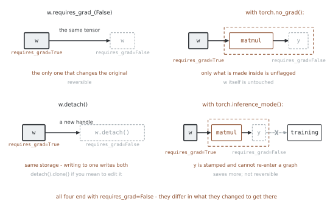
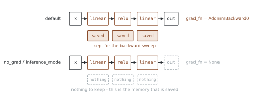

# 경사 추적을 언제 멈출 것인가

<div class="leadbox" markdown>

**들어가는 이야기** — 넷이 같은 답을 내놓는다

파이토치는 **경사 추적**을 끄는 길을 넷이나 준다 — 그 텐서를 역전파가 더는
따라가지 않게 하는 것이다. `requires_grad_(False)` · `torch.no_grad()` ·
`detach()` · `torch.inference_mode()`. 넷을 다 써 보고 결과를 찍으면 **똑같이**
끝난다. `requires_grad=False`.

같은 답이 나오니 아무거나 써도 될 것 같다. 그렇지 않다. 넷이 다른 것은 답이
아니라 **거기에 이르려고 무엇을 바꾸었는가**이고, 그 차이는 그 뒤에 드러난다.
`requires_grad_()`는 그 텐서 자체를 바꾸어 놓고, `no_grad`는 블록을 나가는
순간 효력이 끝나며, `detach()`는 **같은 저장소를 가리키는 새 텐서**를 내주고,
`inference_mode`는 거기서 나온 텐서에 **추론 텐서라는 표**를 박는다.

마지막 것은 되돌릴 수 없다. 모르고 쓰면 평가만 돌리려던 결과를 나중에 트레인에
못 쓴다.

</div>

파이토치가 경사 추적을 끄는 방법은 네 개가 있다. 처음 셋은 잘 알려져 있고 자주 쓰이지만, 마지막 네 번째 방법은 아는 사람이 별로 없다.

| 길 | 무엇을 건드리는가 | 되돌릴 수 있는가 |
|---|---|---|
| `t.requires_grad_(False)` | 그 텐서의 **`requires_grad`** | 된다 |
| `with torch.no_grad()` | 블록 안의 **그래프 기록** | 블록을 나가면 끝 |
| `t.detach()` | **새 텐서**를 만든다 | 원본은 그대로 |
| `with torch.inference_mode()` | 그래프 기록 + **버전 카운터**까지 | **못 되돌린다** |

고르는 기준은 "무엇을 끄고 싶은가"다. 표의 차례대로 넷이다. 텐서 하나를 영영
트레인에서 빼고 싶은가, 이 블록 동안만 기록을 멈추고 싶은가, 값만 꺼내 가고 싶은가,
아니면 **그 결과를 다시 트레인에 쓸 일이 영영 없으니** 더 깊이 끄고 싶은가.

## 1. 코드

```python
"""경사 추적을 멈추는 네 가지 길 — 어느 것을 언제 쓰는가.

파이토치가 경사 추적을 끄는 방법은 네 개가 있다. 처음 셋은 잘 알려져 있고 자주 쓰이지만,
마지막 네 번째 방법은 아는 사람이 별로 없다.

| 길 | 무엇을 건드리는가 | 되돌릴 수 있는가 |
|---|---|---|
| `requires_grad_(False)` | 그 텐서의 requires_grad | 된다 |
| `with torch.no_grad()`  | 블록 안의 그래프 기록 | 블록을 나가면 끝 |
| `t.detach()`            | 새 텐서를 만든다 | 원본은 그대로 |
| `with torch.inference_mode()` | 그래프 기록 + **버전 카운터**까지 | **못 되돌린다** |

실행: 이 쪽의 코드를 파일로 갈무리해 돌린다
"""
# 파이토치를 불러온다. torch.randn, torch.no_grad, torch.inference_mode 가 여기서 온다.
import torch
# torch.nn 은 레이어를 모아 둔 꾸러미다(nn.Linear, nn.ReLU). 관례대로 nn 으로 줄인다.
import torch.nn as nn


# 절 제목을 찍는 작은 도우미다. f"...{title}..." 은 문자열 안의 중괄호 자리에
# 값을 끼워 넣는 파이썬 문법이고, \n 은 줄바꿈이라 제목 앞에 빈 줄이 하나 생긴다.
def header(title):
    print(f"\n=== {title} ===")


# 텐서 t 의 두 가지를 한 줄로 찍는다. 이 쪽 내내 이 둘을 본다.
#   t.requires_grad  경사 추적 중인가 — 「이 텐서로 미분할 것이니, 이 텐서가 들어간
#                    계산을 모두 기록해 두라」는 표시가 붙어 있는가
#   t.grad_fn        이 텐서를 만든 연산의 기록. 그 기록들이 이어진 것이 계산
#                    그래프다. 연산으로 만들지 않았거나 기록하지 않았으면 None 이다
def describe(name, t):
    # type(...).__name__ 은 그 연산의 이름만 꺼낸다(AddmmBackward0 따위).
    # 「A if 조건 else B」 는 조건이 참이면 A, 아니면 B 를 고르는 파이썬 식이다.
    fn = type(t.grad_fn).__name__ if t.grad_fn is not None else None
    # :28s 는 스물여덟 칸에 맞춰 찍는다. !s:5s 는 True/False 를 글자로 바꾼 뒤
    # 다섯 칸에 맞춘다 — 줄을 가지런히 하려는 것이다.
    print(f"  {name:28s} requires_grad={t.requires_grad!s:5s} grad_fn={fn}")


# ========================================================================
# 1. 넷이 무엇을 건드리는가
# ========================================================================

def what_each_touches():
    header("1. 무엇을 건드리는가")
    # 난수의 시드를 고정한다. 아래에서 뽑는 텐서가 돌릴 때마다 같은 값이 된다.
    torch.manual_seed(0)
    # torch.randn(3) 은 표준정규분포에서 뽑은 수 셋을 담은 「텐서」(수의 묶음)를
    # 만든다. 형태는 (3,). requires_grad=True 로 경사 추적을 걸어 둔다.
    # 이 절은 값이 아니라 표시만 보므로 수가 무엇인지는 상관없다.
    w = torch.randn(3, requires_grad=True)

    # --- 길 1. requires_grad_(False) — 그 텐서의 표시를 직접 내린다 -----------------
    # 이름이 _ 로 끝나는 메서드는 텐서를 제자리에서 바꾼다. 새 텐서를 만들지 않고
    # w 자체가 달라진다.
    w.requires_grad_(False)
    print("  requires_grad_(False) 뒤 w:", w.requires_grad, " <- 텐서 자체가 바뀐다")
    w.requires_grad_(True)        # 다음 실험을 위해 다시 켠다 — 되돌릴 수 있다

    # --- 길 2. no_grad() — 블록 안의 계산을 기록하지 않는다 ------------------------
    # with torch.no_grad(): 아래에 들여쓴 줄들이 「블록 안」이다. w 는 추적 중이지만
    # 그 안에서 만든 y 에는 표시도 기록도 붙지 않는다. 값(w 의 두 배)은 똑같이 나온다.
    with torch.no_grad():
        y = w * 2
    describe("no_grad 안에서 만든 y", y)
    # w 자신은 건드리지 않았다. 블록을 나오면 기록도 다시 켜진다.
    print("  블록 밖 w 는 그대로:", w.requires_grad)

    # --- 길 3. detach() — 계산 그래프에서 떼어 낸 새 텐서를 받는다 ------------------
    # d 는 w 와 값이 같지만 경사 추적이 없는 새 텐서 객체다. w 는 그대로 남는다.
    d = w.detach()
    describe("w.detach()", d)
    # data_ptr() 은 수가 실제로 놓인 메모리의 주소다. 둘이 같으면 d 와 w 가 같은
    # 저장소를 쓰는 것이다 — 베낀 것이 아니라서, 한쪽을 제자리에서 고치면 다른 쪽도
    # 바뀐다.
    print("  원본 w 는 그대로:", w.requires_grad,
          "  저장소 공유:", d.data_ptr() == w.data_ptr())

    # detach_() 는 끝에 _ 가 붙은 제자리 판이다. h 는 w * 2 로 만든 연산의 결과라서
    # grad_fn 을 달고 있는데, 새 텐서를 만들지 않고 h 자체를 계산 그래프에서 떼어 낸다.
    h = w * 2
    h.detach_()
    describe("h.detach_() (제자리)", h)


# ========================================================================
# 2. 그래프를 세우느냐 마느냐
# ========================================================================

def graph_or_not():
    header("2. 그래프가 세워지는가")
    # nn.Linear 의 초기값과 입력 x 가 무작위이므로 시드를 고정한다.
    torch.manual_seed(0)
    # nn.Sequential 은 레이어를 적은 차례대로 이어 붙인 모델이다.
    #   nn.Linear(256, 256)  입력 256개 → 출력 256개. 웨이트와 바이어스를 들고 있다
    #   nn.ReLU()            음수를 0 으로 바꾼다. 파라메터가 없다
    #   nn.Linear(256, 10)   256개 → 10개
    # nn.Linear 의 파라메터는 처음부터 경사 추적이 걸려 있다.
    net = nn.Sequential(nn.Linear(256, 256), nn.ReLU(), nn.Linear(256, 10))
    x = torch.randn(64, 256)      # 가짜 입력 — 256개짜리 표본 64개. 형태 (64, 256)

    # net(x) 가 순전파다 — x 를 세 레이어에 차례로 넣어 출력 (64, 10) 을 낸다.
    # 같은 순전파를 세 가지로 해서 출력에 계산 그래프가 달리는지 견준다.
    # 기본은 달린다. AddmmBackward0 은 마지막 Linear 의 「행렬 곱 + 덧셈」이다.
    describe("기본", net(x))
    # no_grad() 안에서는 기록하지 않으므로 grad_fn 이 None 이다.
    with torch.no_grad():
        describe("no_grad", net(x))
    # inference_mode() 도 블록 안의 계산을 기록하지 않는다. 겉으로 찍히는 것은
    # no_grad 와 같고, 다른 점은 3번이 보여 준다.
    with torch.inference_mode():
        describe("inference_mode", net(x))
    print("  뒤의 둘은 grad_fn 이 None 이다 — 그래프를 아예 안 세운다")
    print("  그래서 역전파가 쓰려고 저장해 둘 중간값도 없다")
    print("  긴 뉴럴 네트워크에서 아끼는 메모리가 바로 그 중간값들이다")


# ========================================================================
# 3. no_grad 와 inference_mode 가 갈리는 자리
# ========================================================================

def nograd_vs_inference():
    header("3. no_grad 와 inference_mode")
    # 난수의 시드를 고정한다. 아래에서 뽑는 텐서가 돌릴 때마다 같은 값이 된다.
    torch.manual_seed(0)
    # --- no_grad 안에서 만든 텐서 — 평범한 텐서다 ----------------------------------
    # randn(3) * 2 는 수 셋에 2 를 곱한 것이다. 기록 없이 만들었을 뿐이다.
    with torch.no_grad():
        a = torch.randn(3) * 2
    a.requires_grad_(True)        # 블록을 나온 뒤에 경사 추적을 켠다 — 된다
    print("  no_grad 로 만든 것은 나중에 켤 수 있다:", a.requires_grad)
    # 켠 뒤에는 보통의 파라메터처럼 쓸 수 있다. backward() 는 계산 그래프를 거꾸로
    # 따라가 미분한 값(그래디언트)을 a.grad 에 넣는다. 수 하나에서 출발해야 하므로
    # .sum() 으로 더한다. (3a 의 합)을 a 의 각 칸으로 미분하면 3 이라 [3, 3, 3] 이다.
    (a * 3).sum().backward()
    # tolist() 는 텐서를 파이썬 리스트로 바꾼다.
    print("    역전파도 된다. a.grad =", a.grad.tolist())

    # --- inference_mode 안에서 만든 텐서 — 「추론 텐서」가 된다 ---------------------
    with torch.inference_mode():
        b = torch.randn(3) * 2
    # try: 안에서 오류가 나면 멈추는 대신 except: 로 넘어간다. 오류를 일부러 내 본다.
    try:
        # 추론 텐서에 경사 추적을 켜려 하면 파이토치가 RuntimeError 를 낸다.
        b.requires_grad_(True)
    except RuntimeError as e:
        # e 가 그 오류다. 오류문 str(e) 의 첫 줄(splitlines()[0])에서 앞 66글자만 찍는다.
        print("  inference_mode 로 만든 것은:", str(e).splitlines()[0][:66])
    print("  추론 텐서에는 표가 박혀 있어 트레인 그래프에 다시 들어갈 수 없다")
    print("  그래서 더 많이 아끼는 대신, 결과를 트레인에 쓰려면 못 쓴다")


# ========================================================================
# 4. 어느 자리에 어느 것을 쓰는가
# ========================================================================

def which_where():
    header("4. 자리마다 쓰는 것")
    torch.manual_seed(0)
    # 모델은 4개 → 8개 → 1개로 줄어드는 Linear 둘과 그 사이의 ReLU 다.
    # 시드를 고정했으므로 초기값과 아래 데이터가 늘 같다.
    net = nn.Sequential(nn.Linear(4, 8), nn.ReLU(), nn.Linear(8, 1))
    # 가짜 데이터 — 입력 x 는 형태 (16, 4), 정답 y 는 (16, 1) 이다.
    x, y = torch.randn(16, 4), torch.randn(16, 1)
    # 옵티마이저는 파라메터를 고치는 일을 맡는 객체다. net.parameters() 로 모델의
    # 파라메터 전부를 넘기고 러닝레이트 lr 을 알려 준다. SGD 는 경사 하강법이다.
    opt = torch.optim.SGD(net.parameters(), lr=0.1)

    # (가) 파라메터 갱신 — 옵티마이저 안에서 no_grad 가 쓰인다
    # 트레인 한 스텝이다.
    #   zero_grad()  지난 스텝의 그래디언트를 지운다
    #   mse_loss     순전파 net(x) 의 예측과 정답의 차를 제곱해 평균한 로스
    #                (nn.functional 은 로스 따위를 함수로 모아 둔 곳이다)
    #   backward()   역전파 — 로스를 각 파라메터로 미분해 .grad 에 넣는다
    #   step()       그래디언트의 반대쪽으로 파라메터를 러닝레이트만큼 옮긴다
    # 파라메터를 고치는 일은 모델의 계산이 아니라서 기록하면 안 된다. step() 이 그것을
    # 스스로 챙기므로 여기에 no_grad 를 적을 필요가 없다.
    opt.zero_grad()
    nn.functional.mse_loss(net(x), y).backward()
    opt.step()
    print("  (가) 갱신: opt.step() 이 속에서 no_grad 를 쓴다")

    # (나) 평가 — no_grad 로 감싼다
    # net.eval() 은 모델을 평가 모드로 바꾼다. 드롭아웃이나 배치 정규화처럼 트레인
    # 때와 평가 때 다르게 움직이는 레이어를 위한 스위치이고, 기록을 끄지는 않는다.
    net.eval()
    # 평가에서는 역전파를 하지 않으므로 계산 그래프를 세울 까닭이 없다.
    with torch.no_grad():
        val = nn.functional.mse_loss(net(x), y)
    # .item() 은 수 하나짜리 텐서에서 그 수를 파이썬 실수로 꺼낸다.
    # :.6f 는 소수점 아래 여섯 자리까지 찍으라는 뜻이다.
    print(f"  (나) 평가: no_grad 로 감싼다. 로스 {val.item():.6f}")
    print("       eval() 과 no_grad 는 다른 일이다 — 둘 다 필요하다")
    net.train()                   # 트레인 모드로 되돌린다

    # (다) 기록 — detach 로 값만 꺼낸다
    # no_grad 밖에서 잰 로스이므로 계산 그래프가 달려 있다.
    loss = nn.functional.mse_loss(net(x), y)
    # 리스트에 담을 때 detach() 로 떼어 낸 것을 담는다. loss 를 그대로 담으면 리스트가
    # 그 로스에 달린 계산 그래프까지 붙들고 있게 된다.
    history = [loss.detach()]
    print("  (다) 기록: loss.detach() 로 값만 들고 간다")
    print("       detach 없이 리스트에 쌓으면 그래프가 통째로 따라온다")

    # (라) 동결 — requires_grad_(False)
    # net[0] 은 첫 Linear 다. 그 파라메터(weight, bias)마다 경사 추적을 끈다.
    # 이렇게 트레인에서 빼 두는 것을 동결이라 한다.
    for p in net[0].parameters():
        p.requires_grad_(False)
    # 모델의 파라메터 텐서 넷의 표시를 차례로 모은다 — 0번 레이어의 weight, bias,
    # 2번 레이어의 weight, bias.
    frozen = [p.requires_grad for p in net.parameters()]
    print("  (라) 동결: requires_grad_(False). 파라메터마다 플래그:", frozen)


# 네 절을 차례로 돌린다.
def main():
    what_each_touches()
    graph_or_not()
    nograd_vs_inference()
    which_where()


# 이 파일을 직접 돌렸을 때만 main() 을 부른다. 다른 파일이 import 로 불러 쓸
# 때에는 부르지 않는다.
if __name__ == "__main__":
    main()
```

**출력:**

```
=== 1. 무엇을 건드리는가 ===
  requires_grad_(False) 뒤 w: False  <- 텐서 자체가 바뀐다
  no_grad 안에서 만든 y             requires_grad=False grad_fn=None
  블록 밖 w 는 그대로: True
  w.detach()                   requires_grad=False grad_fn=None
  원본 w 는 그대로: True   저장소 공유: True
  h.detach_() (제자리)            requires_grad=False grad_fn=None

=== 2. 그래프가 세워지는가 ===
  기본                           requires_grad=True  grad_fn=AddmmBackward0
  no_grad                      requires_grad=False grad_fn=None
  inference_mode               requires_grad=False grad_fn=None
  뒤의 둘은 grad_fn 이 None 이다 — 그래프를 아예 안 세운다
  그래서 역전파가 쓰려고 저장해 둘 중간값도 없다
  긴 뉴럴 네트워크에서 아끼는 메모리가 바로 그 중간값들이다

=== 3. no_grad 와 inference_mode ===
  no_grad 로 만든 것은 나중에 켤 수 있다: True
    역전파도 된다. a.grad = [3.0, 3.0, 3.0]
  inference_mode 로 만든 것은: Setting requires_grad=True on inference tensor outside InferenceMo
  추론 텐서에는 표가 박혀 있어 트레인 그래프에 다시 들어갈 수 없다
  그래서 더 많이 아끼는 대신, 결과를 트레인에 쓰려면 못 쓴다

=== 4. 자리마다 쓰는 것 ===
  (가) 갱신: opt.step() 이 속에서 no_grad 를 쓴다
  (나) 평가: no_grad 로 감싼다. 로스 1.046843
       eval() 과 no_grad 는 다른 일이다 — 둘 다 필요하다
  (다) 기록: loss.detach() 로 값만 들고 간다
       detach 없이 리스트에 쌓으면 그래프가 통째로 따라온다
  (라) 동결: requires_grad_(False). 파라메터마다 플래그: [False, False, True, True]
```

## 2. 넷이 건드리는 것이 다르다

```
requires_grad_(False) 뒤 w: False      <- 텐서 자체가 바뀐다
no_grad 안에서 만든 y: requires_grad=False
  블록 밖 w 는 그대로: True
w.detach()           : requires_grad=False   저장소 공유: True
  원본 w 는 그대로    : True
```



**넷이 모두 `requires_grad=False`로 끝난다.** 그래서 섞인다. 다른 것은 결과가
아니라 **거기에 이르려고 무엇을 바꾸었는가**다.

**`requires_grad_(False)`만 원본을 바꾼다.** `no_grad`와 `detach`는 원본을 건드리지 않고
각자 다른 방식으로 피해 간다 — `no_grad`는 그 안에서 **만드는** 텐서에 플래그를
안 달고, `detach`는 플래그 없는 **새 텐서 객체**를 내준다.

`detach()`가 저장소를 공유한다는 점은 「데이터 관련 속성」에서 본 대로다. 미분만
끊은 같은 데이터이므로, 고칠 작정이면 `detach().clone()`이라야 한다.

## 3. 그래프를 세우느냐 마느냐

```
기본           : requires_grad=True   grad_fn=AddmmBackward0
no_grad        : requires_grad=False  grad_fn=None
inference_mode : requires_grad=False  grad_fn=None
```



`grad_fn`이 `None`이라는 것은 **그래프가 아예 안 세워졌다**는 뜻이다. 그래프가
없으면 역전파가 쓰려고 저장해 둘 중간값도 없다. 「retain_graph」에서 두
번째 역전파를 막던 그 중간값이고, **여기서 아끼는 메모리가 바로 그것**이다.

이것이 추론에서 `no_grad`로 감싸는 진짜 이유다. 깊은 뉴럴 네트워크의 순전파는 레이어마다
활성화 값을 남기는데, 역전파를 할 생각이 없다면 그것을 들고 있을 까닭이 없다.
「메모리 관리」에서 트레인 중에 메모리를 터뜨리는 것이 대개 이 중간값임을 보았다.

## 4. `no_grad`와 `inference_mode`가 갈리는 자리

```
no_grad 로 만든 것은 나중에 켤 수 있다: True
  역전파도 된다. a.grad = [3.0, 3.0, 3.0]

inference_mode 로 만든 것은:
  Setting requires_grad=True on inference tensor outside InferenceMode is not allowed
```

`no_grad` 안에서 나온 텐서는 **평범한 텐서**다. 나중에 `requires_grad_(True)`를
켜서 트레인에 쓸 수 있다.

`inference_mode`에서 나온 텐서는 다르다. **추론 텐서라는 표가 박혀 있어** 트레인
그래프에 다시 들어갈 수 없다. 더 공격적으로 아끼는 대신 되돌릴 길을 막은 것이다. 아끼는 것 가운데 하나가
**버전 카운터**다 — 텐서가 제자리 연산으로 몇 번 바뀌었는지 세는 수로, 「데이터
관련 속성」에서 본 `_version`이 그것인데 추론 텐서는 이것도 세지 않는다.

그래서 고르는 기준은 **그 결과를 다시 트레인에 쓸 일이 있는가**다.

| | 쓸 자리 |
|---|---|
| `inference_mode` | 서비스에 띄운 모델, 평가 전용 루프 |
| `no_grad` | 그 결과를 뒤에 다시 쓸 수도 있는 곳 (강화 학습의 타깃값, 준지도 학습의 의사 라벨(pseudo-label)) |

헷갈리면 `no_grad`를 쓰는 편이 안전하다. 아끼는 차이는 크지 않은데, 추론 텐서라서
막혔다는 오류는 그 텐서를 트레인에 넣으려는 한참 뒤에야 나타나기 때문이다.

## 5. 자리마다 쓰는 것

```
(가) 갱신: opt.step() 이 속에서 no_grad 를 쓴다
(나) 평가: no_grad 로 감싼다. 로스 1.046843
(다) 기록: loss.detach() 로 값만 들고 간다
(라) 동결: requires_grad_(False). 파라메터마다 플래그: [False, False, True, True]
```

**(가) 파라메터 갱신** — 내가 쓸 일은 거의 없다. 옵티마이저가 속에서 한다.
손으로 갱신한다면 「작은 트레인 단계」에서 본 대로 `no_grad`가 필요하다.

**(나) 평가** — `model.eval()`과 `torch.no_grad()`는 **다른 일**이고 둘 다
필요하다. `eval()`은 드롭아웃과 배치 정규화의 동작을 바꾸고, `no_grad`는 그래프를
안 세운다. 하나만 하면 반만 맞는다.

**(다) 기록** — 로스를 리스트에 쌓을 때 `detach()`를 빼먹으면 **그래프가 통째로
따라온다.** 에포크마다 하나씩 쌓이면 메모리가 트레인 내내 늘어난다. 「메모리 관리」와
「cat 시각화」에서 같은 자리를 짚었다.

**(라) 동결(freeze)** — 레이어마다 `requires_grad_(False)`를 걸면 그 레이어는 그래디언트를 받지
않아 트레인에서 빠진다. 전이 학습에서 앞쪽을 동결하는 것이 이것이고, 영구적인 변경이라 다시 켜려면
명시적으로 `True`로 돌려야 한다.

## 연습문제

<div class="drillbox" markdown>

**연습문제 1.** <span class="diff easy" title="쉬움"></span>
`no_grad` 블록 안에서 **이미 `requires_grad=True`인 텐서**를 읽으면 그 플래그가
바뀌는가? 그리고 블록 안에서 그 텐서로 만든 결과는 어떤가?

</div>

??? success "풀이"
    ```python
    # 난수의 시드를 고정한다. 아래에서 뽑는 텐서가 돌릴 때마다 같은 값이 된다.
    torch.manual_seed(0)
    # 수 셋짜리 텐서를 만들고 requires_grad=True 로 경사 추적을 건다 — 「이 텐서가
    # 들어간 계산을 기록해 두라」는 표시다. w.requires_grad 로 그 표시를 읽는다.
    w = torch.randn(3, requires_grad=True)
    print("  블록 들어가기 전 w.requires_grad :", w.requires_grad)
    # with torch.no_grad(): 아래에 들여쓴 세 줄이 블록 안이다. 블록 안의 계산은
    # 기록하지 않는다.
    with torch.no_grad():
        print("  블록 안 w.requires_grad        :", w.requires_grad)
        y = w * 2  # 블록 안에서 w 로 새 텐서를 만든다
        print("  블록 안에서 만든 y             :", y.requires_grad)
    # 들여쓰기가 끝났으므로 여기부터는 블록 밖이다.
    print("  블록 나온 뒤 w.requires_grad     :", w.requires_grad)
    z = w * 2  # 같은 계산을 블록 밖에서 한다
    print("  블록 밖에서 만든 z               :", z.requires_grad)
    ```

    ```
      블록 들어가기 전 w.requires_grad : True
      블록 안 w.requires_grad        : True
      블록 안에서 만든 y             : False
      블록 나온 뒤 w.requires_grad     : True
      블록 밖에서 만든 z               : True
    ```

    **`w`의 플래그는 블록 안에서도 `True`다.** `no_grad`는 텐서를 건드리지 않는다.

    바뀌는 것은 **블록 안에서 새로 만들어지는 것**뿐이다. `y`는 `requires_grad=True`인
    `w`에서 나왔는데도 `False`다. 블록을 나오면 다시 정상으로 돌아가 `z`는 `True`다.

    그래서 `no_grad`는 "이 텐서를 트레인에서 빼라"가 아니라 **"여기서 하는 일은
    기록하지 말라"**는 뜻이다. 범위가 텐서가 아니라 코드 블록이다.

---

<div class="drillbox" markdown>

**연습문제 2.** <span class="diff med" title="중간"></span>
로스를 리스트에 쌓을 때 `detach()`를 빼먹으면 메모리가 는다고 했다. 백 번
쌓아 보고, `detach()` 한 쪽과 안 한 쪽에서 **살아 있는 그래프의 수**를 세어라.

</div>

??? success "풀이"
    ```python
    import gc  # gc 는 파이썬의 쓰레기 수거기다. 살아 있는 객체를 세는 데 쓴다

    # 모델과 입력을 만든다. 64개 → 64개 → 1개인 모델이고, 입력 x 는 형태 (32, 64) 다.
    torch.manual_seed(0)
    net = nn.Sequential(nn.Linear(64, 64), nn.ReLU(), nn.Linear(64, 1))
    x = torch.randn(32, 64)

    # (이름표, detach 할지 말지) 짝 둘을 차례로 꺼내 같은 일을 두 번 한다.
    for label, keep in (("detach 함  ", True), ("detach 안 함", False)):
        gc.collect()   # 안 쓰는 객체를 먼저 치워 세는 수를 깨끗이 한다
        hist = []      # 로스를 쌓을 빈 리스트
        for _ in range(100):
            # 순전파로 출력 (32, 1) 을 내고, .pow(2) 로 제곱해 .mean() 으로 평균을 낸다.
            # 모델의 파라메터가 경사 추적 중이므로 loss 에는 계산 그래프가 달린다.
            loss = net(x).pow(2).mean()
            # keep 이 True 면 그래프에서 떼어 낸 loss.detach() 를, 아니면 loss 를 그대로 쌓는다.
            hist.append(loss.detach() if keep else loss)
        # gc.get_objects() 는 지금 살아 있는 객체를 모두 내놓는다. 그 가운데 텐서이면서
        # (isinstance) grad_fn 이 달린 것, 곧 계산 그래프에 묶여 있는 텐서의 수를 센다.
        alive = sum(1 for o in gc.get_objects()
                    if isinstance(o, torch.Tensor) and o.grad_fn is not None)
        # :4d 는 정수를 네 칸에 맞춰 찍는다.
        print(f"  {label}  grad_fn 이 살아 있는 텐서 {alive:4d}개")
        # 리스트를 지우고(del) 수거해, 다음 차례가 이번 것을 세지 않게 한다.
        del hist
        gc.collect()
    ```

    ```
      detach 함    grad_fn 이 살아 있는 텐서    3개
      detach 안 함  grad_fn 이 살아 있는 텐서  300개
    ```

    **백 배 차이다.** `detach()` 한 쪽에 남은 3개는 마지막 반복의 중간값들이고
    다음 반복에서 버려진다. 안 한 쪽의 300개는 **백 반복 치가 전부 살아 있는
    것**이다 — 반복마다 로스 하나와 그 그래프의 중간값 둘이 리스트에 묶여 있다. 리스트가 로스
    텐서를 들고 있고, 로스 텐서가 `grad_fn`을 들고 있고, `grad_fn`이 그 순전파의
    중간값들을 들고 있기 때문이다.

    숫자 하나를 기록하려고 모델 백 번 치의 활성화 값을 쥐고 있는 셈이다. 트레인이
    길어질수록 늘기만 하므로, **에포크 중반에 메모리가 터지는 전형적인 형태**가
    여기서 나온다.

    `.item()`으로 파이썬 수를 꺼내는 것도 같은 일을 한다. 기록용이라면 그쪽이
    더 분명하다 — 텐서가 아니라 수라는 것이 코드에 드러나니까.

---

<div class="drillbox" markdown>

**연습문제 3.** <span class="diff hard" title="어려움"></span>
평가 루프에서 `model.eval()`만 하고 `no_grad`를 빼면 **결과가 틀리는가, 느려질
뿐인가?** 그리고 반대로 `no_grad`만 하고 `eval()`을 빼면?

</div>

??? success "풀이"
    ```python
    torch.manual_seed(0)                     # 초기값과 입력을 고정한다
    # nn.Dropout(0.5) 는 트레인 모드에서 값의 절반쯤을 무작위로 0 으로 만드는
    # 레이어다. 평가 모드에서는 아무것도 하지 않는다.
    net = nn.Sequential(nn.Linear(16, 32), nn.Dropout(0.5), nn.Linear(32, 1))
    x = torch.randn(8, 16)                   # 가짜 입력. 형태 (8, 16)

    # 기준 — 둘 다 한다. net.eval() 이 평가 모드로 바꾸고(드롭아웃이 꺼진다),
    # no_grad() 가 블록 안의 계산을 기록하지 않게 한다.
    net.eval()
    with torch.no_grad():
        a = net(x)
    net.eval()
    b = net(x)                               # no_grad 만 뺐다
    # net.train() 은 트레인 모드로 되돌린다 — 드롭아웃이 다시 켜진다.
    # 같은 입력으로 두 번 불러 c1, c2 에 받는다.
    net.train()
    with torch.no_grad():
        c1, c2 = net(x), net(x)              # eval 만 뺐다

    # torch.allclose(a, b) 는 두 텐서가 아주 작은 오차 안에서 같으면 True 다.
    print("  eval + no_grad  와 eval 만:", torch.allclose(a, b), " 값은 같다")
    # b.grad_fn 은 b 를 만든 연산의 기록이다. None 이 아니면 계산 그래프가 달려 있다.
    print("    다만 b 는 그래프를 들고 있다. grad_fn =",
          type(b.grad_fn).__name__)
    print("  no_grad 만 했을 때 두 번 부르면 같은가:", torch.allclose(c1, c2))
    print("    드롭아웃이 켜져 있어 부를 때마다 다르다")
    ```

    ```
      eval + no_grad  와 eval 만: True  값은 같다
        다만 b 는 그래프를 들고 있다. grad_fn = AddmmBackward0
      no_grad 만 했을 때 두 번 부르면 같은가: False
        드롭아웃이 켜져 있어 부를 때마다 다르다
    ```

    **둘이 전혀 다른 종류의 실수다.**

    `no_grad`를 빼면 **값은 맞다.** 느려지고 메모리를 더 쓸 뿐이다. 나쁘지만
    결과를 틀리게 하지는 않는다.

    `eval()`을 빼면 **값이 틀린다.** 드롭아웃이 켜진 채로 평가하므로 유닛 절반을
    끄고 답을 낸 것이고, 게다가 부를 때마다 다른 값이 나와 **재현되지도 않는다.**
    「실전 예제」의 연습문제에서 같은 것을 재었다 — `eval()`을 안 부른 채 다섯 번
    평가한 정확도가 0.23점 안에서 흔들렸다.

    배치 정규화가 있으면 더 나쁘다. `train()` 모드에서는 **평가 배치의 통계로**
    정규화하므로, 배치를 어떻게 묶느냐에 따라 한 표본의 예측이 달라진다. 배치
    크기 1로 평가하면 아예 터지기도 한다.

    그래서 순서를 외울 것이 아니라 역할로 기억하는 편이 낫다.
    **`eval()`은 모델이 무엇을 계산할지, `no_grad`는 그 계산을 기록할지**를
    정한다. 묻는 것이 다르므로 둘 다 필요하다.
