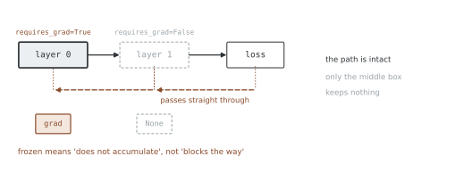
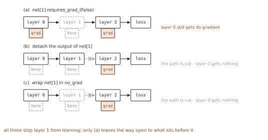

# 그래디언트 추적 끄기 — 플래그를 내리면 무엇이 멈추는가

<div class="leadbox" markdown>

**들어가는 이야기** — 「동결한다」는 말이 하는 일

남이 오래 학습시켜 둔 모델을 가져다 내 일에 맞게 조금만 고치는 것을
**전이 학습**이라 한다. 그때 「앞쪽은 건드리지 말고 뒤쪽만 배우게 하자」는 말을
하는데, 그 「건드리지 말자」를 **동결한다**(freeze)고 부른다.

코드로는 그 층의 파라메터에 `requires_grad_(False)`를 거는 일이다. 동결한다는
말에서 떠오르는 그림은 아마 **벽**일 것이다. 거기서 막히고, 그 너머로는
아무것도 못 가는 벽. 그렇다면 동결한 층은 계산할 것도 줄어서 학습이 빨라져야
한다.

둘 다 틀렸다. 동결한 층은 **길을 막지 않고 그래디언트를 통과시킨다.** 그래서 그 너머의 층도
멀쩡히 배우고, 역전파도 생각만큼 빨라지지 않는다. 막는 것과 안 쌓는 것은
다른 일이다.

이 차이는 평소에는 안 드러난다. 앞쪽을 동결하면 그 앞에 더 갈 곳이 없기
때문이다. **가운데 층을 동결해 보면** 바로 드러나고, 그때 비슷해 보이던 셋 —
`requires_grad_(False)` · `torch.no_grad()` · `detach()` — 이 서로 다른 답을
낸다.

</div>

`requires_grad`는 **그 텐서의 속성**이다. 「그래디언트 추적을 멈추는 시점」에서 본 네
가지 가운데 유일하게 **영구적**인 것이고, 블록을 나온다고 돌아오지 않는다.

전이 학습에서 층을 동결하는 일이 이 플래그 하나로 끝난다. 그런데 "동결한다"는 말이
생각보다 좁은 뜻이다 — **동결한 층도 그래디언트를 통과시킨다.** 쌓지 않을 뿐이다.

## 1. 코드

```python
"""requires_grad 플래그 — 동결과, 동결해도 흐르는 것.

`requires_grad` 는 **그 텐서의 속성**이다. 켜고 끄면 영구적이고,
블록을 나온다고 돌아오지 않는다. 전이 학습에서 층을 동결하는 일이
이 플래그 하나로 끝난다.

조심할 것이 두 가지다.

- **리프 텐서에만 바꿀 수 있다.** 계산으로 생긴 텐서에는 못 건다
- **동결한 층도 그래디언트를 통과시킨다.** 쌓지 않을 뿐이다. 그래서 중간 층을
  동결해도 그 앞 층은 멀쩡히 배운다

실행: 이 쪽의 코드를 파일로 갈무리해 돌린다
"""
import torch
import torch.nn as nn
import torch.nn.functional as F


def header(title):
    print(f"\n=== {title} ===")


# ========================================================================
# 1. 어디에 걸 수 있는가
# ========================================================================

def where_allowed():
    header("1. 플래그를 걸 수 있는 텐서")
    a = torch.randn(3)
    print("  리프 텐서에 켜기:", a.requires_grad_(True).requires_grad)
    print("  만들 때 켜기:", torch.randn(3, requires_grad=True).requires_grad)

    b = torch.randn(3, requires_grad=True) * 2        # 계산으로 생긴 것
    try:
        b.requires_grad_(False)
    except RuntimeError as e:
        print("  리프가 아닌 것에:", str(e).splitlines()[0][:66])

    c = torch.randint(0, 5, (3,))
    try:
        c.requires_grad_(True)
    except RuntimeError as e:
        print("  정수 텐서에  :", str(e).splitlines()[0][:60])
    print("  미분은 실수에서만 뜻이 있으므로 정수에는 못 건다")


# ========================================================================
# 2. 층을 동결한다
# ========================================================================

def freezing():
    header("2. 층 동결")
    torch.manual_seed(0)
    net = nn.Sequential(nn.Linear(4, 8), nn.ReLU(), nn.Linear(8, 1))
    for p in net[0].parameters():
        p.requires_grad_(False)                       # 앞쪽 층을 동결한다

    x, y = torch.randn(16, 4), torch.randn(16, 1)
    opt = torch.optim.SGD(net.parameters(), lr=0.1)   # 전부 넘겨도 된다
    before = [p.detach().clone() for p in net.parameters()]
    opt.zero_grad()
    F.mse_loss(net(x), y).backward()
    opt.step()
    for i, (p, b0) in enumerate(zip(net.parameters(), before)):
        print(f"  파라메터 {i}  requires_grad={p.requires_grad!s:5s} "
              f"grad={'None' if p.grad is None else '있음'}  "
              f"바뀌었나 {not torch.equal(p.detach(), b0)}")
    print("  동결한 둘은 그래디언트도 안 받고 값도 안 바뀌었다")
    print("  옵티마이저에 전부 넘겨도 되지만, 거르는 편이 깔끔하다")


# ========================================================================
# 3. 동결해도 그래디언트는 지나간다
# ========================================================================

def gradient_flows_through():
    header("3. 동결한 층을 그래디언트가 지나간다")
    torch.manual_seed(0)
    net = nn.Sequential(nn.Linear(4, 8), nn.ReLU(), nn.Linear(8, 1))
    for p in net[2].parameters():                     # 이번엔 뒤쪽을 동결한다
        p.requires_grad_(False)
    x, y = torch.randn(16, 4), torch.randn(16, 1)
    F.mse_loss(net(x), y).backward()
    print("  뒤쪽을 동결했을 때")
    print("    앞쪽 층 grad :",
          "있음" if net[0].weight.grad is not None else "None")
    print("    동결 층 grad :", net[2].weight.grad)
    print("  그래디언트가 동결한 층을 통과해 앞쪽까지 갔다")
    print("  동결한다는 것은 '안 쌓는다' 이지 '길을 막는다' 가 아니다")


# ========================================================================
# 4. 동결과 detach 와 no_grad 를 한 자리에서
# ========================================================================

def three_tools_on_a_net():
    header("4. 가운데 층에 세 가지를 걸어 본다")
    x, y = torch.randn(16, 4), torch.randn(16, 1)

    def fresh():
        torch.manual_seed(0)
        return nn.Sequential(nn.Linear(4, 8), nn.Linear(8, 8), nn.Linear(8, 1))

    def report(label, net):
        got = ["있음" if p.grad is not None else "None"
               for p in (net[0].weight, net[1].weight, net[2].weight)]
        print(f"  {label:26s} 0층 {got[0]:4s}  1층 {got[1]:4s}  2층 {got[2]:4s}")

    # (가) 가운데 층의 플래그만 끈다
    net = fresh()
    for p in net[1].parameters():
        p.requires_grad_(False)
    F.mse_loss(net(x), y).backward()
    report("(가) requires_grad_(False)", net)

    # (나) 가운데 층의 출력을 detach 한다
    net = fresh()
    h = net[1](net[0](x)).detach()
    F.mse_loss(net[2](h), y).backward()
    report("(나) 출력을 detach", net)

    # (다) 가운데 층을 no_grad 로 돌린다
    net = fresh()
    h0 = net[0](x)
    with torch.no_grad():
        h = net[1](h0)
    F.mse_loss(net[2](h), y).backward()
    report("(다) no_grad 로 감싸기", net)

    print("  (가) 만 0층까지 그래디언트가 간다. 1층을 지나보내기 때문이다")
    print("  (나)(다) 는 1층에서 길이 끊겨 0층이 아무것도 못 받는다")
    print("  '가운데 층만 동결하고 싶다' 면 (가) 라야 한다")


def main():
    where_allowed()
    freezing()
    gradient_flows_through()
    three_tools_on_a_net()


if __name__ == "__main__":
    main()
```

**출력:**

```
=== 1. 플래그를 걸 수 있는 텐서 ===
  리프 텐서에 켜기: True
  만들 때 켜기: True
  리프가 아닌 것에: you can only change requires_grad flags of leaf variables. If you 
  정수 텐서에  : only Tensors of floating point dtype can require gradients
  미분은 실수에서만 뜻이 있으므로 정수에는 못 건다

=== 2. 층 동결 ===
  파라메터 0  requires_grad=False grad=None  바뀌었나 False
  파라메터 1  requires_grad=False grad=None  바뀌었나 False
  파라메터 2  requires_grad=True  grad=있음  바뀌었나 True
  파라메터 3  requires_grad=True  grad=있음  바뀌었나 True
  동결한 둘은 그래디언트도 안 받고 값도 안 바뀌었다
  옵티마이저에 전부 넘겨도 되지만, 거르는 편이 깔끔하다

=== 3. 동결한 층을 그래디언트가 지나간다 ===
  뒤쪽을 동결했을 때
    앞쪽 층 grad : 있음
    동결 층 grad : None
  그래디언트가 동결한 층을 통과해 앞쪽까지 갔다
  동결한다는 것은 '안 쌓는다' 이지 '길을 막는다' 가 아니다

=== 4. 가운데 층에 세 가지를 걸어 본다 ===
  (가) requires_grad_(False)  0층 있음    1층 None  2층 있음  
  (나) 출력을 detach             0층 None  1층 None  2층 있음  
  (다) no_grad 로 감싸기          0층 None  1층 None  2층 있음  
  (가) 만 0층까지 그래디언트가 간다. 1층을 지나보내기 때문이다
  (나)(다) 는 1층에서 길이 끊겨 0층이 아무것도 못 받는다
  '가운데 층만 동결하고 싶다' 면 (가) 라야 한다
```

## 2. 리프 텐서에만, 실수에만 걸 수 있다

```
리프가 아닌 것에: you can only change requires_grad flags of leaf variables
정수 텐서에  : only Tensors of floating point dtype can require gradients
```

**리프 텐서**(leaf tensor)에만 걸 수 있다 — 연산의 결과가 아니라 사용자가 직접 만든 텐서로, 계산 그래프의 리프에 해당한다(오류 메시지의 「leaf variables」가 이것이다). 계산으로 생긴 텐서의 플래그는 이미 그 위쪽에 의해 정해져
있으므로 손으로 바꿀 일이 아니다. 끊고 싶으면 `detach()`를 쓰라는 것이 오류
메시지가 이어서 하는 말이다.

**실수에만** 걸 수 있다. 정수에 미분은 뜻이 없다. 라벨이나 인덱스 텐서에
실수로 `requires_grad=True`를 걸려 하면 여기서 걸린다.

## 3. 층 동결

```
파라메터 0  requires_grad=False  grad=None  바뀌었나 False
파라메터 1  requires_grad=False  grad=None  바뀌었나 False
파라메터 2  requires_grad=True   grad=있음  바뀌었나 True
파라메터 3  requires_grad=True   grad=있음  바뀌었나 True
```

```python
for p in net[0].parameters():
    p.requires_grad_(False)
```

두 줄로 끝난다. 동결한 파라메터는 **그래디언트를 안 받고**(`grad=None`) 따라서 **값도
안 바뀐다.**

옵티마이저에 `net.parameters()`를 통째로 넘겨도 괜찮다 — 그래디언트가 `None`인
파라메터는 `step()`이 건너뛴다. 다만 거르는 편이 깔끔하다.

```python
opt = torch.optim.SGD([p for p in net.parameters() if p.requires_grad], lr=0.1)
```

거르면 옵티마이저가 동결한 파라메터의 **상태(모멘텀 버퍼 같은 것)를 만들지
않으므로** 메모리도 조금 아낀다. 그리고 나중에 그 층의 동결을 풀(unfreeze) 때 옵티마이저를
다시 만들어야 한다는 것이 코드에 드러난다.

## 4. 동결해도 그래디언트는 지나간다

```
뒤쪽을 동결했을 때
  앞쪽 층 grad : 있음
  동결 층 grad : None
```



뒤쪽 층을 동결했는데 **앞쪽 층은 그래디언트를 받았다.** 그래디언트가 동결한 층을 통과해 거기까지
간 것이다. 그림에서 역전파 화살표가 점선 칸을 **뚫고 지나간다.**

당연한 일이다. 연쇄 법칙이 앞쪽 층까지 가려면 뒤쪽 층의 **웨이트를 거쳐야**
하고, 그 웨이트를 쓰는 것과 그 웨이트에 대한 그래디언트를 쌓는 것은 다른 일이다.

**동결한다는 것은 "안 쌓는다"이지 "길을 막는다"가 아니다.** 그래서 동결한다고 해서
역전파가 빨라지지는 않는다 — 파라메터 그래디언트 계산 하나가 빠질 뿐, 활성화 값에 대한
그래디언트는 그대로 계산된다.

## 5. 세 가지가 가운데 층에서 갈린다

| | 0층 | 1층 (손댄 층) | 2층 |
|---|---|---|---|
| `requires_grad_(False)` | **있음** | None | 있음 |
| 출력을 `detach()` | None | None | 있음 |
| `no_grad`로 감싸기 | None | None | 있음 |



**`requires_grad_(False)`만 0층까지 그래디언트를 보낸다.** 나머지 둘은 1층에서 길이
끊겨 그 앞이 아무것도 못 받는다. 그림의 첫 줄만 화살표가 끊기지 않은 것이
그 차이다 — 둘째 줄에서 1층이 실선인 것은 **플래그는 그대로 서 있고 받을 것이
없을 뿐**이기 때문이다.

그러니 셋을 바꿔 쓸 수 없다.

- **가운데 층만 동결하고 앞뒤는 배우게** 하려면 → `requires_grad_(False)`
- **그 앞을 통째로 멈추려면** → `detach()`나 `no_grad`

전이 학습에서 앞쪽을 동결할 때 둘 다 쓸 수 있는 것은 **앞쪽이 입력과 맞닿아 있어**
더 거슬러 갈 곳이 없기 때문이다. 가운데에 걸면 차이가 바로 드러난다.

## 연습문제

<div class="drillbox" markdown>

**연습문제 1.** <span class="diff easy" title="쉬움"></span>
모델의 파라메터 가운데 **학습되는 것의 개수**를 세는 한 줄을 적어라. 앞쪽 층을
동결한 전후로 세어 보라.

</div>

??? success "풀이"
    ```python
    torch.manual_seed(0)
    net = nn.Sequential(nn.Linear(784, 128), nn.ReLU(), nn.Linear(128, 10))

    def count(m):
        total = sum(p.numel() for p in m.parameters())
        trainable = sum(p.numel() for p in m.parameters() if p.requires_grad)
        return total, trainable

    print("  동결 전 : 전체 {:,}  학습 {:,}".format(*count(net)))
    for p in net[0].parameters():
        p.requires_grad_(False)
    print("  앞쪽 동결한 뒤: 전체 {:,}  학습 {:,}".format(*count(net)))
    ```

    ```
      동결 전 : 전체 101,770  학습 101,770
      앞쪽 동결한 뒤: 전체 101,770  학습 1,290
    ```

    **전체는 그대로이고 학습되는 것만 줄었다.** 101,770개 중 1,290개, 1.3%만
    배운다.

    `sum(p.numel() for p in m.parameters() if p.requires_grad)` 한 줄은 모델을
    고친 뒤 **의도대로 되었는지 확인하는 가장 빠른 길**이다. 동결하는 코드를 쓰고
    이 수를 안 찍어 보면, 오타로 아무것도 안 동결했거나 전부 동결했어도 모른다.

    큰 모델을 미세조정할 때 이 비율이 핵심이다. 「VGG16 전이 학습」에서 본 것처럼
    분류기만 새로 다는 것이 곧 이 수를 몇 퍼센트로 낮추는 일이다.

---

<div class="drillbox" markdown>

**연습문제 2.** <span class="diff med" title="중간"></span>
동결한 층은 그래디언트를 안 받는다. 그렇다면 **역전파가 빨라지는가?** 앞쪽 절반을 동결한
깊은 신경망에서 재어라.

</div>

??? success "풀이"
    ```python
    import time

    def spread(fn, rep=15):
        for _ in range(3):          # 예열 — 첫 몇 번은 유난히 느리다
            fn()
        ts = []
        for _ in range(rep):
            t0 = time.perf_counter(); fn(); ts.append(time.perf_counter() - t0)
        return min(ts) * 1e3, max(ts) * 1e3

    def build(freeze_first_half):
        torch.manual_seed(0)
        net = nn.Sequential(*[nn.Linear(512, 512) for _ in range(12)])
        if freeze_first_half:
            for layer in net[:6]:
                for p in layer.parameters():
                    p.requires_grad_(False)
        return net

    x = torch.randn(128, 512)
    for label, frozen in (("전부 학습 ", False), ("앞 절반 동결", True)):
        net = build(frozen)

        def step():
            net.zero_grad()
            net(x).pow(2).mean().backward()

        lo, hi = spread(step)
        print(f"  {label}  {lo:6.2f} ~ {hi:6.2f} ms")
    ```

    ```
      전부 학습     3.07 ~   5.54 ms
      앞 절반 동결    1.89 ~   3.01 ms
    ```

    빨라지기는 한다. 가장 빠른 값끼리 견주면 대략 **40%** 줄었다. 다만 두 범위가
    거의 맞닿아 있으므로 "절반에 못 미치게 빨라진다"고만 말할 수 있다.

    절반을 동결했는데 딱 절반이 빨라지지 않는 까닭이 4절이다. 동결한 층도 **활성화 값에
    대한 그래디언트는 계산해서 넘겨준다.** 빠지는 것은 **웨이트에 대한 그래디언트**뿐이고,
    그것은 역전파가 하는 일의 일부다.

    정말로 앞쪽을 건너뛰고 싶으면 그 출력에 `detach()`를 걸어야 한다. 그러면
    역전파가 거기서 멈춘다 — 대신 5절에서 본 대로 그 앞은 영영 못 배운다.

---

<div class="drillbox" markdown>

**연습문제 3.** <span class="diff hard" title="어려움"></span>
층을 동결한 채로 학습하다가 중간에 **동결을 풀려** 한다. `requires_grad_(True)`만
되돌리면 되는가? 옵티마이저를 어떻게 해야 하는지 확인하라.

</div>

??? success "풀이"
    ```python
    torch.manual_seed(0)
    net = nn.Sequential(nn.Linear(4, 8), nn.Linear(8, 1))
    x, y = torch.randn(16, 4), torch.randn(16, 1)

    for p in net[0].parameters():
        p.requires_grad_(False)
    opt = torch.optim.SGD([p for p in net.parameters() if p.requires_grad],
                          lr=0.1)
    print("  옵티마이저가 들고 있는 텐서 수:",
          sum(len(g["params"]) for g in opt.param_groups))

    for p in net[0].parameters():            # 동결을 푼다
        p.requires_grad_(True)
    before = net[0].weight.detach().clone()
    opt.zero_grad()
    F.mse_loss(net(x), y).backward()
    opt.step()
    print("  동결을 푼 뒤 0층 grad:",
          "있음" if net[0].weight.grad is not None else "None")
    print("  그런데 값이 바뀌었나:",
          not torch.equal(net[0].weight.detach(), before))

    opt2 = torch.optim.SGD(net.parameters(), lr=0.1)   # 다시 만든다
    opt2.zero_grad()
    F.mse_loss(net(x), y).backward()
    opt2.step()
    print("  옵티마이저를 다시 만든 뒤 바뀌었나:",
          not torch.equal(net[0].weight.detach(), before))
    ```

    ```
      옵티마이저가 들고 있는 텐서 수: 2
      동결을 푼 뒤 0층 grad: 있음
      그런데 값이 바뀌었나: False
      옵티마이저를 다시 만든 뒤 바뀌었나: True
    ```

    **플래그만 되돌리면 모자란다.**

    동결을 푼 뒤 그래디언트는 제대로 온다 — `grad`가 "있음"이다. 그런데 **값이 안 바뀐다.**
    옵티마이저를 만들 때 거른 파라메터는 그 목록에 아예 없고, 옵티마이저는 제
    목록에 있는 것만 갱신하기 때문이다.

    옵티마이저를 다시 만들면 움직인다. 그래서 점진적 동결 해제
    (gradual unfreezing)는 동결을 풀 때마다 옵티마이저를 다시 만들거나,
    `opt.add_param_group({"params": net[0].parameters()})`로 집어넣어야 한다.

    > 처음부터 `net.parameters()`를 통째로 넘겨 두었다면 이 문제가 없다. 동결한
    > 동안에는 그래디언트가 `None`이라 `step()`이 건너뛰고, 동결을 풀면 저절로 갱신되기
    > 시작한다. 3절에서 "통째로 넘겨도 된다"고 한 것이 이 때문이다. 메모리를
    > 조금 더 쓰는 대신 동결 해제가 간단해진다.
