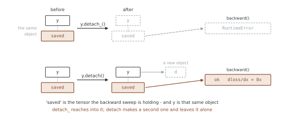

# detach와 detach_

<div class="leadbox" markdown>

**들어가는 이야기** — 밑줄 하나

파이토치에는 이름이 **밑줄 하나로만 다른** 짝이 여럿 있다. 밑줄이 붙은 쪽은
**제자리 연산(in-place)** — 새것을 만들지 않고 그 텐서를 직접 고친다는 뜻이다.
이 쪽이 다루는 짝은 `detach()`와 `detach_()`다.

둘 다 똑같이 「경사 추적을 끊는다」고 적혀 있고, 둘 다 똑같이 끊긴 것을
돌려준다. 찍어 보면 돌려받은 값도 같다. 그러니 바꿔 써도 될 것 같다.

그런데 밑줄이 붙은 `detach_()` 쪽에는 함정이 하나 있다. 그 함정은 **쓰는 그 줄에서는
아무 일도 일어나지 않는다.** 조용히 지나갔다가 **몇 줄 뒤 역전파를 부르는
자리에서** 터진다.

파이토치가 **이 한 경우만을 위한 오류문을 따로 만들어 두었을 만큼** 흔한
실수다. 오류문이 친절해서 범인을 이름으로 짚어 주기는 하지만, 왜 그것이 문제가
되는지는 그 한 줄로는 알 수 없다.

</div>

둘 다 미분 추적을 끊는다. 다른 것은 **무엇에 대고 하느냐**다.

| | 하는 일 | 원본 |
|---|---|---|
| `t.detach()` | 추적 없는 **새 텐서**를 내준다 | 그대로 |
| `t.detach_()` | **`t` 자신**을 끊는다 | **바뀐다** |

이름이 한 글자 차이이고 둘 다 같은 것을 돌려주는 것처럼 보이므로, 바꿔 써도
될 것 같다. 그런데 `detach_()`에는 함정이 하나 있다 — **이미 역전파가 저장해 둔
텐서를 제자리에서 끊으면 뒤에 `backward()`가 터진다.**

## 1. 코드

```python
"""detach() 와 detach_() — 새 텐서냐 제자리냐.

둘 다 미분 추적을 끊는다. 다른 것은 **무엇에 대고 하느냐**다.

- `t.detach()`  — 추적 없는 **새 텐서**를 내준다. `t` 는 그대로
- `t.detach_()` — **`t` 자신**을 끊는다. 되돌릴 수 없다

그리고 `detach_()` 에는 함정이 하나 있다. 이미 역전파가 저장해 둔
텐서를 제자리에서 끊어 버리면, 뒤에 `backward()` 가 터진다.

실행: 이 쪽의 코드를 파일로 갈무리해 돌린다
"""
# 파이토치를 불러온다. 텐서를 만들고 미분하는 일이 다 여기서 온다.
import torch


def header(title):
    # 절 제목을 한 줄 찍는다. \n 은 줄바꿈이고, f"...{title}..." 은 문자열 안에
    # 변수의 값을 끼워 넣는 파이썬 문법(f-문자열)이다.
    print(f"\n=== {title} ===")


def describe(name, t):
    # 텐서 t 가 계산 그래프에 이어져 있는지를 두 가지로 찍는다.
    #
    # requires_grad 는 「이 텐서가 들어간 계산을 기록하라」는 표시다. 이것을 경사
    # 추적이라 한다.
    #
    # grad_fn 은 「이 텐서를 만든 연산」의 기록이다. 계산 그래프는 이 기록들이
    # 이어진 것이고, 역전파는 이것을 거꾸로 따라간다. 계산으로 생긴 텐서에는
    # MulBackward0(곱셈) 같은 것이 달려 있고, 사용자가 직접 만든 텐서(리프 텐서)나
    # 그래프에서 끊긴 텐서는 None 이다.
    #
    # type(...).__name__ 은 그 기록의 종류 이름을 문자열로 꺼낸다. 「A if 조건
    # else B」 는 조건이 참이면 A, 아니면 B 를 고른다 — None 이면 그냥 None 을 둔다.
    fn = type(t.grad_fn).__name__ if t.grad_fn is not None else None
    # :22s 는 이름을 22칸에 맞춰 찍고, !s:5s 는 True/False 를 문자열로 바꿔 5칸에
    # 맞춰 찍는다. 줄을 가지런히 하려는 것이다.
    print(f"  {name:22s} requires_grad={t.requires_grad!s:5s} grad_fn={fn}")


# ========================================================================
# 1. 새 텐서냐 제자리냐
# ========================================================================

def new_or_in_place():
    header("1. 무엇이 바뀌는가")
    # 난수의 시드를 고정한다. 아래에서 뽑는 텐서가 돌릴 때마다 같은 값이 된다.
    torch.manual_seed(0)
    # torch.randn(3) 은 표준정규분포에서 뽑은 실수 3개짜리 텐서다. 형태 (3,).
    # requires_grad=True 로 만들었으니 x 가 들어간 계산은 모두 기록된다. 이 쪽은
    # 값이 아니라 추적 여부만 보므로 난수를 고정하지 않아도 출력이 같다.
    x = torch.randn(3, requires_grad=True)

    # --- detach() : 새 텐서를 돌려준다 ---
    # y 는 x 로 계산한 텐서라 경사 추적이 켜져 있고 grad_fn 이 MulBackward0 이다.
    y = x * 2                    # y = 2x. 계산으로 생긴 텐서
    # y.detach() 는 값은 y 와 같되 계산 그래프와 끊긴 「새」 텐서를 돌려준다.
    # y 자신은 건드리지 않는다.
    d = y.detach()
    print("  y.detach()")
    describe("    돌려받은 d", d)
    describe("    원본 y", y)
    # d is y 는 두 이름이 같은 객체를 가리키는지 묻는다 — 새 텐서이므로 False 다.
    # data_ptr() 은 텐서의 수가 놓인 메모리 주소다. 주소가 같다는 것은 d 와 y 가
    # 객체는 달라도 같은 수(저장소)를 함께 쓴다는 뜻이다. detach() 는 복사하지 않는다.
    print("    같은 객체인가:", d is y,
          "  저장소 공유:", d.data_ptr() == y.data_ptr())

    # --- detach_() : 그 텐서 자신을 끊는다 ---
    # 파이토치에서 이름 끝의 밑줄 _ 은 새 텐서를 만들지 않고 「제자리에서」 고친다는
    # 뜻이다. 견주려고 같은 계산을 y2 로 한 번 더 만든다.
    y2 = x * 2
    # y2 자신의 requires_grad 를 False 로, grad_fn 을 None 으로 바꾼다. 돌려주는 r 은
    # 새 텐서가 아니라 y2 그 자체다.
    r = y2.detach_()
    print("  y2.detach_()")
    describe("    돌려받은 r", r)
    describe("    원본 y2", y2)
    print("    같은 객체인가:", r is y2)
    print("  detach_ 는 y2 자신을 바꾸었다. 되돌릴 길이 없다")


# ========================================================================
# 2. 리프 텐서가 아닌 것에도 걸린다
# ========================================================================

def works_on_non_leaf():
    header("2. requires_grad_ 와 달리 리프 텐서가 아니어도 된다")
    # 난수의 시드를 고정한다. 아래에서 뽑는 텐서가 돌릴 때마다 같은 값이 된다.
    torch.manual_seed(0)
    # x 는 직접 만든 리프 텐서, h 는 x 로 계산한 텐서(리프가 아니다)다.
    x = torch.randn(3, requires_grad=True)
    h = x * 2                    # h = 2x
    # 플래그를 끄는 또 하나의 길 requires_grad_(False) 는 리프 텐서에만 쓸 수 있다.
    # try: 안의 줄이 오류를 내면 프로그램이 죽는 대신 except: 로 넘어간다. 일부러
    # 오류를 내 보고 그 메시지를 찍으려는 것이다.
    try:
        h.requires_grad_(False)
    except RuntimeError as e:
        # e 가 그 오류다. str(e) 로 메시지를 꺼내 splitlines()[0] 으로 첫 줄만,
        # [:58] 로 앞의 58글자만 잘라 찍는다.
        print("  h.requires_grad_(False):", str(e).splitlines()[0][:58])
    # detach_() 는 리프가 아닌 h 에도 걸린다. 끊긴 h 는 requires_grad 가 False 다.
    h.detach_()
    print("  h.detach_()            : 된다.", h.requires_grad)
    print("  오류 메시지가 가리키는 길이 바로 이것이다")


# ========================================================================
# 3. detach_ 의 함정 — 저장된 텐서를 끊으면
# ========================================================================

def the_trap():
    header("3. 저장된 텐서를 제자리에서 끊으면")
    # 난수의 시드를 고정한다. 아래에서 뽑는 텐서가 돌릴 때마다 같은 값이 된다.
    torch.manual_seed(0)
    x = torch.randn(3, requires_grad=True)
    # 로스 식을 손으로 적어 두면  loss = sum(y^2),  y = 2x  이다.
    # y^2 을 y 로 미분하면 2y 이므로, 역전파는 그때 쓸 y 의 값을 계산 그래프에
    # 저장해 둔다. sum() 은 원소를 모두 더해 수 하나로 만든다(** 는 거듭제곱).
    y = x * 2                    # y = 2x
    loss = (y ** 2).sum()        # 역전파가 y 를 저장해 둔다
    y.detach_()                  # 그 y 를 제자리에서 끊는다
    # backward() 는 역전파다 — loss 에서 계산 그래프를 거꾸로 따라가며 미분한다.
    # 그런데 저장해 둔 y 가 제자리에서 끊겼으므로 RuntimeError 가 난다.
    try:
        loss.backward()
    except RuntimeError as e:
        print("  backward:", str(e).splitlines()[0][:72])
    print("  detach() 였다면 새 텐서를 만들 뿐이라 아무 일도 없다")

    # --- 같은 일을 detach() 로 하면 ---
    x2 = torch.randn(3, requires_grad=True)
    y2 = x2 * 2                  # y2 = 2 * x2
    loss2 = (y2 ** 2).sum()      # loss2 = sum(y2^2) — 여기서도 y2 가 저장된다
    _ = y2.detach()              # 새 텐서만 하나 더 만든다  
    # 역전파가 x2.grad 에 dloss2/dx2 를 넣는다. .grad 는 backward() 가 그래디언트를
    # 넣어 주는 자리다.
    loss2.backward()
    # 손으로 구하면 loss = sum((2x)^2) = sum(4x^2) 이므로 그래디언트는 8x 다.
    # torch.allclose 는 두 텐서가 (반올림 오차 안에서) 같으면 True 다. x2.detach()
    # 로 값만 꺼내 8 을 곱한 것과 견준다.
    print("  detach() 뒤 backward:", torch.allclose(x2.grad, 8 * x2.detach()),
          " (dloss/dx = 8x)")


# ========================================================================
# 4. 어느 쪽을 쓰는가
# ========================================================================

def which_one():
    header("4. 쓰는 자리")
    # 난수의 시드를 고정한다. 아래에서 뽑는 텐서가 돌릴 때마다 같은 값이 된다.
    torch.manual_seed(0)
    # 형태 (4,) 의 리프 텐서. 아래 두 보기가 함께 쓴다.
    x = torch.randn(4, requires_grad=True)

    # (가) 값만 꺼내 기록한다 — detach()
    # loss = x 의 원소를 제곱해 모두 더한 수 하나. grad_fn 은 SumBackward0 이다.
    # 트레인 중에 로스 값을 리스트에 모아 두는 일이 흔하다. loss 를 그대로 넣으면
    # 그 뒤에 달린 계산 그래프까지 통째로 붙들고 있게 되므로, detach() 로 값만
    # 꺼내 넣는다.
    loss = (x ** 2).sum()
    history = [loss.detach()]    # 값만 든 텐서를 리스트에 넣는다
    print("  (가) 기록용으로 꺼내기 -> detach()")
    # loss 자신은 그대로다 — grad_fn 이 여전히 SumBackward0 로 찍힌다.
    print("       원본 그래프를 건드리지 않는다:",
          type(loss.grad_fn).__name__)

    # (나) 순환 뉴럴 네트워크에서 은닉 상태를 끊는다 — 둘 다 쓰인다
    # RNN(순환 뉴럴 네트워크)은 은닉 상태 h 를 같은 식에 되풀이해 넣는다. 그 흉내다.
    # torch.zeros(2) 는 0 두 개짜리 텐서, x[:2] 는 x 의 앞 두 원소, tanh 는 값을
    # -1 과 1 사이로 누르는 함수다.
    # 같은 루프를 두 번 돈다 — 한 번은 끊지 않고, 한 번은 반복마다 h = h.detach()
    # 로 끊고. 그리고 세 번 돈 뒤 h 뒤에 달린 계산 그래프가 몇 단계 깊은지 센다.
    def depth(t):
        """t 의 grad_fn 에서 출발해 첫째 입력 쪽으로 거슬러 올라가며 노드를 센다."""
        n, fn = 0, t.grad_fn
        while fn is not None:
            n += 1
            # next_functions 는 이 노드의 입력들을 만든 노드의 목록이다. [0][0] 이
            # 첫째 입력(여기서는 앞 반복의 h)을 만든 노드이고, 없으면 None 이다.
            fn = fn.next_functions[0][0] if fn.next_functions else None
        return n

    depths = []
    for cut in (False, True):
        h = torch.zeros(2)               # 은닉 상태의 초깃값. for _ 의 _ 는 안 쓰는 변수다
        for _ in range(3):
            if cut:
                h = h.detach()           # 앞 반복까지의 그래프를 여기서 끊는다
            h = (h + x[:2]).tanh()       # 한 번 돌 때마다 덧셈·tanh 두 노드가 붙는다
        depths.append(depth(h))
    print("  (나) RNN 은닉 상태: 반복마다 h = h.detach() 로 끊는다")
    print(f"       세 번 돈 뒤 그래프의 깊이: 안 끊으면 {depths[0]}, 끊으면 {depths[1]}")
    print("       안 끊으면 그래프가 반복 횟수만큼 길어진다")
    print("       h 를 다시 대입하므로 detach() 로 충분하다")
    print("  detach_() 가 꼭 필요한 자리는 드물다")
    print("  같은 이름을 계속 쓰면서 그래프만 끊고 싶을 때뿐이다")


def main():
    # 네 절을 차례로 돌린다.
    new_or_in_place()
    works_on_non_leaf()
    the_trap()
    which_one()


# 이 파일을 직접 돌렸을 때만 main() 을 부른다. 다른 파일이 import 로 불러올 때는
# 돌지 않게 하는 파이썬의 관용구다.
if __name__ == "__main__":
    main()
```

**출력:**

```
=== 1. 무엇이 바뀌는가 ===
  y.detach()
      돌려받은 d             requires_grad=False grad_fn=None
      원본 y               requires_grad=True  grad_fn=MulBackward0
    같은 객체인가: False   저장소 공유: True
  y2.detach_()
      돌려받은 r             requires_grad=False grad_fn=None
      원본 y2              requires_grad=False grad_fn=None
    같은 객체인가: True
  detach_ 는 y2 자신을 바꾸었다. 되돌릴 길이 없다

=== 2. requires_grad_ 와 달리 리프 텐서가 아니어도 된다 ===
  h.requires_grad_(False): you can only change requires_grad flags of leaf variables.
  h.detach_()            : 된다. False
  오류 메시지가 가리키는 길이 바로 이것이다

=== 3. 저장된 텐서를 제자리에서 끊으면 ===
  backward: Trying to use a saved tensor that has been detached in-place, i.e. with 
  detach() 였다면 새 텐서를 만들 뿐이라 아무 일도 없다
  detach() 뒤 backward: True  (dloss/dx = 8x)

=== 4. 쓰는 자리 ===
  (가) 기록용으로 꺼내기 -> detach()
       원본 그래프를 건드리지 않는다: SumBackward0
  (나) RNN 은닉 상태: 반복마다 h = h.detach() 로 끊는다
       세 번 돈 뒤 그래프의 깊이: 안 끊으면 6, 끊으면 2
       안 끊으면 그래프가 반복 횟수만큼 길어진다
       h 를 다시 대입하므로 detach() 로 충분하다
  detach_() 가 꼭 필요한 자리는 드물다
  같은 이름을 계속 쓰면서 그래프만 끊고 싶을 때뿐이다
```

## 2. 무엇이 바뀌는가

```
y.detach()
    돌려받은 d : requires_grad=False  grad_fn=None
    원본 y     : requires_grad=True   grad_fn=MulBackward0
  같은 객체인가: False   저장소 공유: True

y2.detach_()
    돌려받은 r : requires_grad=False  grad_fn=None
    원본 y2    : requires_grad=False  grad_fn=None
  같은 객체인가: True
```

`detach()`는 **원본을 건드리지 않는다.** `y`는 여전히 `MulBackward0`을 달고 있고
그래프 위에 있다. 새로 받은 `d`만 그래프 바깥에 있다 — 다만 **저장소는
공유한다.**

`detach_()`는 `y2` 자신의 `grad_fn`을 떼어 낸다. 돌려받은 것과 원본이 같은
객체이고, **되돌릴 길이 없다.** `requires_grad_(True)`로 다시 켜도 그래프와의
연결은 돌아오지 않는다.

## 3. `requires_grad_`와 달리 리프 텐서가 아니어도 된다

```
h.requires_grad_(False): you can only change requires_grad flags of leaf variables.
h.detach_()            : 된다. False
```

「경사 추적 끄기」에서 본 오류다. `requires_grad_`는 리프 텐서(leaf tensor, 연산의 결과가 아니라 직접 만든 텐서)에만 걸리는데, 그 오류
메시지가 가리키는 대안이 바로 `detach()`다.

그래서 둘의 쓰임이 갈린다. **파라메터를 동결(freeze)하는 것은 `requires_grad_`**이고,
**중간 텐서에서 그래프를 끊는 것은 `detach`**다. 대상이 다르다.

## 4. `detach_()`의 함정

```python
# x 는 requires_grad=True 로 만든 텐서다. y = 2x, loss = sum(y^2).
y = x * 2
loss = (y ** 2).sum()    # 역전파가 y 를 저장해 둔다
y.detach_()              # 그 y 를 제자리에서 끊는다
# 역전파는 저장해 둔 y 가 필요한데, 그 y 가 끊겼으므로 여기서 RuntimeError 가 난다.
loss.backward()
```

```
Trying to use a saved tensor that has been detached in-place,
i.e. with .detach_()
```



파이토치가 정확히 이 경우를 위한 메시지를 따로 두었다. 그만큼 흔한 실수라는
뜻이다. **함정이 성립하는 까닭은 `y`와 역전파가 들고 있는 것이 같은 객체이기
때문**이고, 그림의 점선이 그 하나를 가리킨다.

까닭은 「제자리 연산」에서 본 것과 같은 구조다. $\frac{d}{dy}y^2 = 2y$를
계산하려면 `y`가 있어야 하는데, 그 `y`를 그래프에서 떼어 버렸으니 엔진이 쓸 수
없다.

`detach()`였다면 아무 일도 없다 — 새 텐서 객체를 하나 더 만들 뿐 `y`는 그대로다.

```
detach() 뒤 backward: True   (dloss/dx = 8x)
```

> **헷갈릴 때는 `detach()`를 쓴다.** 원본을 안 건드리므로 뒤에 무엇이 와도
> 안전하고, 쓰이는 자리의 거의 전부가 "값만 꺼내 간다"이므로 그것으로 충분하다.

## 5. 쓰는 자리

**(가) 기록용으로 값만 꺼낼 때** — `loss.detach()`. 원본 `loss`는 그래프를
그대로 달고 있으므로 뒤에 `backward()`를 부를 수 있다. 「경사 추적을 언제 멈출 것인가」의 연습문제에서 이것을 빼먹으면 백 반복 치 그래프가 전부 살아 있는 것을 보았다.

**(나) 순환 뉴럴 네트워크(RNN)에서 은닉 상태(hidden state)를 끊을 때** — 반복마다 `h = h.detach()`.
안 끊으면 그래프가 시퀀스 길이만큼 길어져, 역전파가 처음까지 거슬러 올라간다
(이것을 잘라 내는 것을 truncated BPTT라고 부른다). 코드가 세 번 도는 루프로
그것을 잰다 — 한 번 돌 때마다 덧셈과 `tanh` 두 노드가 붙어, 안 끊으면 깊이가
**6**이고 반복마다 끊으면 마지막 반복의 **2**만 남는다.

여기서도 `detach()`로 충분하다. `h`라는 이름에 **새 텐서를 다시 대입**하기
때문이다. `detach_()`가 꼭 필요한 자리는 **같은 객체를 계속 써야 하는데 그래프만
끊고 싶을 때**뿐이고, 실제 코드에서는 드물다.

## 연습문제

<div class="drillbox" markdown>

**연습문제 1.** <span class="diff easy" title="쉬움"></span>
`d = y.detach()`로 받은 `d`를 고치면 `y`도 바뀌는가? 그리고 `d.clone()`은?

</div>

??? success "풀이"
    ```python
    # 본문 코드에 이어서 돌린다 — torch 를 이미 불러온 상태다.
    # 난수 발생기의 시드를 1 로 고정한다. 아래에서 y 의 값을 찍으므로, 고정해 두어야
    # 돌릴 때마다 같은 수가 나온다.
    torch.manual_seed(1)
    x = torch.randn(3, requires_grad=True)     # 형태 (3,) 의 리프 텐서
    y = x * 2                                  # y = 2x
    # d 는 y 와 저장소를 공유하는 끊긴 텐서, c 는 거기에 clone() 을 붙여 따로
    # 복사한 텐서다.
    d = y.detach()
    c = y.detach().clone()
    # y.detach().tolist() 는 값을 파이썬 리스트로 꺼낸다. round(v, 4) 는 소수점 아래
    # 넷째 자리까지 반올림한다. [... for v in ...] 는 원소마다 그렇게 해 리스트로
    # 모으는 파이썬 문법이다.
    print("  고치기 전 y :", [round(v, 4) for v in y.detach().tolist()])
    # d 의 0번 원소를 99 로 고친다. d 와 y 는 같은 메모리이므로 y[0] 도 99 가 된다.
    d[0] = 99.0
    print("  d[0]=99 뒤 y:", [round(v, 4) for v in y.detach().tolist()])
    # c 의 1번 원소를 고친다. c 는 복사본이므로 y 는 그대로다.
    c[1] = -99.0
    print("  c[1]=-99 뒤 y:", [round(v, 4) for v in y.detach().tolist()])
    ```

    ```
      고치기 전 y : [1.3227, 0.5338, 0.1234]
      d[0]=99 뒤 y: [99.0, 0.5338, 0.1234]
      c[1]=-99 뒤 y: [99.0, 0.5338, 0.1234]
    ```

    **`d`를 고치면 `y`가 바뀐다.** `detach()`는 저장소를 공유하므로 같은
    메모리다. `clone()`을 붙인 `c`는 새 자리를 잡았으므로 고쳐도 `y`가 그대로다.

    「Autograd 관련 속성」에서 본 대로, 이렇게 고친 뒤 역전파하면 **그래디언트가 조용히
    틀린다.** 터지지도 경고하지도 않는다.

    그래서 규칙이 짧다. **`detach()`는 읽기 전용, 고칠 작정이면
    `detach().clone()`.**

---

<div class="drillbox" markdown>

**연습문제 2.** <span class="diff med" title="중간"></span>
순환 뉴럴 네트워크에서 `h = h.detach()`를 빼먹으면 그래프가 얼마나 길어지는가? 반복하며 **그래프의 깊이**를 세어라.

</div>

??? success "풀이"
    ```python
    # 본문 코드에 이어서 돌린다 — torch 를 이미 불러온 상태다.
    def depth(t):
        # t 뒤에 달린 계산 그래프가 몇 단계인지 센다. t.grad_fn 은 t 를 만든 연산의
        # 기록이고, fn.next_functions 는 그 연산의 재료를 만든 기록들이다. 첫째 재료
        # 쪽으로만 한 칸씩 거슬러 가며, 더 갈 곳이 없어질(None) 때까지 센다.
        d, fn = 0, t.grad_fn
        while fn is not None:
            d += 1
            fn = fn.next_functions[0][0] if fn.next_functions else None
        return d

    # 난수의 시드를 고정한다. 아래에서 뽑는 텐서가 돌릴 때마다 같은 값이 된다.
    torch.manual_seed(0)
    # 형태 (2,) 의 리프 텐서. 개수만 세므로 시드는 고정하지 않아도 된다.
    x = torch.randn(2, requires_grad=True)
    # 같은 루프를 두 번 돌린다 — 한 번은 반복마다 끊고(True), 한 번은 안 끊고(False).
    for label, cut in (("detach 함  ", True), ("detach 안 함", False)):
        # 은닉 상태의 처음 값. 0 두 개이고 경사 추적은 꺼져 있다.
        h = torch.zeros(2)
        for step in range(1, 6):
            # 한 반복에 기록이 둘 붙는다 — 덧셈(AddBackward0)과 tanh(TanhBackward0).
            h = (h + x).tanh()
            if cut:
                # 값은 그대로 두고 그래프만 끊은 텐서를 h 에 다시 대입한다. grad_fn 이 None
                # 이 되므로 깊이가 0 으로 돌아간다.
                h = h.detach()
        # 안 끊으면 2 × 5 = 10, 끊으면 0 이 찍힌다.
        print(f"  {label}  다섯 반복 뒤 그래프 깊이 {depth(h)}")
    ```

    ```
      detach 함    다섯 반복 뒤 그래프 깊이 0
      detach 안 함  다섯 반복 뒤 그래프 깊이 10
    ```

    끊지 않으면 **반복마다 깊이가 2씩 는다**(`add` 하나, `tanh` 하나). 다섯
    반복이면 10이고, 천 반복이면 2000이다.

    길어진 그래프는 두 가지 비용을 치른다. **메모리** — 반복마다 중간값을 들고
    있어야 한다. 그리고 **시간** — 역전파가 처음까지 거슬러 올라간다.

    끊은 쪽의 깊이가 0인 것은 마지막에 `detach()`를 불렀기 때문이다. 실제
    코드에서는 반복 안에서 로스를 계산한 다음 끊으므로, 한 반복 치 그래프는
    남는다.

    이것이 **잘린 역전파(truncated BPTT)**다. 긴 시퀀스를 통째로 역전파하는 대신
    정해진 길이마다 끊어, 메모리를 상수로 묶는다. 대신 그보다 먼 과거의 의존성은
    배우지 못한다.

---

<div class="drillbox" markdown>

**연습문제 3.** <span class="diff hard" title="어려움"></span>
4절의 함정을 **`detach()`로도** 일으킬 수 있는가? 그리고 고치는 **시점**을
바꾸면 어떻게 되는가?

</div>

??? success "풀이"
    ```python
    # 본문 코드에 이어서 돌린다 — torch 를 이미 불러온 상태다.
    # 같은 한 줄 y.detach()[0] = 99.0 을 로스를 계산하기 「전」에 둘 때와 「뒤」에 둘
    # 때를 차례로 해 본다.
    for when in ("순전파 전", "순전파 뒤"):
        # w = [1, 2] 를 경사 추적을 켜서 만든다. y = 3w = [3, 6].
        # 고치지 않았다면 loss = sum((3w)^2) = 9 + 36 = 45, 그래디언트는 18w = [18, 36] 이다.
        w = torch.tensor([1.0, 2.0], requires_grad=True)
        y = w * 3
        if when == "순전파 전":
            # y.detach() 는 y 와 저장소를 공유하므로, 그 0번 원소를 고치면 y 가 [99, 6]
            # 이 된다. 그 뒤에 로스를 계산하니 역전파는 99 를 저장한다.
            y.detach()[0] = 99.0
            loss = (y ** 2).sum()
        else:
            # 이번에는 로스를 먼저 계산해 y = [3, 6] 이 저장된 뒤에 y 를 고친다.
            loss = (y ** 2).sum()
            y.detach()[0] = 99.0
        # try: 안의 줄이 오류를 내면 프로그램이 죽는 대신 except: 로 넘어간다.
        try:
            loss.backward()
            # w.grad.tolist() 로 그래디언트를 파이썬 리스트로 꺼내 소수 첫째 자리까지 찍는다.
            # 「전」의 경우 dloss/dw[0] = 2 * 99 * 3 = 594 — 오류 없이 틀린 값이 나온다.
            print(f"  {when}: 통과. w.grad = "
                  f"{[round(v, 1) for v in w.grad.tolist()]}  참값 [18, 36]")
        except RuntimeError as e:
            # 오류 메시지의 첫 줄에서 앞의 60글자만 찍는다.
            print(f"  {when}: {str(e).splitlines()[0][:60]}")
    ```

    ```
      순전파 전: 통과. w.grad = [594.0, 36.0]  참값 [18, 36]
      순전파 뒤: one of the variables needed for gradient computation has bee
    ```

    **같은 한 줄인데 어디에 두느냐로 결과가 갈린다.**

    - **순전파 뒤에 고치면** 버전 카운터(텐서가 제자리에서 고쳐질 때마다 1씩
      느는 수)가 알아챈다. 역전파가 저장해 둔 값의
      버전이 0인데 지금은 1이므로 어긋난 것을 알고 거절한다
    - **순전파 전에 고치면** 저장되는 값이 **이미 고쳐진 값**이다. 버전이
      어긋나지 않으므로 검사를 통과하고, 99로 계산한 **594**라는 틀린 그래디언트가
      조용히 나온다

    참값은 $\frac{d}{dw}\sum(3w)^2 = 18w = [18, 36]$이다. 594는
    $2 \times 99 \times 3$으로, 그래프가 만든 적 없는 값으로 계산한 것이다.

    그러니 "검사가 잡아 준다"를 믿을 수 없다. **검사는 저장한 뒤에 바뀐 것만
    잡는다.** 저장되기 전에 망가뜨리면 할 말이 없다.

    4절의 `detach_()`도 식에 따라 갈린다. `(y ** 2).sum()`처럼 `y`를 저장하는
    식이면 터지지만, `y.sum()`처럼 저장할 것이 없는 식이면 **아무 일도 없이
    통과한다.** 「retain_graph」에서 본 것과 같은 갈림이다.

    결론은 짧다. **꺼낸 것을 고칠 작정이면 `detach().clone()`이다.** 어느 쪽이
    잡히고 어느 쪽이 안 잡히는지를 외우는 것보다 싸다.
