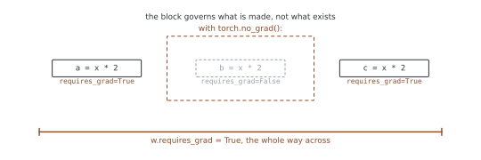
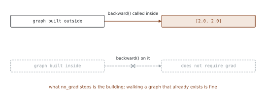
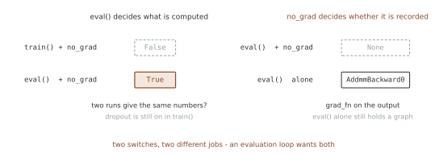

# with torch.no_grad()

<div class="leadbox" markdown>

**들어가는 이야기** — 이름이 말하지 않는 것

`no_grad`라는 이름을 그대로 읽으면 「그래디언트 없음」이다. 그래서 두 가지를 짐작하게
된다. 이 블록 안에서는 **미분을 못 구하겠구나**, 그리고 안에 있는 텐서들은
**미분 대상에서 빠지겠구나**.

둘 다 틀렸다. 블록 안에서도 미분을 구할 수 있고(밖에서 만들어 둔 것이라면),
블록 안의 텐서들은 **아무것도 바뀌지 않는다.** 이 블록이 끄는 것은 그래디언트가
아니라 **적어 두는 일**이다 — 순전파(입력에서 출력 쪽으로 가는 계산)를 하면서 「나중에 거꾸로 돌아오려면
이것을 기억해 둬야지」 하던 것을 그만두는 것뿐이다.

그 하나를 안 하는 것만으로 추론에서 메모리가 크게 준다. 다만 **평가 루프에는
이것 말고 `model.eval()`이라는 설정이 하나 더** 필요하고, 그 둘을 한 가지로 여기면 둘 중
하나는 빼먹게 된다. 빼먹었을 때의 결과가 서로 전혀 다르다.

</div>

`with torch.no_grad():` 안에서는 새로 만드는 텐서에 `grad_fn`이 붙지 않는다.
그래프가 안 세워지니 역전파가 쓰려고 저장해 둘 중간값도 없고, 그래서 추론에서
메모리를 아낀다.

여기까지는 널리 알려져 있는데, 그 위에 얹히는 짐작 둘이 어긋난다.

- **"`no_grad` 안에서는 `backward()`를 못 부른다"** — 부를 수 있다. 그래프를
  블록 **밖에서** 세웠다면 멀쩡히 돈다
- **"`no_grad`가 텐서의 `requires_grad`를 끈다"** — 안 끈다. 블록 안에서
  **만드는** 것에만 영향을 준다

## 1. 코드

```python
"""torch.no_grad — 끄는 것은 역전파가 아니라 기록이다.

`with torch.no_grad():` 안에서는 새로 만드는 텐서에 `grad_fn` 이
붙지 않는다. 그래서 그래프가 안 세워지고, 역전파가 쓰려고 저장해 둘
중간값도 없다.

자주 어긋나는 짐작이 둘 있다.

- "no_grad 안에서는 backward 를 못 부른다" — 부를 수 있다. 그래프를
  **블록 밖에서 세웠다면** 멀쩡히 돈다
- "no_grad 가 텐서의 requires_grad 를 끈다" — 안 끈다. 블록 안에서
  **만드는** 것에만 영향을 준다

실행: 이 쪽의 코드를 파일로 갈무리해 돌린다
"""
# torch 는 파이토치 본체다. 텐서를 만들고 미분하는 일이 다 여기서 온다.
import torch
# torch.nn 은 레이어(nn.Linear, nn.Dropout)와 그것을 잇는 틀(nn.Sequential)을
# 모아 둔 곳이다. 이름이 길어 nn 으로 줄여 부른다.
import torch.nn as nn


def header(title):
    # 절 제목을 한 줄 찍는다. \n 은 줄바꿈이고, f"...{title}..." 은 문자열 안에
    # 변수의 값을 끼워 넣는 파이썬 문법(f-문자열)이다.
    print(f"\n=== {title} ===")


# ========================================================================
# 1. 블록 안에서 만든 것만 달라진다
# ========================================================================

def scope():
    header("1. 범위는 코드 블록이다")
    # 난수의 시드를 고정한다. 아래에서 뽑는 텐서가 돌릴 때마다 같은 값이 된다.
    torch.manual_seed(0)
    # torch.randn(3) 은 표준정규분포에서 뽑은 실수 3개짜리 텐서다. 형태 (3,).
    # requires_grad=True 는 「이 텐서가 들어간 계산을 기록하라」는 표시다. 이것을
    # 경사 추적이라 하고, 그 기록이 이어진 것이 계산 그래프다. 이 절은 값이 아니라
    # 플래그만 찍으므로 난수를 고정하지 않아도 출력이 같다.
    w = torch.randn(3, requires_grad=True)
    print("  들어가기 전 w.requires_grad :", w.requires_grad)
    # with torch.no_grad(): 는 「이 블록 안에서 하는 계산은 기록하지 말라」는
    # 뜻이다. 들여 쓴 줄들이 블록이고, 들여쓰기가 끝나면 기록이 다시 켜진다.
    with torch.no_grad():
        # w 는 블록 밖에서 만든 텐서다. no_grad 는 이미 있는 텐서의 플래그를 안 바꾼다.
        print("  블록 안 w.requires_grad     :", w.requires_grad, " <- 그대로다")
        # 경사 추적 중인 w 로 계산했는데도, 블록 안이라 결과에는 추적이 안 붙는다.
        inside = w * 2
        print("  블록 안에서 만든 것          :", inside.requires_grad)
    # 블록을 나와 똑같은 계산을 하면 다시 기록된다.
    outside = w * 2
    print("  블록 밖에서 만든 것          :", outside.requires_grad)
    print("  no_grad 는 텐서가 아니라 '여기서 하는 일' 에 건다")


# ========================================================================
# 2. 막는 것은 그래프 세우기지 역전파가 아니다
# ========================================================================

def what_is_blocked():
    header("2. 무엇이 막히는가")
    # 난수의 시드를 고정한다. 아래에서 뽑는 텐서가 돌릴 때마다 같은 값이 된다.
    torch.manual_seed(0)
    # 형태 (2,) 의 텐서 w 로 로스를 만든다.  loss = 2*w[0] + 2*w[1]
    # sum() 은 원소를 모두 더해 수 하나로 만든다. w 의 원소마다 2 가 곱해져
    # 있으므로 그래디언트는 w 의 값과 상관없이 [2, 2] 다.
    w = torch.randn(2, requires_grad=True)
    loss = (w * 2).sum()                 # 그래프를 블록 밖에서 세운다
    # backward() 는 역전파다 — loss 에서 계산 그래프를 거꾸로 따라가며 미분하고,
    # 그 결과(그래디언트)를 w.grad 에 넣는다. 이미 세워진 그래프를 따라가는 일이라
    # no_grad 블록 안에서 불러도 된다.
    with torch.no_grad():
        loss.backward()                  # 역전파는 블록 안에서
    # tolist() 는 텐서의 값을 파이썬 리스트로 꺼낸다.
    print("  밖에서 세운 그래프를 안에서 역전파:", w.grad.tolist(), " 된다")

    # --- 이번에는 순서를 뒤집는다 ---
    w2 = torch.randn(2, requires_grad=True)
    with torch.no_grad():
        loss2 = (w2 * 2).sum()           # 그래프를 블록 안에서 세우면
    # grad_fn 은 「이 텐서를 만든 연산」의 기록이고, 역전파는 이것을 따라간다.
    # 블록 안에서 만든 loss2 에는 그 기록이 없어 None 이다.
    print("  안에서 만든 loss2.grad_fn        :", loss2.grad_fn)
    # try: 안의 줄이 오류를 내면 프로그램이 죽는 대신 except: 로 넘어간다. 일부러
    # 오류를 내 보고 그 메시지를 찍으려는 것이다.
    try:
        # 따라갈 기록이 없으므로 RuntimeError 가 난다.
        loss2.backward()
    except RuntimeError as e:
        # e 가 그 오류다. str(e) 로 메시지를 꺼내 splitlines()[0] 으로 첫 줄만,
        # [:52] 로 앞의 52글자만 잘라 찍는다.
        print("  그것을 역전파하면               :",
              str(e).splitlines()[0][:52])
    print("  그러니 막히는 것은 세우기다. 걷기가 아니다")


# ========================================================================
# 3. 안쪽에서 다시 켤 수 있다
# ========================================================================

def nesting():
    header("3. 겹쳐 쓰기")
    # 난수의 시드를 고정한다. 아래에서 뽑는 텐서가 돌릴 때마다 같은 값이 된다.
    torch.manual_seed(0)
    w = torch.randn(2, requires_grad=True)
    # torch.is_grad_enabled() 는 「지금 이 자리에서 계산이 기록되는가」를 True/False
    # 로 알려 준다. 평소에는 True 다.
    print("  지금 추적 켜져 있나:", torch.is_grad_enabled())
    with torch.no_grad():
        print("    no_grad 안       :", torch.is_grad_enabled())
        # torch.enable_grad() 는 no_grad 의 반대다. no_grad 블록 안에 한 번 더 들여 써
        # 넣으면 그 안쪽만 기록이 다시 켜진다.
        with torch.enable_grad():
            print("    enable_grad 안   :", torch.is_grad_enabled())
            a = w * 2        # enable_grad 안 — 기록된다
        # enable_grad 블록은 끝났고 아직 no_grad 블록 안이다 — 기록되지 않는다.
        b = w * 3
    print("  enable_grad 안에서 만든 것:", a.requires_grad)
    print("  그 바깥에서 만든 것       :", b.requires_grad)
    print("  평가 루프 한가운데서 한 조각만 미분해야 할 때 쓴다")


# ========================================================================
# 4. 데코레이터로도 쓴다
# ========================================================================

def decorator():
    header("4. 함수 전체에 걸기")

    # 함수 정의 바로 위에 @... 을 붙이는 것을 데코레이터라 한다. @torch.no_grad()
    # 를 붙이면 그 함수의 몸통 전체가 no_grad 블록 안에서 도는 것과 같다.
    @torch.no_grad()
    def predict(model, x):
        # model(x) 는 모델에 x 를 넣어 출력을 얻는 순전파다.
        return model(x)

    # 난수 발생기의 시드를 0 으로 고정한다. 레이어의 초기화와 randn 이 난수를 쓰므로,
    # 고정해 두어야 돌릴 때마다 같은 값이 나온다.
    torch.manual_seed(0)
    # nn.Linear(4, 2) 는 입력 4개를 받아 출력 2개를 내는 레이어다. 웨이트(형태 (2, 4))
    # 와 바이어스(형태 (2,))라는 파라메터를 가지며, 둘 다 requires_grad=True 다.
    net = nn.Linear(4, 2)
    # 입력은 3개 × 피처 4개(형태 (3, 4)), 출력은 형태 (3, 2) 다. 파라메터가 경사
    # 추적 중이라 평소라면 out 도 추적되지만, 데코레이터 때문에 False 가 찍힌다.
    out = predict(net, torch.randn(3, 4))
    print("  @torch.no_grad() 를 붙인 함수의 결과:", out.requires_grad)
    print("  평가 함수에 한 번 붙여 두면 부를 때마다 감쌀 필요가 없다")


# ========================================================================
# 5. 평가 루프에서 eval() 과 함께
# ========================================================================

def eval_loop():
    header("5. eval() 과 no_grad 는 다른 일이다")
    # 시드 고정 — 레이어의 초기화와 입력 x 가 돌릴 때마다 같게 나온다.
    torch.manual_seed(0)
    # nn.Sequential 은 레이어를 차례로 이어 하나의 뉴럴 네트워크로 만든다.
    #   Linear(8, 16) → Dropout(0.5) → Linear(16, 1)
    # nn.Dropout(0.5) 는 트레인 중에 값을 절반의 확률로 0 으로 만드는 레이어다.
    # 어느 것을 0 으로 할지 부를 때마다 무작위로 다시 뽑는다.
    net = nn.Sequential(nn.Linear(8, 16), nn.Dropout(0.5), nn.Linear(16, 1))
    x = torch.randn(4, 8)    # 입력 4개 × 피처 8개, 형태 (4, 8)

    # net.train() 은 뉴럴 네트워크를 트레인 모드로 둔다 — 드롭아웃이 켜진다.
    # 같은 x 를 두 번 넣어도 0 이 되는 자리가 달라 a 와 b 가 다르다. no_grad 는
    # 기록만 끌 뿐 드롭아웃을 끄지 않는다.
    net.train()
    with torch.no_grad():
        a, b = net(x), net(x)    # 순전파를 두 번 한다. 출력 형태 (4, 1)
    # torch.allclose 는 두 텐서가 (반올림 오차 안에서) 같으면 True 다.
    print("  train() + no_grad: 두 번이 같은가", torch.allclose(a, b),
          " <- 드롭아웃이 켜져 있다")
    # net.eval() 은 평가 모드로 둔다 — 드롭아웃이 꺼져 같은 입력에 같은 답이 나온다.
    net.eval()
    with torch.no_grad():
        c, d = net(x), net(x)
    print("  eval()  + no_grad: 두 번이 같은가", torch.allclose(c, d))
    # 이번에는 eval() 만 하고 no_grad 로 감싸지 않는다. 답은 같지만 계산이
    # 기록된다 — grad_fn 에 AddmmBackward0(마지막 Linear 의 행렬 곱과 덧셈)가 붙는다.
    # type(...).__name__ 은 그 기록의 종류 이름을 문자열로 꺼낸다.
    net.eval()
    e = net(x)               # 순전파. 기록된다
    print("  eval() 만          : grad_fn =",
          type(e.grad_fn).__name__, " <- 그래프를 들고 있다")
    print("  eval() 은 '무엇을 계산할지', no_grad 는 '기록할지' 를 정한다")


def main():
    # 다섯 절을 차례로 돌린다.
    scope()
    what_is_blocked()
    nesting()
    decorator()
    eval_loop()


# 이 파일을 직접 돌렸을 때만 main() 을 부른다. 다른 파일이 import 로 불러올 때는
# 돌지 않게 하는 파이썬의 관용구다.
if __name__ == "__main__":
    main()
```

**출력:**

```
=== 1. 범위는 코드 블록이다 ===
  들어가기 전 w.requires_grad : True
  블록 안 w.requires_grad     : True  <- 그대로다
  블록 안에서 만든 것          : False
  블록 밖에서 만든 것          : True
  no_grad 는 텐서가 아니라 '여기서 하는 일' 에 건다

=== 2. 무엇이 막히는가 ===
  밖에서 세운 그래프를 안에서 역전파: [2.0, 2.0]  된다
  안에서 만든 loss2.grad_fn        : None
  그것을 역전파하면               : element 0 of tensors does not require grad and does 
  그러니 막히는 것은 세우기다. 걷기가 아니다

=== 3. 겹쳐 쓰기 ===
  지금 추적 켜져 있나: True
    no_grad 안       : False
    enable_grad 안   : True
  enable_grad 안에서 만든 것: True
  그 바깥에서 만든 것       : False
  평가 루프 한가운데서 한 조각만 미분해야 할 때 쓴다

=== 4. 함수 전체에 걸기 ===
  @torch.no_grad() 를 붙인 함수의 결과: False
  평가 함수에 한 번 붙여 두면 부를 때마다 감쌀 필요가 없다

=== 5. eval() 과 no_grad 는 다른 일이다 ===
  train() + no_grad: 두 번이 같은가 False  <- 드롭아웃이 켜져 있다
  eval()  + no_grad: 두 번이 같은가 True
  eval() 만          : grad_fn = AddmmBackward0  <- 그래프를 들고 있다
  eval() 은 '무엇을 계산할지', no_grad 는 '기록할지' 를 정한다
```

## 2. 범위는 텐서가 아니라 코드 블록이다

```
들어가기 전 w.requires_grad : True
블록 안 w.requires_grad     : True    <- 그대로다
블록 안에서 만든 것          : False
블록 밖에서 만든 것          : True
```



`w`의 `requires_grad` 플래그는 블록 안에서도 `True`다. **`no_grad`는 텐서를 건드리지 않는다.**
그림의 맨 아래 선이 블록을 **가로질러** 이어지는 것이 그 말이다.

바뀌는 것은 그 안에서 **새로 만들어지는** 것뿐이고, 블록을 나오면 곧바로
원상태다. 「경사 추적 끄기」의 `requires_grad_(False)`와 정반대 성격이다 —
그쪽은 텐서에 영구적으로 걸고, 이쪽은 코드 구간에 일시적으로 건다.

## 3. 막히는 것은 그래프 세우기다

```
밖에서 세운 그래프를 안에서 역전파: [2.0, 2.0]   된다
안에서 만든 loss2.grad_fn        : None
그것을 역전파하면               : element 0 of tensors does not require grad
```



**블록 안에서 `backward()`를 부르는 것은 아무 문제가 없다.** 그래프가 이미
세워져 있으면 걸어 내려가는 데 아무 지장이 없다.

막히는 것은 **그 안에서 그래프를 세우는 일**이다. `loss2`를 블록 안에서
만들었으니 `grad_fn`이 `None`이고, 걸어 내려갈 길이 없어 거절당한다.

이 구별이 쓸모 있는 자리가 있다. 긴 평가 루프를 `no_grad`로 감싸 두고, 그 안에서
미리 만들어 둔 로스를 역전파해도 된다. 반대로 블록 안에서 모델을 돌려 로스를
만들었다면 그것으로는 트레인할 수 없다 — **그 로스는 숫자일 뿐 그래프가 아니다.**

## 4. 안쪽에서 다시 켤 수 있다

```
지금 추적 켜져 있나: True
  no_grad 안       : False
  enable_grad 안   : True
enable_grad 안에서 만든 것: True
그 바깥에서 만든 것       : False
```

`torch.enable_grad()`가 `no_grad`를 되돌린다. `torch.is_grad_enabled()`로 지금
상태를 물어볼 수도 있다.

쓰이는 자리는 **평가 루프 한가운데서 한 조각만 미분해야 할 때**다. 적대적
예제를 만들 때 입력에 대한 그래디언트가 필요하거나, 설명 기법(Grad-CAM 같은 것)이
평가 중에 그래디언트를 보는 경우가 그렇다.

## 5. 데코레이터로도 쓴다

```python
# @ 로 시작하는 줄이 데코레이터다. 바로 아래 함수의 몸통 전체를 no_grad 블록
# 안에서 돌린다 — 부르는 쪽에서 with 로 감쌀 필요가 없다.
@torch.no_grad()
def predict(model, x):
    # 순전파만 한다. 계산은 기록되지 않는다.
    return model(x)
```

평가 함수에 한 번 붙여 두면 부를 때마다 감쌀 필요가 없다. 빠뜨릴 일이
없어진다는 것이 `with`보다 나은 점이다.

## 6. `eval()`과 `no_grad`는 다른 일이다

```
train() + no_grad: 두 번이 같은가 False   <- 드롭아웃이 켜져 있다
eval()  + no_grad: 두 번이 같은가 True
eval() 만          : grad_fn = AddmmBackward0   <- 그래프를 들고 있다
```



둘 다 해야 한다. **서로 다른 설정**이기 때문이다. 그림의 두 칸이 **확인하는
기준부터 다르다** — 왼쪽은 「두 번 돌린 답이 같은가」를 묻고 오른쪽은
「`grad_fn`이 남았는가」를 묻는다. 한 설정으로 두 기준을 다 맞출 수는 없다.

| | 무엇을 정하는가 | 빼먹으면 |
|---|---|---|
| `model.eval()` | 모델이 **무엇을 계산할지** | 답이 **틀리고** 매번 달라진다 |
| `torch.no_grad()` | 그 계산을 **기록할지** | 답은 맞고 **느리고 메모리를 쓴다** |

빼먹었을 때의 결과가 전혀 다르다. `no_grad`를 빼면 성능 문제이고, `eval()`을
빼면 **정확도 문제**다.

배치 정규화가 있으면 더 나쁘다. `train()` 모드에서는 **평가 배치의 통계로**
정규화하므로 한 표본의 예측이 같이 묶인 표본에 따라 달라지고, 배치 크기 1로
평가하면 아예 터지기도 한다.

## 연습문제

<div class="drillbox" markdown>

**연습문제 1.** <span class="diff easy" title="쉬움"></span>
`no_grad` 블록 안에서 파라메터를 제자리에서 고칠 수 있는가? 「작은 트레인 단계」에서
본 것을 확인하라.

</div>

??? success "풀이"
    ```python
    # 본문 코드에 이어서 돌린다 — torch 를 이미 불러온 상태다.
    # torch.tensor([1.0, 2.0]) 은 수 둘을 담은 텐서를 직접 만든다. 이렇게 직접 만든
    # 텐서를 리프 텐서라 한다. 경사 추적을 켰으니 파라메터 구실을 한다.
    w = torch.tensor([1.0, 2.0], requires_grad=True)
    # loss = w[0]^2 + w[1]^2 = 1 + 4 = 5 (** 는 거듭제곱).
    # backward() 가 역전파해 w.grad 에 2w = [2, 4] 를 넣는다.
    (w ** 2).sum().backward()
    try:
        # 경사 하강법 한 스텝을 그냥 적어 본다.  w ← w - 0.1 * 그래디언트
        # w -= ... 는 w 를 새로 만들지 않고 「제자리에서」 고친다. 경사 추적 중인 리프
        # 텐서를 제자리에서 고치는 것을 파이토치는 허락하지 않는다 — RuntimeError.
        w -= 0.1 * w.grad
    except RuntimeError as e:
        print("  그냥 고치면   :", str(e).splitlines()[0][:58])
    # 같은 줄을 no_grad 블록 안에 두면 이 수정은 기록할 계산이 아니게 되어 통과한다.
    with torch.no_grad():
        w -= 0.1 * w.grad
    # round(v, 4) 는 소수점 아래 넷째 자리까지 반올림한다. [... for v in ...] 는
    # 원소마다 그렇게 해 리스트로 모으는 파이썬 문법이다.
    print("  no_grad 안에서:", [round(v, 4) for v in w.tolist()])
    # w.is_leaf 는 w 가 리프 텐서인지를 알려 준다. 값만 바뀌었고 w 는 그대로 w 다.
    print("  플래그는 그대로 :", w.requires_grad, " 리프인가:", w.is_leaf)
    ```

    ```
      그냥 고치면   : a leaf Variable that requires grad is being used in an in-
      no_grad 안에서: [0.8, 1.6]
      플래그는 그대로 : True  리프인가: True
    ```

    `no_grad` 안에서는 리프 텐서(leaf tensor, 연산의 결과가 아니라 직접 만든 텐서 — 오류 메시지의 「leaf Variable」)에 대한 제자리 연산 검사를 넘긴다. 그러고도 `w`는
    **여전히 리프 텐서이고 여전히 `requires_grad=True`**다.

    이것이 옵티마이저가 하는 일이다. 3절의 말로 하면, 갱신은 **기록할 일이 아닌**
    계산이다 — $w \leftarrow w - \eta \nabla w$를 다시 미분할 까닭이 없다.

---

<div class="drillbox" markdown>

**연습문제 2.** <span class="diff med" title="중간"></span>
적대적 예제를 만들려면 평가 중에 **입력에 대한 그래디언트**가 필요하다. `no_grad`로
감싼 평가 루프 안에서 그것을 얻어라.

</div>

??? success "풀이"
    ```python
    # 본문 코드에 이어서 돌린다 — torch, nn 을 이미 불러온 상태다.
    # 시드를 고정한다. 아래에서 그래디언트와 예측을 찍으므로 고정해야 같은 수가 나온다.
    torch.manual_seed(0)
    # 입력 4개 → 8개 → 2개. nn.ReLU() 는 음수를 0 으로 바꾸는 함수다. 출력 2개는
    # 클래스 0 과 1 의 점수이고, 점수가 큰 쪽이 예측이다. 트레인하지 않은 뉴럴
    # 네트워크다.
    net = nn.Sequential(nn.Linear(4, 8), nn.ReLU(), nn.Linear(8, 2))
    # 평가 모드로 둔다. 이 뉴럴 네트워크에는 드롭아웃이 없어 답이 달라지지는 않지만,
    # 평가할 때는 늘 붙이는 줄이다.
    net.eval()
    x = torch.randn(1, 4)                      # 입력 하나 × 피처 4개, 형태 (1, 4)
    # 정답 클래스의 번호다. 1 하나를 담은 정수 텐서, 형태 (1,).
    target = torch.tensor([1])

    with torch.no_grad():                      # 평가 루프 전체
        # 평소의 평가다. 기록되지 않으므로 출력 plain(형태 (1, 2))의 grad_fn 이 None 이다.
        plain = net(x)
        print("  보통 평가 grad_fn:", plain.grad_fn)

        with torch.enable_grad():              # 이 조각만 다시 켠다
            # 입력에 대한 그래디언트가 필요하다. x 를 clone() 으로 복사한 새 텐서에
            # requires_grad_(True) 로 경사 추적을 켠다(끝의 _ 는 제자리에서 고친다는 뜻).
            # x 자체는 건드리지 않는다.
            xa = x.clone().requires_grad_(True)
            # cross_entropy 는 분류의 로스다 — 점수(형태 (1, 2))와 정답 번호를 받아 수 하나를
            # 낸다. 정답 클래스의 점수가 다른 점수보다 낮을수록 크다.
            loss = nn.functional.cross_entropy(net(xa), target)
            # 역전파. 로스를 입력으로 미분한 값이 xa.grad 에 들어간다(형태 (1, 4)).
            loss.backward()
        # xa.grad[0] 은 그 한 행이다. 넷째 자리까지 반올림해 리스트로 찍는다.
        # 여기는 enable_grad 블록을 나온 자리이고, 아직 no_grad 블록 안이다.
        print("  입력에 대한 경사 :",
              [round(v, 4) for v in xa.grad[0].tolist()])

        # sign() 은 원소마다 부호만 남긴다(+1, -1, 0). 그래디언트는 로스가 커지는 쪽을
        # 가리키므로, 입력을 그 부호 쪽으로 0.1 씩 옮기면 로스가 커진다 — 모델이 틀리는
        # 쪽으로 입력을 흔드는 것이다. 이 한 스텝을 FGSM 이라 한다.
        adv = x + 0.1 * xa.grad.sign()         # FGSM 한 스텝
        # argmax(1) 은 행마다 점수가 가장 큰 칸의 번호를 준다. .item() 은 수 하나짜리
        # 텐서에서 그 수를 파이썬 수로 꺼낸다.
        print("  원래 예측        :", net(x).argmax(1).item())
        print("  흔든 뒤 예측     :", net(adv).argmax(1).item())
    ```

    ```
      보통 평가 grad_fn: None
      입력에 대한 경사 : [-0.0584, -0.0821, 0.0388, -0.0283]
      원래 예측        : 1
      흔든 뒤 예측     : 1
    ```

    `enable_grad` 안에서만 그래프가 세워져 `xa.grad`를 얻었다. 바깥은 여전히
    `no_grad`라 `plain`의 `grad_fn`이 `None`이다.

    `x.clone().requires_grad_(True)`로 새 리프 텐서를 만든 것이 핵심이다. 원래 `x`는
    플래그가 꺼져 있으므로 그래디언트를 못 받고, 그렇다고 `x` 자체에 플래그를 켜면 평가
    루프의 다른 부분까지 영향을 받는다.

    이 예에서는 한 스텝으로 예측이 안 바뀌었다 — 트레인하지 않은 뉴럴 네트워크라 결정
    경계가 어디 있는지 모르는 상태다. 제대로 트레인한 모델에서는 이 정도 섭동(입력에
    더한 작은 변화)으로 예측이 뒤집히는 것이 적대적 예제의 요점이다.

---

<div class="drillbox" markdown>

**연습문제 3.** <span class="diff hard" title="어려움"></span>
`no_grad`로 감싼 평가에서 얻은 출력을 **다음 트레인의 목표값으로** 쓰려 한다
(지식 증류나 강화 학습의 타깃 네트워크가 이렇게 한다). 되는가? `inference_mode`로
감쌌다면?

</div>

??? success "풀이"
    ```python
    # 본문 코드에 이어서 돌린다 — torch, nn 을 이미 불러온 상태다.
    torch.manual_seed(0)
    # Linear(4, 2) 둘을 만든다. 초기화가 차례로 난수를 쓰므로 둘의 웨이트는 다르다.
    # 교사의 출력을 학생이 따라 하게 트레인하려는 것이다.
    teacher = nn.Linear(4, 2)
    student = nn.Linear(4, 2)
    # 입력 8개 × 피처 4개, 형태 (8, 4). 8 이 배치 크기다.
    x = torch.randn(8, 4)

    with torch.no_grad():                       # 교사의 출력
        # 교사는 트레인하지 않으므로 no_grad 안에서 돌린다. soft 는 형태 (8, 2) 의
        # 값만 든 텐서다 — requires_grad 가 False 이고 grad_fn 도 없다.
        soft = teacher(x)
    # 학생의 출력은 블록 밖에서 계산해 기록된다. mse_loss 는 학생의 출력과 soft 의
    # 차이를 제곱해 평균 낸 로스(수 하나)다.
    loss = nn.functional.mse_loss(student(x), soft)
    # 역전파. 기록이 있는 학생 쪽으로만 그래디언트가 간다.
    loss.backward()
    print("  no_grad 로 만든 목표값으로 트레인:",
          # student.weight 는 학생의 웨이트이고, .grad 는 역전파가 그래디언트를 넣어 주는
          # 자리다. 넣어 주지 않았으면 None 이다.
          "된다" if student.weight.grad is not None else "안 된다")
    print("    목표값에는 그래디언트가 안 간다:", soft.requires_grad)

    # --- 같은 일을 inference_mode 로 ---
    # zero_grad() 는 위에서 쌓인 학생의 그래디언트를 지운다.
    student.zero_grad()
    # torch.inference_mode() 도 블록 안의 계산을 기록하지 않는다. no_grad 보다
    # 엄격해서, 그 안에서 만든 텐서에 「추론 텐서」라는 표를 박는다. 추론 텐서는
    # 나중에도 역전파에 쓰일 수 없다.
    with torch.inference_mode():
        soft2 = teacher(x)
    try:
        # 오류는 backward() 까지 가기 전에, mse_loss 가 추론 텐서 soft2 를 역전파용으로
        # 저장하려는 순간에 난다. 그래서 바로 아래 print 는 돌지 않는다.
        nn.functional.mse_loss(student(x), soft2).backward()
        print("  inference_mode 로 만든 목표값으로 트레인: 된다")
    except RuntimeError as e:
        print("  inference_mode 로 만든 목표값:",
              str(e).splitlines()[0][:60])
    ```

    ```
      no_grad 로 만든 목표값으로 트레인: 된다
        목표값에는 그래디언트가 안 간다: False
      inference_mode 로 만든 목표값: Inference tensors cannot be saved for backward.
    ```

    **`no_grad`는 되고 `inference_mode`는 막힌다.**

    `no_grad`로 만든 목표값은 평범한 텐서다. 로스가 그것을 상수처럼 읽고 그래디언트는
    학생 쪽으로만 흐른다 — `soft.requires_grad`가 `False`인 것이 그 뜻이다.

    `inference_mode`로 만든 것은 **추론 텐서**라 역전파를 위해 저장될 수조차
    없다. `mse_loss`가 그 목표값을 저장해 두어야 하는데 거절당한다.

    「경사 추적을 언제 멈출 것인가」에서 적은 기준이 그대로 들어맞는다. **그 결과를
    뒤에 다시 쓸 일이 있으면 `no_grad`**다. 지식 증류의 교사, 강화 학습의 타깃 네트워크,
    준지도 학습의 의사 라벨(pseudo-label)이 전부 여기 해당한다.

    오류 메시지가 "To work around" 로 이어지며 `.clone()` 을 권한다. 추론
    텐서를 복제하면 평범한 텐서가 되기 때문이다. 다만 그럴 바에는 처음부터
    `no_grad` 를 쓰는 편이 간단하다.

    교사 모델을 `no_grad`로 감싸는 것 자체는 반드시 해야 한다. 안 감싸면 교사의
    그래프가 통째로 살아 있어 메모리를 두 배로 쓰고, 실수로 교사까지 트레인시킬
    수도 있다.
