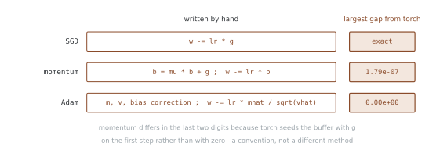
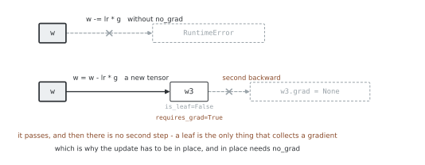

# 옵티마이저 방식의 갱신

<div class="leadbox" markdown>

**들어가는 이야기** — 한 줄 안에 든 것

트레인 코드에서 모델을 실제로 **바꾸는** 줄은 `optimizer.step()` 하나뿐이다. 그 한
줄을 부르면 수백만 개의 파라메터가 조금씩 움직인다. 이름도 「한 걸음(step)」이라
그럴듯하고, 그래서 그 안을 들여다볼 일이 좀처럼 없다.

이 쪽은 그 한 줄을 세 가지 방식으로 손수 적어 보고 라이브러리 것과의 차이를 잰다. 가장
단순한 것은 **뺄셈 한 줄**이고, 가장 복잡한 것도 **다섯 줄**이다. 그리고 다섯
줄짜리는 차이가 정확히 0으로 나온다.

여기까지는 안심하는 이야기인데, 끝에 하나가 걸린다. 갱신은 반드시 **제자리
연산(in-place)**으로 해야 한다. 피해 가려고 새 값을 만들어 이름을 다시 붙이면 오류는 안 나고, 대신
**두 번째 스텝이 조용히 사라진다.**

</div>

`opt.step()` 한 줄이 하는 일을 손으로 적어 본다. SGD·모멘텀·Adam 셋을 차례로
짜서 파이토치 것과 견주고, 숫자가 맞는지 확인한다.

맞으면 두 가지를 얻는다. **옵티마이저가 마법이 아니라는 것**, 그리고 **어디를
건드리면 무엇이 달라지는지**를 코드로 알게 되는 것.

그 과정에서 「작은 트레인 단계」에서 본 구별이 다시 나온다. 그래디언트를
**구하는**(`backward`) 일과 그 그래디언트로 값을 **바꾸는**(갱신) 일은 다른 단계이고,
둘 사이에 `no_grad`가 들어간다.

## 1. 코드

```python
"""옵티마이저 없이 갱신하기 — step() 이 숨기고 있는 세 줄.

`opt.step()` 한 줄이 하는 일을 손으로 적어 본다. 그래디언트를 구하는
일(`backward`)과 그 그래디언트로 값을 바꾸는 일(갱신)은 **다른 단계**이고,
둘 사이에 `no_grad` 가 들어간다.

SGD · 모멘텀 · Adam 을 차례로 손으로 짜서 파이토치 것과 견준다.
셋 다 소수점 끝까지 맞으면, 옵티마이저가 마법이 아니라는 것이
확인된 셈이다.

실행: 이 쪽의 코드를 파일로 갈무리해 돌린다
"""
# warnings 는 파이썬의 경고문을 다루는 표준 모듈이다. 맨 끝 4번에서 경고문 하나를
# 잠깐 끄는 데 쓴다.
import warnings

# 파이토치를 불러온다. torch.tensor, torch.optim, torch.no_grad 가 다 여기서 온다.
import torch


# 절 제목을 찍는 작은 도우미다. f"...{title}..." 은 문자열 안의 중괄호 자리에
# 값을 끼워 넣는 파이썬 문법이고, \n 은 줄바꿈이라 제목 앞에 빈 줄이 하나 생긴다.
def header(title):
    print(f"\n=== {title} ===")


# 실험할 문제를 새로 만들어 돌려준다. 부를 때마다 w 가 [3, 3] 에서 다시 출발하므로
# 파이토치 쪽과 손으로 짠 쪽을 같은 자리에서 시작시킬 수 있다.
def problem():
    """작은 이차함수 하나. 최솟값은 w = [1, -2] 다."""
    # torch.tensor([...]) 는 적어 준 수를 담은 「텐서」를 만든다. 텐서는 파이토치가
    # 다루는 수의 묶음이고, 여기서는 수 둘짜리 — 형태가 (2,) 다.
    # target 은 w 가 가야 할 곳이다. 고칠 값이 아니므로 그냥 만든다.
    target = torch.tensor([1.0, -2.0])
    # w 는 트레인으로 고칠 값, 곧 파라메터다. requires_grad=True 는 「이 텐서로 미분할
    # 것이니, 이 텐서가 들어간 계산을 모두 기록해 두라」는 표시다. 이것을 경사 추적이라
    # 하고, 그 기록을 계산 그래프라 한다. 기본값은 False 라서 target 은 추적하지 않는다.
    w = torch.tensor([3.0, 3.0], requires_grad=True)
    return w, target


# 로스. w 가 target 에서 얼마나 먼지를 잰다 — 성분마다 차를 제곱해 모두 더한다.
def loss_of(w, target):
    # w - target 은 같은 자리끼리 뺀다. ** 2 는 원소마다 제곱, .sum() 은 다 더해 수
    # 하나짜리 텐서로 만든다. 처음에는 (3-1)^2 + (3-(-2))^2 = 4 + 25 = 29 다.
    # w 로 미분한 그래디언트는 2*(w - target) 이고 처음에는 [4, 10] 이다.
    return ((w - target) ** 2).sum()


# ========================================================================
# 1. SGD
# ========================================================================

def plain_sgd():
    header("1. SGD")
    # lr 은 러닝레이트(한 스텝에 얼마나 옮길지), steps 는 되풀이 횟수다.
    lr, steps = 0.1, 20

    # --- 파이토치의 옵티마이저로 스무 스텝 ---------------------------------------
    # t 는 target 이다.
    w, t = problem()
    # 옵티마이저는 파라메터를 고치는 일을 맡는 객체다. 고칠 텐서들을 리스트로 넘기고
    # ([w] — 여기서는 하나뿐이다) 러닝레이트를 알려 준다. SGD 는 경사 하강법이다.
    opt = torch.optim.SGD([w], lr=lr)
    # 스텝 번호를 쓰지 않으므로 변수 이름을 _ 로 둔다. steps 번 되풀이한다는 뜻이다.
    for _ in range(steps):
        # (1) 지난 스텝의 그래디언트를 지운다. backward() 는 .grad 를 새 값으로 바꾸지
        # 않고 거기에 「더하므로」, 지우지 않으면 지난 스텝들의 그래디언트가 쌓인다.
        opt.zero_grad()
        # (2) 순전파와 역전파. loss_of 가 로스를 재고, backward() 가 계산 그래프를 로스에서
        # 거꾸로 따라가며 로스를 w 로 미분한 값(그래디언트)을 w.grad 에 넣어 준다.
        loss_of(w, t).backward()
        # (3) 한 스텝. 옵티마이저가 w.grad 를 보고 w 를 옮긴다. 이 한 줄이 속에서 무슨
        # 일을 하는지가 이 쪽의 물음이다.
        opt.step()
    # 결과를 따로 떼어 둔다. detach() 는 값은 같고 경사 추적만 끊은 텐서를 주고,
    # clone() 은 그 값을 새 텐서로 베낀다. 견줄 값만 필요하기 때문이다.
    by_torch = w.detach().clone()

    # --- 같은 일을 옵티마이저 없이 손으로 스무 스텝 --------------------------------
    # problem() 을 다시 불러 w2 를 [3, 3] 에서 새로 출발시킨다.
    w2, t2 = problem()
    for _ in range(steps):
        # opt.zero_grad() 의 짝. 첫 스텝에는 아직 backward() 를 부른 적이 없어 .grad 가
        # None 이므로 건너뛴다. zero_() 처럼 이름이 _ 로 끝나는 메서드는 텐서를 제자리에서
        # 고친다 — 여기서는 0 으로 채운다.
        if w2.grad is not None:
            w2.grad.zero_()
        loss_of(w2, t2).backward()          # 역전파 — 위와 똑같다
        # opt.step() 의 짝. 그래디언트는 로스가 가장 빨리 「커지는」 쪽을 가리키므로
        # 반대쪽으로 러닝레이트만큼 옮긴다.   첫 스텝: [3, 3] - 0.1 * [4, 10] = [2.6, 2.0]
        #
        # with torch.no_grad(): 블록 안의 계산은 기록하지 않는다. 파라메터를 고치는 일은
        # 모델의 계산이 아니므로 계산 그래프에 들어가면 안 된다. -= 는 w2 를 새로 만들지
        # 않고 「제자리에서」 고친다. 이 둘이 왜 함께 있어야 하는지는 4번이 보여 준다.
        with torch.no_grad():
            w2 -= lr * w2.grad               # 이 한 줄이 step() 이다
    # tolist() 는 텐서를 파이썬 리스트로 바꾸고, round(v, 8) 은 소수점 아래 여덟
    # 자리까지 줄인다. [... for v in ...] 는 리스트의 수마다 그 일을 한다.
    print("  torch.optim.SGD :", [round(v, 8) for v in by_torch.tolist()])
    print("  손으로          :", [round(v, 8) for v in w2.detach().tolist()])
    # torch.equal(a, b) 는 두 텐서가 형태도 같고 모든 원소가 「정확히」 같을 때만
    # True 다. 허용 오차가 없다 — 끝자리 하나만 달라도 False 가 나온다.
    print("  같은가          :", torch.equal(by_torch, w2.detach()))


# ========================================================================
# 2. 모멘텀
# ========================================================================

# 모멘텀 — 이번 그래디언트만 보지 않고 지난 스텝들의 그래디언트를 이어 가며 쓴다.
# 그 누적을 담아 두는 텐서가 버퍼다.
def momentum():
    header("2. 모멘텀")
    lr, mu, steps = 0.1, 0.9, 20  # mu 는 지난 버퍼를 얼마나 남길지 (모멘텀 계수)

    # --- 파이토치 쪽 — momentum=mu 를 주는 것 말고는 1번과 같다 ---------------------
    w, t = problem()
    opt = torch.optim.SGD([w], lr=lr, momentum=mu)
    for _ in range(steps):
        opt.zero_grad()
        loss_of(w, t).backward()
        opt.step()
    # 견줄 값만 떼어 둔다 (경사 추적을 끊고 베낀다).
    by_torch = w.detach().clone()

    # --- 손으로 — 버퍼 buf 를 스스로 들고 다닌다 -----------------------------------
    w2, t2 = problem()
    buf = None                    # 아직 버퍼가 없다는 표시
    for _ in range(steps):
        # 지난 그래디언트를 지우고 역전파한다 — 1번의 손으로 짠 쪽과 같다.
        if w2.grad is not None:
            w2.grad.zero_()
        loss_of(w2, t2).backward()
        with torch.no_grad():
            # g 는 w2.grad 에 붙인 다른 이름이다. 베낀 것이 아니라 같은 텐서를 가리킨다.
            g = w2.grad
            # 버퍼를 갱신한다. 「A if 조건 else B」 는 조건이 참이면 A, 아니면 B 를 고른다.
            #   첫 스텝       buf = g 의 사본                  [4, 10]
            #   그 뒤         buf = mu * (지난 buf) + g        둘째 스텝: 0.9*[4, 10] + [3.2, 8]
            #                                                           = [6.8, 17]
            # 첫 스텝에 clone() 으로 베끼는 까닭 — 그냥 g 를 넣으면 buf 가 w2.grad 와 같은
            # 텐서가 되어, 다음 스텝의 zero_() 가 버퍼까지 0 으로 지운다.
            buf = g.clone() if buf is None else mu * buf + g
            # 그래디언트 대신 버퍼만큼 옮긴다.
            #   첫 스텝    [3, 3]     - 0.1 * [4, 10]   = [2.6, 2.0]
            #   둘째 스텝  [2.6, 2.0] - 0.1 * [6.8, 17] = [1.92, 0.3]
            w2 -= lr * buf
    print("  torch 모멘텀 :", [round(v, 8) for v in by_torch.tolist()])
    print("  손으로       :", [round(v, 8) for v in w2.detach().tolist()])
    # 두 결과의 차에서 절댓값(.abs())이 가장 큰 것(.max())을 찍는다.
    # :.2e 는 지수 표기다 — 1.79e-07 은 1.79 × 10^-7.
    print("  가장 큰 차이 :", f"{(by_torch - w2.detach()).abs().max():.2e}")
    print("  첫 스텝의 버퍼를 g 로 두는 것이 파이토치의 약속이다")
    print("  0 으로 두고 mu*0 + g 를 해도 같은 값이지만, 구현에 따라 다르다")


# ========================================================================
# 3. Adam
# ========================================================================

# Adam — 버퍼를 둘 든다. m 은 그래디언트의 이동 평균(1차 모멘트), v 는 그래디언트
# 제곱의 이동 평균(2차 모멘트)이다. m 을 v 의 제곱근으로 나눈 만큼 옮긴다.
def adam():
    header("3. Adam")
    # b1, b2 는 m 과 v 에서 지난 값을 얼마나 남길지, eps 는 0 으로 나누는 일을 막는
    # 아주 작은 수다. 1e-8 은 0.00000001 이다.
    lr, b1, b2, eps, steps = 0.1, 0.9, 0.999, 1e-8, 20

    # --- 파이토치 쪽 ------------------------------------------------------------
    # 손으로 짠 쪽과 같은 설정이 되도록 betas 와 eps 를 적어서 넘긴다.
    w, t = problem()
    opt = torch.optim.Adam([w], lr=lr, betas=(b1, b2), eps=eps)
    for _ in range(steps):
        opt.zero_grad()
        loss_of(w, t).backward()
        opt.step()
    # 견줄 값만 떼어 둔다 (경사 추적을 끊고 베낀다).
    by_torch = w.detach().clone()

    # --- 손으로 -----------------------------------------------------------------
    w2, t2 = problem()
    # torch.zeros_like(w2) 는 w2 와 형태가 같고 0 으로 채운 텐서다. 경사 추적은 걸리지
    # 않는다. 두 버퍼 모두 0 에서 출발한다.
    m = torch.zeros_like(w2)
    v = torch.zeros_like(w2)
    # 이번에는 스텝 번호가 필요하다(편향 보정에 쓴다). 1 부터 steps 까지 센다.
    for step in range(1, steps + 1):
        # 지난 그래디언트를 지우고 역전파한다 — 1번과 같다.
        if w2.grad is not None:
            w2.grad.zero_()
        loss_of(w2, t2).backward()
        with torch.no_grad():
            g = w2.grad                        # 이번 스텝의 그래디언트
            # 이동 평균 — 지난 값을 b1 만큼 남기고 새 값을 (1 - b1) 만큼 섞는다.
            # 첫 스텝: m = 0.1 * g,  v = 0.001 * g*g   (g * g 는 원소마다 제곱)
            m = b1 * m + (1 - b1) * g
            v = b2 * v + (1 - b2) * g * g
            # m, v 가 0 에서 출발했으므로 처음 몇 스텝은 너무 작다. (1 - b ** step) 으로 나눠
            # 되돌린다(** 는 거듭제곱).   첫 스텝: m_hat = 0.1*g / 0.1 = g,  v_hat = g*g
            m_hat = m / (1 - b1 ** step)       # 편향 보정
            v_hat = v / (1 - b2 ** step)
            # 한 스텝. .sqrt() 는 원소마다 제곱근이다.
            # 첫 스텝: lr * g / (|g| + eps) = 0.1 * (g 의 부호) 이므로 [3, 3] → [2.9, 2.9].
            # 그래디언트가 [4, 10] 으로 달라도 두 성분이 똑같이 0.1 씩만 간다.
            w2 -= lr * m_hat / (v_hat.sqrt() + eps)
    print("  torch.optim.Adam:", [round(v, 8) for v in by_torch.tolist()])
    print("  손으로          :", [round(v, 8) for v in w2.detach().tolist()])
    # 가장 큰 차이를 지수 표기로 찍는다. 0.00e+00 은 정확히 0 이다.
    print("  가장 큰 차이     :", f"{(by_torch - w2.detach()).abs().max():.2e}")


# ========================================================================
# 4. no_grad 를 빼면
# ========================================================================

# 갱신을 no_grad() 없이 하면 무슨 일이 생기는지 두 가지로 해 본다.
def why_no_grad():
    header("4. no_grad 를 빼면")
    # --- (가) no_grad 없이 제자리에서 고친다 → 오류 --------------------------------
    w, t = problem()
    loss_of(w, t).backward()      # w.grad 를 채워 둔다 — [4, 10]
    # try: 안에서 오류가 나면 프로그램이 멈추는 대신 except: 로 넘어간다. 오류가 날
    # 것을 알고 일부러 해 보는 것이다.
    try:
        # 경사 추적 중인 리프 텐서(연산의 결과가 아니라 직접 만든 텐서)를 기록이 켜진
        # 채로 제자리에서 고치려 한다. 파이토치가 RuntimeError 를 낸다.
        w -= 0.1 * w.grad
    except RuntimeError as e:
        # e 가 그 오류다. str(e) 로 오류문을 꺼내 첫 줄(splitlines()[0])의 앞 62글자
        # ([:62])만 찍는다.
        print("  제자리로 고치면:", str(e).splitlines()[0][:62])

    # --- (나) 제자리 대신 새 텐서를 만든다 → 통과하지만 다음 스텝이 없다 ------------
    w2, t2 = problem()
    loss_of(w2, t2).backward()    # w2.grad 를 채워 둔다
    # w2 를 고치지 않고 계산 결과에 w3 이라는 새 이름을 붙였다. 오류는 없다. 다만
    # 이 뺄셈은 기록되므로 w3 은 「w2 로 만든 연산의 결과」가 된다.
    w3 = w2 - 0.1 * w2.grad                  # 새 텐서를 만들면 통과한다
    print("  새 텐서를 만들면 통과한다. 그런데")
    # is_leaf 는 리프 텐서인가다. w3 은 연산의 결과라 False 다. requires_grad 는
    # w2 에서 물려받아 True 다 — 추적은 되는데 리프 텐서는 아니다.
    print("    w3.is_leaf       :", w3.is_leaf)
    print("    w3.requires_grad :", w3.requires_grad)
    # 둘째 스텝을 흉내 낸다. w3 으로 로스를 재고 역전파한다. backward() 는 리프 텐서의
    # .grad 만 채우므로 그래디언트는 w2 로 가고 w3.grad 는 None 으로 남는다.
    loss_of(w3, t2).backward()
    with warnings.catch_warnings():        # 경고문에 빌드 기계 경로가 붙는다
        # 리프 텐서가 아닌 텐서의 .grad 를 읽으면 파이토치가 경고문을 찍는다.
        # simplefilter("ignore") 가 이 with 블록 안에서만 경고를 끈다.
        warnings.simplefilter("ignore")
        print("    두 번째 스텝의 w3.grad:", w3.grad)
    print("  리프 텐서가 아니라 그래디언트를 못 받는다 — 다음 스텝이 없다")


# 네 절을 차례로 돌린다.
def main():
    plain_sgd()
    momentum()
    adam()
    why_no_grad()


# 이 파일을 직접 돌렸을 때만 main() 을 부른다. 다른 파일이 import 로 불러 쓸
# 때에는 부르지 않는다.
if __name__ == "__main__":
    main()
```

**출력:**

```
=== 1. SGD ===
  torch.optim.SGD : [1.02305853, -1.94235396]
  손으로          : [1.02305853, -1.94235396]
  같은가          : True

=== 2. 모멘텀 ===
  torch 모멘텀 : [0.30149513, -3.74626255]
  손으로       : [0.30149496, -3.74626255]
  가장 큰 차이 : 1.79e-07
  첫 스텝의 버퍼를 g 로 두는 것이 파이토치의 약속이다
  0 으로 두고 mu*0 + g 를 해도 같은 값이지만, 구현에 따라 다르다

=== 3. Adam ===
  torch.optim.Adam: [1.22245252, 1.06033909]
  손으로          : [1.22245252, 1.06033909]
  가장 큰 차이     : 0.00e+00

=== 4. no_grad 를 빼면 ===
  제자리로 고치면: a leaf Variable that requires grad is being used in an in-plac
  새 텐서를 만들면 통과한다. 그런데
    w3.is_leaf       : False
    w3.requires_grad : True
    두 번째 스텝의 w3.grad: None
  리프 텐서가 아니라 그래디언트를 못 받는다 — 다음 스텝이 없다
```

## 2. SGD는 뺄셈 한 줄이다

```
torch.optim.SGD : [1.02305853, -1.94235396]
손으로          : [1.02305853, -1.94235396]
같은가          : True
```

```python
# 본문 코드의 손으로 짠 SGD 에서 갱신만 떼어 온 조각이다.
# no_grad() 블록 안의 계산은 계산 그래프에 기록하지 않는다. -= 는 w 를 새로
# 만들지 않고 제자리에서 고친다.   w ← w - lr * 그래디언트
with torch.no_grad():
    w -= lr * w.grad
```

로스를 $L$, 러닝레이트를 $\eta$라 하면 $w \leftarrow w - \eta \nabla_w L$이 식 그대로다. 스무 스텝을 돌려도 어긋나지
않는다.

## 3. 모멘텀은 버퍼 하나를 더 든다

```python
# 본문 코드의 손으로 짠 모멘텀에서 갱신만 떼어 온 조각이다. g 는 w.grad 다.
# 첫 스텝이면(buf 가 None) 그래디언트의 사본을 버퍼로 삼고, 그 뒤로는 지난 버퍼에
# mu 를 곱해 이번 그래디언트를 더한다. 그리고 버퍼만큼 옮긴다.
buf = g.clone() if buf is None else mu * buf + g
w -= lr * buf
```

```
torch 모멘텀 : [0.30149513, -3.74626255]
손으로       : [0.30149496, -3.74626255]
가장 큰 차이 : 1.79e-07
```

$1.79 \times 10^{-7}$ 차이는 float32의 반올림이다 — 더하는 순서가 조금 달라
생긴다.

**첫 스텝을 어떻게 시작하느냐**가 구현마다 갈리는 자리다. 파이토치는 버퍼를
0으로 두고 $\mu \cdot 0 + g$를 하는 대신 **첫 그래디언트를 그대로** 버퍼에 넣는다.
여기서는 결과가 같지만, 다른 라이브러리의 수를 재현하려 할 때 이런 약속 차이가
안 맞는 원인이 된다.

목표가 $[1, -2]$인데 모멘텀 쪽이 $[0.30, -3.75]$로 **지나쳐 있다.** 버퍼에 쌓인
속도 때문에 최솟값을 넘어간 것이고, 스무 스텝으로는 돌아오지 못했다. 모멘텀이 언제나
좋은 것은 아니라는 뜻이다.

## 4. Adam은 버퍼 둘과 보정

```python
# 본문 코드의 손으로 짠 Adam 에서 갱신만 떼어 온 조각이다. g 는 w.grad, step 은
# 1 부터 세는 스텝 번호다. b1 ** step 의 ** 는 거듭제곱이다.
m = b1 * m + (1 - b1) * g              # 1차 모멘트
v = b2 * v + (1 - b2) * g * g          # 2차 모멘트
m_hat = m / (1 - b1 ** step)           # 편향 보정
v_hat = v / (1 - b2 ** step)           # v 도 같은 식으로 보정한다
# 보정한 m 을 보정한 v 의 제곱근으로 나눈 만큼 옮긴다. eps 는 0 으로 나누는 일을
# 막는다.
w -= lr * m_hat / (v_hat.sqrt() + eps)
```

```
torch.optim.Adam: [1.22245252, 1.06033909]
손으로          : [1.22245252, 1.06033909]
가장 큰 차이     : 0.00e+00
```

**차이가 정확히 0이다.** 다섯 줄이 파이토치 구현과 같은 수를 낸다.



세 줄로 모으면 이렇다. **셋 다 손으로 적을 수 있고, 적은 것이 맞는다.**

`step`으로 나누는 **편향 보정**(bias correction)이 Adam에서 빠뜨리기 쉬운 부분이다. $m$과 $v$를
0에서 시작하므로 처음 몇 스텝은 실제보다 작게 추정되는데, $1 - \beta^t$로 나누어
그것을 되돌린다. 「모델 체크포인트」에서 옵티마이저 상태를 복원하지 않으면 Adam의
첫 스텝이 1.64배 커졌던 것이 이 보정이 다시 적용되기 때문이다.

Adam도 스무 스텝으로는 목표에 못 닿았다($[1.22, 1.06]$ 대 $[1, -2]$). 스텝
크기를 그래디언트의 크기로 나누므로 **멀리 있어도 성큼 가지 않는다** — SGD와 다른
성격이다.

## 5. `no_grad`를 빼면

```
제자리로 고치면: a leaf Variable that requires grad is being used in an in-place
새 텐서를 만들면 통과한다. 그런데
  w3.is_leaf       : False
  w3.requires_grad : True
  두 번째 스텝의 w3.grad: None
```



빠져나갈 길이 있어 보인다 — 제자리 대신 `w3 = w - 0.1 * w.grad`로 새 텐서를
만들면 오류가 안 난다. **아랫줄이 통과하는 것**이 그것이고, 그다음 칸에서
멈추는 것이 그 비용이다.

그런데 그 `w3`는 **리프 텐서(leaf tensor)가 아니다** — 연산의 결과로 생긴 텐서다. 「작은 트레인 단계」 연습문제 2에서 본 그대로,
두 번째 스텝에서 `.grad`가 `None`이라 거기서 멈춘다. 게다가 옵티마이저를
쓴다면 그것은 **처음 넘겨받은 객체**를 계속 들고 있으므로, 이름만 바뀐 새
텐서는 영영 갱신되지 않는다.

그러니 갱신은 **제자리여야 하고**, 제자리이려면 `no_grad`가 필요하다. 둘이
맞물려 있다.

## 연습문제

<div class="drillbox" markdown>

**연습문제 1.** <span class="diff easy" title="쉬움"></span>
`w.grad`를 지우지 않고 손으로 갱신하면 어떻게 되는가? SGD 다섯 스텝을 지우는
쪽과 안 지우는 쪽으로 돌려 보라.

</div>

??? success "풀이"
    ```python
    # 본문 코드의 problem, loss_of 를 그대로 쓴다. (이름표, 지울지 말지) 짝 둘을 차례로
    # 꺼내 같은 루프를 두 번 돌린다. 이름표의 빈칸은 줄을 맞추려는 것이다.
    for label, clear in (("지운다  ", True), ("안 지운다", False)):
        w, t = problem()   # w = [3, 3] 에서 다시 출발, t 는 목표 [1, -2]
        for _ in range(5):
            # clear 가 True 일 때만 지난 그래디언트를 지운다. 첫 스텝에는 .grad 가 None 이라
            # 지울 것이 없다. zero_() 는 텐서를 제자리에서 0 으로 채운다.
            if clear and w.grad is not None:
                w.grad.zero_()
            # 역전파. backward() 는 w.grad 에 「더한다」. 그래서 지우지 않는 쪽에서는 w.grad 가
            # 지금까지의 그래디언트를 모두 더한 값이 된다.
            loss_of(w, t).backward()
            # SGD 한 스텝. no_grad() 안에서, 제자리에서 고친다.
            with torch.no_grad():
                w -= 0.1 * w.grad
        # detach() 로 경사 추적을 끊고 tolist() 로 파이썬 리스트로 바꾼 뒤, round(v, 6)
        # 으로 수마다 소수점 아래 여섯 자리까지 줄여 찍는다.
        print(f"  {label}  w = {[round(v, 6) for v in w.detach().tolist()]}")
    print("  목표는 [1.0, -2.0]")
    ```

    ```
      지운다    w = [1.65536, -0.3616]
      안 지운다  w = [-0.61984, -6.0496]
      목표는 [1.0, -2.0]
    ```

    지운 쪽은 $[3, 3]$에서 목표 $[1, -2]$ 쪽으로 다가가고 있다. 안 지운 쪽은
    **목표를 한참 지나쳐 반대편으로 날아갔다.**

    스텝마다 지난 그래디언트가 더해지므로 스텝이 기하급수적으로 커진다. 「경사 누적」
    연습문제 1에서 본 것과 같은 형태인데, 여기서는 두 성분이 서로 다른 속도로
    발산하는 것까지 보인다.

---

<div class="drillbox" markdown>

**연습문제 2.** <span class="diff med" title="중간"></span>
3절에서 모멘텀이 목표를 지나쳤다. $\mu$를 바꿔 가며 **지나치는 정도**를 재고,
어느 값이 가장 빨리 닿는지 찾아라.

</div>

??? success "풀이"
    ```python
    # 표의 머리 줄이다. {'mu':>5} 는 글자 mu 를 다섯 칸에 오른쪽으로 붙여 찍는다.
    print(f"  {'mu':>5}  {'20스텝 뒤 w':>26}  {'목표와의 거리':>12}")
    # 모멘텀 계수 mu 만 바꿔 가며 같은 문제를 스무 스텝씩 돌린다. 0.0 은 모멘텀이
    # 없는 보통의 SGD 다.
    for mu in (0.0, 0.3, 0.5, 0.7, 0.9, 0.95):
        w, t = problem()   # w = [3, 3] 에서 다시 출발
        # 옵티마이저에 고칠 텐서의 리스트 [w], 러닝레이트, 모멘텀 계수를 넘긴다.
        opt = torch.optim.SGD([w], lr=0.1, momentum=mu)
        for _ in range(20):
            opt.zero_grad()             # 지난 그래디언트를 지운다
            loss_of(w, t).backward()    # 로스를 재고 역전파한다
            opt.step()                  # w 를 한 스텝 옮긴다
        # 목표까지의 거리다. detach() 로 경사 추적을 끊고, 목표와의 차에 .norm() 을 불러
        # 그 길이(성분 제곱합의 제곱근)를 재고, .item() 으로 파이썬 실수로 꺼낸다.
        d = (w.detach() - t).norm().item()
        # w 를 소수점 아래 네 자리로 줄인 리스트를 str() 로 글자로 바꿔 26칸에 오른쪽으로
        # 붙인다. :12.6f 는 열두 칸에 소수점 아래 여섯 자리까지 찍는다.
        print(f"  {mu:>5}  {str([round(v, 4) for v in w.detach().tolist()]):>26}"
              f"  {d:12.6f}")
    ```

    ```
         mu                    20스텝 뒤 w       목표와의 거리
        0.0           [1.0231, -1.9424]      0.062087
        0.3           [1.0002, -1.9995]      0.000580
        0.5           [1.0006, -1.9986]      0.001508
        0.7            [0.947, -2.1326]      0.142803
        0.9           [0.3015, -3.7463]      1.880782
       0.95          [-0.2057, -5.0142]      3.246432
    ```

    **0.3이 가장 좋다.** 거리가 0.00058로, 모멘텀 없는 쪽(0.0621)보다 **백 배**
    가깝다.

    그리고 0.7부터 나빠지기 시작해 0.9에서 망가진다. 거리가 1.88이니 모멘텀
    없는 것보다 **서른 배 나쁘다.** 모멘텀이 너무 커서 최솟값을 지나치고
    되돌아오기를 반복한다.

    흔히 쓰는 0.9가 여기서 모멘텀 없는 쪽보다도 한참 나쁜 것이 눈에 걸린다. 0.9가 표준이 된 것은 **큰
    모델에서 그래디언트가 잡음투성이일 때** 그 잡음을 평균내 주기 때문인데, 이
    보기처럼 그래디언트가 깨끗한 이차함수에서는 평균낼 잡음이 없어 지나치는 성질만 남는다.

    「최적화 기초」에서 옵티마이저 선택이 1.0~3.3배만 바꾼 데 비해 러닝레이트가
    28.7~92.4배를 바꾼 것과 같은 이야기다. **하이퍼파라메터의 좋은 값은 문제에
    달려 있고**, 표준값은 어떤 문제들에서 좋았던 값일 뿐이다.

---

<div class="drillbox" markdown>

**연습문제 3.** <span class="diff hard" title="어려움"></span>
4절의 Adam에서 **편향 보정을 빼면** 어떻게 되는가? 첫 몇 스텝을 파이토치와
견주어, 보정이 무엇을 고치는지 보여라.

</div>

??? success "풀이"
    ```python
    # 본문 3번과 같은 설정이다. b1, b2 는 이동 평균에서 지난 값을 남기는 비율,
    # eps 는 0 으로 나누는 일을 막는 작은 수다.
    lr, b1, b2, eps = 0.1, 0.9, 0.999, 1e-8

    # 손으로 짠 Adam. correct 가 True 면 편향 보정을 하고 False 면 뺀다. 스텝마다의
    # w 의 첫 성분을 리스트로 돌려준다.
    def hand_adam(correct, steps=5):
        w, t = problem()      # w = [3, 3] 에서 출발
        # 두 버퍼를 0 에서 시작한다. zeros_like(w) 는 w 와 형태가 같고 0 으로 채운 텐서다.
        m = torch.zeros_like(w)
        v = torch.zeros_like(w)
        out = []              # 스텝마다의 w[0] 을 모을 리스트
        # 편향 보정에 스텝 번호가 필요하므로 1 부터 센다.
        for step in range(1, steps + 1):
            # 지난 그래디언트를 지우고(첫 스텝에는 None 이라 건너뛴다) 역전파한다.
            if w.grad is not None:
                w.grad.zero_()
            loss_of(w, t).backward()
            # 갱신은 계산 그래프에 기록하지 않도록 no_grad() 안에서 한다.
            with torch.no_grad():
                g = w.grad
                # m 은 그래디언트의, v 는 그래디언트 제곱의 이동 평균이다.
                # 첫 스텝: m = 0.1 * g,  v = 0.001 * g*g — 0 에서 출발해 둘 다 너무 작다.
                m = b1 * m + (1 - b1) * g
                v = b2 * v + (1 - b2) * g * g
                # 보정하면 (1 - b ** step) 으로 나눠 되돌린다. 첫 스텝: mh = g, vh = g*g.
                # 보정하지 않으면 작은 m, v 를 그대로 쓴다.
                if correct:
                    mh, vh = m / (1 - b1 ** step), v / (1 - b2 ** step)
                else:
                    mh, vh = m, v
                # 한 스텝. 첫 스텝에 w[0] 이 움직이는 크기는
                #   보정 있음  0.1 * g / |g|                   = 0.1    → 3 - 0.1   = 2.9
                #   보정 없음  0.1 * 0.1*g / (sqrt(0.001)*|g|) ≈ 0.316  → 3 - 0.316 = 2.684
                w -= lr * mh / (vh.sqrt() + eps)
                out.append(w[0].item())    # w 의 첫 성분을 파이썬 실수로 꺼내 모은다
        return out

    # 견줄 기준 — 파이토치의 Adam 으로 다섯 스텝을 가며 w[0] 을 모은다.
    w, t = problem()
    opt = torch.optim.Adam([w], lr=lr, betas=(b1, b2), eps=eps)
    ref = []
    # 스텝마다 그래디언트를 지우고, 역전파하고, 옵티마이저가 한 스텝 옮긴다.
    for _ in range(5):
        opt.zero_grad()
        loss_of(w, t).backward()
        opt.step()
        ref.append(w[0].item())

    # 표의 머리 줄이다. :>4, :>12 는 그 칸 수에 오른쪽으로 붙여 찍는다.
    print(f"  {'스텝':>4} {'파이토치':>12} {'보정 있음':>12} {'보정 없음':>12}")
    # zip 이 세 리스트에서 같은 스텝의 값을 하나씩 묶어 (a, b, c) 로 주고,
    # enumerate(..., 1) 이 거기에 1 부터 번호 i 를 붙인다.
    for i, (a, b, c) in enumerate(zip(ref, hand_adam(True), hand_adam(False)), 1):
        print(f"  {i:>4} {a:12.6f} {b:12.6f} {c:12.6f}")
    ```

    ```
        스텝         파이토치        보정 있음        보정 없음
         1     2.900000     2.900000     2.683772
         2     2.800167     2.800167     2.262265
         3     2.700624     2.700624     1.782943
         4     2.601505     2.601505     1.283828
         5     2.502956     2.502956     0.806633
    ```

    **보정 있는 쪽이 파이토치와 똑같고, 없는 쪽은 훨씬 크게 움직인다.**

    첫 스텝을 보자. 보정 있는 쪽은 3.000에서 2.900으로 정확히 0.1 —
    러닝레이트만큼 — 갔다. 보정 없는 쪽은 2.684로 **0.316**을 갔다.

    계산이 그 수를 설명한다. $m$과 $v$를 0에서 시작하므로 첫 스텝에서
    $m_1 = 0.1g$, $v_1 = 0.001g^2$이고

    $$
    \frac{m_1}{\sqrt{v_1}} = \frac{0.1\,g}{0.0316\,|g|} \approx 3.16\,\text{sign}(g)
    $$

    이다. 여기에 $\eta = 0.1$을 곱하면 0.316이다. 잰 값과 맞는다.

    보정은 $m$을 $1 - \beta_1^t = 0.1$로, $v$를 $1 - \beta_2^t = 0.001$로 나눈다.
    그러면 $\hat{m}_1 = g$, $\hat{v}_1 = g^2$이 되어 비가 정확히 1이 되고,
    스텝이 $\eta$가 된다.

    **그래서 Adam의 첫 스텝은 언제나 러닝레이트 크기다.** 그래디언트가 크든 작든
    상관없다 — 그것이 Adam이 러닝레이트를 고르기 쉬운 까닭이다.

    보정을 빼면 초반 몇 스텝이 세 배 넘게 커진다. 여기서는 목표 쪽으로 가는
    방향이라 우연히 빨라 보이지만, 방향이 나쁘면 그만큼 크게 어긋난다. 보정은
    **빠르게 하려는 것이 아니라 스텝 크기를 예측 가능하게** 만드는 장치다.
