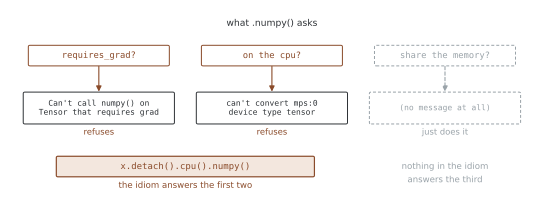
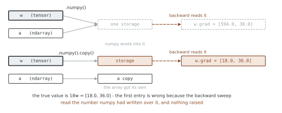

# NumPy로 변환하기

<div class="leadbox" markdown>

**들어가는 이야기** — 터져 주는 쪽이 친절한 쪽이다

텐서를 넘파이 배열로 꺼내려 하면 파이토치가 두 번 거절한다. 그리고 두 번 다
**고치는 방법을 메시지에 함께 적어 준다.** 그대로 붙여 쓰다 보니
`.detach().cpu().numpy()`라는 관용구가 생겼고, 이제는 왜 붙이는지 모른 채 쓰는
사람이 많다.

거절은 성가시지만 고마운 일이다. 그 자리에서 알려 주기 때문이다.

이 쪽에서 볼 것은 **거절하지 않는 셋째**다. 꺼낸 배열과 원래 텐서가 같은
메모리를 쓰는데, 아무도 그 말을 해 주지 않는다. 배열 쪽에서 수 하나를 고치고
나서 미분을 구하면 **오류 없이 틀린 값**이 나온다 — 참값이 18일 자리에 594가
적힌다.

파이토치에는 이런 **제자리 연산(in-place)**을 잡아내는 **버전 카운터**가 있는데 —
텐서가 제자리에서 고쳐질 때마다 1씩 느는 수다 — 여기서는 못 잡는다. 넘겨준 순간 그 감시의 바깥으로 나갔기 때문이다.

</div>

`.numpy()`는 세 가지를 한꺼번에 묻는다.

| 묻는 것 | 어긋나면 |
|---|---|
| 그래프에 매여 있는가 (`requires_grad`) | **거절한다** |
| CPU에 있는가 | **거절한다** |
| 메모리를 나눠 쓸 것인가 | 거절하지 않는다. **그냥 나눠 쓴다** |

앞의 둘은 터져 주니 메시지대로 고치면 끝이다. **셋째는 조용하다.** 이 쪽에서 볼
것이 그것이다.

## 1. 코드

```python
"""텐서를 NumPy 로 넘기기 — 거절당하는 두 자리와 공유되는 메모리.

`.numpy()` 는 세 가지를 한꺼번에 묻는다.

- **그래프에 매여 있는가** — `requires_grad=True` 면 거절한다
- **어느 장치에 있는가** — CPU 가 아니면 거절한다
- **메모리를 나눠 쓸 것인가** — 거절하지 않는다. 그냥 나눠 쓴다

앞의 둘은 터져 주니 고치면 끝이다. 셋째가 조용하다.

실행: 이 쪽의 코드를 파일로 갈무리해 돌린다
"""
# NumPy 는 파이썬에서 수의 배열을 다루는 표준 라이브러리다. 그림을 그리거나
# 파일로 갈무리하는 도구들이 NumPy 배열을 받는다. 관례대로 np 로 줄여 부른다.
import numpy as np
# 파이토치를 불러온다. 텐서를 만들고 미분하는 일이 다 여기서 온다.
import torch


def header(title):
    # 절 제목을 한 줄 찍는다. \n 은 줄바꿈이고, f"...{title}..." 은 문자열 안에
    # 변수의 값을 끼워 넣는 파이썬 문법(f-문자열)이다.
    print(f"\n=== {title} ===")


# ========================================================================
# 1. 거절당하는 두 자리
# ========================================================================

def refusals():
    header("1. 거절")
    # 난수의 시드를 고정한다. 아래에서 뽑는 텐서가 돌릴 때마다 같은 값이 된다.
    torch.manual_seed(0)
    # --- (가) 경사 추적 중인 텐서 ---
    # torch.randn(3) 은 표준정규분포에서 뽑은 실수 3개짜리 텐서다. 형태 (3,).
    # requires_grad=True 는 「이 텐서가 들어간 계산을 기록하라」는 표시다. 이것을
    # 경사 추적이라 하고, 그 기록이 이어진 것이 계산 그래프다.
    g = torch.randn(3, requires_grad=True)
    # try: 안의 줄이 오류를 내면 프로그램이 죽는 대신 except: 로 넘어간다. 일부러
    # 오류를 내 보고 그 메시지를 찍으려는 것이다.
    try:
        # .numpy() 는 텐서를 NumPy 배열로 바꾼다. NumPy 는 계산 그래프를 모르므로,
        # 경사 추적 중인 텐서는 넘겨주지 않고 RuntimeError 를 낸다.
        g.numpy()
    except RuntimeError as e:
        # e 가 그 오류다. str(e) 로 메시지를 꺼내 splitlines()[0] 으로 첫 줄만 찍는다.
        print("  requires_grad=True :", str(e).splitlines()[0])

    # --- (나) CPU 가 아닌 장치에 있는 텐서 ---
    # 텐서는 CPU 의 메모리에 있을 수도, 가속기(GPU)의 메모리에 있을 수도 있다.
    # 이 기계에 쓸 수 있는 가속기를 찾는다 — "cuda" 는 엔비디아 GPU, "mps" 는
    # 애플 실리콘의 GPU 다. 둘 다 없으면 None 이다.
    dev = ("cuda" if torch.cuda.is_available()
           else "mps" if torch.backends.mps.is_available() else None)
    if dev:
        # device=dev 를 주면 텐서를 그 장치의 메모리에 만든다.
        m = torch.randn(3, device=dev)
        try:
            # NumPy 배열은 CPU 메모리에만 있을 수 있다. 그래서 TypeError 를 낸다.
            m.numpy()
        except TypeError as e:
            # :5s 는 장치 이름을 다섯 칸에 맞춰 찍는다.
            print(f"  device={dev:5s}      :", str(e).splitlines()[0])
        # .cpu() 는 텐서를 CPU 메모리로 복사해 온다. 그런 뒤에는 .numpy() 가 된다.
        # .shape 는 배열의 형태이고 (3,) 이 찍힌다.
        print("  .cpu().numpy() 로는 된다:", m.cpu().numpy().shape)
    else:
        print("  가속기가 없어 장치 쪽은 건너뛴다")
    print("  두 메시지 모두 고칠 방법을 함께 적어 준다")
    print("  그래서 x.detach().cpu().numpy() 세 토막이 관용구가 되었다")


# ========================================================================
# 2. 메모리는 조용히 공유된다
# ========================================================================

def sharing():
    header("2. 공유")
    # torch.tensor([...]) 는 적어 준 수를 담은 텐서를 직접 만든다. requires_grad 를
    # 안 줬으니 경사 추적이 꺼져 있고 CPU 에 있다 — .numpy() 가 바로 된다.
    t = torch.tensor([1.0, 2.0, 3.0])
    # a 는 t 를 복사한 것이 아니다. t 의 수가 놓인 메모리를 그대로 가리키는 배열이다.
    a = t.numpy()
    # tolist() 는 값을 파이썬 리스트로 꺼낸다.
    print("  t      :", t.tolist())
    # 배열 쪽의 0번 원소를 고친다. 같은 메모리이므로 t[0] 도 99 가 된다.
    a[0] = 99.0
    print("  a[0]=99 뒤 t:", t.tolist(), " <- 텐서가 바뀌었다")
    # 거꾸로 텐서 쪽을 고쳐도 배열에 보인다.
    t[1] = 77.0
    print("  t[1]=77 뒤 a:", a.tolist(), " <- 배열도 바뀐다")
    # np.shares_memory 는 두 배열이 메모리를 함께 쓰면 True 다.
    print("  np.shares_memory:", np.shares_memory(t.numpy(), a))

    # 난수의 시드를 고정한다. 아래에서 뽑는 텐서가 돌릴 때마다 같은 값이 된다.
    torch.manual_seed(0)
    # 경사 추적 중인 텐서는 detach() 로 계산 그래프에서 끊은 뒤에 넘긴다. detach()
    # 는 값을 복사하지 않고 같은 메모리를 가리키는 텐서를 주므로, 이렇게 얻은 배열도
    # 원래 텐서와 메모리를 함께 쓴다. 말로만 두지 않고 np.shares_memory 로 확인한다 —
    # g 를 한 번 더 detach 해 얻은 배열과 d 가 같은 메모리인지를 본다.
    g = torch.randn(3, requires_grad=True)
    d = g.detach().numpy()
    print("  detach().numpy() 도 공유한다 — detach 가 저장소를 안 끊으니까:",
          np.shares_memory(d, g.detach().numpy()))

    # NumPy 의 .copy() 는 배열을 새 메모리에 복사한다. 이제 safe 를 고쳐도 텐서는
    # 그대로다.
    safe = torch.tensor([1.0, 2.0, 3.0]).numpy().copy()
    print("  끊으려면 .copy() 나 텐서 쪽 .clone() 이 필요하다:", safe.tolist())


# ========================================================================
# 3. 거꾸로 — numpy 에서 텐서로
# ========================================================================

def back():
    header("3. 거꾸로")
    # np.array([...]) 는 NumPy 배열을 만든다. 실수를 적으면 자료형이 float64 다.
    # (파이토치는 torch.tensor([1.0, ...]) 를 float32 로 만든다.)
    arr = np.array([1.0, 2.0, 3.0])
    # 배열을 텐서로 바꾸는 길이 둘이다.
    #   torch.from_numpy(arr) — 메모리를 함께 쓴다(복사하지 않는다)
    #   torch.tensor(arr)     — 새 메모리에 복사한다
    shared = torch.from_numpy(arr)
    copied = torch.tensor(arr)
    # 원본 배열을 고친다. 함께 쓰는 shared 만 따라 바뀐다.
    arr[0] = 55.0
    print("  배열을 55 로 고친 뒤")
    # dtype 은 텐서에 든 수의 자료형이다. 두 길 모두 배열의 float64 를 물려받는다.
    print("    from_numpy  :", shared.tolist(), " dtype", shared.dtype)
    print("    torch.tensor:", copied.tolist(), " dtype", copied.dtype)
    print("  numpy 의 기본 실수형이 float64 라 dtype 도 따라온다")

    # 뉴럴 네트워크의 웨이트는 보통 float32 다. float64 텐서를 그대로 넣으면 자료형이
    # 안 맞아 오류가 나므로, 배열을 만들 때 dtype=np.float32 로 맞춰 둔다.
    f32 = torch.from_numpy(np.array([1.0, 2.0], dtype=np.float32))
    print("  np.float32 로 만들면:", f32.dtype)


# ========================================================================
# 4. 공유가 물어뜯는 자리
# ========================================================================

def the_bite():
    header("4. 공유가 물어뜯는 자리")
    # w = [1, 2] 를 경사 추적을 켜서 만든다. 손으로 따라가면
    #   y = 3w = [3, 6]
    #   loss = 3^2 + 6^2 = 45        (** 는 거듭제곱, sum() 은 모두 더하기)
    #   그래디언트 = 2 * y * 3 = 18w = [18, 36]
    # y^2 을 미분하면 2y 이므로 역전파는 y 의 값을 써야 한다. 그래서 계산 그래프가
    # y 를 저장해 둔다.
    w = torch.tensor([1.0, 2.0], requires_grad=True)
    y = w * 3                        # y = [3, 6]
    loss = (y ** 2).sum()            # loss = 45 — 역전파가 쓸 y 가 저장된다
    # y 는 경사 추적 중이라 detach() 를 거쳐야 numpy() 가 된다. 그렇게 얻은 arr 는
    # y 와 같은 메모리다.
    arr = y.detach().numpy()         # 역전파가 저장해 둔 값을 꺼냈다
    arr[0] = 99.0                    # 그것을 numpy 쪽에서 고친다
    # backward() 는 역전파다 — loss 에서 거꾸로 따라가며 미분해 w.grad 에 넣는다.
    # 오류가 날 수도 있어 try 로 감쌌다. 실제로는 오류 없이 통과한다 — 파이토치는
    # NumPy 쪽에서 고친 것을 알아채지 못한다.
    try:
        loss.backward()
        print("  numpy 로 고친 뒤 backward: 통과")
        # 저장된 y[0] 이 3 이 아니라 99 가 되었으므로 2 * 99 * 3 = 594 가 나온다. 틀린
        # 값이다. round(v, 1) 은 소수 첫째 자리까지 반올림한다.
        print("    w.grad =", [round(v, 1) for v in w.grad.tolist()],
              " 참값 18w =", [18.0, 36.0])
    except RuntimeError as e:
        print("  numpy 로 고친 뒤 backward:", str(e).splitlines()[0][:62])

    # --- 같은 일을 .copy() 로 ---
    # 똑같이 만들되 배열을 복사해서 꺼낸다.
    w2 = torch.tensor([1.0, 2.0], requires_grad=True)
    y2 = w2 * 3                          # y2 = [3, 6]
    loss2 = (y2 ** 2).sum()              # loss2 = 45
    arr2 = y2.detach().numpy().copy()    # 베껴서 꺼낸다
    arr2[0] = 99.0
    # arr2 는 따로 떨어진 복사본이라 y2 는 [3, 6] 그대로다. 참값 [18, 36] 이 나온다.
    loss2.backward()
    print("  .copy() 로 꺼낸 뒤 backward: w.grad =",
          [round(v, 1) for v in w2.grad.tolist()])
    print("  넘겨준 배열을 고칠 작정이면 반드시 베껴야 한다")


def main():
    # 네 절을 차례로 돌린다.
    refusals()
    sharing()
    back()
    the_bite()


# 이 파일을 직접 돌렸을 때만 main() 을 부른다. 다른 파일이 import 로 불러올 때는
# 돌지 않게 하는 파이썬의 관용구다.
if __name__ == "__main__":
    main()
```

**출력:**

```
=== 1. 거절 ===
  requires_grad=True : Can't call numpy() on Tensor that requires grad. Use tensor.detach().numpy() instead.
  device=mps        : can't convert mps:0 device type tensor to numpy. Use Tensor.cpu() to copy the tensor to host memory first.
  .cpu().numpy() 로는 된다: (3,)
  두 메시지 모두 고칠 방법을 함께 적어 준다
  그래서 x.detach().cpu().numpy() 세 토막이 관용구가 되었다

=== 2. 공유 ===
  t      : [1.0, 2.0, 3.0]
  a[0]=99 뒤 t: [99.0, 2.0, 3.0]  <- 텐서가 바뀌었다
  t[1]=77 뒤 a: [99.0, 77.0, 3.0]  <- 배열도 바뀐다
  np.shares_memory: True
  detach().numpy() 도 공유한다 — detach 가 저장소를 안 끊으니까: True
  끊으려면 .copy() 나 텐서 쪽 .clone() 이 필요하다: [1.0, 2.0, 3.0]

=== 3. 거꾸로 ===
  배열을 55 로 고친 뒤
    from_numpy  : [55.0, 2.0, 3.0]  dtype torch.float64
    torch.tensor: [1.0, 2.0, 3.0]  dtype torch.float64
  numpy 의 기본 실수형이 float64 라 dtype 도 따라온다
  np.float32 로 만들면: torch.float32

=== 4. 공유가 물어뜯는 자리 ===
  numpy 로 고친 뒤 backward: 통과
    w.grad = [594.0, 36.0]  참값 18w = [18.0, 36.0]
  .copy() 로 꺼낸 뒤 backward: w.grad = [18.0, 36.0]
  넘겨준 배열을 고칠 작정이면 반드시 베껴야 한다
```

## 2. 거절하는 두 자리

```
requires_grad=True : Can't call numpy() on Tensor that requires grad.
                     Use tensor.detach().numpy() instead.
device=mps         : can't convert mps:0 device type tensor to numpy.
                     Use Tensor.cpu() to copy the tensor to host memory first.
```



두 메시지 모두 **고칠 방법을 함께 적어 준다.** 그래서 흔히 보는 세 토막

```python
# 왼쪽부터 차례로 걸린다.
#   .detach() — 계산 그래프에서 끊는다 (경사 추적 중이어도 넘길 수 있게)
#   .cpu()    — CPU 메모리로 가져온다 (이미 CPU 에 있으면 아무 일도 안 한다)
#   .numpy()  — NumPy 배열로 바꾼다
x.detach().cpu().numpy()
```

은 외울 주문이 아니라 **두 거절을 차례로 치우는 것**이다. `detach()`가 첫째를,
`cpu()`가 둘째를 치운다. CPU 텐서라면 `.cpu()`는 같은 객체를 돌려주므로 공짜고,
그래서 넣어 두어도 손해가 없다.

## 3. 메모리는 조용히 공유된다

```
t      : [1.0, 2.0, 3.0]
a[0]=99 뒤 t: [99.0, 2.0, 3.0]    <- 텐서가 바뀌었다
t[1]=77 뒤 a: [99.0, 77.0, 3.0]   <- 배열도 바뀐다
```

**양방향으로 공유한다.** `.numpy()`는 데이터를 베끼지 않고 같은 메모리에 numpy
배열 헤더만 씌운다.

`detach()`를 거쳐도 마찬가지다. 「데이터 관련 속성」에서 본 대로 `detach()`는
**그래프만 끊고 저장소는 그대로** 두기 때문이다. 그러니
`x.detach().cpu().numpy()`로 받은 배열도 원본과 한 몸이다.

끊으려면 어딘가에서 베껴야 한다 — numpy 쪽 `.copy()`나 텐서 쪽 `.clone()`.

## 4. 공유가 물어뜯는 자리

```python
# w 는 requires_grad=True 로 만든 텐서다.  y = 3w,  loss = sum(y^2)
y = w * 3
loss = (y ** 2).sum()        # 역전파가 y 를 저장해 둔다
arr = y.detach().numpy()     # 그 y 를 numpy 로 꺼낸다
arr[0] = 99.0                # numpy 쪽에서 고친다
# 역전파는 고쳐진 y 로 계산한다. 오류는 나지 않고 틀린 그래디언트가 나온다.
loss.backward()
```

```
numpy 로 고친 뒤 backward: 통과
  w.grad = [594.0, 36.0]   참값 18w = [18.0, 36.0]
```

**터지지 않고 틀린 그래디언트가 나온다.** 참값은 $18w = [18, 36]$인데 594다 —
$2 \times 99 \times 3$, 곧 99로 고쳐진 값으로 계산한 것이다.



「데이터 관련 속성」의 버전 카운터가 왜 못 잡는가. numpy 쪽에서 쓰는 것은
파이토치가 보지 못하는 길이기 때문이다. **텐서를 넘겨준 순간 파이토치의 안전
장치 바깥으로 나간 것**이고, 그 뒤에 일어나는 일은 아무도 지켜보지 않는다.

`.copy()`로 꺼내면 참값이 나온다.

```
.copy() 로 꺼낸 뒤 backward: w.grad = [18.0, 36.0]
```

규칙은 짧다. **넘겨준 배열을 고칠 작정이면 반드시 베낀다.** 읽기만 할 것이라면
공유가 공짜이므로 그대로 두는 편이 낫다.

## 5. 거꾸로

```
배열을 55 로 고친 뒤
  from_numpy  : [55.0, 2.0, 3.0]   dtype torch.float64
  torch.tensor: [1.0, 2.0, 3.0]    dtype torch.float64
```

`from_numpy`는 공유하고 `torch.tensor`는 베낀다. 그리고 **둘 다 `float64`**가
된다 — numpy의 기본 실수형이 그렇기 때문이다.

「데이터 관련 속성」에서 본 그 함정이다. 그대로 모델에 넣으면
`mat1 and mat2 must have the same dtype, but got Double and Float`로 끝난다.
`np.float32`로 만들거나 `.float()`를 붙여야 한다.

## 연습문제

<div class="drillbox" markdown>

**연습문제 1.** <span class="diff easy" title="쉬움"></span>
파이토치의 자료형이 numpy에 모두 있는가? `float32`·`float64`·`int64`·`bool`·
`bfloat16`을 넘겨 보라.

</div>

??? success "풀이"
    ```python
    # 본문 코드에 이어서 돌린다 — numpy(np), torch 를 이미 불러온 상태다.
    # 자료형(dtype)을 바꿔 가며 텐서를 만들어 .numpy() 가 되는지 본다.
    # torch.ones(3) 은 1 세 개짜리 텐서이고 dtype= 으로 자료형을 정한다. 안 주면
    # float32 다. bfloat16 은 16비트 실수의 한 가지다.
    # lambda: ... 는 이름 없는 작은 함수다. 텐서를 「만드는 방법」을 담아 두었다가
    # 아래에서 maker() 로 불러 그때 만든다.
    for name, maker in (("torch.float32", lambda: torch.ones(3)),
                        ("torch.float64", lambda: torch.ones(3, dtype=torch.float64)),
                        ("torch.int64  ", lambda: torch.ones(3, dtype=torch.int64)),
                        ("torch.bool   ", lambda: torch.ones(3, dtype=torch.bool)),
                        ("torch.bfloat16", lambda: torch.ones(3, dtype=torch.bfloat16))):
        t = maker()
        try:
            # .dtype 은 바뀐 NumPy 배열의 자료형이다.
            print(f"  {name} -> numpy dtype {t.numpy().dtype}")
        except TypeError as e:
            # NumPy 에 없는 자료형이면 TypeError 가 난다. 메시지 첫 줄의 56글자만 찍는다.
            print(f"  {name} -> {str(e).splitlines()[0][:56]}")
    ```

    ```
      torch.float32 -> numpy dtype float32
      torch.float64 -> numpy dtype float64
      torch.int64   -> numpy dtype int64
      torch.bool    -> numpy dtype bool
      torch.bfloat16 -> Got unsupported ScalarType BFloat16
    ```

    넷은 그대로 넘어가고 **`bfloat16`만 막힌다.** numpy에 그 자료형이 없기
    때문이다.

    「혼합 정밀도」에서 본 `bfloat16`은 딥러닝을 위해 만들어진 형식이라 일반
    수치 계산 라이브러리에는 들어가 있지 않다. 그래서 트레인 중간값을 그림으로
    그리거나 저장하려면 `.float()`으로 올려서 넘겨야 한다.

    `.float()`을 거치면 메모리가 두 배가 되고 공유도 깨진다 — 자료형을 바꾸는
    일은 언제나 베끼는 일이다.

---

<div class="drillbox" markdown>

**연습문제 2.** <span class="diff med" title="중간"></span>
비연속 텐서도 `.numpy()`가 되는가? 전치·건너뛰기·자르기를 넘겨 보고, numpy 쪽
`strides`를 보라.

</div>

??? success "풀이"
    ```python
    # 본문 코드에 이어서 돌린다 — numpy(np), torch 를 이미 불러온 상태다.
    # torch.arange(12) 는 0 부터 11 까지의 정수 12개다. reshape(3, 4) 로 3행 4열,
    # 형태 (3, 4) 로 바꾼다. 정수(int64)라 수 하나가 8바이트다.
    t = torch.arange(12).reshape(3, 4)
    # t 를 네 가지로 본다. 모두 t 의 메모리를 다른 차례로 읽는 것일 뿐 복사가 아니다.
    #   t.t()      — 행과 열을 맞바꾼다(전치). 형태 (4, 3)
    #   t[::2]     — 행을 하나 걸러 고른다(0행, 2행). 형태 (2, 4)
    #   t[:, 1:3]  — 모든 행에서 1열과 2열만 고른다. 형태 (3, 2)
    for name, v in (("t", t), ("t.t()", t.t()),
                    ("t[::2]", t[::2]), ("t[:, 1:3]", t[:, 1:3])):
        a = v.numpy()
        # a.strides 는 「다음 행, 다음 열로 가려면 메모리에서 몇 바이트를 건너뛰는가」다.
        # t 는 (32, 8) — 다음 행은 4칸 × 8바이트 = 32, 다음 열은 8 이다.
        # :10s 는 이름을 열 칸에 맞춰 찍는다.
        print(f"  {name:10s} -> numpy 형태 {a.shape}  strides {a.strides}  "
              f"공유 {np.shares_memory(a, t.numpy())}")
    ```

    ```
      t          -> numpy 형태 (3, 4)  strides (32, 8)  공유 True
      t.t()      -> numpy 형태 (4, 3)  strides (8, 32)  공유 True
      t[::2]     -> numpy 형태 (2, 4)  strides (64, 8)  공유 True
      t[:, 1:3]  -> numpy 형태 (3, 2)  strides (32, 8)  공유 True
    ```

    **넷 다 되고 넷 다 공유한다.** 비연속이어도 막지 않는다.

    까닭은 numpy도 **스트라이드(stride) 모델을 쓰기 때문**이다. 「메모리 배치와 스트라이드」에서
    본 그 모델이 두 라이브러리에 공통이라, 스트라이드만 그대로 넘겨주면 된다.
    `t.t()`의 numpy strides가 `(8, 32)`로 뒤집혀 있는 것이 그 증거다.

    바이트 단위라는 점만 다르다. 파이토치의 `t.stride()`는 **원소 수**로
    `(4, 1)`이고, numpy의 `strides`는 **바이트 수**로 `(32, 8)`이다 —
    int64라 원소당 8바이트이므로 여덟 배다.

    공유되는 범위도 그대로다. `t[::2]`를 고치면 원본의 그 행들이 바뀐다.

---

<div class="drillbox" markdown>

**연습문제 3.** <span class="diff hard" title="어려움"></span>
공유가 공짜라면 **얼마나** 공짜인가? 천만 개짜리 텐서로 `.numpy()`와 베끼는
방법들을 재어라.

</div>

??? success "풀이"
    ```python
    # 본문 코드에 이어서 돌린다 — numpy(np), torch 를 이미 불러온 상태다.
    import time     # 시간을 재는 파이썬 표준 모듈

    def spread(fn, rep=7):
        # fn 을 rep 번 돌려 가장 빠른 시간과 가장 느린 시간을 밀리초로 돌려준다.
        # 한 번만 재면 우연에 흔들리므로 일곱 번 재어 폭을 본다.
        ts = []
        for _ in range(rep):
            # perf_counter() 는 지금 시각(초)이다. fn 을 돌리기 전과 뒤의 차이가 걸린 시간이다.
            t0 = time.perf_counter(); fn(); ts.append(time.perf_counter() - t0)
        return min(ts) * 1e3, max(ts) * 1e3     # 초 → 밀리초 (1e3 은 1000)

    # 난수의 시드를 고정한다. 아래에서 뽑는 텐서가 돌릴 때마다 같은 값이 된다.
    torch.manual_seed(0)
    # 실수 천만 개짜리 텐서다(10 ** 7 = 10,000,000). float32 라 40 MB 쯤이다.
    t = torch.randn(10 ** 7)
    # 네 가지 길을 견준다. 첫째만 메모리를 함께 쓰고 나머지 셋은 복사한다.
    #   t.numpy().copy()  — 배열로 바꾼 뒤 NumPy 가 복사한다
    #   t.clone().numpy() — 파이토치가 먼저 복사(clone)하고 배열로 바꾼다
    #   np.array(t)       — NumPy 가 텐서를 받아 새 배열을 만든다
    for name, fn in (("t.numpy()", lambda: t.numpy()),
                     ("t.numpy().copy()", lambda: t.numpy().copy()),
                     ("t.clone().numpy()", lambda: t.clone().numpy()),
                     ("np.array(t)", lambda: np.array(t))):
        lo, hi = spread(fn)
        # :20s 는 이름을 스무 칸에, :8.3f 는 수를 여덟 칸에 소수점 아래 세 자리로 찍는다.
        print(f"  {name:20s} {lo:8.3f} ~ {hi:8.3f} ms")
    ```

    ```
      t.numpy()               0.001 ~    0.016 ms
      t.numpy().copy()        1.983 ~    2.709 ms
      t.clone().numpy()       1.368 ~    2.479 ms
      np.array(t)             1.816 ~    4.351 ms
    ```

    **천 배 넘게 차이 난다.** `.numpy()`는 1마이크로초, 베끼는 것들은 2밀리초쯤.

    `.numpy()`가 하는 일은 **스트라이드와 포인터를 적은 헤더 하나를 만드는 것**뿐이라
    크기와 무관하다. 천만 개든 한 개든 같다.

    베끼는 셋은 4천만 바이트를 실제로 옮기므로 크기에 비례한다. 셋 사이의
    차이는 의미 있게 말하기 어렵다 — 범위가 겹친다.

    그러니 고르는 기준은 속도가 아니라 **뒤에 고칠 것인가**다.

    | | 쓸 자리 |
    |---|---|
    | `.numpy()` | 읽기만 한다 (시각화, 지표 계산) |
    | `.numpy().copy()` | 그 배열을 고칠 작정이다 |

    그림을 그리거나 평균을 내는 데 `.copy()`를 붙이는 것은 공짜인 일에 2밀리초를
    치르는 것이다. 매 배치마다 하면 쌓인다.
