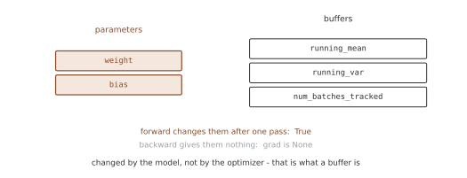
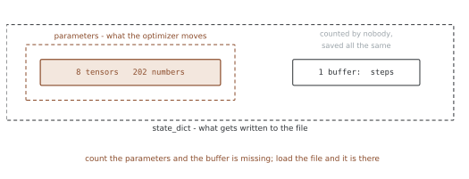

# 레이어 출력하기

<div class="leadbox" markdown>

**들어가는 이야기** — 세어 본 수와 파일 크기가 안 맞을 때

모델이 얼마나 큰지 말할 때 사람들은 **수의 개수**를 센다. 「파라메터 7억 개」
같은 식이다. 세는 법도 한 줄이고, 파이토치가 그 한 줄을 위한 길을 열어 두었다.

그런데 그렇게 센 수와 저장한 파일의 크기를 견주면 **딱 맞지 않는** 때가 있다.
파일 쪽이 더 크다. 어딘가에 세어지지 않은 것이 들어 있다는 뜻이다.

그 정체는 **트레인되지는 않는데 모델이 스스로 고치는 수**다. 파이토치는 이것을 **버퍼**(buffer)라 부른다. 옵티마이저는 손도
안 대고, 미분도 받지 않는다. 그런데 순전파를 할 때마다 조용히 갱신되고,
저장할 때 같이 따라간다. 복원할 때 이것이 빠지면 모델이 다르게 동작한다.

널리 쓰이는 레이어인 배치 정규화 하나가 그런 수를 셋이나 들고 있다.

</div>

`print(model)` 한 줄이 꽤 많은 것을 보여 준다. 그런데 **거기 안 나오는 것**이
있고, 모델을 고치거나 저장할 때 걸리는 것은 대개 그쪽이다.

| | 무엇인가 | 트레인되는가 | 저장되는가 |
|---|---|---|---|
| 파라메터 | `nn.Parameter` | **예** | 예 |
| 버퍼 | `register_buffer` 로 등록한 텐서 | 아니오 | **예** |

마지막 열이 잊히는 자리다. 파라메터 수를 세면 버퍼는 빠지는데, **저장 파일에는
들어간다.** 배치 정규화의 `running_mean`이 거기 있다.

## 1. 코드

```python
"""모델 속 들여다보기 — 무엇이 세어지고 무엇이 저장되는가.

`print(model)` 한 줄이 꽤 많은 것을 보여 주지만, 거기 안 나오는 것이
있다. 모델을 고치거나 저장할 때 알아야 하는 것은 셋이다.

- **모듈 트리** — `named_children()` 은 바로 아래만, `named_modules()`
  는 전부
- **파라메터** — 트레인되는 텐서. `parameters()` 가 준다
- **버퍼** — 트레인되지는 않는데 **저장은 되는** 텐서. 배치 정규화의
  `running_mean` 이 여기 있다

세 번째가 자주 잊힌다. 파라메터 수를 세면 버퍼는 빠지는데, 저장
파일에는 들어간다.

실행: 이 쪽의 코드를 파일로 갈무리해 돌린다
"""
# torch 는 파이토치 본체다. 텐서를 만드는 일이 여기서 온다.
import torch
# torch.nn 은 레이어와, 모델을 짜는 틀(nn.Module)을 모아 둔 곳이다. 이름이 길어
# nn 으로 줄여 부른다.
import torch.nn as nn


def header(title):
    # 절 제목을 한 줄 찍는다. \n 은 줄바꿈이고, f"...{title}..." 은 문자열 안에
    # 변수의 값을 끼워 넣는 파이썬 문법(f-문자열)이다.
    print(f"\n=== {title} ===")


# 들여다볼 모델을 먼저 만든다. 작은 부품 Block 을 만들고, 그것을 Net 에 넣는다.
#
# 파이토치에서 모델과 레이어는 모두 nn.Module 을 물려받은 클래스다. 이것을
# 모듈이라 한다. class Block(nn.Module): 이 「Block 은 모듈이다」라는 선언이고,
# 채울 것은 둘이다.
#   __init__ — 이 모듈이 가진 레이어를 만들어 self.이름 에 넣어 둔다
#   forward  — 입력 x 가 그 레이어들을 어떤 차례로 지나는지(순전파)를 적는다
class Block(nn.Module):
    def __init__(self, d):
        # nn.Module 쪽의 준비를 먼저 시킨다. 이 줄이 있어야 아래에서 self.이름 에 넣는
        # 레이어를 파이토치가 「이 모듈의 자식」으로 적어 둔다. 늘 첫 줄에 온다.
        super().__init__()
        # nn.Linear(d, d) 는 입력 d 개를 받아 출력 d 개를 내는 레이어다. 웨이트(형태
        # (d, d))와 바이어스(형태 (d,))라는 파라메터를 가진다. 파라메터는 트레인으로
        # 고칠 값이다. self.fc 라는 이름이 뒤에 나올 「blocks.0.fc」의 fc 가 된다.
        self.fc = nn.Linear(d, d)
        # nn.ReLU() 는 음수를 0 으로 바꾸는 함수다. 파라메터가 없다.
        self.act = nn.ReLU()

    def forward(self, x):
        # x 를 fc 에 넣고, 그 결과를 act 에 넣는다. 형태는 (배치, d) 그대로다.
        return self.act(self.fc(x))


# 전체 모델. 모듈 안에 모듈을 넣을 수 있다 — Net 이 Block 둘을 품는다.
class Net(nn.Module):
    def __init__(self):
        super().__init__()
        # 입력 4개 → 8개. 웨이트 (8, 4), 바이어스 (8,).
        self.stem = nn.Linear(4, 8)
        # nn.Sequential 은 모듈을 차례로 이어 하나로 만든다. 안에 든 것에는 이름 대신
        # 번호 0, 1 이 붙는다. Block(8) 은 위의 __init__ 을 d = 8 로 부른다.
        self.blocks = nn.Sequential(Block(8), Block(8))
        # 8개 → 출력 2개. 웨이트 (2, 8), 바이어스 (2,).
        self.head = nn.Linear(8, 2)
        # 버퍼를 하나 단다. 버퍼는 파라메터처럼 모델에 딸려 저장되지만 트레인되지는
        # 않는 텐서다. register_buffer(이름, 텐서) 로 달고, 그 뒤로 self.steps 로 읽는다.
        # torch.zeros(1) 은 0 하나짜리 텐서(형태 (1,))다. 여기서는 버퍼가 어떻게 보이는지
        # 보려고 달아 둔 것이고 forward 에서는 쓰지 않는다.
        self.register_buffer("steps", torch.zeros(1))

    def forward(self, x):
        # stem → blocks → head 차례로 지난다. 형태는 (배치, 4) → (배치, 8) → (배치, 8)
        # → (배치, 2) 다.
        return self.head(self.blocks(self.stem(x)))


# ========================================================================
# 1. print(model)
# ========================================================================

def show_repr(net):
    header("1. print(model)")
    # 모듈을 print 하면 그 안의 모듈 트리가 찍힌다. 괄호 안이 __init__ 에서 붙인
    # 이름(stem, blocks, head)이고 그 옆이 레이어의 종류와 설정이다.
    print(net)
    print("  들여쓰기가 중첩을 보여 준다")
    print("  그런데 파라메터 수도, 출력 형태도, 버퍼도 안 나온다")


# ========================================================================
# 2. 바로 아래만 vs 전부
# ========================================================================

def tree(net):
    header("2. children 과 modules")
    # named_children() 은 바로 아래 자식 모듈을 (이름, 모듈) 짝으로 내준다. 이름만
    # 모은다 — for n, _ 의 _ 는 안 쓰는 값이라는 표시다.
    print("  named_children (바로 아래만):",
          [n for n, _ in net.named_children()])
    # modules() 는 자기 자신부터 맨 아래까지 모든 모듈을 내준다. list 로 모아
    # len 으로 센다 — Net 1 + stem 1 + Sequential 1 + Block 2 × (자신, fc, act) 3
    # + head 1 = 10.
    print(f"  named_modules  (전부 {len(list(net.modules()))}개):")
    # named_modules() 는 같은 것을 (이름, 모듈) 짝으로 준다. 이름은 부모에서 내려온
    # 길을 점으로 이은 것이다 — "blocks.0.fc". 맨 위(Net 자신)의 이름은 빈 문자열이다.
    for name, m in net.named_modules():
        # 이름에 든 점의 수로 깊이를 잰다. 맨 위는 0, "stem" 은 1, "blocks.0.fc" 는 3.
        depth = name.count(".") + (0 if name == "" else 1)
        # '  ' * depth 는 공백 두 칸을 depth 번 되풀이한 문자열이다 — 깊이만큼 들여 쓴다.
        # name or '(root)' 는 이름이 빈 문자열이면 '(root)' 를 대신 쓴다. :20s 는 스무
        # 칸에 맞춰 찍는다. type(m).__name__ 은 모듈의 클래스 이름이다.
        print(f"    {'  ' * depth}{name or '(root)':20s} {type(m).__name__}")
    print("  modules() 는 자기 자신도 센다 — 그래서 하나 더 많다")
    print("  이름이 점으로 이어진 형태가 그대로 state_dict 의 키가 된다")


# ========================================================================
# 3. 파라메터와 버퍼
# ========================================================================

def params_and_buffers(net):
    header("3. 파라메터와 버퍼")
    # named_parameters() 는 모델의 모든 파라메터를 (이름, 텐서) 짝으로 내준다.
    # 이름은 「모듈의 길.weight」, 「모듈의 길.bias」 다.
    for name, p in net.named_parameters():
        # p.shape 는 텐서의 형태다. tuple 로 바꾸고 str 로 문자열로 만들어 열 칸에 맞춘다.
        # requires_grad 는 「이 텐서로 미분할 것」이라는 표시다(경사 추적). 파라메터는
        # 트레인할 값이므로 모두 True 로 만들어진다.
        print(f"  param  {name:22s} {str(tuple(p.shape)):10s} "
              f"requires_grad={p.requires_grad}")
    # named_buffers() 는 버퍼를 같은 식으로 내준다. 버퍼는 requires_grad 가 False 다.
    for name, b in net.named_buffers():
        print(f"  buffer {name:22s} {str(tuple(b.shape)):10s} "
              f"requires_grad={b.requires_grad}")
    # p.numel() 은 텐서 p 에 든 수의 개수다. 모든 파라메터에 대해 더한다.
    #   40 (stem) + 72 + 72 (Block 둘) + 18 (head) = 202
    print("  파라메터 수:", sum(p.numel() for p in net.parameters()))
    # 버퍼는 parameters() 에 안 들어 있으므로 따로 센다. steps 하나, 수 1개다.
    print("  버퍼  수   :", sum(b.numel() for b in net.buffers()),
          "<- 위 합에 안 들어간다")
    print("  state_dict 키:")
    # state_dict() 는 모델을 파일로 저장할 때 쓰는 사전이다 — {이름: 텐서}.
    # 파라메터와 버퍼가 함께 들어 있다. 사전을 for 로 돌면 키(이름)가 나온다.
    for k in net.state_dict():
        print("   ", k)
    print("  버퍼가 맨 앞에 끼어 있다. 저장은 되고 트레인은 안 된다")


# ========================================================================
# 4. 실제로 버퍼가 쓰이는 자리
# ========================================================================

def real_buffer():
    header("4. 배치 정규화의 버퍼")
    # nn.BatchNorm1d(4) 는 피처 4개짜리 배치 정규화 레이어다. 배치 안에서 피처마다
    # 평균을 빼고 표준편차로 나눈다. 버퍼를 실제로 쓰는 대표적인 레이어다.
    bn = nn.BatchNorm1d(4)
    # 파라메터는 weight 와 bias 둘이고(트레인된다), 버퍼는 셋이다. running_mean 과
    # running_var 는 지금까지 본 배치들의 평균과 분산을 조금씩 섞어 쌓아 둔 값이다.
    print("  파라메터:", [n for n, _ in bn.named_parameters()])
    print("  버퍼    :", [n for n, _ in bn.named_buffers()])
    # 순전파 뒤와 견주려고 지금 값을 clone() 으로 복사해 둔다. 처음에는 0 넷이다.
    before = bn.running_mean.clone()
    # 트레인 모드로 둔다. 배치 정규화는 이 모드에서 배치를 볼 때마다 running_mean 을
    # 고친다.
    bn.train()
    # 입력 8개 × 피처 4개(형태 (8, 4))를 한 번 넣는다. 출력은 쓰지 않는다 — 버퍼가
    # 바뀌는지만 보려는 것이다. backward() 도 옵티마이저도 없다.
    bn(torch.randn(8, 4))
    # torch.equal 은 두 텐서의 값이 모두 같으면 True 다. not 을 붙여 「바뀌었나」로 읽는다.
    print("  순전파 한 번 뒤 running_mean 이 바뀌었나:",
          not torch.equal(before, bn.running_mean))
    # grad_fn 은 「이 텐서를 만든 연산」의 기록이고 역전파가 이것을 따라간다.
    # 버퍼에는 그 기록이 없고(None) 경사 추적도 꺼져 있다.
    print("  그래디언트는 없다:", bn.running_mean.grad_fn, bn.running_mean.requires_grad)
    print("  트레인되지 않는데 순전파가 고친다 — 그래서 버퍼다")

    # 쌓는 것과 쓰는 것이 두 모드로 갈린다
    # 난수 발생기의 시드를 0 으로 고정한다. 아래에서 출력의 평균을 수로 찍으므로,
    # 고정해 두어야 돌릴 때마다 같은 수가 나온다.
    torch.manual_seed(0)
    bn2 = nn.BatchNorm1d(3)
    # randn 은 평균 0, 표준편차 1 인 수를 뽑는다. 5 를 곱하고 10 을 더하면 평균 10,
    # 표준편차 5 쯤이 된다. 형태 (8, 3).
    x = torch.randn(8, 3) * 5 + 10          # 평균이 10 언저리인 입력
    # 같은 입력을 트레인 모드로 한 번, 평가 모드로 한 번 넣는다.
    for mode in ("train", "eval"):
        # getattr(bn2, "train") 은 bn2.train 과 같다. 뒤에 () 를 붙여 부른다. 곧
        # bn2.train() 과 bn2.eval() 을 차례로 부르는 것이다.
        getattr(bn2, mode)()
        # 순전파 앞의 running_mean 을 떠 둔다.
        was = bn2.running_mean.clone()
        out = bn2(x)
        # out.mean(0) 은 배치 방향(0번 축)으로 평균을 내 피처마다 수 하나를 준다. 형태 (3,).
        # tolist() 로 리스트로 꺼내 소수 셋째 자리까지 반올림한다.
        #
        # train() 에서는 「이 배치」의 평균으로 빼므로 출력 평균이 0 이 된다. 그러면서
        # running_mean 을 고친다. eval() 에서는 「쌓아 둔」 running_mean 으로 뺀다. 한 번
        # 쌓은 값은 아직 0 에서 조금 움직였을 뿐이라, 평균 10 짜리 입력을 0 으로 못
        # 끌어온다.
        print(f"  {mode+'()':8s} running_mean 바뀌나 "
              f"{not torch.equal(was, bn2.running_mean)!s:5s}"
              f"  출력 평균 {[round(v, 3) for v in out.mean(0).tolist()]}")
    print("  train 은 쌓기만 하고 안 쓰며, eval 은 쓰기만 하고 안 쌓는다")
    print("  뒤집는 것은 train/eval 뿐이다 — no_grad 로 감싸도 안 바뀐다")


# ========================================================================
# 5. 쓸모 있는 요약 한 줄
# ========================================================================

def summary(net):
    header("5. 레이어마다 수를 세어 본다")
    # 표의 머리 줄이다. :24s, :12s 는 그 칸 수에 맞춰 왼쪽으로, :>10s 는 열 칸에
    # 맞춰 오른쪽으로 붙여 찍는다.
    print(f"  {'이름':24s} {'종류':12s} {'파라메터':>10s}")
    total = 0
    # 모든 모듈을 돌며 「그 모듈이 직접 가진」 파라메터 수를 센다.
    for name, m in net.named_modules():
        # parameters(recurse=False) 는 자식 모듈의 것은 빼고 이 모듈에 직접 달린
        # 파라메터만 준다. Linear 는 제 웨이트와 바이어스를, Net · Sequential · Block 은
        # 0 을 얻는다 — 그것들의 파라메터는 모두 자식인 Linear 가 들고 있다.
        own = sum(p.numel() for p in m.parameters(recurse=False))
        # own 이 0 이 아니거나, 자식이 없는 맨 끝 모듈이면 한 줄 찍는다. 그래서 묶음일
        # 뿐인 Net · Sequential · Block 은 빠지고, 파라메터가 0 인 ReLU 는 찍힌다.
        if own or not list(m.children()):
            # :>10, 는 열 칸에 오른쪽으로 붙이고 세 자리마다 쉼표를 넣으라는 뜻이다.
            print(f"  {name or '(root)':24s} {type(m).__name__:12s} {own:>10,}")
            total += own
    print(f"  {'합':24s} {'':12s} {total:>10,}")
    print("  recurse=False 로 그 레이어가 '제 몫으로' 가진 것만 센다")
    print("  안 그러면 부모가 자식 것을 다시 세어 합이 부풀어 오른다")


def main():
    # 시드를 고정하고 모델을 하나 만들어 다섯 절에 차례로 넘긴다. Net() 이 위의
    # __init__ 을 부른다. real_buffer 만 제 레이어를 따로 만들어 쓴다.
    torch.manual_seed(0)
    net = Net()
    show_repr(net)
    tree(net)
    params_and_buffers(net)
    real_buffer()
    summary(net)


# 이 파일을 직접 돌렸을 때만 main() 을 부른다. 다른 파일이 import 로 불러올 때는
# 돌지 않게 하는 파이썬의 관용구다.
if __name__ == "__main__":
    main()
```

**출력:**

```
=== 1. print(model) ===
Net(
  (stem): Linear(in_features=4, out_features=8, bias=True)
  (blocks): Sequential(
    (0): Block(
      (fc): Linear(in_features=8, out_features=8, bias=True)
      (act): ReLU()
    )
    (1): Block(
      (fc): Linear(in_features=8, out_features=8, bias=True)
      (act): ReLU()
    )
  )
  (head): Linear(in_features=8, out_features=2, bias=True)
)
  들여쓰기가 중첩을 보여 준다
  그런데 파라메터 수도, 출력 형태도, 버퍼도 안 나온다

=== 2. children 과 modules ===
  named_children (바로 아래만): ['stem', 'blocks', 'head']
  named_modules  (전부 10개):
    (root)               Net
      stem                 Linear
      blocks               Sequential
        blocks.0             Block
          blocks.0.fc          Linear
          blocks.0.act         ReLU
        blocks.1             Block
          blocks.1.fc          Linear
          blocks.1.act         ReLU
      head                 Linear
  modules() 는 자기 자신도 센다 — 그래서 하나 더 많다
  이름이 점으로 이어진 형태가 그대로 state_dict 의 키가 된다

=== 3. 파라메터와 버퍼 ===
  param  stem.weight            (8, 4)     requires_grad=True
  param  stem.bias              (8,)       requires_grad=True
  param  blocks.0.fc.weight     (8, 8)     requires_grad=True
  param  blocks.0.fc.bias       (8,)       requires_grad=True
  param  blocks.1.fc.weight     (8, 8)     requires_grad=True
  param  blocks.1.fc.bias       (8,)       requires_grad=True
  param  head.weight            (2, 8)     requires_grad=True
  param  head.bias              (2,)       requires_grad=True
  buffer steps                  (1,)       requires_grad=False
  파라메터 수: 202
  버퍼  수   : 1 <- 위 합에 안 들어간다
  state_dict 키:
    steps
    stem.weight
    stem.bias
    blocks.0.fc.weight
    blocks.0.fc.bias
    blocks.1.fc.weight
    blocks.1.fc.bias
    head.weight
    head.bias
  버퍼가 맨 앞에 끼어 있다. 저장은 되고 트레인은 안 된다

=== 4. 배치 정규화의 버퍼 ===
  파라메터: ['weight', 'bias']
  버퍼    : ['running_mean', 'running_var', 'num_batches_tracked']
  순전파 한 번 뒤 running_mean 이 바뀌었나: True
  그래디언트는 없다: None False
  트레인되지 않는데 순전파가 고친다 — 그래서 버퍼다
  train()  running_mean 바뀌나 True   출력 평균 [-0.0, -0.0, 0.0]
  eval()   running_mean 바뀌나 False  출력 평균 [5.097, 4.115, 4.784]
  train 은 쌓기만 하고 안 쓰며, eval 은 쓰기만 하고 안 쌓는다
  뒤집는 것은 train/eval 뿐이다 — no_grad 로 감싸도 안 바뀐다

=== 5. 레이어마다 수를 세어 본다 ===
  이름                       종류                 파라메터
  stem                     Linear               40
  blocks.0.fc              Linear               72
  blocks.0.act             ReLU                  0
  blocks.1.fc              Linear               72
  blocks.1.act             ReLU                  0
  head                     Linear               18
  합                                            202
  recurse=False 로 그 레이어가 '제 몫으로' 가진 것만 센다
  안 그러면 부모가 자식 것을 다시 세어 합이 부풀어 오른다
```

## 2. `print(model)`이 보여 주는 것과 안 보여 주는 것

```
Net(
  (stem): Linear(in_features=4, out_features=8, bias=True)
  (blocks): Sequential(
    (0): Block(
      (fc): Linear(in_features=8, out_features=8, bias=True)
      (act): ReLU()
    )
    ...
```

들여쓰기가 중첩을 그대로 보여 주고, 각 레이어의 설정도 보인다. 모델을 처음 볼 때
가장 빠른 길이다.

안 나오는 것이 셋이다. **파라메터 수**, **출력 형태**, **버퍼**. 첫째는 따로
세어야 하고(5절), 둘째는 입력을 실제로 넣어 보아야 알며, 셋째는 아예 다른 목록에
있다(4절).

## 3. 바로 아래만 vs 전부

```
named_children (바로 아래만): ['stem', 'blocks', 'head']
named_modules  (전부 10개):
  (root)               Net
    stem               Linear
    blocks             Sequential
      blocks.0         Block
        blocks.0.fc    Linear
        ...
```

`children()`은 **한 단계만**, `modules()`는 **모듈 트리 전체**를 준다. 그리고
`modules()`는 **자기 자신도 센다** — 그래서 10개 중 하나가 루트다.

이름이 점으로 이어진 형태에 주목하자. `blocks.0.fc`가 그대로 `state_dict`의 키
앞부분이 된다. 그래서 **모델의 속성 이름을 바꾸면 옛 체크포인트를 못 읽는다.**
「모델 체크포인트」에서 구조가 안 저장된다고 한 것의 다른 얼굴이다.

고르는 기준은 간단하다. 레이어마다 무언가를 하려면 `modules()`, 큰 블록 단위로
다루려면 `children()`.

## 4. 버퍼 — 트레인되지 않는데 순전파가 고친다

```
파라메터: ['weight', 'bias']
버퍼    : ['running_mean', 'running_var', 'num_batches_tracked']
순전파 한 번 뒤 running_mean 이 바뀌었나: True
그래디언트는 없다: None False
```



배치 정규화가 버퍼의 본보기다. `running_mean`은

- `requires_grad=False`이고 `grad_fn`도 없다 — **트레인되지 않는다**
- 그런데 **순전파가 고친다** — 배치 통계를 이동평균으로 쌓는다
- `state_dict`에 들어간다 — **저장된다**

**쌓는 것과 쓰는 것이 두 모드로 갈린다.**

```
train()  running_mean 바뀌나 True   출력 평균 [-0.0, -0.0, 0.0]
eval()   running_mean 바뀌나 False  출력 평균 [5.097, 4.115, 4.784]
```

평균이 10 언저리인 입력을 같은 레이어에 두 번 넣었는데 나온 것이 다르다.

**`train()`은 쌓기만 하고 쓰지 않는다.** 정규화는 **그 배치의 통계**로 하므로
출력 평균이 0이 되고, `running_mean`은 그동안 조용히 갱신된다.

**`eval()`은 쓰기만 하고 쌓지 않는다.** 정규화를 **저장해 둔 통계**로 하므로
출력 평균이 0이 아니고, 버퍼는 그대로다.

여기서 버퍼라는 갈래가 왜 있는지가 드러난다. **트레인이 적어 두고 평가가 읽는
쪽지**이기 때문에, 트레인되지 않으면서도 저장되어야 한다. 체크포인트에서 이것이
빠지면 구조와 웨이트가 같아도 **평가가 다른 답을 낸다.**

!!! warning "뒤집는 것은 `train()`·`eval()`뿐이다"
    평가할 때가 되었다고 저절로 바뀌는 것이 아니라 **그 메서드를 불러야** 바뀐다. 안
    부르면 평가 루프 한가운데서도 배치 통계로 정규화하고 버퍼를 계속 갱신한다.

    `torch.no_grad()`로 감싸도 이 동작은 **하나도 안 바뀐다.**
    [with torch.no_grad()](10_with_torch_no_grad.md)가 재어 둔 대로 둘은 다른
    설정이고, 빼먹었을 때의 결과도 다르다 — `no_grad`를 빼면 느려지고,
    `eval()`을 빼면 **답이 틀린다.**

세 성질이 다 필요해서 버퍼라는 갈래가 따로 있다. 파라메터로 두면 옵티마이저가
건드리려 들고, 그냥 속성으로 두면 저장도 장치 이동도 안 된다.

```
state_dict 키:
  steps                 <- 버퍼가 맨 앞에
  stem.weight
  ...
```



그래서 **파라메터 수와 저장 파일 크기가 안 맞는다.** 수를 셀 때는 빠지고 저장할
때는 들어가므로, 둘을 견주려면 버퍼도 더해야 한다. 그림의 **안쪽 테두리가
바깥보다 좁은 것**이 그 말이다.

## 5. 레이어마다 세기 — `recurse=False`가 필요하다

```
이름                       종류                 파라메터
stem                     Linear               40
blocks.0.fc              Linear               72
blocks.0.act             ReLU                  0
blocks.1.fc              Linear               72
blocks.1.act             ReLU                  0
head                     Linear               18
합                                            202
```

`m.parameters()`는 **자식 것까지** 준다. 그래서 모든 모듈을 돌며 더하면 같은
파라메터를 여러 번 센다 — 루트가 전부를, `blocks`가 블록 둘을, 각 블록이 제
것을 다시.

`recurse=False`를 주면 **그 레이어가 제 몫으로 가진 것**만 센다. 그러면 합이
맞는다. 연습문제 1에서 틀리면 얼마나 부풀어 오르는지 본다.

## 연습문제

<div class="drillbox" markdown>

**연습문제 1.** <span class="diff easy" title="쉬움"></span>
`recurse=False`를 빼면 합이 얼마나 부풀어 오르는가? 레이어 세 개짜리 뉴럴 네트워크로 확인하라.

</div>

??? success "풀이"
    ```python
    # 본문 코드에 이어서 돌린다 — torch, nn 을 이미 불러온 상태다.
    # 모듈은 넷이다 — Sequential 자신, Linear(4, 8), ReLU, Linear(8, 2).
    # 파라메터는 (4*8 + 8) + (8*2 + 2) = 40 + 18 = 58 개다.
    net = nn.Sequential(nn.Linear(4, 8), nn.ReLU(), nn.Linear(8, 2))
    # 모듈마다 parameters() 로 센 수를 구해 모두 더한다. parameters() 는 기본이
    # recurse=True 라 자식 것까지 준다. Sequential 이 58 을 세고 두 Linear 가 다시
    # 40 과 18 을 세어 116 이 된다. 안쪽 sum 이 모듈 하나의 수, 바깥 sum 이 그 합이다.
    print("  recurse=True  로 더한 합:",
          sum(sum(p.numel() for p in m.parameters()) for m in net.modules()))
    # recurse=False 면 모듈마다 직접 가진 것만 센다. 0 + 40 + 0 + 18 = 58.
    print("  recurse=False 로 더한 합:",
          sum(sum(p.numel() for p in m.parameters(recurse=False))
              for m in net.modules()))
    # 모듈을 돌지 않고 맨 위에서 parameters() 를 한 번만 부르면 겹치지 않는다.
    print("  올바른 값             :", sum(p.numel() for p in net.parameters()))
    ```

    ```
      recurse=True  로 더한 합: 116
      recurse=False 로 더한 합: 58
      올바른 값             : 58
    ```

    **정확히 두 배**가 되었다. `Sequential` 자신이 58개를 전부 세고, 그 아래
    `Linear` 둘이 각자 제 것을 다시 세었기 때문이다.

    중첩이 깊으면 배수가 커진다. 블록 안에 블록이 있는 구조라면 세 배, 네 배가
    된다.

    가장 간단한 길은 **레이어마다 세지 않는 것**이다. 전체 수는
    `sum(p.numel() for p in net.parameters())` 한 줄이면 맞는다. 레이어별 내역이
    필요할 때만 `recurse=False`가 필요하다.

---

<div class="drillbox" markdown>

**연습문제 2.** <span class="diff med" title="중간"></span>
레이어를 리스트에 담아 두면 모델이 알아보는가? 파이썬 리스트와 `nn.ModuleList`를
둘 다 가진 모듈을 만들어 확인하라.

</div>

??? success "풀이"
    ```python
    # 본문 코드에 이어서 돌린다 — torch, nn 을 이미 불러온 상태다.
    class WithList(nn.Module):
        def __init__(self):
            super().__init__()
            # Linear(2, 2) 세 개를 두 가지로 담는다. [... for _ in range(3)] 은 같은 것을 세 번
            # 만들어 리스트로 모으는 파이썬 문법이다.
            # nn.ModuleList 는 「모듈을 담는 리스트」다. 파이토치가 그 안의 레이어를 자식으로
            # 적어 둔다.
            self.good = nn.ModuleList([nn.Linear(2, 2) for _ in range(3)])
            # 보통의 파이썬 리스트다. 파이토치는 이 안을 들여다보지 않는다.
            self.bad = [nn.Linear(2, 2) for _ in range(3)]

    # Linear(2, 2) 하나는 파라메터 텐서가 둘(웨이트, 바이어스)이다. 여기서는 수의
    # 개수가 아니라 「텐서의 개수」를 len 으로 센다. good 의 셋이면 6 이다.
    m = WithList()
    print("  ModuleList 의 파라메터:", len(list(m.good.parameters())))
    # bad 까지 세어졌다면 12 가 나와야 한다.
    print("  전체 파라메터 수      :", len(list(m.parameters())))
    # 저장되는 이름들이다. keys() 로 키만 꺼내 리스트로 만든다.
    print("  state_dict 키:", list(m.state_dict().keys()))
    ```

    ```
      ModuleList 의 파라메터: 6
      전체 파라메터 수      : 6
      state_dict 키: ['good.0.weight', 'good.0.bias', 'good.1.weight', 'good.1.bias', 'good.2.weight', 'good.2.bias']
    ```

    **`bad`는 아예 없는 것처럼 취급된다.** 전체 파라메터가 6개뿐이고
    `state_dict`에 `bad`가 한 줄도 없다.

    그냥 파이썬 리스트에 담으면 `nn.Module`이 그것을 등록하지 못한다.
    `__setattr__`이 가로채 등록하는 대상이 `nn.Module`과 `nn.Parameter`뿐이기
    때문이다.

    결과가 고약하다. **순전파는 멀쩡히 돌아간다** — 리스트에서 꺼내 쓰면 되니까.
    그런데

    - 옵티마이저에 안 들어가므로 **트레인되지 않는다**
    - `model.to(device)`가 안 옮기므로 **장치가 어긋나 터진다**
    - `state_dict`에 없으므로 **저장도 복원도 안 된다**

    셋 다 한참 뒤에 드러난다. 레이어를 여럿 담을 때는 `nn.ModuleList`나
    `nn.Sequential`, 사전이면 `nn.ModuleDict`를 써야 한다.

---

<div class="drillbox" markdown>

**연습문제 3.** <span class="diff hard" title="어려움"></span>
배치 정규화의 버퍼가 **언제** 갱신되는가? `train()`과 `eval()`에서 각각 세 번씩
순전파하고 `running_mean`과 `num_batches_tracked`를 보라.

</div>

??? success "풀이"
    ```python
    # 본문 코드에 이어서 돌린다 — torch, nn 을 이미 불러온 상태다.
    # 시드를 고정한다. running_mean 의 값을 찍으므로 고정해야 같은 수가 나온다.
    torch.manual_seed(0)
    # 피처 3개짜리 배치 정규화. 버퍼 running_mean 은 0 셋에서 시작한다.
    bn = nn.BatchNorm1d(3)
    # num_batches_tracked 는 트레인 모드에서 본 배치의 수를 세는 버퍼다. .item() 은
    # 수 하나짜리 텐서에서 그 수를 파이썬 수로 꺼낸다. round(v, 4) 는 넷째 자리까지.
    print("  처음           :", [round(v, 4) for v in bn.running_mean.tolist()],
          " num_batches:", bn.num_batches_tracked.item())
    # 트레인 모드에서 배치(형태 (8, 3))를 세 번 넣는다. 출력은 쓰지 않는다.
    bn.train()
    for _ in range(3):
        bn(torch.randn(8, 3))
    print("  train 3번 뒤   :", [round(v, 4) for v in bn.running_mean.tolist()],
          " num_batches:", bn.num_batches_tracked.item())
    # 평가 모드와 견주려고 지금의 running_mean 을 복사해 둔다.
    after_train = bn.running_mean.clone()
    # 평가 모드에서 똑같이 세 번 넣는다. 버퍼가 그대로인지 본다.
    bn.eval()
    for _ in range(3):
        bn(torch.randn(8, 3))
    print("  eval 3번 뒤    :", [round(v, 4) for v in bn.running_mean.tolist()],
          " num_batches:", bn.num_batches_tracked.item())
    print("  eval 에서 바뀌었나:", not torch.equal(after_train, bn.running_mean))
    ```

    ```
      처음           : [0.0, 0.0, 0.0]  num_batches: 0
      train 3번 뒤   : [0.0034, 0.0233, -0.0295]  num_batches: 3
      eval 3번 뒤    : [0.0034, 0.0233, -0.0295]  num_batches: 3
      eval 에서 바뀌었나: False
    ```

    **`train()`에서만 갱신된다.** `eval()`에서는 쌓아 둔 통계를 **읽기만** 한다.

    그래서 `model.eval()`이 하는 일이 둘이다 — 드롭아웃을 끄고, 배치 정규화를
    "쌓기"에서 "읽기"로 바꾼다. 「with torch.no_grad()」 쪽에서 `eval()`을
    빼먹으면 답이 틀린다고 한 까닭이 여기까지 이어진다. 평가 중에 `train()`
    모드면 **평가 데이터의 통계가 모델에 스며든다** — 시험 문제를 보고 모델을
    고치는 셈이다.

    `num_batches_tracked`가 따로 있는 것도 뜻이 있다. `momentum=None`으로 두면
    이동평균 대신 **누적 평균**을 쓰는데, 그때 몇 번째인지 알아야 하기
    때문이다.

    > 평가 전에 `model.eval()`을 부르고 **평가가 끝나면 `model.train()`으로
    > 되돌리는** 것을 잊기 쉽다. 되돌리지 않으면 그다음 트레인이 통째로 `eval()`
    > 모드에서 돌아가고, 드롭아웃이 꺼진 채 배치 정규화 통계도 안 쌓인다.
    > 터지지 않고 결과만 나빠지는 종류다.
