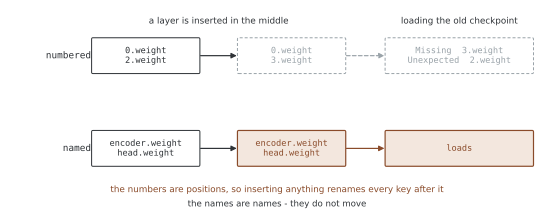

# OrderedDict를 이용한 레이어 이름 짓기

<div class="leadbox" markdown>

**들어가는 이야기** — 보기 좋으라고 붙이는 이름이 아니다

레이어를 차례대로 쌓기만 하면 파이토치가 알아서 **번호**를 매겨 준다. 첫째 레이어는 0,
셋째 레이어는 2 하는 식이다. 굳이 이름을 지어 주는 것은 읽기 좋으라고 하는
치장처럼 보인다.

그 번호가 **자리 번호**라는 데 함정이 있다. 가운데에 레이어를 하나 끼우면 그
뒤쪽은 전부 한 칸씩 밀리고, 밀린 번호는 그대로 **`state_dict`의 키** — 저장
파일이 웨이트를 찾는 이름 — 가 된다.

그래서 며칠 전에 트레인해 둔 웨이트를 못 읽게 된다. 모델을 조금 고쳤을 뿐인데
`load_state_dict`가 「없는 키(missing)」와 「모르는 키(unexpected)」를
늘어놓으며 거절하는 것이다. 이름을 지어
두었다면 아무 일도 일어나지 않는다.

</div>

`nn.Sequential`에 레이어를 그냥 넣으면 `state_dict`의 키가 `0.weight`, `2.weight`
처럼 **번호**가 된다. `OrderedDict`로 이름을 주면 `encoder.weight`가 된다.

보기 좋으라고 하는 일이 아니다. 번호는 **레이어를 하나 끼워 넣는 순간 전부
밀리고**, 밀리면 옛 체크포인트를 못 읽는다.

## 1. 코드

```python
"""Sequential 에 이름 붙이기 — 번호는 밀리고 이름은 안 밀린다.

`nn.Sequential` 에 레이어를 그냥 넣으면 키가 `0.weight`, `2.weight` 처럼
**번호**가 된다. `OrderedDict` 로 이름을 주면 `encoder.weight` 가
된다.

보기 좋으라고 하는 일이 아니다. 번호는 **레이어를 하나 끼워 넣는 순간
전부 밀리고**, 그러면 옛 체크포인트를 못 읽는다.

실행: 이 쪽의 코드를 파일로 갈무리해 돌린다
"""
# OrderedDict 는 파이썬 표준 라이브러리의 사전이다. (이름, 값) 짝을 「넣은 차례대로」
# 간직한다. 레이어는 차례가 곧 계산 순서이므로, 이름과 차례를 함께 넘길 때 이것을 쓴다.
from collections import OrderedDict

# torch 는 파이토치 본체이고, torch.nn 은 레이어를 모아 둔 모듈이다.
# 관례대로 nn 이라는 짧은 이름으로 불러, 아래에서 nn.Linear 처럼 적는다.
import torch
import torch.nn as nn


def header(title):
    # 절 제목을 한 줄 찍는다. f"...{title}..." 은 문자열 안에 변수의 값을 끼워 넣는
    # 파이썬 문법(f-string)이고, 맨 앞의 \n 은 줄바꿈이라 제목 위에 빈 줄이 생긴다.
    print(f"\n=== {title} ===")


def plain():
    # 이름 없이 쌓은 모델을 새로 하나 만들어 돌려준다. 부를 때마다 새 모델이다.
    #
    # nn.Linear(4, 8) 은 선형 레이어다. 수 4 개짜리 입력을 받아 수 8 개를 내놓으며
    # (y = W x + b), 트레인으로 고칠 파라메터를 둘 가진다.
    #   weight (웨이트 W) — 형태 (8, 4)      bias (바이어스 b) — 형태 (8,)
    # nn.ReLU() 는 음수를 0 으로 바꾸는 엑티베이션 함수다. 고칠 파라메터가 없다.
    #
    # nn.Sequential 은 레이어를 적은 차례대로 이어 붙여 모델 하나로 만든다.
    # 입력이 첫 레이어를 지나고, 그 출력이 다음 레이어의 입력이 된다. 그래서 앞
    # 레이어의 출력 크기(8)와 뒤 레이어의 입력 크기(8)가 맞아야 한다.
    # 이렇게 그냥 넣으면 파이토치가 레이어에 0, 1, 2 라는 번호를 붙인다.
    return nn.Sequential(nn.Linear(4, 8), nn.ReLU(), nn.Linear(8, 2))


def labelled():
    # 위와 똑같은 모델인데 레이어마다 이름을 준다.
    # ("이름", 레이어) 짝의 리스트를 OrderedDict 로 싸서 Sequential 에 넘기면,
    # 번호 0, 1, 2 대신 그 이름이 붙는다. 계산 순서는 여전히 적은 차례다.
    return nn.Sequential(OrderedDict([
        ("encoder", nn.Linear(4, 8)),   # 0 번 자리 — 이름은 encoder
        ("act", nn.ReLU()),             # 1 번 자리 — 이름은 act
        ("head", nn.Linear(8, 2)),      # 2 번 자리 — 이름은 head
    ]))


# ========================================================================
# 1. 키가 달라진다
# ========================================================================

def keys():
    header("1. state_dict 의 키")
    # state_dict() 는 모델의 파라메터를 {키: 텐서} 사전으로 돌려준다. 모델을 파일로
    # 저장할 때 적히는 것이 이 사전이고, 키는 「레이어 이름.파라메터 이름」이다.
    # .keys() 로 키만 뽑고, list(...) 로 리스트로 바꿔 한 줄에 찍는다.
    print("  번호 :", list(plain().state_dict().keys()))      # '0.weight', ...
    print("  이름 :", list(labelled().state_dict().keys()))   # 'encoder.weight', ...
    # ReLU 는 파라메터가 없으므로 어느 쪽 사전에도 들어가지 않는다.
    print("  이름은 ReLU 를 건너뛴다 — 파라메터가 없는 레이어는 키가 없다")
    print("  번호 쪽에서 1 번이 비어 있는 것도 같은 까닭이다")


# ========================================================================
# 2. 레이어를 하나 끼우면
# ========================================================================

def inserting():
    header("2. 가운데에 레이어를 끼우면")
    # 「옛 체크포인트」 노릇을 할 사전 둘을 먼저 만들어 둔다. 체크포인트는 트레인
    # 도중이나 끝에 저장해 둔 state_dict 다. 여기서는 파일로 쓰지 않고 사전을 그대로 든다.
    old_plain = plain().state_dict()       # 키: 0.weight, 0.bias, 2.weight, 2.bias
    old_named = labelled().state_dict()    # 키: encoder.*, head.*

    # 모델을 고친다 — ReLU 와 마지막 선형 레이어 사이에 드롭아웃을 하나 끼운다.
    # nn.Dropout(0.1) 은 트레인 중에 값의 10% 를 무작위로 0 으로 만드는 레이어다.
    # ReLU 처럼 파라메터가 없어서 state_dict 에 제 키를 만들지는 않는다.
    # 그런데 자리는 하나 차지하므로, 번호 쪽에서는 그 뒤의 레이어가 2 번에서 3 번이 된다.
    new_plain = nn.Sequential(nn.Linear(4, 8), nn.ReLU(),
                              nn.Dropout(0.1), nn.Linear(8, 2))
    # 이름 쪽에도 같은 자리에 끼운다. head 는 자리가 밀려도 이름이 head 그대로다.
    new_named = nn.Sequential(OrderedDict([
        ("encoder", nn.Linear(4, 8)),
        ("act", nn.ReLU()),
        ("drop", nn.Dropout(0.1)),      # 새로 끼운 레이어
        ("head", nn.Linear(8, 2)),
    ]))
    # 고친 모델의 키를 찍어 본다. print 에 값을 쉼표로 여럿 넘기면 띄어서 이어 찍는다.
    print("  번호 :", list(new_plain.state_dict().keys()), " <- 2 가 3 으로 밀렸다")
    print("  이름 :", list(new_named.state_dict().keys()), " <- 그대로다")

    # 고친 모델에 옛 체크포인트를 넣어 본다. (라벨, 새 모델, 옛 사전) 세 짝을 두 번 돈다.
    for label, model, sd in (("번호", new_plain, old_plain),
                             ("이름", new_named, old_named)):
        # try 안의 줄이 오류를 내면 프로그램이 죽는 대신 except 로 넘어간다.
        try:
            # load_state_dict(sd) 는 사전의 텐서를 「키가 같은」 파라메터에 복사한다.
            # 모델의 키와 사전의 키가 하나라도 안 맞으면 RuntimeError 를 낸다.
            model.load_state_dict(sd)
            print(f"  {label} 쪽에 옛 체크포인트 불러오기: 성공")
        except RuntimeError as e:      # e 에 오류 메시지가 담겨 온다
            print(f"  {label} 쪽에 옛 체크포인트 불러오기: 실패")
            # str(e) 는 오류 메시지 글자다. 여러 줄이라 splitlines() 로 줄마다 나누고,
            # [1:3] 으로 둘째·셋째 줄만 고른다 — 「없는 키」 줄과 「모르는 키」 줄이다.
            # strip() 은 앞뒤 공백을 떼고, [:66] 은 앞에서 66 글자까지만 남긴다.
            for line in str(e).splitlines()[1:3]:
                print("     ", line.strip()[:66])


# ========================================================================
# 3. 이름으로 고르기
# ========================================================================

def select_by_name():
    header("3. 이름으로 골라 동결")
    model = labelled()
    # named_parameters() 는 모델의 파라메터를 (이름, 텐서) 짝으로 하나씩 내준다.
    # 이름은 state_dict 의 키와 같은 글자다 — encoder.weight, encoder.bias, ...
    for name, p in model.named_parameters():
        # 이름이 "encoder." 으로 시작하는 파라메터만 고른다. 끝의 점까지 적어야
        # encoder2 같은 다른 레이어가 함께 걸리지 않는다.
        if name.startswith("encoder."):
            # 동결 — 이 파라메터를 트레인에서 뺀다. requires_grad_(False) 는 경사
            # 추적(이 텐서가 들어간 계산을 기록해 미분할 수 있게 하는 것)을 끈다.
            # 그러면 역전파가 이 파라메터의 그래디언트를 구하지 않아 값이 안 바뀐다.
            # 이름 끝의 밑줄은 「새 텐서를 만들지 않고 제자리에서 바꾼다」는 표시다.
            p.requires_grad_(False)
    # 다시 돌면서 결과를 확인한다. p.requires_grad 는 지금 경사 추적 중인지(True/False)다.
    # {name:16s} 는 이름을 16 칸에 맞춰 찍으라는 뜻이다. 모자라는 칸은 공백으로
    # 채워 줄이 맞는다.
    for name, p in model.named_parameters():
        print(f"  {name:16s} requires_grad={p.requires_grad}")
    print("  번호였다면 name.startswith('0.') 라고 적어야 한다")
    print("  그 코드는 레이어를 끼우는 순간 엉뚱한 레이어를 동결한다")


# ========================================================================
# 4. 점으로 이어진 이름이 곧 키다
# ========================================================================

def nested():
    header("4. 중첩하면 점으로 이어진다")
    # Sequential 안에 Sequential 을 넣는다(중첩). 바깥 모델의 레이어는 둘이다.
    #   features   — 그 자체가 작은 Sequential (conv → act)
    #   classifier — 선형 레이어 하나
    # conv 는 이름만 conv 이고 실제로는 nn.Linear 다. 이름은 붙이는 사람 마음이다.
    model = nn.Sequential(OrderedDict([
        ("features", nn.Sequential(OrderedDict([
            ("conv", nn.Linear(4, 8)),
            ("act", nn.ReLU()),
        ]))),
        ("classifier", nn.Linear(8, 2)),
    ]))
    # 사전을 for 로 돌면 키가 하나씩 나온다. 바깥 이름과 안쪽 이름이 점으로
    # 이어진다 — features 안의 conv 의 weight 는 features.conv.weight 다.
    for k in model.state_dict():
        print("  ", k)
    # 붙인 이름은 모델의 속성이 되어 코드에서도 점으로 따라 들어갈 수 있다.
    # type(...).__name__ 은 그 객체의 클래스 이름이다. 여기서는 "Linear" 가 찍힌다.
    print("  model.features.conv 로 바로 닿을 수 있다:",
          type(model.features.conv).__name__)
    print("  이름이 코드의 길과 저장 파일의 키를 동시에 정한다")


def main():
    # 난수 시드를 고정한다. nn.Linear 는 웨이트를 무작위 수로 초기화하는데,
    # 시드를 박아 두면 돌릴 때마다 같은 수가 나온다. 이 쪽은 키 이름만 찍으므로
    # 출력이 시드에 기대지는 않지만, 난수를 쓰는 프로그램에서는 늘 맨 앞에 둔다.
    torch.manual_seed(0)
    keys()
    inserting()
    select_by_name()
    nested()


# 이 파일을 직접 돌렸을 때만 main() 을 부른다. 다른 파일이 import 로 불러 쓸 때는
# __name__ 이 "__main__" 이 아니어서 아무것도 실행되지 않는다.
if __name__ == "__main__":
    main()
```

**출력:**

```
=== 1. state_dict 의 키 ===
  번호 : ['0.weight', '0.bias', '2.weight', '2.bias']
  이름 : ['encoder.weight', 'encoder.bias', 'head.weight', 'head.bias']
  이름은 ReLU 를 건너뛴다 — 파라메터가 없는 레이어는 키가 없다
  번호 쪽에서 1 번이 비어 있는 것도 같은 까닭이다

=== 2. 가운데에 레이어를 끼우면 ===
  번호 : ['0.weight', '0.bias', '3.weight', '3.bias']  <- 2 가 3 으로 밀렸다
  이름 : ['encoder.weight', 'encoder.bias', 'head.weight', 'head.bias']  <- 그대로다
  번호 쪽에 옛 체크포인트 불러오기: 실패
      Missing key(s) in state_dict: "3.weight", "3.bias".
      Unexpected key(s) in state_dict: "2.weight", "2.bias".
  이름 쪽에 옛 체크포인트 불러오기: 성공

=== 3. 이름으로 골라 동결 ===
  encoder.weight   requires_grad=False
  encoder.bias     requires_grad=False
  head.weight      requires_grad=True
  head.bias        requires_grad=True
  번호였다면 name.startswith('0.') 라고 적어야 한다
  그 코드는 레이어를 끼우는 순간 엉뚱한 레이어를 동결한다

=== 4. 중첩하면 점으로 이어진다 ===
   features.conv.weight
   features.conv.bias
   classifier.weight
   classifier.bias
  model.features.conv 로 바로 닿을 수 있다: Linear
  이름이 코드의 길과 저장 파일의 키를 동시에 정한다
```

## 2. 파라메터 없는 레이어는 키가 없다

```
번호 : ['0.weight', '0.bias', '2.weight', '2.bias']
이름 : ['encoder.weight', 'encoder.bias', 'head.weight', 'head.bias']
```

번호 쪽에서 **1번이 비어 있다.** 그 자리의 `ReLU`에 파라메터가 없기 때문이다.
이름 쪽에서도 `act`가 안 나오는 것이 같은 까닭이다.

그러니 번호는 **레이어의 번호이지 파라메터의 번호가 아니다.** `2.weight`를 보고
"2번 파라메터"라고 읽으면 틀린다 — 2번 **레이어**의 웨이트다.

## 3. 레이어를 하나 끼우면

```
번호 : ['0.weight', '0.bias', '3.weight', '3.bias']   <- 2 가 3 으로 밀렸다
이름 : ['encoder.weight', ..., 'head.weight', ...]    <- 그대로다

번호 쪽에 옛 체크포인트 불러오기: 실패
    Missing key(s) in state_dict: "3.weight", "3.bias".
    Unexpected key(s) in state_dict: "2.weight", "2.bias".
이름 쪽에 옛 체크포인트 불러오기: 성공
```



드롭아웃 하나를 끼웠을 뿐인데 **마지막 선형레이어의 키가 `2`에서 `3`으로 밀렸고**,
저장해 둔 웨이트를 못 읽는다.

이름을 붙여 두면 아무 일도 없다. 끼운 레이어가 어디 있든 `head`는 `head`다.

> 다행히 **터져 준다.** 키가 안 맞으면 `load_state_dict`가 거절하므로,
> 엉뚱한 웨이트를 조용히 읽는 일은 없다. 다만 `strict=False`로 불러오면
> 조용해진다 — 연습문제 2에서 그 자리를 본다.

## 4. 이름으로 골라 동결

```python
# 파라메터를 (이름, 텐서) 짝으로 돌면서 이름이 "encoder." 으로 시작하는 것만 고른다.
for name, p in model.named_parameters():
    if name.startswith("encoder."):
        p.requires_grad_(False)     # 경사 추적을 끈다 — 이 파라메터는 트레인되지 않는다
```

```
encoder.weight   requires_grad=False
encoder.bias     requires_grad=False
head.weight      requires_grad=True
head.bias        requires_grad=True
```

번호였다면 `name.startswith("0.")`이라고 적어야 하는데, 그 코드는 **레이어를 맨 앞에
끼우는 순간 엉뚱한 레이어를 동결한다.** 게다가 오류도 안 난다 — 0번 레이어는 여전히 있으니까.

「경사 추적 끄기」에서 본 동결이 실전에서 이 형태로 쓰인다. 이름이 있어야 그
코드가 안전해진다.

## 5. 중첩하면 점으로 이어진다

```
features.conv.weight
features.conv.bias
classifier.weight
classifier.bias
```

`model.features.conv`로 코드에서 닿을 수 있고, 저장 파일의 키도 같은 글자다.
**이름 하나가 코드의 길과 파일의 키를 동시에 정한다.**

그래서 속성 이름을 바꾸는 것은 가볍게 할 일이 아니다. 「모델 체크포인트」에서
구조가 저장되지 않는다고 한 것이 여기서 실제 비용으로 나타난다.

## 연습문제

<div class="drillbox" markdown>

**연습문제 1.** <span class="diff easy" title="쉬움"></span>
이름을 붙인 `Sequential`에 **번호로도** 닿을 수 있는가? 둘이 같은 객체인가?

</div>

??? success "풀이"
    ```python
    # 본문 코드의 import (OrderedDict, torch.nn as nn) 가 되어 있다고 보고 적는다.
    # 이름 a, b, c 를 붙인 레이어 셋짜리 모델이다. 자리 번호로는 0, 1, 2 다.
    m = nn.Sequential(OrderedDict([("a", nn.Linear(2, 2)),
                                   ("b", nn.ReLU()),
                                   ("c", nn.Linear(2, 2))]))
    # m.a 는 이름으로, m[0] 은 자리 번호로 레이어를 꺼낸다.
    # type(...).__name__ 은 꺼낸 것의 클래스 이름이다 — 둘 다 "Linear" 가 나온다.
    print("  이름으로 :", type(m.a).__name__, type(m.c).__name__)
    print("  번호로도 :", type(m[0]).__name__, type(m[2]).__name__)
    # is 는 「값이 같은가」가 아니라 「메모리의 같은 객체인가」를 묻는다.
    # True 이면 m.a 와 m[0] 은 한 레이어를 가리키는 두 길이다.
    print("  둘이 같은 객체인가:", m.a is m[0])

    # 거꾸로는 안 된다. 이름을 안 준 모델에는 번호만 있으므로, 없는 이름 foo 로
    # 닿으려 하면 AttributeError 가 난다. try/except 로 받아 메시지의 첫 줄을 찍는다.
    p = nn.Sequential(nn.Linear(2, 2))
    try:
        p.foo
    except AttributeError as e:
        # splitlines()[0] 은 메시지의 첫 줄, [:56] 은 그 앞 56 글자다.
        print("  번호만 있는 쪽에 이름으로 닿으면:", str(e).splitlines()[0][:56])
    ```

    ```
      이름으로 : Linear Linear
      번호로도 : Linear Linear
      둘이 같은 객체인가: True
      번호만 있는 쪽에 이름으로 닿으면: 'Sequential' object has no attribute 'foo'
    ```

    **둘 다 되고 같은 객체다.** 이름을 붙이면 번호를 잃는 것이 아니라 **길이
    하나 더 생긴다.**

    그러니 이름을 붙이는 데 드는 비용이 없다. 안 붙일 까닭이 없다는 뜻이다.

---

<div class="drillbox" markdown>

**연습문제 2.** <span class="diff med" title="중간"></span>
이름을 `enc`에서 `encoder`로 **바꾸면** 옛 체크포인트를 어떻게 읽는가? 두 가지
길을 시험하라.

</div>

??? success "풀이"
    ```python
    # 옛 모델 — 첫 레이어의 이름이 enc 다. 그 state_dict 를 옛 체크포인트로 쓴다.
    old = nn.Sequential(OrderedDict([("enc", nn.Linear(4, 8)),
                                     ("head", nn.Linear(8, 2))]))
    sd = old.state_dict()          # 키: enc.weight, enc.bias, head.weight, head.bias
    # 새 모델 — 구조는 같고 첫 레이어의 이름만 encoder 로 바꿨다.
    renamed = nn.Sequential(OrderedDict([("encoder", nn.Linear(4, 8)),
                                         ("head", nn.Linear(8, 2))]))
    # 그대로 넣어 본다. 모델은 encoder.* 를 찾는데 사전에는 enc.* 가 있어
    # 키가 안 맞고, load_state_dict 가 RuntimeError 를 낸다.
    try:
        renamed.load_state_dict(sd)
    except RuntimeError as e:
        # 오류 메시지의 앞 세 줄을 찍는다. strip() 은 앞뒤 공백을 떼고 [:72] 는
        # 72 글자까지만 남긴다.
        for line in str(e).splitlines()[:3]:
            print("  ", line.strip()[:72])

    # 첫째 길 — 사전의 키 이름을 고쳐서 넘긴다.
    # sd.items() 는 (키, 텐서) 짝을 내준다. 키 글자 안의 "enc." 을 "encoder." 으로
    # 바꾸고 텐서 v 는 그대로 두어 새 사전을 만든다. head.* 에는 "enc." 이 없어
    # 그대로 남는다.
    fixed = OrderedDict((k.replace("enc.", "encoder."), v) for k, v in sd.items())
    renamed.load_state_dict(fixed)      # 이제 키가 다 맞아 오류 없이 지나간다
    print("  키 이름을 바꿔 주면 성공")
    # 둘째 길 — strict=False. 맞는 키(head.*)만 복사하고 안 맞는 키는 오류 없이 넘어간다.
    # 대신 무엇이 안 맞았는지를 돌려준다. missing_keys 는 모델에 있는데 사전에 없어
    # 「못 채운」 키이고, unexpected_keys 는 사전에 있는데 모델에 없어 「버린」 키다.
    print("  느슨하게 불러오기:", renamed.load_state_dict(sd, strict=False))
    ```

    ```
       Error(s) in loading state_dict for Sequential:
       Missing key(s) in state_dict: "encoder.weight", "encoder.bias".
       Unexpected key(s) in state_dict: "enc.weight", "enc.bias".
      키 이름을 바꿔 주면 성공
      느슨하게 불러오기: _IncompatibleKeys(missing_keys=['encoder.weight',
        'encoder.bias'], unexpected_keys=['enc.weight', 'enc.bias'])
    ```

    두 길이 **전혀 다르다.**

    **키를 바꿔 주는 길**이 맞다. `state_dict`는 그냥 사전이므로 키 이름을
    고쳐 넘기면 된다. 다른 저장소에서 받은 웨이트를 내 모델에 맞출 때 쓰는
    표준 방법이다.

    **`strict=False`는 위험하다.** 오류 대신 `_IncompatibleKeys`를 돌려주고
    넘어가는데, 그 결과는 **`encoder`가 안 채워진 모델**이다. 무작위 초기값
    그대로인 레이어를 트레인된 모델이라 믿고 쓰게 된다.

    돌려받은 값을 반드시 확인해야 한다. `missing_keys`가 비어 있지 않으면
    뭔가 안 채워졌다는 뜻이다.

    ```python
    # 돌려받은 결과를 r 에 받아 둔다.
    r = model.load_state_dict(sd, strict=False)
    # assert 조건, 메시지 — 조건이 거짓이면 그 메시지와 함께 프로그램을 멈춘다.
    # 빈 리스트는 거짓으로 치므로, not r.missing_keys 는 「못 채운 키가 없다」는 뜻이다.
    assert not r.missing_keys, f"안 채워진 키: {r.missing_keys}"
    ```

---

<div class="drillbox" markdown>

**연습문제 3.** <span class="diff hard" title="어려움"></span>
레이어가 넷인 모델의 웨이트를 레이어가 둘인 모델에 넣으면 어떻게 되는가? 반대는?
`strict=False`로 양쪽을 해 보고 **어느 쪽이 더 위험한지** 가려라.

</div>

??? success "풀이"
    ```python
    # 레이어가 넷인 모델과 둘인 모델을 만든다. for i in range(4) 는 i 를 0, 1, 2, 3
    # 으로 바꿔 가며 ("layer0", 레이어), ("layer1", 레이어), ... 짝을 만든다.
    # 레이어는 모두 nn.Linear(8, 8) 이라 형태가 같고, 다른 것은 개수뿐이다.
    big = nn.Sequential(OrderedDict([(f"layer{i}", nn.Linear(8, 8))
                                     for i in range(4)]))     # layer0 ~ layer3
    small = nn.Sequential(OrderedDict([(f"layer{i}", nn.Linear(8, 8))
                                       for i in range(2)]))   # layer0, layer1

    # 큰 것 → 작은 것. strict=False 라 오류 없이 지나가고, 안 맞은 키를 r 로 돌려준다.
    # 작은 모델의 키 4 개(layer0, layer1 의 weight 와 bias)는 다 채워지고,
    # 사전에 남는 layer2, layer3 의 키 4 개가 unexpected(버린 키)로 나온다.
    r = small.load_state_dict(big.state_dict(), strict=False)
    # len(...) 은 리스트의 길이, 곧 그런 키가 몇 개인가다.
    print("  큰 것을 작은 것에:", "missing", len(r.missing_keys),
          "unexpected", len(r.unexpected_keys))
    print("    unexpected:", r.unexpected_keys[:4])     # [:4] 는 앞에서 네 개까지

    # 작은 것 → 큰 것. 이번에는 큰 모델의 layer2, layer3 을 채울 값이 사전에 없다.
    # 그 키 4 개가 missing(못 채운 키)으로 나오고, 그 레이어들은 초기화된 값 그대로다.
    r2 = big.load_state_dict(small.state_dict(), strict=False)
    print("  작은 것을 큰 것에:", "missing", len(r2.missing_keys),
          "unexpected", len(r2.unexpected_keys))
    print("    missing:", r2.missing_keys[:4])
    ```

    ```
      큰 것을 작은 것에: missing 0 unexpected 4
        unexpected: ['layer2.weight', 'layer2.bias', 'layer3.weight', 'layer3.bias']
      작은 것을 큰 것에: missing 4 unexpected 0
        missing: ['layer2.weight', 'layer2.bias', 'layer3.weight', 'layer3.bias']
    ```

    **둘이 정반대이고, 위험한 정도가 다르다.**

    **큰 것 → 작은 것**은 `unexpected`만 나온다. 작은 모델의 두 레이어는 **전부 제대로
    채워졌고**, 남는 두 레이어 치의 웨이트를 버린 것뿐이다. 모델은 의도대로 동작한다.

    **작은 것 → 큰 것**은 `missing`이 나온다. 큰 모델의 뒤쪽 두 레이어가 **무작위
    초기값 그대로** 남는다. 그런데 앞쪽 두 레이어는 트레인된 값이라, **반쯤 트레인된
    모델**이 된다.

    둘째 경우가 훨씬 나쁘다. 모델이 돌아가고 숫자도 나오는데 성능만 이상하기
    때문이다. 전이 학습에서 "사전 트레인 웨이트를 올렸는데 왜 성능이 나쁘지"의
    흔한 원인이 이것이다.

    그래서 `strict=False`를 쓸 때는 **어느 쪽을 기대하는지 적어 두는 편이**
    낫다.

    ```python
    # pretrained 는 사전 트레인된 웨이트의 state_dict 다.
    r = model.load_state_dict(pretrained, strict=False)
    # 새로 단 분류기만 비어 있어야 한다
    # all(...) 은 안의 조건이 「모두」 참일 때만 참이다. 못 채운 키가 하나라도
    # classifier. 으로 시작하지 않으면 여기서 멈춘다.
    assert all(k.startswith("classifier.") for k in r.missing_keys)
    ```
