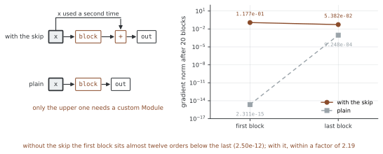
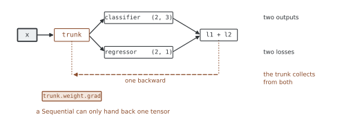

# 사용자 정의 Module을 이용한 레이어 이름 짓기

<div class="leadbox" markdown>

**들어가는 이야기** — 한 줄로만 흘러가는 모델

`nn.Sequential`은 레이어를 차례로 늘어놓기만 하면 되는 틀이다. 앞 레이어가 내놓은 것을
다음 레이어에 넘기고, 그것이 전부다. 짧고 읽기 좋아서 많은 모델이 이 틀로 적힌다.

그 틀에는 **적을 수 없는 것**이 있다. 들어온 값을 뒤에서 한 번 더 쓰는 것,
결과를 둘 내놓는 것, 중간에 지나간 값을 따로 꺼내 보는 것. 어느 것도 「앞의
출력이 다음의 입력」이라는 한 줄에 들어맞지 않는다.

첫째 것이 특히 그렇다. 입력을 **더하기로 한 번 더 얹는** **스킵 연결**(skip connection, 잔차 연결이라고도 한다)은
아주 작은 변경인데,
블록 스무 개를 쌓고 재어 보면 맨 앞 블록에 닿는 그래디언트가 **50조 배쯤** 달라진다. 없는
쪽은 사실상 0이고, 그 레이어들은 아무리 돌려도 배우지 않는다.

그 한 줄을 적으려면 틀에서 나와야 한다.

</div>

속성 이름이 그대로 `state_dict`의 키가 되는 것은 「OrderedDict를 이용한 레이어 이름 짓기」와
같다. 다른 것은 **그 사이에 무엇을 끼워 넣을 수 있느냐**다.

`nn.Sequential`은 "한 줄로 지나가는" 모델만 적을 수 있다. 앞 레이어의 출력이 다음
레이어의 입력이고, 그게 전부다. 그 틀을 벗어나는 것 넷을 본다.

- **스킵 연결**(skip connection) — 입력을 건너뛰어 출력에 한 번 더 더한다
- **분기**(branching) — 출력이 둘 이상
- **중간값 꺼내기** — `forward`가 인자를 더 받는다
- **파라메터 없는 레이어를 안 만들기** — `F.relu`로 끝

## 1. 코드

```python
"""nn.Module 을 상속해 쓰기 — Sequential 로는 못 하는 것들.

`nn.Sequential` 은 "한 줄로 지나가는" 모델만 적을 수 있다. 입력을
두 갈래로 보내거나, 건너뛰어 더하거나, 중간값을 꺼내 쓰려면
`forward` 를 손으로 적어야 한다.

속성 이름이 그대로 `state_dict` 의 키가 되는 것은 「OrderedDict를 이용한
레이어 이름 짓기」와 같다. 다른 것은 **그 사이에 무엇을 끼워 넣을
수 있느냐**다.

실행: 이 쪽의 코드를 파일로 갈무리해 돌린다
"""
# torch 는 파이토치 본체다. torch.nn 은 레이어를 「객체」로 모아 둔 모듈이고
# (nn.Linear 처럼 만들어 두고 부른다), torch.nn.functional 은 같은 계산을 「함수」로
# 모아 둔 모듈이다(F.relu(x) 처럼 바로 부른다). 관례대로 nn, F 로 줄여 부른다.
import torch
import torch.nn as nn
import torch.nn.functional as F


def header(title):
    # 절 제목을 한 줄 찍는다. f"...{title}..." 은 문자열 안에 변수의 값을 끼워 넣는
    # 파이썬 문법(f-string)이고, 맨 앞의 \n 은 줄바꿈이라 제목 위에 빈 줄이 생긴다.
    print(f"\n=== {title} ===")


# ========================================================================
# 1. 속성 이름이 키가 된다
# ========================================================================

# 내 모델을 클래스로 적는다. class 이름(nn.Module): 은 「nn.Module 을 상속한다」는
# 뜻이다. nn.Module 은 파이토치의 모든 레이어와 모델의 바탕 클래스이고, 이것을
# 상속해야 파라메터 모으기·저장·장치 옮기기 같은 기능을 물려받는다.
# 적을 것은 둘이다 — __init__ (어떤 레이어를 가지는가) 와 forward (어떻게 계산하는가).
class TinyNet(nn.Module):
    # __init__ 은 TinyNet() 으로 모델을 만들 때 한 번 불린다. self 는 지금 만들어지는
    # 모델 자신이다.
    def __init__(self):
        # 부모 클래스(nn.Module)의 __init__ 을 먼저 부른다. 여기서 레이어를 등록해 둘
        # 내부 사전들이 만들어지므로 반드시 첫 줄에 와야 한다(5 절이 빼먹은 경우다).
        super().__init__()
        # 레이어를 self 의 속성으로 넣는다. nn.Module 이 이 대입을 가로채 「이 모델의
        # 레이어」로 등록하고, 속성 이름 encoder, head 가 state_dict 의 키가 된다.
        # nn.Linear(5, 3) 은 선형 레이어다 — 수 5 개를 받아 3 개를 내놓는다(y = W x + b).
        # 파라메터는 weight (웨이트, 형태 (3, 5)) 와 bias (바이어스, 형태 (3,)) 둘이다.
        self.encoder = nn.Linear(5, 3)
        self.head = nn.Linear(3, 1)        # 수 3 개 → 1 개. 앞 레이어의 출력 3 과 맞춘다

    # forward 는 순전파다 — 입력 x 가 어떤 차례로 레이어를 지나 출력이 되는가를 적는다.
    # 직접 부르지 않는다. net(x) 라고 부르면 파이토치가 forward(x) 를 불러 준다.
    def forward(self, x):
        # 안쪽부터 읽는다. encoder 를 지나고 → F.relu 가 음수를 0 으로 바꾸고 → head 를
        # 지난다. F.relu 는 함수라서 __init__ 에 레이어로 만들어 두지 않아도 된다.
        return self.head(F.relu(self.encoder(x)))


def names():
    header("1. 속성 이름이 키가 된다")
    net = TinyNet()                        # 모델을 하나 만든다. __init__ 이 불린다
    # state_dict() 는 모델의 파라메터를 {키: 텐서} 사전으로 돌려준다. 모델을 저장할 때
    # 파일에 적히는 것이 이것이다. 키는 「속성 이름.파라메터 이름」이다.
    # .keys() 로 키만 뽑고 list(...) 로 리스트로 바꿔 찍는다.
    print("  state_dict 키:", list(net.state_dict().keys()))
    print("  ReLU 를 F.relu 로 적어 모듈이 아예 없다")
    # named_children() 은 모델에 등록된 레이어를 (이름, 레이어) 짝으로 내준다.
    # [n for n, _ in ...] 은 짝에서 이름 n 만 모아 리스트로 만든다. _ 은 「안 쓰는 값」
    # 자리에 관례로 두는 이름이다.
    print("  모듈 목록:", [n for n, _ in net.named_children()])
    print("  Sequential 과 달리 파라메터 없는 레이어를 안 만들어도 된다")


# ========================================================================
# 2. Sequential 로는 못 적는 것 — 스킵 연결
# ========================================================================

class Residual(nn.Module):
    # 만들 때 인자를 받는다. d 는 입력과 출력의 크기이고, skip 은 스킵 연결을 쓸지다.
    # skip=True 는 기본값이다 — Residual(4) 처럼 안 적으면 True 가 된다.
    def __init__(self, d, skip=True):
        super().__init__()
        self.fc1 = nn.Linear(d, d)         # 크기를 안 바꾸는 선형 레이어 둘
        self.fc2 = nn.Linear(d, d)
        # 레이어가 아닌 보통 값(True/False)도 속성으로 둘 수 있다. 파라메터가 아니므로
        # state_dict 에는 들어가지 않는다.
        self.skip = skip

    def forward(self, x):
        # fc1 → ReLU → fc2 를 지난 값이 h 다. 입력 x 는 지우지 않고 그대로 들고 있다.
        h = self.fc2(F.relu(self.fc1(x)))
        # 「A if 조건 else B」 는 조건이 참이면 A, 거짓이면 B 다. skip 이 켜져 있으면
        # x + h 를, 꺼져 있으면 h 만 돌려준다. x + h 가 되려면 x 와 h 의 형태가 같아야
        # 하는데, 그래서 두 레이어를 d → d 로 만들었다.
        return x + h if self.skip else h          # 입력을 더한다


def skip():
    header("2. 스킵 연결")
    # 난수 시드를 고정한다. nn.Linear 의 초기화와 torch.randn 이 모두 난수를 쓰므로,
    # 시드를 박아야 돌릴 때마다 같은 수가 찍힌다.
    torch.manual_seed(0)
    block = Residual(4)                    # d = 4, 스킵 연결은 기본값대로 켠다
    # torch.randn(2, 4) 는 표준정규분포에서 뽑은 수로 채운 형태 (2, 4) 의 텐서다.
    # 수 4 개짜리 입력이 2 개 — 앞의 2 가 배치 크기(한 번에 넣는 입력의 수)다.
    x = torch.randn(2, 4)
    # block(x) 가 forward(x) 를 부른다. x.shape 은 텐서의 형태이고, tuple(...) 로 싸면
    # torch.Size([2, 4]) 대신 (2, 4) 로 찍힌다. 입력과 출력의 형태가 같다.
    print("  입력 형태", tuple(x.shape), "-> 출력", tuple(block(x).shape))
    print("  x 를 한 번 더 쓰는 식은 Sequential 로 적을 수 없다")
    print("  Sequential 은 앞 레이어의 출력만 다음 레이어에 넘기기 때문이다")

    print("  블록 스무 개를 쌓고 첫 블록에 닿는 그래디언트를 재어 본다")
    # 같은 실험을 두 번 한다 — 스킵 연결을 켜고 한 번, 끄고 한 번.
    for use_skip in (True, False):
        # 두 번 다 같은 시드에서 시작한다. 그래야 두 모델의 초기 웨이트와 입력이
        # 똑같고, 다른 것은 스킵 연결 하나뿐이 된다.
        torch.manual_seed(0)
        # [Residual(16, use_skip) for _ in range(20)] 은 블록 20 개의 리스트다.
        # 앞의 * 는 리스트를 풀어 인자 20 개로 넘긴다. nn.Sequential 은 받은 레이어를
        # 차례대로 이어 붙여 모델 하나로 만든다 — 블록 스무 개를 한 줄로 쌓은 것이다.
        deep = nn.Sequential(*[Residual(16, use_skip) for _ in range(20)])
        # 한 줄에 순전파와 역전파가 다 들어 있다. 왼쪽부터 읽는다.
        #   torch.randn(8, 16)   입력. 형태 (8, 16) — 수 16 개짜리가 8 개
        #   deep(...)            스무 블록을 지난다. 출력의 형태도 (8, 16)
        #   .pow(2).mean()       모든 값을 제곱해 평균 낸 수 하나. 이것을 로스로 쓴다
        #   .backward()          역전파. 로스를 모든 파라메터로 미분해 각 파라메터의
        #                        .grad 에 그래디언트를 넣는다
        deep(torch.randn(8, 16)).pow(2).mean().backward()
        # deep[0] 은 첫 블록, deep[-1] 은 마지막 블록이다(-1 은 뒤에서 첫째).
        # .fc1.weight.grad 는 그 블록 fc1 의 웨이트에 닿은 그래디언트로, 형태가
        # 웨이트와 같은 (16, 16) 이다. .abs().mean() 으로 절댓값의 평균을 내어
        # 「그래디언트의 크기」를 수 하나로 줄이고, .item() 으로 파이썬 실수로 꺼낸다.
        first = deep[0].fc1.weight.grad.abs().mean().item()
        last = deep[-1].fc1.weight.grad.abs().mean().item()
        # :.3e 는 지수 표기로 소수점 아래 세 자리까지 찍는다 (2.311e-15 는 2.311 × 10^-15).
        # str(use_skip) 은 True/False 를 글자로 바꾸고 :5s 는 5 칸에 맞춘다.
        # 「비」 는 첫 블록 ÷ 마지막 블록이다. 0 에 가까울수록 앞쪽까지 못 닿은 것이다.
        print(f"    스킵 연결 {str(use_skip):5s} 첫 블록 {first:.3e}  "
              f"마지막 블록 {last:.3e}  비 {first / last:.2e}")
    print("  스킵 연결이 없으면 첫 블록의 그래디언트가 사라진다")
    print("  더하기의 미분이 1 이라 스킵 연결이 그래디언트를 그대로 흘려 보낸다")


# ========================================================================
# 3. 두 갈래로 보내기
# ========================================================================

class TwoHeads(nn.Module):
    def __init__(self):
        super().__init__()
        # 레이어 셋. trunk 는 두 갈래가 함께 쓰는 몸통이고, cls 와 reg 는 그 뒤에
        # 따로 붙는 두 헤드(출력 쪽 레이어)다.
        self.trunk = nn.Linear(4, 8)       # 수 4 개 → 8 개
        self.cls = nn.Linear(8, 3)         # 분류 헤드 — 클래스 3 개의 점수
        self.reg = nn.Linear(8, 1)         # 회귀 헤드 — 수 하나

    def forward(self, x):
        # 몸통을 한 번 지난 값 h 를 두 헤드에 「똑같이」 넣는다. h 를 두 번 쓰는 것이다.
        h = F.relu(self.trunk(x))
        # 쉼표로 이으면 값 둘을 묶어(튜플) 한꺼번에 돌려준다.
        return self.cls(h), self.reg(h)          # 둘을 돌려준다


def branching():
    header("3. 출력이 둘")
    torch.manual_seed(0)                   # 초기 웨이트와 입력을 고정한다
    net = TwoHeads()
    # 입력은 형태 (2, 4) — 수 4 개짜리 2 개다. forward 가 둘을 돌려주므로 a, b 로
    # 나눠 받는다.   a: 분류 헤드의 출력 (2, 3)     b: 회귀 헤드의 출력 (2, 1)
    a, b = net(torch.randn(2, 4))
    print("  분류 헤드", tuple(a.shape), "  회귀 헤드", tuple(b.shape))
    print("  Sequential 은 텐서 하나만 돌려줄 수 있다")

    # 헤드마다 로스를 하나씩 만들어 더한다.
    #   F.cross_entropy(a, 정답) — 분류 로스. a 의 각 행은 클래스 3 개의 점수이고,
    #       torch.tensor([0, 1]) 은 정답 번호다(첫 입력은 0 번, 둘째 입력은 1 번 클래스).
    #       정답 클래스에 점수를 높게 줄수록 작아진다.
    #   b.pow(2).mean()          — 회귀 쪽 로스. 출력을 제곱해 평균 낸 수 하나다
    #       (여기서는 그래디언트가 흐르는지만 보려고 목표 값을 0 으로 친 셈이다).
    # 둘 다 수 하나짜리 텐서라 그대로 더할 수 있다.
    loss = F.cross_entropy(a, torch.tensor([0, 1])) + b.pow(2).mean()
    # 역전파. 더한 로스에서 거꾸로 따라가 모든 파라메터의 .grad 를 채운다.
    # trunk 는 두 헤드 양쪽에 쓰였으므로, 두 길로 온 그래디언트가 더해져 들어간다.
    loss.backward()
    print("  두 로스를 더해 한 번 역전파하면 trunk 가 둘 다에게서 받는다")
    # .grad 는 backward() 를 부르기 전에는 None 이다. None 이 아니면 채워진 것이다.
    print("  trunk.weight.grad 가 있는가:", net.trunk.weight.grad is not None)


# ========================================================================
# 4. 중간값을 꺼내 쓰기
# ========================================================================

class WithTap(nn.Module):
    def __init__(self):
        super().__init__()
        self.a = nn.Linear(4, 8)           # 4 → 8
        self.b = nn.Linear(8, 8)           # 8 → 8
        self.c = nn.Linear(8, 2)           # 8 → 2

    # forward 도 보통의 파이썬 함수라 인자를 더 받을 수 있다. return_hidden=False 가
    # 기본값이므로 net(x) 로만 부르면 평소처럼 출력 하나만 나온다.
    def forward(self, x, return_hidden=False):
        # 한 줄에 다 겹쳐 적지 않고 중간값마다 이름을 붙여 둔다. 그래야 꺼낼 수 있다.
        h1 = F.relu(self.a(x))             # 첫 레이어를 지난 값. 형태 (배치, 8)
        h2 = F.relu(self.b(h1))            # 둘째 레이어를 지난 값. 형태 (배치, 8)
        out = self.c(h2)                   # 마지막 출력. 형태 (배치, 2)
        # return_hidden 이 참이면 셋을 묶어 돌려주고, 아니면 out 만 돌려준다.
        return (out, h1, h2) if return_hidden else out


def tapping():
    header("4. 중간값 꺼내기")
    torch.manual_seed(0)
    net = WithTap()
    x = torch.randn(2, 4)                  # 입력. 형태 (2, 4) 라 배치 크기가 2 다
    print("  보통 부르면 :", tuple(net(x).shape))            # 출력 하나 — (2, 2)
    # net(x, return_hidden=True) 처럼 넘긴 인자는 그대로 forward 로 건너간다.
    out, h1, h2 = net(x, return_hidden=True)
    print("  중간값까지  :", tuple(out.shape), tuple(h1.shape), tuple(h2.shape))
    print("  forward 에 인자를 더 받을 수 있는 것도 Sequential 과 다르다")
    print("  피처 추출, 증류, 시각화가 전부 이 자리에서 나온다")


# ========================================================================
# 5. 흔한 실수 — super().__init__() 을 빼먹으면
# ========================================================================

def forgot_super():
    header("5. super().__init__() 을 빼먹으면")

    # 일부러 틀리게 적은 클래스다. 클래스는 함수 안에서도 정의할 수 있다.
    class Broken(nn.Module):
        def __init__(self):
            # nn.Module 이 이 대입을 가로채 레이어를 등록하려 하는데, 등록해 둘 내부
            # 사전이 아직 없다. 그것을 만드는 super().__init__() 을 안 불렀기 때문이다.
            self.fc = nn.Linear(2, 2)          # super() 를 안 불렀다

    # try 안의 줄이 오류를 내면 프로그램이 죽는 대신 except 로 넘어간다.
    try:
        Broken()                           # 모델을 만드는 바로 이 자리에서 오류가 난다
    except AttributeError as e:            # e 에 오류 메시지가 담겨 온다
        # str(e) 는 메시지 글자, splitlines()[0] 은 그 첫 줄, [:72] 는 앞 72 글자다.
        print("  만들 때:", str(e).splitlines()[0][:72])
    print("  nn.Module 이 속성을 가로채려면 먼저 제 내부 상태를 만들어야 한다")
    print("  그 내부 상태가 _parameters, _modules 같은 사전들이다")


def main():
    # 절마다 함수 하나다. 난수를 쓰는 절은 저마다 제 안에서 시드를 고정한다.
    names()
    skip()
    branching()
    tapping()
    forgot_super()


# 이 파일을 직접 돌렸을 때만 main() 을 부른다. 다른 파일이 import 로 불러 쓸 때는
# __name__ 이 "__main__" 이 아니어서 아무것도 실행되지 않는다.
if __name__ == "__main__":
    main()
```

**출력:**

```
=== 1. 속성 이름이 키가 된다 ===
  state_dict 키: ['encoder.weight', 'encoder.bias', 'head.weight', 'head.bias']
  ReLU 를 F.relu 로 적어 모듈이 아예 없다
  모듈 목록: ['encoder', 'head']
  Sequential 과 달리 파라메터 없는 레이어를 안 만들어도 된다

=== 2. 스킵 연결 ===
  입력 형태 (2, 4) -> 출력 (2, 4)
  x 를 한 번 더 쓰는 식은 Sequential 로 적을 수 없다
  Sequential 은 앞 레이어의 출력만 다음 레이어에 넘기기 때문이다
  블록 스무 개를 쌓고 첫 블록에 닿는 그래디언트를 재어 본다
    스킵 연결 True  첫 블록 1.177e-01  마지막 블록 5.382e-02  비 2.19e+00
    스킵 연결 False 첫 블록 2.311e-15  마지막 블록 9.248e-04  비 2.50e-12
  스킵 연결이 없으면 첫 블록의 그래디언트가 사라진다
  더하기의 미분이 1 이라 스킵 연결이 그래디언트를 그대로 흘려 보낸다

=== 3. 출력이 둘 ===
  분류 헤드 (2, 3)   회귀 헤드 (2, 1)
  Sequential 은 텐서 하나만 돌려줄 수 있다
  두 로스를 더해 한 번 역전파하면 trunk 가 둘 다에게서 받는다
  trunk.weight.grad 가 있는가: True

=== 4. 중간값 꺼내기 ===
  보통 부르면 : (2, 2)
  중간값까지  : (2, 2) (2, 8) (2, 8)
  forward 에 인자를 더 받을 수 있는 것도 Sequential 과 다르다
  피처 추출, 증류, 시각화가 전부 이 자리에서 나온다

=== 5. super().__init__() 을 빼먹으면 ===
  만들 때: cannot assign module before Module.__init__() call
  nn.Module 이 속성을 가로채려면 먼저 제 내부 상태를 만들어야 한다
  그 내부 상태가 _parameters, _modules 같은 사전들이다
```

## 2. `F.relu`로 적으면 모듈이 안 생긴다

```
state_dict 키: ['encoder.weight', 'encoder.bias', 'head.weight', 'head.bias']
모듈 목록: ['encoder', 'head']
```

`nn.ReLU()`를 속성으로 두지 않고 `forward` 안에서 `F.relu`를 부르면 **모듈
목록에 안 나타난다.** 파라메터가 없으니 `state_dict`에도 차이가 없다.

둘 중 어느 쪽이든 결과는 같다(연습문제 1). 가르는 것은 **모델을 들여다보거나
고칠 때**다 — `nn.ReLU`로 두면 `print(model)`에 보이고 훅(hook, 그 모듈이 불릴 때마다
함께 불리도록 걸어 두는 함수)을 걸 수 있다.

## 3. 스킵 연결 — 그래디언트가 살아남는다

```python
def forward(self, x):
    # fc1 → ReLU → fc2 를 지난 값에 처음의 입력 x 를 그대로 한 번 더 더한다.
    return x + self.fc2(F.relu(self.fc1(x)))
```

`x`를 한 번 더 쓴다. `Sequential`로는 적을 수 없다 — 앞 레이어의 출력만 넘어가니
원래 `x`에 닿을 길이 없다.

블록 스무 개를 쌓고 **첫 블록에 닿는 그래디언트**를 재어 보면 무엇이 달라지는지
보인다.

| | 첫 블록 | 마지막 블록 | 비 |
|---|---|---|---|
| 스킵 연결 있음 | 1.177e-01 | 5.382e-02 | 2.19 |
| 스킵 연결 없음 | **2.311e-15** | 9.248e-04 | 2.50e-12 |



스킵 연결이 없으면 첫 블록의 그래디언트가 $10^{-15}$다. **사라졌다.** 앞쪽 레이어들이
사실상 트레인되지 않는다. 로그 스케일에서 회색 선이 **열한 칸 넘게 떨어지는 것**이
그 말이다.

까닭은 사슬 규칙이다. 스무 레이어를 거치며 각 레이어의 야코비 행렬(출력을 입력으로 미분한 행렬)이 곱해지는데, 그 크기가
1보다 조금만 작아도 스무 번 곱하면 0으로 간다. 스킵 연결이 있으면
$\frac{\partial}{\partial x}(x + f(x)) = 1 + f'(x)$라 **1이 더해져** 곱해도 안
줄어든다.

이것이 ResNet이 깊은 뉴럴 네트워크를 트레인 가능하게 만든 방법이고, 그것을 적으려면
`forward`를 손으로 써야 한다.

## 4. 출력이 둘

```python
def forward(self, x):
    h = F.relu(self.trunk(x))           # 몸통을 한 번 지난다
    return self.cls(h), self.reg(h)     # 같은 h 를 두 헤드에 넣고, 출력 둘을 묶어 돌려준다
```

```
분류 헤드 (2, 3)   회귀 헤드 (2, 1)
두 로스를 더해 한 번 역전파하면 trunk 가 둘 다에게서 받는다
trunk.weight.grad 가 있는가: True
```



`Sequential`은 텐서 하나만 돌려줄 수 있다. 객체 탐지(상자와 클래스), 다중
작업 학습, VAE(평균과 로그분산)가 전부 이 형태다.

`trunk`가 두 헤드 양쪽에서 그래디언트를 받는다 — 「경사 누적」에서 본 대로 한 입력이
여러 곳에 쓰이면 **더해져서** 돌아온다.

## 5. 중간값 꺼내기

```python
def forward(self, x, return_hidden=False):    # 인자를 하나 더 받는다. 기본값은 False 다
    ...                                       # (h1, h2, out 을 구하는 줄은 줄였다)
    # return_hidden 이 참이면 출력과 중간값 둘을 묶어 돌려주고, 아니면 출력만 돌려준다.
    return (out, h1, h2) if return_hidden else out
```

```
보통 부르면 : (2, 2)
중간값까지  : (2, 2) (2, 8) (2, 8)
```

`forward`가 **인자를 더 받는 것**도 `Sequential`과 다르다. 피처 추출, 지식
증류, 어텐션 시각화가 전부 중간값을 꺼내는 일이다.

(모델을 안 고치고 꺼내는 길도 있다 — `register_forward_hook`. 남의 모델에서
꺼낼 때 그쪽을 쓴다.)

## 6. `super().__init__()`을 빼먹으면

```
만들 때: cannot assign module before Module.__init__() call
```

`nn.Module`이 속성 대입을 **가로채서** 등록하려면 먼저 제 내부 상태(`_parameters`,
`_modules` 같은 사전들)를 만들어야 한다. 그래서 `super().__init__()`이 첫 줄에
와야 하고, 빼먹으면 모델을 만드는 그 자리에서 터진다.

다행히 터져 준다. 그런데 **리스트에 담으면 안 터진다** — 연습문제 3이 그
자리다.

## 연습문제

<div class="drillbox" markdown>

**연습문제 1.** <span class="diff easy" title="쉬움"></span>
`F.relu`로 적은 모델과 `nn.ReLU()`를 속성으로 둔 모델은 무엇이 다른가?
같은 입력에 같은 답을 주는가?

</div>

??? success "풀이"
    ```python
    # 본문 코드의 import (torch, nn, F) 가 되어 있다고 보고 적는다.
    # A — ReLU 를 함수 F.relu 로 부른다. 등록되는 레이어는 fc 하나다.
    class A(nn.Module):
        def __init__(self):
            super().__init__()             # nn.Module 의 내부 상태를 먼저 만든다
            self.fc = nn.Linear(2, 2)      # 수 2 개 → 2 개인 선형 레이어
        def forward(self, x):              # 순전파 — a(x) 로 부르면 이것이 불린다
            return F.relu(self.fc(x))

    # B — 같은 계산인데 ReLU 를 nn.ReLU() 레이어로 만들어 속성 act 에 둔다.
    # 등록되는 레이어가 fc, act 둘이 된다.
    class B(nn.Module):
        def __init__(self):
            super().__init__()
            self.fc = nn.Linear(2, 2)
            self.act = nn.ReLU()           # 음수를 0 으로 바꾸는 레이어. 파라메터가 없다
        def forward(self, x):
            return self.act(self.fc(x))

    # 두 모델을 하나씩 만들어 견준다.
    #   state_dict().keys()  저장되는 파라메터의 키 (속성 이름.파라메터 이름)
    #   named_children()     등록된 레이어를 (이름, 레이어) 짝으로 — 이름 k 만 모은다
    # {n:8s} 는 이름을 8 칸에 맞춰 찍어 두 줄의 세로줄을 맞춘다.
    for n, m in (("F.relu", A()), ("nn.ReLU", B())):
        print(f"  {n:8s} state_dict {list(m.state_dict().keys())}  "
              f"모듈 {[k for k, _ in m.named_children()]}")
    # 출력을 견주려면 두 모델의 웨이트가 같아야 한다. nn.Linear 는 웨이트를 난수로
    # 초기화하므로, 모델을 만들기 직전에 시드를 같은 값으로 고정하면 같은 웨이트가
    # 나온다. 세미콜론(;)은 두 문장을 한 줄에 적는 파이썬 문법이다.
    torch.manual_seed(0); a = A()
    torch.manual_seed(0); b = B()
    x = torch.randn(3, 2)                  # 입력. 형태 (3, 2) — 수 2 개짜리 3 개
    # torch.allclose 는 두 텐서의 모든 값이 (부동소수점 오차 안에서) 같으면 True 다.
    print("  출력이 같은가:", torch.allclose(a(x), b(x)))
    ```

    ```
      F.relu   state_dict ['fc.weight', 'fc.bias']  모듈 ['fc']
      nn.ReLU  state_dict ['fc.weight', 'fc.bias']  모듈 ['fc', 'act']
      출력이 같은가: True
    ```

    **`state_dict`는 같고 모듈 목록만 다르다.** ReLU에 파라메터가 없으니 저장할
    것도 없기 때문이다. 출력도 당연히 같다.

    그래서 고르는 기준이 저장이나 성능이 아니라 **보이느냐**다.

    | | |
    |---|---|
    | `nn.ReLU` | `print(model)`에 보이고, 훅을 걸 수 있고, `inplace=True`를 줄 수 있다 |
    | `F.relu` | 코드가 짧고, 같은 활성값을 여러 번 쓰기 좋다 |

    `Sequential`을 쓸 때는 선택지가 없다 — 모듈이어야 한다.

---

<div class="drillbox" markdown>

**연습문제 2.** <span class="diff med" title="중간"></span>
`model(x)`와 `model.forward(x)`는 같은 값을 준다. 그러면 왜 `model(x)`로
부르라고 하는가?

</div>

??? success "풀이"
    ```python
    m = B()                                # 연습문제 1 의 클래스 B 를 그대로 쓴다
    # 난수의 시드를 고정한다. 아래에서 뽑는 텐서가 돌릴 때마다 같은 값이 된다.
    torch.manual_seed(0)
    x = torch.randn(3, 2)                  # 입력. 형태 (3, 2)
    # 두 가지로 불러 값을 견준다. torch.allclose 는 모든 값이 같으면 True 다.
    print("  값이 같은가:", torch.allclose(m(x), m.forward(x)))

    # 훅이 몇 번 불렸는지 세려고 빈 리스트를 둔다. 불릴 때마다 1 을 하나씩 넣는다.
    calls = []
    # register_forward_hook(함수) 는 「이 모듈의 순전파가 끝날 때마다 이 함수를 불러
    # 달라」고 걸어 둔다. 함수는 (모듈, 입력, 출력) 셋을 받는다.
    # lambda mod, i, o: ... 는 이름 없는 한 줄짜리 함수다. 받은 셋은 안 쓰고 세기만 한다.
    # 돌려받은 h 는 나중에 이 훅을 떼는 데 쓰는 손잡이다.
    h = m.register_forward_hook(lambda mod, i, o: calls.append(1))
    m(x)                                   # __call__ 을 거친다 — 훅이 불린다
    m.forward(x)                           # forward 를 직접 부른다 — 훅을 건너뛴다
    h.remove()                             # 훅을 뗀다. 안 떼면 모듈에 계속 붙어 있다
    # len(calls) 는 리스트의 길이, 곧 훅이 불린 횟수다. 두 번 불렀는데 1 이 나온다.
    print("  훅이 불린 횟수:", len(calls), "<- m(x) 에서만 불린다")
    ```

    ```
      값이 같은가: True
      훅이 불린 횟수: 1 <- m(x) 에서만 불린다
    ```

    **값은 같은데 `forward`로 부르면 훅이 안 불린다.** 두 번 불렀는데 훅은 한 번만 작동했다.

    `model(x)`는 `__call__`을 거치고, 그 안에서 `forward`를 부르기 **전후로**
    등록된 훅들을 실행한다. `forward`를 직접 부르면 그 과정을 통째로 건너뛴다.

    훅에 기대는 기능이 많다.

    - 중간 활성값을 꺼내는 코드(Grad-CAM, 피처 추출)
    - `torch.jit.trace`나 프로파일러
    - 양자화·가지치기 라이브러리가 끼워 넣는 훅

    평소에는 차이가 없다가 **그런 도구를 붙이는 순간 조용히 작동하지 않는다.**
    그래서 언제나 `model(x)`로 부른다.

---

<div class="drillbox" markdown>

**연습문제 3.** <span class="diff hard" title="어려움"></span>
`super().__init__()`을 빼먹으면 그 자리에서 터진다. 그런데 **레이어를 파이썬
리스트에 담으면** 안 터진다. 무엇이 조용히 깨지는지 전부 찾아라.

</div>

??? success "풀이"
    ```python
    class Bad(nn.Module):
        def __init__(self):
            super().__init__()             # 이번에는 빼먹지 않았다
            # 선형 레이어 둘을 파이썬 리스트에 담아 속성으로 넣는다. nn.Module 이
            # 가로채 등록하는 것은 레이어(nn.Module)와 nn.Parameter 뿐이라, 리스트는
            # 보통의 속성으로만 남고 그 안의 레이어는 등록되지 않는다.
            self.layers = [nn.Linear(2, 2) for _ in range(2)]   # 그냥 리스트

        def forward(self, x):
            # 리스트의 레이어를 차례로 지난다. 앞 레이어의 출력을 다시 x 에 받아
            # 다음 레이어의 입력으로 쓴다. 계산 자체는 아무 문제 없이 된다.
            for l in self.layers:
                x = l(x)
            return x

    bad = Bad()
    # 난수의 시드를 고정한다. 아래에서 뽑는 텐서가 돌릴 때마다 같은 값이 된다.
    torch.manual_seed(0)
    # 입력 (3, 2) 를 넣으면 출력 (3, 2) 가 멀쩡히 나온다.
    print("  순전파 되는가:", tuple(bad(torch.randn(3, 2)).shape))
    # parameters() 는 모델에 등록된 파라메터 텐서를 하나씩 내준다. 옵티마이저에
    # 넘기는 것이 이것이다. numel() 은 텐서에 든 수의 개수이고, sum 으로 다 더한다.
    # 제대로 등록됐다면 레이어마다 웨이트 4 + 바이어스 2, 둘이니 12 여야 하는데
    # 0 이 나온다.
    print("  파라메터 수  :", sum(p.numel() for p in bad.parameters()))
    # state_dict 도 등록된 것만 담으므로 비어 있다. 저장해도 웨이트가 안 들어간다.
    print("  state_dict   :", list(bad.state_dict().keys()))
    # .to(...) 는 모델의 모든 파라메터를 다른 자료형이나 장치(GPU)로 옮긴다.
    # 여기서는 float32 를 float64 로 바꾸라고 했다. 이것도 등록된 것만 옮긴다.
    bad.to(torch.float64)
    # 리스트 안 레이어의 웨이트 자료형(dtype)을 본다. 안 옮겨져 float32 그대로다.
    print("  to(float64) 뒤 레이어의 dtype:", bad.layers[0].weight.dtype)
    ```

    ```
      순전파 되는가: (3, 2)
      파라메터 수  : 0
      state_dict   : []
      to(float64) 뒤 레이어의 dtype: torch.float32
    ```

    **순전파는 멀쩡히 돈다.** 그리고 나머지가 전부 깨진다.

    | 깨지는 것 | 드러나는 때 |
    |---|---|
    | 파라메터 수가 **0** | 옵티마이저에 안 들어가 **트레인이 안 된다** |
    | `state_dict`가 **비어 있다** | 저장했는데 웨이트가 없다 |
    | `.to()`가 안 옮긴다 | GPU에서 **device mismatch**로 터진다 |

    셋 다 **한참 뒤에** 드러난다. 트레인을 한참 돌리고 "왜 로스가 안 줄지"
    하거나, 저장한 모델을 불러와 보니 무작위이거나, GPU로 옮긴 뒤에야 터진다.

    고치는 법은 `nn.ModuleList`로 감싸는 것 한 줄이다.

    ```python
    # nn.ModuleList 는 리스트처럼 쓰는데 그 자체가 모듈이라, 안의 레이어가 다 등록된다.
    self.layers = nn.ModuleList([nn.Linear(2, 2) for _ in range(2)])
    ```

    까닭은 6절과 같다. `nn.Module.__setattr__`이 가로채 등록하는 대상이
    **`nn.Module`과 `nn.Parameter`뿐**이고, 리스트는 그 둘 다 아니다.
    `nn.ModuleList`는 모듈이므로 등록되고, 그 안의 레이어들을 제 자식으로
    알려 준다.

    사전이면 `nn.ModuleDict`, 파라메터 여럿이면 `nn.ParameterList`가 있다.
    **담는 그릇이 필요하면 `nn.` 이 붙은 것을 쓴다**고 기억하면 된다.
