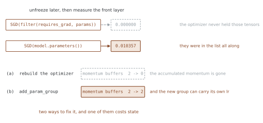
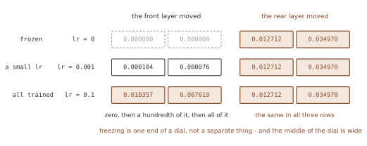

# 파라메터 동결과 해제

<div class="leadbox" markdown>

**들어가는 이야기** — 켜고 끄는 것이 아니라 돌리는 것

남이 트레인해 둔 모델을 가져다 쓸 때 가장 먼저 배우는 기법이 「앞쪽을
**동결한다**(freeze)」이다. 배우게 할 것과 그대로 둘 것을 **둘로 가르는** 일처럼 들린다.

그런데 동결한다는 것은 — `requires_grad_(False)`를 걸어 — 그 레이어의 **러닝레이트를
0으로 두는** 것과 같고, 0은 수 하나일 뿐이다. 0과 평소 쓰는 값 사이에는 자리가 아주 넓다. 이 쪽은 그
가운데 한 자리를 재어서 앞쪽 레이어가 **백분의 일만큼** 움직이는 것을 보인다.
실전의 미세조정은 대개 그 가운데를 쓴다.

여기에 조용한 함정이 하나 딸린다. 동결했다가 **중간에 동결을 해제하는**(unfreeze) 트레인에서,
`requires_grad_(True)`를 제대로 불렀는데도 그 레이어가 끝까지 안 배우는 경우가
있다. 오류는 나지 않는다.
무엇을 빠뜨린 것인지는 3절에서 본다.

</div>

「경사 추적 끄기」에서 `requires_grad_(False)`가 무엇을 하는지 보았다. 이 쪽은
그것을 **트레인 과정에 어떻게 엮는지**를 본다.

| 묻는 것 | |
|---|---|
| 동결한 채로 돌리다가 **중간에 동결을 해제하려면** | 옵티마이저를 어떻게 하는가 |
| 아예 동결하지 않고 | **레이어마다 다른 러닝레이트**를 주는 길 |

둘째 길이 실전에서 더 자주 쓰인다. 동결은 러닝레이트를 0으로 두는 것과
같고, 0과 평소 값 사이에 쓸 만한 자리가 넓기 때문이다.

## 1. 코드

```python
"""동결과 해제 — 미세조정의 실제 형태.

「경사 추적 끄기」에서 `requires_grad_(False)` 가 무엇을 하는지 보았다.
이 쪽은 그것을 **트레인 과정에 어떻게 엮는지**를 본다.

- 동결한 채로 돌리다가 **중간에 동결을 해제하려면** 옵티마이저를 어떻게 하는가
- 아예 동결하지 않고 **레이어마다 다른 러닝레이트**를 주는 길
- 둘을 견주면 어느 쪽이 무엇에 쓸모 있는가

실행: 이 쪽의 코드를 파일로 갈무리해 돌린다
"""
# torch 는 파이토치 본체다. torch.nn 은 레이어를 객체로 모아 둔 모듈이고(nn.Linear),
# torch.nn.functional 은 같은 계산을 함수로 모아 둔 모듈이다(F.mse_loss).
# 관례대로 nn, F 로 줄여 부른다.
import torch
import torch.nn as nn
import torch.nn.functional as F


def header(title):
    # 절 제목을 한 줄 찍는다. f"...{title}..." 은 문자열 안에 변수의 값을 끼워 넣는
    # 파이썬 문법(f-string)이고, 맨 앞의 \n 은 줄바꿈이라 제목 위에 빈 줄이 생긴다.
    print(f"\n=== {title} ===")


def make(seed=0):
    # 실험마다 「똑같은」 모델에서 시작하려고 모델 만드는 일을 함수로 뺐다.
    # torch.manual_seed 는 난수 시드를 고정한다. nn.Linear 가 웨이트를 난수로
    # 초기화하므로, 시드가 같으면 부를 때마다 초기 웨이트가 같은 모델이 나온다.
    # seed=0 은 기본값이다 — make() 처럼 인자 없이 부르면 0 을 쓴다.
    torch.manual_seed(seed)
    # nn.Sequential 은 레이어를 적은 차례대로 이어 붙인 모델이다. 레이어에는
    # 0, 1, 2 번호가 붙어 net[0], net[2] 로 꺼낼 수 있다.
    #   0 번  nn.Linear(4, 8)  선형 레이어. 수 4 개 → 8 개 (y = W x + b)
    #                          파라메터: weight (웨이트) (8, 4), bias (바이어스) (8,)
    #   1 번  nn.ReLU()        음수를 0 으로 바꾸는 엑티베이션 함수. 파라메터가 없다
    #   2 번  nn.Linear(8, 2)  수 8 개 → 2 개.  weight (2, 8), bias (2,)
    # 이 쪽에서는 0 번을 「사전 트레인된 앞쪽 레이어」, 2 번을 「새로 단 뒤쪽
    # 레이어」로 본다.
    return nn.Sequential(nn.Linear(4, 8), nn.ReLU(), nn.Linear(8, 2))


def data(seed=1):
    # 가짜 데이터를 만든다. 시드를 고정하므로 부를 때마다 같은 데이터다.
    # torch.randn(16, 4) 는 표준정규분포에서 뽑은 수로 채운 형태 (16, 4) 의 텐서다.
    #   입력 x — (16, 4)   수 4 개짜리 입력이 16 개 (배치 크기 16)
    #   정답 y — (16, 2)   모델의 출력과 같은 형태
    # 쉼표로 이어 돌려주면 둘이 한 묶음(튜플)으로 나가고, x, y = data() 로 나눠 받는다.
    torch.manual_seed(seed)
    return torch.randn(16, 4), torch.randn(16, 2)


def moved(net, before):
    # 한 스텝 뒤에 파라메터마다 「얼마나 움직였는가」를 수 하나씩으로 잰다.
    # before 는 스텝 전에 떠 둔 파라메터의 복사본 리스트다.
    #   net.parameters()     모델의 파라메터 텐서를 차례로 내준다 —
    #                        0.weight, 0.bias, 2.weight, 2.bias 순서다
    #   zip(...)             지금 값 p 와 옛 값 b 를 같은 자리끼리 짝짓는다
    #   p.detach() - b       지금 값 − 옛 값. detach() 는 경사 추적에서 떼어 낸
    #                        텐서를 준다 — 재기만 할 뿐 미분할 계산이 아니기 때문이다
    #   .abs().max()         절댓값을 취해 그중 가장 큰 것 하나. 가장 많이 움직인 성분이다
    #   .item()              수 하나짜리 텐서에서 파이썬 실수를 꺼낸다
    #   round(..., 6)        소수점 아래 여섯 자리로 반올림한다
    # 그래서 돌려주는 것은 수 네 개짜리 리스트다. 0.0 이면 그 파라메터는 안 움직였다.
    return [round((p.detach() - b).abs().max().item(), 6)
            for p, b in zip(net.parameters(), before)]


# ========================================================================
# 1. 동결 — 플래그와 옵티마이저
# ========================================================================

def freeze_basics():
    header("1. 동결한 레이어는 안 움직인다")
    # 모델과 데이터를 만든다. data() 가 돌려준 묶음을 (x, y) 로 풀어 받는다.
    net, (x, y) = make(), data()
    # 0 번 레이어를 동결한다 — 트레인에서 빼 값이 안 바뀌게 하는 것이다.
    # net[0].parameters() 는 그 레이어의 파라메터(weight, bias)만 내준다.
    # requires_grad_(False) 는 경사 추적(이 텐서가 들어간 계산을 기록해 미분할 수
    # 있게 하는 것)을 끈다. 그러면 역전파가 이 파라메터의 그래디언트를 구하지 않는다.
    # 이름 끝의 밑줄은 「새 텐서를 만들지 않고 제자리에서 바꾼다」는 표시다.
    for p in net[0].parameters():
        p.requires_grad_(False)
    # 옵티마이저를 만든다. 옵티마이저는 그래디언트를 보고 파라메터를 실제로 고치는
    # 물건이다. SGD 는 가장 단순한 것으로 「파라메터 ← 파라메터 − lr × 그래디언트」를 한다.
    #   첫 인자   고칠 파라메터들. 여기서는 동결한 것까지 「전부」 넘긴다
    #   lr=0.1    러닝레이트 — 한 스텝에 얼마나 크게 옮길지
    opt = torch.optim.SGD(net.parameters(), lr=0.1)
    # 스텝 전의 값을 떠 둔다. 파라메터는 제자리에서 고쳐지므로 복사해 두지 않으면
    # 옛 값이 남지 않는다. detach() 로 경사 추적에서 떼고 clone() 으로 복사한다.
    before = [p.detach().clone() for p in net.parameters()]
    # 여기부터 세 줄이 트레인 한 스텝이다.
    # (1) zero_grad() — 앞 스텝에서 남은 그래디언트를 지운다. backward() 는 .grad 에
    #     「더해」 넣으므로 스텝마다 먼저 지워야 한다. 기본 동작은 .grad 를 None 으로
    #     두는 것이다.
    opt.zero_grad()
    # (2) 순전파와 역전파. net(x) 는 모델의 출력 (16, 2) 이고, F.mse_loss(출력, 정답)
    #     은 둘의 차를 제곱해 평균 낸 로스(수 하나)다. backward() 가 그 로스를 각
    #     파라메터로 미분해 .grad 에 넣는다. 동결한 0 번 레이어의 .grad 는 None 으로
    #     남는다.
    F.mse_loss(net(x), y).backward()
    # (3) step() — 옵티마이저가 든 파라메터를 .grad 로 한 번 고친다.
    #     .grad 가 None 인 파라메터는 건너뛴다.
    opt.step()
    print("  움직인 거리:", moved(net, before))    # [0.weight, 0.bias, 2.weight, 2.bias]
    print("  앞 두 개가 0 이다 — 동결한 레이어의 weight 와 bias")
    print("  opt 에 전부 넘겼는데도 안 움직였다. 그래디언트가 None 이라 건너뛴다")


# ========================================================================
# 2. 동결 해제 — 옵티마이저를 어떻게 하는가
# ========================================================================

def unfreeze():
    header("2. 동결을 해제할 때 옵티마이저")
    x, y = data()

    # 옵티마이저를 만드는 두 방식을 차례로 시험한다. 짝마다 (라벨, 옵티마이저를 만드는
    # 함수)다. lambda n: ... 은 이름 없는 한 줄짜리 함수로, 모델 n 을 받아 옵티마이저를
    # 돌려준다. 함수로 싸 둔 것은 아래에서 「동결한 뒤」에 만들어야 하기 때문이다.
    for label, build_opt in (
        # 첫째 — 걸러서 넘긴다. [p for p in ... if p.requires_grad] 는 경사 추적이
        # 켜진 파라메터만 모은 리스트다. 만드는 순간 동결돼 있는 것은 빠진다.
        ("거르고 만든 옵티마이저", lambda n: torch.optim.SGD(
            [p for p in n.parameters() if p.requires_grad], lr=0.1)),
        # 둘째 — 거르지 않고 전부 넘긴다. 동결한 것도 옵티마이저의 목록에 들어 있다.
        ("전부 넘긴 옵티마이저", lambda n: torch.optim.SGD(
            n.parameters(), lr=0.1)),
    ):
        net = make()                         # 두 번 다 같은 초기 웨이트에서 시작한다
        for p in net[0].parameters():        # 0 번 레이어를 동결한다
            p.requires_grad_(False)
        opt = build_opt(net)                 # 동결한 상태에서 옵티마이저를 만든다
        for p in net[0].parameters():        # 동결을 해제한다
            p.requires_grad_(True)           # 경사 추적을 다시 켠다
        # 이제 트레인 한 스텝을 하고 얼마나 움직였는지 잰다. 동결은 풀렸으므로
        # 역전파는 두 쪽 모두 0 번 레이어의 .grad 를 채운다. 갈리는 것은 step() 이다 —
        # 옵티마이저는 「만들 때 받은 목록」에 있는 파라메터만 고친다.
        before = [p.detach().clone() for p in net.parameters()]    # 스텝 전 값의 복사본
        opt.zero_grad()                      # 남은 그래디언트를 지운다
        F.mse_loss(net(x), y).backward()     # 순전파 → 로스 → 역전파
        opt.step()                           # 목록에 든 파라메터만 고친다
        # {label:22s} 는 라벨을 22 칸에 맞춰 찍으라는 뜻이다.
        print(f"  {label:22s} 움직인 거리 {moved(net, before)}")
    print("  거르고 만든 쪽은 동결을 해제해도 앞 두 개가 0 이다")
    print("  옵티마이저가 그 텐서를 애초에 안 들고 있기 때문이다")


# ========================================================================
# 3. 고치는 두 길
# ========================================================================

def two_fixes():
    header("3. 고치는 두 길")
    x, y = data()

    # (가) 옵티마이저를 다시 만든다
    net = make()
    for p in net[0].parameters():            # 0 번 레이어를 동결한다
        p.requires_grad_(False)
    # 걸러서 만든다. 이번에는 momentum=0.9 를 준다. 모멘텀은 지난 스텝들의 그래디언트를
    # 0.9 배씩 줄여 가며 쌓아 둔 값을 함께 써서 옮기는 방법이다. 그 쌓아 둔 값을
    # 옵티마이저가 파라메터마다 하나씩 간직하는데, 이것이 모멘텀 버퍼다.
    opt = torch.optim.SGD([p for p in net.parameters() if p.requires_grad],
                          lr=0.1, momentum=0.9)
    # 트레인 한 스텝. 세미콜론(;)은 여러 문장을 한 줄에 적는 파이썬 문법이다.
    # 이 한 스텝으로 2 번 레이어의 weight 와 bias 에 모멘텀 버퍼가 하나씩 생긴다.
    opt.zero_grad(); F.mse_loss(net(x), y).backward(); opt.step()
    # opt.state 는 옵티마이저가 파라메터마다 간직하는 상태의 사전이다
    # {파라메터: {"momentum_buffer": 텐서}}. len 은 상태를 가진 파라메터의 수다 — 2.
    carried = len(opt.state)
    for p in net[0].parameters():            # 동결을 해제한다
        p.requires_grad_(True)
    # 이제 전부 넘겨 옵티마이저를 새로 만든다. 같은 이름 opt 에 새 것을 넣으므로
    # 옛 옵티마이저와 거기 쌓였던 버퍼는 버려진다. 새 것의 state 는 비어 있다 — 0.
    opt = torch.optim.SGD(net.parameters(), lr=0.1, momentum=0.9)
    print(f"  (가) 다시 만들기: 모멘텀 버퍼 {carried}개 -> {len(opt.state)}개")
    print("       쌓아 둔 모멘텀을 잃는다")

    # (나) 집어넣는다
    # 앞부분은 (가)와 똑같다 — 동결하고, 걸러서 만들고, 한 스텝 간다.
    net2 = make()
    for p in net2[0].parameters():
        p.requires_grad_(False)
    opt2 = torch.optim.SGD([p for p in net2.parameters() if p.requires_grad],
                           lr=0.1, momentum=0.9)
    opt2.zero_grad(); F.mse_loss(net2(x), y).backward(); opt2.step()
    kept = len(opt2.state)                   # 모멘텀 버퍼 2 개
    for p in net2[0].parameters():           # 동결을 해제한다
        p.requires_grad_(True)
    # 옵티마이저를 버리지 않고, 빠져 있던 파라메터를 「그룹」으로 더해 넣는다.
    # 파라메터 그룹은 같은 설정(러닝레이트 따위)을 함께 쓰는 파라메터의 묶음이다.
    # 사전으로 적는다 — "params" 에 파라메터들, "lr" 에 이 그룹만의 러닝레이트.
    # 원래 있던 그룹과 그 버퍼는 건드리지 않는다.
    opt2.add_param_group({"params": list(net2[0].parameters()), "lr": 0.01})
    print(f"  (나) add_param_group: 모멘텀 버퍼 {kept}개 그대로")
    # opt2.param_groups 는 그룹의 리스트다. 그룹마다 g['lr'] 로 러닝레이트를 꺼낸다.
    # 처음 그룹은 0.1, 방금 더한 그룹은 0.01 이다.
    print(f"       그룹 {len(opt2.param_groups)}개, lr {[g['lr'] for g in opt2.param_groups]}")
    print("       동결을 해제한 레이어에 작은 lr 을 따로 줄 수도 있다")


# ========================================================================
# 4. 동결하지 않고 러닝레이트만 낮추기
# ========================================================================

def layerwise_lr():
    header("4. 레이어마다 다른 러닝레이트")
    net, (x, y) = make(), data()
    # 아무것도 동결하지 않는다. 대신 옵티마이저를 만들 때부터 파라메터 그룹 둘로
    # 나눠 넘기고, 그룹마다 러닝레이트를 따로 적는다.
    opt = torch.optim.SGD([
        {"params": net[0].parameters(), "lr": 0.001},   # 앞쪽 레이어 — 아주 작게
        {"params": net[2].parameters(), "lr": 0.1},     # 뒤쪽 레이어 — 평소대로
    ])
    before = [p.detach().clone() for p in net.parameters()]    # 스텝 전 값의 복사본
    opt.zero_grad()                          # 남은 그래디언트를 지운다
    F.mse_loss(net(x), y).backward()         # 순전파 → 로스 → 역전파
    opt.step()                               # 그룹마다 제 러닝레이트로 고친다
    # 앞 두 개가 0 이 아니다. 러닝레이트가 0.1 의 백분의 일이라 움직인 거리도
    # 전부 0.1 로 트레인할 때(5 절의 셋째 줄)의 백분의 일이다.
    print("  움직인 거리:", moved(net, before))
    print("  앞쪽이 0 은 아닌데 백 배 작다")
    print("  동결이 lr=0 이라면, 이것은 아주 작은 lr 이다")
    print("  사전트레인 피처를 지키면서도 조금은 맞춰 간다")


# ========================================================================
# 5. 셋을 한자리에
# ========================================================================

def compare_all():
    header("5. 세 가지를 나란히")
    x, y = data()
    rows = []                                # (이름, 움직인 거리 넷) 을 모아 둘 리스트

    # 세 가지를 같은 모델·같은 데이터로 한 스텝씩 한다. 다른 것은 앞쪽 레이어를
    # 다루는 방식뿐이다.
    # 첫째 — 0 번 레이어를 동결한다(1 절과 같다).
    net = make()
    for p in net[0].parameters():
        p.requires_grad_(False)
    opt = torch.optim.SGD(net.parameters(), lr=0.1)
    before = [p.detach().clone() for p in net.parameters()]
    opt.zero_grad(); F.mse_loss(net(x), y).backward(); opt.step()    # 트레인 한 스텝
    rows.append(("동결하기", moved(net, before)))

    # 둘째 — 동결하지 않고 앞쪽에만 작은 러닝레이트를 준다(4 절과 같다).
    net = make()
    opt = torch.optim.SGD([{"params": net[0].parameters(), "lr": 0.001},
                           {"params": net[2].parameters(), "lr": 0.1}])
    before = [p.detach().clone() for p in net.parameters()]
    opt.zero_grad(); F.mse_loss(net(x), y).backward(); opt.step()
    rows.append(("작은 lr", moved(net, before)))

    # 셋째 — 아무 구별 없이 전부 러닝레이트 0.1 로 트레인한다.
    net = make()
    opt = torch.optim.SGD(net.parameters(), lr=0.1)
    before = [p.detach().clone() for p in net.parameters()]
    opt.zero_grad(); F.mse_loss(net(x), y).backward(); opt.step()
    rows.append(("전부 트레인", moved(net, before)))

    # 표로 찍는다. 먼저 머리 줄이다. {'':10s} 는 빈 글자를 10 칸에 찍어 이름 열을
    # 비워 두고, {'0.weight':>10s} 는 10 칸에 오른쪽으로 붙여 찍는다(> 가 오른쪽 맞춤).
    print(f"  {'':10s} {'0.weight':>10s} {'0.bias':>10s} "
          f"{'2.weight':>10s} {'2.bias':>10s}")
    # 줄마다 이름과 네 수를 찍는다. m[0] ~ m[3] 은 moved() 가 준 리스트의 네 성분이고,
    # :>10.6f 는 10 칸에 오른쪽으로 붙여 소수점 아래 여섯 자리까지 찍으라는 뜻이다.
    for name, m in rows:
        print(f"  {name:10s} {m[0]:>10.6f} {m[1]:>10.6f} "
              f"{m[2]:>10.6f} {m[3]:>10.6f}")
    print("  뒤쪽 레이어는 셋 다 같다 — 앞쪽을 어떻게 하든 영향이 없다")


def main():
    # 절마다 함수 하나다. 시드는 make() 와 data() 가 부를 때마다 고정한다.
    freeze_basics()
    unfreeze()
    two_fixes()
    layerwise_lr()
    compare_all()


# 이 파일을 직접 돌렸을 때만 main() 을 부른다. 다른 파일이 import 로 불러 쓸 때는
# __name__ 이 "__main__" 이 아니어서 아무것도 실행되지 않는다.
if __name__ == "__main__":
    main()
```

**출력:**

```
=== 1. 동결한 레이어는 안 움직인다 ===
  움직인 거리: [0.0, 0.0, 0.012712, 0.03497]
  앞 두 개가 0 이다 — 동결한 레이어의 weight 와 bias
  opt 에 전부 넘겼는데도 안 움직였다. 그래디언트가 None 이라 건너뛴다

=== 2. 동결을 해제할 때 옵티마이저 ===
  거르고 만든 옵티마이저           움직인 거리 [0.0, 0.0, 0.012712, 0.03497]
  전부 넘긴 옵티마이저            움직인 거리 [0.010357, 0.007619, 0.012712, 0.03497]
  거르고 만든 쪽은 동결을 해제해도 앞 두 개가 0 이다
  옵티마이저가 그 텐서를 애초에 안 들고 있기 때문이다

=== 3. 고치는 두 길 ===
  (가) 다시 만들기: 모멘텀 버퍼 2개 -> 0개
       쌓아 둔 모멘텀을 잃는다
  (나) add_param_group: 모멘텀 버퍼 2개 그대로
       그룹 2개, lr [0.1, 0.01]
       동결을 해제한 레이어에 작은 lr 을 따로 줄 수도 있다

=== 4. 레이어마다 다른 러닝레이트 ===
  움직인 거리: [0.000104, 7.6e-05, 0.012712, 0.03497]
  앞쪽이 0 은 아닌데 백 배 작다
  동결이 lr=0 이라면, 이것은 아주 작은 lr 이다
  사전트레인 피처를 지키면서도 조금은 맞춰 간다

=== 5. 세 가지를 나란히 ===
               0.weight     0.bias   2.weight     2.bias
  동결하기          0.000000   0.000000   0.012712   0.034970
  작은 lr        0.000104   0.000076   0.012712   0.034970
  전부 트레인        0.010357   0.007619   0.012712   0.034970
  뒤쪽 레이어는 셋 다 같다 — 앞쪽을 어떻게 하든 영향이 없다
```

## 2. 동결한 레이어는 옵티마이저에 넘겨도 안 움직인다

```
움직인 거리: [0.0, 0.0, 0.012712, 0.03497]
```

`net.parameters()`를 통째로 넘겼는데 앞 두 개가 정확히 0이다. 그래디언트가 `None`이라
`step()`이 건너뛰기 때문이다.

그래서 **거르지 않아도 된다.** 거르면 옵티마이저가 드는 목록이 짧아지기는 하지만, 다음 절을
보면 안 거르는 쪽이 편한 자리가 있다.

## 3. 동결을 해제할 때 걸리는 자리

```
거르고 만든 옵티마이저   움직인 거리 [0.0, 0.0, 0.012712, 0.03497]
전부 넘긴 옵티마이저    움직인 거리 [0.010357, 0.007619, 0.012712, 0.03497]
```



**플래그를 되돌렸는데 거른 쪽은 여전히 0이다.**

옵티마이저는 만들 때 받은 텐서 목록을 들고 있고, 그 목록에 없는 것은 영영
갱신하지 않는다. `requires_grad`를 되돌려 그래디언트는 오는데, 그것으로 갱신해 줄
옵티마이저가 없다.

오류가 안 난다는 점이 나쁘다. 단계적으로 동결을 해제하는 트레인에서 **동결을 해제한 레이어가 안
배우는 채로 끝까지 간다.**

## 4. 고치는 두 길

```
(가) 다시 만들기: 모멘텀 버퍼 2개 -> 0개
     쌓아 둔 모멘텀을 잃는다
(나) add_param_group: 모멘텀 버퍼 2개 그대로
     그룹 2개, lr [0.1, 0.01]
```

**(가) 옵티마이저를 다시 만든다.** 간단하지만 쌓아 둔 상태를 전부 버린다.
모멘텀 버퍼가 2개에서 0개가 되었다. Adam이라면 1·2차 모멘트(그래디언트와 그 제곱의 이동 평균)가 모두 날아가고,
「모델 체크포인트」에서 본 대로 Adam의 **첫 스텝이 1.64배 커진다.**

**(나) `add_param_group`으로 집어넣는다.** 기존 상태가 그대로 남고, 덤으로 동결을 해제한
레이어에 **다른 러닝레이트**를 줄 수 있다. 사전 트레인된 레이어의 동결을 해제할 때는 작은 값을
주는 것이 보통이므로 이쪽이 맞다.

```python
# 동결을 해제한 0 번 레이어의 파라메터를 새 그룹으로 더한다.
# 이 그룹만 러닝레이트가 0.01 이다.
opt.add_param_group({"params": net[0].parameters(), "lr": 0.01})
```

> 애초에 `net.parameters()`를 통째로 넘겨 두었다면 이 문제가 없다. 동결한 동안은
> 그래디언트가 `None`이라 건너뛰고, 동결을 해제하면 저절로 갱신되기 시작한다. 러닝레이트를 따로
> 줄 필요가 없다면 그쪽이 가장 간단하다.

## 5. 동결하지 않고 러닝레이트만 낮추기

```
움직인 거리: [0.000104, 7.6e-05, 0.012712, 0.03497]
```

앞쪽이 0은 아닌데 **백 배 작다.** `lr=0.001`과 `lr=0.1`의 비 그대로다.

```python
# 파라메터를 통째로 넘기는 대신 그룹(사전)의 리스트로 넘긴다. 그룹마다 lr 이 따로다.
opt = torch.optim.SGD([
    {"params": net[0].parameters(), "lr": 0.001},   # 앞쪽 레이어 — 백 배 작게
    {"params": net[2].parameters(), "lr": 0.1},     # 뒤쪽 레이어
])
```

**동결이 $\eta = 0$이라면 이것은 아주 작은 $\eta$다.** 사전 트레인된 피처를 거의
지키면서도 새 데이터에 조금씩 맞춰 간다.

## 6. 셋을 나란히

```
             0.weight     0.bias   2.weight     2.bias
동결하기        0.000000   0.000000   0.012712   0.034970
작은 lr      0.000104   0.000076   0.012712   0.034970
전부 트레인      0.010357   0.007619   0.012712   0.034970
```



앞쪽 열이 **0 → 0.0001 → 0.0104**로 벌어진다. 연속된 스케일 위의 세 점이고,
가운데가 마지막의 꼭 **100분의 1**이다 — 러닝레이트를 0.1에서 0.001로 둔
그대로다.

뒤쪽 두 열은 **셋 다 똑같다.** 앞쪽을 어떻게 하든 뒤쪽 레이어가 받는 그래디언트는 그대로다
— 「경사 추적 끄기」에서 본 대로 동결한 레이어도 그래디언트를 통과시키기 때문이다.

실전의 쓰임을 정리하면 이렇다.

| | 쓸 자리 |
|---|---|
| **동결** | 데이터가 아주 적을 때, 피처 추출기로만 쓸 때 |
| **작은 lr** | 미세조정의 기본. 데이터가 어느 정도 있을 때 |
| **전부 같은 lr** | 데이터가 많고 도메인이 많이 다를 때 |

## 연습문제

<div class="drillbox" markdown>

**연습문제 1.** <span class="diff easy" title="쉬움"></span>
`Linear(784,256) → Linear(256,128) → Linear(128,10)` 뉴럴 네트워크에서 앞 두 레이어를 동결하면
트레인되는 파라메터가 몇 퍼센트 남는가?

</div>

??? success "풀이"
    ```python
    # 본문 코드의 import (torch, nn, F) 가 되어 있다고 보고 적는다.
    # 선형 레이어 셋을 ReLU 로 이은 모델이다. 번호는 0 (Linear), 1 (ReLU),
    # 2 (Linear), 3 (ReLU), 4 (Linear) 이므로 선형 레이어는 net[0], net[2], net[4] 다.
    # nn.Linear(입력, 출력) 의 파라메터 수는 웨이트 입력×출력 개에 바이어스 출력 개다.
    net = nn.Sequential(nn.Linear(784, 256), nn.ReLU(),    # 784*256 + 256 = 200,960
                        nn.Linear(256, 128), nn.ReLU(),    # 256*128 + 128 =  33,024
                        nn.Linear(128, 10))                # 128*10  + 10  =   1,290

    def summary(m):
        # (전체 파라메터 수, 트레인되는 파라메터 수, 그 비율 %) 를 돌려준다.
        # m.parameters() 는 모델의 파라메터 텐서를 하나씩 내주고, numel() 은 텐서에
        # 든 수의 개수다. sum 으로 다 더하면 전체 파라메터 수가 된다.
        t = sum(p.numel() for p in m.parameters())
        # 끝에 if p.requires_grad 를 붙이면 경사 추적이 켜진 것, 곧 트레인되는 것만 센다.
        tr = sum(p.numel() for p in m.parameters() if p.requires_grad)
        return t, tr, 100 * tr / t

    # "...{:,}...{:.1f}...".format(값들) 은 { } 자리에 값을 차례로 끼워 넣는다.
    # {:,} 는 세 자리마다 쉼표를 찍고(235,146), {:.1f} 는 소수점 아래 한 자리까지 찍는다.
    # *summary(net) 의 * 는 돌려받은 셋을 풀어 인자 셋으로 넘긴다.
    print("  처음        : 전체 {:,}  트레인 {:,}  ({:.1f}%)".format(*summary(net)))
    # 앞의 두 선형 레이어를 동결한다. requires_grad_(False) 가 경사 추적을 꺼서
    # 그 파라메터를 트레인에서 뺀다. 남는 것은 net[4] 의 1,290 개다.
    for layer in (net[0], net[2]):
        for p in layer.parameters():
            p.requires_grad_(False)
    print("  앞 둘 동결  : 전체 {:,}  트레인 {:,}  ({:.1f}%)".format(*summary(net)))

    # 트레인되는 파라메터만 걸러 옵티마이저를 만든다. SGD 는 「파라메터 ← 파라메터 −
    # lr × 그래디언트」로 고치는 옵티마이저이고, momentum=0.9 를 주면 지난 그래디언트를
    # 쌓아 둔 모멘텀 버퍼를 파라메터마다 하나씩 간직한다.
    opt = torch.optim.SGD([p for p in net.parameters() if p.requires_grad],
                          lr=0.1, momentum=0.9)
    # 난수의 시드를 고정한다. 아래에서 뽑는 텐서가 돌릴 때마다 같은 값이 된다.
    torch.manual_seed(0)
    # 한 스텝 간다. 입력은 형태 (8, 784), 출력은 (8, 10) 이다. 여기서는 버퍼가 생기는지만
    # 보면 되므로 출력을 다 더한 값(.sum())을 로스 삼아 역전파한다.
    net(torch.randn(8, 784)).sum().backward()
    opt.step()                               # 이때 모멘텀 버퍼가 만들어진다
    # opt.state 는 파라메터마다의 상태를 담은 사전이다. 버퍼를 가진 파라메터는
    # net[4] 의 weight 와 bias 둘이다.
    print("  옵티마이저 상태 버퍼 수:", len(opt.state))
    ```

    ```
      처음        : 전체 235,146  트레인 235,146  (100.0%)
      앞 둘 동결  : 전체 235,146  트레인 1,290  (0.5%)
      옵티마이저 상태 버퍼 수: 2
    ```

    **0.5%만 남는다.** 23만 개 중 1,290개다.

    모델의 무게가 앞쪽에 몰려 있기 때문이다 — `Linear(784, 256)` 하나가 20만
    개를 넘는다. 「실전 예제」에서 `fc1`이 전체의 91%를 차지한 것과 같은 모습이다.

    옵티마이저 상태가 **2개**인 것도 보아 둘 만하다. 모멘텀 버퍼는 트레인되는
    텐서 수만큼만 생긴다. 전부 넘겼더라도 마찬가지다 — 2절에서 본 대로 `step()`은
    그래디언트가 `None`인 파라메터를 건너뛰므로, 동결한 텐서에는 버퍼를 만들지 않는다.

---

<div class="drillbox" markdown>

**연습문제 2.** <span class="diff med" title="중간"></span>
레이어가 셋인 뉴럴 네트워크에 레이어마다 다른 러닝레이트(0.001 / 0.01 / 0.1)를 주고, 움직인
거리가 그 비를 따르는지 확인하라. 그리고 **트레인 도중에 전부 열 배로** 올려라.

</div>

??? success "풀이"
    ```python
    torch.manual_seed(0)                          # 초기 웨이트를 고정한다
    # 선형 레이어 셋을 바로 이어 붙인다(ReLU 없이). 번호는 0, 1, 2 다.
    net = nn.Sequential(nn.Linear(4, 8), nn.Linear(8, 8), nn.Linear(8, 2))
    x, y = data()                                 # 위 프로그램의 data() 를 그대로 쓴다
    # 레이어마다 파라메터 그룹을 하나씩 만든다. Sequential 을 for 로 돌면 레이어가
    # 차례로 나오고, zip 이 레이어 l 과 러닝레이트 lr 을 같은 자리끼리 짝짓는다.
    #   0 번 레이어 — 0.001     1 번 레이어 — 0.01     2 번 레이어 — 0.1
    # 그룹은 사전이다 — "params" 에 그 레이어의 파라메터, "lr" 에 그 그룹의 러닝레이트.
    opt = torch.optim.SGD([{"params": l.parameters(), "lr": lr}
                           for l, lr in zip(net, (0.001, 0.01, 0.1))])
    # 스텝 전의 값을 복사해 둔다(detach 로 경사 추적에서 떼고 clone 으로 복사한다).
    before = [p.detach().clone() for p in net.parameters()]
    opt.zero_grad()                               # 남은 그래디언트를 지운다
    F.mse_loss(net(x), y).backward()              # 순전파 → 제곱오차 로스 → 역전파
    opt.step()                                    # 그룹마다 제 러닝레이트로 한 스텝
    # 파라메터는 여섯 개다 — 레이어마다 weight, bias 순서로 둘씩. enumerate 가 번호
    # i (0 ~ 5) 를 붙여 준다. i // 2 는 2 로 나눈 몫이라 0, 0, 1, 1, 2, 2 가 되어
    # 그 파라메터가 속한 레이어 번호가 된다.
    # 움직임은 (지금 값 − 옛 값) 의 절댓값 가운데 가장 큰 것이다.
    for i, (p, b) in enumerate(zip(net.parameters(), before)):
        print(f"  파라메터 {i} (레이어 {i // 2}, lr {[0.001, 0.01, 0.1][i // 2]})  "
              f"움직임 {(p.detach() - b).abs().max():.6f}")

    # 트레인 도중에 러닝레이트를 바꾼다. opt.param_groups 는 그룹(사전)의 리스트이고,
    # 그 "lr" 값을 고치면 다음 step() 부터 새 값이 쓰인다. *= 10 은 열 배로 만든다.
    for g in opt.param_groups:
        g["lr"] *= 10
    print("  lr 을 열 배로:", [g["lr"] for g in opt.param_groups])
    ```

    ```
      파라메터 0 (레이어 0, lr 0.001)  움직임 0.000068
      파라메터 1 (레이어 0, lr 0.001)  움직임 0.000039
      파라메터 2 (레이어 1, lr 0.01)  움직임 0.000752
      파라메터 3 (레이어 1, lr 0.01)  움직임 0.000951
      파라메터 4 (레이어 2, lr 0.1)  움직임 0.018504
      파라메터 5 (레이어 2, lr 0.1)  움직임 0.028939
      lr 을 열 배로: [0.01, 0.1, 1.0]
    ```

    **러닝레이트를 따라 벌어진다** — 웨이트만 보면 0.00007, 0.0008, 0.0185. 다만
    정확히 열 배씩은 아닌데(열한 배, 스물다섯 배),
    레이어마다 그래디언트의 크기 자체가 다르기 때문이다. 움직인 거리는 $\eta \times
    |\nabla|$이므로 둘 다 작용한다.

    `param_groups`의 `lr`을 직접 고치면 트레인 도중에 바꿀 수 있다. **스케줄러가
    하는 일이 정확히 이것**이고, 그래서 스케줄러도 그룹마다 다른 값을 유지한다.

    출력에 가까운 레이어일수록 러닝레이트를 키우는 이 형태를 **차등 러닝레이트**(discriminative
    learning rates)라 부른다. 사전 트레인된 피처는 조금만, 새로 단 헤드는 크게
    움직이게 한다.

---

<div class="drillbox" markdown>

**연습문제 3.** <span class="diff hard" title="어려움"></span>
트레인 **도중에** 레이어를 동결하면 옵티마이저에 쌓인 모멘텀은 어떻게 되는가? 동결한
레이어가 그 모멘텀으로 계속 움직이지는 않는가?

</div>

??? success "풀이"
    ```python
    torch.manual_seed(0)
    net = nn.Sequential(nn.Linear(4, 8), nn.Linear(8, 2))    # 선형 레이어 둘 — 0 번, 1 번
    x, y = data()                                 # 위 프로그램의 data() 를 그대로 쓴다
    # 전부 넘겨 옵티마이저를 만든다. momentum=0.9 라 스텝마다 지난 그래디언트를
    # 쌓은 모멘텀 버퍼가 파라메터마다 하나씩 생긴다.
    opt = torch.optim.SGD(net.parameters(), lr=0.1, momentum=0.9)
    # 먼저 아무것도 동결하지 않고 세 스텝 트레인해 모멘텀을 쌓는다.
    # _ 은 「안 쓰는 값」 자리에 관례로 두는 이름이다 — 세 번 되풀이만 한다.
    for _ in range(3):
        opt.zero_grad()                           # 남은 그래디언트를 None 으로 지운다
        F.mse_loss(net(x), y).backward()          # 순전파 → 제곱오차 로스 → 역전파
        opt.step()                                # 그래디언트와 모멘텀으로 고친다
    # opt.state 는 {파라메터: 그 파라메터의 상태} 사전이다. 0 번 레이어의 웨이트를
    # 열쇠로 넣어 그 모멘텀 버퍼(웨이트와 같은 형태 (8, 4) 의 텐서)를 꺼내고,
    # 절댓값의 최댓값을 내어 「얼마나 쌓였는가」를 수 하나로 본다.
    buf = opt.state[net[0].weight]["momentum_buffer"].abs().max().item()
    print(f"  동결 전 0번 레이어 모멘텀 버퍼 최대 {buf:.6f}")

    # 이제 트레인 도중에 0 번 레이어를 동결한다. 옵티마이저는 그대로 둔다.
    for p in net[0].parameters():
        p.requires_grad_(False)                   # 경사 추적을 끈다
    w_before = net[0].weight.detach().clone()     # 동결한 순간의 웨이트를 복사해 둔다
    # 동결한 채로 세 스텝 더 간다. zero_grad() 가 0 번 레이어의 .grad 를 None 으로
    # 두고, 경사 추적이 꺼져 있어 backward() 가 다시 채우지 않는다. step() 은 .grad 가
    # None 인 파라메터를 건너뛰므로 버퍼에 모멘텀이 남아 있어도 쓰지 않는다.
    for _ in range(3):
        opt.zero_grad()
        F.mse_loss(net(x), y).backward()
        opt.step()
    # torch.equal 은 두 텐서의 형태와 모든 값이 똑같으면 True 다. 앞에 not 을 붙여
    # 「달라졌는가」로 뒤집는다. False 면 한 성분도 안 움직인 것이다.
    print("  동결한 뒤 0번 레이어가 움직였나:",
          not torch.equal(net[0].weight.detach(), w_before))
    # opt.state.get(열쇠, {}) 는 그 열쇠가 없으면 빈 사전을 준다. 그 안에
    # "momentum_buffer" 가 들어 있는지를 in 으로 묻는다.
    print("  버퍼가 남아 있나:",
          "momentum_buffer" in opt.state.get(net[0].weight, {}))
    ```

    ```
      동결 전 0번 레이어 모멘텀 버퍼 최대 0.482482
      동결한 뒤 0번 레이어가 움직였나: False
      버퍼가 남아 있나: True
    ```

    **움직이지 않는다.** 모멘텀 버퍼에 0.48이 쌓여 있는데도 그렇다.

    까닭은 `step()`이 **그래디언트가 `None`인 파라메터를 아예 건너뛰기** 때문이다.
    버퍼를 읽지도 쓰지도 않고 지나간다. 「경사를 0으로 만드는 세 가지 방법」에서 `set_to_none=True`와
    0으로 채우기가 갈렸던 것이 바로 이 분기다 — 0으로 채워 두었다면 `step()`이
    들어가서 모멘텀으로 밀었을 것이다.

    버퍼는 **남아 있다.** 나중에 동결을 해제하면 그 모멘텀이 그대로 다시 작용한다. 좋을
    수도 나쁠 수도 있다 — 동결해 둔 동안 다른 레이어가 많이 바뀌었다면, 옛 모멘텀은
    이제 맞지 않는 방향일 수 있다.

    깔끔하게 하려면 동결을 해제할 때 그 파라메터의 상태를 비우면 된다.

    ```python
    for p in net[0].parameters():
        # pop(p, None) 은 사전에서 열쇠 p 의 항목을 지운다. 없어도 오류를 내지 않는다.
        opt.state.pop(p, None)       # 쌓인 모멘텀을 버린다
        p.requires_grad_(True)       # 경사 추적을 다시 켠다 — 동결 해제
    ```
