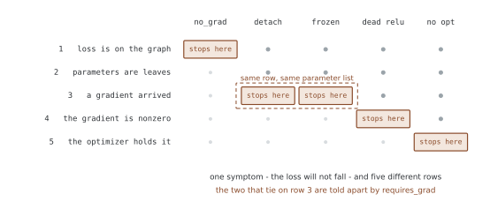

# 함정과 점검 사항

<div class="leadbox" markdown>

**들어가는 이야기** — 증상이 하나뿐일 때

트레인이 안 되면 거의 언제나 같은 모습으로 나타난다. 로스가 안 줄고, 오류는 안
나고, 프로그램은 끝까지 돈다. **증상이 하나**인 것이다.

증상이 하나면 어디부터 보아야 할지 알 수가 없다. 그래서 코드를 위에서부터
다시 읽게 되는데, 다시 읽어서 찾는 버그라면 애초에 안 넣었을 것이다.

이 쪽은 다른 길을 간다. **다섯 줄짜리 점검표**를 하나 만들고, 일부러 다섯
가지로 망가뜨린 모델을 차례로 걸어 본다. 다섯이 대개 **서로 다른 줄에서** 걸리므로,
걸린 줄 번호가 곧 원인을 가리킨다.

다만 다섯 가운데 **둘은 같은 줄에서 걸린다.** 점검표가 못 가르는 자리가 있다는
뜻이고, 그 둘을 가르는 물음도 함께 적어 둔다.

</div>

"트레인이 안 된다"는 증상 하나에 원인이 여럿이다. 로스가 안 줄고, 오류도 안
나고, 어디부터 보아야 할지 모르겠다.

이 쪽은 **점검표**를 하나 만들어 망가뜨린 모델 다섯에 차례로 걸어 본다. 각
경우가 점검표의 **어느 줄에서 걸리는지**를 보면 증상과 원인이 이어진다.

| | 보는 것 |
|---|---|
| 1 | 로스가 그래프 위에 있는가 — `requires_grad`, `grad_fn` |
| 2 | 파라메터가 리프(leaf) 텐서인가, 곧 연산의 결과가 아니라 직접 만든 텐서인가 — `is_leaf` |
| 3 | 역전파 뒤 그래디언트가 왔는가 — `.grad is None` |
| 4 | 그래디언트가 0이 아닌가 |
| 5 | 옵티마이저가 그 파라메터를 들고 있는가 |

## 1. 코드

```python
"""그래디언트가 안 올 때 — 차례로 짚어 보는 다섯 가지.

"트레인이 안 된다" 는 증상 하나에 원인이 여럿이다. 로스는 줄지 않고
오류도 안 난다. 어디부터 보아야 하는가.

이 쪽은 점검 함수를 하나 만들어, 망가뜨린 모델 다섯에 차례로
걸어 본다. 각 경우가 **점검표의 어느 줄에서 걸리는지**를 보면
증상과 원인이 이어진다.

점검 순서
1. 로스가 그래프 위에 있는가 (`requires_grad`, `grad_fn`)
2. 파라메터가 리프인가 (`is_leaf`)
3. 역전파 뒤 그래디언트가 왔는가 (`.grad is None`)
4. 그래디언트가 0 이 아닌가
5. 옵티마이저가 그 파라메터를 들고 있는가

실행: 이 쪽의 코드를 파일로 갈무리해 돌린다
"""
# 파이토치를 불러온다. torch.randn, torch.no_grad, torch.optim 이 여기서 온다.
import torch
# torch.nn 은 레이어를 모아 둔 꾸러미다(nn.Linear, nn.ReLU). 관례대로 nn 으로 줄인다.
import torch.nn as nn
# torch.nn.functional 은 같은 일을 함수로 모아 둔 것이다. 관례대로 F 로 줄이고,
# 여기서는 로스 함수 F.mse_loss 를 쓴다.
import torch.nn.functional as F


# 절 제목을 찍는 작은 도우미다. f"...{title}..." 은 문자열 안의 중괄호 자리에
# 값을 끼워 넣는 파이썬 문법이고, \n 은 줄바꿈이라 제목 앞에 빈 줄이 하나 생긴다.
def header(title):
    print(f"\n=== {title} ===")


# ========================================================================
# 점검 함수
# ========================================================================

# name 은 찍을 이름표, model 은 모델, loss 는 이미 잰 로스(아직 역전파 전),
# opt 는 옵티마이저다. opt=None 은 기본값이라 넘기지 않으면 5번을 건너뛴다.
def diagnose(name, model, loss, opt=None):
    """로스와 모델을 받아 다섯 가지를 차례로 본다."""
    print(f"  [{name}]")
    # --- 1. 로스가 계산 그래프 위에 있는가 ---
    # 파이토치는 경사 추적 중인 텐서(requires_grad=True — 「이 텐서로 미분할 것이니
    # 계산을 기록해 두라」는 표시가 붙은 텐서)가 들어간 계산을 기록해 둔다. 이 기록이
    # 계산 그래프다. 그런 계산으로 만든 로스는
    #   loss.requires_grad  가 True 이고
    #   loss.grad_fn        에 「무슨 연산으로 만들었나」가 달려 있다 (없으면 None)
    # type(...).__name__ 은 그 연산의 이름만 꺼낸다(MseLossBackward0 따위).
    # 「A if 조건 else B」 는 조건이 참이면 A, 아니면 B 를 고르는 파이썬 식이다.
    print(f"    1. loss.requires_grad = {loss.requires_grad}"
          f"   grad_fn = {type(loss.grad_fn).__name__ if loss.grad_fn else None}")
    # 그래프 밖의 로스에서는 역전파(backward())를 할 수 없다 — 부르면 오류가 난다.
    # 그래서 여기서 return 으로 함수를 끝낸다.
    if not loss.requires_grad:
        print("       -> 로스가 그래프 밖이다. 여기서 끝난다")
        return
    # --- 2. 파라메터가 리프 텐서인가 ---
    # 리프 텐서는 연산의 결과가 아니라 직접 만든 텐서다. 역전파는 리프 텐서의 .grad
    # 에만 그래디언트를 넣어 주므로 파라메터는 리프 텐서여야 한다.
    # named_parameters() 는 (이름, 파라메터 텐서) 짝을 차례로 내놓는다. 이름은
    # "0.weight" 처럼 「몇 번째 레이어.무엇」이다. [n for n, p in ... if 조건] 은 조건에
    # 맞는 것의 이름만 모아 리스트를 만든다.
    leaves = [n for n, p in model.named_parameters() if not p.is_leaf]
    # 리스트가 비어 있으면 「leaves or '없음'」 이 '없음' 을 고른다. 빈 리스트는
    # 거짓으로 치기 때문이다.
    print(f"    2. 리프가 아닌 파라메터: {leaves or '없음'}")
    # --- 3. 역전파 뒤 그래디언트가 왔는가 ---
    # model.zero_grad() 는 모든 파라메터의 .grad 를 비운다(None 으로 둔다). 앞서 남은
    # 그래디언트가 있으면 「왔는지」를 가릴 수 없으므로 먼저 비운다.
    model.zero_grad()
    # backward() 는 계산 그래프를 loss 에서 거꾸로 따라가며 사슬 규칙으로 로스를 각
    # 파라메터로 미분하고, 그 값(그래디언트)을 파라메터의 .grad 에 넣어 준다.
    loss.backward()
    # 역전파가 닿지 못한 파라메터는 .grad 가 None 그대로다.
    nones = [n for n, p in model.named_parameters() if p.grad is None]
    print(f"    3. 그래디언트가 안 온 파라메터: {nones or '없음'}")
    # --- 4. 그래디언트가 0 이 아닌가 ---
    # 그래디언트가 오기는 왔는데(None 이 아닌데) 모든 칸이 0 인 파라메터를 모은다.
    # .abs() 는 원소마다 절댓값, .max() 는 그 가운데 가장 큰 값이다. 가장 큰 절댓값이
    # 0 이면 전부 0 이다.
    zeros = [n for n, p in model.named_parameters()
             if p.grad is not None and p.grad.abs().max() == 0]
    print(f"    4. 그래디언트가 0 인 파라메터: {zeros or '없음'}")
    # --- 5. 옵티마이저가 그 파라메터를 들고 있는가 ---
    # 옵티마이저는 처음에 넘겨받은 파라메터만 고친다. opt.param_groups 는 사전의
    # 리스트이고 사전마다 "params" 에 맡은 텐서들이 들어 있다.
    if opt is not None:
        # id(p) 는 객체마다 다른 번호다. 값이 같은지가 아니라 「바로 그 텐서인지」를
        # 가리려고 번호로 견준다. { ... } 는 그 번호들을 모은 집합이다.
        held = {id(p) for g in opt.param_groups for p in g["params"]}
        # 모델의 파라메터 가운데 그 집합에 번호가 없는 것 — 옵티마이저가 안 고칠 것들이다.
        missing = [n for n, p in model.named_parameters() if id(p) not in held]
        print(f"    5. 옵티마이저가 안 든 파라메터: {missing or '없음'}")


# ========================================================================
# 망가뜨린 모델 다섯
# ========================================================================

# 다섯 경우가 모두 같은 모델에서 출발하도록 모델을 새로 만들어 돌려준다.
def make():
    # nn.Linear 의 초기값은 무작위다. 시드를 고정해 부를 때마다 같은 값이 되게 한다.
    torch.manual_seed(0)
    # nn.Sequential 은 레이어를 적은 차례대로 이어 붙인 모델이다. net[0] 처럼 번호로
    # 레이어를 꺼낼 수 있다.
    #   0  nn.Linear(4, 8)  입력 4개 → 출력 8개. weight (8, 4) 와 bias (8,) 를 들고 있다
    #   1  nn.ReLU()        음수를 0 으로 바꾼다. 파라메터가 없다
    #   2  nn.Linear(8, 2)  8개 → 2개. weight (2, 8) 과 bias (2,)
    # nn.Linear 의 파라메터는 처음부터 경사 추적이 걸려 있다(requires_grad=True).
    return nn.Sequential(nn.Linear(4, 8), nn.ReLU(), nn.Linear(8, 2))


# 가짜 데이터를 만든다. 시드를 고정했으므로 부를 때마다 같은 수다.
def data():
    torch.manual_seed(1)
    # torch.randn 은 표준정규분포에서 뽑은 수로 채운 「텐서」(수의 묶음)를 만든다.
    # 입력 x 의 형태는 (16, 4) — 표본 16개, 값 4개씩. 정답 y 의 형태는 (16, 2).
    return torch.randn(16, 4), torch.randn(16, 2)


def case_ok():
    header("정상")
    # make() 가 모델을, data() 가 (x, y) 짝을 돌려준다. 한 줄에서 셋으로 풀어 받는다.
    net, (x, y) = make(), data()
    # 순전파 — net(x) 가 x 를 세 레이어에 차례로 넣어 예측 (16, 2) 를 낸다.
    # F.mse_loss(예측, 정답) 은 차를 제곱해 평균한 로스다(평균제곱오차). 수 하나짜리
    # 텐서가 된다.
    # torch.optim.SGD 는 경사 하강법 옵티마이저다. net.parameters() 로 모델의 파라메터
    # 전부를 넘기고 러닝레이트 lr 을 알려 준다. 아무것도 망가뜨리지 않은 기준이다.
    diagnose("정상", net, F.mse_loss(net(x), y),
             torch.optim.SGD(net.parameters(), lr=0.1))


def case_no_grad():
    header("1. 로스를 no_grad 안에서 만들었다")
    net, (x, y) = make(), data()
    # with torch.no_grad(): 블록 안의 계산은 계산 그래프에 기록하지 않는다. 값은 똑같이
    # 나오지만 「어떻게 만들었는지」가 남지 않아 역전파할 길이 없다. 평가할 때 쓰는
    # 블록인데 트레인의 로스까지 그 안에서 만든 실수를 흉내 낸다.
    with torch.no_grad():
        loss = F.mse_loss(net(x), y)
    diagnose("no_grad 안에서 만든 로스", net, loss)


def case_detached():
    header("2. 중간에 detach 가 끼었다")
    net, (x, y) = make(), data()
    # net(x) 를 레이어별로 풀어 적었다. net[0](x) 는 첫 Linear 의 출력 (16, 8),
    # net[1](...) 은 거기에 ReLU 를 건 것이다. .detach() 는 값은 같고 계산 그래프와의
    # 연결만 끊은 텐서를 준다. 그래서 h 는 「어디서 왔는지」를 모른다.
    h = net[1](net[0](x)).detach()          # 여기서 끊긴다
    # 끊긴 h 를 마지막 레이어 net[2] 에 넣어 로스를 낸다. 로스는 net[2] 까지만 이어져
    # 있으므로 역전파가 0번 레이어에 닿지 못한다.
    diagnose("중간 detach", net, F.mse_loss(net[2](h), y))


def case_frozen():
    header("3. 레이어가 동결되어 있다")
    net, (x, y) = make(), data()
    # net[0].parameters() 는 0번 레이어의 파라메터(weight, bias)만 내놓는다.
    # requires_grad_(False) 는 그 텐서의 경사 추적을 끈다. 이름 끝의 _ 는 제자리에서
    # 바꾼다는 뜻이다. 이렇게 트레인에서 빼 두는 것을 동결이라 한다.
    for p in net[0].parameters():
        p.requires_grad_(False)
    diagnose("앞쪽 동결", net, F.mse_loss(net(x), y))


def case_dead_relu():
    header("4. 그래디언트가 오긴 오는데 0 이다")
    # make() 와 같은 시드, 같은 구조로 모델을 만든다.
    torch.manual_seed(0)
    net = nn.Sequential(nn.Linear(4, 8), nn.ReLU(), nn.Linear(8, 2))
    # 파라메터의 값을 직접 고치는 일은 모델의 계산이 아니므로 no_grad() 안에서 한다.
    # fill_(-100.0) 은 0번 레이어의 bias 여덟 칸을 모두 -100 으로 채운다(제자리에서).
    # 그러면 첫 Linear 의 출력이 전부 큰 음수가 되고 ReLU 가 그것을 전부 0 으로 만든다.
    # ReLU 는 0 을 내놓는 자리에서 기울기도 0 이라, 그래디언트가 0 이 되어 돌아온다.
    with torch.no_grad():
        net[0].bias.fill_(-100.0)           # ReLU 를 전부 죽인다
    x, y = data()
    diagnose("죽은 ReLU", net, F.mse_loss(net(x), y))


def case_optimizer():
    header("5. 옵티마이저가 안 들고 있다")
    net, (x, y) = make(), data()
    # net[2].parameters() — 2번 레이어의 파라메터만 옵티마이저에 넘겼다. 0번 레이어는
    # 그래디언트를 받아도 고쳐 줄 옵티마이저가 없다.
    opt = torch.optim.SGD(net[2].parameters(), lr=0.1)   # 뒤쪽만 넘겼다
    # 이번에는 opt 를 넘기므로 점검표의 5번까지 간다.
    diagnose("옵티마이저 누락", net, F.mse_loss(net(x), y), opt)


# ========================================================================
# 증상 하나에 원인 다섯
# ========================================================================

# 다섯 경우가 점검표의 어느 줄에서 걸렸는지 글로 모아 찍는다. 계산은 없다.
def summary():
    header("정리")
    print("  다섯 가지가 전부 '로스가 안 줄어든다' 로 보인다")
    print("  그런데 점검표에서 걸리는 줄이 다르다")
    print("    no_grad   -> 1 번에서 걸린다 (로스가 그래프 밖)")
    print("    detach    -> 3 번 (앞쪽만 그래디언트가 안 온다)")
    print("    동결      -> 3 번 (동결한 레이어만 안 온다)")
    print("    죽은 ReLU -> 4 번 (오기는 오는데 0)")
    print("    옵티마이저 -> 5 번 (그래디언트는 멀쩡한데 안 걷는다)")
    print("  3 번이 겹치는 둘은 requires_grad 를 보면 갈린다")


# 정상인 경우를 먼저, 이어서 망가뜨린 다섯을 차례로 돌리고 정리를 찍는다.
def main():
    case_ok()
    case_no_grad()
    case_detached()
    case_frozen()
    case_dead_relu()
    case_optimizer()
    summary()


# 이 파일을 직접 돌렸을 때만 main() 을 부른다. 다른 파일이 import 로 불러 쓸
# 때에는 부르지 않는다.
if __name__ == "__main__":
    main()
```

**출력:**

```
=== 정상 ===
  [정상]
    1. loss.requires_grad = True   grad_fn = MseLossBackward0
    2. 리프가 아닌 파라메터: 없음
    3. 그래디언트가 안 온 파라메터: 없음
    4. 그래디언트가 0 인 파라메터: 없음
    5. 옵티마이저가 안 든 파라메터: 없음

=== 1. 로스를 no_grad 안에서 만들었다 ===
  [no_grad 안에서 만든 로스]
    1. loss.requires_grad = False   grad_fn = None
       -> 로스가 그래프 밖이다. 여기서 끝난다

=== 2. 중간에 detach 가 끼었다 ===
  [중간 detach]
    1. loss.requires_grad = True   grad_fn = MseLossBackward0
    2. 리프가 아닌 파라메터: 없음
    3. 그래디언트가 안 온 파라메터: ['0.weight', '0.bias']
    4. 그래디언트가 0 인 파라메터: 없음

=== 3. 레이어가 동결되어 있다 ===
  [앞쪽 동결]
    1. loss.requires_grad = True   grad_fn = MseLossBackward0
    2. 리프가 아닌 파라메터: 없음
    3. 그래디언트가 안 온 파라메터: ['0.weight', '0.bias']
    4. 그래디언트가 0 인 파라메터: 없음

=== 4. 그래디언트가 오긴 오는데 0 이다 ===
  [죽은 ReLU]
    1. loss.requires_grad = True   grad_fn = MseLossBackward0
    2. 리프가 아닌 파라메터: 없음
    3. 그래디언트가 안 온 파라메터: 없음
    4. 그래디언트가 0 인 파라메터: ['0.weight', '0.bias', '2.weight']

=== 5. 옵티마이저가 안 들고 있다 ===
  [옵티마이저 누락]
    1. loss.requires_grad = True   grad_fn = MseLossBackward0
    2. 리프가 아닌 파라메터: 없음
    3. 그래디언트가 안 온 파라메터: 없음
    4. 그래디언트가 0 인 파라메터: 없음
    5. 옵티마이저가 안 든 파라메터: ['0.weight', '0.bias']

=== 정리 ===
  다섯 가지가 전부 '로스가 안 줄어든다' 로 보인다
  그런데 점검표에서 걸리는 줄이 다르다
    no_grad   -> 1 번에서 걸린다 (로스가 그래프 밖)
    detach    -> 3 번 (앞쪽만 그래디언트가 안 온다)
    동결      -> 3 번 (동결한 레이어만 안 온다)
    죽은 ReLU -> 4 번 (오기는 오는데 0)
    옵티마이저 -> 5 번 (그래디언트는 멀쩡한데 안 걷는다)
  3 번이 겹치는 둘은 requires_grad 를 보면 갈린다
```

## 2. 다섯 가지가 다른 줄에서 걸린다

| 망가뜨린 것 | 걸리는 줄 | 보이는 것 |
|---|---|---|
| `no_grad` 안에서 로스 | **1** | `loss.requires_grad = False` |
| 중간에 `detach` | **3** | `0.weight`, `0.bias`만 `None` |
| 레이어를 동결 | **3** | 같은 모양으로 `None` |
| 죽은 ReLU | **4** | 그래디언트는 오는데 전부 0 |
| 옵티마이저 누락 | **5** | 그래디언트는 멀쩡한데 안 걷는다 |



**1번에서 걸리면 거기서 끝이다.** 로스가 그래프 밖이면 `backward()`가 아예
터지므로 그 아래를 볼 것이 없다. 반가운 쪽이다 — 터져 주니까.

**5번이 가장 고약하다.** 그래디언트가 제대로 계산되어 `.grad`에 들어 있는데 아무도
그것으로 파라메터를 갱신하지 않는다. 앞의 네 줄을 다 통과하므로 어지간한 점검으로는 안 잡힌다.

## 3. 3번이 겹치는 둘 가려내기

`detach`와 동결이 똑같이 "`0.weight`에 그래디언트가 안 온다"로 나타난다. 가르는
것은 `requires_grad`다.

```python
# loss.backward() 를 부른 뒤에 돌린다. model 은 점검할 모델이다.
# named_parameters() 가 (이름 n, 파라메터 텐서 p) 짝을 차례로 준다.
for n, p in model.named_parameters():
    # 그래디언트가 안 온 파라메터만 골라 그 requires_grad 를 찍는다.
    # False 면 동결한 것이고, True 면 순전파 어딘가에서 길이 끊긴 것이다.
    if p.grad is None:
        print(n, "requires_grad =", p.requires_grad)
```

- **`False`면 동결한 것이다** — 내가 껐거나 어디선가 꺼졌다
- **`True`인데 그래디언트가 없으면 길이 끊긴 것이다** — `detach`나 `no_grad`가
  순전파 중간에 끼어 있다

둘은 고치는 법이 전혀 다르다. 앞은 플래그를 되돌리면 되고(「파라메터 동결과 해제」),
뒤는 순전파 코드를 고쳐야 한다.

## 4. 4번 — 그래디언트가 오는데 0인 경우

죽은 ReLU가 본보기다. 바이어스를 크게 음수로 만들면 ReLU가 전부 0을 내놓고,
그 뒤로 그래디언트가 0이 되어 돌아온다.

```
4. 그래디언트가 0 인 파라메터: ['0.weight', '0.bias', '2.weight']
```

`2.bias`만 살아 있다. 이 바이어스는 ReLU를 거치지 않고 출력에 바로 더해지기 때문이다.

이것이 3번과 다른 점은 **되살아날 수 있다**는 것이다. 그래디언트가 `None`이면 길이
없는 것이지만, 0이면 길은 있고 값이 0일 뿐이다. 입력이 바뀌거나 다른 레이어가
움직이면 다시 흐를 수도 있다 — 다만 ReLU의 경우 한번 죽으면 스스로는 못
돌아온다.

## 5. 실전에서 쓰는 형태

점검 함수를 통째로 쓸 일은 드물고, 보통은 한 줄씩 끼워 넣는다.

```python
# 역전파 — 로스를 각 파라메터로 미분한 값을 그 파라메터의 .grad 에 넣는다.
loss.backward()
# 모든 파라메터를 (이름 n, 텐서 p) 로 돌며 두 가지를 본다.
for n, p in model.named_parameters():
    # .grad 가 None 이면 그래디언트가 아예 안 왔다. requires_grad 를 같이 찍어 동결
    # (False)인지 길이 끊긴 것(True)인지 가린다.
    if p.grad is None:
        print("그래디언트 없음:", n, p.requires_grad)
    # 왔는데 절댓값의 최댓값이 0 이면 전부 0 이다. elif 는 「앞의 조건이 아니고
    # 이 조건이면」 이다.
    elif p.grad.abs().max() == 0:
        print("그래디언트 0:", n)
```

트레인 전에 **한 스텝만 돌려 이것을 찍어 보는 것**이 값싼 보험이다. 「실전
예제」에서 본 대로 조용한 고장은 숫자만 보아서는 안 보이고, 몇 시간 돌린 뒤에
알게 되면 그 시간이 통째로 날아간다.

## 연습문제

<div class="drillbox" markdown>

**연습문제 1.** <span class="diff easy" title="쉬움"></span>
`a`는 추적하고 `b`는 안 할 때 `a + b`는 어느 쪽인가? 역전파 뒤 `b.grad`는?
그리고 정수 텐서가 섞이면?

</div>

??? success "풀이"
    ```python
    # 난수의 시드를 고정한다. 아래에서 뽑는 텐서가 돌릴 때마다 같은 값이 된다.
    torch.manual_seed(0)
    # torch.randn(3) 은 표준정규분포에서 뽑은 수 셋을 담은 텐서다. 형태 (3,).
    # a 에만 requires_grad=True 로 경사 추적을 건다. b 는 기본값(False) 그대로다.
    a = torch.randn(3, requires_grad=True)
    b = torch.randn(3)
    c = a + b     # 같은 자리끼리 더한다. 형태 (3,)
    # c 가 추적되는지, 무슨 연산으로 만들어졌는지(grad_fn 의 이름)를 찍는다.
    print("  c.requires_grad :", c.requires_grad,
          " grad_fn", type(c.grad_fn).__name__)
    # backward() 는 수 하나에서 출발해야 하므로 .sum() 으로 셋을 더해 수 하나로
    # 만든다. c 의 합을 a 의 각 칸으로 미분하면 1 이므로 a.grad 는 [1, 1, 1] 이다.
    c.sum().backward()
    print("  a.grad :", a.grad.tolist())         # tolist() 는 텐서를 파이썬 리스트로 바꾼다
    print("  b.grad :", b.grad)                  # 추적하지 않은 텐서의 .grad 는 None 이다

    # torch.randint(0, 5, (3,)) 는 0 부터 4 까지의 정수에서 뽑은 수 셋이다. 정수 텐서다.
    i = torch.randint(0, 5, (3,))
    # try: 안에서 오류가 나면 멈추는 대신 except: 로 넘어간다. 오류를 일부러 내 본다.
    try:
        # a.long() 은 a 를 정수로 바꾼 새 텐서다. 정수는 미분할 수 없어 여기서 경사 추적이
        # 끊긴다. 그 뒤의 합은 계산 그래프 밖이라 backward() 가 RuntimeError 를 낸다.
        (a.long() + i).sum().backward()
    except RuntimeError as e:
        # 오류문 str(e) 의 첫 줄(splitlines()[0])에서 앞 62글자([:62])만 찍는다.
        print("  정수로 바꾸면:", str(e).splitlines()[0][:62])
    ```

    ```
      c.requires_grad : True  grad_fn AddBackward0
      a.grad : [1.0, 1.0, 1.0]
      b.grad : None
      정수로 바꾸면: element 0 of tensors does not require grad and does not have a
    ```

    **하나만 추적해도 결과는 추적된다.** `a`에 대한 미분 경로가 있으면 그것을
    기록해야 하니까.

    `b.grad`는 `None`이다. `b`는 그래디언트를 요구하지 않았으므로 계산도 안 하고
    저장도 안 한다. 점검표 3번에서 "그래디언트가 안 온 파라메터"로 잡히겠지만,
    `requires_grad`가 `False`이므로 **의도된 것**이다.

    정수로 바꾸면 길이 끊긴다. 「경사 추적 끄기」에서 본 대로 미분은 실수에서만
    뜻이 있고, `.long()`이 그래프를 끊는다. 라벨이나 인덱스를 다루다가 실수로
    끼워 넣으면 이렇게 된다.

---

<div class="drillbox" markdown>

**연습문제 2.** <span class="diff med" title="중간"></span>
점검표에 **여섯 번째 줄**을 더한다면 무엇이 좋겠는가? 깊은 뉴럴 네트워크의 초기화를
바꿔 가며 그래디언트의 **크기**를 재어라.

</div>

??? success "풀이"
    ```python
    # (곱할 수 d, 이름표) 짝 둘을 차례로 꺼낸다. 초기 웨이트에 0.5 를 곱해 줄인
    # 경우와 2.0 을 곱해 키운 경우다.
    for d, label in ((0.5, "작게 초기화"), (2.0, "크게 초기화")):
        torch.manual_seed(0)  # 두 경우의 초기값을 같게 맞춘다
        # nn.Linear(32, 32) 열다섯 개를 이어 붙인 깊은 모델이다. [... for _ in range(15)]
        # 가 레이어 15개의 리스트를 만들고, 앞의 * 가 그 리스트를 풀어 하나씩 넘긴다.
        # 사이에 엑티베이션 함수는 넣지 않았다.
        net = nn.Sequential(*[nn.Linear(32, 32) for _ in range(15)])
        # 파라메터의 값을 직접 고치므로 no_grad() 안에서 한다. net 을 for 로 돌면
        # 레이어가 하나씩 나온다.
        with torch.no_grad():
            for m in net:
                m.weight.mul_(d)  # 웨이트를 제자리에서 d 배 한다
                m.bias.zero_()    # 바이어스는 0 으로 채운다
        # 한 줄에 넷이 이어져 있다. 표본 8개짜리 가짜 입력 (8, 32) 를 넣어 출력을 내고,
        # .pow(2) 로 원소마다 제곱해 .mean() 으로 평균을 내 로스로 삼고, 역전파한다.
        net(torch.randn(8, 32)).pow(2).mean().backward()
        # 웨이트의 그래디언트만 모은다. p.dim() 은 축의 개수라서 2 이면 weight (32, 32),
        # 1 이면 bias (32,) 다. .abs().mean().item() 은 절댓값의 평균을 파이썬 실수로 꺼낸다.
        gs = [p.grad.abs().mean().item() for p in net.parameters() if p.dim() == 2]
        # gs[0] 은 첫 레이어, gs[-1] 은 마지막 레이어의 것이다. :.3e 는 지수 표기로
        # 찍는다 — 1.077e-17 은 1.077 × 10^-17. :12s 는 열두 칸에 맞춘다.
        print(f"  {label:12s} 첫 레이어 {gs[0]:.3e}  마지막 레이어 {gs[-1]:.3e}")
    ```

    ```
      작게 초기화       첫 레이어 1.077e-17  마지막 레이어 4.851e-18
      크게 초기화       첫 레이어 3.104e+00  마지막 레이어 1.398e+00
    ```

    **둘 다 점검표 1~5번을 전부 통과한다.** 그래디언트가 오고, 0도 아니고, 옵티마이저도
    들고 있다. 그런데 작게 초기화한 쪽은 $10^{-17}$이다 — **있으나 마나다.** 크게
    초기화한 쪽($10^{0}$)보다 열일곱 자릿수가 작다.

    그래서 여섯 번째 줄은 이렇게 된다.

    > **6. 그래디언트의 크기가 쓸 만한가** — 0이 아닌 것으로는 모자라고, 자릿수를 본다

    $10^{-17}$이면 웨이트가 사실상 안 움직여 못 배우고, 거꾸로 너무 크면
    한 스텝에 발산한다. 둘 다 "로스가 안 줄어든다"로 보이는데 고치는 법이 정반대다.

    실전에서는 **전체 그래디언트의 노름**을 찍는 것이 간편하다.

    ```python
    # 그래디언트 전체의 노름이다. 그래디언트가 온 파라메터마다 제곱합을 구해
    # (.pow(2).sum()) 모두 더하고, 끝에 .sqrt() 로 제곱근을 씌운다.
    total = sum(p.grad.pow(2).sum() for p in model.parameters()
                if p.grad is not None).sqrt()
    ```

    이 수가 트레인 중에 어떻게 변하는지 보면 터지는 것도 사라지는 것도 보인다.

---

<div class="drillbox" markdown>

**연습문제 3.** <span class="diff hard" title="어려움"></span>
4절의 죽은 ReLU에서 **`2.bias`만** 살아 있었다. 왜 그런지 설명하고, 그 모델을
되살리는 두 가지 길을 재어라.

</div>

??? success "풀이"
    ```python
    # 본문 코드의 「죽은 ReLU」 모델을 다시 만든다. 시드를 고정하고, 0번 레이어의
    # bias 를 no_grad() 안에서 모두 -100 으로 채운다(fill_ 은 제자리에서 채운다).
    torch.manual_seed(0)
    net = nn.Sequential(nn.Linear(4, 8), nn.ReLU(), nn.Linear(8, 2))
    with torch.no_grad():
        net[0].bias.fill_(-100.0)
    x, y = torch.randn(16, 4), torch.randn(16, 2)     # 가짜 입력 (16, 4) 와 정답 (16, 2)

    # 첫 Linear 의 출력만 따로 본다. 형태는 (16, 8) — ReLU 에 들어가기 직전의 값이다.
    h = net[0](x)
    # .max() 가 가장 큰 값, .item() 이 그것을 파이썬 실수로 꺼내고 round(..., 4) 가
    # 소수점 아래 네 자리로 줄인다. 최대가 음수면 128칸이 전부 음수다.
    print("  ReLU 앞 값의 최대:", round(h.max().item(), 4))
    # F.relu(h) 는 음수를 0 으로 바꾼다. != 0 은 칸마다 참/거짓을 주고 .sum() 이 참의
    # 개수를 센다. h.numel() 은 칸의 수 16 * 8 = 128 이다.
    print("  ReLU 뒤 0 이 아닌 칸:", int((F.relu(h) != 0).sum()), "/", h.numel())
    # ; 는 두 문장을 한 줄에 적은 것이다. 그래디언트를 비우고, 순전파로 로스를 내고
    # (F.mse_loss = 평균제곱오차), 역전파한다.
    net.zero_grad(); F.mse_loss(net(x), y).backward()
    # .grad.abs().max() 는 그래디언트의 절댓값 가운데 가장 큰 것이다.
    print("  0번 레이어 weight.grad 최대:", net[0].weight.grad.abs().max().item())
    print("  2번 레이어 bias.grad 최대  :", net[2].bias.grad.abs().max().item())

    # 길 1 — bias 를 0 으로 되돌리고(zero_ 는 제자리에서 0 으로 채운다) 다시 역전파해
    # 0번 레이어의 그래디언트가 돌아오는지 본다.
    with torch.no_grad():
        net[0].bias.zero_()                       # 길 1: 바이어스를 되돌린다
    net.zero_grad(); F.mse_loss(net(x), y).backward()
    print("  바이어스를 0 으로 되돌린 뒤:",
          round(net[0].weight.grad.abs().max().item(), 6))

    torch.manual_seed(0)                          # 길 2: 죽인 채로 엑티베이션 함수만 바꾼다
    # nn.LeakyReLU(0.01) 은 음수를 0 으로 만들지 않고 0.01 배로 줄여 내보낸다.
    # 기울기가 0 이 아니므로 그래디언트가 작게나마 지나간다.
    leaky = nn.Sequential(nn.Linear(4, 8), nn.LeakyReLU(0.01), nn.Linear(8, 2))
    # 같은 시드로 만든 새 모델의 bias 를 똑같이 -100 으로 채운다.
    with torch.no_grad():
        leaky[0].bias.fill_(-100.0)
    F.mse_loss(leaky(x), y).backward()    # 로스를 내고 역전파한다
    print("  LeakyReLU 로 바꾼 뒤       :",
          round(leaky[0].weight.grad.abs().max().item(), 6))
    ```

    ```
      ReLU 앞 값의 최대: -98.4979
      ReLU 뒤 0 이 아닌 칸: 0 / 128
      0번 레이어 weight.grad 최대: 0.0
      2번 레이어 bias.grad 최대  : 0.2109556794166565
      바이어스를 0 으로 되돌린 뒤: 0.218475
      LeakyReLU 로 바꾼 뒤       : 0.00266
    ```

    **`2.bias`가 사는 까닭**은 그것이 ReLU를 거치지 않기 때문이다. 출력은
    $W_2 \cdot \text{relu}(\cdot) + b_2$인데, $\text{relu}(\cdot)$가 전부 0이어도
    $b_2$는 출력에 그대로 더해진다. 그래서
    $\partial L / \partial b_2$는 멀쩡하다.

    `2.weight`는 0이다 — 그것은 0인 입력과 곱해지므로 그래디언트도 0이다.

    **되살리는 두 길.**

    - **바이어스를 되돌린다** — 그래디언트가 0.218로 돌아온다. 근본 원인이 초기화였다면
      이게 맞다
    - **LeakyReLU로 바꾼다** — 바이어스는 $-100$인 채로 두었는데도, 음수 쪽 기울기가
      0.01이라 그래디언트가 $2.66 \times 10^{-3}$으로 흐른다. 작지만 0은 아니고, 여기서부터
      스스로 기어 나올 수 있다

    뒤쪽이 구조적인 해법이다. ReLU는 **한번 죽으면 스스로 못 돌아온다** —
    출력이 0이면 그래디언트도 0이고, 그래디언트가 0이면 웨이트가 안 바뀌고, 그러면 계속
    0이다. LeakyReLU나 GELU처럼 음수 쪽이 완전히 평평하지 않은 엑티베이션 함수는
    그 덫을 없앤다.
