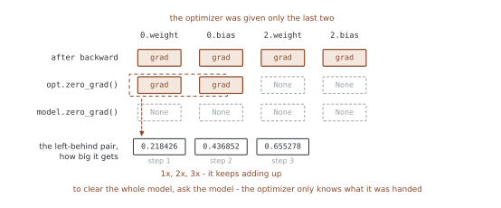

# 경사를 0으로 만드는 세 가지 방법

<div class="leadbox" markdown>

**들어가는 이야기** — 지웠다고 믿는 것

트레인 루프마다 지난 스텝의 그래디언트를 지우는 `opt.zero_grad()`를 넣는다. 그 줄은
거의 언제나 같은 모습이고, 한 번 써 놓으면 다시 들여다보지 않는다. 지웠다고 믿는 것이다.

그 줄이 지우는 것은 **옵티마이저에게 넘긴 것뿐**이다. 평소에는 모델의 모든
것을 넘기니 차이가 없다. 그런데 앞쪽 레이어를 빼고 뒤쪽만 넘기는 때가 있고 —
전이 학습에서 그런 코드를 흔히 본다 — 그러면 **넘기지 않은 쪽은 영영 안 지워진다.**

안 지워진 값은 스텝마다 더해져 1배, 2배, 3배로 자란다. 그 레이어를 트레인하지 않으니
결과는 안 틀리지만, 메모리를 계속 잡고 있고 **나중에 그 레이어를 옵티마이저에 넣는 순간**
그때까지 쌓인 것으로 첫 스텝을 밟는다.

</div>

`opt.zero_grad()` · `model.zero_grad()` · `p.grad = None`. 셋 다 그래디언트를
치운다. 그런데 **둘은 범위가 다르고 하나는 남기는 것이 다르다.**

| 길 | 범위 | 남기는 것 |
|---|---|---|
| `opt.zero_grad()` | **옵티마이저가 든 것만** | `None` |
| `model.zero_grad()` | 모델 전체 | `None` |
| `p.grad = None` | 그 텐서 하나 | `None` |
| `p.grad.zero_()` | 그 텐서 하나 | **0으로 채운 텐서** |

첫 줄이 함정이다. 옵티마이저에 **일부만** 넘겼다면 `opt.zero_grad()`는 나머지를
안 지우고, 안 지워진 그래디언트는 스텝마다 쌓인다.

## 1. 코드

```python
"""그래디언트를 지우는 세 가지 길 — 그리고 '어디까지' 지우는가.

`opt.zero_grad()` · `model.zero_grad()` · `p.grad = None`.
셋 다 그래디언트를 치우는데, 둘은 **범위가 다르고** 하나는 **남기는 것이
다르다.**

| 길 | 범위 | 남기는 것 |
|---|---|---|
| `opt.zero_grad()` | 옵티마이저가 든 것만 | `None` (기본값) |
| `model.zero_grad()` | 모델 전체 | `None` (기본값) |
| `p.grad = None` | 그 텐서 하나 | `None` |
| `p.grad.zero_()` | 그 텐서 하나 | **0 으로 채운 텐서** |

범위가 갈리는 자리가 함정이다. 옵티마이저에 일부만 넘겼다면
`opt.zero_grad()` 는 나머지를 **안 지운다.**

실행: 이 쪽의 코드를 파일로 갈무리해 돌린다
"""
# inspect 는 파이썬 표준 라이브러리다. 함수가 어떤 인자를 받고 그 기본값이 무엇인지
# 들여다볼 때 쓴다. 3 절에서 zero_grad 의 기본값을 확인하는 데 한 번 쓴다.
import inspect

# torch 는 파이토치 본체다. torch.nn 은 레이어를 객체로 모아 둔 모듈이고(nn.Linear),
# torch.nn.functional 은 같은 계산을 함수로 모아 둔 모듈이다(F.mse_loss).
# 관례대로 nn, F 로 줄여 부른다.
import torch
import torch.nn as nn
import torch.nn.functional as F


def header(title):
    # 절 제목을 한 줄 찍는다. f"...{title}..." 은 문자열 안에 변수의 값을 끼워 넣는
    # 파이썬 문법(f-string)이고, 맨 앞의 \n 은 줄바꿈이라 제목 위에 빈 줄이 생긴다.
    print(f"\n=== {title} ===")


def has_grad(net):
    # 파라메터마다 「지금 그래디언트를 들고 있는가」를 True/False 로 모은 리스트다.
    # net.parameters() 는 모델의 파라메터 텐서를 차례로 내준다. p.grad 는 역전파가
    # 그래디언트를 넣어 두는 자리인데, 아직 없거나 지워졌으면 None 이다.
    # 「is not None」 은 None 이 아닌가를 묻는다. 0 으로 채운 텐서도 None 은
    # 아니므로 True 로 나온다.
    return [p.grad is not None for p in net.parameters()]


# ========================================================================
# 1. 범위가 다르다
# ========================================================================

def scope():
    header("1. 범위")
    # 난수 시드를 고정한다. 레이어의 초기화와 torch.randn 이 난수를 쓰므로,
    # 시드를 박아야 돌릴 때마다 같은 수가 나온다.
    torch.manual_seed(0)
    # nn.Linear(4, 8) 은 선형 레이어다 — 수 4 개를 받아 8 개를 내놓는다(y = W x + b).
    # 파라메터는 weight (웨이트, 형태 (8, 4)) 와 bias (바이어스, 형태 (8,)) 둘이다.
    # nn.Sequential 은 레이어를 적은 차례대로 이어 붙인 모델이다. 0, 1 번호가 붙어
    # net[0], net[1] 로 꺼낼 수 있다. 파라메터는 모두 넷이다 —
    #   0.weight (8, 4),  0.bias (8,),  1.weight (2, 8),  1.bias (2,)
    net = nn.Sequential(nn.Linear(4, 8), nn.Linear(8, 2))
    # 옵티마이저는 그래디언트를 보고 파라메터를 실제로 고치는 물건이다. SGD 는
    # 「파라메터 ← 파라메터 − lr × 그래디언트」를 하고, lr 이 러닝레이트다.
    # 첫 인자가 「이 옵티마이저가 맡을 파라메터」인데, 여기서는 net[1] 의 것만 준다.
    # 옵티마이저는 0 번 레이어의 파라메터가 있는 줄도 모른다.
    opt = torch.optim.SGD(net[1].parameters(), lr=0.1)   # 뒤쪽만 넘겼다
    # 가짜 데이터다. torch.randn 은 표준정규분포에서 뽑은 수로 텐서를 채운다.
    #   입력 x — 형태 (8, 4): 수 4 개짜리 입력이 8 개 (배치 크기 8)
    #   정답 y — 형태 (8, 2): 모델의 출력과 같은 형태
    x, y = torch.randn(8, 4), torch.randn(8, 2)

    # 순전파와 역전파를 한 줄에 적었다. net(x) 가 출력 (8, 2) 를 내고,
    # F.mse_loss(출력, 정답) 이 둘의 차를 제곱해 평균 낸 로스(수 하나)를 만들고,
    # backward() 가 그 로스를 「모든」 파라메터로 미분해 저마다의 .grad 에 넣는다.
    # 역전파는 옵티마이저와 상관없이 일어나므로 넷 다 채워진다.
    F.mse_loss(net(x), y).backward()
    print("  역전파 뒤 grad 있는가 :", has_grad(net))     # [0.w, 0.b, 1.w, 1.b] 순서
    # 첫째 길 — 옵티마이저에게 지우라고 한다. 제가 맡은 파라메터(net[1])의 .grad 만
    # None 으로 만든다.
    opt.zero_grad()
    print("  opt.zero_grad() 뒤    :", has_grad(net))
    print("    앞 둘이 True 로 남았다 — 옵티마이저가 모르는 텐서다")
    # 둘째 길 — 모델에게 지우라고 한다. 모델은 제 파라메터를 다 알므로 넷 다 지운다.
    net.zero_grad()
    print("  model.zero_grad() 뒤  :", has_grad(net))
    print("  모델 전체를 지우려면 모델에게 시켜야 한다")


# ========================================================================
# 2. 안 지우면 쌓인다
# ========================================================================

def leftover_accumulates():
    header("2. 안 지운 쪽은 쌓인다")
    # 1 절과 똑같이 차린다 — 같은 시드, 같은 모델, 뒤쪽만 맡은 옵티마이저, 같은 데이터.
    torch.manual_seed(0)
    net = nn.Sequential(nn.Linear(4, 8), nn.Linear(8, 2))
    opt = torch.optim.SGD(net[1].parameters(), lr=0.1)
    x, y = torch.randn(8, 4), torch.randn(8, 2)

    sizes = []                                # 스텝마다 잰 크기를 모아 둘 리스트
    # 「지우고 → 역전파」를 세 번 되풀이한다. opt.step() 을 부르지 않으므로 파라메터는
    # 안 바뀌고, 그래서 역전파가 구하는 그래디언트는 세 번 다 똑같은 값이다.
    for step in range(3):
        opt.zero_grad()                       # 뒤쪽만 지운다
        # backward() 는 .grad 를 덮어쓰지 않고 「더해」 넣는다(경사 누적).
        # 지워진 뒤쪽은 새 값 하나만 남지만, 안 지워진 0 번 레이어는 앞의 것 위에
        # 또 쌓인다.
        F.mse_loss(net(x), y).backward()
        # 0 번 레이어 웨이트의 그래디언트(형태 (8, 4))에서 절댓값이 가장 큰 성분을
        # 꺼내 「크기」로 삼는다. .item() 은 수 하나짜리 텐서를 파이썬 실수로 바꾼다.
        sizes.append(net[0].weight.grad.abs().max().item())
    # round(v, 6) 은 소수점 아래 여섯 자리로 반올림한다.
    # 같은 그래디언트 g 가 한 번, 두 번, 세 번 더해졌으므로 g, 2g, 3g 가 찍힌다.
    print("  0번 레이어 그래디언트의 크기가 스텝마다:",
          [round(v, 6) for v in sizes])
    print("  지워지지 않아 1배, 2배, 3배로 자란다")
    print("  0번 레이어를 트레인하지 않더라도 이 그래디언트는 메모리를 차지한다")


# ========================================================================
# 3. None 과 0 으로 채운 텐서
# ========================================================================

def none_or_zeros():
    header("3. None 과 0")
    torch.manual_seed(1)
    # 이번에는 모델 없이 텐서 하나를 파라메터로 쓴다. 수 3 개짜리(형태 (3,)) 텐서이고,
    # requires_grad=True 는 경사 추적을 켠다 — 이 텐서가 들어간 계산을 기록해 두어
    # 이 텐서로 미분할 수 있게 하는 것이다. 이렇게 직접 만든 텐서가 리프 텐서다.
    w = torch.randn(3, requires_grad=True)
    # 옵티마이저에는 파라메터의 「리스트」를 넘긴다. 하나뿐이어도 [w] 로 싼다.
    opt = torch.optim.SGD([w], lr=0.1)

    # 로스는 w 의 세 수를 제곱해 더한 것이다(** 는 거듭제곱). w1^2 + w2^2 + w3^2 를
    # w 로 미분하면 2w 이므로, 역전파 뒤 w.grad 에는 2w 가 들어간다.
    (w ** 2).sum().backward()
    print("  역전파 뒤          :", w.grad)       # 2w — 수 3 개짜리 텐서
    # (1) 인자 없이 zero_grad(). 기본 동작은 .grad 를 None 으로 만드는 것이다 —
    #     그래디언트 텐서 자체를 치운다.
    opt.zero_grad()
    print("  opt.zero_grad()    :", w.grad, " <- 기본이 None")
    # 다음 길을 시험하려고 역전파를 다시 해 .grad 를 채운다. 아래에서도 같다.
    (w ** 2).sum().backward()
    # (2) set_to_none=False 를 주면 텐서는 그대로 두고 그 안의 값만 0 으로 채운다.
    opt.zero_grad(set_to_none=False)
    print("  set_to_none=False  :", w.grad)       # 0 이 셋 든 텐서
    (w ** 2).sum().backward()                    # 0 위에 2w 가 더해져 다시 2w 다
    # (3) 옵티마이저를 거치지 않고 손으로 그 텐서 하나의 .grad 를 None 으로 둔다.
    w.grad = None
    print("  w.grad = None      :", w.grad)
    (w ** 2).sum().backward()
    # (4) 손으로 0 으로 채운다. zero_() 끝의 밑줄은 「새 텐서를 만들지 않고 제자리에서
    #     바꾼다」는 표시다. (2) 와 같은 결과다.
    w.grad.zero_()
    print("  w.grad.zero_()     :", w.grad)

    # 지금 깔린 파이토치에서 zero_grad 의 기본값이 무엇인지 코드로 확인한다.
    # inspect.signature(함수) 는 그 함수의 인자 목록을 주고, 거기서 set_to_none 이라는
    # 인자의 기본값(.default)을 꺼낸다. torch.__version__ 은 파이토치의 판 번호다.
    sig = inspect.signature(opt.zero_grad)
    print("  이 판의 기본값     :", sig.parameters["set_to_none"].default,
          f"(torch {torch.__version__})")
    print("  예전 판은 0 으로 채우는 것이 기본이었다")


# ========================================================================
# 4. 그 차이가 스텝을 바꾼다
# ========================================================================

def it_changes_the_step():
    header("4. 모멘텀이 있으면 스텝이 달라진다")
    got = []                                    # 두 실험의 마지막 웨이트를 모아 둔다
    # 같은 실험을 두 번 한다 — None 으로 지우고 한 번, 0 으로 채우고 한 번.
    for set_to_none in (True, False):
        # 두 번 다 같은 시드에서 시작해 모델과 데이터가 똑같다. 다른 것은 지우는
        # 방식뿐이다.
        torch.manual_seed(0)
        m = nn.Linear(3, 1)                     # 레이어 하나짜리 모델. weight 는 (1, 3)
        # momentum=0.9 를 준다. 모멘텀은 지난 스텝들의 그래디언트를 0.9 배씩 줄여 가며
        # 쌓아 둔 값(모멘텀 버퍼)으로 옮기는 방법이다.
        #   버퍼 ← 0.9 × 버퍼 + 그래디언트,   파라메터 ← 파라메터 − lr × 버퍼
        opt = torch.optim.SGD(m.parameters(), lr=0.1, momentum=0.9)
        x, y = torch.randn(5, 3), torch.randn(5, 1)   # 입력 (5, 3), 정답 (5, 1)
        F.mse_loss(m(x), y).backward()          # 순전파 → 제곱오차 로스 → 역전파
        opt.step()                              # 첫 스텝. 버퍼에 이 그래디언트가 들어간다
        opt.zero_grad(set_to_none=set_to_none)  # 그래디언트를 None 또는 0 으로 지운다
        # 역전파를 다시 하지 않고 step() 만 한 번 더 부른다.
        #   .grad 가 None 이면 — step() 이 그 파라메터를 건너뛴다. 안 움직인다.
        #   .grad 가 0 이면    — 「그래디언트가 0」인 스텝으로 계산한다.
        #                        버퍼 ← 0.9 × 버퍼 + 0 이 남아 있어 그만큼 더 움직인다.
        opt.step()                              # 그래디언트가 빈 채로 한 스텝
        # 마지막 웨이트를 떠 둔다. detach() 로 경사 추적에서 떼고, flatten() 으로
        # (1, 3) 을 (3,) 으로 펴고, clone() 으로 복사한다.
        got.append(m.weight.detach().flatten().clone())
    # tolist() 는 텐서를 파이썬 리스트로 바꾼다. 수마다 {v:+.6f} 로 부호를 붙여 소수점
    # 아래 여섯 자리까지 찍고, "  ".join(...) 으로 공백 둘을 사이에 두고 잇는다.
    print("  set_to_none=True  :", "  ".join(f"{v:+.6f}" for v in got[0].tolist()))
    print("  set_to_none=False :", "  ".join(f"{v:+.6f}" for v in got[1].tolist()))
    # 두 결과의 차에서 절댓값이 가장 큰 성분이다.
    print(f"  가장 큰 차이      : {(got[0] - got[1]).abs().max():.6f}")
    print("  None 이면 step 이 건너뛰고, 0 이면 모멘텀이 민다")


# ========================================================================
# 5. 그래서 무엇을 쓰는가
# ========================================================================

def which():
    header("5. 고르기")
    torch.manual_seed(0)
    net = nn.Sequential(nn.Linear(4, 8), nn.Linear(8, 2))
    # 이번에는 옵티마이저에 모델의 파라메터를 「전부」 넘긴다. 가장 흔한 모습이다.
    opt = torch.optim.SGD(net.parameters(), lr=0.1)
    x, y = torch.randn(8, 4), torch.randn(8, 2)

    # 보통의 트레인 루프다. 스텝마다 세 줄이 이 차례로 온다. _ 은 「안 쓰는 값」
    # 자리에 관례로 두는 이름이다 — 두 번 되풀이만 한다.
    for _ in range(2):
        opt.zero_grad()                         # 앞 스텝의 그래디언트를 지운다
        F.mse_loss(net(x), y).backward()        # 순전파 → 로스 → 역전파
        opt.step()                              # 파라메터를 한 스텝 고친다
    print("  보통은 opt.zero_grad() 다 — 걷는 것과 지우는 것이 한 짝이다")
    print("  옵티마이저가 모델 전체를 들고 있으면 범위도 같다")
    # 옵티마이저가 맡은 범위와 모델 전체가 같은지 세어서 확인한다.
    #   opt.param_groups   옵티마이저가 든 파라메터 그룹(사전)의 리스트.
    #                      g["params"] 가 그 그룹의 파라메터 리스트다
    #   net.parameters()   모델의 파라메터. list 로 바꿔야 len 으로 셀 수 있다
    # 둘 다 4 다 (0.weight, 0.bias, 1.weight, 1.bias).
    print("  들고 있는 파라메터 수:",
          sum(len(g["params"]) for g in opt.param_groups),
          " 모델의 파라메터 수:", len(list(net.parameters())))
    print("  둘이 다르면 model.zero_grad() 를 쓰는 편이 안전하다")


def main():
    # 절마다 함수 하나다. 시드는 절마다 제 안에서 고정한다.
    scope()
    leftover_accumulates()
    none_or_zeros()
    it_changes_the_step()
    which()


# 이 파일을 직접 돌렸을 때만 main() 을 부른다. 다른 파일이 import 로 불러 쓸 때는
# __name__ 이 "__main__" 이 아니어서 아무것도 실행되지 않는다.
if __name__ == "__main__":
    main()
```

**출력:**

```
=== 1. 범위 ===
  역전파 뒤 grad 있는가 : [True, True, True, True]
  opt.zero_grad() 뒤    : [True, True, False, False]
    앞 둘이 True 로 남았다 — 옵티마이저가 모르는 텐서다
  model.zero_grad() 뒤  : [False, False, False, False]
  모델 전체를 지우려면 모델에게 시켜야 한다

=== 2. 안 지운 쪽은 쌓인다 ===
  0번 레이어 그래디언트의 크기가 스텝마다: [0.218426, 0.436852, 0.655278]
  지워지지 않아 1배, 2배, 3배로 자란다
  0번 레이어를 트레인하지 않더라도 이 그래디언트는 메모리를 차지한다

=== 3. None 과 0 ===
  역전파 뒤          : tensor([1.3227, 0.5338, 0.1234])
  opt.zero_grad()    : None  <- 기본이 None
  set_to_none=False  : tensor([0., 0., 0.])
  w.grad = None      : None
  w.grad.zero_()     : tensor([0., 0., 0.])
  이 판의 기본값     : True (torch 2.5.1)
  예전 판은 0 으로 채우는 것이 기본이었다

=== 4. 모멘텀이 있으면 스텝이 달라진다 ===
  set_to_none=True  : -0.021486  +0.282214  -0.422172
  set_to_none=False : -0.036934  +0.257463  -0.374460
  가장 큰 차이      : 0.047712
  None 이면 step 이 건너뛰고, 0 이면 모멘텀이 민다

=== 5. 고르기 ===
  보통은 opt.zero_grad() 다 — 걷는 것과 지우는 것이 한 짝이다
  옵티마이저가 모델 전체를 들고 있으면 범위도 같다
  들고 있는 파라메터 수: 4  모델의 파라메터 수: 4
  둘이 다르면 model.zero_grad() 를 쓰는 편이 안전하다
```

## 2. 범위가 다르다

```
역전파 뒤 grad 있는가 : [True, True, True, True]
opt.zero_grad() 뒤    : [True, True, False, False]
model.zero_grad() 뒤  : [False, False, False, False]
```

옵티마이저에 뒤쪽 레이어만 넘겼더니 **앞쪽 둘이 `True`로 남았다.** 옵티마이저는
제가 들고 있는 것만 지운다.

전이 학습 코드에서 이 형태가 흔하다. 앞쪽을 트레인하지 않으려고 옵티마이저에 뒤쪽만
넘기고 앞쪽의 `requires_grad`는 그대로 두면, 앞쪽 레이어의 `.grad`에도 그래디언트는 계속
쌓이는데 아무도 안 지운다. (「경사 추적 끄기」에서 본 `requires_grad_(False)`까지 걸었다면
그 레이어에는 `.grad`가 아예 안 생기므로 이 문제가 없다.)

## 3. 안 지운 쪽은 쌓인다

```
0번 레이어 그래디언트의 크기가 스텝마다: [0.218426, 0.436852, 0.655278]
```



**정확히 1배, 2배, 3배다.** 스텝마다 더해지기 때문이다.

그 레이어를 트레인하지 않으니 결과는 안 틀린다. 다만

- **메모리를 차지한다** — 그래디언트 텐서가 파라메터 크기만큼 계속 살아 있다
- **나중에 그 레이어를 옵티마이저에 넣으면 첫 스텝이 커진다** — 그때까지 쌓인 그래디언트로 스텝을 밟는다

그래서 일부만 트레인할 때는 `model.zero_grad()`를 쓰거나, 트레인하지 않는 레이어에
`requires_grad_(False)`를 걸어 `.grad`가 아예 안 생기게 하는 편이 낫다.

## 4. `None`과 0으로 채운 텐서

```
역전파 뒤          : tensor([1.3227, 0.5338, 0.1234])
opt.zero_grad()    : None              <- 기본이 None
set_to_none=False  : tensor([0., 0., 0.])
w.grad = None      : None
w.grad.zero_()     : tensor([0., 0., 0.])
이 판의 기본값     : True (torch 2.5.1)
```

파이토치 2.0부터 기본값이 `set_to_none=True`다. 예전 버전은 0으로 채웠으므로,
옛 코드를 그대로 돌리면 **동작이 달라진다.**

달라지는 것이 메모리만이 아니다.

```
set_to_none=True  : -0.021486  +0.282214  -0.422172
set_to_none=False : -0.036934  +0.257463  -0.374460
가장 큰 차이      : 0.047712
```

모멘텀을 켜고 그래디언트가 빈 채로 한 스텝 더 밟으면 **0.0477만큼 다른 자리**에 간다.
`None`이면 `step()`이 그 파라메터를 건너뛰고, 0이면 "0만큼 움직여라"로 읽혀
모멘텀이 계속 민다.

## 5. 무엇을 쓰는가

**보통은 `opt.zero_grad()`**다. 스텝을 밟는 것과 지우는 것이 한 짝이라 코드가
읽히고, 옵티마이저가 모델 전체를 들고 있으면 범위도 같다.

범위가 다른 경우에만 `model.zero_grad()`가 필요하다. 확인은 한 줄이면 된다.

```python
# 옵티마이저가 든 파라메터 수 == 모델의 파라메터 수. False 면 범위가 다른 것이다.
sum(len(g["params"]) for g in opt.param_groups) == len(list(net.parameters()))
```

`p.grad = None`을 손으로 쓰는 자리는 드물다. 특정 파라메터의 그래디언트만 버리고
싶을 때 — 이를테면 옵티마이저에 넣지 않았던 레이어를 뒤늦게 넣기 전에 그동안 쌓인 것을 버릴
때 — 쯤이다.

## 연습문제

<div class="drillbox" markdown>

**연습문제 1.** <span class="diff easy" title="쉬움"></span>
3절의 "메모리를 차지한다"를 재어라. 옵티마이저가 안 든 레이어의 그래디언트가 몇 KB를
쥐고 있는가?

</div>

??? success "풀이"
    ```python
    # 본문 코드의 import (torch, nn, F) 가 되어 있다고 보고 적는다.
    # 메모리가 눈에 보이도록 앞쪽 레이어를 크게 잡는다. 파라메터 수는
    #   0 번  Linear(256, 256)   256*256 + 256 = 65,792
    #   1 번  Linear(256, 2)     256*2   + 2   =    514
    net = nn.Sequential(nn.Linear(256, 256), nn.Linear(256, 2))
    # 옵티마이저에는 뒤쪽 레이어만 넘긴다. opt.zero_grad() 는 뒤쪽의 .grad 만 지운다.
    opt = torch.optim.SGD(net[1].parameters(), lr=0.1)
    # 난수의 시드를 고정한다. 아래에서 뽑는 텐서가 돌릴 때마다 같은 값이 된다.
    torch.manual_seed(0)
    x, y = torch.randn(32, 256), torch.randn(32, 2)    # 입력 (32, 256), 정답 (32, 2)

    def grad_bytes(m):
        # 모델의 그래디언트 텐서들이 차지하는 메모리를 바이트로 센다.
        #   p.grad.numel()          그래디언트 텐서에 든 수의 개수
        #   p.grad.element_size()   수 하나가 차지하는 바이트. 기본 자료형 float32 는 4 다
        # 둘을 곱하면 그 텐서의 바이트 수다. .grad 가 None 인 파라메터는 빼고 더한다.
        return sum(p.grad.numel() * p.grad.element_size()
                   for p in m.parameters() if p.grad is not None)

    for i in range(3):
        opt.zero_grad()                          # 뒤쪽만 None 으로 지운다
        # 역전파가 넷 다 다시 채운다. 앞쪽은 안 지워져 값이 쌓이지만 텐서는 그대로
        # 하나이므로 바이트 수는 (65,792 + 514) × 4 = 265,224 로 매번 같다.
        F.mse_loss(net(x), y).backward()
        # 1e3 은 1000 이다. 바이트를 1000 으로 나눠 KB 로 찍는다.
        print(f"  {i + 1}스텝 뒤 그래디언트가 쓰는 메모리 {grad_bytes(net) / 1e3:.1f} KB")
    net.zero_grad()                              # 모델 전체의 .grad 를 None 으로 만든다
    print("  model.zero_grad() 뒤:", grad_bytes(net) / 1e3, "KB")
    ```

    ```
      1스텝 뒤 그래디언트가 쓰는 메모리 265.2 KB
      2스텝 뒤 그래디언트가 쓰는 메모리 265.2 KB
      3스텝 뒤 그래디언트가 쓰는 메모리 265.2 KB
      model.zero_grad() 뒤: 0.0 KB
    ```

    **메모리는 안 늘어난다.** 값만 쌓일 뿐 텐서는 하나이기 때문이다. 265 KB에서
    그대로 머문다.

    그러니 3절에서 말한 비용은 "스텝마다 늘어난다"가 아니라 **"안 쓰는 것을
    계속 들고 있다"**가 맞다. 265 KB 가운데 거의 전부가 `Linear(256,256)` 하나의 몫이니, 사전 트레인된
    큰 모델에서 앞쪽을 옵티마이저에서 빼기만 하면 모델 크기만큼을 쓸모없이 쥐고 있게 된다.

    진짜 문제는 값 쪽이다. 그 레이어를 옵티마이저에 넣는 순간 쌓인 그래디언트 때문에 첫 스텝이 그만큼 커진다.

---

<div class="drillbox" markdown>

**연습문제 2.** <span class="diff med" title="중간"></span>
`set_to_none`의 차이가 Adam에서는 어떻게 나타나는가? SGD 모멘텀과 같은 모습인가?

</div>

??? success "풀이"
    ```python
    # 본문 코드의 import (torch, nn, F) 가 되어 있다고 보고 적는다.
    # 데이터부터 만든다. 입력 x 는 형태 (8, 4), 정답 y 는 (8, 2) 다. 시드를 고정해
    # 돌릴 때마다 같은 데이터가 나오게 한다.
    torch.manual_seed(0)
    x, y = torch.randn(8, 4), torch.randn(8, 2)

    # 같은 실험을 두 번 한다. stn 이 set_to_none 에 넘길 값이다.
    for label, stn in (("None", True), ("0 채우기", False)):
        torch.manual_seed(0)            # 두 번 다 같은 초기 웨이트에서 시작한다
        mm = nn.Linear(4, 2)            # 선형 레이어 하나. weight 의 형태 (2, 4)
        # Adam 은 SGD 와 다른 옵티마이저다. 파라메터마다 그래디언트의 이동 평균(1차
        # 모멘트)과 그래디언트 제곱의 이동 평균(2차 모멘트)을 간직하고, 그 둘로
        # 스텝의 방향과 크기를 정한다.
        o = torch.optim.Adam(mm.parameters(), lr=0.1)
        F.mse_loss(mm(x), y).backward() # 순전파 → 제곱오차 로스 → 역전파
        o.step()                        # 첫 스텝. 두 모멘트에 이 그래디언트가 들어간다
        o.zero_grad(set_to_none=stn)    # True 면 .grad 를 None 으로, False 면 0 으로
        # 역전파 없이 step() 만 두 번 더 부른다. None 이면 두 번 다 건너뛰고,
        # 0 이면 남아 있는 1차 모멘트로 두 번 더 움직인다.
        o.step(); o.step()              # 그래디언트가 빈 채로 두 스텝
        # 웨이트를 (8,) 로 펴서 앞의 두 수만 리스트로 찍는다.
        print(f"  Adam {label:8s} weight {mm.weight.detach().flatten()[:2].tolist()}")
    ```

    ```
      Adam None     weight [-0.10374340415000916, 0.16822180151939392]
      Adam 0 채우기  weight [-0.22254490852355957, 0.049420297145843506]
    ```

    **차이가 SGD보다 크다.** 0.12쯤 벌어졌다.

    Adam은 1차 모멘트 $m$을 들고 있는데, 그래디언트를 0으로 채우면
    $m \leftarrow 0.9m + 0.1 \times 0$으로 **줄어들기는 해도 0이 되지 않는다.**
    그 남은 $m$으로 계속 움직인다. 2차 모멘트 $v$도 같이 줄어들지만 훨씬 천천히
    줄어들므로($\beta_2 = 0.999$) $m/\sqrt{v}$의 분모는 거의 그대로이고, 스텝은 $m$이
    줄어드는 속도로만 작아진다.

    `None`이면 그 파라메터를 통째로 건너뛰므로 $m$도 $v$도 그대로 멈춰 있다.

    그래서 기본값이 `True`로 바뀐 것이 Adam에서 더 중요하다. 스텝을 안 밟는
    것과 "그래디언트가 0인 스텝을 밟는 것"은 상태를 가진 옵티마이저에서 전혀 다른
    일이다.

---

<div class="drillbox" markdown>

**연습문제 3.** <span class="diff hard" title="어려움"></span>
`zero_grad()`를 넣을 자리가 넷이다. `backward()` 앞, `backward()` 뒤, `step()`
뒤, 아예 안 하기. 다섯 스텝씩 돌려 로스를 견주어라.

</div>

??? success "풀이"
    ```python
    # 본문 코드의 import (torch, nn, F) 가 되어 있다고 보고 적는다.
    # 데이터부터 만든다. 입력 x 는 형태 (8, 4), 정답 y 는 (8, 2) 다. 시드를 고정해
    # 돌릴 때마다 같은 데이터가 나오게 한다.
    torch.manual_seed(0)
    x, y = torch.randn(8, 4), torch.randn(8, 2)

    # zero_grad() 를 두는 자리 넷을 차례로 시험한다. where 가 그 자리의 이름이다.
    for where in ("backward 앞", "backward 뒤", "step 뒤", "아예 안 함"):
        torch.manual_seed(0)                     # 네 번 다 같은 초기 웨이트에서 시작한다
        n2 = nn.Sequential(nn.Linear(4, 8), nn.Linear(8, 2))
        o = torch.optim.SGD(n2.parameters(), lr=0.1)    # 파라메터를 전부 넘긴다
        # 트레인 루프 다섯 스텝. 뼈대는 backward() → step() 이고, if 셋 가운데
        # where 와 맞는 하나에서만 zero_grad() 가 불린다. "아예 안 함" 이면 어느
        # if 에도 안 걸려 한 번도 지우지 않는다.
        for _ in range(5):
            if where == "backward 앞":
                o.zero_grad()                    # 지우고 → 역전파 → 스텝. 맞는 차례다
            F.mse_loss(n2(x), y).backward()      # 순전파 → 로스 → 역전파
            if where == "backward 뒤":
                o.zero_grad()                    # 방금 구한 그래디언트를 지워 버린다
            o.step()                             # .grad 가 None 이면 아무것도 안 고친다
            if where == "step 뒤":
                o.zero_grad()                    # 쓰고 나서 지운다. 다음 스텝 앞과 같다
        # 다섯 스텝 뒤의 로스를 다시 잰다. {where:12s} 는 이름을 12 칸에 맞춰 찍는다.
        print(f"  {where:12s} 마지막 로스 {F.mse_loss(n2(x), y).item():.6f}")
    ```

    ```
      backward 앞   마지막 로스 0.679886
      backward 뒤   마지막 로스 1.242582
      step 뒤       마지막 로스 0.679886
      아예 안 함       마지막 로스 1.067795
    ```

    **넷이 세 가지 결과로 갈린다.**

    - **`backward` 앞**과 **`step` 뒤**는 같다(0.679886). 루프의 반복을 이어 놓고 보면
      같은 자리이기 때문이다. 둘 다 맞다
    - **`backward` 뒤**가 가장 나쁘다(1.242582). 방금 구한 그래디언트를 지우므로
      `step()`이 아무것도 안 한다. **로스가 처음 값 그대로**다
    - **아예 안 함**은 그 중간이다(1.067795). 그래디언트가 쌓여 스텝이 커지는데,
      이 보기에서는 터지지 않고 조금 지나쳤다

    넷 중 **둘이 맞고 둘이 틀리는데, 틀린 둘이 서로 다르게 틀린다.** 안 지우는
    쪽은 적어도 트레인이 일어나므로 로스가 줄기는 한다. 잘못된 자리에 둔 쪽은
    아예 안 배운다.

    그래서 증상으로 구별할 수 있다. **로스가 완전히 평평하면 지우는 자리를,
    로스가 요동치면 안 지웠는지를** 보면 된다.
