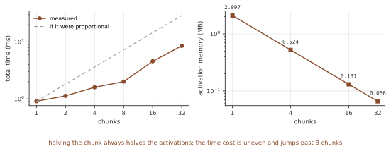

# 큰 배치를 위한 경사 누적

<div class="leadbox" markdown>

**들어가는 이야기** — 공짜가 아니다

큰 배치를 한 번에 올릴 수 없을 때 쪼개서 여러 번 역전파하고 한 번만 `step()`하는
**그래디언트 누적**이 있다. 결과가 통째로 한 것과 **같다**는 것은 앞에서 재어 확인했다. 그러면
남는 물음은 하나다. **얼마를 치르는가.**

쪼개면 두 가지가 동시에 움직인다. 아끼는 쪽은 꼬박꼬박 정직하다 — 조각을
반으로 줄이면 **언제나 정확히 반**이 준다. 치르는 쪽은 그렇지 않다. 조각 수에
비례해 늘 것 같은데 그보다 훨씬 덜 늘다가, 어느 지점부터는 갑자기 더 가파르게
는다.

아끼는 것이 무엇인지도 정확히 알아 둘 값어치가 있다. 줄어드는 것은 **엑티베이션 값**(각 레이어가 순전파에서 내놓는 중간 출력으로, 역전파에 쓰려고
저장해 둔다) 메모리뿐이고, 파라메터와 그 `.grad`는 **조각 수와 아무 상관이 없다.** 그래서 쪼개는 것으로는 넘을 수 없는 벽이
따로 있다.

</div>

「경사 누적」에서 쪼개서 쌓은 것이 통째로 한 것과 **같은 그래디언트**를 준다는 것을
확인했다(`mean` 로스면 조각 수로 나눈다는 단서와 함께). 이 쪽은 그 다음 물음을
본다.

**비용이 얼마인가.** 쪼개면 엑티베이션 값 메모리가 조각 크기에 비례해 줄어들고, 대신
순전파와 역전파를 여러 번 해야 하니 시간이 는다. 두 축을 재면 조각 수를 어떻게
고를지 가늠이 선다.

## 1. 코드

```python
"""그래디언트 누적의 비용 — 메모리를 아끼고 시간을 치른다.

「경사 누적」에서 쪼개서 쌓은 것이 통째로 한 것과 **같은 그래디언트**를
준다는 것을 확인했다. 이 쪽은 그 다음 물음을 본다 — **비용이 얼마인가.**

쪼개면 엑티베이션 값 메모리가 조각 크기에 비례해 줄어든다. 대신 순전파와
역전파를 여러 번 해야 하므로 시간이 는다. 두 축을 재어, 조각 수를
어떻게 고를지 가늠해 본다.

실행: 이 쪽의 코드를 파일로 갈무리해 돌린다
"""
# time 은 파이썬 표준 라이브러리다. 걸린 시간을 재는 데 쓴다.
import time

# torch 는 파이토치 본체다. torch.nn 은 레이어를 객체로 모아 둔 모듈이고(nn.Linear),
# torch.nn.functional 은 같은 계산을 함수로 모아 둔 모듈이다(F.cross_entropy).
# 관례대로 nn, F 로 줄여 부른다.
import torch
import torch.nn as nn
import torch.nn.functional as F


def header(title):
    # 절 제목을 한 줄 찍는다. f"...{title}..." 은 문자열 안에 변수의 값을 끼워 넣는
    # 파이썬 문법(f-string)이고, 맨 앞의 \n 은 줄바꿈이라 제목 위에 빈 줄이 생긴다.
    print(f"\n=== {title} ===")


def spread(fn, rep=5):
    # 함수 fn 을 여러 번 불러 걸린 시간의 (가장 짧은 것, 가장 긴 것) 을 밀리초로
    # 돌려준다. 시간은 잴 때마다 흔들리므로 한 번 재지 않고 폭을 본다.
    # rep=5 는 기본값이다 — 따로 안 적으면 다섯 번 잰다.
    #
    # 먼저 두 번은 재지 않고 그냥 돌린다(예열). 처음 한두 번은 메모리를 잡는 따위의
    # 준비로 유난히 느려서, 그것을 재면 실제보다 느리게 나온다.
    # _ 은 「안 쓰는 값」 자리에 관례로 두는 이름이다 — 되풀이만 한다.
    for _ in range(2):          # 예열
        fn()
    ts = []                     # 잰 시간(초)을 모아 둘 리스트
    for _ in range(rep):
        # time.perf_counter() 는 지금 시각을 초로 준다. 부르기 전과 뒤의 차가
        # fn() 한 번에 걸린 시간이다.
        t0 = time.perf_counter()
        fn()
        ts.append(time.perf_counter() - t0)
    # 1e3 은 1000 이다. 초에 1000 을 곱해 밀리초(ms)로 바꾼다.
    return min(ts) * 1e3, max(ts) * 1e3


# 프로그램 전체가 함께 쓰는 두 수다. 바뀌지 않는 값은 관례로 대문자로 적는다.
#   BATCH — 배치 크기. 옵티마이저가 한 스텝에 보는 표본의 수다
#   DIM   — 입력 하나에 든 수의 개수이자 레이어의 폭이다
BATCH, DIM = 256, 512


def setup(seed=0):
    # 모델·옵티마이저·데이터를 한꺼번에 만들어 돌려준다.
    # 난수 시드를 고정한다. 레이어의 초기화와 데이터가 난수를 쓰므로, 시드가 같으면
    # 부를 때마다 같은 모델과 같은 데이터가 나온다.
    torch.manual_seed(seed)
    # nn.Linear(입력, 출력) 은 선형 레이어다 — y = W x + b. 트레인으로 고칠 파라메터는
    # weight (웨이트 W, 형태 (출력, 입력)) 와 bias (바이어스 b, 형태 (출력,)) 다.
    # nn.ReLU() 는 음수를 0 으로 바꾸는 엑티베이션 함수이고 파라메터가 없다.
    # nn.Sequential 은 레이어를 적은 차례대로 이어 붙여 모델 하나로 만든다.
    #   512 → 512 → ReLU → 512 → ReLU → 10
    # 마지막의 10 은 클래스 10 개에 매기는 점수다.
    net = nn.Sequential(nn.Linear(DIM, DIM), nn.ReLU(),
                        nn.Linear(DIM, DIM), nn.ReLU(),
                        nn.Linear(DIM, 10))
    # 옵티마이저는 그래디언트를 보고 파라메터를 실제로 고치는 물건이다. SGD 는
    # 「파라메터 ← 파라메터 − lr × 그래디언트」를 한다. net.parameters() 로 모델의
    # 파라메터를 전부 넘기고, lr 이 러닝레이트(한 스텝의 크기)다.
    opt = torch.optim.SGD(net.parameters(), lr=0.01)
    # 가짜 데이터다.
    #   X — torch.randn 은 표준정규분포에서 뽑은 수로 채운다. 형태 (256, 512):
    #       수 512 개짜리 입력이 256 개
    #   Y — torch.randint(0, 10, (BATCH,)) 는 0 ~ 9 가운데 정수를 뽑는다(10 은 안
    #       들어간다). 형태 (256,): 입력마다 정답 클래스 번호 하나
    X = torch.randn(BATCH, DIM)
    Y = torch.randint(0, 10, (BATCH,))
    return net, opt, X, Y


def step_fn(net, opt, X, Y, k):
    # 「배치를 k 조각으로 나눠 경사 누적으로 트레인 한 스텝을 하는 함수」를 만들어
    # 돌려준다. 함수 안에서 함수 run 을 정의해 그것을 돌려주는 것이다. run 은 인자
    # 없이 부를 수 있어 spread 에 넘겨 시간을 잴 수 있다.
    def run():
        # 경사 누적 — 큰 배치를 한 번에 못 넣을 때 작은 조각으로 나눠 역전파를 여러 번
        # 하고, 그래디언트가 다 쌓인 뒤에 스텝을 한 번만 밟는 방법이다.
        #
        # (1) 앞 스텝의 그래디언트를 지운다. 스텝의 맨 앞에서 「한 번만」 한다.
        #     조각 사이에서는 지우지 않는다 — 지우면 쌓이지 않는다.
        opt.zero_grad()
        n = BATCH // k                # 조각 크기. // 는 몫이다 — k = 4 면 256 // 4 = 64
        for i in range(k):            # i = 0, 1, ..., k-1 — 조각마다 한 번
            # (2) i 번째 조각으로 순전파해 로스를 구한다.
            #   X[i*n:(i+1)*n]   i*n 번째부터 (i+1)*n 번째 앞까지의 행. 형태 (n, 512)
            #   net(...)          모델의 출력. 형태 (n, 10) — 클래스 10 개의 점수
            #   Y[i*n:(i+1)*n]   같은 조각의 정답 번호. 형태 (n,)
            #   F.cross_entropy   분류 로스. 정답 클래스의 점수가 높을수록 작아지는 수
            #                     하나이고, 조각 안 n 개의 「평균」이다
            #   / k               조각마다의 평균을 k 로 나눠 둔다. 그래야 k 개를 다
            #                     더한 것이 배치 256 개 전체의 평균과 같아진다
            part = F.cross_entropy(net(X[i * n:(i + 1) * n]),
                                   Y[i * n:(i + 1) * n]) / k
            # (3) 역전파. backward() 는 .grad 를 덮어쓰지 않고 「더해」 넣으므로,
            #     k 번 부르면 k 조각의 그래디언트가 .grad 에 쌓인다.
            part.backward()
        # (4) 다 쌓인 그래디언트로 파라메터를 「한 번」 고친다.
        opt.step()
    return run


# ========================================================================
# 1. 시간이 얼마나 느는가
# ========================================================================

def time_cost():
    header("1. 조각 수와 시간")
    net, opt, X, Y = setup()
    times = {}                        # {조각 수: 가장 짧은 시간(ms)} 을 모아 둘 사전
    # 조각 수 k 를 두 배씩 늘려 가며 한 스텝에 걸리는 시간을 잰다.
    # k = 1 은 쪼개지 않고 256 개를 통째로 넣는 것이다.
    for k in (1, 2, 4, 8, 16, 32):
        # spread 가 (가장 짧은 시간, 가장 긴 시간) 을 준다. 여기서는 짧은 쪽만 쓰고
        # 긴 쪽은 _ 로 받아 버린다. 가장 짧은 시간이 방해를 덜 받은 측정이다.
        lo, _ = spread(step_fn(net, opt, X, Y, k))
        times[k] = lo
        # 형식 지정: {k:2d} 는 정수를 2 칸에, {lo:6.2f} 는 실수를 6 칸에 소수점 아래
        # 두 자리까지 찍는다. 칸 수를 주면 줄마다 세로줄이 맞는다.
        #   lo / times[1]   통째로 할 때(k = 1)의 몇 배인가
        #   lo / k          조각 하나에 든 시간
        print(f"  {k:2d} 조각  조각 크기 {BATCH // k:3d}  "
              f"{lo:6.2f} ms   통째 대비 {lo / times[1]:5.2f}배   "
              f"조각당 {lo / k:6.3f} ms")
    print("  조각 수에 꼭 비례하지는 않는다 — 조각당 시간이 줄어든다")
    print("  작은 배치는 행렬곱이 덜 효율적이지만 일 자체도 적기 때문이다")
    return times                      # 3 절에서 다시 쓰려고 돌려준다


# ========================================================================
# 2. 메모리는 조각 크기가 정한다
# ========================================================================

def memory_cost():
    header("2. 조각 수와 엑티베이션 값 메모리")
    # 이 절은 메모리를 재지 않고 「어림」한다. 엑티베이션 값은 순전파 때 레이어마다 나온
    # 중간 출력이다. 역전파가 그 값을 다시 쓰므로 backward() 가 끝날 때까지 메모리에
    # 남아 있어야 하고, 그 크기는 한 번에 넣은 표본 수(조각 크기)에 비례한다.
    print("  엑티베이션 값은 '조각 크기 x 폭 x 저장되는 텐서 수 x 4바이트' 쯤이다")
    for k in (1, 4, 16, 32):
        n = BATCH // k                      # 조각 크기 — 256, 64, 16, 8
        # 어림식이다. 표본 n 개 × 폭 512 짜리 텐서 하나에 수가 n × 512 개 들고,
        # 그런 텐서가 네 군데쯤 남는다고 보아 4 를 곱하고, float32 수 하나가 4 바이트라
        # 또 4 를 곱한다. 1e6 (백만) 으로 나눠 MB 로 바꾼다.
        #   k = 1 일 때   256 * 512 * 4 * 4 = 2,097,152 바이트 → 2.097 MB
        approx = n * DIM * 4 * 4 / 1e6      # 네 군데쯤 저장된다고 보고
        print(f"  {k:2d} 조각  조각 크기 {n:3d}  엑티베이션 값 대략 {approx:6.3f} MB")
    print("  파라메터와 그래디언트는 조각 수와 무관하다 — 모델 크기가 정한다")
    # 파라메터 쪽은 어림이 아니라 실제 모델에서 센다. setup() 이 넷을 돌려주는데
    # 모델만 쓰므로 나머지 셋은 _ 로 받아 버린다.
    net, _, _, _ = setup()
    # 파라메터마다 numel() (든 수의 개수) × element_size() (수 하나의 바이트, 4) 를
    # 구해 다 더한다.
    #   Linear(512, 512) 둘   (512*512 + 512) * 2 = 525,312 개
    #   Linear(512, 10)        512*10 + 10        =   5,130 개
    #   합 530,442 개 × 4 바이트 = 2,121,768 바이트 → 2.12 MB
    pbytes = sum(p.numel() * p.element_size() for p in net.parameters())
    # 그래디언트(.grad)는 파라메터와 형태가 같은 텐서라 같은 크기를 한 벌 더 쓴다.
    print(f"  이 모델의 파라메터 {pbytes / 1e6:.2f} MB (그래디언트도 같은 크기)")
    print("  그래서 누적으로 아끼는 것은 엑티베이션 값뿐이다")


# ========================================================================
# 3. 어디까지 쪼개는 것이 쓸모 있는가
# ========================================================================

def diminishing(times):
    header("3. 쪼갤수록 이득이 줄어든다")
    # times 는 1 절이 잰 {조각 수: 시간} 사전이다. 새로 재지 않고 그 수로 계산만 한다.
    # sorted(사전) 은 열쇠를 작은 것부터 늘어놓은 리스트다 — [1, 2, 4, 8, 16, 32].
    ks = sorted(times)
    # ks[1:] 은 첫째를 뺀 나머지 [2, 4, 8, 16, 32] 다. zip 으로 짝지으면 이웃한 두
    # 조각 수 (1, 2), (2, 4), (4, 8), (8, 16), (16, 32) 가 나온다.
    # times[b] / times[a] 는 조각 수를 두 배로 늘렸을 때 시간이 몇 배가 되는가다.
    ratios = [times[b] / times[a] for a, b in zip(ks, ks[1:])]
    print("  조각 크기를 반으로 줄일 때마다")
    print("    엑티베이션 값 메모리: 반으로 — 언제나 반")
    # 비 다섯 개를 소수점 아래 두 자리로 찍어 " -> " 로 잇는다.
    print("    시간:", " -> ".join(f"{r:.2f}" for r in ratios), "배")
    print("  메모리 이득은 일정하고 시간 손해는 쌓인다")
    print("  그래서 '모델이 올라가는 가장 큰 조각' 을 고르는 것이 맞다")
    print("  더 쪼개도 그래디언트는 같으므로 트레인에는 아무 이득이 없다")


# ========================================================================
# 4. 모델이 깊으면 체크포인팅과 견줄 만하다
# ========================================================================

def versus_checkpointing():
    header("4. 체크포인팅과 견주기")
    # checkpoint 는 체크포인팅(gradient checkpointing)을 해 주는 함수다. 순전파 때
    # 그 구간의 엑티베이션 값을 저장하지 않고, 역전파 때 그 구간의 순전파를 다시 해서 구한다.
    # 메모리를 아끼고 시간을 더 쓴다. 이 절에서만 쓰므로 함수 안에서 불러온다.
    from torch.utils.checkpoint import checkpoint
    torch.manual_seed(0)
    # 깊은 모델을 만든다. (Linear → ReLU) 한 묶음이 블록 하나이고, 그런 블록 8 개를
    # 리스트에 담는다. nn.ModuleList 는 레이어를 담는 리스트인데, 보통의 파이썬
    # 리스트와 달리 안의 레이어가 파이토치에 등록되어 parameters() 로 꺼낼 수 있다.
    # Sequential 로 잇지 않고 리스트로 둔 것은 블록을 하나씩 따로 부르기 위해서다.
    blocks = nn.ModuleList([nn.Sequential(nn.Linear(DIM, DIM), nn.ReLU())
                            for _ in range(8)])
    head = nn.Linear(DIM, 10)                 # 마지막에 붙는 출력 레이어. 512 → 10
    # 모델이 blocks 와 head 둘로 나뉘어 있으므로, 두 쪽의 파라메터를 리스트로 바꿔
    # 이어 붙인 것을 옵티마이저에 넘긴다(리스트끼리의 + 는 이어 붙이기다).
    params = list(blocks.parameters()) + list(head.parameters())
    opt = torch.optim.SGD(params, lr=0.01)
    X = torch.randn(BATCH, DIM)               # 입력. 형태 (256, 512)
    Y = torch.randint(0, 10, (BATCH,))        # 정답 클래스 번호. 형태 (256,)

    def forward(x, use_ckpt):
        # 순전파를 손으로 적는다. 블록 8 개를 차례로 지나고 마지막에 head 를 지난다.
        for b in blocks:
            # 「A if 조건 else B」 는 조건이 참이면 A, 거짓이면 B 다.
            #   use_ckpt 가 참    checkpoint(b, x, ...) — b(x) 와 값은 같은데 블록 안의
            #                     엑티베이션 값을 저장하지 않는다. use_reentrant=False 는
            #                     파이토치가 권하는 새 방식으로 하라는 뜻이다
            #   use_ckpt 가 거짓  b(x) — 보통대로 부른다
            x = checkpoint(b, x, use_reentrant=False) if use_ckpt else b(x)
        return head(x)                        # 출력. 형태 (표본 수, 10)

    def run(k, use_ckpt):
        # step_fn 과 같은 일을 한다 — k 조각 경사 누적으로 트레인 한 스텝을 하는
        # 함수 f 를 만들어 돌려준다. 다른 것은 net(...) 대신 위의 forward 를 부르는 것이다.
        def f():
            opt.zero_grad()                   # 스텝의 맨 앞에서 한 번만 지운다
            n = BATCH // k                    # 조각 크기
            for i in range(k):
                # i 번째 조각의 로스. k 로 나눠 두어 다 더하면 배치 전체의 평균이 된다.
                part = F.cross_entropy(forward(X[i * n:(i + 1) * n], use_ckpt),
                                       Y[i * n:(i + 1) * n]) / k
                part.backward()               # 그래디언트가 .grad 에 쌓인다
            opt.step()                        # 다 쌓인 뒤 한 번 고친다
        return f

    # 세 가지를 잰다. 짝마다 (라벨, 조각 수 k, 체크포인팅을 쓰는가) 다.
    #   통째로       k = 1, 체크포인팅 없음 — 견줄 기준
    #   8조각 누적   k = 8 — 배치 쪽을 줄인다
    #   체크포인팅   k = 1, 체크포인팅 켬 — 깊이 쪽을 줄인다
    for label, k, ck in (("통째로", 1, False),
                         ("8조각 누적", 8, False),
                         ("체크포인팅", 1, True)):
        lo, hi = spread(run(k, ck))           # (가장 짧은 시간, 가장 긴 시간) ms
        # 이번에는 폭을 그대로 보인다. {label:12s} 는 라벨을 12 칸에 맞춰 찍는다.
        print(f"  {label:12s} {lo:6.2f} ~ {hi:6.2f} ms")
    print("  둘 다 메모리를 시간과 바꾸는데 체크포인팅이 덜 비쌌다")
    print("  다만 아끼는 축이 다르다 — 누적은 배치 축, 체크포인팅은 깊이 축")
    print("  둘을 같이 쓰면 곱으로 아낀다")


def main():
    times = time_cost()            # 1 절이 잰 시간을 받아 둔다
    memory_cost()
    diminishing(times)             # 3 절이 그 시간을 다시 쓴다
    versus_checkpointing()


# 이 파일을 직접 돌렸을 때만 main() 을 부른다. 다른 파일이 import 로 불러 쓸 때는
# __name__ 이 "__main__" 이 아니어서 아무것도 실행되지 않는다.
if __name__ == "__main__":
    main()
```

**출력:**

```
=== 1. 조각 수와 시간 ===
   1 조각  조각 크기 256    0.91 ms   통째 대비  1.00배   조각당  0.907 ms
   2 조각  조각 크기 128    1.13 ms   통째 대비  1.25배   조각당  0.566 ms
   4 조각  조각 크기  64    1.60 ms   통째 대비  1.76배   조각당  0.400 ms
   8 조각  조각 크기  32    2.01 ms   통째 대비  2.22배   조각당  0.252 ms
  16 조각  조각 크기  16    4.58 ms   통째 대비  5.05배   조각당  0.287 ms
  32 조각  조각 크기   8    8.53 ms   통째 대비  9.40배   조각당  0.267 ms
  조각 수에 꼭 비례하지는 않는다 — 조각당 시간이 줄어든다
  작은 배치는 행렬곱이 덜 효율적이지만 일 자체도 적기 때문이다

=== 2. 조각 수와 엑티베이션 값 메모리 ===
  엑티베이션 값은 '조각 크기 x 폭 x 저장되는 텐서 수 x 4바이트' 쯤이다
   1 조각  조각 크기 256  엑티베이션 값 대략  2.097 MB
   4 조각  조각 크기  64  엑티베이션 값 대략  0.524 MB
  16 조각  조각 크기  16  엑티베이션 값 대략  0.131 MB
  32 조각  조각 크기   8  엑티베이션 값 대략  0.066 MB
  파라메터와 그래디언트는 조각 수와 무관하다 — 모델 크기가 정한다
  이 모델의 파라메터 2.12 MB (그래디언트도 같은 크기)
  그래서 누적으로 아끼는 것은 엑티베이션 값뿐이다

=== 3. 쪼갤수록 이득이 줄어든다 ===
  조각 크기를 반으로 줄일 때마다
    엑티베이션 값 메모리: 반으로 — 언제나 반
    시간: 1.25 -> 1.41 -> 1.26 -> 2.28 -> 1.86 배
  메모리 이득은 일정하고 시간 손해는 쌓인다
  그래서 '모델이 올라가는 가장 큰 조각' 을 고르는 것이 맞다
  더 쪼개도 그래디언트는 같으므로 트레인에는 아무 이득이 없다

=== 4. 체크포인팅과 견주기 ===
  통째로            3.93 ~   5.59 ms
  8조각 누적         9.20 ~  17.42 ms
  체크포인팅          7.07 ~  12.22 ms
  둘 다 메모리를 시간과 바꾸는데 체크포인팅이 덜 비쌌다
  다만 아끼는 축이 다르다 — 누적은 배치 축, 체크포인팅은 깊이 축
  둘을 같이 쓰면 곱으로 아낀다
```

이 측정은 시간이라 돌릴 때마다 흔들린다. 아래 수들도 그 폭 안에서 읽어야 한다.

## 2. 시간은 조각 수에 비례하지 않는다

| 조각 수 | 조각 크기 | 시간 | 통째 대비 | 조각당 |
|---|---|---|---|---|
| 1 | 256 | 0.91 ms | 1.00 | 0.907 |
| 4 | 64 | 1.60 ms | 1.76 | 0.400 |
| 16 | 16 | 4.58 ms | 5.05 | 0.287 |
| 32 | 8 | 8.53 ms | 9.40 | 0.267 |

**32조각이 32배가 아니라 9.4배다.** 조각당 시간이 0.907에서 0.267로 줄기
때문이다.

까닭이 둘 겹쳐 있다. 조각이 작으면 **행렬곱이 덜 효율적**이지만(GPU든 CPU든
큰 행렬을 좋아한다), 동시에 **일 자체가 적다**(8개 표본의 순전파는 256개의
1/32이다). 뒤쪽이 더 크게 작용해서 전체로는 32배까지 안 간다.

그래도 **느려지기는 한다.** 공짜가 아니다.

## 3. 메모리는 조각 크기가 정한다

```
 1 조각  조각 크기 256  엑티베이션 값 대략  2.097 MB
16 조각  조각 크기  16  엑티베이션 값 대략  0.131 MB
이 모델의 파라메터 2.12 MB (그래디언트도 같은 크기)
```

**아끼는 것은 엑티베이션 값뿐이다.** 파라메터와 그래디언트는 모델 크기가 정하므로 조각 수와
무관하다.

이 비율이 중요하다. 이 작은 모델에서는 엑티베이션 값(2.1 MB)과 파라메터(2.1 MB)가
비슷하고 그래디언트도 2.1 MB를 쓰므로, 누적으로 아낄 수 있는 몫은 전체의 3분의
1쯤뿐이다. 반면 **엑티베이션 값이 파라메터보다
훨씬 큰** 경우 — 긴 시퀀스, 큰 영상, 깊은 뉴럴 네트워크 — 에는 누적이 크게 이긴다.

그래서 누적을 쓰기 전에 **어느 쪽이 메모리를 먹고 있는지** 보아야 한다.
파라메터가 안 올라가는 것이면 누적으로는 못 고친다.

## 4. 쪼갤수록 이득이 줄어든다

```
조각 크기를 반으로 줄일 때마다
  엑티베이션 값 메모리: 반으로 — 언제나 반
  시간: 1.25 -> 1.41 -> 1.26 -> 2.28 -> 1.86 배
```



메모리 이득은 **일정하게 절반**이고 시간 손해는 **곱해서 쌓인다.** 오른쪽
그래프가 로그 스케일에서 곧은 직선인 것이 「언제나 반」이라는 뜻이고, 왼쪽
그래프의 실측 선이 점선보다 한참 아래인 것이 「비례하지는 않는다」는 뜻이다.

그래서 고르는 법이 분명해진다. **모델이 올라가는 가장 큰 조각**을 쓴다. 더
쪼개도 그래디언트는 「경사 누적」에서 본 대로 똑같으므로 **트레인에는 아무 이득이
없고**, 시간만 더 든다.

## 5. 체크포인팅과 견주기

```
통째로        3.93 ~  5.59 ms
8조각 누적     9.20 ~ 17.42 ms
체크포인팅     7.07 ~ 12.22 ms
```

**체크포인팅**(gradient checkpointing)은 순전파에서 중간 엑티베이션 값을 저장하지 않고,
역전파 때 그 구간의 순전파를 다시 해서 구하는 기법이다(모델을 파일로 저장하는
체크포인트와는 다른 것이다). 누적과 체크포인팅은 둘 다 메모리를 시간과 바꾸는데,
**아끼는 축이 다르다.**

| | 줄이는 것 | 치르는 것 |
|---|---|---|
| 그래디언트 누적 | **배치 축** — 한 번에 처리하는 표본 수 | 순전파·역전파를 여러 번 |
| 체크포인팅 | **깊이 축** — 레이어마다 저장하는 엑티베이션 값 | 역전파에서 순전파를 다시 |

여기서는 체크포인팅이 덜 비쌌지만, 모델과 배치 형태에 따라 뒤집힌다. 그리고
**둘을 같이 쓸 수 있다** — 배치를 쪼개고 각 조각에서 체크포인팅하면 아끼는
양이 곱해진다. 큰 언어 모델을 작은 GPU에서 트레인하는 코드가 흔히 둘을 함께 쓴다.

## 연습문제

<div class="drillbox" markdown>

**연습문제 1.** <span class="diff easy" title="쉬움"></span>
조각 수를 바꿔도 **옵티마이저가 스텝을 밟는 횟수**는 같다. 몇 번 밟는지 세어
확인하라.

</div>

??? success "풀이"
    ```python
    # 본문 프로그램의 setup() 과 BATCH (= 256) 를 그대로 쓴다.
    # 모델, 옵티마이저, 입력 X (256, 512), 정답 Y (256,) 를 받는다.
    net, opt, X, Y = setup()
    for k in (1, 4, 16):                      # 조각 수를 셋으로 바꿔 본다
        # 횟수를 셀 사전이다. 부를 때마다 += 1 로 하나씩 올린다.
        steps = {"backward": 0, "step": 0}
        opt.zero_grad()                       # 앞 스텝의 그래디언트를 지운다 — 한 번만
        n = BATCH // k                        # 조각 크기 — 256, 64, 16
        for i in range(k):
            # i 번째 조각으로 순전파해 분류 로스(F.cross_entropy)를 구하고, k 로 나눈
            # 다음 곧바로 역전파한다. backward() 는 .grad 에 「더해」 넣으므로 조각마다
            # 그래디언트가 쌓인다. 전체를 괄호로 싼 것은 나눈 결과에 .backward() 를
            # 부르기 위해서다.
            (F.cross_entropy(net(X[i * n:(i + 1) * n]),
                             Y[i * n:(i + 1) * n]) / k).backward()
            steps["backward"] += 1            # 역전파를 한 번 했다
        opt.step()                            # 쌓인 그래디언트로 파라메터를 한 번 고친다
        steps["step"] += 1                    # 스텝을 한 번 밟았다
        # {k:2d} 는 정수를 2 칸에 맞춰 찍는다.
        print(f"  {k:2d} 조각  backward {steps['backward']:2d}번  "
              f"step {steps['step']}번")
    ```

    ```
       1 조각  backward  1번  step 1번
       4 조각  backward  4번  step 1번
      16 조각  backward 16번  step 1번
    ```

    **`backward`는 조각 수만큼, `step`은 한 번.** 이것이 그래디언트 누적의 정의
    그대로다.

    그래서 "실효 배치 크기"라는 말이 성립한다. 옵티마이저 쪽에서 보면 256개를
    한 번에 본 것과 구별되지 않는다.

    러닝레이트 스케줄러나 로그를 걸 때 **어느 쪽을 세는지** 조심해야 한다.
    `step()` 횟수를 세야 하는데 `backward()` 횟수를 세면 스케줄이 $k$배 빨리
    간다.

---

<div class="drillbox" markdown>

**연습문제 2.** <span class="diff med" title="중간"></span>
3절은 "파라메터가 안 올라가면 누적으로 못 고친다"고 했다. 모델 크기와 배치
크기를 바꿔 가며 **엑티베이션 값과 파라메터의 비**를 재어, 누적이 언제 쓸모 있는지
가늠하라.

</div>

??? success "풀이"
    ```python
    # 네 가지 설정을 차례로 본다. 짝마다 (폭 dim, 깊이 depth, 배치 크기 batch) 다.
    # 첫째가 기준이고, 둘째는 배치만, 셋째는 폭만, 넷째는 깊이만 키운 것이다.
    for dim, depth, batch in ((512, 3, 256), (512, 3, 4096),
                              (4096, 3, 256), (512, 32, 256)):
        torch.manual_seed(0)                     # 레이어의 초기화를 고정한다
        # (Linear → ReLU) 를 depth 번 이어 붙인 모델을 만든다. 빈 리스트에서 시작해
        # 돌 때마다 레이어 둘을 뒤에 붙인다(리스트의 += 는 이어 붙이기다).
        layers = []
        for _ in range(depth):
            # nn.Linear(dim, dim) 은 수 dim 개 → dim 개인 선형 레이어이고,
            # nn.ReLU() 는 음수를 0 으로 바꾸는 엑티베이션 함수다(파라메터가 없다).
            layers += [nn.Linear(dim, dim), nn.ReLU()]
        # nn.Sequential 은 레이어를 차례대로 이어 모델 하나로 만든다. 앞의 * 는
        # 리스트를 풀어 인자 여럿으로 넘긴다.
        net = nn.Sequential(*layers)
        # 파라메터가 차지하는 바이트. numel() 은 텐서에 든 수의 개수, element_size()
        # 는 수 하나의 바이트(float32 는 4)다. 모델에서 실제로 센 값이다.
        #   기준 설정   (512*512 + 512) * 3 * 4 = 3,151,872 바이트 → 3.2 MB
        pbytes = sum(p.numel() * p.element_size() for p in net.parameters())
        # 엑티베이션 값 쪽은 재지 않고 어림한다. 레이어 하나의 출력에 수가 batch × dim 개
        # 들고, 그런 텐서가 레이어마다 두 군데쯤 남는다고 보아 depth × 2 를 곱하고,
        # 수 하나가 4 바이트라 4 를 곱한다.
        #   기준 설정   256 * 512 * 3 * 2 * 4 = 3,145,728 바이트 → 3.1 MB
        act = batch * dim * depth * 2 * 4        # 레이어마다 두 군데쯤
        # 1e6 (백만) 으로 나눠 MB 로 찍는다. {dim:5d} 는 정수를 5 칸에, {…:7.1f} 는
        # 실수를 7 칸에 소수점 아래 한 자리까지 찍는다.
        # 비 = 엑티베이션 값 ÷ 파라메터. 클수록 경사 누적으로 아낄 몫이 크다.
        print(f"  폭 {dim:5d} 깊이 {depth:2d} 배치 {batch:5d}  "
              f"파라메터 {pbytes / 1e6:7.1f} MB  엑티베이션 값 {act / 1e6:7.1f} MB  "
              f"비 {act / pbytes:6.2f}")
    ```

    ```
      폭   512 깊이  3 배치   256  파라메터     3.2 MB  엑티베이션 값     3.1 MB  비   1.00
      폭   512 깊이  3 배치  4096  파라메터     3.2 MB  엑티베이션 값    50.3 MB  비  15.97
      폭  4096 깊이  3 배치   256  파라메터   201.4 MB  엑티베이션 값    25.2 MB  비   0.12
      폭   512 깊이 32 배치   256  파라메터    33.6 MB  엑티베이션 값    33.6 MB  비   1.00
    ```

    비가 클수록 누적이 이긴다.

    - **배치가 크면** 비가 그대로 커진다(15.97). 누적이 가장 잘 듣는 자리다
    - **모델이 넓으면** 비가 작아진다(0.12). 파라메터가 $d^2$로 자라는데
      엑티베이션 값은 $d$로만 자라기 때문이다. 누적해도 거의 못 아낀다
    - **깊으면** 둘이 같이 자라 비가 그대로다

    그래서 **"배치를 줄여서 될 일인가"**를 먼저 물어야 한다. 큰 언어 모델에서
    파라메터만 수십 GB인 경우, 누적은 아무 도움이 안 되고 모델 병렬화나
    ZeRO 같은 다른 길이 필요하다.

---

<div class="drillbox" markdown>

**연습문제 3.** <span class="diff hard" title="어려움"></span>
5절에서 누적과 체크포인팅을 **같이** 쓰면 곱으로 아낀다고 했다. 네 조합을
재어 시간이 어떻게 되는지 보라.

</div>

??? success "풀이"
    ```python
    # 본문 프로그램의 BATCH (= 256), DIM (= 512), spread() 를 그대로 쓴다.
    # checkpoint 는 순전파 때 그 구간의 엑티베이션 값을 저장하지 않고 역전파 때 다시 계산하게
    # 해 주는 함수다(체크포인팅).
    from torch.utils.checkpoint import checkpoint

    torch.manual_seed(0)                      # 초기화와 데이터를 고정한다
    # 본문 4 절과 같은 모델이다. (Linear → ReLU) 블록 8 개를 nn.ModuleList 에 담고
    # (레이어를 담는 리스트로, 안의 레이어가 파이토치에 등록된다), 끝에 출력 레이어
    # head (512 → 10) 를 둔다.
    blocks = nn.ModuleList([nn.Sequential(nn.Linear(DIM, DIM), nn.ReLU())
                            for _ in range(8)])
    head = nn.Linear(DIM, 10)
    # 두 쪽의 파라메터를 리스트로 이어 붙여 옵티마이저 하나에 넘긴다.
    opt = torch.optim.SGD(list(blocks.parameters()) + list(head.parameters()),
                          lr=0.01)
    # 입력 X 는 형태 (256, 512), 정답 Y 는 0 ~ 9 의 클래스 번호로 형태 (256,) 다.
    X, Y = torch.randn(BATCH, DIM), torch.randint(0, 10, (BATCH,))

    def forward(x, ck):
        # 순전파. 블록을 차례로 지난다. ck 가 참이면 블록을 checkpoint 로 싸서 부르고
        # (값은 같고 엑티베이션 값만 저장하지 않는다), 거짓이면 보통대로 b(x) 를 부른다.
        for b in blocks:
            x = checkpoint(b, x, use_reentrant=False) if ck else b(x)
        return head(x)                        # 출력. 형태 (표본 수, 10)

    def run(k, ck):
        # 「k 조각 경사 누적 + 체크포인팅 여부 ck」 로 트레인 한 스텝을 하는 함수 f 를
        # 만들어 돌려준다. 인자 없는 함수여야 spread 로 시간을 잴 수 있다.
        def f():
            opt.zero_grad()                   # 스텝의 맨 앞에서 한 번만 지운다
            n = BATCH // k                    # 조각 크기 — k = 8 이면 32
            for i in range(k):
                # i 번째 조각의 분류 로스를 k 로 나눠 역전파한다. 그래디언트가 쌓인다.
                (F.cross_entropy(forward(X[i * n:(i + 1) * n], ck),
                                 Y[i * n:(i + 1) * n]) / k).backward()
            opt.step()                        # 다 쌓인 뒤 한 번 고친다
        return f

    # 네 조합 — 조각 수 (1, 8) × 체크포인팅 (끔, 켬) — 을 차례로 잰다.
    for k in (1, 8):
        for ck in (False, True):
            lo, hi = spread(run(k, ck))       # (가장 짧은 시간, 가장 긴 시간) ms
            # str(ck) 는 True/False 를 글자로 바꾸고 :5s 는 5 칸에 맞춘다.
            # {lo:6.2f} 는 6 칸에 소수점 아래 두 자리까지 찍는다.
            print(f"  {k} 조각, 체크포인팅 {str(ck):5s}  {lo:6.2f} ~ {hi:6.2f} ms")
    ```

    ```
      1 조각, 체크포인팅 False    6.16 ~   8.45 ms
      1 조각, 체크포인팅 True     8.77 ~  10.40 ms
      8 조각, 체크포인팅 False   11.36 ~  16.79 ms
      8 조각, 체크포인팅 True    19.65 ~  27.13 ms
    ```

    시간이 **대략 곱해진다.** 체크포인팅 혼자 1.42배, 누적 혼자 1.84배,
    둘을 곱하면 2.6배인데 잰 값이 6.16 → 19.65로 3.2배다. 추정이 자릿수로는
    맞는다 — 시간 측정이라 폭이 넓으니 그 이상을 말할 수는 없다.

    메모리도 곱으로 줄어든다. 배치를 8분의 1로, 깊이 쪽 엑티베이션 값을 또 그만큼
    줄이므로, 둘을 합치면 혼자서는 못 올라가는 설정이 올라간다.

    치르는 비용이 세 배가 넘는다는 것은 가볍지 않다. 트레인이 하루 걸리던 것이
    사흘 넘게 걸린다. 그래서 순서가 있다.

    1. **배치를 줄여 본다** — 공짜다. 다만 배치 정규화가 있으면 결과가 달라진다
    2. **혼합 정밀도를 켠다** — 엑티베이션 값이 절반이 되고, 텐서 코어가 있는 GPU에서는 더 빨라진다
    3. **누적을 쓴다** — 실효 배치를 되돌린다
    4. **체크포인팅을 켠다** — 그래도 안 올라갈 때

    「혼합 정밀도」가 2번이고 그것이 가장 수지가 맞는다. 메모리를 아끼면서
    느려지지 않는 유일한 수단이기 때문이다.
