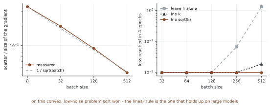

# 경사 크기 조정이 중요한 이유

<div class="leadbox" markdown>

**들어가는 이야기** — 배치를 키웠는데 더 나빠졌다

**배치 크기**를 늘리면 좋아질 것 같다. 같은 데이터를 보되 **덜 흔들리는** 그래디언트로
스텝을 밟게 되니 말이다. 그런데 **러닝레이트**를 그대로 두고 배치만 키우면 어느
지점부터 **결과가 망가진다.** 이 쪽의 측정에서는 배치를 열여섯 배로 키웠을 때
백 배 넘게 나빠졌다.

까닭은 두 가지가 동시에 달라지기 때문이다. 하나는 같은 데이터를 보는 동안
**스텝 수**가 그만큼 줄어드는 것이고, 다른 하나는 스텝마다 그래디언트의
**흔들림**(잡음)이 줄어드는 것이다. 앞엣것은 손해, 뒤엣것은 이득이다.

그래서 러닝레이트를 함께 키워야 하는데, **얼마나** 키우느냐에 널리 쓰이는
답이 둘 있다 — 배치를 $k$배 했으면 러닝레이트도 $k$배 하라는 **선형 규칙**과,
$\sqrt{k}$배면 된다는 **제곱근 규칙**이다. 이 쪽은 둘 다 재어 보고 승부를 본다. 다만 이긴 쪽이 언제나
이기는 것은 아니어서, 그 단서도 함께 적는다.

</div>

「경사 누적」에서 `mean` 로스를 조각 수로 나누어야 한다는 것을 보았다. 그것은
**같은 그래디언트를 만들기 위한** 조정이었다 — 배치가 실제로 커진 것이 아니다.

이 쪽은 다른 물음이다. 실효 배치를 **정말로** 키웠을 때 러닝레이트를 어떻게
할 것인가. 그래디언트의 **크기는 그대로**인데(평균이니까) 두 가지가 달라진다.

| | 어떻게 되는가 | 어느 방향 |
|---|---|---|
| 에포크당 스텝 수 | 배치가 $k$배면 $1/k$배 | 러닝레이트를 **키워야** |
| 그래디언트의 잡음 | $1/\sqrt{k}$배 | 더 큰 스텝을 **견딜 수 있다** |

앞의 것만 보면 $k$배(선형 규칙), 뒤의 것까지 보면 $\sqrt{k}$배가 맞다는 주장이
나온다. 셋을 나란히 재어 본다.

## 1. 코드

```python
"""배치를 키우면 러닝레이트를 어떻게 해야 하는가.

「경사 누적」에서 `mean` 로스를 조각 수로 나누어야 한다는 것을 보았다.
그것은 **같은 그래디언트를 만들기 위한** 조정이었다.

이 쪽은 다른 물음이다. 실효 배치를 **정말로 키웠을 때** 러닝레이트를
어떻게 할 것인가. 그래디언트의 크기는 그대로인데(평균이니까) 두 가지가
달라진다.

- **에포크당 스텝 수가 줄어든다** — 배치가 두 배면 스텝이 절반
- **그래디언트의 잡음이 줄어든다** — 표본이 많으면 추정이 정확해진다

앞의 것만 보면 러닝레이트를 k 배 해야 하고(선형 규칙), 뒤의 것까지
보면 sqrt(k) 배가 맞다는 주장이 나온다. 재어 본다.

실행: 이 쪽의 코드를 파일로 갈무리해 돌린다
"""
# math 는 파이썬 표준 라이브러리다. 여기서는 제곱근 math.sqrt 하나만 쓴다.
import math

# torch 는 파이토치 본체다. 텐서(파이토치가 다루는 수의 묶음)와 자동 미분이 여기서 온다.
# torch.nn 은 레이어를 모아 둔 곳이고 관례대로 nn 으로 줄여 부른다.
# torch.nn.functional 은 로스 같은 함수를 모아 둔 곳이고 F 로 줄여 부른다.
import torch
import torch.nn as nn
import torch.nn.functional as F


def header(title):
    # 절 제목을 한 줄 찍는다. \n 은 줄바꿈이라 제목 앞에 빈 줄이 하나 생긴다.
    # f"...{title}..." 은 문자열 안에 값을 끼워 넣는 파이썬 문법(f-문자열)이다.
    print(f"\n=== {title} ===")


# 데이터의 크기다. 표본이 N = 2048 개이고, 표본 하나는 수 D = 16 개로 되어 있다.
N, D = 2048, 16
# 기준이 되는 배치 크기 32 와 러닝레이트 0.05 다. 배치를 키울 때 「기준의 몇 배인가」를
# 이 둘에 견주어 잰다. 러닝레이트는 한 스텝에 파라메터를 얼마나 옮길지 정하는 수다.
BASE_B, BASE_LR = 32, 0.05


def make_data(seed=0):
    # 선형 회귀 문제를 하나 지어낸다. 참 웨이트 W 를 정해 두고 Y = XW + 잡음 으로 만든다.
    #
    # torch.manual_seed(seed) 는 난수 생성기를 정해진 자리에서 시작시킨다. 이 줄이
    # 있어야 돌릴 때마다 같은 난수가 나와, 쪽에 실린 수가 그대로 다시 나온다.
    torch.manual_seed(seed)
    # torch.randn(N, D) 는 표준정규분포(평균 0, 표준편차 1)에서 뽑은 수로 채운
    # 형태 (N, D) = (2048, 16) 의 텐서를 만든다. 행 하나가 표본 하나다.
    X = torch.randn(N, D)
    W = torch.randn(D, 1)          # 참 웨이트. 형태 (16, 1)
    # 함수는 (입력, 정답) 을 한 쌍으로 돌려준다.
    # @ 는 행렬 곱이다. (2048, 16) @ (16, 1) = (2048, 1) — 표본마다 정답이 하나다.
    # 거기에 표준편차 0.1 의 잡음을 더한다. 잡음의 분산이 0.1^2 = 0.01 이므로
    # 아무리 잘 맞춰도 제곱오차의 평균은 0.01 언저리에서 멈춘다.
    return X, X @ W + 0.1 * torch.randn(N, 1)


def train(X, Y, batch, lr, epochs=4, seed=0):
    # 배치 크기 batch, 러닝레이트 lr 로 epochs 에포크 트레인하고, 끝난 뒤 전체
    # 데이터에서 잰 로스를 돌려준다. 에포크는 데이터 전체를 한 번 다 보는 것이다.
    #
    # 시드를 여기서 다시 박는다. 모델의 초기화와 표본을 섞는 순서가 부를 때마다
    # 같아져, 결과의 차이가 batch 와 lr 에서만 나온다.
    torch.manual_seed(seed)
    # nn.Linear(D, 1) 은 수 16 개를 받아 수 1 개를 내는 레이어다.   y = x W^T + b
    # 웨이트(형태 (1, 16))와 바이어스(형태 (1,))를 무작위로 초기화해 갖고 있다.
    # 둘 다 처음부터 requires_grad=True, 곧 경사 추적이 걸려 있다 — 이 텐서가
    # 들어간 계산을 파이토치가 기록해 두므로 나중에 이 텐서로 미분할 수 있다.
    m = nn.Linear(D, 1)
    # 옵티마이저는 파라메터를 고치는 일을 맡는다. SGD 는 가장 단순한 것으로
    #   파라메터 ← 파라메터 - lr * 그래디언트
    # 를 한다. m.parameters() 로 고칠 파라메터(웨이트와 바이어스)를 넘겨준다.
    opt = torch.optim.SGD(m.parameters(), lr=lr)
    for _ in range(epochs):                 # _ 는 「이 변수는 쓰지 않는다」는 관례다
        # torch.randperm(N) 은 0 ~ N-1 을 무작위 순서로 늘어놓은 텐서다.
        # 에포크마다 표본을 새로 섞은 뒤 앞에서부터 배치로 자른다.
        perm = torch.randperm(N)
        # range(0, N, batch) 는 0, batch, 2*batch, ... 다. 배치가 32 면 64 번 돈다.
        for i in range(0, N, batch):
            idx = perm[i:i + batch]         # 이번 배치에 들어갈 표본의 번호 batch 개
            # 한 스텝은 늘 아래 세 줄이다.
            # (1) zero_grad() — 지난 스텝의 그래디언트를 지운다. backward() 는 .grad 에
            #     덮어쓰지 않고 「더하기」 때문에, 지우지 않으면 지난 것과 섞인다.
            opt.zero_grad()
            # (2) 순전파와 역전파. X[idx] 는 그 번호의 행만 뽑은 것(형태 (batch, 16))이고
            #     m(X[idx]) 가 모델의 예측(형태 (batch, 1))이다. F.mse_loss 는 예측과
            #     정답의 차를 제곱해 「평균」낸 수 하나다. 평균이라는 점이 이 쪽의
            #     핵심이다 — 배치가 커져도 그래디언트의 크기는 커지지 않는다.
            #     backward() 는 계산 그래프(계산의 기록)를 로스에서 거꾸로 따라가며
            #     로스를 각 파라메터로 미분한 값(그래디언트)을 그 파라메터의 .grad 에
            #     채운다.
            F.mse_loss(m(X[idx]), Y[idx]).backward()
            # (3) step() — .grad 를 읽어 파라메터를 한 번 옮긴다. 이것이 한 스텝이다.
            opt.step()
    # 트레인이 끝난 뒤 전체 2048 개로 로스를 잰다. .item() 은 수 하나짜리 텐서에서
    # 그 수를 파이썬 실수로 꺼낸다.
    return F.mse_loss(m(X), Y).item()


# ========================================================================
# 1. 배치가 크면 스텝이 준다
# ========================================================================

def fewer_steps():
    # 트레인 없이 셈만 한다. 표본 2048 개를 배치 b 개씩 자르면 몇 스텝이 나오는가.
    header("1. 에포크당 스텝 수")
    for b in (32, 64, 128, 256, 512):
        # // 는 몫만 남기는 나눗셈이다.   2048 // 32 = 64,   2048 // 512 = 4
        # 4 * (N // b) 의 4 는 train() 의 기본 에포크 수(epochs=4)다.
        # {b:4d} 는 정수를 네 칸에 맞춰 찍으라는 뜻이다. 나란히 적은 두 문자열은
        # 파이썬이 하나로 이어 붙인다.
        print(f"  배치 {b:4d}  에포크당 스텝 {N // b:3d}번  "
              f"4 에포크면 {4 * (N // b):4d}번")
    # 배치 32 는 256 번, 배치 512 는 16 번이다.   256 / 16 = 16
    print("  같은 데이터를 보는데 걷는 횟수가 열여섯 배 차이 난다")


# ========================================================================
# 2. 그래디언트의 잡음은 줄어든다
# ========================================================================

def less_noise():
    header("2. 배치와 그래디언트의 잡음")
    X, Y = make_data()
    # 모델은 하나만 만들고 트레인하지 않는다. 파라메터를 한 자리에 붙들어 둔 채
    # 배치만 다르게 뽑아, 그래디언트가 뽑기마다 얼마나 달라지는지 본다.
    torch.manual_seed(0)
    m = nn.Linear(D, 1)
    for b in (8, 32, 128, 512, N):          # 마지막 N = 2048 은 전체 배치다
        gs = []                             # 이 배치 크기로 잰 그래디언트를 모을 리스트
        for t in range(16):                 # 배치를 열여섯 번 다르게 뽑는다
            # 뽑기마다 시드를 100, 101, ..., 115 로 달리해 서로 다른 배치가 나오게 한다.
            torch.manual_seed(100 + t)
            idx = torch.randperm(N)[:b]     # 섞은 번호의 앞 b 개 = 무작위 배치 하나
            # 옵티마이저가 없으므로 모델에 대고 그래디언트를 지운다. 하는 일은 같다.
            m.zero_grad()
            # 이 배치의 로스를 역전파한다. step() 이 없으므로 파라메터는 그대로다.
            F.mse_loss(m(X[idx]), Y[idx]).backward()
            # m.weight.grad 는 로스를 웨이트로 미분한 값이고 형태는 웨이트와 같은
            # (1, 16) 이다. flatten() 으로 길이 16 의 벡터로 펴고, clone() 으로
            # 복사본을 떼어 리스트에 넣는다 — .grad 는 다음 역전파가 다시 쓰는
            # 자리이므로 값을 따로 챙겨 두는 것이다.
            gs.append(m.weight.grad.flatten().clone())
        # torch.stack 은 길이 16 의 벡터 16 개를 쌓아 형태 (16, 16) 의 텐서로 만든다.
        # 행 하나가 뽑기 한 번이고 열 하나가 웨이트 한 자리다.
        G = torch.stack(gs)
        # 흔들림 — 웨이트 자리마다 열여섯 번 뽑은 값의 표준편차를 내고(dim=0 은 행을
        # 따라, 곧 뽑기에 걸쳐 계산하라는 뜻이다) 그 16 개를 평균낸다.
        spread = G.std(dim=0).mean().item()
        # 크기 — 열여섯 번을 평균낸 그래디언트(길이 16)의 노름, 곧 벡터의 길이다.
        size = G.mean(dim=0).norm().item()
        # {size:7.4f} 는 일곱 칸에 소수점 아래 네 자리로 찍는다. 「비」는 흔들림을
        # 크기로 나눈 것이다. 전체 배치는 순서만 다를 뿐 매번 같은 2048 개라
        # 그래디언트가 매번 같고, 그래서 흔들림이 0 으로 찍힌다.
        print(f"  배치 {b:4d}  그래디언트 크기 {size:7.4f}  표본마다 흔들림 {spread:7.4f}"
              f"  비 {spread / size:6.3f}")
    print("  크기는 그대로고 흔들림만 준다 — 평균이라 그렇다")
    print("  흔들림이 1/sqrt(배치) 로 줄어드는 것이 sqrt 규칙의 근거다")


# ========================================================================
# 3. 세 가지 조정을 견준다
# ========================================================================

def three_rules():
    header("3. 러닝레이트를 어떻게 할 것인가")
    X, Y = make_data()
    # 견줄 기준 — 배치 32, 러닝레이트 0.05 로 4 에포크 트레인한 로스다.
    # :.6f 는 소수점 아래 여섯 자리까지 찍으라는 뜻이다.
    print(f"  기준: 배치 {BASE_B}, lr {BASE_LR}  ->"
          f" {train(X, Y, BASE_B, BASE_LR):.6f}")
    # 표의 머리 줄이다. {'배치':>5s} 는 문자열을 다섯 칸에 오른쪽으로 붙여 찍는다.
    print(f"  {'배치':>5s}  {'그대로':>22s}  {'선형 k배':>22s}  {'sqrt k배':>22s}")
    for b in (32, 64, 128, 256, 512):
        k = b / BASE_B                      # 배치가 기준의 몇 배인가 — 1, 2, 4, 8, 16
        cells = []                          # 이 줄에 찍을 세 칸을 모은다
        # 세 가지 러닝레이트로 저마다 처음부터 트레인한다.
        #   그대로        0.05
        #   선형 규칙     0.05 * k          b = 512 면 0.05 * 16 = 0.8
        #   제곱근 규칙   0.05 * sqrt(k)    b = 512 면 0.05 * 4  = 0.2
        for lr in (BASE_LR, BASE_LR * k, BASE_LR * math.sqrt(k)):
            # 쓴 러닝레이트와 닿은 로스를 한 칸의 문자열로 만들어 둔다.
            cells.append(f"lr={lr:5.3f} {train(X, Y, b, lr):9.6f}")
        # "  ".join(...) 은 세 칸을 공백 두 개로 이어 붙여 한 줄로 만든다.
        print(f"  {b:5d}  " + "  ".join(f"{c:>22s}" for c in cells))


# ========================================================================
# 4. 읽기
# ========================================================================

def reading():
    # 재는 것은 없다. 3 의 표에서 읽히는 것을 글로 찍는다.
    header("4. 무엇이 보이는가")
    print("  그대로 두면 배치 256 부터 무너진다 — 스텝이 모자라서다")
    print("  선형 k배는 256 까지 버티고 512 에서 나빠진다 — 스텝이 너무 커서다")
    print("  sqrt k배는 끝까지 같은 자리에 닿는다")
    print("  이 문제에서는 sqrt 쪽이 이겼다. 다만 조건이 붙는다")
    print("    - 이 로스는 볼록하고 잡음이 작다")
    print("    - 큰 딥러닝 모델에서는 선형 규칙이 더 잘 듣는다고 알려져 있다")
    print("    - 어느 쪽이든 '안 바꾸는 것' 보다는 낫다")


def main():
    # 네 절을 차례로 돌린다.
    fewer_steps()
    less_noise()
    three_rules()
    reading()


# 이 파일을 직접 돌렸을 때만 main() 을 부른다. 다른 파일이 이 파일을 불러다(import)
# 쓸 때는 __name__ 이 "__main__" 이 아니므로 아무것도 돌지 않는다.
if __name__ == "__main__":
    main()
```

**출력:**

```
=== 1. 에포크당 스텝 수 ===
  배치   32  에포크당 스텝  64번  4 에포크면  256번
  배치   64  에포크당 스텝  32번  4 에포크면  128번
  배치  128  에포크당 스텝  16번  4 에포크면   64번
  배치  256  에포크당 스텝   8번  4 에포크면   32번
  배치  512  에포크당 스텝   4번  4 에포크면   16번
  같은 데이터를 보는데 걷는 횟수가 열여섯 배 차이 난다

=== 2. 배치와 그래디언트의 잡음 ===
  배치    8  그래디언트 크기  9.3937  표본마다 흔들림  3.2639  비  0.347
  배치   32  그래디언트 크기  9.9579  표본마다 흔들림  1.8499  비  0.186
  배치  128  그래디언트 크기 10.6477  표본마다 흔들림  0.9664  비  0.091
  배치  512  그래디언트 크기 11.0757  표본마다 흔들림  0.4676  비  0.042
  배치 2048  그래디언트 크기 10.9422  표본마다 흔들림  0.0000  비  0.000
  크기는 그대로고 흔들림만 준다 — 평균이라 그렇다
  흔들림이 1/sqrt(배치) 로 줄어드는 것이 sqrt 규칙의 근거다

=== 3. 러닝레이트를 어떻게 할 것인가 ===
  기준: 배치 32, lr 0.05  -> 0.009760
     배치                     그대로                   선형 k배                 sqrt k배
     32      lr=0.050  0.009760      lr=0.050  0.009760      lr=0.050  0.009760
     64      lr=0.050  0.009688      lr=0.100  0.009775      lr=0.071  0.009714
    128      lr=0.050  0.009786      lr=0.200  0.009794      lr=0.100  0.009689
    256      lr=0.050  0.066415      lr=0.400  0.009827      lr=0.141  0.009678
    512      lr=0.050  1.321642      lr=0.800  0.018453      lr=0.200  0.009684

=== 4. 무엇이 보이는가 ===
  그대로 두면 배치 256 부터 무너진다 — 스텝이 모자라서다
  선형 k배는 256 까지 버티고 512 에서 나빠진다 — 스텝이 너무 커서다
  sqrt k배는 끝까지 같은 자리에 닿는다
  이 문제에서는 sqrt 쪽이 이겼다. 다만 조건이 붙는다
    - 이 로스는 볼록하고 잡음이 작다
    - 큰 딥러닝 모델에서는 선형 규칙이 더 잘 듣는다고 알려져 있다
    - 어느 쪽이든 '안 바꾸는 것' 보다는 낫다
```

## 2. 스텝이 줄어든다

```
배치   32  에포크당 스텝  64번   4 에포크면  256번
배치  512  에포크당 스텝   4번   4 에포크면   16번
```

같은 데이터를 네 번 보는데 스텝 수가 **열여섯 배** 차이 난다. 러닝레이트가
같으면 큰 배치 쪽이 훨씬 덜 움직인다 — 그것만으로도 덜 배운다.

## 3. 잡음만 줄어든다

| 배치 | 그래디언트 크기 | 표본마다 흔들림 | 비 |
|---|---|---|---|
| 8 | 9.3937 | 3.2639 | 0.347 |
| 32 | 9.9579 | 1.8499 | 0.186 |
| 128 | 10.6477 | 0.9664 | 0.091 |
| 512 | 11.0757 | 0.4676 | 0.042 |
| 2048 (전체) | 10.9422 | 0.0000 | 0.000 |

**크기는 거의 그대로이고 흔들림만 준다.** 로스가 평균이므로 기댓값이 배치
크기와 무관하기 때문이다.

비가 0.347 → 0.186 → 0.091 → 0.042로, 배치가 네 배 될 때마다 **거의 정확히
절반**이 된다. $1/\sqrt{k}$다. 전체 배치에서는 흔들림이 0이다 — 뽑을 것이
없으니 매번 같은 그래디언트가 나온다.

이것이 sqrt 규칙의 근거다. 잡음이 절반이면 두 배 큰 스텝을 밟아도 같은 만큼
흔들린다.

## 4. 세 가지를 견주면

| 배치 | 그대로 (lr 0.05) | 선형 $k$배 | $\sqrt{k}$배 |
|---|---|---|---|
| 32 | 0.009760 | 0.009760 | 0.009760 |
| 64 | 0.009688 | 0.009775 | 0.009714 |
| 128 | 0.009786 | 0.009794 | 0.009689 |
| 256 | **0.066415** | 0.009827 | 0.009678 |
| 512 | **1.321642** | **0.018453** | **0.009684** |



세 가지가 다르게 무너진다.

- **그대로 두면** 256부터 무너지고 512에서 1.32다. 백 배 이상 나쁘다.
  **스텝이 모자라서**다 — 에포크당 네 스텝, 모두 열여섯 스텝으로는 멀리 못 간다
- **선형 $k$배**는 256까지 버티고 512에서 두 배 가까이 나빠진다. 이제 **스텝이 너무
  커서**다
- **$\sqrt{k}$배**는 끝까지 0.0097 언저리에 닿는다

> 이 문제에서 $\sqrt{k}$가 이겼다는 것을 일반 법칙으로 읽으면 안 된다. 이
> 로스는 **볼록하고 잡음이 작다.** 큰 영상 모델에서는 선형 규칙이 더 잘 듣는
> 것으로 알려져 있고, 실제로 ImageNet을 큰 배치로 트레인하는 작업들이 선형
> 규칙에 워밍업을 붙여 쓴다.
>
> 확실한 것은 하나다. **안 바꾸는 것보다는 어느 쪽이든 낫다.** 배치를 바꾸면서
> 러닝레이트를 그대로 두는 것이 가장 나쁘다.

## 연습문제

<div class="drillbox" markdown>

**연습문제 1.** <span class="diff easy" title="쉬움"></span>
배치를 $k$배 키우고 러닝레이트도 $k$배 하면, **한 에포크 동안 파라메터가 움직이는
총 거리**는 어떻게 되는가? 스텝 수와 스텝 크기로 계산해 보라.

</div>

??? success "풀이"
    계산은 간단하다. 배치를 $k$배 하면

    - 스텝 수: $1/k$배
    - 스텝 크기: 러닝레이트를 $k$배 했으므로 $k$배 (그래디언트 크기는 그대로)

    곱하면 **1배** — 총 거리가 같다.

    ```python
    # 본문 프로그램의 임포트와 make_data(), N, D 를 그대로 쓴다.
    X, Y = make_data()
    for b in (32, 128, 512):
        k = b / 32                              # 기준 배치 32 의 몇 배인가 — 1, 4, 16
        # 시드를 박아 세 번 모두 같은 초기화에서 출발하고 같은 순서로 섞게 한다.
        torch.manual_seed(0)
        # nn.Linear(D, 1) 은 수 16 개를 받아 수 1 개를 내는 레이어다. 웨이트의
        # 형태는 (1, 16) 이고 m.weight 로 꺼낸다.
        m = nn.Linear(D, 1)
        # 출발 자리의 웨이트를 복사해 둔다. detach() 는 계산 그래프에서 떼어 내
        # 경사 추적 없이 값만 보는 텐서를 주는데, 메모리는 m.weight 와 같이 쓴다.
        # 그래서 clone() 으로 복사해야 한다 — 복사하지 않으면 스텝마다 m.weight 가
        # 바뀔 때 start 도 따라 바뀐다.
        start = m.weight.detach().clone()
        # 선형 규칙 — 배치가 k 배면 러닝레이트도 k 배다.   lr = 0.05, 0.2, 0.8
        opt = torch.optim.SGD(m.parameters(), lr=0.05 * k)
        moved = 0.0                             # 스텝마다 움직인 길이를 더해 갈 자리
        perm = torch.randperm(N)                # 표본을 섞는다. 한 에포크만 돈다
        for i in range(0, N, b):                # 2048 // b 번 — 64, 16, 4 스텝
            prev = m.weight.detach().clone()    # 스텝 직전의 웨이트
            idx = perm[i:i + b]                 # 이번 배치의 표본 번호 b 개
            # 한 스텝이다. ; 는 여러 문장을 한 줄에 적는 문법이고, 차례는 본문의
            # train() 과 같다 — 지난 그래디언트를 지우고(zero_grad), 로스를
            # 역전파해 .grad 를 채우고(backward), 그것으로 파라메터를 옮긴다(step).
            opt.zero_grad(); F.mse_loss(m(X[idx]), Y[idx]).backward(); opt.step()
            # 이번 스텝에 웨이트가 움직인 길이다. norm() 은 벡터의 길이(노름)다.
            moved += (m.weight.detach() - prev).norm().item()
        # 「움직인 길이 합」은 걸어간 길 전체의 길이이고, 「처음에서의 거리」는
        # 출발점과 도착점을 곧게 이은 길이다. 길이 구불구불하면 앞의 것이 더 크다.
        print(f"  배치 {b:4d}  스텝 {N // b:3d}번  "
              f"움직인 길이 합 {moved:7.4f}  "
              f"처음에서의 거리 {(m.weight.detach() - start).norm():7.4f}")
    ```

    ```
      배치   32  스텝  64번  움직인 길이 합  7.3213  처음에서의 거리  5.7478
      배치  128  스텝  16번  움직인 길이 합  6.4124  처음에서의 거리  5.7552
      배치  512  스텝   4번  움직인 길이 합 18.6414  처음에서의 거리  5.4709
    ```

    **처음에서의 거리가 셋 다 5.5~5.8로 거의 같다.** 선형 규칙이 노리는 것이
    이것이다 — 한 에포크에 같은 만큼 이동하게 만든다.

    "움직인 길이 합"은 짐작과 다르게 나왔다. 32와 128은 7.3과 6.4로 비슷한데
    **512가 18.6으로 훌쩍 크다.** 네 스텝뿐인데 스텝마다 lr이 0.8이라 한 번에
    크게 지나쳤다 되돌아오기를 했기 때문이다.

    그러니 "큰 배치가 곧은 길로 간다"는 말은 **스텝이 적당할 때만** 참이다.
    스텝을 $k$배로 키워 놓으면 그 큰 스텝이 또 다른 지그재그를 만든다. 4절에서
    선형 규칙이 512에서 무너진 것과 같은 장면을 다른 각도로 본 셈이다.

---

<div class="drillbox" markdown>

**연습문제 2.** <span class="diff med" title="중간"></span>
3절의 잡음 비가 $1/\sqrt{b}$를 정말 따르는가? 배치를 네 배씩 키우며 비가
절반이 되는지 확인하라.

</div>

??? success "풀이"
    위 프로그램의 `make_data()`와 `N`, `D`를 그대로 쓴다. 본문의 `less_noise()`와
    같은 측정인데, 배치마다 뽑는 횟수만 16에서 32로 늘렸다.

    ```python
    X, Y = make_data()
    # 모델은 하나만 만들고 트레인하지 않는다. 같은 파라메터 자리에서 배치만
    # 다르게 뽑아 그래디언트의 흔들림을 잰다.
    torch.manual_seed(0)
    m = nn.Linear(D, 1)
    prev = None                             # 바로 앞 배치 크기에서 잰 잡음비. 처음엔 없다
    for b in (8, 32, 128, 512):             # 배치를 네 배씩 키운다
        gs = []                             # 그래디언트 32 개를 모을 리스트
        for t in range(32):                 # 배치를 서른두 번 다르게 뽑는다
            torch.manual_seed(100 + t)      # 뽑기마다 다른 시드 — 다른 배치가 나온다
            idx = torch.randperm(N)[:b]     # 섞은 번호의 앞 b 개 = 무작위 배치 하나
            m.zero_grad()                   # 지난 뽑기의 그래디언트를 지운다
            # 이 배치의 로스를 역전파해 m.weight.grad 를 채운다.
            F.mse_loss(m(X[idx]), Y[idx]).backward()
            # 웨이트의 그래디언트(형태 (1, 16))를 길이 16 의 벡터로 펴서 복사해 둔다.
            gs.append(m.weight.grad.flatten().clone())
        G = torch.stack(gs)                 # 형태 (32, 16) — 행이 뽑기, 열이 웨이트 자리
        # 잡음비 = 흔들림 / 크기.
        #   G.std(0).mean()   자리마다 32 번에 걸친 표준편차를 내고 16 자리를 평균낸다
        #   G.mean(0).norm()  32 번을 평균낸 그래디언트의 노름(벡터의 길이)
        # std(0) 의 0 은 본문에서 dim=0 으로 적은 것과 같다.
        r = (G.std(0).mean() / G.mean(0).norm()).item()
        # 첫 줄에는 견줄 앞의 값이 없으므로 빈 문자열을 붙인다. 그 뒤로는 앞의 비를
        # 지금의 비로 나눈다. 1/sqrt(b) 를 따른다면 배치가 4 배일 때 sqrt(4) = 2 다.
        note = "" if prev is None else f"  앞의 {prev / r:.2f}배 작아짐"
        print(f"  배치 {b:4d}  잡음비 {r:.4f}{note}")
        prev = r                            # 다음 줄이 견줄 수 있게 넘겨 둔다
    ```

    ```
      배치    8  잡음비 0.3436
      배치   32  잡음비 0.1787  앞의 1.92배 작아짐
      배치  128  잡음비 0.0894  앞의 2.00배 작아짐
      배치  512  잡음비 0.0404  앞의 2.21배 작아짐
    ```

    **1.92, 2.00, 2.21** — $\sqrt{4} = 2$ 둘레에서 흔들린다.

    표본 32개로 잰 값이라 그 자체가 잡음을 품고 있다. 더 많이 재면 2에 더
    붙겠지만, 지금도 법칙이 보일 만큼은 맞는다.

    이것이 통계에서 가장 흔한 형태다. 「선형 회귀」 연습문제 2에서 표본
    수와 추정 오차를 같은 $1/\sqrt{N}$에 견주었다. **독립인 것을 $n$개 평균내면 흔들림이
    $\sqrt{n}$에 반비례해 줄어든다.**

---

<div class="drillbox" markdown>

**연습문제 3.** <span class="diff hard" title="어려움"></span>
4절에서 선형 규칙이 배치 512에서 무너졌다(0.0185). **워밍업**을 붙이면
나아지는가? 처음 몇 스텝 동안 러닝레이트를 작은 값에서부터 차츰 올려 보라.

</div>

??? success "풀이"
    위 프로그램의 `make_data()`를 그대로 쓰고, `train()`에 워밍업만 더한다.

    ```python
    X, Y = make_data()


    def train_warm(batch, lr, epochs=4, warmup=0, seed=0):
        # 본문의 train() 과 같고, 표시한 세 곳만 더했다. warmup 은 러닝레이트를
        # 올리는 데 쓸 스텝 수다. 0 이면 워밍업 없이 train() 과 똑같이 돈다.
        torch.manual_seed(seed)             # 초기화와 섞는 순서를 train() 과 같게 한다
        m = nn.Linear(D, 1)                 # 수 16 개를 받아 1 개를 내는 레이어
        # 옵티마이저 SGD 는 step() 때   파라메터 ← 파라메터 - lr * 그래디언트   를 한다.
        opt = torch.optim.SGD(m.parameters(), lr=lr)
        step = 0                            # (더한 곳 1) 지금까지 밟은 스텝 수를 센다
        for _ in range(epochs):
            perm = torch.randperm(N)        # 에포크마다 표본을 새로 섞는다
            for i in range(0, N, batch):
                step += 1
                # (더한 곳 2) 이번 스텝에 쓸 러닝레이트다. 워밍업 동안은 스텝 수에
                # 비례해 올리고, 다 올린 뒤에는 min 이 1.0 에서 막아 lr 그대로다.
                #   warmup = 4, lr = 0.8 이면   0.2, 0.4, 0.6, 0.8, 0.8, ...
                # 「if warmup else lr」 는 warmup 이 0 일 때 0 으로 나누지 않게 한다.
                cur = lr * min(1.0, step / warmup) if warmup else lr
                # (더한 곳 3) 옵티마이저는 설정을 param_groups 라는 리스트에 사전으로
                # 갖고 있다. 그 안의 "lr" 을 바꿔 쓰면 다음 step() 부터 그 값을 쓴다.
                for g in opt.param_groups:
                    g["lr"] = cur
                idx = perm[i:i + batch]     # 이번 배치의 표본 번호
                opt.zero_grad()             # 지난 스텝의 그래디언트를 지운다
                # 배치의 평균 제곱오차를 역전파해 각 파라메터의 .grad 를 채운다.
                F.mse_loss(m(X[idx]), Y[idx]).backward()
                opt.step()                  # 방금 정한 러닝레이트 cur 로 한 스텝 옮긴다
        # 전체 데이터의 로스를 파이썬 실수로 꺼내 돌려준다.
        return F.mse_loss(m(X), Y).item()

    # 4절에서 무너진 조합(배치 512, 선형 규칙의 lr 0.8)에 워밍업 길이만 바꿔 본다.
    # 배치 512 는 에포크당 4 스텝, 4 에포크에 모두 16 스텝이다.
    for wu in (0, 2, 4, 8):
        print(f"  워밍업 {wu:2d} 스텝  마지막 로스 {train_warm(512, 0.8, warmup=wu):.6f}")
    ```

    ```
      워밍업  0 스텝  마지막 로스 0.018453
      워밍업  2 스텝  마지막 로스 0.013331
      워밍업  4 스텝  마지막 로스 0.011875
      워밍업  8 스텝  마지막 로스 0.011976
    ```

    **나아진다.** 0.0185에서 0.0119로, 거의 sqrt 규칙(0.0097) 가까이 간다.

    까닭은 **초반의 그래디언트가 가장 크기 때문**이다. 무작위 초기값에서 출발하면
    첫 몇 스텝의 그래디언트가 유난히 크고, 거기에 큰 러닝레이트를 곱하면 지나친다.
    충분히 가까워진 뒤에는 같은 러닝레이트가 안전하다.

    워밍업 8스텝이 4스텝보다 조금 나쁜 것도 보아 둘 만하다. 전체가 16스텝뿐이라
    **절반을 워밍업에 쓰면 제 러닝레이트로 가는 구간이 모자란다.** 워밍업 길이도
    공짜가 아니다.

    실전에서는 전체 스텝의 1~5% 정도를 쓴다. 큰 배치로 ImageNet을 트레인하는
    작업들이 선형 규칙 + 몇 에포크 워밍업을 함께 쓰는 까닭이 여기 있다 —
    둘이 한 짝이다.
