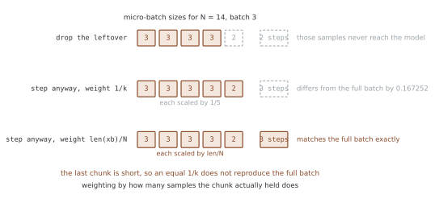

# 경사 누적을 쓰는 트레인 루프

<div class="leadbox" markdown>

**들어가는 이야기** — 나누어떨어지지 않을 때

**그래디언트 누적**(gradient accumulation) 루프는 교과서에 짧게 적힌다 — 작은 배치의 그래디언트를 여러 번 더해 큰 배치 하나를 흉내 내는 기법이다. 몇 번 `backward()`하고 한 번
`step()`하고 `zero_grad()`하는, 네 줄 남짓한 틀이다. 그 틀은 **데이터 수가 딱 나누어떨어진다**고 가정하고 있다.

실제 데이터는 나누어떨어지지 않는다. 그리고 안 떨어질 때 생기는 일 둘이
**모두 조용하다.** 하나는 매 에포크 마지막 몇 표본이 통째로 버려지는 것이고 —
같은 자리가 매번 빠지므로 그 표본들은 영영 덜 배운다 — 다른 하나는 끝까지
챙겼는데도 결과가 통째로 한 것과 **어긋나는** 것이다.

둘째가 더 고약하다. 모든 표본을 쓰고 있으니 빠뜨린 느낌이 없는데, 짧은 조각에
다른 조각과 같은 무게를 주었기 때문에 **그 표본들이 제 몫보다 무겁게** 들어간
것이다. 고치는 방법은 한 줄이다.

</div>

「경사 누적」에서 `mean` 로스를 조각 수로 나누라고 했다. 그 규칙에 단서가 둘
붙는다. 둘 다 **데이터 수가 딱 안 떨어질 때** 생기고, 둘 다 오류를 내지 않는다.

- **남는 마이크로배치** — 누적 수로 안 나눠떨어지면 마지막 몇 개의 그래디언트가
  조용히 버려진다
- **고르지 않은 조각** — 마지막 조각이 짧은데 같은 $1/k$를 곱하면 전체 배치와
  **다른 그래디언트**가 나온다

$N = 14$, 배치 3, 누적 2로 재어 본다. 14는 3으로도 6으로도 안 떨어지므로 둘 다
일어난다.

## 1. 코드

```python
"""그래디언트를 쌓는 트레인 루프 — 나머지가 생길 때.

「경사 누적」에서 `mean` 로스를 조각 수로 나누라고 했다. 그 규칙에
단서가 둘 붙는다. 데이터 수가 딱 안 떨어질 때 생기는 일이다.

- **남는 마이크로배치** — 누적 수로 안 나눠떨어지면 마지막 몇 개의
  그래디언트가 조용히 버려진다
- **고르지 않은 조각** — 마지막 조각이 짧은데 같은 1/k 를 곱하면
  전체 배치와 다른 그래디언트가 된다

둘 다 오류를 내지 않는다. 그래서 이 쪽에서 재어 본다.

실행: 이 쪽의 코드를 파일로 갈무리해 돌린다
"""
# torch 는 파이토치 본체다. 텐서(파이토치가 다루는 수의 묶음)와 자동 미분이 여기서 온다.
# torch.nn 은 레이어를 모아 둔 곳이고 관례대로 nn 으로 줄여 부른다.
# torch.nn.functional 은 로스 같은 함수를 모아 둔 곳이고 F 로 줄여 부른다.
import torch
import torch.nn as nn
import torch.nn.functional as F


def header(title):
    # 절 제목을 한 줄 찍는다. \n 은 줄바꿈이라 제목 앞에 빈 줄이 하나 생긴다.
    # f"...{title}..." 은 문자열 안에 값을 끼워 넣는 파이썬 문법(f-문자열)이다.
    print(f"\n=== {title} ===")


# N     표본 수 14
# D     표본 하나를 이루는 수의 개수 4
# BATCH 한 번에 모델에 넣는 표본 수 3. 이 작은 묶음을 마이크로배치라 부른다
# ACC   누적 수 2. 마이크로배치 2 개의 그래디언트를 쌓은 뒤에 한 스텝 간다
# 14 = 3 + 3 + 3 + 3 + 2 이므로 마이크로배치는 5 개이고 마지막은 2 개짜리다.
N, D, BATCH, ACC = 14, 4, 3, 2      # 14 는 3 으로도 6 으로도 안 떨어진다


def setup():
    # 데이터와 출발 웨이트를 만든다. torch.manual_seed(0) 은 난수 생성기를 정해진
    # 자리에서 시작시킨다 — 부를 때마다 같은 수가 나와 네 절이 같은 데이터를 쓴다.
    torch.manual_seed(0)
    # torch.randn 은 표준정규분포(평균 0, 표준편차 1)에서 뽑은 수로 텐서를 채운다.
    # 차례로 입력 X(형태 (14, 4)), 정답 Y(형태 (14, 1)), 출발 웨이트 W0(형태 (4, 1))다.
    return torch.randn(N, D), torch.randn(N, 1), torch.randn(D, 1)


def fresh(W0):
    # 늘 똑같은 새 모델을 하나 만들어 돌려준다. 방법을 바꿔 가며 견줄 때마다
    # 같은 자리에서 출발해야 결과의 차이가 방법에서만 나온다.
    torch.manual_seed(0)
    # nn.Linear(D, 1) 은 수 4 개를 받아 수 1 개를 내는 레이어다.   y = x W^T + b
    # 웨이트(형태 (1, 4))와 바이어스(형태 (1,))를 무작위로 초기화해 갖고 있다.
    # 둘 다 처음부터 requires_grad=True, 곧 경사 추적이 걸려 있다 — 이 텐서가
    # 들어간 계산을 파이토치가 기록해 두므로 나중에 이 텐서로 미분할 수 있다.
    m = nn.Linear(D, 1)
    # 웨이트를 W0 으로 덮어쓴다. with torch.no_grad(): 블록 안의 계산은 기록하지
    # 않는다. 파라메터에 값을 써넣는 일은 모델의 계산이 아니므로 기록에 남기면
    # 안 되고, 이 블록 없이 경사 추적 중인 텐서를 제자리에서 고치면 오류가 난다.
    with torch.no_grad():
        # view(1, D) 는 값은 그대로 두고 형태만 (4, 1) 에서 (1, 4) 로 바꿔 본다.
        # copy_ 는 그 값을 웨이트에 복사해 넣는다. 이름 끝의 _ 는 새 텐서를
        # 만들지 않고 「제자리에서」 고치는 연산이라는 파이토치의 표시다.
        m.weight.copy_(W0.view(1, D))
    return m


# ========================================================================
# 1. 루프의 뼈대
# ========================================================================

def skeleton():
    header("1. 누적 루프의 뼈대")
    # 흔히 쓰는 경사 누적 루프를 글로 찍는다. 이 다섯 줄은 실행되는 코드가 아니라
    # 찍히는 문자열이다. % 는 나머지다 — 번호가 ACC 의 배수일 때만 스텝을 간다.
    print("  for 마이크로배치:")
    print("      로스 = criterion(...) / ACC")
    print("      로스.backward()")
    print("      if 마이크로배치 번호 % ACC == 0:")
    print("          opt.step(); opt.zero_grad()")
    # // 는 몫만 남기되 「내림」하는 나눗셈이다. 음수로 바꿔 나누고 다시 부호를
    # 뒤집으면 올림이 된다.   -(-14 // 3) = -(-5) = 5   (14 / 3 = 4.67 의 올림)
    print(f"  N={N}, 배치 {BATCH} -> 마이크로배치 {-(-N // BATCH)}개")
    # 5 // 2 = 2 번 걷고, 5 % 2 = 1 개가 남는다.
    print(f"  누적 {ACC} 로 묶으면 {-(-N // BATCH) // ACC}번 걷고 "
          f"{-(-N // BATCH) % ACC}개가 남는다")


# ========================================================================
# 2. 남는 마이크로배치
# ========================================================================

def leftover():
    header("2. 남는 마이크로배치")
    X, Y, W0 = setup()
    # 같은 루프를 두 번 돈다. 다른 것은 루프가 끝난 뒤 남은 마이크로배치를
    # 챙기는가(handle_tail) 하나뿐이다.
    for label, handle_tail in (("마지막을 버린다", False),
                               ("마지막도 걷는다", True)):
        m = fresh(W0)
        # 옵티마이저는 파라메터를 고치는 일을 맡는다. SGD 는 가장 단순한 것으로
        #   파라메터 ← 파라메터 - lr * 그래디언트
        # 를 한다. lr 이 러닝레이트이고, m.parameters() 로 고칠 파라메터를 넘겨준다.
        opt = torch.optim.SGD(m.parameters(), lr=0.1)
        micro = steps = 0                   # 지나온 마이크로배치 수, 밟은 스텝 수
        # range(0, N, BATCH) 는 0, 3, 6, 9, 12 다. X[i:i + BATCH] 는 i 번째부터
        # 3 개의 행이고, 마지막(i = 12)은 남은 2 개뿐이다.
        for i in range(0, N, BATCH):
            # 순전파: m(...) 이 예측이고 F.mse_loss 는 예측과 정답의 차를 제곱해
            # 「평균」낸 수 하나다. 그것을 누적 수 ACC 로 나눈다 — 두 번 쌓으면
            # 두 마이크로배치의 평균이 되게 하려는 것이다.
            # 역전파: backward() 는 로스를 각 파라메터로 미분한 값(그래디언트)을
            # 그 파라메터의 .grad 에 넣는다. 덮어쓰지 않고 「더한다」. 경사 누적은
            # 이 성질을 쓴다 — zero_grad() 를 부르기 전까지 .grad 에 계속 쌓인다.
            (F.mse_loss(m(X[i:i + BATCH]), Y[i:i + BATCH]) / ACC).backward()
            micro += 1
            if micro % ACC == 0:            # 2 번째, 4 번째 마이크로배치에서만 참이다
                opt.step()                  # 쌓인 .grad 로 파라메터를 한 번 옮긴다
                opt.zero_grad()             # 다음 묶음을 위해 .grad 를 비운다
                steps += 1
        # 루프가 끝났을 때 micro = 5 이고 5 % 2 = 1 이다. 0 이 아닌 수는 참으로
        # 치므로 「남은 것이 있고, 그것을 챙기기로 했으면」 이라는 조건이다.
        # 챙기지 않으면 5 번째 마이크로배치의 그래디언트는 .grad 에 쌓이기만 하고
        # step() 을 만나지 못한다.
        if micro % ACC and handle_tail:
            opt.step()
            opt.zero_grad()
            steps += 1
        # 웨이트의 앞 두 값을 찍어 두 방법의 결과를 견준다.
        #   {label:16s}   문자열을 열여섯 칸에 맞춰 찍는다
        #   detach()      계산 그래프에서 떼어 내 값만 본다
        #   flatten()[:2] 한 줄로 펴서 앞의 둘만 고른다
        #   tolist()      파이썬 리스트로 바꾼다. round(v, 6) 은 여섯 자리 반올림이다
        print(f"  {label:16s} 마이크로배치 {micro}개  step {steps}번  "
              f"w[:2] {[round(v, 6) for v in m.weight.detach().flatten()[:2].tolist()]}")
    print("  버리는 쪽은 마지막 조각의 그래디언트가 통째로 사라진다")
    print("  에포크마다 같은 자리가 빠지므로, 그 표본들은 영영 덜 배운다")


# ========================================================================
# 3. 고르지 않은 조각에 1/k 를 곱하면
# ========================================================================

def uneven():
    header("3. 조각 크기가 고르지 않을 때")
    X, Y, W0 = setup()
    # 마이크로배치마다 표본이 몇 개인지 센다. len 은 첫 차원의 길이, 곧 행의 수다.
    sizes = [len(X[i:i + BATCH]) for i in range(0, N, BATCH)]      # [3, 3, 3, 3, 2]
    print("  조각 크기:", sizes)
    # sizes[-1] 은 마지막 원소(2)이고 len(sizes) 는 조각의 수(5)다.
    print(f"  마지막이 {sizes[-1]}개뿐인데 1/{len(sizes)} 를 똑같이 곱한다면?")

    # 기준 — 14 개를 한꺼번에 넣은 전체 배치의 그래디언트다. 스텝은 가지 않는다.
    m = fresh(W0)
    F.mse_loss(m(X), Y).backward()
    # m.weight.grad 는 로스를 웨이트로 미분한 값이고 형태는 웨이트와 같은 (1, 4) 다.
    # flatten() 으로 길이 4 의 벡터로 펴고 clone() 으로 복사해 따로 둔다.
    exact = m.weight.grad.flatten().clone()

    # 조각 로스에 곱할 가중치를 두 가지로 바꿔 가며 그래디언트를 쌓는다.
    for label, mode in (("1/조각수", "count"), ("표본수 비례", "size")):
        m2 = fresh(W0)
        for i in range(0, N, BATCH):
            xb, yb = X[i:i + BATCH], Y[i:i + BATCH]       # 이번 마이크로배치
            # "count" 는 어느 조각에나 1/5 = 0.2 를 곱한다.
            # "size" 는 조각의 표본 수에 비례하게 곱한다.   3/14 = 0.214,   2/14 = 0.143
            w = 1 / len(sizes) if mode == "count" else len(xb) / N
            # step() 도 zero_grad() 도 부르지 않는다. 파라메터는 그대로이고 다섯
            # 조각의 그래디언트가 .grad 에 모두 더해진다.
            (F.mse_loss(m2(xb), yb) * w).backward()
        g = m2.weight.grad.flatten()                      # 다섯 조각을 쌓은 그래디언트
        # torch.allclose 는 두 텐서의 모든 자리가 허용 오차(atol = 0.000001) 안에서
        # 같으면 True 다. 부동소수점 계산은 끝자리가 다를 수 있어 == 로 견주지 않는다.
        # (g - exact).abs().max() 는 자리마다의 차 가운데 가장 큰 절댓값이다.
        print(f"  {label:12s} 전체 배치와 같은가 {torch.allclose(g, exact, atol=1e-6)}"
              f"   가장 큰 차 {(g - exact).abs().max():.6f}")
    print("  조각이 고르면 둘이 같다. 고르지 않으면 표본수로 가중해야 한다")


# ========================================================================
# 4. 제대로 적은 루프
# ========================================================================

def correct_loop():
    header("4. 제대로 적은 루프")
    X, Y, W0 = setup()
    m = fresh(W0)
    opt = torch.optim.SGD(m.parameters(), lr=0.1)

    # micro   지나온 마이크로배치 수        steps   밟은 스텝 수
    # seen    지금까지 본 표본 수           pending 쌓였는데 아직 스텝에 안 쓴 표본 수
    micro = steps = seen = 0
    pending = 0
    for i in range(0, N, BATCH):
        xb, yb = X[i:i + BATCH], Y[i:i + BATCH]
        # 고친 곳 1 — 로스를 ACC 로 나누지 않고 len(xb) / N 을 곱한다. 2 의 루프와
        # 달리 짧은 마지막 조각이 제 표본 수만큼만 무게를 갖는다.
        (F.mse_loss(m(xb), yb) * (len(xb) / N)).backward()   # 표본수로 가중
        micro += 1
        pending += len(xb)
        seen += len(xb)
        # 고친 곳 2 — 표본을 다 보았으면(seen == N) 묶음이 덜 찼어도 스텝을 간다.
        # micro = 2, 4 에서 앞 조건으로, micro = 5 에서 뒤 조건으로 모두 세 번 걷는다.
        if micro % ACC == 0 or seen == N:                    # 마지막도 걷는다
            opt.step()                      # 쌓인 그래디언트로 파라메터를 옮긴다
            opt.zero_grad()                 # 다음 묶음을 위해 .grad 를 비운다
            steps += 1
            pending = 0                     # 쌓인 것을 다 썼다
    # 「남은 것 0개」 는 스텝을 못 만난 그래디언트가 없다는 뜻이다.
    print(f"  마이크로배치 {micro}개  step {steps}번  남은 것 {pending}개")
    print(f"  w[:2] {[round(v, 6) for v in m.weight.detach().flatten()[:2].tolist()]}")
    print("  seen == N 조건 하나로 나머지를 챙긴다")
    print("  가중치를 len(xb)/N 로 두면 모든 표본이 같은 무게로 들어간다")


def main():
    # 네 절을 차례로 돌린다.
    skeleton()
    leftover()
    uneven()
    correct_loop()


# 이 파일을 직접 돌렸을 때만 main() 을 부른다. 다른 파일이 이 파일을 불러다(import)
# 쓸 때는 __name__ 이 "__main__" 이 아니므로 아무것도 돌지 않는다.
if __name__ == "__main__":
    main()
```

**출력:**

```
=== 1. 누적 루프의 뼈대 ===
  for 마이크로배치:
      로스 = criterion(...) / ACC
      로스.backward()
      if 마이크로배치 번호 % ACC == 0:
          opt.step(); opt.zero_grad()
  N=14, 배치 3 -> 마이크로배치 5개
  누적 2 로 묶으면 2번 걷고 1개가 남는다

=== 2. 남는 마이크로배치 ===
  마지막을 버린다         마이크로배치 5개  step 2번  w[:2] [0.296894, -0.065658]
  마지막도 걷는다         마이크로배치 5개  step 3번  w[:2] [0.199234, -0.010484]
  버리는 쪽은 마지막 조각의 그래디언트가 통째로 사라진다
  에포크마다 같은 자리가 빠지므로, 그 표본들은 영영 덜 배운다

=== 3. 조각 크기가 고르지 않을 때 ===
  조각 크기: [3, 3, 3, 3, 2]
  마지막이 2개뿐인데 1/5 를 똑같이 곱한다면?
  1/조각수        전체 배치와 같은가 False   가장 큰 차 0.167252
  표본수 비례       전체 배치와 같은가 True   가장 큰 차 0.000000
  조각이 고르면 둘이 같다. 고르지 않으면 표본수로 가중해야 한다

=== 4. 제대로 적은 루프 ===
  마이크로배치 5개  step 3번  남은 것 0개
  w[:2] [0.183782, -0.400689]
  seen == N 조건 하나로 나머지를 챙긴다
  가중치를 len(xb)/N 로 두면 모든 표본이 같은 무게로 들어간다
```

## 2. 남는 마이크로배치

```
마지막을 버린다   마이크로배치 5개  step 2번  w[:2] [0.296894, -0.065658]
마지막도 걷는다   마이크로배치 5개  step 3번  w[:2] [0.199234, -0.010484]
```

마이크로배치가 5개인데 2개씩 묶으면 **1개가 남는다.** 흔한 형태의 루프는

```python
# micro 는 지나온 마이크로배치의 번호이고 % 는 나머지다. 번호가 누적 수 ACC 의
# 배수일 때만 스텝을 가고(step) 쌓인 그래디언트를 비운다(zero_grad).
# ; 는 두 문장을 한 줄에 적는 문법이다.
if micro % ACC == 0:
    opt.step(); opt.zero_grad()
```

이므로 남은 1개는 `step()`을 못 만나고, 그 그래디언트는 다음 에포크의 첫 묶음에
섞이거나(지우지 않았다면) 그냥 사라진다.

웨이트가 0.2969와 0.1992로 **눈에 띄게 다르다.** 버린 쪽이 틀린 것이고,
오류는 안 난다.

그리고 섞지 않으면 **에포크마다 같은 표본**이 빠진다. 연습문제 2에서 그 자리를
본다.

## 3. 고르지 않은 조각에 1/k 를 곱하면

```
조각 크기: [3, 3, 3, 3, 2]

1/조각수      전체 배치와 같은가 False   가장 큰 차 0.167252
표본수 비례    전체 배치와 같은가 True    가장 큰 차 0.000000
```



마지막 조각이 2개뿐인데 다른 조각과 **같은 $1/5$**를 곱하면, 그 두 표본이
다른 표본보다 1.5배 무겁게 들어간다. 전체 배치의 그래디언트와 0.167 어긋난다.

$\dfrac{|\text{조각}|}{N}$로 가중하면 **정확히 0** 차이로 맞는다.

$$
\sum_j \frac{n_j}{N} \cdot \frac{1}{n_j}\sum_{i \in j} \ell_i
= \frac{1}{N}\sum_i \ell_i
$$

조각 평균에 조각 크기를 곱하면 조각 합이 되고, 그것들을 더해 $N$으로 나누면
전체 평균이다. **$1/k$는 조각이 고를 때만 이것과 같아진다.**

> 조각이 고르면(즉 `drop_last=True`이면) $n_j = N/k$이므로
> $n_j/N = 1/k$다. 그래서 흔한 조언 "로스를 누적 수로 나눠라"가 대개 맞는
> 것이고, 안 맞는 자리가 정확히 마지막 조각이다.

## 4. 제대로 적은 루프

```python
# 위 correct_loop() 의 뼈대만 흔한 이름으로 옮겨 적은 조각이다.
#   loader     마이크로배치 (xb, yb) 를 하나씩 내주는 것
#   criterion  조각의 평균 로스를 내는 함수(위에서는 F.mse_loss)
#   model      모델(위에서는 m)
for xb, yb in loader:
    # 조각의 평균 로스에 「조각의 표본 수 / 전체 표본 수」 를 곱해 역전파한다.
    # backward() 는 .grad 에 더하므로 조각마다 그래디언트가 쌓인다.
    (criterion(model(xb), yb) * (len(xb) / N)).backward()
    micro += 1                               # 지나온 마이크로배치 수
    seen += len(xb)                          # 지금까지 본 표본 수
    # 누적 수만큼 찼거나, 덜 찼어도 표본을 다 보았으면 스텝을 간다.
    if micro % ACC == 0 or seen == N:        # 마지막도 챙긴다
        opt.step()                           # 쌓인 그래디언트로 파라메터를 옮긴다
        opt.zero_grad()                      # .grad 를 비운다
```

```
마이크로배치 5개  step 3번  남은 것 0개
```

두 군데를 고쳤다. **가중치를 `len(xb) / N`로** 두고, **`seen == N` 조건을
`or`로 더해** 마지막 묶음에서도 `step()`을 부르게 했다.

이렇게 하면 모든 표본이 **같은 무게**로 들어간다. 웨이트가 그대로라면 한 에포크
동안 쌓은 그래디언트의 합이 전체 배치의 그래디언트와 같다. 실제로는 `step()`마다
웨이트가 움직이므로 전체 배치 한 스텝과 정확히 같지는 않지만, 빠지거나 더 무겁게
들어가는 표본은 없다.

## 연습문제

<div class="drillbox" markdown>

**연습문제 1.** <span class="diff easy" title="쉬움"></span>
`DataLoader`의 `drop_last`가 이 문제를 어떻게 바꾸는가? 켜고 끄고 조각 크기와
본 표본 수를 세어라.

</div>

??? success "풀이"
    위 프로그램의 `setup()`과 `N`, `BATCH`를 그대로 쓴다.

    ```python
    # 데이터를 배치로 잘라 내주는 일을 맡는 두 도구를 불러온다.
    #   TensorDataset  텐서 여럿을 묶어 「i 번째 표본 = (X[i], Y[i])」 로 꺼내게 한다
    #   DataLoader     데이터셋에서 표본을 batch_size 개씩 모아 차례로 내준다
    from torch.utils.data import TensorDataset, DataLoader

    X, Y, W0 = setup()                      # X 는 (14, 4), Y 는 (14, 1). W0 은 안 쓴다
    ds = TensorDataset(X, Y)                # 표본 14 개짜리 데이터셋
    for last in (False, True):
        # drop_last 는 batch_size 를 못 채운 마지막 조각을 버릴지 정한다.
        # False(기본값)면 짧은 채로 내주고, True 면 내주지 않는다.
        dl = DataLoader(ds, batch_size=BATCH, drop_last=last)
        # 로더를 for 로 돌면 (입력 배치, 정답 배치) 가 하나씩 나온다. 정답은 쓰지
        # 않으므로 _ 로 받고, 입력 배치의 표본 수 len(xb) 만 모은다.
        sizes = [len(xb) for xb, _ in dl]
        # {last!s:5s} 의 !s 는 True/False 를 문자열로 바꾸라는 뜻이고, :5s 는 그것을
        # 다섯 칸에 맞춰 찍는다. sum(sizes) 가 한 에포크에 본 표본 수다.
        print(f"  drop_last={last!s:5s} 조각 {len(sizes)}개 크기 {sizes}  "
              f"본 표본 {sum(sizes)}/{N}")
    ```

    ```
      drop_last=False 조각 5개 크기 [3, 3, 3, 3, 2]  본 표본 14/14
      drop_last=True  조각 4개 크기 [3, 3, 3, 3]  본 표본 12/14
    ```

    **`drop_last=True`가 3절의 문제를 없앤다.** 조각이 전부 3개로 고르니
    $1/k$와 `len(xb)/N`이 같아진다.

    대신 **표본 두 개를 아예 안 본다.** 14개 중 12개만 트레인에 쓴다.

    그래서 둘 사이의 트레이드오프는 이렇다.

    | | 얻는 것 | 잃는 것 |
    |---|---|---|
    | `drop_last=True` | 조각이 고르다, 코드가 단순하다 | 매 에포크 일부 표본 |
    | `drop_last=False` | 전부 본다 | 가중치와 나머지를 챙겨야 한다 |

    데이터가 많으면 앞쪽이 흔하다 — 1%도 안 되는 표본을 잃을 뿐이고,
    배치 정규화도 조각 크기가 고른 쪽을 좋아한다.

---

<div class="drillbox" markdown>

**연습문제 2.** <span class="diff med" title="중간"></span>
`drop_last=True`로 버려지는 표본이 **에포크마다 같은가?** 셔플을 켜고 끄고
확인하라.

</div>

??? success "풀이"
    ```python
    # TensorDataset 은 텐서를 묶어 표본 단위로 꺼내게 하고, DataLoader 는 그것을
    # 배치로 잘라 차례로 내준다. 위 프로그램의 torch 와 N = 14 를 그대로 쓴다.
    from torch.utils.data import TensorDataset, DataLoader

    # 어느 표본이 빠졌는지 알아보려고 입력을 「제 번호」 로 채운다.
    #   torch.arange(N)   0, 1, ..., 13 (정수)
    #   .float()          실수로 바꾼다
    #   .unsqueeze(1)     길이 1 의 차원을 끼워 형태 (14,) 를 (14, 1) 로 만든다
    X = torch.arange(N).float().unsqueeze(1)
    # 정답은 쓰지 않으므로 0 으로 채운 (14, 1) 텐서를 자리만 채워 넣는다.
    ds = TensorDataset(X, torch.zeros(N, 1))

    print("셔플 없이")
    # drop_last=True 는 3 개를 못 채운 마지막 조각을 버린다. shuffle=False 는
    # 표본을 섞지 않고 번호 순서대로 자른다 — 0~2, 3~5, 6~8, 9~11.
    dl = DataLoader(ds, batch_size=3, drop_last=True, shuffle=False)
    for e in range(3):                      # 로더를 한 번 다 도는 것이 한 에포크다
        # 로더가 내준 배치마다 첫 열 xb[:, 0], 곧 표본의 번호를 뽑고,
        # torch.cat 으로 이어 붙여 이번 에포크에 본 번호 12 개를 한 줄로 만든다.
        seen = torch.cat([xb[:, 0] for xb, _ in dl])
        # 전체 번호의 집합 {0, ..., 13} 에서 본 번호의 집합을 뺀다(- 는 차집합).
        # 집합은 순서가 없으므로 sorted 로 줄 세워 찍는다.
        print(f"  에포크 {e + 1}  못 본 표본",
              sorted(set(range(N)) - {int(v) for v in seen}))

    print("셔플을 켜면")
    # shuffle=True 는 에포크마다 표본의 순서를 새로 섞는다. 섞는 데 쓸 난수
    # 생성기를 따로 만들어 시드 0 을 박고 generator 로 넘긴다 — 그래야 돌릴 때마다
    # 같은 순서로 섞여 아래 출력이 그대로 다시 나온다.
    g = torch.Generator().manual_seed(0)
    dl2 = DataLoader(ds, batch_size=3, drop_last=True, shuffle=True, generator=g)
    for e in range(3):
        # 위와 같은 셈이다. 이번에는 에포크마다 다른 두 개가 마지막에 놓여 빠진다.
        seen = torch.cat([xb[:, 0] for xb, _ in dl2])
        print(f"  에포크 {e + 1}  못 본 표본",
              sorted(set(range(N)) - {int(v) for v in seen}))
    ```

    ```
    셔플 없이
      에포크 1  못 본 표본 [12, 13]
      에포크 2  못 본 표본 [12, 13]
      에포크 3  못 본 표본 [12, 13]
    셔플을 켜면
      에포크 1  못 본 표본 [5, 8]
      에포크 2  못 본 표본 [0, 10]
      에포크 3  못 본 표본 [1, 6]
    ```

    **셔플이 없으면 12번과 13번이 영영 트레인에 안 들어간다.** 백 에포크를 돌려도
    그 둘은 한 번도 안 본다.

    셔플을 켜면 매 에포크 다른 둘이 빠지므로, 길게 보면 모든 표본이 거의 같은
    횟수만큼 들어간다. 표본마다 들어가는 횟수가 $12/14$의 비율로 줄어들 뿐이다.

    그래서 **`drop_last=True`는 `shuffle=True`와 한 짝**이다. 트레인 로더에
    셔플을 켜는 까닭이 그래디언트의 잡음을 바꾸는 것만이 아니라 여기에도 있다.

    평가 로더에서는 `drop_last=False`여야 한다. 평가는 **모든 표본을 봐야**
    하고, 조각 크기가 고르지 않아도 가중 평균을 내면 된다.

---

<div class="drillbox" markdown>

**연습문제 3.** <span class="diff hard" title="어려움"></span>
스케줄러를 `micro % ACC == 0` 안이 아니라 **마이크로배치마다** 부르면 어떻게
되는가? `StepLR`로 세 에포크를 돌려 러닝레이트를 찍어 보라.

</div>

??? success "풀이"
    위 프로그램의 `setup()`과 `fresh()`, `N`, `BATCH`, `ACC`를 그대로 쓴다.

    ```python
    X, Y, W0 = setup()
    # 같은 루프를 두 번 돈다. 다른 것은 스케줄러를 부르는 자리(inside) 하나다.
    for label, inside in (("step 마다", True), ("마이크로배치마다", False)):
        m = fresh(W0)
        opt = torch.optim.SGD(m.parameters(), lr=0.1)     # 러닝레이트 0.1 에서 출발
        # 스케줄러는 트레인 도중에 옵티마이저의 러닝레이트를 바꿔 준다. StepLR 은
        # sched.step() 이 step_size = 2 번 불릴 때마다 러닝레이트에 gamma = 0.5 를
        # 곱한다.   0.1 → 0.05 → 0.025 → ...
        sched = torch.optim.lr_scheduler.StepLR(opt, step_size=2, gamma=0.5)
        micro, lrs = 0, []                  # 지나온 마이크로배치 수, 찍어 둘 러닝레이트
        for _ in range(3):                  # 세 에포크. micro 는 에포크를 넘어 이어 센다
            for i in range(0, N, BATCH):    # 에포크당 마이크로배치 5 개, 모두 15 개
                xb, yb = X[i:i + BATCH], Y[i:i + BATCH]
                # 조각 로스에 표본 수 비율을 곱해 역전파한다. 그래디언트가 .grad 에 쌓인다.
                (F.mse_loss(m(xb), yb) * (len(xb) / N)).backward()
                micro += 1
                if micro % ACC == 0:        # 짝수 번째에서만 — 15 개 가운데 7 번
                    # 쌓인 그래디언트로 한 스텝 가고 .grad 를 비운다.
                    opt.step(); opt.zero_grad()
                    if inside:
                        # 옳은 자리 — opt.step() 과 같은 횟수(7 번)만 불린다.
                        # opt.param_groups[0]["lr"] 은 옵티마이저가 지금 쓰는
                        # 러닝레이트다. 부른 직후의 값을 리스트에 적어 둔다.
                        sched.step(); lrs.append(opt.param_groups[0]["lr"])
                if not inside:
                    # 틀린 자리 — if 밖이라 마이크로배치마다, 곧 15 번 불린다.
                    sched.step(); lrs.append(opt.param_groups[0]["lr"])
        # 적어 둔 러닝레이트를 소수점 아래 다섯 자리로 반올림해 찍는다.
        print(f"  {label:16s}", [round(v, 5) for v in lrs])
    ```

    ```
      step 마다          [0.1, 0.05, 0.05, 0.025, 0.025, 0.0125, 0.0125]
      마이크로배치마다         [0.1, 0.05, 0.05, 0.025, 0.025, 0.0125, 0.0125, 0.00625, 0.00625, 0.00313, 0.00313, 0.00156, 0.00156, 0.00078, 0.00078]
    ```

    **두 배 빨리 줄어든다.** 세 에포크 끝에 0.0125여야 할 러닝레이트가
    0.00078이다 — 열여섯 배 작다.

    까닭은 계산 그대로다. 마이크로배치가 15번, 스텝이 7번이므로 스케줄러를
    마이크로배치마다 부르면 **두 배 넘게** 진행한다. 누적 수가 8이라면 여덟
    배가 된다.

    그래서 규칙이 하나 더 붙는다. **스케줄러는 `opt.step()`과 같은 자리에
    둔다.** 둘은 한 짝이고, 그 짝을 떼어 놓으면 스케줄이 설정과 다른 속도로
    간다.

    같은 이야기가 로그와 조기 종료에도 걸린다. "1000 스텝마다 저장"이라고 적은
    코드가 누적을 켠 순간 **$k$배 자주** 저장하게 된다.
