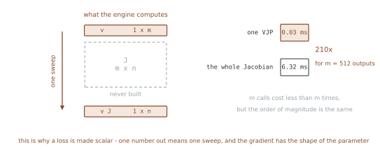

# v를 이용한 벡터 역전파

<div class="leadbox" markdown>

**들어가는 이야기** — 거절당하는 자리

지금까지 미분을 구한 것은 언제나 **수 하나**에 대해서였다. 입력을 조금
흔들었을 때 그 수 하나가 얼마나 따라 흔들리는지를 물었다. 출력이 수 하나가 아니라
여러 개라면 어떻게 될까.

파이토치는 **거절한다.** 그리고 거절하는 까닭이 이 쪽의 내용 전부다.

출력이 여럿이면 「얼마나 따라 흔들리는가」의 답도 하나가 아니다. 출력 하나하나에
대해 입력 하나하나의 몫이 있으니 **야코비 행렬**이 되는 것이다. 그런데 `.grad`는
원래 텐서와 **똑같은 형태**로 정해져 있어, 행렬을 넣을 곳이 없다.

그래서 파이토치는 야코비 행렬을 만들지 않는다. 대신 `backward(v)`의 `v`로
「출력들을 각각 얼마씩 중히 볼 것인가」를 함께 받아, 행렬 대신 **줄(행) 하나**를 낸다.
**벡터-야코비 곱(VJP)**이라 부르는 것이 이것이다. 야코비 행렬을 다 받으려면 그
일을 출력 개수만큼 해야 하는데, 이 쪽이 그 비용을 재어 보인다.

</div>

출력이 스칼라(수 하나짜리 텐서)이면 `backward()`로 끝난다. 형태가 있으면 거절한다.

```
grad can be implicitly created only for scalar outputs
```

까닭은 **미분의 결과가 야코비 행렬**이어서 `.grad`에 담을 수 없기 때문이다.
`.grad`는 언제나 그 텐서와 같은 형태다.

그래서 `backward(v)`는 야코비 행렬을 만들지 않고 **$v^\top J$ 하나**만 계산한다.
벡터-야코비 곱(VJP)이라 부르는 것이 이것이고, 역전파 전체가 이 연산의
연쇄다.

## 1. 코드

```python
"""backward(v) 는 야코비를 주지 않는다 — v^T J 를 준다.

출력이 스칼라이면 `backward()` 로 끝난다. 형태가 있으면 거절한다.

    grad can be implicitly created only for scalar outputs

까닭은 미분의 결과가 **야코비 행렬**이어서 `.grad` 에 담을 수 없기
때문이다. `.grad` 는 언제나 그 텐서와 같은 형태다.

그래서 `backward(v)` 는 야코비를 만들지 않고 **v 와의 곱 하나**만
계산한다. 야코비 전체가 필요하면 v 를 바꿔 가며 여러 번 불러야 하고,
그 비용을 이 쪽에서 잰다.

실행: 이 쪽의 코드를 파일로 갈무리해 돌린다
"""
# time 은 파이썬 표준 라이브러리다. 4 에서 걸린 시간을 재는 데 쓴다.
import time

# torch 는 파이토치 본체다. 텐서(파이토치가 다루는 수의 묶음)와 자동 미분이 여기서 온다.
import torch


def header(title):
    # 절 제목을 한 줄 찍는다. \n 은 줄바꿈이라 제목 앞에 빈 줄이 하나 생긴다.
    # f"...{title}..." 은 문자열 안에 값을 끼워 넣는 파이썬 문법(f-문자열)이다.
    print(f"\n=== {title} ===")


# ========================================================================
# 1. 스칼라가 아니면 거절한다
# ========================================================================

def refuses():
    header("1. 거절")
    # torch.tensor([...]) 는 수 셋을 담은 텐서를 만든다. 형태는 (3,) — 길이 3 의 벡터다.
    #
    # requires_grad=True 는 「이 텐서로 미분할 것이니, 이 텐서가 들어간 계산을 모두
    # 기록해 두라」는 표시다. 이것을 경사 추적이라 하고, 그 기록이 계산 그래프다.
    x = torch.tensor([1.0, 2.0, 3.0], requires_grad=True)
    # ** 는 거듭제곱이고 자리마다 따로 한다.   y = [1, 4, 9],   형태 (3,)
    y = x ** 2                      # 형태가 있는 출력
    # backward() 는 계산 그래프를 거꾸로 따라가며 미분해 그 결과를 x.grad 에 넣는
    # 역전파다. 그런데 인수 없이 부를 수 있는 것은 출력이 스칼라(수 하나)일 때뿐이다.
    # y 는 수가 셋이라 파이토치가 RuntimeError 를 낸다.
    #
    # try: ... except: 는 오류가 나도 프로그램이 죽지 않게 받아 내는 파이썬 문법이다.
    # 오류를 e 로 받아 글로 바꾸고(str), 줄 단위로 잘라(splitlines) 첫 줄만 찍는다.
    try:
        y.backward()
    except RuntimeError as e:
        print("  y.backward():", str(e).splitlines()[0])
    # 야코비 행렬은 「출력 i 를 입력 j 로 미분한 값」 을 (i, j) 자리에 모은 표다.
    # 출력이 3 개, 입력이 3 개이므로 형태가 (3, 3) 이다. x.grad 는 x 와 같은
    # 형태 (3,) 로 정해져 있어 이 표가 들어갈 자리가 없다.
    print("  y 가 (3,) 이고 x 가 (3,) 이면 야코비는 3x3 이다")
    print("  x.grad 는 (3,) 이므로 거기 담을 수 없다")


# ========================================================================
# 2. v 는 '출력을 얼마씩 중히 볼 것인가' 다
# ========================================================================

def what_v_means():
    header("2. v 의 뜻")
    # y = x^2 (자리마다) 이면 y_i 는 x_i 에만 달려 있다. 그래서 야코비 행렬 J 는
    # 대각 행렬이고, x = [1, 2, 3] 에서 대각 원소 2x_i 는 2, 4, 6 이다.
    #
    #       [2 0 0]
    #   J = [0 4 0]        형태 (3, 3)
    #       [0 0 6]
    #
    # v 를 네 가지로 바꿔 가며 backward(v) 가 x.grad 에 무엇을 넣는지 본다.
    for v in ([1.0, 0.0, 0.0], [0.0, 1.0, 0.0], [1.0, 1.0, 1.0],
              [10.0, 1.0, 0.1]):
        # x 를 매번 새로 만든다. backward 는 .grad 에 「더하기」 때문에 같은 x 를
        # 다시 쓰면 앞의 결과와 섞인다.
        x = torch.tensor([1.0, 2.0, 3.0], requires_grad=True)
        # backward(v) 는 야코비 행렬을 만들지 않고 벡터-야코비 곱(VJP) v^T J 만
        # 계산해 x.grad 에 넣는다. v 를 열벡터로 보면 J^T v 와 같은 것이다.
        # v 는 출력 y 와 같은 형태 (3,) 이어야 하고, 결과는 x 와 같은 형태 (3,) 다.
        #   v = [1, 0, 0]     →  J 의 첫 줄        [2, 0, 0]
        #   v = [0, 1, 0]     →  J 의 둘째 줄      [0, 4, 0]
        #   v = [1, 1, 1]     →  세 줄의 합        [2, 4, 6]
        #   v = [10, 1, 0.1]  →  [10*2, 1*4, 0.1*6] = [20, 4, 0.6]
        (x ** 2).backward(torch.tensor(v))
        # str(v) 는 리스트를 글로 바꾼 것이고 :22s 는 스물두 칸에 맞춰 찍으라는 뜻이다.
        # tolist() 는 텐서를 파이썬 리스트로 바꾼다. 0.6 이 0.6000000238... 로 찍히는
        # 것은 텐서가 32 비트 실수라 0.6 을 딱 맞게 담지 못해서다.
        print(f"  v={str(v):22s} x.grad={x.grad.tolist()}")
    print("  y_i = x_i^2 이라 야코비가 대각이고 대각 원소가 2x_i 다")
    print("  그래서 v^T J = v * 2x 가 그대로 보인다")
    print("  v 를 전부 1 로 주는 것은 y.sum().backward() 와 같다")
    # 확인 — 출력을 모두 더해 스칼라로 만든 뒤 인수 없이 backward() 를 부른다.
    # 위에서 v = [1, 1, 1] 로 받은 [2, 4, 6] 과 같아야 한다.
    x = torch.tensor([1.0, 2.0, 3.0], requires_grad=True)
    (x ** 2).sum().backward()
    print("  확인:", x.grad.tolist())


# ========================================================================
# 3. 야코비 전체를 얻으려면 m 번 불러야 한다
# ========================================================================

def building_jacobian():
    header("3. 야코비 모으기")
    # torch.manual_seed(0) 은 난수 생성기를 정해진 자리에서 시작시킨다. 돌릴 때마다
    # 같은 난수가 나온다.
    torch.manual_seed(0)
    # torch.randn 은 표준정규분포(평균 0, 표준편차 1)에서 뽑은 수로 텐서를 채운다.
    A = torch.randn(4, 3)                       # 형태 (4, 3) 의 행렬. 미분하지 않는다
    x = torch.randn(3, requires_grad=True)      # 형태 (3,) 의 입력. 경사 추적을 건다
    # @ 는 행렬 곱이다. (4, 3) @ (3,) = (4,) — 입력 3 개에서 출력 4 개가 나온다.
    # y_i = sum_j A[i, j] * x_j 이므로 y_i 를 x_j 로 미분하면 A[i, j] 다. 곧 야코비
    # 행렬 J 는 형태 (4, 3) 의 A 자신이라, 모은 것이 맞는지 바로 견줄 수 있다.
    y = A @ x                        # 야코비는 A 자신이다

    rows = []                                   # J 의 줄을 하나씩 모을 리스트
    for i in range(4):                          # 출력이 4 개이므로 네 번 부른다
        # i 번째 자리만 1 이고 나머지는 0 인 단위벡터를 만든다. 형태는 y 와 같은 (4,) 다.
        # 이 v 로 v^T J 를 계산하면 J 의 i 번째 줄만 골라져 나온다.
        v = torch.zeros(4)
        v[i] = 1.0
        # 앞 바퀴의 결과를 지운다. backward 는 .grad 에 더하므로, 지우지 않으면
        # i 번째 줄이 아니라 0 ~ i 번째 줄의 합이 들어간다.
        x.grad = None
        # 역전파는 끝나면 계산 그래프에 저장해 둔 값을 지운다. 같은 y 에 대고
        # 네 번 불러야 하므로 retain_graph=True 로 지우지 말고 남겨 두라고 한다.
        y.backward(v, retain_graph=True)
        # x.grad 는 형태 (3,) 의 v^T J, 곧 J 의 i 번째 줄이다. 다음 바퀴에서
        # x.grad 를 다시 쓰므로 clone() 으로 복사해 둔다.
        rows.append(x.grad.clone())
    # torch.stack 은 길이 3 의 벡터 4 개를 쌓아 형태 (4, 3) 의 행렬로 만든다.
    J = torch.stack(rows)
    print("  단위벡터 네 개로 네 줄을 모았다")
    # torch.allclose 는 두 텐서의 모든 자리가 (작은 허용 오차 안에서) 같으면 True 다.
    print("  J 가 A 와 같은가:", torch.allclose(J, A))
    print("  출력이 m 개면 backward 를 m 번 불러야 한다")
    print("  retain_graph=True 가 필요하고, 매번 x.grad 를 비워야 한다")


# ========================================================================
# 4. 비용이 얼마나 드는가
# ========================================================================

def the_cost():
    header("4. VJP 한 번 vs 야코비 전체")
    torch.manual_seed(0)
    n, m = 512, 512                             # 입력 n 개, 출력 m 개
    A = torch.randn(m, n)                       # 형태 (512, 512). 야코비 행렬도 이 형태다

    # 함수 안에서 함수를 정의할 수 있다. 시간을 잴 일 두 가지를 함수로 싸 둔다.
    def one_vjp():
        # VJP 한 번 — 순전파 한 번에 backward(v) 한 번이다. v 는 형태 (512,) 의
        # 아무 벡터이고, x.grad 에 형태 (512,) 의 v^T J 가 들어간다.
        x = torch.randn(n, requires_grad=True)
        (A @ x).backward(torch.randn(m))

    def full_jacobian():
        # 야코비 행렬 전체 — 3 과 같은 방법이다. 순전파는 한 번이고, 단위벡터를
        # 바꿔 가며 backward 를 512 번 부른다. 시간만 재므로 줄을 모으지는 않는다.
        x = torch.randn(n, requires_grad=True)
        y = A @ x
        for i in range(m):
            v = torch.zeros(m)
            v[i] = 1.0                          # i 번째 단위벡터
            x.grad = None                       # 앞 바퀴의 결과를 지운다
            y.backward(v, retain_graph=True)    # J 의 i 번째 줄이 x.grad 에 들어간다

    got = {}                                    # 이름표 → 걸린 시간(ms) 을 담을 사전
    for label, fn in (("VJP 한 번", one_vjp), ("야코비 전체", full_jacobian)):
        ts = []
        for _ in range(3):                      # 세 번 잰다. _ 는 안 쓰는 변수라는 관례다
            # time.perf_counter() 는 지금 시각을 초 단위로 준다. 일을 하기 전과
            # 뒤에 한 번씩 읽어 그 차를 걸린 시간으로 삼는다.
            t0 = time.perf_counter()
            fn()
            ts.append(time.perf_counter() - t0)
        # 셋 가운데 가장 짧은 것을 쓴다 — 다른 일에 방해받지 않은 값에 가장 가깝다.
        # 1e3 은 1000 이다. 초를 밀리초(ms)로 바꾼다.
        got[label] = min(ts) * 1e3
        # {got[label]:8.2f} 는 여덟 칸에 소수점 아래 두 자리로 찍는다.
        print(f"  {label:12s} {got[label]:8.2f} ms")
    # 야코비 행렬 전체가 VJP 한 번의 몇 배인가. 시간은 기계마다, 돌릴 때마다 다르다.
    ratio = got["야코비 전체"] / got["VJP 한 번"]
    # 잰 비가 출력 개수보다 작은지는 기계마다 다를 수 있으므로 견주어 보고 적는다.
    print(f"  {ratio:.0f} 배 든다. 출력 개수 {m} {'보다는 작다' if ratio < m else '보다 크다'}")
    print("  backward 를 m 번 부르는 비용이 m 배까지는 안 가기 때문이다")
    print("  그래도 출력 개수만큼 backward 를 불러야 한다. 로스를 스칼라로 만드는 까닭이 이것이다")


# ========================================================================
# 5. 로스가 스칼라인 까닭
# ========================================================================

def why_scalar_loss():
    header("5. 로스는 왜 스칼라인가")
    torch.manual_seed(0)
    # 레이어 하나를 손으로 만든다. W 는 수 4 개를 받아 3 개를 내는 웨이트이고
    # 트레인으로 고칠 값이므로 경사 추적을 건다. x 는 표본 8 개짜리 배치다.
    W = torch.randn(3, 4, requires_grad=True)   # 형태 (3, 4)
    x = torch.randn(8, 4)                       # 형태 (8, 4) — 행 하나가 표본 하나
    # W.t() 는 전치다. 행과 열을 맞바꿔 (3, 4) 를 (4, 3) 으로 만든다.
    # (8, 4) @ (4, 3) = (8, 3) — 표본마다 출력이 3 개다.
    out = x @ W.t()                   # (8, 3)
    # 출력 24 개(8*3)를 저마다 웨이트 12 개(3*4)로 미분하면 24 * 12 = 288 개다.
    print("  출력이 (8,3) 이면 야코비는 (8,3) x (3,4) 짜리다")
    print("  원소 수:", 8 * 3 * 3 * 4)
    # pow(2) 로 자리마다 제곱하고 mean() 으로 24 개를 평균내 수 하나로 만든다.
    # 스칼라이므로 인수 없는 backward() 가 통한다. 2 에서 본 대로 이것은
    # v 를 「모든 출력에 같은 무게」 로 넣어 준 VJP 한 번이다.
    loss = out.pow(2).mean()          # 스칼라로 줄인다
    loss.backward()
    print("  스칼라로 줄이면 backward 한 번으로 끝난다")
    # W.grad 는 로스를 W 의 각 원소로 미분한 값이다. W.grad.shape 는 그 형태이고
    # tuple(...) 로 감싸 (3, 4) 처럼 찍히게 한다.
    print("  W.grad 형태:", tuple(W.grad.shape), "= W 와 같다")
    print("  트레인에 필요한 것은 야코비가 아니라 이 하나뿐이다")


def main():
    # 다섯 절을 차례로 돌린다.
    refuses()
    what_v_means()
    building_jacobian()
    the_cost()
    why_scalar_loss()


# 이 파일을 직접 돌렸을 때만 main() 을 부른다. 다른 파일이 이 파일을 불러다(import)
# 쓸 때는 __name__ 이 "__main__" 이 아니므로 아무것도 돌지 않는다.
if __name__ == "__main__":
    main()
```

**출력:**

```
=== 1. 거절 ===
  y.backward(): grad can be implicitly created only for scalar outputs
  y 가 (3,) 이고 x 가 (3,) 이면 야코비는 3x3 이다
  x.grad 는 (3,) 이므로 거기 담을 수 없다

=== 2. v 의 뜻 ===
  v=[1.0, 0.0, 0.0]        x.grad=[2.0, 0.0, 0.0]
  v=[0.0, 1.0, 0.0]        x.grad=[0.0, 4.0, 0.0]
  v=[1.0, 1.0, 1.0]        x.grad=[2.0, 4.0, 6.0]
  v=[10.0, 1.0, 0.1]       x.grad=[20.0, 4.0, 0.6000000238418579]
  y_i = x_i^2 이라 야코비가 대각이고 대각 원소가 2x_i 다
  그래서 v^T J = v * 2x 가 그대로 보인다
  v 를 전부 1 로 주는 것은 y.sum().backward() 와 같다
  확인: [2.0, 4.0, 6.0]

=== 3. 야코비 모으기 ===
  단위벡터 네 개로 네 줄을 모았다
  J 가 A 와 같은가: True
  출력이 m 개면 backward 를 m 번 불러야 한다
  retain_graph=True 가 필요하고, 매번 x.grad 를 비워야 한다

=== 4. VJP 한 번 vs 야코비 전체 ===
  VJP 한 번          0.03 ms
  야코비 전체           6.32 ms
  210 배 든다. 출력 개수 512 보다는 작다
  backward 를 m 번 부르는 비용이 m 배까지는 안 가기 때문이다
  그래도 출력 개수만큼 backward 를 불러야 한다. 로스를 스칼라로 만드는 까닭이 이것이다

=== 5. 로스는 왜 스칼라인가 ===
  출력이 (8,3) 이면 야코비는 (8,3) x (3,4) 짜리다
  원소 수: 288
  스칼라로 줄이면 backward 한 번으로 끝난다
  W.grad 형태: (3, 4) = W 와 같다
  트레인에 필요한 것은 야코비가 아니라 이 하나뿐이다
```

## 2. `v`는 "출력을 얼마씩 중히 볼 것인가"다

$y_i = x_i^2$이면 야코비 행렬이 대각이고 대각 원소가 $2x_i$다. 그래서 $v^\top J$가
눈에 보인다.

| `v` | `x.grad` |
|---|---|
| `[1, 0, 0]` | `[2, 0, 0]` |
| `[0, 1, 0]` | `[0, 4, 0]` |
| `[1, 1, 1]` | `[2, 4, 6]` |
| `[10, 1, 0.1]` | `[20, 4, 0.6]` |

$v$의 자리마다 그 출력의 몫이 그만큼 섞여 들어온다. **$v$를 전부 1로 주는 것은
`y.sum().backward()`와 같다** — 확인해 보면 `[2, 4, 6]`으로 같다.

그러니 스칼라 로스의 `backward()`는 특별한 것이 아니다. **$v = 1$을 넣어 주는
것**뿐이다.

## 3. 야코비 행렬 전체를 얻으려면

```python
# 위 building_jacobian() 의 루프만 옮겨 적은 조각이다. m 은 출력의 개수다.
for i in range(m):
    # i 번째 자리만 1 인 단위벡터. 형태는 출력 y 와 같은 (m,) 다.
    v = torch.zeros(m); v[i] = 1.0
    x.grad = None                      # 안 비우면 쌓인다
    y.backward(v, retain_graph=True)   # 안 남기면 두 번째가 터진다
    # x.grad 는 v^T J, 곧 야코비 행렬의 i 번째 줄이다. 복사해서 모은다.
    rows.append(x.grad.clone())
```

$v$를 $i$번째 단위벡터로 두면 $v^\top J$가 $J$의 $i$번째 **줄**이다. $m$번
모으면 야코비 행렬이 완성된다. $y = Ax$의 야코비 행렬은 $A$ 자신이므로 확인도 쉽다 —
`True`가 나왔다.

두 군데를 챙겨야 한다. `retain_graph=True`가 없으면 두 번째 호출이 터지고
(「retain_graph」), `x.grad`를 안 비우면 줄들이 더해진다(「경사 누적」).
**뒤쪽이 더 위험하다** — 터지지 않고 틀린 야코비 행렬이 나온다.

## 4. 비용이 얼마나 드는가

```
VJP 한 번          0.03 ms
야코비 전체          6.32 ms
210 배 든다. 출력 개수 512 보다는 작다
```



출력이 512개이니 512번 불러야 하고 512배가 들 것 같은데, 실제로는 210배다. `backward` 한 번의
비용에는 그래프를 훑는 고정 비용이 섞여 있어 $m$배까지는 안 간다.

그래도 **자릿수가 같다.** 출력이 많으면 야코비 행렬은 못 구한다고 보아야 한다.

## 5. 로스를 스칼라로 만드는 까닭

```
출력이 (8,3) 이면 야코비는 (8,3) x (3,4) 짜리다
원소 수: 288
스칼라로 줄이면 backward 한 번으로 끝난다
W.grad 형태: (3, 4) = W 와 같다
```

트레인에 필요한 것은 **야코비 행렬이 아니다.** $\partial L/\partial W$ 하나이고, 그것은
$W$와 같은 형태다.

그래서 로스를 스칼라로 만드는 것이 관행이 아니라 **필요**다. 스칼라가 아니면
$v$를 손으로 정해야 하고, 무엇을 넣든 그것이 곧 "어느 출력을 얼마나 줄일
것인가"를 정하는 일이 된다. 로스 함수가 하는 일이 바로 그 결정이다.

## 연습문제

<div class="drillbox" markdown>

**연습문제 1.** <span class="diff easy" title="쉬움"></span>
`y.sum().backward()`와 `y.backward(torch.ones_like(y))`가 같은가? 그리고
`y.mean().backward()`는 어떤 `v`에 해당하는가?

</div>

??? success "풀이"
    ```python
    # 역전파하는 네 가지 방법을 (이름표, 함수) 쌍으로 늘어놓고 차례로 돌린다.
    # lambda x: ... 는 이름 없는 한 줄짜리 함수다. x 를 받아 y = x ** 2 를 만들고
    # 저마다의 방법으로 역전파한다.
    #   sum()      출력 셋을 더해 스칼라로 만든다
    #   mean()     출력 셋을 평균내 스칼라로 만든다 (더해서 3 으로 나눈다)
    #   backward(v)  스칼라로 줄이지 않고 v 를 직접 준다. x.grad 에 v^T J 가 들어간다
    # torch.ones(3) 은 [1, 1, 1] 이고 torch.ones(3) / 3 은 [1/3, 1/3, 1/3] 이다.
    for label, run in (
        ("y.sum().backward()", lambda x: (x ** 2).sum().backward()),
        ("y.backward(ones)", lambda x: (x ** 2).backward(torch.ones(3))),
        ("y.mean().backward()", lambda x: (x ** 2).mean().backward()),
        ("y.backward(ones/3)", lambda x: (x ** 2).backward(torch.ones(3) / 3)),
    ):
        # 방법마다 x 를 새로 만든다. requires_grad=True 로 경사 추적을 걸어야
        # x.grad 가 채워지고, 새로 만들어야 앞의 그래디언트와 섞이지 않는다.
        x = torch.tensor([1.0, 2.0, 3.0], requires_grad=True)
        run(x)
        # 야코비 행렬이 대각 [2, 4, 6] 이므로 v^T J 는 자리마다 v_i * 2x_i 다.
        #   v = [1, 1, 1]        →  [2, 4, 6]
        #   v = [1/3, 1/3, 1/3]  →  [2/3, 4/3, 6/3] = [0.666667, 1.333333, 2.0]
        # tolist() 로 파이썬 리스트로 바꾸고 round(v, 6) 으로 여섯 자리 반올림해 찍는다.
        print(f"  {label:22s} x.grad = {[round(v, 6) for v in x.grad.tolist()]}")
    ```

    ```
      y.sum().backward()     x.grad = [2.0, 4.0, 6.0]
      y.backward(ones)       x.grad = [2.0, 4.0, 6.0]
      y.mean().backward()    x.grad = [0.666667, 1.333333, 2.0]
      y.backward(ones/3)     x.grad = [0.666667, 1.333333, 2.0]
    ```

    **`sum`은 $v = \mathbf{1}$이고 `mean`은 $v = \mathbf{1}/n$이다.**

    줄이는 함수가 곧 $v$를 고르는 일이라는 것이 여기서 분명해진다.
    「선형 회귀」에서 `reduction="sum"`과 `"mean"`이 그래디언트를 $N$배
    가르던 것이 같은 이야기다 — $v$가 $N$배 다르기 때문이다.

---

<div class="drillbox" markdown>

**연습문제 2.** <span class="diff med" title="중간"></span>
3절에서 `x.grad = None`을 빼먹으면 어떻게 되는가? 야코비 행렬이 어떻게 틀리는지
보여라.

</div>

??? success "풀이"
    ```python
    torch.manual_seed(0)                    # 돌릴 때마다 같은 난수가 나오게 한다
    A = torch.randn(3, 3)                   # 형태 (3, 3). y = A @ x 의 야코비 행렬이다
    for clear in (True, False):             # x.grad 를 비우는 쪽과 안 비우는 쪽
        x = torch.randn(3, requires_grad=True)      # 형태 (3,). 경사 추적을 건다
        y = A @ x                           # @ 는 행렬 곱. (3, 3) @ (3,) = (3,)
        rows = []                           # 야코비 행렬의 줄을 모을 리스트
        for i in range(3):
            # i 번째 자리만 1 인 단위벡터. ; 는 두 문장을 한 줄에 적는 문법이다.
            v = torch.zeros(3); v[i] = 1.0
            if clear:
                x.grad = None               # 앞 바퀴의 결과를 지운다
            # backward(v) 는 v^T J, 곧 A 의 i 번째 줄을 x.grad 에 「더한다」.
            # 비우지 않았다면 x.grad 에는 A 의 0 ~ i 번째 줄의 합이 쌓인다.
            # retain_graph=True 는 계산 그래프를 지우지 말고 남겨 다시 부를 수 있게 한다.
            y.backward(v, retain_graph=True)
            rows.append(x.grad.clone())     # 지금의 x.grad 를 복사해 모은다
        J = torch.stack(rows)               # 세 줄을 쌓아 형태 (3, 3) 으로 만든다
        # {clear!s:5s} 는 True/False 를 문자열로 바꿔(!s) 다섯 칸에 찍는다.
        # torch.allclose 는 두 텐서가 모든 자리에서 (허용 오차 안에서) 같으면 True 다.
        print(f"  비움={clear!s:5s} J == A 인가: {torch.allclose(J, A)}")
        # 안 비운 쪽이 어떻게 틀렸는지 본다. J[1] 은 모은 것의 둘째 줄(번호는 0 부터)
        # 이고, 그것이 A 의 0 번 줄과 1 번 줄을 더한 것과 같은지 나란히 찍는다.
        if not clear:
            print("    2번째 줄 =", [round(v, 4) for v in J[1].tolist()])
            print("    A[0]+A[1] =", [round(v, 4) for v in (A[0] + A[1]).tolist()])
    ```

    ```
      비움=True  J == A 인가: True
      비움=False J == A 인가: False
        2번째 줄 = [2.1094, -1.378, -3.5774]
        A[0]+A[1] = [2.1094, -1.378, -3.5774]
    ```

    **둘째 줄이 $A$의 0번과 1번 줄의 합**이다. 셋째 줄은 세 줄 전부의 합이 된다.

    오류는 안 난다. 형태도 맞다. **아래로 갈수록 누적된 야코비 행렬**이 나올 뿐이다.

    첫 줄은 맞으므로 "첫 줄만 보고 맞다"고 넘어가기 쉽다. 야코비 행렬을 손으로
    모을 때는 **마지막 줄을 검산하는** 편이 낫다.

---

<div class="drillbox" markdown>

**연습문제 3.** <span class="diff hard" title="어려움"></span>
4절처럼 손으로 모으는 대신 `torch.func.jacrev`를 쓰면 얼마나 빠른가? 그리고
입력이 출력보다 많을 때와 적을 때 **어느 방향이 유리한지** 재어라.

</div>

??? success "풀이"
    ```python
    import time
    # torch.func 는 함수를 받아 그 미분을 계산하는 함수를 돌려주는 도구 모음이다.
    #   jacrev(f)  f 의 야코비 행렬을 역방향(reverse)으로, 곧 VJP 로 구하는 함수
    #   jacfwd(f)  같은 야코비 행렬을 순방향(forward)으로, 곧 JVP 로 구하는 함수
    # JVP 는 야코비-벡터 곱 J v 다. VJP 가 J 의 줄(행)을 내는 것과 달리 열을 낸다.
    from torch.func import jacrev, jacfwd

    def timeit(fn, rep=5):
        # fn 을 rep 번 돌려 가장 짧게 걸린 시간을 밀리초로 돌려준다.
        for _ in range(2):
            fn()                        # 예열
        ts = []
        for _ in range(rep):
            # time.perf_counter() 는 지금 시각(초)이다. 앞뒤로 읽어 그 차를 모은다.
            t0 = time.perf_counter(); fn(); ts.append(time.perf_counter() - t0)
        return min(ts) * 1e3            # 1e3 = 1000. 초를 밀리초(ms)로 바꾼다

    # (입력 수 n, 출력 수 m) 을 네 가지로 바꾼다. 앞의 둘과 뒤의 둘은 서로 n 과 m 을
    # 뒤집은 것이다.
    for n, m in ((4096, 8), (8, 4096), (2048, 32), (32, 2048)):
        torch.manual_seed(0)
        A, x = torch.randn(m, n), torch.randn(n)    # A 는 형태 (m, n), x 는 (n,)
        # 입력 (n,) 을 받아 출력 (m,) 을 내는 함수다. A @ t 로 행렬 곱을 하고 자리마다
        # tanh 를 씌운다. 야코비 행렬의 형태는 (m, n) — 출력이 줄, 입력이 열이다.
        f = lambda t: (A @ t).tanh()
        # jacrev(f)(x) 와 jacfwd(f)(x) 는 x 에서의 야코비 행렬을 준다. 값은 같고
        # 구하는 방향만 다르다. lambda: ... 는 인수 없는 함수로 싸서 timeit 에 넘긴다.
        rev, fwd = timeit(lambda: jacrev(f)(x)), timeit(lambda: jacfwd(f)(x))
        # 더 빠른 쪽의 이름과, 느린 쪽이 그 몇 배 걸렸는지를 찍는다.
        print(f"  입력 {n:5d} -> 출력 {m:5d}   jacrev {rev:7.2f} ms   "
              f"jacfwd {fwd:7.2f} ms   "
              f"{'rev' if rev < fwd else 'fwd'} 가 {max(rev, fwd) / min(rev, fwd):.1f}배 빠르다")
    ```

    ```
      입력  4096 -> 출력     8   jacrev    0.10 ms   jacfwd    5.39 ms   rev 가 52.1배 빠르다
      입력     8 -> 출력  4096   jacrev    9.23 ms   jacfwd    0.19 ms   fwd 가 48.0배 빠르다
      입력  2048 -> 출력    32   jacrev    0.09 ms   jacfwd    0.86 ms   rev 가  9.9배 빠르다
      입력    32 -> 출력  2048   jacrev    2.08 ms   jacfwd    0.20 ms   fwd 가 10.2배 빠르다
    ```

    **방향이 정확히 뒤집히고, 치우칠수록 더 벌어진다.** 4096대 8에서 52배,
    2048대 32에서 10배다.

    `jacrev`는 VJP를 출력 수만큼 부르고, `jacfwd`는 JVP(야코비-벡터 곱)를
    **입력 수만큼** 부른다. 그래서

    - **출력이 적으면**(로스 하나) 역방향이 싸다 — 딥러닝이 여기 있다
    - **입력이 적으면** 순방향이 싸다 — 하이퍼파라메터 몇 개에 대한 민감도 같은 것

    역전파가 딥러닝의 표준이 된 까닭이 이 비대칭이다. 파라메터는 수백만 개인데
    로스는 하나이므로, 역방향 한 번이면 끝난다. 순방향으로 하면 파라메터 수만큼
    불러야 한다.
