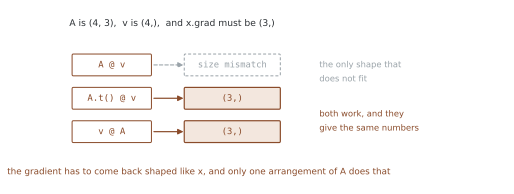
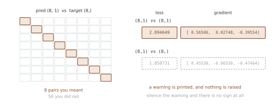

# 선형 사상의 VJP — 전치는 어디서 오고, 모양은 어디서 무는가

<div class="leadbox" markdown>

**들어가는 이야기** — 전치는 어디서 오는가

$y = Ax$만큼 단순한 식은 없다. 그런데 이것의 역전파가 돌려주는 것은 $A$가
아니라 **전치** $A^\top$다. 외워 두기는 쉬운데, 왜 전치가 되는지는 식을
따라가 보기 전에는 잘 안 와닿는다.

이 쪽은 두 가지 길로 답한다. 하나는 정직하게 **셈으로 유도하는** 길이다.

다른 하나가 더 쓸모 있다. **아무것도 계산하지 않고 모양만 보는** 길이다.
돌아오는 값은 $x$와 같은 모양이어야 하고, 가진 조각들로 그 모양을 만들 방법이
**하나뿐**이면 그것이 답이다. 식을 유도하기 전에 답을 알 수 있다.

이 요령은 여기서만 쓰는 것이 아니다. 어떤 층의 역전파가 어떻게 생겼는지
가늠해야 할 때 가장 먼저 꺼내는 수단이다.

</div>

$y = Ax$에서 `y.backward(v)`를 부르면 `x.grad`에 무엇이 들어오는가.

답은 $A^\top v$다. **$A$를 곱하는 것이 아니라 $A^\top$을 곱한다.** 전치가 어디서
오는지는 두 가지로 설명된다 — 셈으로 유도하는 길과, **모양만 보고 아는** 길.

## 1. 코드

```python
"""선형 사상의 VJP — 왜 A 가 아니라 A^T v 인가.

$y = Ax$ 에서 `y.backward(v)` 를 부르면 `x.grad` 에 무엇이 들어오는가.
손으로 유도해 보면 $A^\\top v$ 이고, 그것은 **$A$ 를 곱하는 것이 아니라
$A^\\top$ 을 곱하는 것**이다.

전치가 붙는 까닭을 모양만으로도 알 수 있다. $A$ 가 $(m, n)$ 이고
$v$ 가 $(m,)$ 이면, 결과는 $x$ 와 같은 $(n,)$ 이어야 한다.
$(m, n)$ 과 $(m,)$ 으로 $(n,)$ 을 만드는 길은 $A^\\top v$ 뿐이다.

실행: 이 쪽의 코드를 파일로 갈무리해 돌린다
"""
import torch


def header(title):
    print(f"\n=== {title} ===")


M, N = 4, 3


def setup(seed=0):
    torch.manual_seed(seed)
    return torch.randn(M, N), torch.randn(N, requires_grad=True)


# ========================================================================
# 1. autograd 와 손계산
# ========================================================================

def compare():
    header("1. A^T v 와 맞는가")
    A, x = setup()
    v = torch.tensor([1.0, 0.5, -1.0, 2.0])
    y = A @ x
    print("  A 모양", tuple(A.shape), "  x 모양", tuple(x.shape),
          "  y 모양", tuple(y.shape))
    y.backward(v)
    hand = A.t() @ v
    print("  x.grad :", [round(t, 6) for t in x.grad.tolist()])
    print("  A^T v  :", [round(t, 6) for t in hand.tolist()])
    print("  같은가 :", torch.allclose(x.grad, hand))


# ========================================================================
# 2. 모양만 보아도 전치가 나온다
# ========================================================================

def shapes_force_it():
    header("2. 모양이 전치를 강요한다")
    A, x = setup()
    v = torch.randn(M)
    print(f"  A ({M},{N})   v ({M},)   결과는 x 와 같은 ({N},) 여야 한다")
    for name, expr in (("A @ v  ", lambda: A @ v),
                       ("A.t() @ v", lambda: A.t() @ v),
                       ("v @ A  ", lambda: v @ A)):
        try:
            r = expr()
            print(f"  {name} -> 모양 {tuple(r.shape)}")
        except RuntimeError as e:
            print(f"  {name} -> {str(e).splitlines()[0][:50]}")
    print("  A.t() @ v 와 v @ A 가 둘 다 (3,) 을 준다")
    print("  그리고 둘은 같은 값이다:", torch.allclose(A.t() @ v, v @ A))


# ========================================================================
# 3. 유도
# ========================================================================

def derivation():
    header("3. 유도")
    A, x = setup()
    v = torch.randn(M)
    print("  y_i = sum_j A_ij x_j 이므로  dy_i/dx_j = A_ij")
    print("  스칼라 s = sum_i v_i y_i 를 만들면")
    print("    ds/dx_j = sum_i v_i * dy_i/dx_j = sum_i v_i A_ij = (A^T v)_j")
    s = (v * (A @ x)).sum()
    s.backward()
    print("  s = (v*y).sum() 을 역전파한 x.grad:",
          [round(t, 6) for t in x.grad.tolist()])
    print("  A^T v                            :",
          [round(t, 6) for t in (A.t() @ v).tolist()])
    print("  backward(v) 는 이 s 를 만들어 역전파한 것과 같다")


# ========================================================================
# 4. 야코비는 A 자신이다
# ========================================================================

def jacobian_is_A():
    header("4. 야코비 = A")
    A, x = setup()
    y = A @ x
    rows = []
    for i in range(M):
        e = torch.zeros(M)
        e[i] = 1.0
        x.grad = None
        y.backward(e, retain_graph=True)
        rows.append(x.grad.clone())
    J = torch.stack(rows)
    print("  단위벡터로 모은 J 가 A 와 같은가:", torch.allclose(J, A))
    print("  그래서 v^T J = v^T A = A^T v 다 (벡터이므로 같다)")


# ========================================================================
# 5. A 에 대한 경사도 같이 본다
# ========================================================================

def grad_wrt_A():
    header("5. A 에 대한 경사")
    torch.manual_seed(0)
    A = torch.randn(M, N, requires_grad=True)
    x = torch.randn(N, requires_grad=True)
    v = torch.randn(M)
    (A @ x).backward(v)
    outer = torch.outer(v, x.detach())
    print("  A.grad 모양:", tuple(A.grad.shape), " = A 와 같다")
    print("  A.grad == outer(v, x) 인가:", torch.allclose(A.grad, outer))
    print("  y_i = sum_j A_ij x_j 이므로 dy_i/dA_ij = x_j")
    print("  ds/dA_ij = v_i x_j — 바깥곱이다")


def main():
    compare()
    shapes_force_it()
    derivation()
    jacobian_is_A()
    grad_wrt_A()


if __name__ == "__main__":
    main()
```

**출력:**

```
=== 1. A^T v 와 맞는가 ===
  A 모양 (4, 3)   x 모양 (3,)   y 모양 (4,)
  x.grad : [0.615178, -2.866987, -1.794756]
  A^T v  : [0.615178, -2.866987, -1.794756]
  같은가 : True

=== 2. 모양이 전치를 강요한다 ===
  A (4,3)   v (4,)   결과는 x 와 같은 (3,) 여야 한다
  A @ v   -> size mismatch, got input (4), mat (4x3), vec (4)
  A.t() @ v -> 모양 (3,)
  v @ A   -> 모양 (3,)
  A.t() @ v 와 v @ A 가 둘 다 (3,) 을 준다
  그리고 둘은 같은 값이다: True

=== 3. 유도 ===
  y_i = sum_j A_ij x_j 이므로  dy_i/dx_j = A_ij
  스칼라 s = sum_i v_i y_i 를 만들면
    ds/dx_j = sum_i v_i * dy_i/dx_j = sum_i v_i A_ij = (A^T v)_j
  s = (v*y).sum() 을 역전파한 x.grad: [0.377445, 1.423056, 0.093968]
  A^T v                            : [0.377445, 1.423056, 0.093968]
  backward(v) 는 이 s 를 만들어 역전파한 것과 같다

=== 4. 야코비 = A ===
  단위벡터로 모은 J 가 A 와 같은가: True
  그래서 v^T J = v^T A = A^T v 다 (벡터이므로 같다)

=== 5. A 에 대한 경사 ===
  A.grad 모양: (4, 3)  = A 와 같다
  A.grad == outer(v, x) 인가: True
  y_i = sum_j A_ij x_j 이므로 dy_i/dA_ij = x_j
  ds/dA_ij = v_i x_j — 바깥곱이다
```

## 2. 모양이 전치를 강요한다

$A$가 $(4, 3)$, $v$가 $(4,)$이고 결과는 $x$와 같은 $(3,)$이어야 한다.

| | 결과 |
|---|---|
| `A @ v` | `size mismatch, got input (4), mat (4x3), vec (4)` |
| `A.t() @ v` | `(3,)` |
| `v @ A` | `(3,)` |



**$(4,3)$과 $(4,)$으로 $(3,)$을 만드는 길이 전치뿐이다.** 그래서 식을 유도하기
전에도 전치가 붙는다는 것을 알 수 있다.

`A.t() @ v`와 `v @ A`는 같은 값이다. 벡터에는 행·열 구별이 없으므로
$v^\top A = A^\top v$다.

## 3. 유도

$y_i = \sum_j A_{ij} x_j$이므로 $\dfrac{\partial y_i}{\partial x_j} = A_{ij}$다.

`backward(v)`가 하는 일은 홑값 $s = \sum_i v_i y_i$를 만들어 역전파하는 것과
같으므로

$$
\frac{\partial s}{\partial x_j}
= \sum_i v_i \frac{\partial y_i}{\partial x_j}
= \sum_i v_i A_{ij}
= (A^\top v)_j
$$

코드가 그것을 확인한다 — `(v * y).sum().backward()`로 얻은 `x.grad`가
$A^\top v$와 소수점까지 같다.

## 4. 야코비는 행렬 A 자신이다

단위벡터로 모은 $J$가 $A$와 같다. 그러니 $v^\top J = v^\top A$이고, 벡터이므로
$A^\top v$와 같은 것을 다르게 적은 것뿐이다.

**선형 사상에서는 야코비가 상수**다. $x$가 무엇이든 $A$다. 비선형 함수에서는
$x$에 따라 달라지고, 그래서 「비선형 함수의 전체 야코비안」에서 다시 본다.

## 5. 행렬 A 에 대한 경사는 바깥곱이다

```
A.grad 모양: (4, 3)  = A 와 같다
A.grad == outer(v, x) 인가: True
```

$y_i = \sum_j A_{ij} x_j$이므로 $\dfrac{\partial y_i}{\partial A_{ij}} = x_j$이고,
따라서

$$
\frac{\partial s}{\partial A_{ij}} = v_i x_j
$$

**바깥곱 $v x^\top$**이다. 「Linear 웨이트 관례」에서 본
$\partial L/\partial W = g^\top X$가 배치가 있는 형태이, 여기서는 표본 하나라
바깥곱이 된다.

## 6. 열벡터로 적으면

「선형 사상의 VJP」에서 $x$를 $(3,)$으로 두었다. 수학책처럼 $(3,1)$ 열벡터로
두면 어떻게 되는가. **답은 같고 모양만 달라진다.**

그런데 `backward(v)`의 `v`는 출력과 **꼭 같은 모양**이어야 한다. 브로드캐스팅으로
넘어가지 않는다 — 이것이 반가운 소식이다. 틀리면 터져 준다.

반가운 소식에는 짝이 있다. 모양이 **조용히** 틀리는 자리는 따로 있고, 그쪽이
훨씬 자주 문다. 10절이 그 자리다.

```python
"""같은 수학, 다른 모양 — v 의 모양은 출력과 꼭 맞아야 한다.

앞의 1~5절에서 $x$ 를 $(3,)$ 으로 두었다. 수학책처럼
$(3,1)$ 열벡터로 두면 어떻게 되는가. **답은 같고 모양만 달라진다.**

그런데 `backward(v)` 의 `v` 는 출력과 **꼭 같은 모양**이어야 한다.
브로드캐스팅으로 넘어가지 않는다 — 이것이 반가운 소식이다.

반가운 소식에는 짝이 있다. 모양이 **조용히** 틀리는 자리는 따로
있고, 그쪽이 훨씬 자주 문다. 이 쪽 10절이 그 자리다.

실행: 이 쪽의 코드를 파일로 갈무리해 돌린다
"""
import warnings

import torch
import torch.nn.functional as F


def header(title):
    print(f"\n=== {title} ===")


# ========================================================================
# 1. 같은 수학, 다른 모양
# ========================================================================

def same_math():
    header("1. (3,) 와 (3,1)")
    torch.manual_seed(0)
    A = torch.randn(4, 3)
    base = torch.randn(3)
    x1 = base.clone().requires_grad_(True)              # (3,)
    x2 = base.view(3, 1).clone().requires_grad_(True)   # (3,1)
    print("  x (3,)  -> y", tuple((A @ x1).shape))
    print("  x (3,1) -> y", tuple((A @ x2).shape))

    v = torch.tensor([1.0, 0.5, -1.0, 2.0])
    (A @ x1).backward(v)
    (A @ x2).backward(v.view(4, 1))
    print("  x1.grad 모양", tuple(x1.grad.shape),
          " x2.grad 모양", tuple(x2.grad.shape))
    print("  x1.grad", [round(t, 6) for t in x1.grad.tolist()])
    print("  x2.grad", [round(t, 6) for t in x2.grad.flatten().tolist()])
    print("  값이 같은가:", torch.allclose(x1.grad, x2.grad.flatten()))
    print("  경사는 언제나 그 텐서와 같은 모양으로 온다")


# ========================================================================
# 2. v 의 모양은 엄격하다
# ========================================================================

def strict_v():
    header("2. v 의 모양 검사")
    torch.manual_seed(0)
    A = torch.randn(4, 3)
    for shape in ((4, 1), (4,), (1, 1), (1,)):
        x = torch.randn(3, 1, requires_grad=True)
        try:
            (A @ x).backward(torch.ones(shape))
            print(f"  v 모양 {str(shape):8s} -> 통과. x.grad "
                  f"{[round(t, 4) for t in x.grad.flatten().tolist()]}")
        except RuntimeError as e:
            print(f"  v 모양 {str(shape):8s} -> {str(e).splitlines()[0][:52]}")
    print("  출력이 (4,1) 이므로 v 도 (4,1) 이라야 한다")
    print("  브로드캐스팅으로 넘어가지 않는다 — 터져 주는 쪽이다")


# ========================================================================
# 3. 열벡터로 적으면 식이 수학책과 같아진다
# ========================================================================

def column_form():
    header("3. 열벡터 형태")
    torch.manual_seed(0)
    A = torch.randn(4, 3)
    x = torch.randn(3, 1, requires_grad=True)
    v = torch.randn(4, 1)
    (A @ x).backward(v)
    print("  x.grad    :", [round(t, 6) for t in x.grad.flatten().tolist()])
    print("  A^T v     :", [round(t, 6) for t in (A.t() @ v).flatten().tolist()])
    print("  모양도 같은가:", x.grad.shape == (A.t() @ v).shape)
    print("  (3,1) 로 두면 A^T v 의 모양이 그대로 x.grad 다")
    print("  (3,) 로 두면 값은 같고 모양만 (3,) 로 눌린다")


# ========================================================================
# 4. 어느 쪽으로 적을 것인가
# ========================================================================

def which_form():
    header("4. 고르기")
    print("  (3,) 형태")
    print("    장점: 코드가 짧다. 파이토치의 거의 모든 함수가 이쪽을 받는다")
    print("    단점: 수학책의 열벡터 식과 모양이 다르다")
    print("  (3,1) 형태")
    print("    장점: A^T v 의 모양이 그대로 나온다")
    print("    단점: 어디선가 (3,) 와 섞이면 브로드캐스팅이 일어난다")
    print("  파이토치는 (배치, 피처) 를 쓰므로 표본 하나도 (1, 3) 이 보통이다")


# ========================================================================
# 5. 조용히 틀리는 자리
# ========================================================================

def the_silent_one():
    header("5. 모양이 조용히 무는 자리")
    torch.manual_seed(0)
    pred = torch.randn(8, 1)
    targ_col = torch.randn(8, 1)
    targ_flat = targ_col.flatten()
    print("  pred", tuple(pred.shape),
          " target 열", tuple(targ_col.shape),
          " target 평평", tuple(targ_flat.shape))

    a = F.mse_loss(pred, targ_col)
    with warnings.catch_warnings(record=True) as caught:
        warnings.simplefilter("always")
        b = F.mse_loss(pred, targ_flat)
    print(f"  (8,1) vs (8,1) 로스 {a.item():.6f}")
    print(f"  (8,1) vs (8,)  로스 {b.item():.6f}   경고 {len(caught)}개")
    print("  (8,1) 과 (8,) 이 브로드캐스팅되어 (8,8) 이 된다")
    print("  표본 여덟 개를 서로 엇갈려 견준 셈이다")

    p1 = pred.clone().requires_grad_(True)
    F.mse_loss(p1, targ_col).backward()
    p2 = pred.clone().requires_grad_(True)
    with warnings.catch_warnings():
        warnings.simplefilter("ignore")
        F.mse_loss(p2, targ_flat).backward()
    print("  경사가 같은가:", torch.allclose(p1.grad, p2.grad))
    print("  바른 경사:", [round(t, 5) for t in p1.grad.flatten()[:3].tolist()])
    print("  틀린 경사:", [round(t, 5) for t in p2.grad.flatten()[:3].tolist()])
    print("  경고는 뜨지만 터지지는 않는다. 경고를 끄면 아무 표도 없다")


def main():
    same_math()
    strict_v()
    column_form()
    which_form()
    the_silent_one()


if __name__ == "__main__":
    main()
```

**출력:**

```
=== 1. (3,) 와 (3,1) ===
  x (3,)  -> y (4,)
  x (3,1) -> y (4, 1)
  x1.grad 모양 (3,)  x2.grad 모양 (3, 1)
  x1.grad [0.615178, -2.866987, -1.794756]
  x2.grad [0.615178, -2.866987, -1.794756]
  값이 같은가: True
  경사는 언제나 그 텐서와 같은 모양으로 온다

=== 2. v 의 모양 검사 ===
  v 모양 (4, 1)   -> 통과. x.grad [2.1094, -1.1366, -4.1146]
  v 모양 (4,)     -> Mismatch in shape: grad_output[0] has a shape of tor
  v 모양 (1, 1)   -> Mismatch in shape: grad_output[0] has a shape of tor
  v 모양 (1,)     -> Mismatch in shape: grad_output[0] has a shape of tor
  출력이 (4,1) 이므로 v 도 (4,1) 이라야 한다
  브로드캐스팅으로 넘어가지 않는다 — 터져 주는 쪽이다

=== 3. 열벡터 형태 ===
  x.grad    : [0.377445, 1.423056, 0.093968]
  A^T v     : [0.377445, 1.423056, 0.093968]
  모양도 같은가: True
  (3,1) 로 두면 A^T v 의 모양이 그대로 x.grad 다
  (3,) 로 두면 값은 같고 모양만 (3,) 로 눌린다

=== 4. 고르기 ===
  (3,) 형태
    장점: 코드가 짧다. 파이토치의 거의 모든 함수가 이쪽을 받는다
    단점: 수학책의 열벡터 식과 모양이 다르다
  (3,1) 형태
    장점: A^T v 의 모양이 그대로 나온다
    단점: 어디선가 (3,) 와 섞이면 브로드캐스팅이 일어난다
  파이토치는 (배치, 피처) 를 쓰므로 표본 하나도 (1, 3) 이 보통이다

=== 5. 모양이 조용히 무는 자리 ===
  pred (8, 1)  target 열 (8, 1)  target 평평 (8,)
  (8,1) vs (8,1) 로스 2.094649
  (8,1) vs (8,)  로스 1.850731   경고 1개
  (8,1) 과 (8,) 이 브로드캐스팅되어 (8,8) 이 된다
  표본 여덟 개를 서로 엇갈려 견준 셈이다
  경사가 같은가: False
  바른 경사: [0.56506, 0.02748, -0.39554]
  틀린 경사: [0.4553, -0.0033, -0.47464]
  경고는 뜨지만 터지지는 않는다. 경고를 끄면 아무 표도 없다
```

## 7. 모양만 다르고 값은 같다

```
x (3,)  -> y (4,)
x (3,1) -> y (4, 1)

x1.grad 모양 (3,)    x2.grad 모양 (3, 1)
값이 같은가: True
```

**경사는 언제나 그 텐서와 같은 모양으로 온다.** 그래서 $x$를 어떻게 두든
`x.grad`의 모양이 따라온다.

달라지는 것은 `v`다. 출력이 $(4,1)$이면 `v`도 $(4,1)$이어야 한다.

## 8. `v`의 모양 검사는 엄격하다

| `v` 모양 | 결과 |
|---|---|
| `(4, 1)` | 통과 |
| `(4,)` | `Mismatch in shape` |
| `(1, 1)` | `Mismatch in shape` |
| `(1,)` | `Mismatch in shape` |

**브로드캐스팅되지 않는다.** $(4,)$는 $(4,1)$로 늘어날 수 있는 모양인데도
거절한다.

일부러 그렇게 만들어 둔 것으로 보인다. `v`는 "각 출력을 얼마씩 중히 보는가"라
출력과 일대일로 맞아야 뜻이 분명하고, 브로드캐스팅을 허용하면 어느 축이
늘어났는지 모르게 된다.

그래서 **여기서 틀리면 반드시 터진다.** 고마운 자리다.

## 9. 열벡터 형태의 쓸모

```
x.grad    : [0.615178, -2.866987, -1.794756]
A^T v     : [0.615178, -2.866987, -1.794756]
모양도 같은가: True
```

$(3,1)$로 두면 $A^\top v$의 모양이 그대로 `x.grad`다. 수학책 식을 그대로 코드로
옮기기 좋다.

| | 장점 | 단점 |
|---|---|---|
| `(3,)` | 짧다. 파이토치 함수 대부분이 이쪽 | 수학책 식과 모양이 다르다 |
| `(3,1)` | $A^\top v$가 그대로 나온다 | $(3,)$와 섞이면 브로드캐스팅 |

실전에서는 파이토치가 `(배치, 피처)`를 쓰므로 표본 하나도 `(1, 3)`으로 두는
것이 보통이다. 열벡터 형태는 손으로 유도한 식과 맞춰 볼 때 쓸모가 있다.

## 10. 모양이 조용히 무는 자리

`backward(v)`는 터져 주는데, **로스 안의 브로드캐스팅은 안 터진다.**

```
pred (8, 1)   target 열 (8, 1)   target 평평 (8,)

(8,1) vs (8,1) 로스 2.094649
(8,1) vs (8,)  로스 1.850731   경고 1개

경사가 같은가: False
바른 경사: [0.56506, 0.02748, -0.39554]
틀린 경사: [0.4553, -0.0033, -0.47464]
```



$(8,1)$과 $(8,)$이 브로드캐스팅되어 **$(8,8)$**이 된다. 표본 여덟 개를 서로
엇갈려 견준 셈이고, 로스도 경사도 전혀 다른 값이 나온다.

경고가 뜨기는 한다. 그런데

- 경고일 뿐 **터지지 않는다**
- 로그가 많으면 **묻힌다**
- `warnings.filterwarnings("ignore")`를 어디선가 걸어 두면 **아무 표도 없다**

모델 출력이 `(N, 1)`이고 라벨이 `(N,)`인 것은 흔한 형태. `nn.Linear(d, 1)`이
`(N,1)`을 주고, CSV에서 읽은 라벨은 `(N,)`이다. 그래서 이 버그가 자주 생긴다.

> **고치는 법은 둘 중 아무거나.** `target.view(-1, 1)`로 라벨을 세우거나
> `pred.squeeze(-1)`로 예측을 눕힌다. 어느 쪽이든 로스를 계산하기 **전에**
> 모양을 맞춰 두는 것이 요점이다.

## 연습문제

<div class="drillbox" markdown>

**연습문제 1.** <span class="diff easy" title="쉬움"></span>
$v$를 단위벡터로 주면 `x.grad`가 무엇이 되는가? 그리고 전부 1로 주면?
**먼저 적고** 확인하라.

</div>

??? success "풀이"
    $A^\top v$에서 $v$가 $i$번째 단위벡터면 $A^\top$의 $i$번째 **열**, 곧 $A$의
    $i$번째 **줄**이다. 전부 1이면 $A$의 줄들을 다 더한 것이다.

    ```python
    A = torch.randn(4, 3)
    for v in ([1., 0, 0, 0], [0, 0, 0, 1.], [1., 1, 1, 1]):
        x = torch.randn(3, requires_grad=True)
        (A @ x).backward(torch.tensor(v))
        print(f"  v={str(v):18s} x.grad={[round(t, 4) for t in x.grad.tolist()]}")
    ```

    ```
      v=[1.0, 0, 0, 0]     x.grad=[1.541, -0.2934, -2.1788]   A[0] = [1.541, -0.2934, -2.1788]
      v=[0, 0, 0, 1.0]     x.grad=[-0.4033, -0.5966, 0.182]
      v=[1.0, 1, 1, 1]     x.grad=[2.1094, -1.1366, -4.1146]  A.sum(0) = [2.1094, -1.1366, -4.1146]
    ```

    짐작대로다. 첫 줄이 `A[0]`과 같고, 셋째 줄이 `A.sum(0)`과 같다.

    **$v$는 "$A$의 어느 줄을 얼마씩 섞을 것인가"**를 정한다. 「벡터 출력의
    역전파」에서 $v$를 "출력을 얼마씩 중히 볼 것인가"라고 한 것이 선형 사상에서는
    이렇게 구체화된다.

---

<div class="drillbox" markdown>

**연습문제 2.** <span class="diff med" title="중간"></span>
선형 사상 둘을 이으면 $y = A_2 A_1 x$다. VJP가 $A_1^\top (A_2^\top v)$인지
확인하고, **먼저 $A_2 A_1$을 곱해 두는 것**과 시간을 견주어라.

</div>

??? success "풀이"
    ```python
    A1, A2 = torch.randn(5, 4), torch.randn(3, 5)
    x = torch.randn(4, requires_grad=True)
    v = torch.randn(3)
    (A2 @ (A1 @ x)).backward(v)
    print("  x.grad        :", [round(t, 6) for t in x.grad.tolist()])
    print("  A1^T (A2^T v) :", [round(t, 6) for t in (A1.t() @ (A2.t() @ v)).tolist()])
    print("  (A2 A1)^T v   :", [round(t, 6) for t in ((A2 @ A1).t() @ v).tolist()])

    n = 2048
    B1, B2, vv = torch.randn(n, n), torch.randn(n, n), torch.randn(n)
    print(f"  순서대로  B1^T (B2^T v)  {timeit(lambda: B1.t() @ (B2.t() @ vv)):.3f} ms")
    print(f"  먼저 곱하고 (B2 B1)^T v  {timeit(lambda: (B2 @ B1).t() @ vv):.3f} ms")
    ```

    ```
      x.grad        : [-0.665507, -3.905338, -2.741568, 2.191602]
      A1^T (A2^T v) : [-0.665507, -3.905338, -2.741568, 2.191602]
      (A2 A1)^T v   : [-0.665507, -3.905338, -2.741568, 2.191602]

      순서대로  B1^T (B2^T v)   0.699 ms
      먼저 곱하고 (B2 B1)^T v  12.717 ms
    ```

    셋이 같은 값이고, **순서대로 미는 쪽이 18배 빠르다.**

    까닭은 셈의 크기다. $n = 2048$에서

    - **순서대로**: 행렬-벡터 곱 두 번 — $2n^2$번 곱셈
    - **먼저 곱하고**: 행렬-행렬 곱 한 번 — $n^3$번 곱셈

    $n$배 차이가 난다. 실제로 잰 18배는 BLAS가 행렬-행렬 곱을 훨씬 잘 최적화하기
    때문에 $n = 2048$보다 훨씬 작게 나온 것이다.

    **이것이 역전파가 야코비를 안 만드는 까닭**이다. 층이 $L$개인 신경망에서
    야코비를 곱해 나가면 행렬-행렬 곱이 $L$번이지만, 벡터를 밀면 행렬-벡터
    곱이 $L$번이다.

---

<div class="drillbox" markdown>

**연습문제 3.** <span class="diff hard" title="어려움"></span>
$v$가 $i$번째 단위벡터일 때 `A.grad`는 어떻게 생겼는가? 5절의 바깥곱으로
**먼저 예측하고** 확인하라.

</div>

??? success "풀이"
    $A.\text{grad} = v x^\top$이고 $v$가 $i$번째 단위벡터이면, **$i$번째 줄만
    $x^\top$이고 나머지는 0**일 것이다.

    ```python
    A = torch.randn(4, 3, requires_grad=True)
    x = torch.randn(3, requires_grad=True)
    for v in ([1., 0, 0, 0], [0, 1., 0, 0]):
        A.grad = None
        (A @ x).backward(torch.tensor(v))
        nz = (A.grad.abs() > 0).sum(1).tolist()
        print(f"  v={str(v):16s} A.grad 의 줄마다 0 이 아닌 원소 수: {nz}")
    ```

    ```
      v=[1.0, 0, 0, 0]   A.grad 의 줄마다 0 이 아닌 원소 수: [3, 0, 0, 0]
      v=[0, 1.0, 0, 0]   A.grad 의 줄마다 0 이 아닌 원소 수: [0, 3, 0, 0]
    ```

    예측대로다. **$i$번째 줄만 채워진다.**

    뜻을 읽으면 이렇다. $y_i$만 중히 본다고 했으니, $y_i$를 만드는 데 쓰인
    파라미터 — $A$의 $i$번째 줄 — 만 경사를 받는다. 나머지 줄은 $y_i$에 아무
    기여도 안 했으므로 할 말이 없다.

    「Linear 웨이트 관례」의 $(out, in)$ 배치가 여기서 다시 쓸모를 보인다.
    출력 하나에 해당하는 파라미터가 **한 줄에 모여 있으므로**, 그 출력만
    건드리는 일이 한 줄을 건드리는 일이 된다.

---

<div class="drillbox" markdown>

**연습문제 4.** <span class="diff easy" title="쉬움"></span>
`nn.Linear(4, 1)`의 출력과 `(N,)` 라벨로 MSE를 계산하면 얼마나 틀리는가?
고치는 두 길이 같은 값을 주는지 확인하라.

</div>

??? success "풀이"
    ```python
    m = nn.Linear(4, 1)
    x = torch.randn(8, 4)
    y_col = torch.randn(8, 1)
    y_flat = y_col.flatten()
    print("  model(x) 모양:", tuple(m(x).shape))
    for name, t in (("(8,1)", y_col), ("(8,)", y_flat)):
        with warnings.catch_warnings(record=True) as w:
            warnings.simplefilter("always")
            l = F.mse_loss(m(x), t)
        print(f"  target {name:6s} 로스 {l.item():.6f}  경고 {len(w)}개")
    print("  squeeze 쪽:", round(F.mse_loss(m(x).squeeze(-1), y_flat).item(), 6))
    print("  view 쪽   :", round(F.mse_loss(m(x), y_flat.view(-1, 1)).item(), 6))
    ```

    ```
      model(x) 모양: (8, 1)
      target (8,1)  로스 2.663356  경고 0개
      target (8,)   로스 2.125755  경고 1개
      squeeze 쪽: 2.663356
      view 쪽   : 2.663356
    ```

    로스가 2.663에서 2.126으로 **20%** 틀린다. 그럴듯한 수라서 더 나쁘다 —
    `nan`이면 바로 알 텐데 이건 그냥 "로스가 좀 작네"로 보인다.

    고치는 두 길이 같은 값을 준다. 어느 쪽을 쓰든 되고, 모델 쪽을 건드리는
    `squeeze`가 더 흔하다 — 라벨은 데이터 적재 쪽에서 오므로 손대기 번거로울
    때가 있다.

---

<div class="drillbox" markdown>

**연습문제 5.** <span class="diff med" title="중간"></span>
`cross_entropy`도 같은 문제가 있는가? `(N, C)` 로짓에 `(N,)` 라벨과 `(N, 1)`
라벨을 각각 주어 보라.

</div>

??? success "풀이"
    ```python
    logits = torch.randn(8, 3)
    targ = torch.randint(0, 3, (8,))
    print("  (N,C) 와 (N,):", round(F.cross_entropy(logits, targ).item(), 6))
    try:
        F.cross_entropy(logits, targ.view(-1, 1))
    except Exception as e:
        print("  (N,1) 을 주면:", str(e).splitlines()[0][:70])
    ```

    ```
      (N,C) 와 (N,): 1.332264
      (N,1) 을 주면: 0D or 1D target tensor expected, multi-target not supported
    ```

    **`cross_entropy`는 터진다.** MSE와 반대다.

    까닭은 기대하는 모양이 다르기 때문이다.

    | | 예측 | 목표 |
    |---|---|---|
    | `mse_loss` | `(N, 1)` | **같은 모양** `(N, 1)` |
    | `cross_entropy` | `(N, C)` | **다른 모양** `(N,)`, 클래스 번호 |

    `cross_entropy`의 목표는 값이 아니라 **번호**이므로 모양이 하나 적고,
    그래서 브로드캐스팅될 여지가 없다. 틀리면 바로 터진다.

    그러니 "`(N,)`과 `(N,1)` 중 무엇을 쓸까"에 일반적인 답이 없다. **쓰는 로스
    함수가 정한다.** 회귀에서 `(N,1)`로 맞추던 습관을 분류에 가져가면 여기서
    터진다 — 다행히 터진다.

---

<div class="drillbox" markdown>

**연습문제 6.** <span class="diff hard" title="어려움"></span>
8절에서 `v`의 모양이 엄격하다고 했다. **0차원 `v`**는 어떤가? 그리고 출력이
홑값일 때 `(1,)` 짜리 `v`를 주면?

</div>

??? success "풀이"
    ```python
    A = torch.randn(4, 3)
    x = torch.randn(3, requires_grad=True)
    y = A @ x
    for desc, v in (("정상 (4,)", torch.ones(4)),
                    ("0 차원", torch.tensor(1.0)),
                    ("(4,1)", torch.ones(4, 1))):
        x.grad = None
        try:
            y.backward(v, retain_graph=True)
            print(f"  {desc:10s} -> 통과")
        except RuntimeError as e:
            print(f"  {desc:10s} -> {str(e).splitlines()[0][:56]}")

    s = (A @ x).sum()
    x.grad = None
    try:
        s.backward(torch.ones(1))
        print("  홑값에 (1,) 짜리 v -> 통과")
    except RuntimeError as e:
        print("  홑값에 (1,) 짜리 v ->", str(e).splitlines()[0][:56])
    ```

    ```
      정상 (4,)    -> 통과  x.grad [2.1094, -1.1366, -4.1146]
      0 차원       -> Mismatch in shape: grad_output[0] has a shape of torch.S
      (4,1)      -> Mismatch in shape: grad_output[0] has a shape of torch.S
      홑값에 (1,) 짜리 v -> Mismatch in shape: grad_output[0] has a shape of torch.S
    ```

    **모두 거절한다.** 0차원도, $(4,1)$도, 홑값에 준 $(1,)$도.

    홑값 쪽이 재미있다. `s`가 0차원이므로 `v`도 0차원이어야 하고, $(1,)$은
    원소가 하나뿐이어도 **모양이 다르므로** 안 된다. 「형상, 자료형, 장치」에서
    본 0차원과 $(1,)$의 구별이 여기서도 걸린다.

    그래서 홑값에는 `backward()`를 인자 없이 부르거나
    `backward(torch.tensor(1.0))`을 준다.

    이 엄격함이 10절의 느슨함과 대비된다. **역전파의 입구는 모양을 꼭 맞추라고
    하는데, 순전파 안의 로스 계산은 브로드캐스팅을 허용한다.** 같은 라이브러리가
    같은 종류의 실수를 한쪽에서는 막고 한쪽에서는 통과시킨다.
