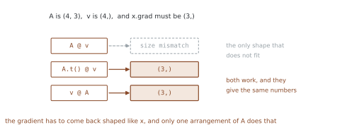
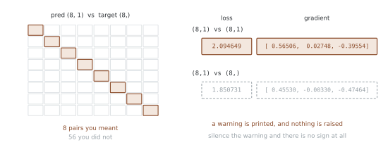

# 선형 사상의 VJP

<div class="leadbox" markdown>

**들어가는 이야기** — 전치는 어디서 오는가

$y = Ax$만큼 단순한 식은 없다. 그런데 이것의 역전파가 돌려주는 것은 $A$가
아니라 **전치** $A^\top$다. 외워 두기는 쉬운데, 왜 전치가 되는지는 식을
따라가 보기 전에는 잘 안 와닿는다.

이 쪽은 두 가지 길로 답한다. 하나는 정직하게 **계산으로 유도하는** 길이다.

다른 하나가 더 쓸모 있다. **아무것도 계산하지 않고 형태만 보는** 길이다.
돌아오는 값은 $x$와 같은 형태여야 하고, 가진 조각들로 그 형태를 만들 방법이
**하나뿐**이면 그것이 답이다. 식을 유도하기 전에 답을 알 수 있다.

이 요령은 여기서만 쓰는 것이 아니다. 어떤 레이어의 역전파가 어떻게 생겼는지
가늠해야 할 때 가장 먼저 꺼내는 수단이다.

</div>

$y = Ax$에서 `y.backward(v)`를 부르면 `x.grad`에 무엇이 들어오는가.

답은 $A^\top v$다. **$A$를 곱하는 것이 아니라 $A^\top$을 곱한다.** 전치가 어디서
오는지는 두 가지로 설명된다 — 계산으로 유도하는 길과, **형태만 보고 아는** 길.

## 1. 코드

```python
"""선형 사상의 VJP — 왜 A 가 아니라 A^T v 인가.

$y = Ax$ 에서 `y.backward(v)` 를 부르면 `x.grad` 에 무엇이 들어오는가.
손으로 유도해 보면 $A^\\top v$ 이고, 그것은 **$A$ 를 곱하는 것이 아니라
$A^\\top$ 을 곱하는 것**이다.

전치가 붙는 까닭을 형태만으로도 알 수 있다. $A$ 가 $(m, n)$ 이고
$v$ 가 $(m,)$ 이면, 결과는 $x$ 와 같은 $(n,)$ 이어야 한다.
$(m, n)$ 과 $(m,)$ 으로 $(n,)$ 을 만드는 길은 $A^\\top v$ 뿐이다.

실행: 이 쪽의 코드를 파일로 갈무리해 돌린다
"""
# torch 는 파이토치 본체다. 텐서(파이토치가 다루는 수의 묶음)와 자동 미분이 여기서 온다.
import torch


def header(title):
    # 절 제목을 한 줄 찍는다. \n 은 줄바꿈이라 제목 앞에 빈 줄이 하나 생긴다.
    # f"...{title}..." 은 문자열 안에 값을 끼워 넣는 파이썬 문법(f-문자열)이다.
    print(f"\n=== {title} ===")


# 출력이 M = 4 개, 입력이 N = 3 개다. 그래서 A 의 형태가 (M, N) = (4, 3) 이다.
M, N = 4, 3


def setup(seed=0):
    # 행렬 A 와 입력 x 를 만들어 돌려준다. torch.manual_seed(seed) 는 난수 생성기를
    # 정해진 자리에서 시작시킨다 — 부를 때마다 같은 A 와 x 가 나온다.
    torch.manual_seed(seed)
    # torch.randn 은 표준정규분포(평균 0, 표준편차 1)에서 뽑은 수로 텐서를 채운다.
    #   A   형태 (4, 3) 의 행렬. 미분하지 않으므로 그냥 만든다
    #   x   형태 (3,) 의 벡터. requires_grad=True 는 「이 텐서로 미분할 것이니
    #       이 텐서가 들어간 계산을 모두 기록해 두라」는 표시다. 이것을 경사 추적이라
    #       하고, 그 기록이 계산 그래프다
    return torch.randn(M, N), torch.randn(N, requires_grad=True)


# ========================================================================
# 1. autograd 와 손계산
# ========================================================================

def compare():
    header("1. A^T v 와 맞는가")
    A, x = setup()
    # v 는 「출력 넷을 얼마씩 중히 볼 것인가」 다. 출력 y 와 같은 형태 (4,) 로 준다.
    v = torch.tensor([1.0, 0.5, -1.0, 2.0])
    # @ 는 행렬 곱이다. (4, 3) @ (3,) = (4,) — 순전파다.
    y = A @ x
    # .shape 는 텐서의 형태다. tuple(...) 로 감싸 (4, 3) 처럼 찍히게 한다.
    print("  A 형태", tuple(A.shape), "  x 형태", tuple(x.shape),
          "  y 형태", tuple(y.shape))
    # 역전파다. y 가 스칼라(수 하나)가 아니므로 backward() 에 v 를 주어야 한다.
    # backward(v) 는 야코비 행렬 J (y 의 각 원소를 x 의 각 원소로 미분한 표,
    # 형태 (4, 3)) 를 만들지 않고 벡터-야코비 곱(VJP) v^T J 만 계산해 x.grad 에
    # 넣는다. x.grad 는 언제나 x 와 같은 형태 (3,) 다.
    y.backward(v)
    # 손계산 쪽이다. A.t() 는 전치 — 행과 열을 맞바꿔 (4, 3) 을 (3, 4) 로 만든다.
    # (3, 4) @ (4,) = (3,). 자동 미분을 쓰지 않고 행렬 곱 한 번으로 구한다.
    hand = A.t() @ v
    # tolist() 는 텐서를 파이썬 리스트로 바꾸고 round(t, 6) 은 여섯 자리 반올림이다.
    print("  x.grad :", [round(t, 6) for t in x.grad.tolist()])
    print("  A^T v  :", [round(t, 6) for t in hand.tolist()])
    # torch.allclose 는 두 텐서의 모든 자리가 (작은 허용 오차 안에서) 같으면 True 다.
    print("  같은가 :", torch.allclose(x.grad, hand))


# ========================================================================
# 2. 형태만 보아도 전치가 나온다
# ========================================================================

def shapes_force_it():
    header("2. 형태가 전치를 강요한다")
    A, x = setup()
    v = torch.randn(M)                          # 형태 (4,) 의 아무 벡터
    print(f"  A ({M},{N})   v ({M},)   결과는 x 와 같은 ({N},) 여야 한다")
    # A 와 v 를 곱하는 세 가지 방법을 (이름, 함수) 쌍으로 늘어놓고 하나씩 해 본다.
    # lambda: ... 는 이름 없는 함수다. 싸 두기만 하고 아래 expr() 에서 실제로 계산한다.
    #   A @ v       (4, 3) @ (4,)   안쪽 수 3 과 4 가 달라 곱할 수 없다
    #   A.t() @ v   (3, 4) @ (4,) = (3,)
    #   v @ A       (4,) @ (4, 3) = (3,)
    for name, expr in (("A @ v  ", lambda: A @ v),
                       ("A.t() @ v", lambda: A.t() @ v),
                       ("v @ A  ", lambda: v @ A)):
        # try: ... except: 는 오류가 나도 프로그램이 죽지 않게 받아 내는 문법이다.
        # 곱해지면 결과의 형태를 찍고, RuntimeError 가 나면 오류를 e 로 받아
        # 글로 바꿔(str) 첫 줄(splitlines()[0])의 앞 50 자([:50])만 찍는다.
        try:
            r = expr()
            print(f"  {name} -> 형태 {tuple(r.shape)}")
        except RuntimeError as e:
            print(f"  {name} -> {str(e).splitlines()[0][:50]}")
    print("  A.t() @ v 와 v @ A 가 둘 다 (3,) 을 준다")
    # 1 차원 텐서에는 행벡터와 열벡터의 구별이 없다. 그래서 v^T A 와 A^T v 가
    # 같은 수 셋이다.
    print("  그리고 둘은 같은 값이다:", torch.allclose(A.t() @ v, v @ A))


# ========================================================================
# 3. 유도
# ========================================================================

def derivation():
    header("3. 유도")
    A, x = setup()
    v = torch.randn(M)                          # 형태 (4,)
    print("  y_i = sum_j A_ij x_j 이므로  dy_i/dx_j = A_ij")
    print("  스칼라 s = sum_i v_i y_i 를 만들면")
    print("    ds/dx_j = sum_i v_i * dy_i/dx_j = sum_i v_i A_ij = (A^T v)_j")
    # 위에 찍은 식을 그대로 코드로 옮긴다. A @ x 가 y(형태 (4,))이고, v * y 는
    # 같은 자리끼리 곱한 것(형태 (4,))이며, sum() 이 그것을 다 더해 수 하나로 만든다.
    s = (v * (A @ x)).sum()
    # s 는 스칼라이므로 v 없이 backward() 를 부를 수 있다. x.grad 에 ds/dx 가 들어간다.
    s.backward()
    print("  s = (v*y).sum() 을 역전파한 x.grad:",
          [round(t, 6) for t in x.grad.tolist()])
    # 견줄 값 — 행렬 곱으로 바로 구한 A^T v 다. 형태 (3,).
    print("  A^T v                            :",
          [round(t, 6) for t in (A.t() @ v).tolist()])
    print("  backward(v) 는 이 s 를 만들어 역전파한 것과 같다")


# ========================================================================
# 4. 야코비는 A 자신이다
# ========================================================================

def jacobian_is_A():
    header("4. 야코비 = A")
    A, x = setup()
    y = A @ x                                   # 형태 (4,). 순전파는 한 번만 한다
    rows = []                                   # 야코비 행렬의 줄을 하나씩 모을 리스트
    for i in range(M):                          # 출력이 4 개이므로 네 번 부른다
        # i 번째 자리만 1 이고 나머지는 0 인 단위벡터 e 를 만든다. 형태 (4,).
        # v = e 로 두면 v^T J 가 J 의 i 번째 줄만 골라낸다.
        e = torch.zeros(M)
        e[i] = 1.0
        # backward 는 .grad 에 덮어쓰지 않고 「더한다」. 앞 바퀴의 결과를 지워야
        # i 번째 줄만 남는다.
        x.grad = None
        # 역전파는 끝나면 계산 그래프에 저장해 둔 값을 지운다. 같은 y 에 대고 네 번
        # 불러야 하므로 retain_graph=True 로 지우지 말고 남겨 두라고 한다.
        y.backward(e, retain_graph=True)
        # x.grad (형태 (3,)) 가 J 의 i 번째 줄이다. 다음 바퀴에서 x.grad 를 다시
        # 쓰므로 clone() 으로 복사해 모은다.
        rows.append(x.grad.clone())
    # torch.stack 은 길이 3 의 벡터 4 개를 쌓아 형태 (4, 3) 의 행렬로 만든다.
    J = torch.stack(rows)
    print("  단위벡터로 모은 J 가 A 와 같은가:", torch.allclose(J, A))
    print("  그래서 v^T J = v^T A = A^T v 다 (벡터이므로 같다)")


# ========================================================================
# 5. A 에 대한 그래디언트도 같이 본다
# ========================================================================

def grad_wrt_A():
    header("5. A 에 대한 그래디언트")
    torch.manual_seed(0)
    # 이번에는 A 에도 경사 추적을 건다. 레이어로 치면 A 가 웨이트이고, 트레인에
    # 필요한 것은 x 가 아니라 A 에 대한 그래디언트다.
    A = torch.randn(M, N, requires_grad=True)   # 형태 (4, 3)
    x = torch.randn(N, requires_grad=True)      # 형태 (3,)
    v = torch.randn(M)                          # 형태 (4,)
    # backward(v) 한 번이 경사 추적을 건 텐서 모두의 .grad 를 채운다.
    # A.grad 는 A 와 같은 형태 (4, 3) 이고, (i, j) 자리가 ds/dA_ij = v_i * x_j 다.
    (A @ x).backward(v)
    # torch.outer(v, x) 는 외적이다. (4,) 와 (3,) 에서 (i, j) 자리가 v_i * x_j 인
    # 형태 (4, 3) 의 행렬을 만든다. x.detach() 는 x 를 계산 그래프에서 떼어 낸
    # 것이다 — 견줄 값만 필요하고 이 계산은 기록할 까닭이 없다.
    outer = torch.outer(v, x.detach())
    print("  A.grad 형태:", tuple(A.grad.shape), " = A 와 같다")
    print("  A.grad == outer(v, x) 인가:", torch.allclose(A.grad, outer))
    print("  y_i = sum_j A_ij x_j 이므로 dy_i/dA_ij = x_j")
    print("  ds/dA_ij = v_i x_j — 외적이다")


def main():
    # 다섯 절을 차례로 돌린다.
    compare()
    shapes_force_it()
    derivation()
    jacobian_is_A()
    grad_wrt_A()


# 이 파일을 직접 돌렸을 때만 main() 을 부른다. 다른 파일이 이 파일을 불러다(import)
# 쓸 때는 __name__ 이 "__main__" 이 아니므로 아무것도 돌지 않는다.
if __name__ == "__main__":
    main()
```

**출력:**

```
=== 1. A^T v 와 맞는가 ===
  A 형태 (4, 3)   x 형태 (3,)   y 형태 (4,)
  x.grad : [0.615178, -2.866987, -1.794756]
  A^T v  : [0.615178, -2.866987, -1.794756]
  같은가 : True

=== 2. 형태가 전치를 강요한다 ===
  A (4,3)   v (4,)   결과는 x 와 같은 (3,) 여야 한다
  A @ v   -> size mismatch, got input (4), mat (4x3), vec (4)
  A.t() @ v -> 형태 (3,)
  v @ A   -> 형태 (3,)
  A.t() @ v 와 v @ A 가 둘 다 (3,) 을 준다
  그리고 둘은 같은 값이다: True

=== 3. 유도 ===
  y_i = sum_j A_ij x_j 이므로  dy_i/dx_j = A_ij
  스칼라 s = sum_i v_i y_i 를 만들면
    ds/dx_j = sum_i v_i * dy_i/dx_j = sum_i v_i A_ij = (A^T v)_j
  s = (v*y).sum() 을 역전파한 x.grad: [0.377445, 1.423056, 0.093968]
  A^T v                            : [0.377445, 1.423056, 0.093968]
  backward(v) 는 이 s 를 만들어 역전파한 것과 같다

=== 4. 야코비 = A ===
  단위벡터로 모은 J 가 A 와 같은가: True
  그래서 v^T J = v^T A = A^T v 다 (벡터이므로 같다)

=== 5. A 에 대한 그래디언트 ===
  A.grad 형태: (4, 3)  = A 와 같다
  A.grad == outer(v, x) 인가: True
  y_i = sum_j A_ij x_j 이므로 dy_i/dA_ij = x_j
  ds/dA_ij = v_i x_j — 외적이다
```

## 2. 형태가 전치를 강요한다

$A$가 $(4, 3)$, $v$가 $(4,)$이고 결과는 $x$와 같은 $(3,)$이어야 한다.

| | 결과 |
|---|---|
| `A @ v` | `size mismatch, got input (4), mat (4x3), vec (4)` |
| `A.t() @ v` | `(3,)` |
| `v @ A` | `(3,)` |



**$(4,3)$과 $(4,)$으로 $(3,)$을 만드는 길이 전치뿐이다.** 그래서 식을 유도하기
전에도 전치가 붙는다는 것을 알 수 있다.

`A.t() @ v`와 `v @ A`는 같은 값이다. 벡터에는 행·열 구별이 없으므로
$v^\top A = A^\top v$다.

## 3. 유도

$y_i = \sum_j A_{ij} x_j$이므로 $\dfrac{\partial y_i}{\partial x_j} = A_{ij}$다.

`backward(v)`가 하는 일은 스칼라 $s = \sum_i v_i y_i$를 만들어 역전파하는 것과
같으므로

$$
\frac{\partial s}{\partial x_j}
= \sum_i v_i \frac{\partial y_i}{\partial x_j}
= \sum_i v_i A_{ij}
= (A^\top v)_j
$$

코드가 그것을 확인한다 — `(v * y).sum().backward()`로 얻은 `x.grad`가
$A^\top v$와 소수점까지 같다.

## 4. 야코비 행렬은 A 자신이다

단위벡터로 모은 $J$가 $A$와 같다. 그러니 $v^\top J = v^\top A$이고, 벡터이므로
$A^\top v$와 같은 것을 다르게 적은 것뿐이다.

**선형 사상에서는 야코비 행렬이 상수**다. $x$가 무엇이든 $A$다. 비선형 함수에서는
$x$에 따라 달라지고, 그래서 「비선형 전체 야코비안」에서 다시 본다.

## 5. 행렬 A 에 대한 그래디언트는 외적이다

```
A.grad 형태: (4, 3)  = A 와 같다
A.grad == outer(v, x) 인가: True
```

$y_i = \sum_j A_{ij} x_j$이므로 $\dfrac{\partial y_i}{\partial A_{ij}} = x_j$이고,
따라서

$$
\frac{\partial s}{\partial A_{ij}} = v_i x_j
$$

**외적(outer product) $v x^\top$**이다 — 열벡터와 행벡터를 곱해 행렬을 만드는 연산이다. 「Linear 웨이트 관례」에서 본
$\partial L/\partial W = g^\top X$가 배치가 있는 형태이고, 여기서는 표본 하나라
외적이 된다.

## 6. 열벡터로 적으면

1~5절에서는 $x$를 $(3,)$으로 두었다. 수학책처럼 $(3,1)$ 열벡터로
두면 어떻게 되는가. **답은 같고 형태만 달라진다.**

그런데 `backward(v)`의 `v`는 출력과 **꼭 같은 형태**여야 한다. 브로드캐스팅으로
넘어가지 않는다 — 이것이 반가운 소식이다. 틀리면 터져 준다.

반가운 소식에는 짝이 있다. 형태가 **조용히** 틀리는 자리는 따로 있고, 그쪽이
훨씬 자주 문다. 10절이 그 자리다.

```python
"""같은 수학, 다른 형태 — v 의 형태는 출력과 꼭 맞아야 한다.

앞의 1~5절에서 $x$ 를 $(3,)$ 으로 두었다. 수학책처럼
$(3,1)$ 열벡터로 두면 어떻게 되는가. **답은 같고 형태만 달라진다.**

그런데 `backward(v)` 의 `v` 는 출력과 **꼭 같은 형태**여야 한다.
브로드캐스팅으로 넘어가지 않는다 — 이것이 반가운 소식이다.

반가운 소식에는 짝이 있다. 형태가 **조용히** 틀리는 자리는 따로
있고, 그쪽이 훨씬 자주 문다. 이 쪽 10절이 그 자리다.

실행: 이 쪽의 코드를 파일로 갈무리해 돌린다
"""
# warnings 는 파이썬 표준 라이브러리다. 5 에서 파이토치가 띄우는 경고를 세고 끄는 데 쓴다.
import warnings

# torch 는 파이토치 본체다. 텐서(파이토치가 다루는 수의 묶음)와 자동 미분이 여기서 온다.
# torch.nn.functional 은 로스 같은 함수를 모아 둔 곳이고 관례대로 F 로 줄여 부른다.
import torch
import torch.nn.functional as F


def header(title):
    # 절 제목을 한 줄 찍는다. \n 은 줄바꿈이고, f"...{title}..." 은 문자열 안에
    # 값을 끼워 넣는 파이썬 문법(f-문자열)이다.
    print(f"\n=== {title} ===")


# ========================================================================
# 1. 같은 수학, 다른 형태
# ========================================================================

def same_math():
    header("1. (3,) 와 (3,1)")
    # torch.manual_seed(0) 은 난수 생성기를 정해진 자리에서 시작시킨다. 앞 프로그램의
    # setup() 과 같은 시드, 같은 차례라 A 와 x 의 값이 앞 프로그램과 똑같다.
    torch.manual_seed(0)
    A = torch.randn(4, 3)                       # 형태 (4, 3) 의 행렬
    base = torch.randn(3)                       # 수 셋. 이것을 두 가지 형태로 담는다
    # 같은 수 셋으로 입력을 둘 만든다. clone() 은 복사본을 만들고,
    # requires_grad_(True) 는 그 텐서에 경사 추적을 건다 — 이 텐서가 들어간 계산을
    # 기록해 두어 나중에 이 텐서로 미분할 수 있게 한다. 이름 끝의 _ 는 새 텐서를
    # 만들지 않고 「제자리에서」 고친다는 파이토치의 표시다.
    # view(3, 1) 은 값은 그대로 두고 형태만 (3,) 에서 (3, 1) 로 바꿔 본다.
    x1 = base.clone().requires_grad_(True)              # (3,)
    x2 = base.view(3, 1).clone().requires_grad_(True)   # (3,1)
    # @ 는 행렬 곱이다. 입력의 형태에 따라 출력의 형태가 달라진다.
    #   (4, 3) @ (3,)   = (4,)       1 차원 벡터
    #   (4, 3) @ (3, 1) = (4, 1)     열이 하나인 행렬(열벡터)
    print("  x (3,)  -> y", tuple((A @ x1).shape))
    print("  x (3,1) -> y", tuple((A @ x2).shape))

    v = torch.tensor([1.0, 0.5, -1.0, 2.0])     # 형태 (4,)
    # backward(v) 는 야코비 행렬 J (출력의 각 원소를 입력의 각 원소로 미분한 표.
    # 여기서는 A 자신) 를 만들지 않고 벡터-야코비 곱(VJP) v^T J = A^T v 만 계산해
    # 입력의 .grad 에 넣는다. v 는 출력과 같은 형태로 주어야 한다.
    (A @ x1).backward(v)                        # 출력이 (4,) 이므로 v 도 (4,)
    (A @ x2).backward(v.view(4, 1))             # 출력이 (4, 1) 이므로 v 도 (4, 1)
    # .grad 는 그 텐서와 같은 형태다. x1.grad 는 (3,), x2.grad 는 (3, 1) 이다.
    print("  x1.grad 형태", tuple(x1.grad.shape),
          " x2.grad 형태", tuple(x2.grad.shape))
    # tolist() 는 텐서를 파이썬 리스트로 바꾸고 round(t, 6) 은 여섯 자리 반올림이다.
    # x2.grad 는 flatten() 으로 (3, 1) 을 (3,) 으로 펴서 같은 모양으로 찍는다.
    print("  x1.grad", [round(t, 6) for t in x1.grad.tolist()])
    print("  x2.grad", [round(t, 6) for t in x2.grad.flatten().tolist()])
    # torch.allclose 는 두 텐서의 모든 자리가 (작은 허용 오차 안에서) 같으면 True 다.
    print("  값이 같은가:", torch.allclose(x1.grad, x2.grad.flatten()))
    print("  그래디언트는 언제나 그 텐서와 같은 형태로 온다")


# ========================================================================
# 2. v 의 형태는 엄격하다
# ========================================================================

def strict_v():
    header("2. v 의 형태 검사")
    torch.manual_seed(0)
    A = torch.randn(4, 3)
    # 출력 A @ x 의 형태는 (4, 1) 이다. v 의 형태를 네 가지로 바꿔 어느 것이 통하는지
    # 본다. (4,) 는 원소 수가 같고, (1, 1) 과 (1,) 은 브로드캐스팅 — 형태가 다른
    # 텐서를 자동으로 늘려 맞추는 규칙 — 으로 (4, 1) 까지 늘릴 수 있는 형태다.
    for shape in ((4, 1), (4,), (1, 1), (1,)):
        # x 를 매번 새로 만든다. 형태 (3, 1), 경사 추적을 건다.
        x = torch.randn(3, 1, requires_grad=True)
        # try: ... except: 는 오류가 나도 프로그램이 죽지 않게 받아 내는 문법이다.
        try:
            # torch.ones(shape) 는 1 로 채운 텐서다. v 가 전부 1 이면 v^T J 는
            # A 의 줄을 모두 더한 것, 곧 열마다의 합이다.
            (A @ x).backward(torch.ones(shape))
            # 통과하면 x.grad 를 찍는다. {str(shape):8s} 는 형태를 글로 바꿔 여덟 칸에
            # 맞춰 찍으라는 뜻이다.
            print(f"  v 형태 {str(shape):8s} -> 통과. x.grad "
                  f"{[round(t, 4) for t in x.grad.flatten().tolist()]}")
        except RuntimeError as e:
            # 거절당하면 오류 글의 첫 줄(splitlines()[0])에서 앞 52 자만 찍는다.
            print(f"  v 형태 {str(shape):8s} -> {str(e).splitlines()[0][:52]}")
    print("  출력이 (4,1) 이므로 v 도 (4,1) 이라야 한다")
    print("  브로드캐스팅으로 넘어가지 않는다 — 터져 주는 쪽이다")


# ========================================================================
# 3. 열벡터로 적으면 식이 수학책과 같아진다
# ========================================================================

def column_form():
    header("3. 열벡터 형태")
    torch.manual_seed(0)
    A = torch.randn(4, 3)                       # 형태 (4, 3)
    x = torch.randn(3, 1, requires_grad=True)   # 형태 (3, 1) 의 열벡터. 경사 추적을 건다
    v = torch.randn(4, 1)                       # 형태 (4, 1) — 출력 A @ x 와 같다
    (A @ x).backward(v)                         # x.grad 에 형태 (3, 1) 의 VJP 가 들어간다
    print("  x.grad    :", [round(t, 6) for t in x.grad.flatten().tolist()])
    # A.t() 는 전치 — 행과 열을 맞바꿔 (4, 3) 을 (3, 4) 로 만든다.
    # (3, 4) @ (4, 1) = (3, 1). 수학책의 A^T v 를 형태까지 그대로 옮긴 것이다.
    print("  A^T v     :", [round(t, 6) for t in (A.t() @ v).flatten().tolist()])
    # 값뿐 아니라 형태도 견준다. 둘 다 (3, 1) 이라 True 다.
    print("  형태도 같은가:", x.grad.shape == (A.t() @ v).shape)
    print("  (3,1) 로 두면 A^T v 의 형태가 그대로 x.grad 다")
    print("  (3,) 로 두면 값은 같고 형태만 (3,) 로 눌린다")


# ========================================================================
# 4. 어느 쪽으로 적을 것인가
# ========================================================================

def which_form():
    # 재는 것은 없다. 두 형태의 장단점을 글로 찍는다.
    header("4. 고르기")
    print("  (3,) 형태")
    print("    장점: 코드가 짧다. 파이토치의 거의 모든 함수가 이쪽을 받는다")
    print("    단점: 수학책의 열벡터 식과 형태가 다르다")
    print("  (3,1) 형태")
    print("    장점: A^T v 의 형태가 그대로 나온다")
    print("    단점: 어디선가 (3,) 와 섞이면 브로드캐스팅이 일어난다")
    print("  파이토치는 (배치, 피처) 를 쓰므로 표본 하나도 (1, 3) 이 보통이다")


# ========================================================================
# 5. 조용히 틀리는 자리
# ========================================================================

def the_silent_one():
    header("5. 형태가 조용히 무는 자리")
    torch.manual_seed(0)
    # 표본 8 개짜리 회귀를 흉내 낸다. 모델의 예측이 (8, 1) 로 나왔다고 하고,
    # 같은 정답을 두 가지 형태로 준비한다.
    pred = torch.randn(8, 1)                    # 예측. 형태 (8, 1)
    targ_col = torch.randn(8, 1)                # 정답. 형태 (8, 1) — 예측과 같다
    targ_flat = targ_col.flatten()              # 같은 값을 (8,) 으로 편 것
    print("  pred", tuple(pred.shape),
          " target 열", tuple(targ_col.shape),
          " target 평평", tuple(targ_flat.shape))

    # F.mse_loss 는 예측과 정답의 차를 제곱해 평균낸 수 하나다. 형태가 같으면
    # i 번째 예측을 i 번째 정답과 견준 8 개의 평균이다.
    a = F.mse_loss(pred, targ_col)
    # 형태가 (8, 1) 과 (8,) 로 다르면 오류 대신 브로드캐스팅이 일어난다. 차가
    # (8, 8) 로 늘어나 모든 예측을 모든 정답과 견준 64 개의 평균이 된다.
    # 파이토치는 이때 경고만 띄운다. catch_warnings(record=True) 는 이 블록 안에서
    # 뜬 경고를 화면에 내지 않고 리스트 caught 에 모으고, simplefilter("always") 는
    # 경고를 빠뜨리지 말고 모두 잡으라는 설정이다.
    with warnings.catch_warnings(record=True) as caught:
        warnings.simplefilter("always")
        b = F.mse_loss(pred, targ_flat)
    # .item() 은 수 하나짜리 텐서에서 그 수를 파이썬 실수로 꺼낸다.
    # :.6f 는 소수점 아래 여섯 자리까지 찍으라는 뜻이다. len(caught) 가 경고의 수다.
    print(f"  (8,1) vs (8,1) 로스 {a.item():.6f}")
    print(f"  (8,1) vs (8,)  로스 {b.item():.6f}   경고 {len(caught)}개")
    print("  (8,1) 과 (8,) 이 브로드캐스팅되어 (8,8) 이 된다")
    print("  표본 여덟 개를 서로 엇갈려 견준 셈이다")

    # 로스만이 아니라 그래디언트도 틀리는지 본다. 예측을 복사해 경사 추적을 걸고
    # 로스를 역전파하면 .grad 에 「로스를 예측으로 미분한 값」(형태 (8, 1))이 들어간다.
    # 로스가 스칼라이므로 backward() 에 v 를 주지 않아도 된다.
    p1 = pred.clone().requires_grad_(True)
    F.mse_loss(p1, targ_col).backward()         # 바른 짝
    p2 = pred.clone().requires_grad_(True)
    # 이번에는 simplefilter("ignore") 로 이 블록 안의 경고를 아예 끈다. 화면에
    # 아무것도 안 뜨고 틀린 그래디언트만 조용히 나온다.
    with warnings.catch_warnings():
        warnings.simplefilter("ignore")
        F.mse_loss(p2, targ_flat).backward()    # 어긋난 짝
    print("  그래디언트가 같은가:", torch.allclose(p1.grad, p2.grad))
    # flatten()[:3] 으로 앞의 세 값만 골라 다섯 자리로 반올림해 찍는다.
    print("  바른 그래디언트:", [round(t, 5) for t in p1.grad.flatten()[:3].tolist()])
    print("  틀린 그래디언트:", [round(t, 5) for t in p2.grad.flatten()[:3].tolist()])
    print("  경고는 뜨지만 터지지는 않는다. 경고를 끄면 아무 표도 없다")


def main():
    # 다섯 절을 차례로 돌린다.
    same_math()
    strict_v()
    column_form()
    which_form()
    the_silent_one()


# 이 파일을 직접 돌렸을 때만 main() 을 부른다. 다른 파일이 이 파일을 불러다(import)
# 쓸 때는 __name__ 이 "__main__" 이 아니므로 아무것도 돌지 않는다.
if __name__ == "__main__":
    main()
```

**출력:**

```
=== 1. (3,) 와 (3,1) ===
  x (3,)  -> y (4,)
  x (3,1) -> y (4, 1)
  x1.grad 형태 (3,)  x2.grad 형태 (3, 1)
  x1.grad [0.615178, -2.866987, -1.794756]
  x2.grad [0.615178, -2.866987, -1.794756]
  값이 같은가: True
  그래디언트는 언제나 그 텐서와 같은 형태로 온다

=== 2. v 의 형태 검사 ===
  v 형태 (4, 1)   -> 통과. x.grad [2.1094, -1.1366, -4.1146]
  v 형태 (4,)     -> Mismatch in shape: grad_output[0] has a shape of tor
  v 형태 (1, 1)   -> Mismatch in shape: grad_output[0] has a shape of tor
  v 형태 (1,)     -> Mismatch in shape: grad_output[0] has a shape of tor
  출력이 (4,1) 이므로 v 도 (4,1) 이라야 한다
  브로드캐스팅으로 넘어가지 않는다 — 터져 주는 쪽이다

=== 3. 열벡터 형태 ===
  x.grad    : [0.377445, 1.423056, 0.093968]
  A^T v     : [0.377445, 1.423056, 0.093968]
  형태도 같은가: True
  (3,1) 로 두면 A^T v 의 형태가 그대로 x.grad 다
  (3,) 로 두면 값은 같고 형태만 (3,) 로 눌린다

=== 4. 고르기 ===
  (3,) 형태
    장점: 코드가 짧다. 파이토치의 거의 모든 함수가 이쪽을 받는다
    단점: 수학책의 열벡터 식과 형태가 다르다
  (3,1) 형태
    장점: A^T v 의 형태가 그대로 나온다
    단점: 어디선가 (3,) 와 섞이면 브로드캐스팅이 일어난다
  파이토치는 (배치, 피처) 를 쓰므로 표본 하나도 (1, 3) 이 보통이다

=== 5. 형태가 조용히 무는 자리 ===
  pred (8, 1)  target 열 (8, 1)  target 평평 (8,)
  (8,1) vs (8,1) 로스 2.094649
  (8,1) vs (8,)  로스 1.850731   경고 1개
  (8,1) 과 (8,) 이 브로드캐스팅되어 (8,8) 이 된다
  표본 여덟 개를 서로 엇갈려 견준 셈이다
  그래디언트가 같은가: False
  바른 그래디언트: [0.56506, 0.02748, -0.39554]
  틀린 그래디언트: [0.4553, -0.0033, -0.47464]
  경고는 뜨지만 터지지는 않는다. 경고를 끄면 아무 표도 없다
```

## 7. 형태만 다르고 값은 같다

```
x (3,)  -> y (4,)
x (3,1) -> y (4, 1)

x1.grad 형태 (3,)    x2.grad 형태 (3, 1)
값이 같은가: True
```

**그래디언트는 언제나 그 텐서와 같은 형태로 온다.** 그래서 $x$를 어떻게 두든
`x.grad`의 형태가 따라온다.

달라지는 것은 `v`다. 출력이 $(4,1)$이면 `v`도 $(4,1)$이어야 한다.

## 8. `v`의 형태 검사는 엄격하다

| `v` 형태 | 결과 |
|---|---|
| `(4, 1)` | 통과 |
| `(4,)` | `Mismatch in shape` |
| `(1, 1)` | `Mismatch in shape` |
| `(1,)` | `Mismatch in shape` |

**브로드캐스팅되지 않는다.** $(1,1)$과 $(1,)$은 보통의 연산에서라면 $(4,1)$로
늘어나는 형태인데도 거절한다. $(4,)$는 원소가 넷으로 같지만 형태가 달라
거절한다 — 이쪽은 브로드캐스팅으로도 $(4,1)$이 되지 않는다($(4,1)$과 만나면
$(4,4)$가 된다).

일부러 그렇게 만들어 둔 것으로 보인다. `v`는 "각 출력을 얼마씩 중히 보는가"라
출력과 일대일로 맞아야 뜻이 분명하고, 브로드캐스팅을 허용하면 어느 축이
늘어났는지 모르게 된다.

그래서 **여기서 틀리면 반드시 터진다.** 고마운 자리다.

## 9. 열벡터 형태의 쓸모

```
x.grad    : [0.377445, 1.423056, 0.093968]
A^T v     : [0.377445, 1.423056, 0.093968]
형태도 같은가: True
```

$(3,1)$로 두면 $A^\top v$의 형태가 그대로 `x.grad`다. 수학책 식을 그대로 코드로
옮기기 좋다.

| | 장점 | 단점 |
|---|---|---|
| `(3,)` | 짧다. 파이토치 함수 대부분이 이쪽 | 수학책 식과 형태가 다르다 |
| `(3,1)` | $A^\top v$가 그대로 나온다 | $(3,)$와 섞이면 브로드캐스팅 |

실전에서는 파이토치가 `(배치, 피처)`를 쓰므로 표본 하나도 `(1, 3)`으로 두는
것이 보통이다. 열벡터 형태는 손으로 유도한 식과 맞춰 볼 때 쓸모가 있다.

## 10. 형태가 조용히 무는 자리

`backward(v)`는 터져 주는데, **로스 안의 브로드캐스팅은 안 터진다.**

```
pred (8, 1)   target 열 (8, 1)   target 평평 (8,)

(8,1) vs (8,1) 로스 2.094649
(8,1) vs (8,)  로스 1.850731   경고 1개

그래디언트가 같은가: False
바른 그래디언트: [0.56506, 0.02748, -0.39554]
틀린 그래디언트: [0.4553, -0.0033, -0.47464]
```



$(8,1)$과 $(8,)$이 브로드캐스팅되어 **$(8,8)$**이 된다. 표본 여덟 개를 서로
엇갈려 견준 셈이고, 로스도 그래디언트도 전혀 다른 값이 나온다.

경고가 뜨기는 한다. 그런데

- 경고일 뿐 **터지지 않는다**
- 로그가 많으면 **묻힌다**
- `warnings.filterwarnings("ignore")`를 어디선가 걸어 두면 **아무 표도 없다**

모델 출력이 `(N, 1)`이고 라벨이 `(N,)`인 것은 흔한 형태다. `nn.Linear(d, 1)`이
`(N,1)`을 주고, CSV에서 읽은 라벨은 `(N,)`이다. 그래서 이 버그가 자주 생긴다.

> **고치는 법은 둘 중 아무거나.** `target.view(-1, 1)`로 라벨을 세우거나
> `pred.squeeze(-1)`로 예측을 눕힌다. 어느 쪽이든 로스를 계산하기 **전에**
> 형태를 맞춰 두는 것이 요점이다.

## 연습문제

<div class="drillbox" markdown>

**연습문제 1.** <span class="diff easy" title="쉬움"></span>
$v$를 단위벡터로 주면 `x.grad`가 무엇이 되는가? 그리고 전부 1로 주면?
**먼저 적고** 확인하라.

</div>

??? success "풀이"
    $A^\top v$에서 $v$가 $i$번째 단위벡터면 $A^\top$의 $i$번째 **열**, 곧 $A$의
    $i$번째 **줄**이다. 전부 1이면 $A$의 줄들을 다 더한 것이다.

    ```python
    torch.manual_seed(0)                    # 돌릴 때마다 같은 난수가 나오게 한다
    A = torch.randn(4, 3)                   # 형태 (4, 3). y = A @ x 의 야코비 행렬이다
    # v 를 세 가지로 준다 — 0 번째 단위벡터, 3 번째 단위벡터, 전부 1.
    # 1. 은 1.0 이다. 리스트에 실수가 하나라도 있으면 텐서 전체가 실수가 된다.
    for v in ([1., 0, 0, 0], [0, 0, 0, 1.], [1., 1, 1, 1]):
        # x 를 매번 새로 만든다(형태 (3,), 경사 추적). 값은 바퀴마다 다르지만
        # 상관없다 — 선형 사상의 야코비 행렬은 x 가 무엇이든 A 이기 때문이다.
        x = torch.randn(3, requires_grad=True)
        # backward(v) 가 x.grad 에 v^T J = A^T v (형태 (3,)) 를 넣는다.
        (A @ x).backward(torch.tensor(v))
        print(f"  v={str(v):18s} x.grad={[round(t, 4) for t in x.grad.tolist()]}")
    # 견줄 값들이다. A[0] 은 A 의 0 번 줄, A[3] 은 3 번 줄(번호는 0 부터)이고,
    # A.sum(0) 은 줄들을 다 더한 것 — 열마다의 합, 형태 (3,) — 이다.
    print("  A[0]     =", [round(t, 4) for t in A[0].tolist()])
    print("  A[3]     =", [round(t, 4) for t in A[3].tolist()])
    print("  A.sum(0) =", [round(t, 4) for t in A.sum(0).tolist()])
    ```

    ```
      v=[1.0, 0, 0, 0]     x.grad=[1.541, -0.2934, -2.1788]
      v=[0, 0, 0, 1.0]     x.grad=[-0.4033, -0.5966, 0.182]
      v=[1.0, 1, 1, 1]     x.grad=[2.1094, -1.1366, -4.1146]
      A[0]     = [1.541, -0.2934, -2.1788]
      A[3]     = [-0.4033, -0.5966, 0.182]
      A.sum(0) = [2.1094, -1.1366, -4.1146]
    ```

    짐작대로다. 첫 줄이 `A[0]`과, 둘째 줄이 `A[3]`과, 셋째 줄이 `A.sum(0)`과 같다.

    **$v$는 "$A$의 어느 줄을 얼마씩 섞을 것인가"**를 정한다. 「벡터 출력의
    역전파」에서 $v$를 "출력을 얼마씩 중히 볼 것인가"라고 한 것이 선형 사상에서는
    이렇게 구체화된다.

---

<div class="drillbox" markdown>

**연습문제 2.** <span class="diff med" title="중간"></span>
선형 사상 둘을 이으면 $y = A_2 A_1 x$다. VJP가 $A_1^\top (A_2^\top v)$인지
확인하고, **먼저 $A_2 A_1$을 곱해 두는 것**과 시간을 견주어라.

</div>

??? success "풀이"
    ```python
    # time 은 파이썬 표준 라이브러리다. 걸린 시간을 재는 데 쓴다.
    import time


    def timeit(fn, repeat=20):
        """fn 을 repeat 번 불러 가장 빠른 한 번을 밀리초로 돌려준다."""
        best = float("inf")                 # 무한대에서 시작해 더 짧은 값으로 바꿔 간다
        for _ in range(repeat):
            # time.perf_counter() 는 지금 시각(초)이다. 앞뒤로 읽어 그 차를 잰다.
            t0 = time.perf_counter()
            fn()
            best = min(best, time.perf_counter() - t0)
        return best * 1000                  # 초를 밀리초(ms)로 바꾼다


    # --- 값이 같은가 ---
    torch.manual_seed(0)
    # 선형 사상 둘을 잇는다. x (4,) → A1 → (5,) → A2 → (3,)
    A1, A2 = torch.randn(5, 4), torch.randn(3, 5)       # 형태 (5, 4) 와 (3, 5)
    x = torch.randn(4, requires_grad=True)              # 형태 (4,). 경사 추적을 건다
    v = torch.randn(3)                                  # 출력과 같은 형태 (3,)
    # 순전파 A2 @ (A1 @ x) 의 출력은 (3,) 이다. backward(v) 가 x.grad 에 VJP 를 넣는다.
    (A2 @ (A1 @ x)).backward(v)
    print("  x.grad        :", [round(t, 6) for t in x.grad.tolist()])
    # 순서대로 — v 를 뒤 레이어부터 거꾸로 민다. 행렬-벡터 곱 두 번이다.
    #   A2.t() @ v      (5, 3) @ (3,) = (5,)
    #   A1.t() @ 그것   (4, 5) @ (5,) = (4,)
    print("  A1^T (A2^T v) :", [round(t, 6) for t in (A1.t() @ (A2.t() @ v)).tolist()])
    # 먼저 곱하고 — 전체 야코비 행렬 A2 @ A1 (형태 (3, 4)) 을 만든 뒤 전치해 v 에 곱한다.
    #   (A2 @ A1).t() @ v   (4, 3) @ (3,) = (4,)
    print("  (A2 A1)^T v   :", [round(t, 6) for t in ((A2 @ A1).t() @ v).tolist()])

    # --- 시간이 같은가 ---
    # 차이가 보이도록 큰 행렬로 잰다. B1, B2 는 형태 (2048, 2048), vv 는 (2048,) 이다.
    # 미분은 하지 않고 위의 두 식을 행렬 곱으로만 계산해 시간을 견준다.
    n = 2048
    B1, B2, vv = torch.randn(n, n), torch.randn(n, n), torch.randn(n)
    print()
    # lambda: ... 는 이름 없는 함수다. 계산을 싸서 timeit 에 넘긴다.
    # {…:6.3f} 는 여섯 칸에 소수점 아래 세 자리로 찍는다.
    print(f"  순서대로  B1^T (B2^T v)  {timeit(lambda: B1.t() @ (B2.t() @ vv)):6.3f} ms")
    print(f"  먼저 곱하고 (B2 B1)^T v  {timeit(lambda: (B2 @ B1).t() @ vv):6.3f} ms")
    ```

    ```
      x.grad        : [-0.665507, -3.905338, -2.741568, 2.191602]
      A1^T (A2^T v) : [-0.665507, -3.905338, -2.741568, 2.191602]
      (A2 A1)^T v   : [-0.665507, -3.905338, -2.741568, 2.191602]

      순서대로  B1^T (B2^T v)   0.699 ms
      먼저 곱하고 (B2 B1)^T v  12.717 ms
    ```

    셋이 같은 값이고, **순서대로 미는 쪽이 18배 빠르다.**

    까닭은 계산량이다. $n = 2048$에서

    - **순서대로**: 행렬-벡터 곱 두 번 — $2n^2$번 곱셈
    - **먼저 곱하고**: 행렬-행렬 곱 한 번 — $n^3$번 곱셈

    곱셈 수로는 $n/2$배, 곧 천 배쯤 차이가 난다. 실제로 잰 18배가 그보다 훨씬
    작은 것은 BLAS가 행렬-행렬 곱을 훨씬 잘 최적화하기 때문이다.

    **이것이 역전파가 야코비 행렬을 안 만드는 까닭**이다. 레이어가 $L$개인 뉴럴 네트워크에서
    야코비 행렬을 곱해 나가면 행렬-행렬 곱이 $L$번이지만, 벡터를 밀면 행렬-벡터
    곱이 $L$번이다.

---

<div class="drillbox" markdown>

**연습문제 3.** <span class="diff hard" title="어려움"></span>
$v$가 $i$번째 단위벡터일 때 `A.grad`는 어떻게 생겼는가? 5절의 외적으로
**먼저 예측하고** 확인하라.

</div>

??? success "풀이"
    $A.\text{grad} = v x^\top$이고 $v$가 $i$번째 단위벡터이면, **$i$번째 줄만
    $x^\top$이고 나머지는 0**일 것이다.

    ```python
    torch.manual_seed(0)
    # A 에도 경사 추적을 건다. 그래야 backward 가 A.grad 를 채운다.
    A = torch.randn(4, 3, requires_grad=True)   # 형태 (4, 3)
    x = torch.randn(3, requires_grad=True)      # 형태 (3,)
    for v in ([1., 0, 0, 0], [0, 1., 0, 0]):    # 0 번째, 1 번째 단위벡터
        # backward 는 .grad 에 「더하기」 때문에 앞 바퀴의 결과를 먼저 지운다.
        A.grad = None
        # A.grad 는 A 와 같은 형태 (4, 3) 이고 (i, j) 자리가 v_i * x_j 다.
        # v 가 i 번째 단위벡터이면 i 번째 줄만 x 이고 나머지 줄은 0 이다.
        (A @ x).backward(torch.tensor(v))
        # 줄마다 0 이 아닌 원소를 센다. abs() > 0 은 자리마다 True/False 를 주고,
        # sum(1) 은 줄 안에서(열을 따라) 더한다 — True 는 1 로 센다. 결과는 길이 4 다.
        nz = (A.grad.abs() > 0).sum(1).tolist()
        print(f"  v={str(v):16s} A.grad 의 줄마다 0 이 아닌 원소 수: {nz}")
    ```

    ```
      v=[1.0, 0, 0, 0]   A.grad 의 줄마다 0 이 아닌 원소 수: [3, 0, 0, 0]
      v=[0, 1.0, 0, 0]   A.grad 의 줄마다 0 이 아닌 원소 수: [0, 3, 0, 0]
    ```

    예측대로다. **$i$번째 줄만 채워진다.**

    뜻을 읽으면 이렇다. $y_i$만 중히 본다고 했으니, $y_i$를 만드는 데 쓰인
    파라메터 — $A$의 $i$번째 줄 — 만 그래디언트를 받는다. 나머지 줄은 $y_i$에 아무
    기여도 안 했으므로 할 말이 없다.

    「Linear 웨이트 관례」의 $(out, in)$ 배치가 여기서 다시 쓸모를 보인다.
    출력 하나에 해당하는 파라메터가 **한 줄에 모여 있으므로**, 그 출력만
    건드리는 일이 한 줄을 건드리는 일이 된다.

---

<div class="drillbox" markdown>

**연습문제 4.** <span class="diff easy" title="쉬움"></span>
`nn.Linear(4, 1)`의 출력과 `(N,)` 라벨로 MSE를 계산하면 얼마나 틀리는가?
고치는 두 길이 같은 값을 주는지 확인하라.

</div>

??? success "풀이"
    ```python
    # torch.nn 은 레이어를 모아 둔 곳이다. 관례대로 nn 으로 줄여 부른다.
    # torch, F, warnings 는 6절 프로그램의 임포트를 그대로 쓴다.
    import torch.nn as nn

    torch.manual_seed(0)
    # nn.Linear(4, 1) 은 수 4 개를 받아 수 1 개를 내는 레이어다. 웨이트와 바이어스를
    # 무작위로 초기화해 갖고 있다. 출력이 1 개여도 그 차원은 남는다.
    m = nn.Linear(4, 1)
    x = torch.randn(8, 4)                   # 표본 8 개짜리 배치. 형태 (8, 4)
    y_col = torch.randn(8, 1)               # 정답. 형태 (8, 1)
    y_flat = y_col.flatten()                # 같은 값을 (8,) 으로 편 것
    print("  model(x) 형태:", tuple(m(x).shape))        # (8, 1)
    for name, t in (("(8,1)", y_col), ("(8,)", y_flat)):
        # 이 블록 안에서 뜬 경고를 화면에 내지 않고 리스트 w 에 모은다.
        # simplefilter("always") 는 경고를 빠뜨리지 말고 모두 잡으라는 설정이다.
        with warnings.catch_warnings(record=True) as w:
            warnings.simplefilter("always")
            # F.mse_loss 는 예측과 정답의 차를 제곱해 평균낸다. 정답이 (8,) 이면
            # (8, 1) 과 브로드캐스팅되어 차가 (8, 8) 이 되고, 64 개의 평균이 나온다.
            l = F.mse_loss(m(x), t)
        print(f"  target {name:6s} 로스 {l.item():.6f}  경고 {len(w)}개")
    # 고치는 두 길이다. 둘 다 로스를 계산하기 전에 형태를 맞춘다.
    #   squeeze(-1)   예측의 마지막 차원(길이 1)을 없앤다.   (8, 1) → (8,)
    #   view(-1, 1)   정답을 열 하나짜리로 세운다. -1 은 「알아서 맞춰라」다.  (8,) → (8, 1)
    print("  squeeze 쪽:", round(F.mse_loss(m(x).squeeze(-1), y_flat).item(), 6))
    print("  view 쪽   :", round(F.mse_loss(m(x), y_flat.view(-1, 1)).item(), 6))
    ```

    ```
      model(x) 형태: (8, 1)
      target (8,1)  로스 2.663356  경고 0개
      target (8,)   로스 2.125755  경고 1개
      squeeze 쪽: 2.663356
      view 쪽   : 2.663356
    ```

    로스가 2.663에서 2.126으로 **20%** 틀린다. 그럴듯한 수라서 더 나쁘다 —
    `nan`이면 바로 알 텐데 이건 그냥 "로스가 좀 작네"로 보인다.

    고치는 두 길이 같은 값을 준다. 어느 쪽을 쓰든 되고, 모델 쪽을 건드리는
    `squeeze`가 더 흔하다 — 라벨은 데이터 적재 쪽에서 오므로 손대기 번거로울
    때가 있다.

---

<div class="drillbox" markdown>

**연습문제 5.** <span class="diff med" title="중간"></span>
`cross_entropy`도 같은 문제가 있는가? `(N, C)` 로짓에 `(N,)` 라벨과 `(N, 1)`
라벨을 각각 주어 보라.

</div>

??? success "풀이"
    ```python
    torch.manual_seed(0)
    # 표본 N = 8 개, 클래스 C = 3 개짜리 분류를 흉내 낸다.
    # 로짓은 모델이 클래스마다 내놓는 점수다. 형태 (8, 3).
    logits = torch.randn(8, 3)
    # torch.randint(0, 3, (8,)) 는 0, 1, 2 가운데 하나를 무작위로 8 개 뽑은 정수
    # 텐서다(3 은 들어가지 않는다). 형태 (8,) — 표본마다 정답 클래스의 번호 하나다.
    targ = torch.randint(0, 3, (8,))
    # F.cross_entropy 는 분류에 쓰는 로스다. (N, C) 로짓과 (N,) 번호를 받아
    # 수 하나를 낸다. 이것이 바른 짝이다.
    print("  (N,C) 와 (N,):", round(F.cross_entropy(logits, targ).item(), 6))
    # 라벨을 view(-1, 1) 로 (8, 1) 로 세워서 주어 본다. 오류가 나면 받아서
    # 그 글의 첫 줄에서 앞 70 자만 찍는다.
    try:
        F.cross_entropy(logits, targ.view(-1, 1))
    except Exception as e:
        print("  (N,1) 을 주면:", str(e).splitlines()[0][:70])
    ```

    ```
      (N,C) 와 (N,): 1.332264
      (N,1) 을 주면: 0D or 1D target tensor expected, multi-target not supported
    ```

    **`cross_entropy`는 터진다.** MSE와 반대다.

    까닭은 기대하는 형태가 다르기 때문이다.

    | | 예측 | 목표 |
    |---|---|---|
    | `mse_loss` | `(N, 1)` | **같은 형태** `(N, 1)` |
    | `cross_entropy` | `(N, C)` | **다른 형태** `(N,)`, 클래스 번호 |

    `cross_entropy`의 목표는 값이 아니라 **번호**이므로 차원이 하나 적고,
    그래서 브로드캐스팅될 여지가 없다. 틀리면 바로 터진다.

    그러니 "`(N,)`과 `(N,1)` 중 무엇을 쓸까"에 일반적인 답이 없다. **쓰는 로스
    함수가 정한다.** 회귀에서 `(N,1)`로 맞추던 습관을 분류에 가져가면 여기서
    터진다 — 다행히 터진다.

---

<div class="drillbox" markdown>

**연습문제 6.** <span class="diff hard" title="어려움"></span>
8절에서 `v`의 형태가 엄격하다고 했다. **0차원 `v`**는 어떤가? 그리고 출력이
스칼라일 때 `(1,)` 짜리 `v`를 주면?

</div>

??? success "풀이"
    ```python
    torch.manual_seed(0)
    A = torch.randn(4, 3)                       # 형태 (4, 3)
    x = torch.randn(3, requires_grad=True)      # 형태 (3,). 경사 추적을 건다
    y = A @ x                                   # 출력. 형태 (4,)
    # 출력이 (4,) 일 때 v 를 세 가지 형태로 준다.
    #   torch.ones(4)       형태 (4,) — 출력과 같다
    #   torch.tensor(1.0)   0 차원. 형태가 () 인 수 하나짜리 텐서다
    #   torch.ones(4, 1)    형태 (4, 1) — 원소 수는 같은데 차원이 하나 많다
    for desc, v in (("정상 (4,)", torch.ones(4)),
                    ("0 차원", torch.tensor(1.0)),
                    ("(4,1)", torch.ones(4, 1))):
        x.grad = None                           # 앞 바퀴의 결과를 지운다
        try:
            # 같은 y 에 대고 여러 번 부르므로 retain_graph=True 로 계산 그래프를
            # 남겨 둔다. 통과하면 x.grad 는 v^T J = A^T v, 여기서는 A 의 열마다의 합이다.
            y.backward(v, retain_graph=True)
            print(f"  {desc:10s} -> 통과  x.grad "
                  f"{[round(t, 4) for t in x.grad.tolist()]}")
        except RuntimeError as e:
            # 거절당하면 오류 글의 첫 줄에서 앞 56 자만 찍는다.
            print(f"  {desc:10s} -> {str(e).splitlines()[0][:56]}")

    # 이번에는 출력이 스칼라다. sum() 이 (4,) 를 다 더해 0 차원 텐서로 만든다.
    s = (A @ x).sum()
    x.grad = None
    # torch.ones(1) 은 원소가 하나지만 형태가 (1,) 이라 0 차원인 s 와 형태가 다르다.
    try:
        s.backward(torch.ones(1))
        print("  스칼라에 (1,) 짜리 v -> 통과")
    except RuntimeError as e:
        print("  스칼라에 (1,) 짜리 v ->", str(e).splitlines()[0][:56])
    ```

    ```
      정상 (4,)    -> 통과  x.grad [2.1094, -1.1366, -4.1146]
      0 차원       -> Mismatch in shape: grad_output[0] has a shape of torch.S
      (4,1)      -> Mismatch in shape: grad_output[0] has a shape of torch.S
      스칼라에 (1,) 짜리 v -> Mismatch in shape: grad_output[0] has a shape of torch.S
    ```

    **모두 거절한다.** 0차원도, $(4,1)$도, 스칼라에 준 $(1,)$도.

    스칼라 쪽이 재미있다. `s`가 0차원이므로 `v`도 0차원이어야 하고, $(1,)$은
    원소가 하나뿐이어도 **형태가 다르므로** 안 된다. 「형상, 자료형, 장치」에서
    본 0차원과 $(1,)$의 구별이 여기서도 걸린다.

    그래서 스칼라에는 `backward()`를 인자 없이 부르거나
    `backward(torch.tensor(1.0))`을 준다.

    이 엄격함이 10절의 느슨함과 대비된다. **역전파의 입구는 형태를 꼭 맞추라고
    하는데, 순전파 안의 로스 계산은 브로드캐스팅을 허용한다.** 같은 라이브러리가
    같은 종류의 실수를 한쪽에서는 막고 한쪽에서는 통과시킨다.
